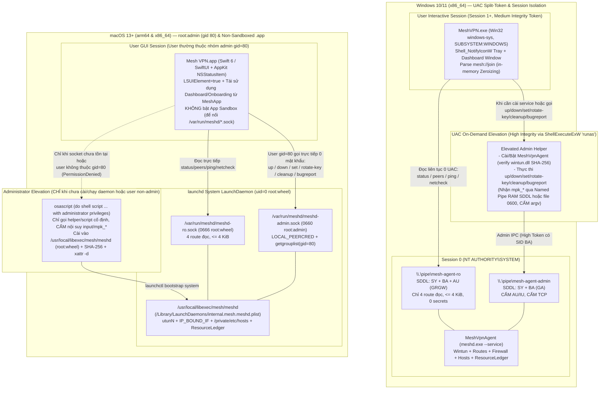

# Yêu cầu Sẵn sàng Vận hành & Desktop GUI / System Tray — Mesh VPN (`v0.3.0`)

| Thuộc tính | Giá trị |
|---|---|
| Tác giả | `agile-researcher` |
| Ngày lập | 2026-11-16 |
| Phiên bản | **v1.1 — Đồng bộ Khắc phục Phản biện Gate 1 Vòng 1 (`desktop-gui-gate-1-critique.md`)** |
| Nhánh làm việc | `feat/desktop-gui` (tách từ `feat/mobile-clients`; giữ nguyên `main` / `v0.1.0-rc1`) |
| Giai đoạn | Chặng 1 — Discovery & Readiness (`v0.3.0` Desktop GUI & System Tray: Windows & macOS) |
| Quyết định Người dùng đã chốt | `OQ-DGUI-01` (**A1**), `OQ-DGUI-02` (**A2**), `OQ-DGUI-03` (**A3**) trong [agile-state.md](../04-sprint-management/agile-state.md) |
| Tài liệu kế thừa bắt buộc | [production-readiness-requirements.md](./production-readiness-requirements.md) (v1.2), [mobile-readiness-requirements.md](./mobile-readiness-requirements.md) (v1.0), [system-architecture.md](../03-system-design/system-architecture.md) (v2.2), [api-design.md](../03-system-design/api-design.md) (v2.2), [coding-standards.md](../03-system-design/coding-standards.md) (v2.2), [`.agents/rules/coding-standards.md`](../../.agents/rules/coding-standards.md), [desktop-gui-gate-1-critique.md](../05-quality-assurance/critique-reviews/desktop-gui-gate-1-critique.md) |
| Người nhận | `agile-po-ba` (chuyển hóa `DGUI-*` thành User Stories/NFR), `agile-architect`, `agile-tech-lead`, `agile-critic` |

> [!IMPORTANT]
> **Ranh giới Gate 1 (What) và Gate 2 (How) & Kế thừa Bất biến `v0.1.0`/`v0.2.0`:**
> - Toàn bộ chuẩn an toàn và bảo mật cốt lõi (`SEC-01`, `SEC-04`, `SEC-05`, `SEC-14`, `SEC-15`, `REL-08`, `REL-09`, `G4`, `GNFR-11`, `deny.toml`, `unsafe_code = "forbid"` ngoài `crates/mesh-sys`) **giữ nguyên hiệu lực 100%, TUYỆT ĐỐI KHÔNG nới lỏng** khi bổ sung lớp Desktop GUI & System Tray.
> - Bản **v1.1** đóng toàn bộ phát hiện giao cho `agile-researcher` trong [desktop-gui-gate-1-critique.md](../05-quality-assurance/critique-reviews/desktop-gui-gate-1-critique.md) (`BLK-DGUI-G1-01..03`, `HR-DGUI-G1-01..03`, `MED-DGUI-G1-02`) mà không phá vỡ mã số `43` yêu cầu `DGUI-*` hiện hành (chi tiết đồng bộ xem Bảng §4.4).
> - Tài liệu này định nghĩa **yêu cầu hành vi & thuộc tính kiểm chứng được (`DGUI-*`)**. Các đề xuất kỹ thuật cụ thể về cấu trúc crate mới, thư viện UI chi tiết hoặc cơ chế truyền bí mật trung gian được đánh dấu **`*(KN)*`** (*Khuyến nghị Gate 1*) để `agile-tech-lead` và `agile-architect` chốt thiết kế cuối cùng ở Gate 2/ADR.
> - Toàn bộ các con số ngưỡng hiệu năng/bộ nhớ (`DGUI-PERF-*`) là **mục tiêu thiết kế đề xuất** ở Gate 1 và sẽ được đo kiểm chứng thực tế tại Gate 3 trên cả Windows và macOS.

---

## Tóm tắt Quyết định Người dùng `OQ-DGUI-01..03` (2026-11-16)

| Mã quyết định | Lựa chọn đã chốt | Ý nghĩa trực tiếp đối với tài liệu `DGUI-*` |
|---|---|---|
| **`OQ-DGUI-01`** | **A1 — System Tray / Menu Bar + Full Dashboard Window** | Ứng dụng phải vừa thường trú nhẹ nhàng ở System Tray (Windows) / Menu Bar (macOS) để xem trạng thái nhanh & bật/tắt tức thì, vừa mở được cửa sổ Dashboard đầy đủ (nhập `mesh://join` URI hoặc IP+Pin+`mpk_*`, danh sách Peers, Ping/Netcheck, cập nhật Server/Pin, xoay khóa, xuất Bugreport). |
| **`OQ-DGUI-02`** | **A2 — Giao diện Bản địa Tối ưu theo từng OS** | **macOS**: `Mesh VPN.app` viết bằng **Swift 6 / SwiftUI + AppKit Menu Bar** tái sử dụng UX từ `mobile/ios/MeshApp/Sources/`, giao tiếp qua `/var/run/meshd/meshd-{ro,admin}.sock`. **Windows**: `MeshVPN.exe` dùng trực tiếp **Win32 `windows-sys`** (`Shell_NotifyIconW` + cửa sổ DPI-aware), không kéo WebView2/Electron/framework GUI nặng để giữ sạch `deny.toml` và footprint nhỏ. |
| **`OQ-DGUI-03`** | **A3 — 1-Click Service Install/Start trong GUI** | Khi người dùng mở app mà dịch vụ nền `meshd` (`MeshVpnAgent` trên Windows / `internal.mesh.meshd` trên macOS) chưa cài hoặc chưa chạy, GUI hiển thị trạng thái rõ ràng và cho phép cài đặt/khởi động ngay bằng 1 cú nhấp chuột (Windows UAC `ShellExecuteExW("runas")` / macOS `osascript` administrator prompt) thay vì bắt chạy script Terminal/PowerShell thủ công. |

---

## Phần 1 — Phân tích Nguyên nhân Gốc rễ: "Tại sao chạy trên Windows và macOS không mở được `mesh` ở `v0.1.0-rc1`"

Ở bản phát hành `v0.1.0-rc1` (được đóng gói bởi [`.github/workflows/release.yml`](../../.github/workflows/release.yml)), dự án mới hoàn thiện tầng lõi CLI (`mesh`), daemon nền (`meshd`) và máy chủ (`mesh-server`). Khi người dùng cuối tải gói `.zip` / `.tar.gz` về máy cá nhân và nhấp đúp (double-click) để chạy như một ứng dụng VPN thông thường, việc thực thi thất bại do tổ hợp các nguyên nhân gốc rễ đã được đối chứng trực tiếp trong mã nguồn như sau:

### 1.1. Phân tích Nguyên nhân trên Windows (`mesh-windows-x86_64-msvc.zip`)

Đối chiếu [`.github/workflows/release.yml`](../../.github/workflows/release.yml#L258-L271), gói phát hành Windows hiện chỉ chứa các tệp trần: `mesh.exe`, `meshd.exe`, `mesh-server.exe`, `wintun.dll`, `wintun.dll.sha256`, `WINTUN-LICENSE.txt`, `README-WINTUN.md` và `scripts/install-windows.ps1` — **hoàn toàn chưa có binary GUI, shortcut Start Menu hay trình khởi chạy cửa sổ**.

1. **Double-click `mesh.exe` gây hiện tượng "cửa sổ đen chớp tắt" (exit code `2`)**:
   - **Link subsystem là `CONSOLE`**: Binary `crates/mesh` không khai báo `#![windows_subsystem = "windows"]`, nên trình liên kết tạo tệp PE kiểu `SUBSYSTEM:CONSOLE`. Khi nhấp đúp từ Windows Explorer, hệ điều hành bắt buộc cấp phát một cửa sổ `conhost.exe` / Windows Terminal mới gắn vào tiến trình.
   - **Subcommand bắt buộc trong `clap`**: Tại [`crates/mesh/src/cli.rs`](../../crates/mesh/src/cli.rs#L15-L31), cấu trúc `Cli` khai báo trường `#[command(subcommand)] pub(crate) command: TopCommand` không có `Option<...>`. Khi double-click với **0 tham số** (`argc == 1`), lời gọi `Cli::parse()` ở [`crates/mesh/src/main.rs`](../../crates/mesh/src/main.rs#L52) in thông báo thiếu subcommand ra `stderr` và thoát ngay lập tức với **exit code `2`**. Cửa sổ console tạm vừa được tạo lập tức bị Windows đóng lại sau vài mili-giây, khiến người dùng thấy màn hình đen nháy lên rồi biến mất.
2. **Double-click `meshd.exe` thất bại dây chuyền do SCM, quyền Administrator và kiểm tra `wintun.dll`**:
   - **Không chạy qua Windows SCM**: Tại [`crates/meshd/src/main.rs`](../../crates/meshd/src/main.rs#L179-L208), khi khởi chạy `meshd.exe` không có cờ `--service` hoặc `--foreground`, `run_entry` gọi `service_windows::try_run_as_service(&paths)`. Vì Explorer không phải là Service Control Manager (SCM), hàm `service_dispatcher::start(WINDOWS_SERVICE_NAME, ffi_service_main)` trong [`crates/meshd/src/service_windows.rs`](../../crates/meshd/src/service_windows.rs#L65-L81) nhận mã lỗi Win32 **`ERROR_FAILED_SERVICE_CONTROLLER_CONNECT` (`1063`)** → trả về `ServiceDispatchOutcome::NotLaunchedByScm`, và tiến trình rơi xuống `run_foreground_daemon(paths)`.
   - **Thiếu đặc quyền Administrator/SYSTEM (`UAC Filtered Token`)**: Trong `run_foreground_daemon`, `DaemonSupervisor::boot` truy cập thư mục trạng thái `C:\ProgramData\Mesh` (vốn có SDDL `D:P(A;OICI;GA;;;SY)(A;OICI;GA;;;BA)` theo [`scripts/install-windows.ps1`](../../scripts/install-windows.ps1#L30)), mở pipe `\\.\pipe\mesh-agent-admin` (SDDL `SY`+`BA`), tạo adapter Wintun (`WintunAdapter::open_or_create` trả `ERROR_ACCESS_DENIED` khi thiếu quyền Admin), cài đặt route và sửa `C:\Windows\System32\drivers\etc\hosts`. Dưới phiên người dùng thường (kể cả tài khoản thuộc nhóm Administrators nhưng chưa "Run as Administrator"), token Medium-Integrity bị từ chối và `meshd.exe` thoát ngay với mã lỗi `ExitCode::FAILURE`.
   - **Chốt chặn fail-closed `MESH_WINTUN_SHA256` & `LOAD_LIBRARY_SEARCH_APPLICATION_DIR`**: Tại [`crates/meshd/src/config.rs`](../../crates/meshd/src/config.rs#L84), `DaemonRuntimePaths::system_default()` đọc `option_env!("MESH_WINTUN_SHA256")`. Trong [`crates/meshd/src/supervisor.rs`](../../crates/meshd/src/supervisor.rs#L251-L255), nếu binary được biên dịch cục bộ không qua CI release (vốn truyền `MESH_WINTUN_SHA256` lúc build) hoặc thiếu `wintun.dll` đặt cùng thư mục với `meshd.exe` (do [`crates/mesh-sys/src/tun_windows.rs`](../../crates/mesh-sys/src/tun_windows.rs#L255-L260) ép cờ `LOAD_LIBRARY_SEARCH_APPLICATION_DIR`), `setup_os_tun_and_route` từ chối nạp DLL (`PermissionDenied`).
   - **Cấm chạy `--service` ngoài SCM**: Nếu người dùng chạy `meshd.exe --service` từ terminal, `service_windows::run_as_service` từ chối fail-closed (`"meshd --service must be launched by Windows Service Control Manager (SCM)"`). Người dùng buộc phải tự mở PowerShell quyền Administrator chạy [`scripts/install-windows.ps1`](../../scripts/install-windows.ps1).
3. **Rào cản Session 0 Isolation khi đã cài dịch vụ**:
   - Ngay cả khi `MeshVpnAgent` đã chạy dưới tài khoản `LocalSystem` (Session 0), kiến trúc bảo mật **Session 0 Isolation** (từ Windows Vista trở đi) cấm tuyệt đối các Windows Service tương tác trực tiếp với desktop người dùng (Session 1+) — một service `LocalSystem` **không thể** vẽ Tray Icon hoặc cửa sổ cài đặt lên màn hình người dùng.

### 1.2. Phân tích Nguyên nhân trên macOS (`mesh-darwin-arm64.tar.gz` & `mesh-darwin-x86_64.tar.gz`)

Đối chiếu [`.github/workflows/release.yml`](../../.github/workflows/release.yml#L217-L226) và [`scripts/install-macos.sh`](../../scripts/install-macos.sh):

1. **Chỉ phát hành Mach-O binary trần, chưa có `.app` bundle**:
   - Kho lưu trữ `.tar.gz` chỉ chứa 3 tệp thực thi dòng lệnh trần (`mesh`, `meshd`, `mesh-server`), kịch bản [`scripts/install-macos.sh`](../../scripts/install-macos.sh) và tệp cấu hình LaunchDaemon [`deploy/launchd/internal.mesh.meshd.plist`](../../deploy/launchd/internal.mesh.meshd.plist). Không có cấu trúc bundle `Mesh VPN.app/Contents/{Info.plist,MacOS/,Resources/}` kèm `LSUIElement` và biểu tượng ứng dụng để macOS LaunchServices nhận diện như một ứng dụng đồ họa.
2. **Chặn Gatekeeper do `com.apple.quarantine` kết hợp chữ ký ad-hoc**:
   - Workflow release chỉ ký ad-hoc bằng `codesign --force -s -` (không có Apple Developer ID / Notarization `$99/năm`). Trên macOS, khi người dùng tải `.tar.gz` qua trình duyệt và giải nén bằng Finder, hệ điều hành tự động gắn thuộc tính mở rộng **`com.apple.quarantine`** lên các tệp trích xuất. Khi người dùng double-click `mesh` hoặc `meshd` trong Finder, Gatekeeper kiểm tra tệp có quarantine mà không có chữ ký Developer ID + notarization → **chặn mở** và báo *"cannot be opened because the developer cannot be verified"*.
3. **Thoát ngay hoặc fail-closed quyền `root:wheel` khi chạy trực tiếp**:
   - Nếu chạy `mesh` với 0 tham số (sau khi bỏ quarantine hoặc gõ trực tiếp trong Terminal), `Cli::parse()` báo lỗi thiếu subcommand và thoát ngay mã `2` (`[Process completed]`).
   - Nếu double-click `meshd` dưới quyền user thường, tiến trình không đủ quyền `root` (`uid == 0`) để mở kernel control `utun`, tạo `/var/db/mesh` (`0700 root:wheel`), `/var/run/meshd` (`0755 root:wheel`), sửa `/private/etc/hosts`; ngoài ra [`crates/meshd/src/supervisor.rs`](../../crates/meshd/src/supervisor.rs#L1133-L1154) gọi `verify_macos_daemon_startup_paths` ([`crates/mesh-net/src/ipc_macos.rs`](../../crates/mesh-net/src/ipc_macos.rs#L58-L76)) bắt buộc `/usr/local/libexec/mesh/meshd` và `/Library/LaunchDaemons/internal.mesh.meshd.plist` thuộc `root:wheel` và không có thư mục cha nào cho user thường ghi.
   - Hiện tại người dùng bắt buộc phải mở Terminal gõ `sudo sh scripts/install-macos.sh --from ... --sha256-file ...` để xác minh SHA-256, xóa `com.apple.quarantine` (`/usr/bin/xattr -d`), cài đặt sang đường dẫn `root:wheel` và gọi `launchctl bootstrap system`.

### 1.3. Thiết kế Hành vi Khởi chạy: `mesh` / `mesh.exe` (0 tham số và `mesh gui`) vs CLI Automation / Test

Để khắc phục triệt để trải nghiệm cho người dùng cuối **mà không phá vỡ** tính xác định của CLI, pipeline CI, script tự động hóa hoặc các unit test trong [`crates/mesh/src/cli.rs`](../../crates/mesh/src/cli.rs#L52-L135), cần phân tách rõ quy tắc giữa **điểm vào GUI** và **điểm vào CLI**:

1. **Giữ mô hình Two-Binary Split (Không nhồi `AttachConsole` vào 1 binary duy nhất trên Windows)**:
   - Theo thực tế hệ sinh thái Rust/Win32, việc biên dịch `mesh.exe` thành `SUBSYSTEM:WINDOWS` rồi gọi `AttachConsole(ATTACH_PARENT_PROCESS)` gây lỗi nghiêm trọng cho CLI: làm gãy chuyển hướng `stdout`/`stderr` (`mesh status --json > out.json`, pipe `mesh peers | ...`), tạo race condition với bộ đệm `std::io::stdout()`, và làm rơi mất thông báo lỗi/help của `clap` trong script tự động hóa.
   - Do đó: **`mesh` (`mesh.exe`) tiếp tục là CLI `SUBSYSTEM:CONSOLE` thuần túy**, còn **GUI sử dụng binary/bundle riêng** (`MeshVPN.exe` chuẩn `SUBSYSTEM:WINDOWS` trên Windows; `Mesh VPN.app` trên macOS).
2. **Bổ sung subcommand tường minh `mesh gui` (`crates/mesh`)**:
   - Lệnh `mesh gui` cho phép người dùng gọi giao diện trực tiếp từ terminal (`MeshVPN.exe` chạy tách tiến trình `DETACHED` trên Windows; `open -a "Mesh VPN"` hoặc đường dẫn bundle đã cài trên macOS).
   - Nếu chạy trên Linux headless/SSH không có display server hoặc chưa cài gói GUI tương ứng, `mesh gui` **fail-closed** trả về lỗi có cấu trúc ra `stderr` với exit code khác `0`, không treo tiến trình.
3. **Quy tắc an toàn cho `mesh` / `mesh.exe` khi chạy với 0 tham số (`argc == 1`)**:
   - **Ngữ cảnh Terminal / Script / Pipe / CI / Headless / Unit Test (`Cli::try_parse_from`)**: Khi được gọi từ shell hiện hữu (`cmd`, `pwsh`, `bash`, `zsh`), IDE/test runner, Task Scheduler (`CREATE_NEW_CONSOLE`), đang redirect pipe (`!stdin.is_terminal() || !stdout.is_terminal() || !stderr.is_terminal()`), biến môi trường `CI` hoặc `MESH_NO_GUI_AUTOLAUNCH` được bật, hoặc trong unit test `clap` → **BẮT BUỘC giữ nguyên hành vi CLI chuẩn**: in help/usage (kèm 1 dòng hướng dẫn chạy `mesh gui` hoặc mở `MeshVPN.exe` / `Mesh VPN.app`) ra `stderr` và thoát ngay với **exit code `2`**. Tuyệt đối không mở cửa sổ GUI làm treo script hoặc hỏng bộ test `cli.rs`!
   - **Ngữ cảnh người dùng nhấp đúp nhầm trực tiếp vào `mesh.exe` từ Windows Explorer (`MED-DGUI-G1-02`, `*(KN)*`)**: Trên Windows, chỉ khi thỏa đồng thời toàn bộ điều kiện nghiêm ngặt: (i) `argc == 1`, (ii) `stdin`/`stdout`/`stderr` là console tương tác và không bật `CI` / `MESH_NO_GUI_AUTOLAUNCH`, (iii) `GetConsoleProcessList` trả về count `== 1` (Windows vừa tạo console riêng), **VÀ (iv) xác minh tiến trình cha trực tiếp là `explorer.exe`**. Khi đó *(KN)* nếu `MeshVPN.exe` tồn tại cạnh bên hoặc tại đường dẫn cài đặt chuẩn (`%ProgramFiles%\Mesh\MeshVPN.exe`) thì khởi chạy tách tiến trình `MeshVPN.exe` và thoát `0` ngay. Mọi trường hợp không chắc chắn (tiến trình cha là `pwsh`/`cmd`/IDE/`cargo`/Task Scheduler hoặc chạy với `CREATE_NEW_CONSOLE`) đều fail-closed giữ nguyên exit code `2` của `clap`.
   - **Khuyến nghị đóng gói**: Shortcut trên Start Menu / Desktop (Windows) và `/Applications/Mesh VPN.app` (macOS) **luôn trỏ vào `MeshVPN.exe` / `Mesh VPN.app`**, không trỏ vào CLI `mesh`.

---

## Phần 2 — Đối chiếu Hệ thống Thực tế & Thiết kế Đặc thù Theo OS (`OQ-DGUI-01..03`)

### 2.1. Khảo sát & Đối chiếu 4 Hệ thống VPN Desktop Thực tế

| Hệ thống tham chiếu | Mô hình Tiến trình & Đặc quyền | Kênh IPC & Phân tách Quyền | Trải nghiệm Tray/Menu Bar & Nâng quyền | Bài học áp dụng & Cạm bẫy cần tránh cho Mesh VPN |
|---|---|---|---|---|
| **Tailscale** (`tailscale-ipn.exe` + `tailscaled` Windows; `Tailscale.app` / `tailscaled` macOS) `[G1][T38]` | **Windows**: `Tailscale` Service (`LocalSystem`, Session 0) + `tailscale-ipn.exe` (User Session Tray/GUI). **macOS**: 3 biến thể `[T38]` — Mac App Store (`NEPacketTunnelProvider` sandbox), Standalone (`SystemExtension` Developer ID), và Open-source `tailscaled` (`LaunchDaemon` + `utun`). | **Windows**: Named Pipe kèm SDDL DACL giữa `tailscale-ipn.exe` và service. **macOS**: Local socket / XPC tùy biến thể. Cho phép chế độ chạy *unattended* trước khi user đăng nhập. | Tray icon hiển thị trạng thái kết nối, danh sách thiết bị theo nhóm/IP `100.x`, ping/copy IP nhanh, submenu cài đặt chi tiết. | **Bài học 1**: Tách dịch vụ nền (`Session 0` / `LaunchDaemon`) khỏi tiến trình Tray/GUI là chuẩn ngành bắt buộc. **Bài học 2**: Bản App Store Sandbox **không** chạm trực tiếp được Unix socket hệ thống `/var/run/*.sock`; mô hình `$0` không cần `$99/năm` trên macOS phù hợp nhất với biến thể `LaunchDaemon` + `.app` không bật App Sandbox. |
| **WireGuard Desktop** (`wireguard.exe` Windows; `WireGuard.app` macOS) `[G2]` | **Windows**: Manager Service + `WireGuardTunnel$<Name>` chạy dưới `NT AUTHORITY\SYSTEM`; UI/Tray chạy trong phiên tương tác của người dùng. **macOS**: App Swift/AppKit + Network Extension. | Giao tiếp từ UI tới Service quản lý qua Named Pipe / Service Control Manager; Wintun adapter được tạo bởi tiến trình `SYSTEM`. | Cực kỳ gọn nhẹ (Win32 thuần, không nhúng trình duyệt/WebView2); nhấn mạnh ranh giới quản trị viên khi thêm/sửa/bật tunnel trên Windows. | **Bài học 3**: **Không chạy GUI dưới quyền `SYSTEM` hoặc `requireAdministrator` vĩnh viễn**; chấp nhận ranh giới UAC rõ ràng cho tác vụ thay đổi cấu hình mạng (hoặc tách đọc chỉ-xem vs ghi đặc quyền) để không làm hỏng auto-start và giảm bề mặt tấn công Shatter/UIPI. |
| **Cloudflare WARP** (`warp-svc.exe` + `Cloudflare WARP.exe` Windows; `Cloudflare WARP.app` + `LaunchDaemon` macOS) `[G3]` | **Windows**: `warp-svc.exe` (`LocalSystem`, `Program Files\Cloudflare\Cloudflare WARP`) + `Cloudflare WARP.exe` (User Session Tray/Flyout). **macOS**: LaunchDaemon `/Library/LaunchDaemons/com.cloudflare.*.plist` (`root`) + Menu Bar `.app`. | IPC cục bộ (Named Pipe trên Windows; local socket/XPC trên macOS) đồng bộ trạng thái tunnel, DNS, split-tunnel và thông báo lỗi kết nối. | Menu Bar / System Tray 1-click bật/tắt nhanh, hiển thị trạng thái kết nối + thông tin mạng rõ ràng, tách phần cấu hình nâng cao sang cửa sổ cài đặt/preferences. | **Bài học 4**: Mô hình "Menu Bar / Tray nhanh + Cửa sổ Dashboard/Preferences mở rộng khi cần" (`OQ-DGUI-01` A1) giải quyết tốt cả nhu cầu bật/tắt 1 giây lẫn thao tác cấu hình phức tạp (nhập Pin, xem Peers, Netcheck, Bugreport). |
| **Mullvad VPN** (`mullvad-daemon` + `mullvad-gui` viết bằng Rust) `[G4]` | Daemon nền viết bằng **Rust** (`SYSTEM` trên Windows, `root` `LaunchDaemon` `/Library/LaunchDaemons/net.mullvad.daemon.plist` trên macOS) tách hoàn toàn khỏi frontend GUI không đặc quyền. | Named Pipe (`\\.\pipe\Mullvad VPN`) trên Windows và Unix Domain Socket cục bộ trên macOS/Linux; frontend hoàn toàn phi trạng thái (stateless view). | Cửa sổ quản lý tài khoản, trạng thái tunnel, cấu hình bảo mật và chẩn đoán; daemon giữ tunnel/kill-switch sống độc lập khi đóng cửa sổ GUI. | **Bài học 5**: Chứng minh thực tế tính ổn định của kiến trúc **daemon Rust đặc quyền (`meshd`) + GUI không đặc quyền qua Named Pipe / UDS**. Khác với Mullvad dùng Electron nặng (~150+ MB RAM), Mesh VPN theo `OQ-DGUI-02` chọn Win32 `windows-sys` & SwiftUI bản địa giúp giữ footprint nhẹ hơn nhiều lần và sạch `deny.toml`. |

### 2.2. Sơ đồ Kiến trúc Đặc quyền & Giao tiếp Đa nền tảng (`OQ-DGUI-01..03`)

### 2.3. Thiết kế Đặc thù Windows: UAC Split-Token, `SEC-14` & Truyền Khóa `mpk_*` An toàn (`SEC-01`)

Đây là bài toán bảo mật trọng yếu nhất của Windows Desktop Client và phải được khóa chặt từ Discovery:

1. **Cơ chế Windows UAC Split-Token và Lý do Phân tách 2 Named Pipe (`SEC-14`)**:
   - Khi người dùng đăng nhập Windows dưới một tài khoản thuộc nhóm *Administrators*, hệ điều hành tạo ra **hai access token**: một **Filtered Token (Medium Integrity)** dùng cho mọi ứng dụng desktop mặc định (`explorer.exe`, trình duyệt, `MeshVPN.exe`), và một **Elevated Token (High Integrity)** chỉ được kích hoạt khi người dùng xác nhận hộp thoại UAC. Trong Filtered Token, SID `BUILTIN\Administrators` (`BA`, `S-1-5-32-544`) bị đánh dấu `SE_GROUP_USE_FOR_DENY_ONLY` (bị tước quyền cấp phép `Grant`).
   - Đối chiếu triển khai thực tế tại [`crates/mesh-net/src/ipc_windows.rs`](../../crates/mesh-net/src/ipc_windows.rs#L19-L24) và [`crates/mesh-sys/src/ipc_windows.rs`](../../crates/mesh-sys/src/ipc_windows.rs#L41-L57):
     - **`\\.\pipe\mesh-agent-ro`** dùng `RO_PIPE_SDDL = "D:P(A;;GA;;;SY)(A;;GA;;;BA)(A;;GRGW;;;AU)"`: nhóm `Authenticated Users` (`AU`) bao gồm cả Medium-Integrity Filtered Token và Standard User. Router [`IpcService::build_ro_router`](../../crates/meshd/src/ipc_service.rs#L52-L62) chỉ mở đúng 4 endpoint đọc (`GET /v1/agent/status`, `GET /v1/agent/peers`, `POST /v1/agent/ping`, `POST /v1/agent/netcheck`) với thân gói giới hạn `MAX_RO_IPC_BODY_BYTES = 4_096` bytes và 0 bí mật. Nhờ vậy, **`MeshVPN.exe` cập nhật Tray Icon, hiển thị trạng thái tunnel, danh sách peer, Ping và Netcheck mượt mà liên tục với 0 hộp thoại UAC**.
     - **`\\.\pipe\mesh-agent-admin`** dùng `ADMIN_PIPE_SDDL = "D:P(A;;GA;;;SY)(A;;GA;;;BA)"` kết hợp `verify_secured_pipe_peer` kiểm tra `is_builtin_admin || is_local_system`. Vì Medium-Integrity Filtered Token không có SID `BA` hiệu lực, mọi kết nối không nâng quyền tới `mesh-agent-admin` bị nhân Windows từ chối ngay lập tức bằng `ERROR_ACCESS_DENIED` (`5` → `ErrorKind::PermissionDenied`).
   - **Các hành vi CẤM TUYỆT ĐỐI**:
     - **CẤM** nới lỏng `ADMIN_PIPE_SDDL` (như thêm `AU` hoặc `IU`) để GUI Medium-Integrity gọi `up`/`down`/`set`/`rotate-key` mà không cần UAC — vì làm vậy sẽ cho phép mọi phần mềm bất kỳ (hoặc mã độc trình duyệt) chạy trong phiên user điều khiển tunnel VPN, đổi Control Server sang máy chủ giả mạo, hoặc trích xuất bugreport, phá vỡ hoàn toàn ranh giới `SEC-14` và `PLAT-01`.
     - **CẤM** gắn `requireAdministrator` trong manifest của `MeshVPN.exe` (vì tiến trình GUI thường trú khi bật cao ngay từ đầu sẽ bị Windows chặn auto-start lúc đăng nhập và buộc người dùng bấm UAC mỗi lần mở Tray).
     - **CẤM** mở bất kỳ listener Admin TCP/HTTP nào trên `127.0.0.1` (`SEC-14`).

2. **Quy trình Nâng quyền Theo Yêu cầu (`ShellExecuteExW("runas")`) & Truyền `mpk_*` An toàn (`SEC-01`)**:
   - Khi người dùng ở `MeshVPN.exe` thực hiện thao tác thay đổi trạng thái (`Connect/Enroll` → `/v1/agent/up`, `Disconnect` → `/v1/agent/down`, `Set Server/Pin` → `/v1/agent/set`, `Rotate Key` → `/v1/agent/rotate-key`, `Cleanup` → `/v1/agent/cleanup`, `Bugreport` → `/v1/agent/bugreport`, hoặc cài/bật dịch vụ `MeshVpnAgent`), `MeshVPN.exe` gọi **`ShellExecuteExW`** với `lpVerb = "runas"` để khởi chạy tiến trình trợ giúp ngắn hạn (High Integrity).
   - **Cạm bẫy bảo mật đặc thù cần chặn đứng khi truyền khóa `mpk_*` qua ranh giới `runas`**:
     1. **CẤM truyền qua `argv` (`lpParameters`)**: Tham số dòng lệnh của tiến trình mới (kể cả khi truyền `mpk_*` hoặc toàn bộ `mesh://join?...&key=mpk_...`) có thể bị tiến trình khác cùng user đọc qua Win32 PEB (`NtQueryInformationProcess`) hoặc WMI (`Win32_Process.CommandLine`), vi phạm `SEC-01` và [`crates/mesh/src/cli.rs`](../../crates/mesh/src/cli.rs#L78-L86).
     2. **Lưu ý kỹ thuật về `stdin` với `ShellExecuteExW`**: Khác với `CreateProcessW`, việc nâng quyền qua `ShellExecuteExW("runas")` đi qua dịch vụ hệ thống `AppInfo` nên **KHÔNG kế thừa handle `stdin`/`stdout`/`stderr`** từ tiến trình cha Medium-Integrity sang tiến trình con High-Integrity.
   - **Hai cơ chế truyền bí mật an toàn được phép lựa chọn ở Gate 2 `*(KN)*`**:
     - **Cơ chế A — Ephemeral Authenticated Memory Named Pipe (Khuyến nghị ưu tiên, 0 chạm đĩa `*(KN)*`)**: `MeshVPN.exe` tạo một Named Pipe một lần `\\.\pipe\mesh-gui-handoff-<128bit_hex_random>` (`FILE_FLAG_FIRST_PIPE_INSTANCE | PIPE_REJECT_REMOTE_CLIENTS`) với SDDL chỉ cho phép `SY`, `BA` và **đúng User SID hiện tại** (`D:P(A;;GA;;;SY)(A;;GA;;;BA)(A;;GA;;;<CurrentUserSid>)`), đồng thời giữ chuỗi bí mật trong `Zeroizing` RAM. `ShellExecuteExW("runas")` chỉ truyền **tên pipe** (không chứa secret) cho worker nâng quyền. Worker kết nối vào pipe; `MeshVPN.exe` gọi `GetNamedPipeClientProcessId` + kiểm tra token đối phương thực sự mang SID `BA`/`SY` (hoặc Integrity Level `>= High`) trước khi ghi payload `AgentUpRequest` / `AgentRotateKeyRequest` đúng 1 lần rồi zeroize RAM và đóng pipe ngay lập tức (kèm timeout ngắn, vd. `15 s`–`30 s`, nếu user bấm Cancel trên hộp thoại UAC).
     - **Cơ chế B — Tệp tạm Khóa SDDL Hẹp (`--authkey-file` sẵn có)**: Tạo tệp mới nguyên tử (`CREATE_NEW`, kiểm tra không có reparse point/symlink trên thư mục cha) trong `%LOCALAPPDATA%\MeshVPN\tmp\` với SDDL chỉ `SY` + `BA` + **đúng User SID hiện tại** (`D:P(A;;GA;;;SY)(A;;GA;;;BA)(A;;GA;;;<CurrentUserSid>)`), ghi `mpk_*`, truyền **duy nhất đường dẫn tệp** qua `--authkey-file` (khớp sẵn [`crates/mesh/src/client_cmds.rs`](../../crates/mesh/src/client_cmds.rs#L107)), và tiến trình đọc **lẫn** tiến trình cha (khi timeout/hủy UAC) phải ghi đè zero (`0x00`) và xóa ngay lập tức. *(Ghi chú: Cơ chế A ưu việt hơn vì không ghi khóa thô ra đĩa; Cơ chế B tận dụng trực tiếp luồng `--authkey-file` sẵn có của `mesh.exe`.)*

3. **Luồng 1-Click Cài đặt, Nâng cấp & Khởi động Dịch vụ `MeshVpnAgent` (`OQ-DGUI-03`, `BLK-DGUI-G1-03`)**:
   - `MeshVPN.exe` kiểm tra trạng thái dịch vụ `MeshVpnAgent` qua Win32 Service Control Manager (`OpenSCManagerW` với `SC_MANAGER_CONNECT`, `OpenServiceW` với `SERVICE_QUERY_STATUS` — quyền đọc hoạt động ở user thường không cần UAC) kết hợp kiểm tra sẵn sàng pipe `\\.\pipe\mesh-agent-ro`.
   - Khi dịch vụ chưa cài đặt hoặc đang dừng (`Stopped`):
     - UI hiển thị trạng thái rõ ràng ("Background service not installed" / "Background service stopped") cùng nút hành động 1-click **"Install & Start Service"** / **"Start Service"**.
     - Khi người dùng bấm nút: `MeshVPN.exe` gọi `ShellExecuteExW("runas")` chạy tác vụ cài đặt/bật dịch vụ không qua shell (`cmd.exe`/`powershell -Command` bị cấm với dữ liệu ghép chuỗi). Tác vụ nâng quyền:
       1. **Xác minh chống TOCTOU `wintun.dll` và nhị phân nguồn (`BLK-DGUI-G1-03`)**: `MeshVPN.exe` phải nhúng cùng hằng số biên dịch `option_env!("MESH_WINTUN_SHA256")` như `meshd.exe` ([`crates/meshd/src/config.rs`](../../crates/meshd/src/config.rs#L84), [`supervisor.rs`](../../crates/meshd/src/supervisor.rs#L251-L255)) — **không** tin mù quáng tệp rời `wintun.dll.sha256` nằm trong thư mục user ghi được như `Downloads` (cảnh báo fail-closed nếu bản dev build thiếu `MESH_WINTUN_SHA256`). Trước khi kiểm băm, tiến trình phải mở toàn bộ tệp nguồn (`meshd.exe`, `mesh.exe`, `MeshVPN.exe`, `wintun.dll`) bằng cờ **`FILE_SHARE_READ` + `FILE_FLAG_OPEN_REPARSE_POINT`** (chặn symlink/junction và giữ nguyên khóa đọc chống thay thế TOCTOU xuyên suốt bước kiểm băm → sao chép sang `%ProgramFiles%\Mesh\`).
       2. **Xử lý khóa tệp `ERROR_SHARING_VIOLATION (32)` & Nâng cấp khi đang chạy Tray (`BLK-DGUI-G1-03`)**: Nếu đường dẫn nguồn đã chuẩn hóa trùng với đích `%ProgramFiles%\Mesh\` (chỉ khởi động/cài lại từ thư mục cài đặt) thì bỏ qua bước tự ghi đè `MeshVPN.exe`. Nếu cài/nâng cấp từ thư mục khác (vd. `Downloads`) trong khi phiên bản cũ đang chạy tại khay hệ thống, phải gửi tín hiệu để thực thể Tray cũ thoát êm (nhả khóa `Local\MeshVpnGuiSingleInstance` và handle image `MeshVPN.exe`) và dừng dịch vụ `MeshVpnAgent` trước khi sao chép, đồng thời **bảo toàn** `C:\ProgramData\Mesh\keys.json` & `bootstrap.toml`.
       3. Thiết lập SDDL chuẩn (`InstallDir`: `D:P(A;OICI;GA;;;SY)(A;OICI;GA;;;BA)(A;OICI;GRGX;;;AU)`; `C:\ProgramData\Mesh`: `D:P(A;OICI;GA;;;SY)(A;OICI;GA;;;BA)`), đăng ký/cập nhật dịch vụ `MeshVpnAgent` (`LocalSystem`, `SERVICE_AUTO_START`, `binPath = "\"...\meshd.exe\" --service"`, `SERVICE_FAILURE_ACTIONS` recovery `5_000 ms` theo `US-052`), khởi động dịch vụ và chờ `\\.\pipe\mesh-agent-ro` sẵn sàng.
   - **Bất biến Unprivileged Sink Write khi xuất Bugreport (`BLK-DGUI-G1-01`)**: Vì `C:\ProgramData\Mesh\bugreports` kế thừa SDDL `SY+BA` nên tiến trình Medium-Integrity không đọc trực tiếp được, nhưng **cấm** worker nâng quyền `runas` tự mở đường dẫn đích do `SaveFileDialog` chọn (tránh tấn công NTFS Junction/Mount Point + Oplock TOCTOU EoP). Thay vào đó, `MeshVPN.exe` (Medium Integrity) tự mở tệp đích bằng quyền user hoặc nhận luồng `.tar` đã lọc bí mật (`<= 20 MiB`) qua kênh IPC/handoff an toàn để ghi.

4. **Ràng buộc Kỹ thuật Win32 `windows-sys` & Tương thích Toolchain (`OQ-DGUI-02`, `HR-DGUI-G1-03`)**:
   - Dùng `windows-sys` (`0.59` đã có sẵn trong [`Cargo.toml`](../../Cargo.toml#L109)) với `Shell_NotifyIconW`, cửa sổ Win32 DPI-aware (`Per-Monitor V2` qua `SetProcessDpiAwarenessContext`), không kéo WebView2, Chromium, Electron hay crate GUI đa nền tảng cồng kềnh vào `Cargo.lock` / `deny.toml`.
   - **Tương thích MinGW `x86_64-pc-windows-gnu` & Non-Windows CI**: Trong [`scripts/check.ps1`](../../scripts/check.ps1#L164-L194), khi thiếu MSVC `link.exe`, hệ thống tự chuyển sang `+1.94.1-x86_64-pc-windows-gnu`, đồng thời `check.sh` và `check.ps1 -Cross` kiểm tra biên dịch workspace trên Linux/macOS (trong khi [`Cargo.toml`](../../Cargo.toml) không kéo `embed-resource`/`winres`). Vì vậy crate GUI Windows không được phụ thuộc cứng vào cờ linker riêng của MSVC (`/MANIFEST:EMBED` phải rào `CARGO_CFG_TARGET_ENV == "msvc"`, DPI đặt qua API lúc chạy trong `crates/mesh-sys`) và phải có stub `#[cfg(not(windows))]` để `cargo check/clippy/test --workspace` xanh trên cả 3 hệ điều hành.
   - **Ranh giới `unsafe` & `.expose_secret()` (`scripts/check.{ps1,sh}`)**: Bộ kiểm tra tĩnh [`scripts/check.ps1`](../../scripts/check.ps1#L97-L114) và [`scripts/check.sh`](../../scripts/check.sh#L81-L101) nghiêm cấm từ khóa `unsafe` ngoài `crates/mesh-sys/*` và cấm `.expose_secret()` ngoài 4 crate (`mesh-crypto`, `mesh-datapath`, `mesh-net`, `mesh`). Do đó toàn bộ lời gọi FFI Win32 phải đặt trong `crates/mesh-sys` (`// SAFETY:`), và bất kỳ thao tác giải bọc secret nào phục vụ đóng gói IPC/handoff phải đặt trong `crates/mesh-net` (hoặc dùng `Zeroizing<String>`/`MobileJoinUri`), giữ nguyên `[lints] workspace = true` (`unsafe_code = "forbid"`) cho crate GUI mới (việc thêm binary crate vào workspace phải qua duyệt Gate 2).

---

### 2.4. Thiết kế Đặc thù macOS: `root:admin` (`gid 80`), LaunchDaemon & Non-Sandboxed `Mesh VPN.app`

1. **Tận dụng Phân quyền `root:admin` (`gid = 80`) cho Trải nghiệm Không Cần Mật khẩu Lặp lại (`SEC-14`)**:
   - Đối chiếu [`crates/mesh-net/src/ipc_macos.rs`](../../crates/mesh-net/src/ipc_macos.rs#L78-L87) và [`crates/mesh-sys/src/ipc_macos.rs`](../../crates/mesh-sys/src/ipc_macos.rs#L19-L80):
     - LaunchDaemon `internal.mesh.meshd` chạy dưới quyền `root:wheel`, tạo `/var/run/meshd/meshd-ro.sock` (`0666 root:wheel`) và `/var/run/meshd/meshd-admin.sock` (`0660 root:admin`, `MACOS_ADMIN_GID = 80`).
     - Khi tiếp nhận kết nối trên `meshd-admin.sock`, `meshd` xác minh kép `getpeereid` và `getsockopt(SOL_LOCAL, LOCAL_PEERCRED)` (`xucred.cr_groups` chứa `gid == 80`, kèm fallback `getpwuid_r` + `getgrouplist` nếu user thuộc `>= 16` nhóm phụ).
   - **Hệ quả trực tiếp cho UX macOS**: Vì tài khoản chính của người dùng máy Mac cá nhân mặc định thuộc nhóm `admin` (`gid 80`), ứng dụng `Mesh VPN.app` chạy hoàn toàn dưới quyền user bình thường (không chạy `root`) vẫn kết nối **trực tiếp** tới **cả** `meshd-ro.sock` lẫn `meshd-admin.sock` để bật/tắt VPN (`up`/`down`), cập nhật server (`set`), xoay khóa (`rotate-key`), dọn dẹp (`cleanup`) hoặc xuất bugreport **mà KHÔNG làm phiền người dùng bằng hộp thoại nhập mật khẩu mỗi lần bật/tắt**.
   - **Đối với tài khoản Standard User (không thuộc `gid 80`)**: `Mesh VPN.app` đọc được `status`/`peers`/`ping`/`netcheck` qua `meshd-ro.sock` bình thường; chỉ khi gửi lệnh ghi vào `meshd-admin.sock` mới nhận `PermissionDenied` → UI thông báo rõ ràng cần quyền Administrator (`osascript` hoặc đăng nhập tài khoản admin) thay vì nới lỏng socket `0660 root:admin`.

2. **Tại sao KHÔNG BẬT App Sandbox (`com.apple.security.app-sandbox`) trên bản `.app` ngoài App Store**:
   - Trên macOS, nếu bật App Sandbox (`com.apple.security.app-sandbox = true`), nhân hệ điều hành coi kết nối tới Unix Domain Socket bên ngoài sandbox container của app hoặc App Group container (`~/Library/Group Containers/<group>`) là thao tác `network-outbound` trái phép và **chặn cứng mọi kết nối tới `/var/run/meshd/meshd-ro.sock` và `/var/run/meshd/meshd-admin.sock`** (kể cả khi khai báo temporary-exception file entitlements `[D1][D2]`).
   - Đồng thời, App Sandbox cũng chặn `Mesh VPN.app` gọi `osascript` với `with administrator privileges` để cài đặt LaunchDaemon vào `/Library/LaunchDaemons` và `/usr/local/libexec/mesh`.
   - Do đó, ở Milestone `v0.3.0` (`$0` Mode, phân phối trực tiếp ngoài Mac App Store thông qua `.tar.gz`/`.dmg` trên GitHub Releases mà không phụ thuộc `$99/năm` System Extension/App Store provisioning profile ở `PLAT-07`), `Mesh VPN.app` **BẮT BUỘC KHÔNG BẬT App Sandbox** (cũng không khai báo `NSAllowsArbitraryLoads` hay `CFBundleURLTypes`).

3. **Luồng 1-Click Cài đặt / Khởi động LaunchDaemon qua `osascript`, Thứ tự Ký mã & An toàn Đường dẫn Root (`PLAT-06`, `OQ-DGUI-03`, `BLK-DGUI-G1-03`)**:
   - Khi `Mesh VPN.app` khởi động và phát hiện `internal.mesh.meshd` chưa cài hoặc chưa chạy (`/var/run/meshd/meshd-ro.sock` chưa sẵn sàng hoặc `connect` trả `ENOENT`/`ECONNREFUSED`), UI hiển thị banner hướng dẫn kèm nút 1-click **"Install & Start Background Service"** (hoặc **"Start Background Service"**).
   - **Bất biến chống leo thang đặc quyền (`PLAT-06(1)`)**:
     - Vì người dùng có thể giải nén hoặc kéo `Mesh VPN.app` vào thư mục user ghi được (`~/Downloads`, `~/Applications`, hoặc `/Applications` thuộc quyền user cài đặt), **LaunchDaemon `internal.mesh.meshd` TUYỆT ĐỐI KHÔNG được trỏ `ProgramArguments` vào binary `meshd` nằm bên trong `Mesh VPN.app`** — làm vậy sẽ kích hoạt fail-closed của `verify_macos_daemon_startup_paths` ([`crates/mesh-net/src/ipc_macos.rs`](../../crates/mesh-net/src/ipc_macos.rs#L58-L76)) hoặc mở lỗ hổng leo thang đặc quyền cục bộ lên `root`!
     - Do đó, bước 1-click cài đặt qua `osascript` phải cài đặt nguyên trạng `meshd` sang `/usr/local/libexec/mesh/meshd` (`0755 root:wheel`), `mesh` sang `/usr/local/bin/mesh` (`0755 root:wheel`), `internal.mesh.meshd.plist` sang `/Library/LaunchDaemons/internal.mesh.meshd.plist` (`0644 root:wheel`), sau khi **kiểm tra SHA-256** khớp `SHA256SUMS` nhúng trong `Contents/Resources/` và **xác minh cây thư mục cha thuộc `root`** (tương đương [`scripts/install-macos.sh`](../../scripts/install-macos.sh#L65-L101)), rồi chạy `launchctl bootout` (bỏ qua nếu chưa nạp) và `launchctl bootstrap system`.
   - **Thứ tự ký mã bất biến & Bảo toàn `SHA256SUMS` (`BLK-DGUI-G1-03`)**:
     - Trong [`scripts/install-macos.sh`](../../scripts/install-macos.sh#L223-L224) hiện tại, việc chạy lại `codesign --force -s -` sau khi copy vào `/usr/local/libexec/mesh/meshd` làm thay đổi byte nhị phân (khiến hash trên đĩa lệch vĩnh viễn so với `Contents/Resources/meshd` và xóa mất chữ ký Developer ID thương mại khi kích hoạt `DGUI-OPS-05`).
     - Vì vậy quy trình đóng gói & cài đặt phải tuân thủ chặt: (1) Ký `meshd` và `mesh` **trước** → (2) Tính `SHA256SUMS` và nhúng vào `Mesh VPN.app/Contents/Resources/` → (3) Ký outer bundle `Mesh VPN.app` **không dùng `--deep`** (tránh tái ký làm biến đổi hash `meshd`/`mesh` bên trong Resources). Lúc cài đặt, chỉ chạy `codesign --force -s -` dự phòng **nếu** `codesign -v` chưa hợp lệ, không bao giờ ký đè lên binary đã có chữ ký hợp lệ.
     - Ngoài ra, để so sánh chính xác phiên bản daemon đang chạy trên RAM và trên đĩa (`DGUI-MAC-07`), phải bổ sung cờ `version` cho `DaemonArgs` ([`crates/meshd/src/main.rs`](../../crates/meshd/src/main.rs#L33-L44)) **và** cung cấp cách đọc phiên bản tương thích ngược qua IPC (`*(KN)*`: `GET /v1/agent/version` hoặc header `X-Mesh-Agent-Version`) mà không phá `#[serde(deny_unknown_fields)]` của `AgentStatusResponse` ([`crates/mesh-proto/src/agent_ipc.rs`](../../crates/mesh-proto/src/agent_ipc.rs#L133-L161)).
   - **Bất biến chống Command Injection trong `osascript`**:
     - Khi gọi `NSAppleScript` / `/usr/bin/osascript` với `do shell script ... with administrator privileges`, **NGHIÊM CẤM** nối chuỗi trực tiếp dữ liệu người dùng nhập (`server_endpoint`, `node_name`, `mpk_*`, đường dẫn `NSSavePanel`, v.v.) vào chuỗi câu lệnh shell.
     - Toàn bộ thông số `mpk_*`, `server_endpoint`, `pin` không bao giờ đi qua `osascript`; `osascript` chỉ gọi lệnh cài đặt/khởi chạy cố định từ bundle (truyền đường dẫn nguồn đã qua chuẩn hóa/bọc `quoted form of` và kiểm tra không chứa byte NUL/ký tự điều khiển), chỉ xóa `com.apple.quarantine` trên đúng binary vừa cài sau khi SHA-256 hợp lệ, **TUYỆT ĐỐI CẤM** chạy `spctl --master-disable`.
     - Nếu macOS Application Firewall (`socketfilterfw`) đang bật, hộp thoại 1-click hoặc màn hình cảnh báo `macos_firewall_warning` cho phép người dùng chọn **opt-in** thêm ngoại lệ `/usr/local/libexec/mesh/meshd` (`PLAT-06(5)`).
   - **Ghi chú trung thực về Gatekeeper khi mở `Mesh VPN.app` lần đầu ở chế độ `$0`**:
     - Với `$0` Mode (chỉ ký ad-hoc `codesign --force -s -`, chưa có chứng chỉ Apple Developer ID `$99/năm` & Notarization — thuộc `PLAT-07`), nếu người dùng tải `.dmg`/`.zip`/`.tar.gz` bằng trình duyệt web, macOS sẽ gắn `com.apple.quarantine` lên `Mesh VPN.app` và chặn mở khi double-click lần đầu. Tài liệu phát hành và hướng dẫn cài đặt cần nêu trung thực 2 đường chuẩn: (i) cài bằng lệnh script/Homebrew-free verify SHA-256 (tự tháo quarantine an toàn sau kiểm băm), hoặc (ii) nhấp chuột phải → *Open* / *Privacy & Security → Open Anyway* (tuyệt đối không hướng dẫn `spctl --master-disable`).

4. **Tái sử dụng Trải nghiệm UI từ `mobile/ios/MeshApp/Sources/` & 3 Điều kiện Tiên quyết Bắt buộc (`HR-DGUI-G1-02`, `BLK-DGUI-G1-02`)**:
   - Đối chiếu 5 tệp Swift đã đọc trong [`mobile/ios/MeshApp/Sources/`](../../mobile/ios/MeshApp/Sources/MeshApp.swift):
     - **`OnboardingView.swift` & `EnrollmentConfirmationSheet`**: Tái sử dụng luồng *Quick Join* (`PasteButton` trên macOS 13+ / `NSPasteboard.general` cho `mesh://join?v=1&...`) + *Manual Enrollment* (Control Endpoint, Port Override, TLS Mode `SPKI Pin` vs `System CA`, SPKI Pin `sha256:...`, SecureField `mpk_...`, Device Name tùy chọn) + **Sheet xác nhận bắt buộc (`EnrollmentConfirmationDraft`)** áp dụng cho **Initial Enrollment / Re-enrollment có `mpk_*`**. *(Lưu ý: Thao tác 1-Click Reconnect khi node đã enroll với `preauth_key: None` thực hiện ngay không qua confirmation sheet và phải bảo toàn `bootstrap.next_pin` theo `SEC-04(d)`.)*
     - **`DashboardView.swift`**: Tái sử dụng bố cục 4 khối rõ ràng: (1) *Tunnel Status* (StatusBadge `Connected`/`Connecting`/`Reconnecting`/`Stopped`/`Revoked`/`ReauthRequired`, Overlay IP monospace, FQDN `.mesh.internal`, Control endpoint, Netmap version, nút Connect/Disconnect), (2) *Operational Warnings* (`overlay_conflict_warning`, `macos_firewall_warning`, `last_error`, hướng dẫn phục hồi riêng cho `ReauthRequired` → **Rotate Key** và `Revoked` → **Reset Node Identity**), (3) *Peers* (tên, Overlay IP, Online/Offline, `Direct`/`Relay`, `rtt_ms`, nút `Ping` từng peer), (4) *Diagnostics & Maintenance* (`Run Netcheck`, kết quả Ping từng sample, `Rotate Node Key`, `Update Control Server`, `Export Redacted Bugreport` ghi bởi user `uid = 501` qua `NSSavePanel` từ luồng stream `meshd-admin`, `Cleanup` tài nguyên, và **`Reset Node Identity / Switch Network`** có xác nhận nguy hiểm để đưa node bị thu hồi về Onboarding mà không cần gỡ service).
     - **Kiến trúc ViewModel (`AppViewModel.swift` / `AppViewModel+Actions.swift`)**: Chuyển lớp transport từ `NETunnelProviderSession` + `MeshMobileFFI` (trên iOS) sang **client IPC Unix Domain Socket** nói chuyện trực tiếp với `/var/run/meshd/meshd-ro.sock` & `/var/run/meshd/meshd-admin.sock` theo DTO của [`crates/mesh-proto/src/agent_ipc.rs`](../../crates/mesh-proto/src/agent_ipc.rs), hoàn toàn không chạy WireGuard/Control bên trong tiến trình GUI.
     - **Tích hợp Menu Bar (`MeshApp.swift` + AppKit `NSStatusItem`)**: `Mesh VPN.app` khởi tạo `NSStatusItem` trên Menu Bar macOS (biểu tượng phản ánh trạng thái Connected / Connecting / Stopped / Warning / Daemon Offline, menu nhanh: Toggle Connect/Disconnect, Copy My Overlay IP, Quick Peer List & Copy IP, Open Dashboard Window single-instance, Service Status / Install, Quit GUI — đóng cửa sổ Dashboard chỉ ẩn cửa sổ với `applicationShouldTerminateAfterLastWindowClosed == false`, daemon và icon Menu Bar vẫn hoạt động bình thường).
   - **3 Lỗi Thực tế Trong Mã Nguồn `mobile/ios/MeshApp/Sources/` BẮT BUỘC Sửa Khi Tái Sử Dụng (`HR-DGUI-G1-02`)**:
     1. **`PasteButton` bỏ qua xóa clipboard `30 s` (`OnboardingView.swift:102-107`, `AppViewModel+Actions.swift:35-60`)**: Trên iOS hiện chỉ nhánh fallback iOS 15 `pasteFromSystemClipboard()` mới gọi `scheduleClipboardRedactionIfMatching(...)` (và dùng `#if canImport(UIKit)` `UIPasteboard`). Khi port sang macOS 13+, hàm `handlePastedText` (cho cả `PasteButton`, `Cmd+V` và dán vào ô `mpk_*`) **bắt buộc** kích hoạt hẹn giờ xóa `NSPasteboard.general` `<= 30 s` khi nội dung khớp.
     2. **`split_host_port` từ chối thiếu `:<port>` & thiếu khóa `System CA` trên IP (`AppViewModel+Actions.swift:71-128`, `DashboardView.swift:441-479`)**: Trong lõi [`apply_port_override`](../../crates/mesh-client/src/session.rs#L2181-L2188) gọi [`split_host_port`](../../crates/mesh-client/src/config.rs#L553-L555), chuỗi `server_endpoint` bắt buộc phải có `:<port>` sẵn (người dùng nhập `203.0.113.10` + Port Override `8443`, hoặc nhập hostname không port, sẽ bị trả `400 InvalidArgument`!). Ngoài ra Picker TLS hiện chưa tự khóa `System CA` khi host là IP literal. Trên cả macOS và Windows GUI **bắt buộc** chuẩn hóa `<host>:<effective_port>` (lấy từ `DEFAULT_CONTROL_TCP_PORT` của `mesh-core` hoặc `port_override`) và tự vô hiệu hóa `System CA` cho IP literal trước khi gửi IPC.
     3. **Loại bỏ phụ thuộc độc quyền `UIKit`**: 4/5 tệp trong `mobile/ios/MeshApp/Sources/` đang `import UIKit` và dùng modifier iOS-only (`.navigationBarTitleDisplayMode`, `.navigationViewStyle(.stack)`, `.keyboardType`, `.textInputAutocapitalization`, `.navigationBarTrailing`). Lớp macOS (`DGUI-MAC-02`) phải tách/chuyển sang AppKit & macOS SwiftUI idioms (`Window` đơn, `NSPasteboard`, `NSSavePanel`, `NSApp.setActivationPolicy`).

---

## Phần 3 — Danh mục Yêu cầu `DGUI-*` (`v0.3.0`)

Quy ước ký hiệu:
- **Mức ưu tiên**: `P0` (bắt buộc cho `v0.3.0`), `P1` (nên có trong `v0.3.0` để hoàn thiện vận hành), `P2` (mở rộng sau `v0.3.0` / cần chứng chỉ trả phí).
- **Nhóm mã**: `DGUI-UX-*`, `DGUI-WIN-*`, `DGUI-MAC-*`, `DGUI-SEC-*`, `DGUI-IPC-*`, `DGUI-OPS-*`, `DGUI-PERF-*`.

### 3.1. Nhóm `DGUI-UX-*` — Trải nghiệm System Tray / Menu Bar & Dashboard (`OQ-DGUI-01`)

| Mã ID | Ưu tiên | Yêu cầu & Mô tả | Ràng buộc Bảo mật | Tiêu chí Kiểm chứng (`$0` CI & Máy thật) |
|---|---|---|---|---|
| **`DGUI-UX-01`** | **P0** | **System Tray (Windows) & Menu Bar (macOS) Thường trú**: Biểu tượng khay hệ thống hiển thị tức thì trạng thái (`Connected`, `Connecting`/`Degraded`, `Stopped`, `DaemonNotRunning`, `Warning`/`Revoked`/`ReauthRequired`) qua icon/tooltip/nhãn. Menu ngữ cảnh hỗ trợ **1-Click Connect/Disconnect** (khi node đã enroll: kích hoạt ngay không hiện sheet xác nhận và bảo toàn `bootstrap.next_pin` theo `SEC-04(d)`), hiển thị & sao chép nhanh Overlay IP của chính máy này, danh sách peer rút gọn (nhấp để copy Overlay IP/FQDN), mở cửa sổ Dashboard, kiểm tra/cài Service khi offline, và Quit GUI (thoát GUI **không** tắt tunnel nền của `meshd`). | `SEC-01` (menu tray không bao giờ hiển thị `mpk_*` hay private key); `SEC-04(d)`; `G4` | **CI (`$0`)**: Unit test ViewModel chuyển trạng thái icon/menu theo `DaemonState` và test `execute_up` (`preauth_key: None`) giữ nguyên `next_pin` trên cả Windows & macOS. **Máy thật**: Đóng cửa sổ Dashboard → icon Tray/Menu Bar vẫn sống; 1-click Disconnect/Connect hoạt động mượt không hỏi lại cấu hình enroll. |
| **`DGUI-UX-02`** | **P0** | **Cửa sổ Dashboard, Onboarding & Phục hồi Danh tính (`Revoked` / Switch Network)**: Giao diện cửa sổ đầy đủ gồm 2 chế độ tự động: **(a) Onboarding** (khi `node_id == None` hoặc chưa cấu hình): dán `mesh://join?v=1&...` URI hoặc nhập tay `Control Endpoint`, `Port`, `TLS Mode (SPKI Pin / System CA)`, `SPKI Pin (sha256:...)`, `Pre-Auth Key (mpk_...)`, `Node Name` tùy chọn; **(b) Dashboard** (khi đã enroll): trạng thái tunnel, Overlay IP & FQDN (nút Copy), nút Connect/Disconnect, cảnh báo vận hành, bảng Peers (`direct`/`relay`, `rtt_ms`, `rx/tx_bytes`, endpoint, nút Ping từng peer), Netcheck, Update Server/Pin (`set`), Rotate Key (`rotate-key`), Cleanup (`cleanup`), Export Bugreport, trạng thái dịch vụ nền, và tác vụ **"Reset Node Identity / Switch Network"** (có hộp thoại xác nhận nguy hiểm: chạy `ResourceLedger` cleanup và xóa nguyên tử `keys.json`, `bootstrap.toml`, `netmap-cache.json` trong khi **giữ dịch vụ `meshd` đang chạy**, đưa node về màn hình Onboarding để gia nhập lại bằng `mpk_*` mới khi bị thu hồi hoặc chuyển Control Server). | `SEC-04` (mặc định SPKI Pin, không nút bỏ qua pin); `SEC-01` (`mpk_*` dùng ô nhập ẩn ký tự) | **CI (`$0`)**: Test parsing/validation form, `MobileJoinUri`, và luồng Reset Identity đưa `node_id` về `None` giữ nguyên `meshd` sống. **Máy thật**: Enroll bằng `mesh://join`, xem peer/ping, thử Reset Identity → quay về Onboarding và enroll lại vào mesh không cần gỡ cài đặt dịch vụ. |
| **`DGUI-UX-03`** | **P0** | **Phân tách Xác nhận Enrollment Có `mpk_*` vs 1-Click Reconnect (`BLK-DGUI-G1-02`)**: **(1) Luồng Initial Enrollment / Re-enrollment có `mpk_*`** (dán `mesh://join` hoặc nhập tay endpoint + `mpk_*`) **bắt buộc** hiển thị màn hình/hộp thoại xác nhận gồm: `Control Endpoint` đã chuẩn hóa `<host>:<port>`, `TLS Mode`, `SPKI Fingerprint` đầy đủ để đối chiếu ngoài băng, `Node Name`, và `mpk_*` **đã che** (chỉ hiện tiền tố/hậu tố ngắn, không hiện nguyên văn) trước khi gửi `/v1/agent/up` hoặc `/v1/agent/rotate-key`. **(2) Luồng 1-Click Reconnect (`preauth_key: None` trên node đã enroll)** bỏ qua hộp thoại xác nhận, gửi trực tiếp `/v1/agent/up` (giữ nguyên `bootstrap.next_pin` và danh tính hiện có). | `SEC-04(c)(d)`, `SEC-01` | **CI (`$0`)**: Test xác nhận draft không chứa `mpk_*` đầy đủ và yêu cầu Confirm cho enrollment; test 1-click reconnect gửi `preauth_key: None` trực tiếp bảo toàn `next_pin`. **Máy thật**: Dán `mesh://join` → hiện màn hình xác nhận Endpoint+Pin; bấm Connect lại từ Tray sau khi Disconnect → nối lại ngay 1 click. |
| **`DGUI-UX-04`** | **P0** | **Hiển thị Chẩn đoán & Điều hướng Phục hồi Theo Trạng thái (`Ping`, `Netcheck`, `Warnings`, `Revoked`, `ReauthRequired`)**: Giao diện hiển thị trực quan `Ping` từng mẫu (`direct`/`relay`/`timeout` + `rtt_ms`), `Netcheck` (`udp_egress_ok`, `stun_reachable`, `nat_mapping`, `control_tcp_reachable`, `diagnostic_hint` khi mạng chặn cổng khác `443`), cảnh báo (`overlay_conflict_warning`, `macos_firewall_warning`), và điều hướng phục hồi chính xác theo `DaemonState`: **(a) `ReauthRequired` (`NodeKeyExpired`)** → dừng retry và hướng nút hành động chính sang **Rotate Node Key** (`/v1/agent/rotate-key` kèm `mpk_*` `--for <node>`, không lặp vô ích `/v1/agent/up` dùng key cũ); **(b) `Revoked`** → dừng retry và hướng nút hành động chính sang **Reset Node Identity** để nhập `mpk_*` mới. | `SEC-05` (lỗi auth chỉ hiển thị `"authentication failed"` không lộ chi tiết nội bộ); `US-034` | **CI (`$0`)**: Mock `AgentStatusResponse` cho từng trạng thái `ReauthRequired`, `Revoked`, `NetcheckResponse`, `PingResponse` xác nhận đúng nút hành động đích. **Máy thật**: Bấm Netcheck/Ping khớp `mesh netcheck`; mô phỏng node hết hạn/thu hồi thấy đúng nút điều hướng tương ứng. |
| **`DGUI-UX-05`** | **P0** | **1-Click Cài đặt & Khởi động Dịch vụ Nền trong GUI (`OQ-DGUI-03`)**: Khi `meshd` chưa được cài đặt hoặc đang dừng, Dashboard và menu Tray hiển thị trạng thái dễ hiểu (*"Dịch vụ nền chưa được cài đặt"* / *"Dịch vụ nền đang dừng"*) kèm nút 1-click khởi tạo quá trình cài đặt/khởi động có xác nhận hệ điều hành (UAC / `osascript`), tự động chờ IPC sẵn sàng và chuyển thẳng vào màn hình Onboarding/Dashboard mà không bắt người dùng mở Terminal/PowerShell. | `SEC-14`, `PLAT-01`, `PLAT-06` (không chạy GUI thường trú dưới root/Admin; chỉ nâng quyền lúc cài/bật) | **CI (`$0`)**: Test state machine phát hiện 3 trạng thái: `NotInstalled`, `Stopped`, `Running` qua fake service/socket probe. **Máy thật**: Giải nén bản release mới trên máy sạch, mở GUI và bấm 1-click cài & chạy `meshd` thành công. |
| **`DGUI-UX-06`** | **P0** | **Tương tác Khởi chạy `mesh gui` & Không làm Gãy CLI (`mesh` / `mesh.exe`)**: Người dùng có thể mở GUI từ `MeshVPN.exe` / `Mesh VPN.app` hoặc gõ `mesh gui` trong Terminal/PowerShell; trong khi `mesh` chạy CLI trong script, pipe, CI, IDE/Task Scheduler hoặc unit test `cli.rs` (kể cả 0 tham số từ shell) giữ nguyên hành vi xuất `clap` usage/lỗi mã `2` không treo chờ GUI. Chỉ tự chuyển tiếp mở `MeshVPN.exe` ở trường hợp 0-arg khi đồng thời thỏa `GetConsoleProcessList == 1` + tiến trình cha là `explorer.exe` + không bật `CI`/`MESH_NO_GUI_AUTOLAUNCH`. | `SEC-01` (không nhận key qua argv) | **CI (`$0`)**: Toàn bộ unit test `crates/mesh/src/cli.rs` PASS; test `mesh` piped và `CREATE_NEW_CONSOLE` với tiến trình cha non-Explorer trả exit code `2` trong `< 1 s`. **Máy thật**: Gõ `mesh gui` mở cửa sổ; double-click từ Explorer mở `MeshVPN.exe` / `Mesh VPN.app` không chớp console đen. |
| **`DGUI-UX-07`** | **P1** | **Xuất Bugreport Streaming An toàn & Bất biến Unprivileged Sink Write (`BLK-DGUI-G1-01`)**: Bấm *"Export Redacted Bugreport"* gọi kênh `meshd-admin` để sinh và **stream** luồng `.tar` đã lọc bí mật (`<= 20 MiB` = `MAX_BUGREPORT_ARCHIVE_BYTES`) kèm metadata `scrubbed_items`, sau đó `meshd` xóa tệp tạm trong `state_dir/bugreports`. **Bất biến Unprivileged Sink Write**: tiến trình đặc quyền (`meshd` / worker `runas`) **tuyệt đối không** tự mở hay ghi vào đường dẫn do user chọn; chỉ tiến trình GUI không đặc quyền (`MeshVPN.exe` Medium Integrity / `Mesh VPN.app` `uid = 501`) tự mở và ghi luồng `.tar` xuống đích `SaveFileDialog` / `NSSavePanel` bằng quyền của chính user — giữ nguyên quyền `0700` / `SY+BA` của thư mục chứa `keys.json` và đạt `0` mật khẩu trên macOS `gid = 80`. | `SEC-01`, `SEC-14`, `OPS-09`, chống Arbitrary File Overwrite EoP | **CI (`$0`)**: Test stream bugreport `<= 20 MiB` qua IPC `meshd-admin` mock kiểm tra 0 `mpk_*`/private key, `scrubbed_items >= 1`, xóa tệp tạm sau stream, và test lỗi daemon offline. **Máy thật**: User thường/`admin` xuất bugreport trên Windows & macOS lưu ra `Downloads` mà không nới quyền `/var/db/mesh` hay `C:\ProgramData\Mesh`. |

---

### 3.2. Nhóm `DGUI-WIN-*` — Đặc thù Windows `MeshVPN.exe` (`OQ-DGUI-02`, `OQ-DGUI-03`)

| Mã ID | Ưu tiên | Yêu cầu & Mô tả | Ràng buộc Bảo mật | Tiêu chí Kiểm chứng (`$0` CI & Máy thật) |
|---|---|---|---|---|
| **`DGUI-WIN-01`** | **P0** | **Native Win32 `windows-sys` (`SUBSYSTEM:WINDOWS`), Tương thích MSVC + MinGW + Non-Windows CI**: `MeshVPN.exe` biên dịch với `#![windows_subsystem = "windows"]` (0 cửa sổ console đen bật kèm), xây dựng hoàn toàn trên `windows-sys` Win32 (`Shell_NotifyIconW`, `CreateWindowExW`, Common Controls / Direct2D-GDI, không kéo WebView2, Electron, Tauri, `embed-resource`/`winres` hay framework GUI nặng), giữ sạch [`deny.toml`](../../deny.toml). Phải biên dịch & qua clippy/test trên cả `msvc`, `x86_64-pc-windows-gnu` (MinGW trong `check.ps1`) và non-Windows (`#[cfg(not(windows))]` stub), đặt DPI runtime qua `SetProcessDpiAwarenessContext` trong `crates/mesh-sys` (rào `CARGO_CFG_TARGET_ENV == "msvc"` nếu dùng linker flags). | `deny.toml` (MIT/Apache-2.0/BSD, 0 C ẩn mới); `unsafe` cô lập trong `crates/mesh-sys` (`scripts/check.{ps1,sh}`) | **CI (`$0`)**: `scripts/check.ps1` (kể cả nhánh MinGW `+1.94.1-x86_64-pc-windows-gnu` và `-Cross`) + `scripts/check.sh` + `cargo deny check` PASS 100%. **Máy thật**: Chạy trên Windows 10/11 sạch không cài WebView2 Runtime vẫn mở bình thường. |
| **`DGUI-WIN-02`** | **P0** | **Tách Session 0 & Phiên Tương tác với UAC Filtered Token**: `MeshVPN.exe` chạy dưới phiên người dùng tương tác (Medium-Integrity Filtered Token, manifest `asInvoker` — **cấm** `requireAdministrator`). Mọi thao tác đọc trạng thái, peers, ping, netcheck đi trực tiếp qua `\\.\pipe\mesh-agent-ro` với **0 UAC prompt**. | `SEC-14`, `PLAT-01` (không chạy UI với đặc quyền `SYSTEM`/Admin thường trực) | **CI (`$0`)**: Kiểm tra manifest / config nhị phân không yêu cầu `requireAdministrator`; test đọc `RO_PIPE_SDDL` dưới token non-admin. **Máy thật**: Khởi động `MeshVPN.exe` ở user chuẩn & Admin split-token đều hiện Tray & đọc trạng thái không hiện UAC. |
| **`DGUI-WIN-03`** | **P0** | **Nâng quyền On-Demand qua `ShellExecuteExW("runas")` & Cô lập `ADMIN_PIPE_SDDL`**: Mọi thao tác ghi (`up`, `down`, `set`, `rotate-key`, `cleanup`, `bugreport/export`, `reset-identity`) và quản trị dịch vụ đi qua `ShellExecuteExW` (`lpVerb = "runas"`) để nhận High-Integrity token mở `\\.\pipe\mesh-agent-admin`. Giữ nguyên nguyên vẹn `ADMIN_PIPE_SDDL = "D:P(A;;GA;;;SY)(A;;GA;;;BA)"` và `verify_secured_pipe_peer`. | `SEC-14` (**CẤM** nới lỏng `ADMIN_PIPE_SDDL` cho `AU`/`IU`, **CẤM** TCP Admin) | **CI (`$0`)**: Test xác nhận tiến trình non-admin bị từ chối trên `mesh-agent-admin` (`ErrorKind::PermissionDenied`) và `ADMIN_PIPE_SDDL` không đổi. **Máy thật**: Bấm Connect/Disconnect từ user Admin split-token → bật UAC 1 lần, thực thi thành công trên `mesh-agent-admin`. |
| **`DGUI-WIN-04`** | **P0** | **1-Click Cài đặt/Khởi động `MeshVpnAgent`, Chống TOCTOU & Bắt buộc `MESH_WINTUN_SHA256` (`BLK-DGUI-G1-03`)**: `MeshVPN.exe` phải nhúng hằng số biên dịch `option_env!("MESH_WINTUN_SHA256")` đồng bộ với `meshd.exe` (fail-closed hoặc cảnh báo tường minh nếu thiếu ở dev build, không tin mù quáng tệp `wintun.dll.sha256` đặt cạnh trong thư mục user ghi được như `Downloads`). Trước khi kiểm băm và cài đặt, mở toàn bộ nhị phân nguồn (`meshd.exe`, `mesh.exe`, `MeshVPN.exe`, `wintun.dll`) với **`FILE_SHARE_READ` + `FILE_FLAG_OPEN_REPARSE_POINT`** và giữ nguyên handle xuyên suốt bước kiểm SHA-256 → sao chép sang `%ProgramFiles%\Mesh\` (bỏ qua self-copy nếu đường dẫn nguồn chuẩn hóa trùng đích). Áp SDDL `C:\ProgramData\Mesh` (`SY+BA`), đăng ký `MeshVpnAgent` (`LocalSystem`, `Start=Auto`, recovery `5 s`), và khởi chạy dịch vụ. | `G4`, `SEC-01`, `ADR-011` (`LOAD_LIBRARY_SEARCH_APPLICATION_DIR`, không chạy `powershell -Command` ghép chuỗi) | **CI (`$0`)**: Unit test kiểm tra fail-closed khi `wintun.dll` sai băm / thiếu `MESH_WINTUN_SHA256`, giữ khóa đọc `FILE_SHARE_READ` + `FILE_FLAG_OPEN_REPARSE_POINT`, bỏ qua self-copy khi trùng đích. **Máy thật**: Cài đặt 1-click trên Windows sạch → tạo adapter `MeshVPN` thành công. |
| **`DGUI-WIN-05`** | **P0** | **DPI-Aware, Thông báo Tray & Khôi phục Tray sau Explorer Restart**: `MeshVPN.exe` khai báo DPI-Awareness (`PerMonitorV2` qua `SetProcessDpiAwarenessContext` + manifest MSVC nếu có) để hiển thị sắc nét trên màn hình 125%–200%; lắng nghe thông điệp `TaskbarCreated` để tự đăng ký lại `Shell_NotifyIconW` khi `explorer.exe` khởi động lại; xử lý đóng cửa sổ (`WM_CLOSE`) thành ẩn về Tray thay vì thoát hẳn (chỉ thoát khi chọn *Quit* trong menu). | `DGUI-UX-01` | **CI (`$0`)**: Kiểm tra hàm đăng ký lại icon & message loop handler qua unit test. **Máy thật**: Thay đổi Display Scale 150% và restart `explorer.exe` trong Task Manager → icon Tray tự xuất hiện lại sắc nét. |
| **`DGUI-WIN-06`** | **P1** | **Single-Instance Guard, Cho phép Nâng cấp Êm & Tự khởi chạy (`BLK-DGUI-G1-03`)**: Sử dụng Named Mutex theo User Session (`Local\MeshVpnGuiSingleInstance`) ngăn mở trùng lặp nhiều Tray icon cùng phiên bản; khi nhận mở bản cùng/cũ hơn thì đưa Dashboard hiện hữu lên tiền cảnh và thoát. **Trường hợp nâng cấp (`ERROR_SHARING_VIOLATION = 32`)**: khi mở `MeshVPN.exe` phiên bản mới (vd. từ `Downloads` đè lên `%ProgramFiles%\Mesh\`), hỗ trợ gửi tín hiệu yêu cầu thực thể Tray cũ thoát êm (nhả mutex và khóa tệp image) trước khi ghi đè binary mới. Cung cấp tùy chọn bật/tắt tự mở Tray khi đăng nhập Windows (`HKCU\...\Run`, lưu đúng ngữ cảnh user thường không cần Admin). | Không tạo mutex global dễ DoS cross-session (dùng `Local\` namespace) | **CI (`$0`)**: Unit test phát hiện version mới hơn & gửi tín hiệu graceful exit cho thực thể cũ trên Windows runner. **Máy thật**: Đang chạy Tray `v0.3.0`, mở bản `v0.3.1` từ `Downloads` bấm Upgrade → không gặp lỗi `ERROR_SHARING_VIOLATION (32)`. |
| **`DGUI-WIN-07`** | **P1** | **Hiển thị Cảnh báo Khi Nâng quyền Từ chối / Standard User**: Nếu người dùng bấm *No/Cancel* ở hộp thoại UAC hoặc máy dùng Standard account không có mật khẩu Admin, GUI hủy phiên truyền bí mật an toàn, zeroize RAM ngay và hiển thị thông báo thân thiện (không crash, không retry UAC lặp vô tận). | `SEC-01` (zeroize ngay khi `ERROR_CANCELLED`) | **CI (`$0`)**: Test mô phỏng lỗi `ERROR_CANCELLED` (`1223`) xác nhận cleanup/zeroize sạch. **Máy thật**: Bấm *No* trên hộp thoại UAC → GUI về trạng thái an toàn và không còn tệp/pipe tạm nào. |

---

### 3.3. Nhóm `DGUI-MAC-*` — Đặc thù macOS `Mesh VPN.app` (`OQ-DGUI-02`, `OQ-DGUI-03`)

| Mã ID | Ưu tiên | Yêu cầu & Mô tả | Ràng buộc Bảo mật | Tiêu chí Kiểm chứng (`$0` CI & Máy thật) |
|---|---|---|---|---|
| **`DGUI-MAC-01`** | **P0** | **Cấu trúc Bundle `Mesh VPN.app`, Menu Bar `LSUIElement` & Cửa sổ Đơn (Swift 6 / SwiftUI + AppKit)**: Đóng gói đầy đủ `.app` bundle (`Contents/Info.plist`, `Contents/MacOS/Mesh VPN`, `Contents/Resources/{meshd,mesh,internal.mesh.meshd.plist,SHA256SUMS,AppIcon.icns}`) hỗ trợ macOS 13+ (`arm64` + `x86_64`). Đặt `LSUIElement = true` với `NSStatusItem` trên Menu Bar; sử dụng **cửa sổ Dashboard đơn (single-instance `Window` scene / `NSWindowController`)** với `applicationShouldTerminateAfterLastWindowClosed == false`, chuyển tạm `NSApp.setActivationPolicy(.regular)` khi mở Dashboard và thu về `.accessory` khi đóng (tránh mở nhiều cửa sổ trùng lặp khi bấm Open hoặc `Cmd+N`). | `swiftlint --strict`, `SWIFT_STRICT_CONCURRENCY = complete`, cấm `!`/`try!`/`as!`/`fatalError` | **CI (`$0`)**: Build `xcodebuild` trên `macos-latest` (`CODE_SIGNING_ALLOWED=NO`), `swiftlint --strict`, XCTest UI/ViewModel PASS. **Máy thật**: Kéo `Mesh VPN.app` vào `/Applications`, mở từ Finder thấy icon Menu Bar & tối đa 1 cửa sổ Dashboard. |
| **`DGUI-MAC-02`** | **P0** | **Tái sử dụng UX từ `mobile/ios/MeshApp` (Sửa 3 Lỗi `HR-DGUI-G1-02`) & Giao tiếp UDS Thuần**: Tái sử dụng màn hình/luồng từ [`mobile/ios/MeshApp/Sources/`](../../mobile/ios/MeshApp/Sources/DashboardView.swift), chuyển transport sang Unix Domain Socket `/var/run/meshd/meshd-ro.sock` & `/var/run/meshd/meshd-admin.sock` (DTO `crates/mesh-proto/src/agent_ipc.rs`, không nhúng `NEPacketTunnelProvider` / `MeshMobileFFI`). **Bắt buộc khắc phục đồng thời 3 khiếm khuyết từ code iOS**: (1) bỏ toàn bộ phụ thuộc `UIKit` sang AppKit/macOS SwiftUI; (2) chuẩn hóa `<host>:<port>` (điền `DEFAULT_CONTROL_TCP_PORT` / `port_override`) trước khi gọi `meshd` tránh lỗi `split_host_port` và khóa `System CA` khi host là IP literal; (3) gắn xóa clipboard `<= 30 s` vào cả `PasteButton` lẫn `Cmd+V`. | `SEC-14`, `SEC-01`, `SEC-04` | **CI (`$0`)**: XCTest trên `macos-latest` xác minh build macOS không chứa `UIKit`, serialize/deserialize JSON khớp `agent_ipc.rs`, chuẩn hóa `<host>:<port>` & khóa `System CA` khi nhập IP. **Máy thật**: So sánh số liệu Dashboard khớp `mesh status --json`. |
| **`DGUI-MAC-03`** | **P0** | **KHÔNG bật App Sandbox cho Bản Phát hành Ngoài App Store**: `Mesh VPN.app` **không** bật entitlement `com.apple.security.app-sandbox`, để tiến trình GUI kết nối hợp lệ tới `/var/run/meshd/meshd-ro.sock` và `/var/run/meshd/meshd-admin.sock` (vốn bị nhân App Sandbox chặn đối với mọi Unix Domain Socket ngoài container/App Group) và gọi được `osascript` cài LaunchDaemon. Không khai báo `NSAllowsArbitraryLoads` hay `CFBundleURLTypes`. | `SEC-14`, chống URL hijacking (`CFBundleURLTypes` bị cấm trong `check.{ps1,sh}`) | **CI (`$0`)**: Kiểm tra tĩnh `entitlements`/`Info.plist` trong `check.{ps1,sh}` không chứa `com.apple.security.app-sandbox`, `NSAllowsArbitraryLoads`, `CFBundleURLTypes`. **Máy thật**: `Mesh VPN.app` kết nối thành công tới `/var/run/meshd/meshd-{ro,admin}.sock`. |
| **`DGUI-MAC-04`** | **P0** | **Quyền `root:admin` (`gid = 80`) Mượt mà cho Người dùng `admin`**: Khi `internal.mesh.meshd` đã chạy, tài khoản macOS thuộc nhóm `admin` (`gid 80`) sử dụng mọi chức năng (`Connect`, `Disconnect`, `Set`, `Rotate Key`, `Reset Identity`, `Cleanup`, `Bugreport` stream) trực tiếp qua `/var/run/meshd/meshd-admin.sock` (`0660 root:admin`) với **0 lần hỏi mật khẩu**. Tài khoản Standard User (ngoài `gid 80`) vẫn đọc `meshd-ro.sock` bình thường và bị `meshd-admin.sock` từ chối (`PermissionDenied`), UI gợi ý xác thực quyền quản trị. | `SEC-14`, `PLAT-06(3)` (giữ nguyên `LOCAL_PEERCRED` + `getgrouplist` trong `mesh-sys::ipc_macos`) | **CI (`$0`)**: `crates/mesh-net/src/ipc_macos.rs` & `crates/mesh-sys/src/ipc_macos.rs` tests PASS trên `macos-latest`. **Máy thật**: User `admin` bật/tắt VPN và xuất bugreport không cần mật khẩu; Standard User bị từ chối thao tác admin đúng `SEC-14`. |
| **`DGUI-MAC-05`** | **P0** | **1-Click Cài đặt/Khởi động LaunchDaemon qua `osascript`, Đường dẫn Root-Owned & Bảo toàn Chữ ký (`BLK-DGUI-G1-03`)**: Khi `meshd-ro.sock` chưa sẵn sàng, 1-click *Install & Start Service* gọi `osascript` (`with administrator privileges`) chạy bộ cài đặt kiểm tra **SHA-256** khớp `Contents/Resources/SHA256SUMS`, kiểm tra đường dẫn cha thuộc `root` (`verify_root_owned_ancestors`), cài `meshd` vào `/usr/local/libexec/mesh/meshd` (`0755 root:wheel`), `mesh` vào `/usr/local/bin/mesh` (`0755 root:wheel`), plist vào `/Library/LaunchDaemons/internal.mesh.meshd.plist` (`0644 root:wheel`), xóa `com.apple.quarantine` trên tệp vừa cài và nạp `launchctl bootstrap system`. **Chỉ chạy ad-hoc `codesign --force -s -` nếu `codesign -v` chưa hợp lệ** (tuyệt đối không tái ký đè làm biến đổi SHA-256 hay phá chữ ký Developer ID). **TUYỆT ĐỐI CẤM** LaunchDaemon chạy `meshd` trực tiếp từ bên trong `.app` bundle. | `PLAT-06(1)` (chống LPE lên root), `verify_macos_daemon_startup_paths`, cấm `spctl --master-disable` | **CI (`$0`)**: Kiểm tra `install-macos.sh` & helper script qua `bash -n`, `plutil -lint`, và kiểm chứng `codesign -v` giữ nguyên SHA-256 trên `macos-latest`. **Máy thật**: Cài đặt 1-click 1 lần → `launchctl print system/internal.mesh.meshd` hoạt động và hash khớp `SHA256SUMS`. |
| **`DGUI-MAC-06`** | **P1** | **Xử lý Gatekeeper / Quarantine ($0 Ad-hoc) & Opt-in Application Firewall (`socketfilterfw`)**: (1) Trong bản phát hành `$0` (chỉ ad-hoc `codesign --force -s -`, chưa có Developer ID `$99/năm` P2), cung cấp script cài đặt không qua trình duyệt / hướng dẫn mở lần đầu hợp lệ mà **cấm** hướng dẫn tắt Gatekeeper toàn cục (`spctl --master-disable`). (2) Nếu `macos_firewall_warning` xuất hiện hoặc `socketfilterfw --getglobalstate` đang bật, cung cấp tùy chọn **opt-in** có xác nhận trong bước cài đặt để cấp ngoại lệ cho `/usr/local/libexec/mesh/meshd`. | `PLAT-06(1)(5)`, `G4` | **CI (`$0`)**: Kiểm tra ad-hoc `codesign -v` trên `Mesh VPN.app` & binaries; kiểm tra tĩnh `check.{ps1,sh}` cấm chuỗi `spctl --master-disable`. **Máy thật**: Kiểm tra quy trình mở `.app` và P2P khi bật Application Firewall. |
| **`DGUI-MAC-07`** | **P1** | **Kiểm tra Tự động Ngăn Lệch Phiên bản Bundle ↔ Daemon (`BLK-DGUI-G1-03`)**: Bổ sung `version` cho `DaemonArgs` (`meshd --version`) và cung cấp cơ chế đọc phiên bản tương thích ngược qua IPC (`GET /v1/agent/version` hoặc header `X-Mesh-Agent-Version` mà không phá `AgentStatusResponse` `deny_unknown_fields`). Khi `Mesh VPN.app` phát hiện phiên bản `meshd` đang chạy hoặc trên đĩa (`/usr/local/libexec/mesh/meshd`) cũ hơn bản nhúng trong bundle (hoặc SHA-256 khác bản phát hành tương ứng), UI gợi ý 1-click *"Update Background Service"* qua `osascript` mà vẫn giữ nguyên `/var/db/mesh/keys.json` & `bootstrap.toml`. | `PLAT-06(1)`, `REL-01` | **CI (`$0`)**: Unit test `meshd --version` và kiểm tra version endpoint/header IPC + logic phát hiện version mismatch. **Máy thật**: Nâng cấp `.app` lên bản mới → 1-click update daemon thành công, node giữ nguyên IP overlay. |

---

### 3.4. Nhóm `DGUI-SEC-*` — Bảo mật, Bí mật Bộ nhớ & An toàn Hệ thống (`SEC-01/04/05/14`, `G4`)

| Mã ID | Ưu tiên | Yêu cầu & Mô tả | Ràng buộc Bảo mật | Tiêu chí Kiểm chứng (`$0` CI & Máy thật) |
|---|---|---|---|---|
| **`DGUI-SEC-01`** | **P0** | **Không Bao giờ Lộ `mpk_*` qua `argv`, Log, Crash Dump & Bảo toàn Allowlist `.expose_secret()` (`HR-DGUI-G1-03`)**: Khi truyền `mpk_*` (nhập tay hoặc giải mã từ `mesh://join`) sang `meshd-admin` — đặc biệt qua ranh giới UAC `runas` trên Windows — **CẤM TUYỆT ĐỐI** truyền khóa qua tham số dòng lệnh (`argv`/`lpParameters`), biến môi trường công khai, log ứng dụng hay file JSON giữ lại trên đĩa. Bắt buộc dùng pipe trong RAM SDDL hẹp (`SY`+`BA`+CurrentUser) hoặc tệp SDDL `0600` ghi đè zero & xóa ngay. Giữ nguyên allowlist `.expose_secret()` chỉ trong 4 crate (`mesh-crypto`, `mesh-datapath`, `mesh-net`, `mesh`) của [`scripts/check.ps1`](../../scripts/check.ps1#L106-L114): mọi thao tác giải bọc `Secret<T>` phục vụ đóng gói IPC/handoff đặt trong `crates/mesh-net` (hoặc dùng `Zeroizing`/`MobileJoinUri`), và trên Swift xóa ngay buffer tạm sau khi gửi. | `SEC-01`, `test_no_secrets_in_outputs`, `scripts/check.{ps1,sh}` | **CI (`$0`)**: Test kiểm tra 0 chuỗi `mpk_` xuất hiện trong lệnh `runas`, log hoặc `Debug`/`Display`; `scripts/check.{ps1,sh}` pass allowlist `.expose_secret()`. **Máy thật**: Kiểm tra Process Explorer / `Win32_Process.CommandLine` lúc UAC → 0 `mpk_*`. |
| **`DGUI-SEC-02`** | **P0** | **Cấm OS Deep-Link URL Handler cho `mesh://` (Chống Scheme Hijacking)**: Không đăng ký `CFBundleURLTypes` (macOS `Info.plist`) hay Windows Registry URL Protocol (`HKCU\Software\Classes\mesh`) cho URI chứa `mpk_*`. Người dùng chỉ dán trực tiếp `mesh://join?v=1&...` vào ô nhập / nút Paste bên trong ứng dụng đã xác thực, tương tự chính sách của `v0.2.0` Mobile (`MOB-SEC-04`). | `SEC-01`, chống URL Scheme Hijacking | **CI (`$0`)**: Quét tĩnh `Info.plist` (qua `check.{ps1,sh}`) và installer/code Windows đảm bảo 0 khai báo `CFBundleURLTypes` hoặc protocol handler `mesh:`. **Máy thật**: Không ứng dụng ngoài nào cướp được luồng `mesh://join`. |
| **`DGUI-SEC-03`** | **P0** | **Tự động Xóa Clipboard Chứa Bí mật & Bảo vệ Nhập liệu (`HR-DGUI-G1-02`)**: Sau khi người dùng dán chuỗi `mesh://join` hoặc `mpk_*` (qua **`PasteButton` macOS 13+**, nút Paste UI, `Cmd+V`/`Ctrl+V` vào form Onboarding/Rotate Key), ứng dụng **bắt buộc** kích hoạt hẹn giờ tự động xóa clipboard hệ thống (`NSPasteboard.general` trên macOS / Win32 Clipboard trên Windows) sau tối đa `30 s` — khắc phục triệt để lỗi bỏ sót ở `OnboardingView.swift:102-107` (chỉ xóa nếu nội dung clipboard hiện tại vẫn khớp đúng chuỗi bí mật vừa đọc). Ô nhập `mpk_*` phải che ký tự (`ES_PASSWORD` / `SecureField`). | `SEC-01` | **CI (`$0`)**: Unit test xác nhận cả `PasteButton`, nút Paste và `Cmd+V`/`Ctrl+V` đều kích hoạt bộ đếm xóa clipboard khi khớp secret và không xóa nhầm nội dung khác. **Máy thật**: Dán `mesh://join` qua `PasteButton` → sau `30 s` clipboard bị làm rỗng. |
| **`DGUI-SEC-04`** | **P0** | **Zero-TOFU Tuyệt đối, Bắt buộc SPKI Pin & Chuẩn hóa Endpoint Trước khi Gọi Daemon (`HR-DGUI-G1-02`)**: Giao diện Onboarding và Update Server không cung cấp nút/checkbox "Skip TLS Verification" hay chế độ TOFU ngầm định. Trên cả Windows & macOS, GUI phải chuẩn hóa endpoint thành `<host>:<effective_port>` (tự điền `DEFAULT_CONTROL_TCP_PORT` từ `mesh-core` hoặc `port_override` khi người dùng nhập host thiếu `:port`, tránh lỗi `split_host_port` ở [`crates/mesh-client/src/config.rs`](../../crates/mesh-client/src/config.rs#L553-L555)), và khi host là địa chỉ IPv4/IPv6 literal thì **vô hiệu hóa lựa chọn `System CA`** + bắt buộc SPKI Pin hợp lệ `sha256:<64_hex>`. | `SEC-04(c)`, `ADR-008` | **CI (`$0`)**: Test validation UI trên cả Windows & macOS từ chối IP + `System CA` và IP thiếu Pin, đồng thời chuẩn hóa đúng `203.0.113.10` + port `8443` → `203.0.113.10:8443`. **Máy thật**: Nhập IP → công tắc `System CA` bị khóa. |
| **`DGUI-SEC-05`** | **P0** | **Chống Command Injection Tuyệt đối ở Tầng Elevation & Unprivileged Sink Write (`BLK-DGUI-G1-01`)**: **Cấm** nội suy input người dùng (`server_endpoint`, `node_name`, `mpk_*`, đường dẫn `SaveFileDialog`/`NSSavePanel`) vào `osascript -e "do shell script ..."` hoặc `cmd.exe` / `powershell.exe -Command`. Tác vụ đặc quyền chỉ chạy API trực tiếp (`windows-sys`, `sysexec` allowlist, script cố định không nhận đường dẫn user), và **không bao giờ mở/ghi tệp đích do user chọn bằng quyền `root`/Administrator** (tuân thủ *Unprivileged Sink Write* của `DGUI-UX-07`). | `SEC-14`, `G4`, chống Arbitrary File Overwrite EoP | **CI (`$0`)**: Quét tĩnh + unit test kiểm chứng parser đường dẫn / builder tham số elevation reject `; | & $() \n ' "` và `sysexec` không nhận đường dẫn user. **Máy thật**: Nhập tên/đường dẫn chứa metacharacter → bị reject ngay ở biên. |
| **`DGUI-SEC-06`** | **P0** | **Khóa Cứng Ranh giới `unsafe`, Cấm Hardcoded Port & Mở rộng Quét Tĩnh macOS Desktop (`HR-DGUI-G1-03`)**: Crate Rust của GUI Windows (`MeshVPN.exe`) phải đặt `[lints] workspace = true` (`unsafe_code = "forbid"`), **0 dòng `unsafe`** ngoài `crates/mesh-sys/`, không gọi `.expose_secret()` ngoài 4 crate cho phép, và không hardcode `:443` / `:3478` ngoài `crates/mesh-core` (`GNFR-11`). Mở rộng [`scripts/check.ps1`](../../scripts/check.ps1) và [`scripts/check.sh`](../../scripts/check.sh) quét thêm thư mục mã nguồn Desktop macOS mới (BOM/LF, cấm `NSAllowsArbitraryLoads`, `CFBundleURLTypes`, `com.apple.security.app-sandbox`, `spctl --master-disable`; loại trừ `.build`/`DerivedData`). | `coding-standards.md`, `GNFR-11`, `SEC-01` | **CI (`$0`)**: `scripts/check.ps1` và `scripts/check.sh` bước `[2/5]` & `[3/5]` PASS 100% trên cả Rust và thư mục Desktop macOS. |
| **`DGUI-SEC-07`** | **P0** | **Bảo toàn `ResourceLedger` & Không Sửa Tài nguyên Ngoài Mesh (`G4`)**: Luồng 1-click cài/gỡ/dọn dẹp trong GUI chỉ được phép thao tác qua `ResourceLedger` (`cleanup`) và danh mục tài nguyên Mesh (`MeshVpnAgent`, `MeshVPN` adapter, `internal.mesh.meshd`, `/usr/local/{libexec/mesh,bin/mesh}`, `/var/db/mesh`, `# BEGIN mesh ... # END mesh`), **không** chạm tới `utun` khác hay quy tắc firewall người dùng. | `G4`, `REL-08`, `PLAT-01`, `PLAT-06` | **CI (`$0`)**: Test `cleanup_offline_ledger_if_present` & ledger isolation. **Máy thật**: Bật song song VPN khác / iCloud Private Relay rồi cài/cleanup/uninstall từ GUI → VPN khác không bị ảnh hưởng. |
| **`DGUI-SEC-08`** | **P1** | **Làm mờ Nội dung Nhạy cảm khi Không Hoạt động / Che Màn hình Chia sẻ (`Privacy Overlay`)**: Hỗ trợ ẩn thông tin nhạy cảm (`mpk_*` đang nhập dở trong form thủ công phải xóa ngay khi đóng/hủy sheet hoặc mất focus/thoát app; không giữ `mpk_*` trong state sau khi tạo `AgentUpRequest` / `PendingJoinSession`). | `SEC-01` | **CI (`$0`)**: Unit test ViewModel xác nhận `manualPreauthKey` được xóa rỗng ngay trong `defer` sau `prepareManualEnrollment`. |

---

### 3.5. Nhóm `DGUI-IPC-*` — Giao tiếp Dual-Channel IPC & Tương thích CLI/Daemon

| Mã ID | Ưu tiên | Yêu cầu & Mô tả | Ràng buộc Bảo mật | Tiêu chí Kiểm chứng (`$0` CI & Máy thật) |
|---|---|---|---|---|
| **`DGUI-IPC-01`** | **P0** | **Tuân thủ 100% Hợp đồng DTO `crates/mesh-proto/src/agent_ipc.rs` & Mở rộng Tương thích Ngược (`BLK-DGUI-G1-01/02/03`)**: Mọi truy vấn đọc/ghi sử dụng chuẩn HTTP/1.1 JSON với đúng cấu trúc của `crates/mesh-proto/src/agent_ipc.rs` (`#[serde(deny_unknown_fields)]`) không làm gãy `mesh` CLI cũ. Đồng thời bổ sung ở tầng `meshd-admin` (chỉ trên kênh đặc quyền, giữ nguyên `POST /v1/agent/bugreport` & `POST /v1/agent/cleanup` cho CLI): **(1)** endpoint/stream xuất `.tar` bugreport không chạm đĩa người dùng (`BLK-DGUI-G1-01`); **(2)** tác vụ Reset Node Identity khi `Revoked`/đổi mạng giữ service chạy (`BLK-DGUI-G1-02`); **(3)** bảo toàn `bootstrap.next_pin` trong `execute_up` khi tái kết nối cùng endpoint+pin (`SEC-04(d)`); **(4)** đọc `agent_version` tương thích ngược (`GET /v1/agent/version` hoặc header `X-Mesh-Agent-Version` mà không đổi schema `AgentStatusResponse`). | `SEC-14`, `SEC-04(d)`, `api-design.md` | **CI (`$0`)**: Cross-language golden JSON fixture tests (Rust `mesh-proto` ↔ Swift `Codable` & Win32 Rust client) + test regression CLI `v0.1.0` + test `execute_up` bảo toàn `next_pin` PASS 100%. |
| **`DGUI-IPC-02`** | **P0** | **Tôn trọng Trần Payload `4 KiB` (`meshd-ro`) vs `64 KiB` (`meshd-admin` JSON) vs Stream `<= 20 MiB` (`Bugreport`) (`BLK-DGUI-G1-01`)**: Trên `meshd-ro`, request body giới hạn cứng `<= 4 KiB` (`MAX_RO_IPC_BODY_BYTES = 4_096`), và client đọc response JSON giới hạn `<= 64 KiB` (`MAX_HTTP_BODY_BYTES = 65_536` — tránh lỗi cắt payload khi `AgentStatusResponse` có 20–50 peers). Trên `meshd-admin`, mọi JSON request/response giữ trần `<= 64 KiB` (`MAX_ADMIN_IPC_BODY_BYTES`), **duy nhất** luồng export bugreport streaming sử dụng giới hạn đọc streaming tách biệt `<= 20 MiB` (`MAX_BUGREPORT_ARCHIVE_BYTES`, không cấp phát `Vec` vượt trần). | `SEC-14`, chống DoS RAM IPC | **CI (`$0`)**: Test HTTP-over-IPC trên Windows pipe & macOS UDS với payload 50 peers (`> 4 KiB` response) và test stream bugreport `<= 20 MiB` thành công, từ chối vượt trần. |
| **`DGUI-IPC-03`** | **P0** | **Phân luồng Chính xác `meshd-ro` vs `meshd-admin`**: `status`, `peers`, `ping`, `netcheck` (và đọc `version` nếu đặt trên ro/header) kết nối `meshd-ro` (`\\.\pipe\mesh-agent-ro` / `/var/run/meshd/meshd-ro.sock`); `up`, `down`, `cleanup`, `set`, `rotate-key`, `bugreport`, export stream bugreport và reset identity **chỉ** kết nối `meshd-admin` (`\\.\pipe\mesh-agent-admin` / `/var/run/meshd/meshd-admin.sock`, trên Windows qua worker `runas`). Không bao giờ cố gửi thao tác mutating hay bugreport qua `meshd-ro`. | `SEC-14` | **CI (`$0`)**: Test xác nhận mọi mutation route & bugreport export gửi vào `build_ro_router` đều trả `404 NotFound` / `PermissionDenied`. |
| **`DGUI-IPC-04`** | **P0** | **Polling Thích ứng & Kiến trúc Timeout IPC 3 Tầng (`HR-DGUI-G1-01`)**: Khi Dashboard mở ở tiền cảnh, làm mới trạng thái mỗi ~`2 s`; khi thu gọn ở Tray/Menu Bar, giãn chu kỳ (`~5–10 s`) hoặc làm mới theo sự kiện mở menu/đổi mạng. Trong [`send_ipc_json_request`](../../crates/mesh-net/src/ipc.rs#L312-L365) và Swift UDS client bắt buộc áp dụng **3 bậc timeout rõ ràng** (thay cho ngưỡng `<= 1 s` toàn cục): **(1) Connect / Pipe-Open Timeout = `850 ms – 1_000 ms`** (khớp [`IPC_CONNECT_TIMEOUT`](../../crates/mesh/src/client_cmds.rs#L35), kèm retry ngắn cho `ERROR_PIPE_BUSY = 231`); **(2) Read-Only Status/Peers Response Timeout = `2_000 ms`**; **(3) Active Probe / Admin Mutation Response Timeout**: `ping` (`count * timeout_ms + 2_000 ms`, trần `35_000 ms`), `netcheck` (`10_000 ms`), và `meshd-admin` mutations (`32_000 ms`, lớn hơn [`IPC_COMMAND_TIMEOUT = 30 s`](../../crates/meshd/src/ipc_service.rs#L32)). | Không treo UI thread và không cắt nhầm `ping`/`netcheck`/`up` chậm mạng | **CI (`$0`)**: Test đo fail-fast connect `< 1 s` khi daemon tắt, test `ping`/`netcheck`/`up` hoàn tất trong ngưỡng mới không timeout giả, và test read timeout ngắt kết nối treo nửa chừng. **Máy thật**: Dừng `meshd` khi Dashboard đang mở → báo offline `<= 2 s`; chạy `ping` tới peer offline `10 s` hoàn tất bình thường. |
| **`DGUI-IPC-05`** | **P1** | **Phân biệt Lỗi Quyền (`PermissionDenied`) vs Dịch vụ Tắt (`Unavailable`)**: GUI phải phân biệt rõ mã lỗi từ IPC (`ERROR_ACCESS_DENIED`/`EACCES` → thiếu quyền Admin hoặc user không thuộc `gid 80` vs `ERROR_FILE_NOT_FOUND`/`ENOENT`/`ECONNREFUSED` → daemon chưa chạy) để hiển thị đúng nút hành động (nút nâng quyền vs nút cài/bật dịch vụ). | `SEC-14`, `SEC-05` | **CI (`$0`)**: Unit test map lỗi IO Windows (`2`, `5`, `231`) và Unix (`ENOENT`, `ECONNREFUSED`, `EACCES`). |

---

### 3.6. Nhóm `DGUI-OPS-*` — Đóng gói Phát hành, Nâng cấp, Gỡ cài đặt & Nghiệm thu (`CI $0` vs Máy thật)

| Mã ID | Ưu tiên | Yêu cầu & Mô tả | Ràng buộc Bảo mật | Tiêu chí Kiểm chứng (`$0` CI & Máy thật) |
|---|---|---|---|---|
| **`DGUI-OPS-01`** | **P0** | **Đóng gói Release Tự động, Thứ tự `SHA256SUMS` & Chống Lỗi Glob `mesh*` (`.github/workflows/release.yml`, `BLK-DGUI-G1-03`, `HR-DGUI-G1-03`)**: Mở rộng workflow phát hành để: **(a) Windows** đóng gói `MeshVPN.exe` (biên dịch kèm `MESH_WINTUN_SHA256`) cùng `mesh.exe`, `meshd.exe`, `wintun.dll`, `wintun.dll.sha256`, `WINTUN-LICENSE.txt`, `scripts/install-windows.ps1` và **liệt kê tường minh tên tệp GUI (`MeshVPN.exe`) khi tạo `SHA256SUMS`** (thay vì glob `mesh*` vốn phân biệt hoa-thường bỏ sót `MeshVPN.exe` tại `release.yml:277,283`!); **(b) macOS (`arm64` & `x86_64`)** ký ad-hoc `meshd` & `mesh` **trước** → sinh `SHA256SUMS` → nhúng vào `Mesh VPN.app/Contents/Resources/` → ký outer `Mesh VPN.app` **không `--deep`** → ghi tên tường minh vào `SHA256SUMS` phát hành (`$0` Mode). | Toàn bộ tệp phát hành ghi nhận đầy đủ vào `SHA256SUMS`; 0 khóa bí mật trong artifact | **CI (`$0`)**: Job release matrix trên `windows-latest` & `macos-latest` build thành công, kiểm tra `SHA256SUMS` chứa đủ cả `MeshVPN.exe` / `Mesh VPN.app` và hash khớp 100% với tệp trong `Contents/Resources/` sau `codesign -v`. |
| **`DGUI-OPS-02`** | **P0** | **Gỡ cài đặt & Nâng cấp Sạch, Dọn `HKCU\...\Run` & Phân tách Gỡ Service vs App (`MED-DGUI-G1-03`)**: Cung cấp quy trình Uninstall (và nâng cấp đè lên `v0.3.0`) đồng bộ GUI + [`scripts/install-windows.ps1`](../../scripts/install-windows.ps1) + [`scripts/install-macos.sh`](../../scripts/install-macos.sh): **(1)** Trước khi nâng quyền `runas`, GUI dọn sạch khóa `HKCU\...\Run` và shortcut Start Menu/Desktop thuộc ngữ cảnh user đang đăng nhập (tránh trường hợp UAC chạy dưới tài khoản Admin khác nên `HKCU` không khớp); **(2)** Worker nâng quyền dừng sạch `MeshVPN.exe` / `meshd`, chạy `cleanup` qua `ResourceLedger`, gỡ service/LaunchDaemon, xóa đầy đủ toàn bộ tệp đã cài trong `%ProgramFiles%\Mesh` (gồm `MeshVPN.exe`, `meshd.exe`, `mesh.exe`, `wintun.dll`, `wintun.dll.sha256`, `WINTUN-LICENSE.txt`, `README-WINTUN.md`), bảo toàn `keys.json` & `bootstrap.toml` mặc định trừ khi chọn tường minh *"Purge identity keys"*; **(3)** Trên macOS phân biệt rõ *"Uninstall Background Service"* với gỡ bỏ `/Applications/Mesh VPN.app`. | `G4`, `REL-08`, `US-052 AC2` | **CI (`$0`)**: Kiểm tra script install/uninstall trên Windows & macOS dọn đủ danh sách tệp mới, khóa auto-start đúng user context và bảo toàn `keys.json` khi không purge. **Máy thật**: Gỡ cài đặt không purge → cài lại giữ nguyên IP overlay; có purge → sạch hoàn toàn dấu vết GUI & daemon. |
| **`DGUI-OPS-03`** | **P0** | **Structured Logging cho GUI (Không Log Secret)**: Nếu GUI ghi log chẩn đoán cục bộ ra đĩa (`%LOCALAPPDATA%\MeshVPN\logs` với rotation / macOS `os.Logger` `OSLog` gắn `%{private}@`), bắt buộc áp dụng lọc secret: `0` `mpk_*`, `0` khóa riêng, `0` chuỗi `mesh://join?...&key=...` nguyên vẹn ở mọi mức log. | `SEC-01`, `OPS-01` | **CI (`$0`)**: Unit test bơm chuỗi canary `mpk_*` qua hàm log của GUI → kiểm chứng 0 rò rỉ. |
| **`DGUI-OPS-04`** | **P0** | **Phân tách Minh bạch Nghiệm thu `$0` CI vs Phần cứng Vật lý**: Mọi báo cáo QA/DoD của `v0.3.0` phải tách rạch ròi hạng mục đã chứng minh trên GitHub Actions CI miễn phí (`$0`: build Rust/Win32, Swift 6 `xcodebuild`, static lint, BOM/LF, `cargo-deny`, unit/mock IPC/UAC tests) với hạng mục bắt buộc ký xác nhận trên máy thật (`hardware_signoff_required`: tương tác Tray Windows 10/11, hộp thoại UAC thật, `wintun.dll` thật, `Mesh VPN.app` trên MacBook thật với `osascript` + `utun` + Gatekeeper). | Trung thực báo cáo kỹ thuật (`Go-Live Checklist`) | **CI (`$0`)**: Workflow CI Gate + Release Matrix xanh 100%. **Máy thật**: Hoàn thành checklist nghiệm thu thực địa Windows + MacBook. |
| **`DGUI-OPS-05`** | **P2** | **Chữ ký Thương mại Authenticode (Windows) & Developer ID / Notarization / `.pkg` (macOS)**: Nâng cấp tùy chọn khi dự án kích hoạt chứng chỉ Code Signing EV/OV (Windows) và Apple Developer Program `$99/năm` (macOS `PLAT-07`) để loại bỏ cảnh báo SmartScreen / Gatekeeper khi tải qua trình duyệt. Bảo đảm cơ chế `DGUI-MAC-05` không tái ký ad-hoc đè lên binary đã ký Developer ID. | `PLAT-07` (ngoài phạm vi `$0` của `v0.3.0`) | Tài liệu hóa quy trình ký phát hành cho giai đoạn thương mại hóa; kiểm chứng `install-macos.sh` giữ nguyên chữ ký sẵn có khi `codesign -v` đã đạt. |

---

### 3.7. Nhóm `DGUI-PERF-*` — Mục tiêu Hiệu năng & Tài nguyên GUI (`Đề xuất Gate 1`)

| Mã ID | Ưu tiên | Yêu cầu & Mô tả | Ràng buộc Bảo mật | Tiêu chí Kiểm chứng (`$0` CI & Máy thật) |
|---|---|---|---|---|
| **`DGUI-PERF-01`** | **P0** | **Footprint RAM Tiến trình GUI Rảnh Nhẹ (`No Browser Engine`)**: Khi ẩn ở System Tray / Menu Bar (không mở Dashboard), `MeshVPN.exe` đặt **mục tiêu `<= 15 MiB` Working Set / Private Bytes** và `Mesh VPN.app` **mục tiêu `<= 35 MiB` RSS** (khi mở cửa sổ Dashboard tương ứng `<= 30 MiB` Windows / `<= 60 MiB` macOS), bảo đảm tổng RAM cả `meshd + GUI` vẫn gọn nhẹ hơn rất nhiều so với giải pháp Electron/WebView2. | `OQ-DGUI-02` (A2) | **Máy thật**: Đo qua Task Manager / Process Explorer (Windows) và Activity Monitor / `ps` (macOS) sau 10 phút idle. *(Mục tiêu thiết kế đề xuất cần đo xác nhận ở Gate 3.)* |
| **`DGUI-PERF-02`** | **P0** | **Kích thước Nhị phân & Thời gian Khởi động Nguội**: Nhị phân `MeshVPN.exe` (`release` `lto = "thin"`, `strip = "symbols"`) đặt **mục tiêu `<= 4 MiB`** (tối đa `<= 6 MiB`), tổng gói phát hành giữ gọn; thời gian từ lúc bấm mở Tray/Dashboard tới khi hiển thị giao diện tương tác đầu tiên **mục tiêu `<= 500 ms`**. | Không kéo tài nguyên/runtime thừa | **CI (`$0`)**: Kiểm tra kích thước tệp nhị phân trong release step không vượt ngưỡng cứng. **Máy thật**: Đo thời gian mở app lần đầu. |
| **`DGUI-PERF-03`** | **P1** | **Tiêu thụ CPU Rảnh Gần Bằng 0 & Phản hồi Trạng thái Nhanh**: Khi thu gọn ở Tray/Menu Bar và không thao tác, mức CPU trung bình của tiến trình GUI **mục tiêu `< 0.5%` CPU** (chỉ gọi IPC đọc trạng thái theo chu kỳ giãn hoặc khi người dùng mở menu/cửa sổ); khi trạng thái `meshd` thay đổi do người dùng thao tác trong GUI, icon và nhãn cập nhật trong **`<= 500 ms`** (từ polling nền tối đa `<= 2 s` khi mở Dashboard). | Không busy-wait loop | **Máy thật**: Đo bằng Performance Monitor / `top` trong 5 phút ở chế độ Tray idle. |
| **`DGUI-PERF-04`** | **P1** | **Thoát Êm GUI & Hủy An toàn Handoff (`<= 2 s`)**: Khi người dùng chọn *Quit* từ Tray/Menu Bar hoặc Windows gửi `WM_QUERYENDSESSION`/`WM_ENDSESSION` lúc shutdown/logoff, GUI hủy ngay mọi kết nối IPC đang chờ, zeroize mọi bộ nhớ tạm (`mpk_*`, pending draft), gỡ icon khay `Shell_NotifyIconW(NIM_DELETE)` và thoát sạch trong **`<= 2 s`** (nằm gọn trong ngân sách `GRACEFUL_SHUTDOWN_BUDGET_MS = 5_000 ms`, không làm kẹt Windows Shutdown/Restart). | `SEC-01`, `REL-08` | **CI (`$0`)**: Test cancellation/cleanup không rò handle. **Máy thật**: Chọn *Quit* hoặc Restart Windows khi GUI đang chạy → thoát tức thì, không còn icon ma ở khay (hover không tự biến mất). |

---

## Phần 4 — Ma trận Kiểm chứng & Lộ trình Chuyển hóa cho `agile-po-ba`

### 4.1. Tổng hợp Đếm Mã `DGUI-*`

| Nhóm | Số lượng | Phân bổ Ưu tiên (`P0` / `P1` / `P2`) |
|---|---|---|
| `DGUI-UX-*` | 7 | `6 P0`, `1 P1`, `0 P2` |
| `DGUI-WIN-*` | 7 | `5 P0`, `2 P1`, `0 P2` |
| `DGUI-MAC-*` | 7 | `5 P0`, `2 P1`, `0 P2` |
| `DGUI-SEC-*` | 8 | `7 P0`, `1 P1`, `0 P2` |
| `DGUI-IPC-*` | 5 | `4 P0`, `1 P1`, `0 P2` |
| `DGUI-OPS-*` | 5 | `4 P0`, `0 P1`, `1 P2` |
| `DGUI-PERF-*` | 4 | `2 P0`, `2 P1`, `0 P2` |
| **Tổng cộng** | **43** | **`33 P0` · `9 P1` · `1 P2`** |

*(Ghi chú v1.1: Số lượng và bộ mã `43` `DGUI-*` giữ nguyên ổn định từ v1.0 để tránh trôi ID cho Backlog; toàn bộ khắc phục `BLK-DGUI-G1-01..03`, `HR-DGUI-G1-01..03`, `MED-DGUI-G1-02` được tích hợp trực tiếp vào các mã hiện hữu và tóm tắt tại §4.4.)*

### 4.2. Phân tách Kiểm chứng `$0` CI vs Phần cứng Vật lý Windows & macOS

| Lớp Kiểm chứng | Môi trường | Phạm vi kiểm tra được ở `$0` | Hạng mục BẮT BUỘC Ký Nghiệm thu Máy thật (`hardware_signoff_required`) |
|---|---|---|---|
| **Static Hygiene & Repo Rules** | `scripts/check.{ps1,sh}` (Windows, macOS & Linux CI) | UTF-8 No-BOM, 100% LF (`.ps1` CRLF), cấm `unsafe` ngoài `crates/mesh-sys`, bảo toàn nguyên vẹn allowlist 4 crate cho `.expose_secret()` (`mesh-crypto`, `mesh-datapath`, `mesh-net`, `mesh`), cấm hardcoded `:443`/`:3478`, quét thêm thư mục Swift macOS Desktop (cấm `com.apple.security.app-sandbox`, `CFBundleURLTypes`, `NSAllowsArbitraryLoads`, `spctl --master-disable`, `PasteButton` bỏ qua clipboard wipe), `cargo check` cross-platform stub cho non-Windows, kiểm danh sách tên tệp tường minh trong `.github/workflows/release.yml` (cấm glob `mesh*`) | — |
| **Windows Rust + Win32 GUI** | `windows-latest` CI (cả MSVC & MinGW `x86_64-pc-windows-gnu`) | `cargo fmt`, `clippy -D warnings`, `cargo test` (logic CLI `mesh`/`mesh gui`, kiểm `GetConsoleProcessList == 1` + parent `explorer.exe` + `!MESH_NO_GUI_AUTOLAUNCH`, `MobileJoinUri`, SDDL & pipe handoff mock, phân tầng 3 mức timeout IPC `<= 1 s` / `<= 2 s` / `<= 10-35 s`, stream bugreport `<= 20 MiB` & kiểm Unprivileged Sink Write chống symlink/overwrite, *Reset Identity* & giữ `bootstrap.next_pin` trong `execute_up`, tương thích ngược `agent_version`, compile-time `MESH_WINTUN_SHA256` & `FILE_SHARE_READ` + `FILE_FLAG_OPEN_REPARSE_POINT`, `ERROR_SHARING_VIOLATION` + `Local\MeshVpnGuiSingleInstance`, zeroize on cancel), `cargo deny check`, build release `MeshVPN.exe` (`SUBSYSTEM:WINDOWS`) trên cả MSVC lẫn MinGW `gnu` | Hộp thoại UAC thật khi bấm *Install & Start Service* / *Connect*, vẽ `Shell_NotifyIconW` trên Taskbar Windows 10/11 100%–200% DPI, khôi phục icon sau restart `explorer.exe`, nâng cấp khi `MeshVPN.exe` đang chạy, đo RAM `<= 15 MiB` idle, chạy VPN end-to-end với `wintun.dll` thật |
| **macOS Swift 6 + AppKit/SwiftUI** | `macos-latest` CI | `xcodebuild` (`CODE_SIGNING_ALLOWED=NO`), `swiftlint --strict`, `SWIFT_STRICT_CONCURRENCY = complete`, XCTest ViewModel + JSON DTO parity với `mesh-proto` (kể cả tương thích ngược thiếu `agent_version`) + URI parser (`:<port>` & bắt buộc khóa/vô hiệu hóa `System CA` khi host là IP literal) + kiểm `NSPasteboard` wipe 30s + Unprivileged Sink Write cho bugreport `.tar` `<= 20 MiB` + *Reset Identity* (`DaemonState::Revoked`) + `plutil -lint`, đóng gói `Mesh VPN.app` + ký đúng thứ tự (inner `codesign` → `SHA256SUMS` → outer `.app` không `--deep`, `codesign -v`) | Mở `Mesh VPN.app` trên MacBook thật (`arm64` / `x86_64`), kiểm tra Menu Bar `NSStatusItem` + Dashboard Window, bấm 1-click *Install & Start Service* (`osascript` prompt mật khẩu 1 lần), xác nhận `install-macos.sh` không làm hỏng chữ ký Developer ID (`codesign -v`), xác nhận user `admin` (`gid 80`) bật/tắt `up`/`down` và xuất `bugreport` **0 mật khẩu**, xác nhận Standard user bị từ chối `meshd-admin.sock`, đo RSS `<= 35 MiB` idle |

### 4.3. Gợi ý Phân rã Epics cho `agile-po-ba` (`v0.3.0`)

Đề xuất kế tiếp `EP-13..EP-16` của Milestone `v0.2.0` bằng **4 Epics (`EP-17..EP-20`)** cho Milestone `v0.3.0`:

| Epic gợi ý | Tên Epic | Các mã `DGUI-*` bao phủ | Trọng tâm bàn giao (v1.1) |
|---|---|---|---|
| **`EP-17`** | **CLI Launcher Safety, IPC Client Hygiene & Cross-Platform Contract** | `DGUI-UX-06`, `DGUI-IPC-01..05`, `DGUI-SEC-04`, `DGUI-SEC-06` | Giữ `mesh`/`mesh.exe` an toàn cho `clap`/automation/test; bổ sung `mesh gui` và xử lý 0-arg Explorer-safe (`GetConsoleProcessList == 1` + parent `explorer.exe` + `!MESH_NO_GUI_AUTOLAUNCH`) `*(KN)*`; tách IPC client phân tầng 3 mức timeout (`<= 1 s` / `<= 2 s` / `<= 10-35 s`), xuất bugreport dạng stream/chunk `<= 20 MiB` + *Unprivileged Sink Write*, *Reset Node Identity* + bảo toàn `bootstrap.next_pin`, thương lượng tương thích ngược `agent_version` & `DaemonArgs` `version`, golden JSON fixture tests, `0` vi phạm `check.{ps1,sh}` & `deny.toml`. |
| **`EP-18`** | **Windows Native Tray & Dashboard Client (`MeshVPN.exe` — `windows-sys`)** | `DGUI-WIN-01..07`, `DGUI-UX-01..05`, `DGUI-UX-07`, `DGUI-SEC-01..03`, `DGUI-SEC-05`, `DGUI-SEC-07..08`, `DGUI-PERF-01..04` | Bao bọc Win32 FFI (`Shell_NotifyIconW`, Window/Controls DPI-aware, `ShellExecuteExW("runas")`, SCM service status/install, Named Pipe / SDDL `0600` secret handoff, `Local\MeshVpnGuiSingleInstance`) an toàn trong `crates/mesh-sys` tương thích cả MSVC & MinGW `gnu` (và compile-check stub trên non-Windows); xây dựng `MeshVPN.exe` (`SUBSYSTEM:WINDOWS`), Onboarding `mesh://join` + *1-Click Reconnect* tách biệt *Confirmation* + *Rotate Node Key* (`ReauthRequired`) + *Reset Identity* (`Revoked`) + Dashboard + `MeshVpnAgent` + `MESH_WINTUN_SHA256` & `FILE_SHARE_READ` + `FILE_FLAG_OPEN_REPARSE_POINT`. |
| **`EP-19`** | **macOS Menu Bar & Dashboard App (`Mesh VPN.app` — Swift 6 / SwiftUI + AppKit)** | `DGUI-MAC-01..07`, `DGUI-UX-01..05`, `DGUI-UX-07`, `DGUI-SEC-01..05`, `DGUI-SEC-07..08`, `DGUI-PERF-01..04` | Dựng `Mesh VPN.app` (macOS 13+, `LSUIElement`, Non-Sandboxed) tham chiếu cấu trúc UX từ `mobile/ios/MeshApp/Sources/` nhưng sửa triệt để 3 lỗi tái sử dụng (xóa clipboard 30s cả khi dán, bổ sung `:<port>` trước `split_host_port` & bắt buộc khóa/vô hiệu hóa `System CA` khi host là IP literal, thay toàn bộ `UIKit` bằng `AppKit`), giao tiếp trực tiếp `/var/run/meshd/meshd-{ro,admin}.sock` (`root:admin` `gid=80`), 1-click cài/nâng cấp LaunchDaemon `/usr/local/libexec/mesh/meshd` qua `osascript` + SHA-256 + `socketfilterfw` opt-in, mở rộng `check.{ps1,sh}` quét thư mục Swift macOS, `swiftlint --strict` + XCTest. |
| **`EP-20`** | **Desktop GUI Release Packaging, Upgrade/Uninstall & Hardware Verification** | `DGUI-OPS-01..05`, `DGUI-SEC-07` | Mở rộng `.github/workflows/release.yml` dùng danh sách tên tệp tường minh (không glob `mesh*`), đóng gói `MeshVPN.exe` (Windows `.zip`) và `Mesh VPN.app` (macOS `.tar.gz`/`.dmg` ký đúng thứ tự trước `SHA256SUMS` không `--deep`), hoàn thiện `install-macos.sh` (chỉ ad-hoc sign khi `codesign -v` thất bại) & quy trình nâng cấp khi GUI đang mở (`ERROR_SHARING_VIOLATION` / `Local\MeshVpnGuiSingleInstance`) bảo toàn `keys.json`, và lập giao thức nghiệm thu thực địa Windows 10/11 + macOS 13+. |

### 4.4. Bảng Tổng hợp Thay đổi v1.0 → v1.1 & Đồng bộ `DGUI-*` (Gate 1 Remediation)

| Mã Finding Gate 1 | Tóm tắt Khắc phục trong v1.1 | Mã `DGUI-*` cập nhật trực tiếp |
|---|---|---|
| `BLK-DGUI-G1-01` | Xuất bugreport dạng stream/chunk `<= 20 MiB` qua `meshd-admin` + *Unprivileged Sink Write* (GUI user ghi tệp ra Desktop/Downloads, từ chối symlink/reparse point/đường dẫn hệ thống, bỏ qua giới hạn `64 KiB` của lệnh thường) | `DGUI-UX-07`, `DGUI-MAC-04`, `DGUI-SEC-05`, `DGUI-IPC-01`, `DGUI-IPC-02` (§2.3 #3, §2.4 #4) |
| `BLK-DGUI-G1-02` | Bổ sung *Reset Node Identity* (`DaemonState::Revoked` / chuyển mạng giữ nguyên `meshd`), tách luồng `ReauthRequired` (*Rotate Node Key*), tách *1-Click Reconnect* (`preauth_key: None`) khỏi *Enrollment Confirmation*, và bảo toàn `bootstrap.next_pin` qua `execute_up` | `DGUI-UX-01`, `DGUI-UX-02`, `DGUI-UX-03`, `DGUI-UX-04`, `DGUI-IPC-01` (§2.4 #4) |
| `BLK-DGUI-G1-03` | Bắt buộc khớp phiên bản `GUI ↔ Daemon` tương thích ngược (`agent_version` + `DaemonArgs` `version`), sửa thứ tự ký `codesign` / `SHA256SUMS` & chỉ ad-hoc re-sign khi `codesign -v` lỗi, cơ chế nâng cấp an toàn qua `Local\MeshVpnGuiSingleInstance` & `ERROR_SHARING_VIOLATION`, siết compile-time `MESH_WINTUN_SHA256` + `FILE_SHARE_READ` + `FILE_FLAG_OPEN_REPARSE_POINT` | `DGUI-WIN-04`, `DGUI-WIN-06`, `DGUI-MAC-05`, `DGUI-MAC-07`, `DGUI-IPC-01`, `DGUI-OPS-01`, `DGUI-OPS-05` (§2.3 #3, §2.4 #3) |
| `HR-DGUI-G1-01` | Phân tầng 3 mức timeout IPC (`connect <= 1 s`, `status/peers <= 2 s`, `ping/netcheck/admin <= 10–35 s`) và ngắt polling khi chờ phản hồi admin | `DGUI-IPC-04` |
| `HR-DGUI-G1-02` | Ghi nhận & cấm mang 3 khiếm khuyết của `mobile/ios/MeshApp/Sources/` sang macOS (`PasteButton` bỏ qua wipe 30s, thiếu `:<port>` / bắt buộc khóa/vô hiệu hóa `System CA` trên IP literal, phụ thuộc `UIKit`) | `DGUI-MAC-01`, `DGUI-MAC-02`, `DGUI-SEC-03`, `DGUI-SEC-04` (§2.4 #4) |
| `HR-DGUI-G1-03` | Giữ nguyên allowlist 4 crate `.expose_secret()`, hỗ trợ MSVC + MinGW `gnu` + CI non-Windows, mở rộng `scripts/check.{ps1,sh}` cho thư mục Swift macOS, bỏ glob `mesh*` trong `release.yml` | `DGUI-WIN-01`, `DGUI-SEC-01`, `DGUI-SEC-06`, `DGUI-OPS-01` (§2.3 #4) |
| `MED-DGUI-G1-02` | Siết 3 điều kiện đồng thời cho 0-arg Explorer auto-launch trên Windows (`GetConsoleProcessList == 1`, tiến trình cha trực tiếp là `explorer.exe`, không có `CI`/`MESH_NO_GUI_AUTOLAUNCH`) | `DGUI-UX-06` (§1.3 #3) |

*(Ghi chú liên nhóm đã đồng bộ cùng `@poba-gui` & `@critic-gui-g1`: `MED-DGUI-G1-01` bổ sung AC `[E]` cho `US-101` & `US-116` đạt `18/18` DoR; `MED-DGUI-G1-03` dọn `HKCU\...\Run` & shortcut trong user context, xóa tệp mới trong `%ProgramFiles%\Mesh\` & tách gỡ Service vs `.app` macOS tại `DGUI-OPS-02`; `LOW-DGUI-G1-01` khóa single-window Dashboard `LSUIElement` tại `DGUI-MAC-01` / `US-109` & liệt kê tường minh từng mã `DGUI-*` trên dòng `Trace:` của `US-116`.)*

---

## Phần 5 — Tài liệu Tham chiếu

### 5.1. Tài liệu & Mã nguồn Đối chiếu Trực tiếp trong Repo
- Trạng thái & quyết định `OQ-DGUI-01..03`: [agile-state.md](../04-sprint-management/agile-state.md)
- Yêu cầu nền tảng & bảo mật `v0.1.0` / `v0.2.0`: [production-readiness-requirements.md](./production-readiness-requirements.md), [mobile-readiness-requirements.md](./mobile-readiness-requirements.md), [system-architecture.md](../03-system-design/system-architecture.md), [api-design.md](../03-system-design/api-design.md), [coding-standards.md](../03-system-design/coding-standards.md), [`.agents/rules/coding-standards.md`](../../.agents/rules/coding-standards.md)
- Phản biện Gate 1 Vòng 1: [desktop-gui-gate-1-critique.md](../05-quality-assurance/critique-reviews/desktop-gui-gate-1-critique.md)
- CLI, Daemon, Client & Store hiện hành: [`crates/mesh/src/{main.rs,cli.rs,client_cmds.rs,admin_cmds.rs,output.rs,qr.rs}`](../../crates/mesh/src/cli.rs), [`crates/meshd/src/{main.rs,ipc_service.rs,service_windows.rs,config.rs,supervisor.rs}`](../../crates/meshd/src/main.rs), [`crates/mesh-core/src/{mobile_uri.rs,defaults.rs,brand.rs}`](../../crates/mesh-core/src/mobile_uri.rs), [`crates/mesh-proto/src/agent_ipc.rs`](../../crates/mesh-proto/src/agent_ipc.rs), [`crates/mesh-client/src/{session.rs,config.rs}`](../../crates/mesh-client/src/session.rs), [`crates/mesh-store/src/nodes_repo.rs`](../../crates/mesh-store/src/nodes_repo.rs)
- Lớp OS, IPC & `unsafe` boundary: [`crates/mesh-net/src/{ipc.rs,ipc_windows.rs,ipc_macos.rs,tun_windows.rs,ledger.rs,keystore.rs,sysexec.rs}`](../../crates/mesh-net/src/ipc_windows.rs), [`crates/mesh-sys/src/{ipc_windows.rs,ipc_macos.rs,tun_windows.rs}`](../../crates/mesh-sys/src/ipc_windows.rs), [`crates/mesh-sys/Cargo.toml`](../../crates/mesh-sys/Cargo.toml), [`Cargo.toml`](../../Cargo.toml), [`deny.toml`](../../deny.toml)
- Bộ cài đặt, kiểm tra tĩnh & CI/CD: [`scripts/install-windows.ps1`](../../scripts/install-windows.ps1), [`scripts/install-macos.sh`](../../scripts/install-macos.sh), [`scripts/check.ps1`](../../scripts/check.ps1), [`scripts/check.sh`](../../scripts/check.sh), [`deploy/launchd/internal.mesh.meshd.plist`](../../deploy/launchd/internal.mesh.meshd.plist), [`.github/workflows/release.yml`](../../.github/workflows/release.yml), [`.github/workflows/ci.yml`](../../.github/workflows/ci.yml)
- Tham chiếu UI Swift sẵn có: [`mobile/ios/MeshApp/Sources/{MeshApp.swift,AppViewModel.swift,AppViewModel+Actions.swift,DashboardView.swift,OnboardingView.swift}`](../../mobile/ios/MeshApp/Sources/MeshApp.swift)

### 5.2. Nguồn Tham chiếu Hệ thống Thực tế & Nền tảng (`[G1]–[G8]`)
- `[G1]` Tailscale Windows & macOS architecture (`tailscale-ipn.exe`, `Tailscale` LocalSystem Service, Named Pipe SDDL, 3 macOS variants: App Store Sandbox vs Standalone vs open-source `tailscaled`) — *tailscale.com, github.com/tailscale/tailscale*.
- `[G2]` WireGuard for Windows architecture (`WireGuardTunnel$`, `LocalSystem`, Session 0 Isolation, Wintun + Named Pipe IPC, Manager/UI elevation) — *git.zx2c4.com/wireguard-windows, github.com/WireGuard*.
- `[G3]` Cloudflare WARP Desktop architecture (`warp-svc.exe`, `Cloudflare WARP.exe` Tray/GUI, macOS `LaunchDaemon` `/Library/LaunchDaemons/com.cloudflare.*.plist` + Menu Bar `.app`) — *developers.cloudflare.com*.
- `[G4]` Mullvad VPN Desktop split-privilege architecture (`mullvad-daemon` Rust `SYSTEM`/`root` + `mullvad-gui` unprivileged via `\\.\pipe\Mullvad VPN` / UDS) — *github.com/mullvad/mullvadvpn-app, mullvad.net*.
- `[G5]` Microsoft Windows UAC Split-Token (`Filtered` Medium Token với `BA` `SE_GROUP_USE_FOR_DENY_ONLY` vs `Elevated` High Token), Session 0 Isolation, Named Pipe SDDL (`SY`, `BA`, `AU`, Mandatory Integrity Labels), và hành vi `ShellExecuteExW("runas")` qua `AppInfo` — *learn.microsoft.com*.
- `[G6]` Windows PE Subsystem behavior (`SUBSYSTEM:WINDOWS` vs `SUBSYSTEM:CONSOLE`), `AttachConsole(ATTACH_PARENT_PROCESS)` redirection pitfalls & Two-Binary Split pattern — *learn.microsoft.com, rust-lang ecosystem discussions*.
- `[G7]` Apple App Sandbox vs Unix Domain Sockets (`/var/run` blocked as `network-outbound` outside app/App Group container) & `LSUIElement` activation policy — *developer.apple.com, Apple Platform Security Guide*.
- `[G8]` Apple `osascript` `do shell script ... with administrator privileges` command-injection prevention (`quoted form of`, avoiding interpolated user inputs) — *developer.apple.com AppleScript Language Guide*.
