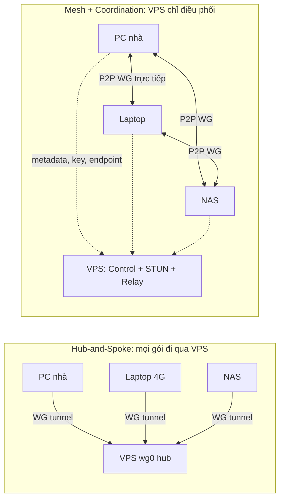
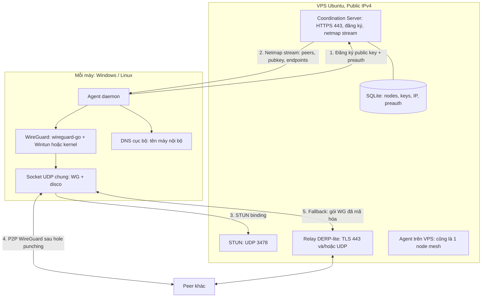

# Reference Systems Benchmark — Mesh VPN cá nhân kiểu Tailscale trên 1 VPS

| Thuộc tính | Giá trị |
|---|---|
| Tác giả | `agile-researcher` |
| Ngày | 2026-11-12 |
| Giai đoạn | 1 — Discovery (trước Gate 1) |
| Phạm vi | Mesh overlay network/P2P VPN cá nhân, 3–20 node, 1 VPS Ubuntu có Public IPv4, ưu tiên Windows + Linux |
| Thành phần AI/SLM | **Không có** → bỏ qua mục khảo sát model AI (đúng persona, mục 3 không áp dụng) |
| Tài liệu đi kèm | [production-readiness-requirements.md](./production-readiness-requirements.md) |

> **Quy ước trích dẫn**: `[Tn]` = nguồn trong mục *Tài liệu tham khảo* cuối file. Mọi con số đều có nguồn; con số nào là **đề xuất của researcher** (chưa đo) được ghi rõ "đề xuất".

---

## 0. Tóm tắt điều hành (TL;DR)

1. Mọi hệ thống mesh VPN hiện đại thành công đều có cùng một "xương sống": **Control Plane tập trung chỉ trao đổi metadata + public key** ↔ **Data Plane P2P mã hóa đầu-cuối bằng WireGuard/Noise** ↔ **NAT traversal (STUN + hole punching)** ↔ **Relay mù (blind relay) làm đường lui** [T1][T2][T6][T9].
2. Với 1 VPS, mô hình đúng là: **VPS = Coordination Server + STUN + Relay (DERP-lite) + (tùy chọn) 1 node trong mesh**. VPS **không bao giờ** giữ private key và **không đọc được** traffic relay [T3][T4].
3. Không tự viết mật mã. Dùng **WireGuard** (`wireguard-go` userspace + Wintun trên Windows; kernel WireGuard hoặc `wireguard-go` trên Linux) [T12][T13].
4. Bài học đắt giá nhất của ngành: **Control Plane chết thì Data Plane vẫn phải sống** [T5]; **MTU an toàn 1280** [T11]; **endpoint bị đổi khi roaming/sleep** [T14]; **private key sinh tại client và không rời client** [T2][T16].
5. MVP cá nhân **không cần**: OIDC/SSO, multi-tenant, HA nhiều region, eBPF, GUI đa nền tảng, Tailnet Lock, birthday-paradox port scanning. Những thứ này thuộc **Phase 2+**.

---

## 1. Bối cảnh bài toán & cách đọc tài liệu

Người dùng muốn **hiểu bản chất và tự xây** một chương trình giống Tailscale cho ~3–20 máy: PC ở nhà sau NAT nhà mạng (khả năng cao là CGNAT), laptop di động (Wi-Fi quán cafe/4G), Home Server/NAS và chính VPS. Mục tiêu là **học sâu + dùng thật hằng ngày**, nên tài liệu này vừa giải thích "vì sao" (kiến trúc), vừa chỉ ra "cái gì phải có để không hỏng mạng máy thật" (pitfalls).

---

## 2. Đường cơ sở: WireGuard hub-and-spoke truyền thống (để thấy giá trị của Mesh + Coordination)



| Tiêu chí | WireGuard hub-and-spoke thủ công | Mesh + Coordination (Tailscale-like) |
|---|---|---|
| Đường đi dữ liệu PC nhà ↔ NAS cùng LAN | Đi vòng ra VPS rồi quay về (tốn RTT + băng thông VPS) | Đi thẳng trong LAN (endpoint LAN được ưu tiên) |
| Băng thông VPS | Toàn bộ traffic giữa các máy | Chỉ traffic của cặp máy không xuyên NAT được |
| Thêm 1 máy mới | Sửa config ở hub + phát lại config/khóa thủ công | Client tự sinh khóa, đăng ký bằng pre-auth key, các peer tự nhận netmap mới |
| Máy đổi IP (roaming) | WireGuard tự roam endpoint khi nhận gói hợp lệ [T12], nhưng chỉ khi một phía có IP cố định | Coordination + disco ping tìm lại đường mới cho mọi cặp |
| Điểm chết duy nhất | Hub chết = mất mạng toàn bộ | Control chết = không thêm/sửa được, **tunnel đang chạy vẫn sống** [T5] |
| Độ phức tạp tự xây | Thấp | Trung bình–cao (NAT traversal, relay, đồng bộ trạng thái) |

**Kết luận**: Hub-and-spoke là **chế độ dự phòng tối thiểu** (relay qua VPS) — chính là cái mà Mesh vẫn dùng khi P2P thất bại. Giá trị cộng thêm của Mesh nằm ở *tự động hóa quản lý khóa + đường đi trực tiếp*.

---

## 3. Phân tích 5 hệ thống tham chiếu

### 3.1. Tailscale (thương mại, client mã nguồn mở BSD-3)

**Điểm sáng Nghiệp vụ & UX (nên học)**
- Cài là chạy: đăng nhập một lần, máy tự có IP `100.x.y.z` và tên MagicDNS; không cần mở cổng router [T1][T2].
- `tailscale status` / `tailscale ping` cho biết ngay kết nối đang **direct** (hiện `ip:port`) hay **relay** (`via DERP(region)`) [T17] — đây là công cụ chẩn đoán số 1 mà mọi bản tự xây phải có.
- Pre-auth key cho máy headless: **one-off** hoặc **reusable**, hạn **1–90 ngày** (mặc định 90); node **ephemeral** tự bị xóa khi offline [T15].
- Node key hết hạn mặc định **180 ngày**, có thể tắt cho server tin cậy [T16].

**Kiến trúc & kỹ thuật cốt lõi**
- **Control vs Data plane tách biệt**: coordination server chỉ phân phối public key, netmap, ACL, DNS; không chạm vào payload [T2].
- **Machine key vs Node key** (đều Curve25519, sinh tại client): machine key định danh bản cài/máy, dùng để mã hóa kênh client↔control; node key là khóa WireGuard của phiên, được liên kết với danh tính người dùng sau khi xác thực [T2].
- **Giao thức control `ts2021`**: `POST /ts2021` nâng cấp HTTP thành kênh **Noise IK**; client gửi `MapRequest{Stream:true}` để giữ **long-poll stream**; phản hồi đầu tiên là **netmap đầy đủ**, các phản hồi sau là **delta** [T7].
- **magicsock + disco**: lớp socket UDP userspace bọc WireGuard; disco là giao thức riêng (khóa disco riêng, NaCl box) với các bản tin **Ping / Pong / CallMeMaybe** để dò và nâng cấp đường đi mà không làm gián đoạn tunnel [T8].
  - `CallMeMaybe` gửi **qua DERP** để báo peer bên kia "bắn gói UDP về phía tôi ngay" → hai bên cùng bắn đồng thời → đục lỗ NAT [T8].
- **NAT traversal**: STUN để biết `public ip:port`; phân biệt Easy NAT (Endpoint-Independent Mapping) và Hard NAT (Endpoint-Dependent Mapping); với hard NAT dùng thủ thuật mở nhiều socket + dò ngẫu nhiên dựa trên **birthday paradox** [T1][T10].
- **DERP**: relay chạy trên **HTTPS/TCP 443**, **định tuyến theo public key** (không theo IP); chỉ chuyển tiếp gói WireGuard **đã mã hóa** nên không đọc được [T3]. Mọi kết nối **bắt đầu qua DERP rồi nâng cấp lên direct** khi đục lỗ thành công [T1].
- **MTU mặc định 1280** trên `tailscale0` (= MTU tối thiểu của IPv6, RFC 8200) để tránh PMTU blackhole [T11].
- **MagicDNS**: resolver cục bộ tại `100.100.100.100`; Windows dùng **NRPT** cho split DNS, Linux tích hợp **systemd-resolved** qua D-Bus thay vì ghi đè `/etc/resolv.conf` [T18].
- **Tailnet Lock**: chữ ký node key bằng khóa giữ trên thiết bị tin cậy → control plane bị chiếm cũng không chèn được node lạ [T19].

**Bài học xương máu / Pitfalls**
- Control plane là gốc tin cậy: nếu bị chiếm, kẻ tấn công có thể **chèn public key của node giả** vào netmap → đó là lý do Tailnet Lock tồn tại [T19].
- Sau sleep/wake hoặc đổi mạng: phải bắt sự kiện "link change", **rebind socket UDP**, chạy lại STUN; nếu rebind trước khi card mạng có IP thì treo kết nối dù UI báo "Connected" [T14].
- Windows sau crash: **adapter Wintun "ma"**, route mồ côi, adapter bị gán **Public firewall profile** → mất kết nối, cần dọn dẹp [T20].

### 3.2. Headscale (mã nguồn mở, BSD-3) — "Tailscale control plane tự host"

**Điểm sáng Nghiệp vụ & UX**
- Tương thích **client Tailscale chính thức** trên mọi OS → chứng minh rằng ranh giới Control/Data plane đủ sạch để thay Control mà không đụng Data [T21].
- Quản trị qua **CLI** (`headscale nodes list`, `preauthkeys create`…) — đủ cho cá nhân, không cần Web UI [T21].
- Pre-auth key, node ephemeral, MagicDNS, subnet router, exit node, ACL HuJSON [T21].

**Kiến trúc & kỹ thuật cốt lõi**
- **1 binary + SQLite** (`db.sqlite`) là cấu hình khuyến nghị; sao lưu = sao lưu 1 file [T21][T22].
- **DERP nhúng** + **STUN UDP 3478** trong cùng tiến trình; có thể bỏ hoàn toàn DERP map công cộng của Tailscale để chỉ dùng relay riêng [T22].
- Triển khai endpoint `/ts2021` (Noise) và long-poll MapRequest giống Tailscale [T7].
- Tài nguyên: báo cáo cộng đồng cho thấy **~50–100 MB RAM khi rảnh**, CPU < 1% với mạng nhỏ (nguồn thứ cấp, chưa phải benchmark chính thức) [T23].

**Bài học xương máu / Pitfalls**
- **Single-writer SQLite** → không có HA active-active; phải chấp nhận VPS là SPOF cho control (chấp nhận được với cá nhân nếu data plane độc lập) [T22].
- **Relay tự host bị lạm dụng**: DERP standalone (`derper`) nếu không bật `-verify-clients` thì **bất kỳ ai biết domain** cũng dùng ké băng thông VPS. Relay nhúng trong control plane thì xác thực theo danh sách node đã đăng ký [T24].
- Gánh nặng vận hành: tự lo **gia hạn TLS (Let's Encrypt)**, backup, phục hồi [T22].
- "Feature lag" do bám theo giao thức đóng của Tailscale — bài học: **tự định nghĩa giao thức của mình** thay vì cố tương thích giao thức người khác.

### 3.3. NetBird (mã nguồn mở; client BSD-3, server `management/signal/relay` AGPLv3)

**Điểm sáng Nghiệp vụ & UX**
- Tách **3 dịch vụ rõ ràng**: Management (peer, IP, ACL, netmap), Signal (chỉ trao đổi ICE candidate, mã hóa đầu-cuối), Relay [T25].
- **Setup key** cho máy headless, dashboard Web, tích hợp IdP (Phase 2 với ta).

**Kiến trúc & kỹ thuật cốt lõi**
- NAT traversal theo chuẩn **ICE** (RFC 8445) dùng thư viện **Pion ICE** (Go): gom candidate host/srflx/relay → trao đổi qua Signal → kiểm tra cặp song song [T25].
- Relay: ban đầu dùng **TURN/coturn**; từ **v0.29.0** chuyển sang **Relay tự viết chạy WebSocket (WSS/443) và QUIC** để giảm số cổng và đơn giản self-host [T26].
- Data plane là WireGuard (kernel khi có, userspace khi không) [T25].

**Bài học xương máu / Pitfalls**
- **Coturn là gánh nặng vận hành** (nhiều cổng UDP, cấu hình realm/credential) → chính NetBird đã thay bằng relay riêng chạy trên 443 [T26]. Bài học cho ta: **relay kiểu DERP qua TLS 443 đơn giản hơn TURN cho 1 VPS**.
- Tách Signal riêng là hợp lý ở quy mô lớn, nhưng với 1 VPS thì **gộp Signal vào Control** (giống Tailscale/DERP mang CallMeMaybe) bớt 1 tiến trình.
- Tính năng chống lượng tử Rosenpass được tích hợp rồi bị **đánh dấu deprecated (v0.82.0)** [T26] → cảnh báo phình phạm vi bằng tính năng "thời thượng".
- Giấy phép: server AGPLv3 → **không sao chép mã server NetBird** vào dự án nếu muốn giữ giấy phép tự do lựa chọn.

### 3.4. Nebula (Slack/Defined Networking, MIT)

**Điểm sáng Nghiệp vụ & UX**
- Mô hình **CA tự quản**: mỗi node có chứng chỉ ký bởi CA của mạng, chứng chỉ gắn **IP overlay + tên + groups** → firewall phân tán dựa trên group không thể giả mạo [T27].
- **Lighthouse** (node có IP public) chỉ giúp tìm nhau rồi **bước ra khỏi đường dữ liệu** [T27].

**Kiến trúc & kỹ thuật cốt lõi**
- Mật mã **Noise Protocol Framework** (ECDH + AES-256-GCM hoặc ChaCha20-Poly1305), không phải WireGuard [T27].
- Hole punching do lighthouse điều phối; `punchy.punch` giữ NAT mapping; `punchy.respond` cho phép bắn handshake ngược khi được lighthouse báo [T28].
- **Relay** (từ v1.6): node có `relay.am_relay: true` chuyển tiếp cho node khai báo `relay.relays` khi đục lỗ thất bại [T28].

**Bài học xương máu / Pitfalls**
- **Thu hồi chứng chỉ thủ công**: Nebula không có OCSP/CRL động; phải thêm fingerprint vào `pki.blocklist` của **từng node** và lighthouse **không tự phân phối** blocklist; tunnel đang chạy chỉ bị cắt khi bật `pki.disconnect_invalid` [T29]. → Bài học: **thu hồi phải được đẩy từ control plane** và **cắt cả tunnel đang sống**.
- Chứng chỉ sống dài = cửa sổ rủi ro dài khi lộ khóa [T29].
- Không có control plane động → cấp IP/nhóm qua phát hành chứng chỉ thủ công; phù hợp hạ tầng server, kém tiện cho laptop cá nhân.

### 3.5. Innernet (tonari, MIT)

**Điểm sáng Nghiệp vụ & UX**
- **File lời mời (invitation)** chứa keypair tạm dùng 1 lần; client redeem → **tự sinh keypair vĩnh viễn tại chỗ**, chỉ gửi public key; server **không bao giờ biết private key** [T30]. Đây là mẫu onboarding chuẩn mực cho bài toán của ta.
- CIDR phân cấp (`infra`, `humans`, `devices`…) làm ACL đơn giản, dễ hiểu [T31].

**Kiến trúc & kỹ thuật cốt lõi**
- Server trung tâm + **SQLite**, cố ý **không dùng Raft/consensus** để tự host dễ [T31].
- **API control chạy bên trong chính tunnel WireGuard** tới server → kênh control được WireGuard bảo vệ [T30].
- Server ghi nhận endpoint UDP quan sát được của từng peer và phân phối cho peer khác (STUN-lite) [T32].

**Bài học xương máu / Pitfalls**
- **Không có relay tự động**: hai máy cùng sau symmetric NAT/CGNAT sẽ **không nói chuyện được** trừ khi tự mở cổng [T32]. → Chứng minh relay fallback là **bắt buộc**, không phải "nice-to-have", nhất là khi PC nhà ở sau CGNAT và laptop dùng 4G.
- Đồng bộ bằng polling → độ trễ lan truyền thay đổi phụ thuộc chu kỳ poll.

### 3.6. Bảng so sánh tổng hợp

| Tiêu chí | Tailscale | Headscale | NetBird | Nebula | Innernet | WG hub-spoke |
|---|---|---|---|---|---|---|
| Mật mã data plane | WireGuard | (client Tailscale) WireGuard | WireGuard | Noise (riêng) | WireGuard | WireGuard |
| Control plane | SaaS, Noise `ts2021`, long-poll + delta | 1 binary Go + SQLite | Management + Signal (gRPC) | Không (CA offline + lighthouse) | Server + SQLite, API trong tunnel | Không |
| Khóa sinh ở đâu | Client | Client | Client | Client tự sinh (CA chỉ ký phần public) | Client (sau khi redeem lời mời) | Thường do admin sinh rồi phát (rủi ro) |
| NAT traversal | STUN + disco + birthday paradox | Như Tailscale | ICE (Pion) | Lighthouse + punchy | STUN-lite qua server | Không |
| Relay fallback | DERP, TCP/TLS 443 | DERP nhúng + STUN 3478 | TURN → Relay WS/QUIC | Relay node (UDP) | **Không có** | Chính hub |
| Thu hồi node | Từ control, tức thì | CLI | Dashboard | Blocklist thủ công từng node | CLI server | Sửa config thủ công |
| Phù hợp tự xây trên 1 VPS | Mô hình mẫu | Bằng chứng khả thi | Quá nhiều thành phần | Thiếu control động | Mẫu tối giản tốt, thiếu relay | Chỉ là fallback |
| Giấy phép | Client BSD-3 | BSD-3 | Client BSD-3 / Server AGPLv3 | MIT | MIT | GPLv2 (kernel) / MIT (wireguard-go) |

---

## 4. Kiến trúc kỹ thuật cốt lõi để tự xây "Tailscale-lite" trên 1 VPS

> Phần này là **mô hình tham chiếu khái niệm** để `agile-architect` và `agile-tech-lead` ra quyết định — không phải thiết kế đã chốt.



### 4.1. Control Plane (Coordination Server trên VPS)

| Trách nhiệm | Cách các hệ thống thật làm | Gợi ý cho MVP 1 VPS |
|---|---|---|
| **Định danh máy** | Tailscale: *machine key* (bền) + *node key* (WireGuard, có hạn) đều sinh tại client [T2] | MVP: 1 cặp khóa WireGuard Curve25519 sinh tại client là đủ; tách machine/node key là Phase 2 (cho phép xoay node key mà không đăng ký lại máy) |
| **Xác thực máy mới** | Pre-auth key one-off/reusable có TTL [T15]; innernet: invitation keypair dùng 1 lần [T30] | Pre-auth key **ngẫu nhiên ≥128 bit, one-time, TTL ngắn**, chỉ lưu **hash** trong DB; tạo bằng CLI admin trên VPS |
| **Chứng minh sở hữu khóa** | DERP/Tailscale dùng NaCl box hoặc Noise IK, vì Curve25519 (X25519) **chỉ làm Diffie-Hellman, không ký được** [T3][T7] | Kênh client↔server dùng TLS + bước "challenge" mã hóa bằng DH giữa khóa client và khóa server (NaCl box hoặc Noise IK). **Không** tự chế giao thức xác thực từ nguyên thủy mật mã |
| **Cấp IP ảo** | Tailscale dùng `100.64.0.0/10` (Shared Address Space RFC 6598) [T2][T33] | Cấp IP tĩnh, **bền vững theo node** trong DB; dải nên **cấu hình được** (xem pitfall 5.6 về xung đột CGNAT) |
| **Phân phối Netmap** | Tailscale: long-poll stream, full rồi delta [T7]; NetBird: gRPC stream [T25]; innernet: polling [T31] | 1 kênh stream (long-poll HTTP hoặc WebSocket) gửi **snapshot đầy đủ kèm số version tăng đơn điệu**. Với ≤20 node, snapshot chỉ vài KB → **delta là Phase 2** |
| **Signaling cho hole punching** | Tailscale: CallMeMaybe qua DERP [T8]; NetBird: Signal service riêng [T25] | Gộp signaling vào **kênh relay** (giống Tailscale) hoặc kênh control; không dựng service Signal riêng |
| **Lưu trữ** | Headscale, innernet: SQLite [T21][T31] | SQLite (WAL) + backup file định kỳ |

**Netmap tối thiểu cho mỗi peer** (gợi ý trường): `node_id`, `name`, `overlay_ip`, `wg_public_key`, `disco_public_key` (nếu tách), `endpoints[]` (LAN + STUN-reflexive, có nguồn gốc), `relay_home`, `key_expiry`, `online/last_seen`, `netmap_version`.

### 4.2. Data Plane — WireGuard, "Don't roll your own crypto"

- WireGuard dùng **Noise_IK**, Curve25519, ChaCha20-Poly1305; **cryptokey routing**: `AllowedIPs` ↔ public key; gói đến được kiểm tra IP nguồn bên trong có thuộc `AllowedIPs` của peer đó không [T12].
- **Roaming tích hợp**: peer cập nhật endpoint khi nhận gói xác thực hợp lệ từ địa chỉ mới [T12].
- **Bộ hẹn giờ có sẵn**: `REKEY_TIMEOUT` 5 s, `KEEPALIVE_TIMEOUT` 10 s, `REKEY_AFTER_TIME` 120 s, `REJECT_AFTER_TIME` 180 s, `REKEY_ATTEMPT_TIME` 90 s [T34] → dùng làm tín hiệu sống/chết của peer, không cần tự chế.
- **Lựa chọn hiện thực**:

| Lựa chọn | Ưu | Nhược | Ghi chú |
|---|---|---|---|
| `wireguard-go` (userspace, MIT) + **Wintun** (Windows) / TUN (Linux) | Kiểm soát được socket UDP → **chia sẻ socket với STUN/disco** (bắt buộc cho hole punching, vì NAT mapping gắn với port) | Tốn CPU hơn kernel [T13] | Cách Tailscale, NetBird làm. **Phù hợp nhất cho MVP** |
| Kernel WireGuard (Linux) / WireGuardNT (Windows) | Nhanh nhất [T13] | Không chèn được disco/STUN vào cùng socket → khó đục lỗ, cần thủ thuật | Phase 2 tối ưu hiệu năng |
| `boringtun` (Rust, userspace) | Hiệu năng tốt | Hệ sinh thái Windows kém hơn | Tùy ngôn ngữ tech-lead chọn |

- **Wintun**: driver TUN L3 cho Windows; binary đã ký được **phân phối lại kèm phần mềm của mình** theo Prebuilt Binaries License (không sửa, không bán riêng) [T35].

### 4.3. NAT Traversal (xuyên NAT P2P)

**Phân loại NAT theo RFC 4787** [T10]:

| Loại | Mapping | Hệ quả |
|---|---|---|
| Easy NAT (thường gọi "cone") | **Endpoint-Independent Mapping (EIM)**: cùng `ip:port` public cho mọi đích | Port STUN thấy = port peer dùng được → đục lỗ dễ |
| Hard NAT ("symmetric") | **Endpoint-Dependent Mapping**: mỗi đích một port mới | Port STUN thấy vô dụng với peer → cần dò port (birthday paradox) hoặc relay [T1] |
| Filtering | Endpoint-Independent / Address-Dependent / Address+Port-Dependent | Quyết định gói lạ có lọt vào không → cần **bắn đồng thời** từ hai phía |
| Timer | RFC 4787 REQ-5: mapping UDP **không được hết hạn trước 2 phút**, khuyến nghị ≥5 phút [T10] | Thực tế nhiều NAT ngắn hơn → keepalive ~25 s (WireGuard khuyến nghị cho client sau NAT) [T12] |

**Quy trình đục lỗ đề xuất (rút gọn từ Tailscale disco + ICE)** [T1][T8][T25]:

```mermaid
sequenceDiagram
    participant A as Node A (sau NAT)
    participant S as VPS (STUN + Relay + Control)
    participant B as Node B (sau NAT)
    A->>S: STUN Binding (từ chính socket WG)
    S-->>A: Bạn là 1.2.3.4:41641
    B->>S: STUN Binding
    S-->>B: Bạn là 5.6.7.8:50000
    A->>S: Cập nhật endpoints (LAN + reflexive)
    B->>S: Cập nhật endpoints
    S-->>A: Netmap: B có endpoints [...]
    S-->>B: Netmap: A có endpoints [...]
    Note over A,B: Lúc này dữ liệu đã chạy qua Relay (gói WG đã mã hóa)
    A->>S: CallMeMaybe(B) qua relay
    S->>B: CallMeMaybe từ A
    par Bắn đồng thời
        A->>B: disco Ping tới mọi endpoint của B
    and
        B->>A: disco Ping tới mọi endpoint của A
    end
    B-->>A: disco Pong (kèm RTT, địa chỉ quan sát)
    Note over A,B: Chọn đường RTT tốt nhất, chuyển WG sang direct; relay giữ làm dự phòng
```

**Điểm then chốt**
- STUN **phải gửi từ chính socket UDP mà WireGuard dùng** — nếu không, port NAT thấy được không phải port của tunnel.
- Phân biệt gói disco với gói WireGuard trên cùng socket (Tailscale dùng **magic header** trước gói disco [T8]).
- Ưu tiên ứng viên: **LAN > IPv6 public > IPv4 reflexive > relay**.
- **Birthday-paradox port scanning cho hard NAT ↔ hard NAT** là Phase 2: phức tạp, có thể bị coi như quét cổng [T1]; với ≤20 máy cá nhân thì relay qua VPS là đủ.

### 4.4. Relay fallback trên VPS (DERP-lite) — E2EE mà VPS không đọc được

**Nguyên lý**: relay **không phải VPN server**. Nó là "bưu điện mù":
1. Mỗi agent mở **1 kết nối lâu dài** tới relay (TLS/TCP 443, hoặc UDP), xác thực bằng chứng minh sở hữu khóa node (NaCl box/Noise) [T3].
2. Agent gửi **frame** `{dest_public_key, payload}` với `payload` = **gói WireGuard đã mã hóa sẵn** (hoặc gói disco đã mã hóa).
3. Relay tra `dest_public_key` → kết nối tương ứng → đẩy frame đi. Relay **không có private key** của ai nên **không giải mã được** [T3].
4. Bên nhận đưa payload vào WireGuard như thể nó đến từ UDP.

| Phương án vận chuyển relay | Ưu | Nhược |
|---|---|---|
| **TLS/TCP 443 (kiểu DERP, NetBird WSS)** | Lọt qua gần như mọi firewall khách sạn/công ty [T3][T26] | TCP-over-TCP: head-of-line blocking, độ trễ tăng khi mất gói |
| UDP riêng (kiểu Nebula relay) | Hiệu năng tốt hơn | Bị chặn ở mạng chỉ cho 80/443 |
| QUIC (NetBird) | UDP + chống HOL | Phức tạp, vẫn bị chặn nơi chặn UDP |

**Khuyến nghị MVP**: relay **TLS 443 bắt buộc** (đường cuối cùng luôn thông), UDP relay là Phase 2. Relay **chỉ phục vụ public key đã đăng ký, chưa thu hồi** — bài học từ `derper -verify-clients` [T24].

**Tận dụng một cổng 443**: TLS cho control và relay có thể chung cổng 443 (phân luồng theo path/HTTP Upgrade), giống Tailscale/Headscale.

### 4.5. Tiện ích cá nhân

| Tiện ích | Tham chiếu | MVP | Phase 2 |
|---|---|---|---|
| **Tên máy nội bộ** | MagicDNS `100.100.100.100`; Windows NRPT, Linux systemd-resolved [T18] | Ghi khối có đánh dấu vào `hosts` (`C:\Windows\System32\drivers\etc\hosts`, `/etc/hosts`) do agent quản lý, xóa sạch khi tắt; hoặc resolver nhỏ trong agent | Resolver cục bộ + split DNS chuẩn (NRPT / systemd-resolved) |
| **ACL** | Tailscale ACL HuJSON; innernet CIDR; Nebula groups [T21][T31][T27] | **Mặc định full-mesh** giữa máy của chính mình | ACL theo tag/nhóm, áp ở cả control (lọc netmap) và agent (packet filter) |
| Subnet router / Exit node | Tailscale, Headscale [T21] | Không | Có — kèm xử lý routing loop đầy đủ (mục 5.1) |

---

## 5. Cạm bẫy xương máu (Anti-patterns & Pitfalls) khi tự code VPN kiểu Tailscale

### 5.1. Routing loop — làm rớt mạng toàn máy
- **Cơ chế**: gói WireGuard đã đóng gói (đích = endpoint thật của peer/VPS) lại khớp một route trỏ vào chính interface tunnel → bị đóng gói lần nữa → vòng lặp vô hạn, máy mất mạng [T36].
- **Khi nào xảy ra trong dự án này**:
  - Có **exit node / `0.0.0.0/0`** hoặc **subnet route** rộng (Phase 2).
  - **Endpoint ứng viên lại là IP overlay** (vd. agent quảng bá cả địa chỉ của interface tunnel làm endpoint) → peer gửi gói WG tới IP overlay → vào tunnel.
  - Route tới **IP public của VPS** đi qua tunnel khi VPS cũng là node mesh.
- **Phòng tránh**:
  - Linux: đánh dấu socket bằng **fwmark** + `ip rule not fwmark` như `wg-quick` (table 51820) [T36].
  - Windows: không có fwmark → **thêm host route /32 tới endpoint qua gateway vật lý** (cách client WireGuard Windows làm) hoặc **ràng socket vào interface vật lý** [T36].
  - **Lọc endpoint**: không bao giờ quảng bá/nhận endpoint thuộc dải overlay hoặc của interface tunnel.
  - MVP chỉ cài route cho **dải overlay**, không cài default route.

### 5.2. MTU blackhole / phân mảnh
- WireGuard overhead **60 byte (IPv4)** / **80 byte (IPv6)** → MTU tunnel 1440/1420 trên đường 1500 [T37].
- Đường thực tế thường < 1500 (PPPoE 1492, 4G, mạng khách sạn) và **ICMP "Fragmentation Needed" hay bị chặn** → gói lớn bị rơi im lặng: SSH vào được nhưng `ls` dài treo, HTTPS bắt tay xong rồi đứng [T11].
- Relay bọc thêm header frame → ngân sách MTU còn nhỏ hơn.
- **Phòng tránh**: MTU tunnel **mặc định 1280** như Tailscale [T11] (1280 + 80 = 1360 byte bên ngoài, còn dư cho PPPoE/4G/header relay); cho phép cấu hình; test bằng ping không phân mảnh (`ping -M do -s` / `ping -f -l`).

### 5.3. IP roaming, Wi-Fi ↔ 4G, Sleep/Wake
- Endpoint cũ chết nhưng tunnel vẫn "tưởng" đang sống đến khi hết `REJECT_AFTER_TIME` 180 s [T34].
- Rebind socket khi card mạng chưa có IP → bind thất bại, không retry → treo dù UI báo "Connected" [T14].
- **Phòng tránh**: lắng nghe sự kiện thay đổi mạng của OS (Linux netlink; Windows `NotifyIpInterfaceChange`/`NotifyRouteChange2`); khi có thay đổi lớn: **rebind + STUN lại + đẩy endpoint mới lên control + disco ping lại**; nếu ping direct thất bại thì **về relay ngay** trong vài giây; phát hiện "time jump" sau sleep để buộc kiểm tra lại.

### 5.4. Rò rỉ Private Key lên Control Server
- Anti-pattern kinh điển của các công cụ "WireGuard UI": server sinh keypair rồi gửi config chứa private key cho client.
- Mọi hệ thống chuẩn mực đều **sinh khóa tại client**: Tailscale [T2], innernet (server không bao giờ biết private key) [T30], Nebula (CA chỉ ký phần public) [T27]. DERP không giải mã được vì private key không rời thiết bị [T3].
- **Quy tắc**: private key sinh tại client, lưu file quyền hạn chế (Linux `0600` root; Windows ACL chỉ SYSTEM/Administrators hoặc DPAPI), **không log, không gửi đi, không đưa vào crash dump/support bundle**.

### 5.5. Phình to phạm vi (Scope creep)
- Tự viết OIDC/SSO, multi-tenant, HA nhiều region, eBPF datapath, GUI đa nền tảng, post-quantum ngay bản đầu.
- Bằng chứng: NetBird đưa Rosenpass vào rồi deprecate [T26]; Headscale chỉ có CLI vẫn được dùng rộng rãi [T21].
- **Phòng tránh**: MVP = CLI + daemon/service; một tenant; một VPS; full-mesh.

### 5.6. Các cạm bẫy bổ sung (phát hiện trong nghiên cứu)

| # | Cạm bẫy | Vì sao nguy hiểm | Phòng tránh |
|---|---|---|---|
| 5.6.1 | **Xung đột dải `100.64.0.0/10`** | RFC 6598 cấp dải này cho **CGNAT của nhà mạng** [T33]; nếu WAN của PC nhà/4G nằm trong dải này mà overlay cấp trùng subnet → route sai | Dải overlay cấu hình được; kiểm tra xung đột với địa chỉ interface vật lý khi khởi động và cảnh báo |
| 5.6.2 | **Relay mở cho người lạ** | Ai biết domain cũng dùng ké băng thông VPS [T24] | Chỉ relay giữa các public key đã đăng ký & còn hiệu lực; giới hạn băng thông mỗi node |
| 5.6.3 | **Thu hồi không cắt tunnel đang sống** | Nebula chỉ cắt khi bật `disconnect_invalid` [T29] | Thu hồi = xóa peer khỏi netmap của **mọi** node + agent gỡ peer khỏi WireGuard ngay + relay ngắt kết nối |
| 5.6.4 | **Windows: adapter ma, route mồ côi, Public firewall profile** sau crash [T20] | Mất mạng/thấy "chạy" nhưng bị firewall chặn | Dọn dẹp lúc khởi động (stale cleanup), đặt tên adapter cố định, xử lý profile mạng và rule firewall cho dải overlay |
| 5.6.5 | **STUN gửi từ socket khác** | Mapping NAT khác port tunnel → đục lỗ luôn thất bại | Chung socket cho WG + STUN + disco |
| 5.6.6 | **Control plane bị chiếm = chèn node giả** [T19] | Mọi node tin netmap | MVP: hardening VPS + TLS + audit log; Phase 2: ký netmap/node key kiểu Tailnet Lock |
| 5.6.7 | **Dựa vào kernel WG cho Windows ngay** | Không chia sẻ socket với disco/STUN | Dùng `wireguard-go` + Wintun cho MVP [T13] |
| 5.6.8 | **Sao chép mã AGPL** (server NetBird) | Ràng buộc giấy phép toàn dự án | Chỉ tham khảo thiết kế; thư viện nên là MIT/BSD (wireguard-go, Pion, Nebula) |

---

## 6. Tinh hoa áp dụng ngay cho MVP cá nhân (1 VPS)

| # | Tinh hoa | Học từ | Lý do đưa vào MVP |
|---|---|---|---|
| M1 | Tách **Control Plane / Data Plane**; control chết không đứt tunnel | Tailscale [T5], Headscale | Yêu cầu sống còn cho 24/7 trên 1 VPS (SPOF) |
| M2 | **Khóa sinh tại client** + onboarding bằng **pre-auth key one-time có TTL** | innernet [T30], Tailscale [T15] | Bảo mật cốt lõi, UX đủ tốt cho máy headless |
| M3 | **WireGuard userspace** (`wireguard-go` + Wintun/TUN), chung socket UDP với STUN + disco | Tailscale, NetBird [T13][T25] | Không tự viết crypto; cho phép hole punching |
| M4 | **STUN trên VPS** + trao đổi endpoint + **đục lỗ đồng thời** (disco Ping/Pong/CallMeMaybe-lite) | Tailscale [T1][T8], Nebula punchy [T28] | Mục tiêu "P2P trực tiếp" là giá trị chính |
| M5 | **Relay mù TLS 443 theo public key**, chỉ cho node đã đăng ký; dữ liệu khởi đầu qua relay rồi nâng cấp direct | DERP [T3][T1], NetBird WS relay [T26], `-verify-clients` [T24] | Không có relay = mất kết nối với CGNAT/4G (bài học innernet [T32]) |
| M6 | **SQLite 1 file** + 1 binary server + CLI admin | Headscale [T21], innernet [T31] | Vừa VPS 1–2 GB RAM, backup dễ |
| M7 | Netmap qua **stream (long-poll/WebSocket), snapshot + version** | Tailscale [T7] | Cập nhật gần thời gian thực, đơn giản ở ≤20 node |
| M8 | **MTU tunnel 1280** mặc định | Tailscale [T11] | Chặn họ lỗi "treo SSH/HTTPS" |
| M9 | CLI **`status` / `ping`** hiện direct vs relay + RTT | Tailscale [T17] | Không có thì không vận hành/gỡ lỗi được |
| M10 | Tên máy qua **hosts quản lý tự động** hoặc resolver nhỏ; **full-mesh** mặc định | MagicDNS [T18] (bản rút gọn) | Tiện dụng, ít rủi ro đụng DNS hệ thống |
| M11 | **Thu hồi/hết hạn node** đẩy từ control, cắt cả tunnel đang sống | Tailscale key expiry [T16], bài học Nebula [T29] | Mất laptop phải xử lý được ngay |

## 7. Lộ trình mở rộng Phase 2+

| # | Hạng mục | Tham chiếu | Điều kiện kích hoạt |
|---|---|---|---|
| P1 | macOS, Android, iOS | Tailscale, NetBird | Sau khi Windows/Linux ổn định |
| P2 | Tách machine key / node key + xoay node key định kỳ | Tailscale [T2] | Khi cần xoay khóa không đăng ký lại |
| P3 | Netmap **delta** | Tailscale [T7] | Khi >50 node hoặc churn cao |
| P4 | Đục lỗ **hard NAT ↔ hard NAT** (birthday paradox), UPnP/NAT-PMP/PCP | Tailscale [T1] | Khi số liệu `status` cho thấy relay chiếm tỉ lệ cao |
| P5 | Relay UDP/QUIC, nhiều relay/region, peer relay (dùng node có IP public tại nhà) | NetBird [T26], Nebula [T28], Tailscale | Khi băng thông VPS trở thành nút cổ chai |
| P6 | Split DNS chuẩn (NRPT, systemd-resolved) | Tailscale [T18] | Khi hosts file không đủ |
| P7 | ACL theo nhóm/tag, packet filter trong agent | Tailscale, Nebula groups [T27], innernet CIDR [T31] | Khi chia sẻ mạng với người khác |
| P8 | Subnet router, Exit node (kèm xử lý routing loop đầy đủ) | Headscale [T21] | Nhu cầu truy cập LAN nhà/duyệt web qua VPS |
| P9 | Ký node key kiểu **Tailnet Lock** | Tailscale [T19] | Khi muốn giảm tin cậy vào VPS |
| P10 | OIDC/SSO, Web UI, multi-user | Headscale OIDC, NetBird | Khi có người dùng ngoài bản thân |
| P11 | Kernel WireGuard/WireGuardNT để tăng throughput | [T13] | Khi CPU thành nút cổ chai |

---

## 8. Câu hỏi mở chuyển cho PO/BA, Tech Lead & Architect

1. **Mức tương thích**: tự định nghĩa giao thức (khuyến nghị — học được bản chất, không phụ thuộc client Tailscale) hay tương thích client Tailscale (= viết lại Headscale)?
2. **Ngôn ngữ/runtime**: Go có sẵn hệ sinh thái `wireguard-go`, Wintun bindings, Pion, tham chiếu mã Tailscale/Headscale/Nebula (đều Go); Rust có `boringtun`. → quyết định của `agile-tech-lead`.
3. **Dải IP overlay** mặc định và cách phát hiện xung đột với CGNAT của nhà mạng người dùng.
4. VPS có **domain** để xin chứng chỉ Let's Encrypt không? (cần cho TLS 443 sạch; nếu không thì phải pin khóa/chứng chỉ tự ký trong client).
5. VPS có tham gia mesh như một node (truy cập dịch vụ trên VPS qua IP overlay) không?
6. Chấp nhận giới hạn MVP: hai máy cùng sau hard NAT sẽ **luôn đi relay**.

---

## 9. Tài liệu tham khảo

| Mã | Nguồn |
|---|---|
| T1 | Tailscale — *How NAT traversal works* (D. Anderson): https://tailscale.com/blog/how-nat-traversal-works |
| T2 | Tailscale — *How Tailscale works*: https://tailscale.com/blog/how-tailscale-works ; Tailscale Security/Encryption docs (machine key, node key) tại https://tailscale.com/security và https://tailscale.com/kb |
| T3 | Tailscale — *DERP servers*: https://tailscale.com/kb/1232/derp-servers ; package `tailscale.com/derp`: https://pkg.go.dev/tailscale.com/derp |
| T4 | Tailscale — mô tả DERP "không giải mã được vì private key không rời thiết bị" (cùng nguồn T3 và T2) |
| T5 | Tailscale KB — mục *What happens if the coordination server is down?* (tra tại https://tailscale.com/kb): tunnel đang chạy tiếp tục; không thêm node, không sửa ACL, không thu hồi được; node có thể mất kết nối nếu key hết hạn trong lúc control chết |
| T6 | Tailscale GitHub (client BSD-3): https://github.com/tailscale/tailscale |
| T7 | Tailscale control protocol `ts2021`, `MapRequest`/`MapResponse` (streaming + delta): https://pkg.go.dev/tailscale.com/tailcfg ; Headscale noise impl: https://github.com/juanfont/headscale |
| T8 | Tailscale disco protocol (Ping/Pong/CallMeMaybe, NaCl box): https://pkg.go.dev/tailscale.com/disco ; magicsock: https://pkg.go.dev/tailscale.com/wgengine/magicsock |
| T9 | WireGuard — *Conceptual overview*: https://www.wireguard.com/ |
| T10 | IETF RFC 4787 — *NAT Behavioral Requirements for Unicast UDP* (EIM, filtering, REQ-5 timer ≥ 2 phút): https://www.rfc-editor.org/rfc/rfc4787 |
| T11 | Tailscale MTU 1280 mặc định & PMTU blackhole: https://github.com/tailscale/tailscale (issue/tài liệu MTU) ; RFC 8200 (IPv6 minimum MTU 1280) |
| T12 | WireGuard whitepaper (Noise_IK, cryptokey routing, roaming): https://www.wireguard.com/papers/wireguard.pdf ; *Quick start — PersistentKeepalive 25*: https://www.wireguard.com/quickstart/ |
| T13 | WireGuardNT (kernel Windows, ra mắt 2021) vs `wireguard-go` + Wintun: https://git.zx2c4.com/wireguard-nt/about/ ; thông báo trên mailing list WireGuard (lists.zx2c4.com, 08/2021) |
| T14 | Tailscale GitHub issues về treo sau sleep/wake & link change: https://github.com/tailscale/tailscale/issues (tìm "sleep", "resume", "link change") |
| T15 | Tailscale — *Auth keys* (one-off/reusable/ephemeral, hạn 1–90 ngày): https://tailscale.com/kb/1085/auth-keys |
| T16 | Tailscale — *Key expiry* (mặc định 180 ngày): https://tailscale.com/kb/1028/key-expiry |
| T17 | Tailscale CLI `status`, `ping` (direct vs DERP): https://tailscale.com/kb/1080/cli ; Tailscale KB *Connection types* (direct / DERP / peer relay) |
| T18 | Tailscale — *MagicDNS*, `100.100.100.100`, DNS trên Windows/Linux: https://tailscale.com/kb/1081/magicdns ; Tailscale KB *What is Quad100* ; https://tailscale.com/kb/1188/linux-dns |
| T19 | Tailscale — *Tailnet Lock*: https://tailscale.com/kb/1226/tailnet-lock ; blog: https://tailscale.com/blog/tailnet-lock-ga |
| T20 | Tailscale — Windows troubleshooting (adapter/route/firewall profile): https://tailscale.com/kb/1023/troubleshooting |
| T21 | Headscale — docs & features: https://headscale.net/ ; https://github.com/juanfont/headscale |
| T22 | Headscale — DERP nhúng, STUN 3478, SQLite, vận hành: https://headscale.net/stable/ref/derp/ ; https://headscale.net/stable/setup/requirements/ |
| T23 | Báo cáo cộng đồng về RAM Headscale (~50–100 MB idle) — nguồn thứ cấp: dev.to, simeononsecurity.com (chỉ dùng làm định hướng, không phải benchmark chính thức) |
| T24 | `derper -verify-clients` / `-verify-client-url`: https://tailscale.com/kb/1118/custom-derp-servers ; https://pkg.go.dev/tailscale.com/cmd/derper |
| T25 | NetBird — *How NetBird works* (Management, Signal, ICE/Pion, Relay): https://docs.netbird.io/about-netbird/how-netbird-works ; https://github.com/netbirdio/netbird |
| T26 | NetBird — Relay WS/QUIC từ v0.29.0; Rosenpass deprecated (v0.82.0); giấy phép AGPLv3 cho `management/signal/relay`: https://docs.netbird.io/ ; https://github.com/netbirdio/netbird/blob/main/LICENSE |
| T27 | Slack Nebula: https://github.com/slackhq/nebula ; Slack Engineering blog: https://slack.engineering/introducing-nebula-the-open-source-global-overlay-network-from-slack/ |
| T28 | Nebula docs — relay (`am_relay`, `use_relays`, `relays`), punchy: https://nebula.defined.net/docs/config/relay/ ; https://nebula.defined.net/docs/config/punchy/ |
| T29 | Nebula docs — `pki.blocklist`, `pki.disconnect_invalid`, CA rotation: https://nebula.defined.net/docs/config/pki/ ; https://nebula.defined.net/docs/guides/rotating-certificate-authority/ |
| T30 | innernet README (invitation, client tự sinh khóa, API trong tunnel): https://github.com/tonarino/innernet |
| T31 | tonari blog — *Introducing innernet* (SQLite, không consensus, CIDR): https://blog.tonari.no/introducing-innernet |
| T32 | innernet — NAT traversal & giới hạn (không relay): https://github.com/tonarino/innernet (issues/docs về NAT) |
| T33 | IETF RFC 6598 — *IANA-Reserved IPv4 Prefix for Shared Address Space* (`100.64.0.0/10` cho CGNAT): https://www.rfc-editor.org/rfc/rfc6598 |
| T34 | WireGuard protocol & timers (`REKEY_TIMEOUT` 5 s, `KEEPALIVE_TIMEOUT` 10 s, `REKEY_AFTER_TIME` 120 s, `REJECT_AFTER_TIME` 180 s): https://www.wireguard.com/protocol/ ; whitepaper §6 |
| T35 | Wintun — https://www.wintun.net/ (Prebuilt Binaries License: được phân phối kèm phần mềm, không sửa/bán riêng) |
| T36 | WireGuard *Routing & Network Namespace Integration* (fwmark, table 51820, `wg-quick`): https://www.wireguard.com/netns/ ; Pro Custodibus về `wg-quick` policy routing |
| T37 | Tính toán overhead WireGuard 60/80 byte và MTU 1420: WireGuard mailing list / whitepaper (header 32 byte + UDP 8 + IP 20/40) |
| — | RFC bổ sung: STUN RFC 8489, ICE RFC 8445, TURN RFC 8656 |
