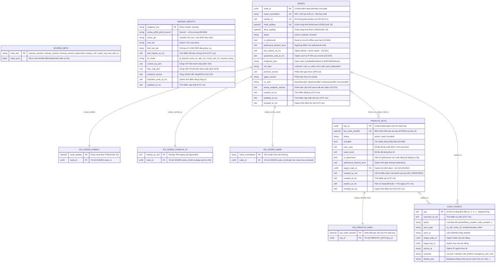
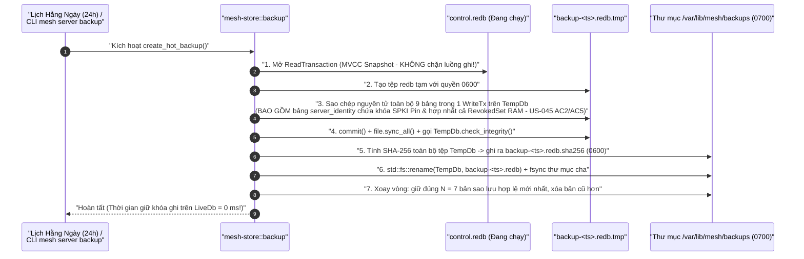

# Database & Persistent State Design — Mesh VPN (`redb` 2.4 & OS State Files)

| Thuộc tính | Giá trị |
|---|---|
| Tác giả | `agile-architect` |
| Ngày | 2026-11-12 |
| Phiên bản | **2.2** — Gate 2 Round 2 Revision: Thiết kế lưu trữ **`redb` `2.4` (100% Pure-Rust ACID MVCC)**, `MonotonicNetmapVersion` High-Watermark Lease (`VERSION_LEASE_STEP = 1_024`), `emergency-revocations.bin` (Compaction & Fail-Closed Boot) & tách riêng thư mục trạng thái/IPC Linux giữa `mesh-server` và `meshd` |
| Trạng thái | **Proposed-for-Gate-2 (Revised Round 2)** |
| Thành phần AI/Vector DB | **Không có** (Dự án không có RAG/Vector Index) |
| Đầu vào | [production-readiness-requirements.md](../01-discovery/production-readiness-requirements.md) (v1.2) · [product-backlog.md](../02-product-planning/product-backlog.md) (v1.2) · [tech-stack-decision.md](./tech-stack-decision.md) (v2.0) · [architecture-decision-record.md](./architecture-decision-record.md) (v2.2 `ADR-005`, `ADR-006`, `ADR-007`) · [coding-standards.md](./coding-standards.md) (v2.2) |
| Crate thực thi | `crates/mesh-store` (trên VPS) và `crates/mesh-net::{keystore, ledger}` + `crates/meshd::config` (trên Client/Node) |

---

## 1. Tổng Quan Kiến Trúc Lưu Trữ

Theo quyết định tại **`ADR-001`** và **`ADR-005`**, hệ thống loại bỏ hoàn toàn C-SQLite (`rusqlite`/`libsqlite3-sys`) để sử dụng **`redb` `2.4`** (MIT/Apache-2.0) — cơ sở dữ liệu nhúng B-tree Copy-on-Write (MVCC) viết **100% bằng Rust an toàn (0 dòng mã C)**:

1. **Giao dịch ACID Đa Bảng Nguyên Tử (`REL-11`, `US-007 AC1/AC2`)**:
   - `redb::Database::begin_write()` cung cấp một `WriteTransaction` tuần tự hóa duy nhất tại một thời điểm, đảm bảo mọi thao tác cập nhật bảng chính (`nodes`, `preauth_keys`, `audit_events`, `schema_meta`) và các bảng chỉ mục duy nhất (`idx_nodes_pubkey`, `idx_nodes_overlay_ip`, `idx_nodes_name`, `idx_preauth_hash`) thành công cùng nhau hoặc tự động rollback hoàn toàn nếu tiến trình bị `kill -9` hay mất điện.
2. **Đọc Không Chặn Ghi bằng MVCC (`ReadTransaction`)**:
   - `redb::Database::begin_read()` tạo snapshot cô lập dựa trên cây B-tree Copy-on-Write, không bao giờ chặn luồng `WriteTransaction` và cho phép tạo **Hot Atomic Snapshot Backup** (`US-045`) ngay khi server đang phục vụ lưu lượng.
3. **Tách Biệt Trạng Thái Cấu Trúc Bền Vững (`redb`), Tệp Cấp Cứu Định Sẵn (`emergency-revocations.bin`) và Trạng Thái Runtime Trong RAM (`HR-03`, `HR-G2-03`, `Codex #5, #6`, `Codex R2 #1, #2`, `US-009 AC1`, `US-013 AC4`)**:
   - Các nhịp heartbeat `last_seen_at_ms` chỉ cập nhật trong bộ nhớ RAM (`NodeRuntimePresence`), **không ghi đĩa liên tục và không bao giờ làm tăng `netmap_version`**.
   - Bộ sinh `netmap_version` (`MonotonicNetmapVersion`) sử dụng **bộ đếm logic thuần túy kết hợp High-Watermark Lease bền vững (`VERSION_LEASE_STEP = 1_024`)** lưu tại `schema_meta["netmap_version_watermark"]` (và trường `min_netmap_version` trong `emergency-revocations.bin` làm bản gương khi `ENOSPC`). Trong runtime, phiên bản tăng đơn điệu thuần túy `next = current.checked_add(1)?` (**không gọi `max(..., now_unix_ms)`** trong runtime) và đảm bảo bất biến cứng `next <= persisted_watermark` trước khi phát sóng — giúp **1.023 / 1.024 lần chuyển trạng thái `online/offline` tốn 0 lượt ghi đĩa (`O(1)`)** mà vẫn chống tuyệt đối lỗi lùi version khi đồng hồ hệ thống bị NTP kéo lùi kèm crash/restart (`Codex R2 #1`).
   - Tập thu hồi khẩn cấp `RevokedSet` trong RAM luôn được ưu tiên kiểm tra và cập nhật trước tiên (< 100 ms); khi đĩa đầy (`ENOSPC`) làm `redb` không thể cấp phát trang mới, `mesh-server` ghi đè tại chỗ (`pwrite` + `sync_data`, **0 xin thêm block filesystem mới khi đầy đĩa `ENOSPC`**) vào tệp cấp cứu đã cấp phát sẵn **`/var/lib/mesh/emergency-revocations.bin` (`64 KiB` chia 2 slot A/B `32 KiB`)**, trả rõ trạng thái bền vững qua `persistence_tier: "redb" | "emergency_slot" | "ram_only"`, tự động thu gọn (compaction) khi `redb` ghi lại được, và khởi động **fail-closed** nếu tệp cấp cứu bị mất hoặc hỏng cả 2 slot (`Codex R2 #2`).

---

## 2. Sơ Đồ Thực Thể Liên Kết (`erDiagram`)



---

## 3. Đặc Tả Chi Tiết 9 Bảng `TableDefinition` trong `crates/mesh-store`

### 3.1. Khai báo `TableDefinition` Định Kiểu (`crates/mesh-store/src/schema.rs`)

Tất cả tên bảng tuân thủ chuẩn `snake_case` của `coding-standards.md` §2.1:

```rust
use redb::TableDefinition;

/// 1. Schema version, monotonic counters (netmap_version, audit_seq), and immutable cluster metadata.
pub const TABLE_SCHEMA_META: TableDefinition<&str, &[u8]> =
    TableDefinition::new("schema_meta");

/// 2. Server identity keypair (ECDSA P-256), SPKI PinSet (active + next), and port migration state.
pub const TABLE_SERVER_IDENTITY: TableDefinition<&str, &[u8]> =
    TableDefinition::new("server_identity");

/// 3. Primary node records keyed by NodeId (u128 big-endian bytes / native u128 in redb).
pub const TABLE_NODES: TableDefinition<u128, &[u8]> =
    TableDefinition::new("nodes");

/// 4. Unique secondary index: X25519 node_pubkey ([u8; 32]) -> NodeId (u128).
pub const TABLE_IDX_NODES_PUBKEY: TableDefinition<&[u8; 32], u128> =
    TableDefinition::new("idx_nodes_pubkey");

/// 5. Unique secondary index: Overlay IPv4 (u32 host-order of Ipv4Addr) -> NodeId (u128).
pub const TABLE_IDX_NODES_OVERLAY_IP: TableDefinition<u32, u128> =
    TableDefinition::new("idx_nodes_overlay_ip");

/// 6. Unique secondary index: normalized node name (&str, RFC 1123 lowercase) -> NodeId (u128).
pub const TABLE_IDX_NODES_NAME: TableDefinition<&str, u128> =
    TableDefinition::new("idx_nodes_name");

/// 7. Pre-Auth key records keyed by KeyId (u128).
pub const TABLE_PREAUTH_KEYS: TableDefinition<u128, &[u8]> =
    TableDefinition::new("preauth_keys");

/// 8. Unique secondary index: SHA-256 hash of Pre-Auth key ([u8; 32]) -> KeyId (u128).
pub const TABLE_IDX_PREAUTH_HASH: TableDefinition<&[u8; 32], u128> =
    TableDefinition::new("idx_preauth_hash");

/// 9. Append-only audit log keyed by monotonic sequence number (u64).
pub const TABLE_AUDIT_EVENTS: TableDefinition<u64, &[u8]> =
    TableDefinition::new("audit_events");
```

### 3.2. Định dạng Tuần tự hóa Value (Deterministic Versioned Envelope)

Để không phải kéo thêm bất kỳ crate tuần tự hóa ngoài danh mục cho phép trong `tech-stack-decision.md` §7.1, mọi giá trị phức tạp (`&[u8]`) lưu trong `redb` sử dụng cấu trúc **Versioned JSON Envelope** thông qua `serde` + `serde_json`:
- Byte đầu tiên `b[0]` luôn là **byte phiên bản định dạng nhị phân `FORMAT_VERSION_V1 = 0x01`**.
- Phần còn lại `b[1..]` là chuỗi UTF-8 JSON được tuần tự hóa từ struct Rust có gắn `#[derive(Serialize, Deserialize)]` và `#[serde(deny_unknown_fields)]`.
- Nhờ byte tiền tố `0x01`, nếu các phiên bản sau nâng cấp cấu trúc bản ghi (`0x02`), hàm giải mã có thể đọc lười (lazy migration) hoặc chuyển đổi trong bước migration lúc khởi động mà không bao giờ giải mã nhầm dữ liệu.

### 3.3. Đặc tả Kiểu Dữ liệu & Ràng buộc Toàn vẹn của Từng Bảng

#### (1) Bảng `schema_meta` (`&str -> &[u8]`)
| Khóa (`&str`) | Kiểu dữ liệu Rust | Ràng buộc & Ý nghĩa |
|---|---|---|
| `"schema_version"` | `u32` (hiện tại = `1`) | Phiên bản schema DB hiện hành (`US-007 AC4`). |
| `"netmap_version"` | `u64` | Phiên bản `netmap_version` mới nhất đã được ghi nhận trong một `WriteTransaction` của `redb` (`REL-03`, `US-009 AC1`). |
| `"netmap_version_watermark"` | `u64` | Mức trần **High-Watermark Lease (`VERSION_LEASE_STEP = 1_024`)** đã được ghi bền trên đĩa (`Codex R2 #1`). Mọi giá trị `next` trước khi phát ra mạng (cả giao dịch `redb` lẫn sự kiện `online/offline` chỉ-trong-RAM) đều bắt buộc thỏa **`next <= persisted_watermark`**. Lúc khởi động lại sau crash/lùi đồng hồ, `boot_base = db_netmap_version.max(db_watermark).max(emergency_slot.min_netmap_version)` (hoàn toàn độc lập với đồng hồ tường `now_unix_ms`) và server ghi bền ngay `initial_watermark = boot_base + VERSION_LEASE_STEP` trước khi mở cổng mạng. |
| `"audit_seq"` | `u64` (khởi đầu = `0`) | Bộ đếm thứ tự bản ghi `audit_events` tăng đơn điệu (`US-013`). |
| `"overlay_cidr"` | `OverlayCidr` (mặc định `"100.115.0.0/16"`) | Dải CIDR đã khóa khi khởi tạo; từ chối tự ý đổi dải khi đã có node (`US-008 AC3`). |
| `"last_alloc_ip"` | `u32` | Con trỏ cấp phát IP vòng tròn (Round-Robin) trong dải `overlay_cidr`. |

#### (2) Bảng `server_identity` (`&str -> StoredServerIdentityDto`) & Kiểu Miền Runtime `ServerIdentity` (`SEC-01`, `Codex #7`, `IMP-G2-02`)
Chỉ chứa duy nhất 1 bản ghi với khóa `"primary"`. Để tuân thủ tuyệt đối `SEC-01` (không bao giờ giữ `Vec<u8>` khóa bí mật thô có `#[derive(Debug, Clone)]` trong bộ nhớ runtime), `crates/mesh-store::identity_repo` **tách biệt hoàn toàn** kiểu miền runtime (`ServerIdentity`) khỏi struct codec lưu trữ nội bộ (`StoredServerIdentityDto`):

```rust
use mesh_crypto::Secret;
use zeroize::Zeroize;

/// Runtime domain struct used across mesh-store and mesh-server.
/// Private keys exist ONLY inside `Secret<Vec<u8>>` (`ZeroizeOnDrop`, Debug prints `"[REDACTED]"`).
#[derive(Debug)]
pub struct ServerIdentity {
    /// PKCS#8 DER of the server's ECDSA P-256 identity private key wrapped in `Secret`.
    pub identity_pkcs8_der: Secret<Vec<u8>>,
    /// Active SPKI pin: "sha256:<64_hex_lowercase>" (SEC-04c, US-047 AC3).
    pub active_pin: SpkiPin,
    /// Optional next SPKI pin announced ahead of planned key rotation (US-047 AC5).
    pub next_pin: Option<SpkiPin>,
    /// Next PKCS#8 DER private key staged for rotation, wrapped in `Secret`.
    pub staged_next_pkcs8_der: Option<Secret<Vec<u8>>>,
    /// Self-signed or ACME leaf certificate DER currently served.
    pub leaf_cert_der: Vec<u8>,
    pub leaf_not_before_at_ms: u64,
    pub leaf_expires_at_ms: u64,
    pub tls_mode: ServerTlsMode,
    pub public_host: String,
    pub control_tcp_port: Port,
    pub stun_udp_port: Port,
    /// Monotonic version incremented on port/IP/TLS/pin migration (US-074).
    pub endpoint_version: u64,
    /// Active dual-listener migration window if port/IP migration is in progress (US-074 AC1/AC7).
    pub migration_window: Option<EndpointMigrationWindow>,
    pub created_at_ms: u64,
    pub updated_at_ms: u64,
}

/// Private codec DTO confined strictly inside `crates/mesh-store/src/identity_repo.rs`.
/// FORBIDDEN: `#[derive(Debug)]` or `#[derive(Clone)]`!
/// Immediately after deserialization from redb (0600), the raw byte buffers are moved into
/// `Secret::new(...)` and the temporary JSON buffer is wiped with `.zeroize()`.
#[derive(Serialize, Deserialize)]
#[serde(deny_unknown_fields)]
struct StoredServerIdentityDto {
    identity_pkcs8_der: Vec<u8>,
    active_pin: SpkiPin,
    next_pin: Option<SpkiPin>,
    staged_next_pkcs8_der: Option<Vec<u8>>,
    leaf_cert_der: Vec<u8>,
    leaf_not_before_at_ms: u64,
    leaf_expires_at_ms: u64,
    tls_mode: ServerTlsMode,
    public_host: String,
    control_tcp_port: Port,
    stun_udp_port: Port,
    endpoint_version: u64,
    migration_window: Option<EndpointMigrationWindow>,
    created_at_ms: u64,
    updated_at_ms: u64,
}
```

#### (3) Bảng `nodes` (`u128 -> NodeRecord`) & 3 Bảng Chỉ Mục Duy Nhất (`idx_nodes_*`)
```rust
#[derive(Debug, Clone, Copy, PartialEq, Eq, Serialize, Deserialize)]
#[serde(rename_all = "snake_case")]
pub enum NodeStatus {
    Active,
    Expired,
    Revoked,
}

#[derive(Debug, Clone, Serialize, Deserialize)]
#[serde(deny_unknown_fields)]
pub struct NodeRecord {
    pub node_id: NodeId,
    /// Normalized lowercase RFC 1123 label (1..=63 chars, [a-z0-9-], no leading/trailing '-').
    pub name_normalized: NodeName,
    pub overlay_ip: OverlayIp,
    pub node_pubkey: PublicKey,
    pub disco_pubkey: PublicKey,
    pub status: NodeStatus,
    pub is_ephemeral: bool,
    pub ephemeral_timeout_secs: Option<u32>,
    /// None means expiry is disabled ("never") for trusted servers (US-031 AC2).
    /// Some(ts) defaults to created_at_ms + 180 days (US-031 AC1).
    pub key_expires_at_ms: Option<u64>,
    /// When status == Revoked, overlay_ip cannot be reassigned until now_ms > quarantine_until_at_ms (default +24h, US-029 AC5).
    pub quarantine_until_at_ms: Option<u64>,
    /// True once a revoked node's quarantined IP has been reclaimed by a newer node (HR-G2-03).
    pub ip_released: bool,
    pub endpoints: Vec<CandidateEndpoint>,
    pub nat_type: NatMappingType,
    pub protocol_version: u16,
    pub agent_version: String,
    pub os: String,
    pub arch: String,
    pub acked_endpoint_version: u64,
    pub registered_with_key_id: KeyId,
    pub created_at_ms: u64,
    pub updated_at_ms: u64,
    pub revoked_at_ms: Option<u64>,
}
```

#### (4) Bảng `preauth_keys` (`u128 -> PreAuthKeyRecord`) & `idx_preauth_hash`
```rust
#[derive(Debug, Clone, Copy, PartialEq, Eq, Serialize, Deserialize)]
#[serde(rename_all = "snake_case")]
pub enum PreAuthKeyStatus {
    Active,
    Used,
    Revoked,
}

#[derive(Debug, Clone, Serialize, Deserialize)]
#[serde(deny_unknown_fields)]
pub struct PreAuthKeyRecord {
    pub key_id: KeyId,
    /// SHA-256 digest of the raw "mpk_..." token. Plaintext key is NEVER stored (SEC-03, US-002 AC5).
    pub key_hash_sha256: [u8; 32],
    pub status: PreAuthKeyStatus,
    pub reusable: bool,
    pub max_uses: u32,
    pub used_count: u32,
    pub is_ephemeral: bool,
    pub ephemeral_timeout_secs: Option<u32>,
    /// Optional target NodeId when created with `--for <node>` for re-auth/key-rotation (US-031 AC5/AC6, US-032).
    pub target_node_id: Option<NodeId>,
    pub used_by_nodes: Vec<NodeId>,
    pub created_by_uid: u32,
    pub created_at_ms: u64,
    /// Mandatory TTL: 0 < (expires_at_ms - created_at_ms) <= 90 days (US-002 AC3).
    pub expires_at_ms: u64,
    pub revoked_at_ms: Option<u64>,
}
```

#### (5) Bảng `audit_events` (`u64 -> AuditRecord` — Append-Only Tuyệt Đối)
- **Ràng buộc `US-013 AC2`**: Module `crates/mesh-store::audit_repo` chỉ xuất 2 hàm: `append_audit_in_tx(&mut WriteTransaction, ...)` và `list_audit_events(&ReadTransaction, limit, offset)`. **Không tồn tại bất kỳ hàm xóa, ghi đè hay cắt bớt bảng `audit_events` nào trong toàn bộ codebase**.

---

## 4. Cưỡng Chế Ràng Buộc Toàn Vẹn & Giao Dịch ACID Nguyên Tử

### 4.1. Thuật toán Đăng ký Thiết bị Idempotent trong 1 `WriteTransaction` Duy Nhất (`US-004`, `US-005`, `US-007`, `US-031`, `HR-G2-03`)

Mọi yêu cầu `POST /v1/nodes/register` (sau khi đã vượt qua bước chứng minh sở hữu `node_pubkey` bằng single-use `challenge_id` + `SalsaBox` và băm `key_hash = sha256(preauth_key)`) đều chạy trong **đúng 1 `redb::WriteTransaction`**:

1. **Bước 1 — Kiểm tra Idempotency & Chặn Khóa Đã Hết Hạn/Thu Hồi theo `node_pubkey` (`US-005 AC1/AC2`, `US-031 AC5`, `HR-G2-03`)**:
   - Kiểm tra trước trong `EmergencyRevocationState` RAM: nếu `req.node_pubkey` nằm trong `revoked_pubkeys` $\to$ từ chối ngay với `ErrorKind::Unauthenticated` (`401 Unauthorized`, `"authentication failed"` theo `SEC-05`).
   - Tra `idx_nodes_pubkey.get(&req.node_pubkey)`:
   - Nếu đã tồn tại `existing_node_id`: đọc `node` từ bảng `nodes`:
     - **Nếu `node.status == NodeStatus::Active`** (và chưa quá `key_expires_at_ms`) và `node.registered_with_key_id` khớp với key gửi lên (hoặc đang retry cùng yêu cầu): **không tạo node mới, không cấp IP mới, không trừ thêm lượt dùng key**, trả về ngay `NodeRecord` hiện có kèm `NetmapSnapshot` (`200 OK`).
     - **Nếu `node.status == NodeStatus::Expired` (hoặc `Some(exp) = node.key_expires_at_ms` mà `now_ms >= exp`) (`HR-G2-03`, `US-031 AC5`)**: **BẮT BUỘC từ chối ngay lập tức với lỗi đồng nhất `ErrorKind::Unauthenticated` (`401 Unauthorized`, `"authentication failed"`, `SEC-05`)**! Tuyệt đối không cho phép đăng ký lại bằng `node_pubkey` đã hết hạn (buộc client phải sinh cặp khóa X25519 mới và dùng Pre-Auth Key tạo với `--for <node>` để đi vào Bước 3 Trường hợp A).
     - **Nếu `node.status == NodeStatus::Revoked`**: từ chối ngay với lỗi công khai đồng nhất `ErrorKind::Unauthenticated` (`401 Unauthorized`, `"authentication failed"`, `SEC-05`).
2. **Bước 2 — Đối chiếu Pre-Auth Key Constant-Time (`SEC-03`, `SEC-05`, `US-042 AC2`)**:
   - Tra `idx_preauth_hash.get(&key_hash)` và verify lại bằng `bool::from(record.key_hash_sha256.ct_eq(&key_hash))`.
   - Kiểm tra key không nằm trong `RevokedSet` RAM, `record.status == Active`, `now_ms < record.expires_at_ms`, và `record.used_count < record.max_uses`.
   - Nếu bất kỳ điều kiện nào sai: abort transaction và trả về lỗi đồng nhất `ErrorKind::Unauthenticated` (`"authentication failed"`, HTTP `401`) để không tiết lộ lý do key sai hay hết hạn (`US-004 AC4`).
3. **Bước 3 — Phân nhánh Đăng ký Mới vs Đăng ký Lại (`--for <node>`, `US-031 AC5/AC6`, `US-032`, `HR-G2-03`)**:
   - **Trường hợp A — Key có `target_node_id = Some(target_id)` (Re-auth / Key Rotation)**:
     - Đọc `target_node` từ bảng `nodes` (nếu `target_node.status == NodeStatus::Revoked` thì từ chối `401 "authentication failed"`). Yêu cầu `req.node_pubkey != target_node.node_pubkey` (bắt buộc sinh cặp khóa mới theo `US-031 AC5`).
     - Xóa `target_node.node_pubkey` cũ khỏi `idx_nodes_pubkey`, chèn `req.node_pubkey -> target_id` vào `idx_nodes_pubkey`, đưa khóa cũ vào danh sách vô hiệu hóa, giữ nguyên `target_node.overlay_ip` và `target_node.name_normalized`, đặt lại `status = Active` và `key_expires_at_ms = now_ms + 180 days`.
   - **Trường hợp B — Key thường (`target_node_id = None`)**:
     - Kiểm tra `req.node_name` qua `NodeName::parse()` (chặn tên cấm `localhost`, `broadcasthost`, `wpad`, `isatap`, `local` và `server_identity.public_host` theo `US-004 AC3`).
     - Tra `idx_nodes_name.get(req.node_name.as_str())`: nếu đã tồn tại (kể cả khi client cố tình đòi thay thế node đang có bằng key thường — `US-031 AC6`), từ chối ngay với `ErrorKind::Conflict` và ghi audit cảnh báo!
     - **Cấp phát `OverlayIp` không trùng (`UNIQUE(overlay_ip)`) & Dọn chỉ mục khi tái cấp IP hết hạn cách ly (`HR-G2-03`)**: duyệt từ `last_alloc_ip` trong dải `overlay_cidr` (bỏ qua địa chỉ mạng `.0`, địa chỉ broadcast và địa chỉ gateway dự phòng `.1`):
       - Nếu `ip` chưa có trong `idx_nodes_overlay_ip` $\to$ chọn `ip`.
       - Nếu `ip` trỏ tới một bản ghi `old_node` đã `Revoked` và `now_ms > old_node.quarantine_until_at_ms.unwrap_or(u64::MAX)` (đã hết 24h cách ly theo `US-029 AC5`) $\to$ ngay trong cùng `WriteTransaction`, **xóa mục `idx_nodes_overlay_ip.remove(ip)` của `old_node`**, cập nhật `old_node.ip_released = true` & `old_node.quarantine_until_at_ms = None` vào `TABLE_NODES`, rồi cấp `ip` đó cho node mới.
       - Nếu cả dải CIDR đã kín $\to$ abort transaction, trả `ErrorKind::Conflict` (`"overlay subnet address pool exhausted"`, `US-004 AC5`).
     - Ghi `NodeRecord` mới (`ip_released = false`) vào `nodes`, ghi đồng thời vào `idx_nodes_pubkey`, `idx_nodes_overlay_ip`, `idx_nodes_name`.
4. **Bước 4 — Cập nhật Pre-Auth Key, Cấp `netmap_version` Kèm High-Watermark Lease & Ghi Audit (`HR-G2-03`, `Codex #5`, `Codex R2 #1`)**:
   - Tăng `key.used_count += 1`; nếu `!key.reusable || key.used_count >= key.max_uses` thì đặt `key.status = PreAuthKeyStatus::Used`.
   - Gọi bộ sinh đơn điệu `let (next_ver, new_watermark) = control_state.allocate_version_for_db_tx()?` (trong đó `next_ver = current.checked_add(1)?` không phụ thuộc `now_unix_ms`, và `new_watermark = persisted_watermark.max(next_ver.checked_add(VERSION_LEASE_STEP)?)`) rồi ghi đồng thời `schema_meta["netmap_version"] = next_ver` và `schema_meta["netmap_version_watermark"] = new_watermark` ngay trong cùng `WriteTransaction`.
   - Tăng `audit_seq += 1` và chèn bản ghi `AuditRecord` vào `audit_events`.
   - Gọi `write_tx.commit()?`: đảm bảo cả 4 bước thành công nguyên tử 100%!

### 4.2. Cơ Chế `RevokedSet` Trong RAM Kết Hợp Tệp Cấp Cứu Định Sẵn `emergency-revocations.bin` (`64 KiB` A/B Slots) Khi Đầy Đĩa `ENOSPC` (`US-013 AC4`, `US-029`, `HR-G2-03`, `Codex #5, #6`, `Codex R2 #2`)

Vì `redb` là cơ sở dữ liệu Copy-on-Write nên một `WriteTransaction` mới có thể thất bại khi ổ đĩa của VPS đầy 100% (`ENOSPC`). Nếu chỉ lưu trạng thái thu hồi trong RAM mà VPS bị mất điện/restart ngay lúc đĩa vẫn đầy, node bị thu hồi sẽ sống lại từ `control.redb` cũ. Để **triệt tiêu nguy cơ hồi sinh node đã thu hồi khi đầy đĩa `ENOSPC`** đồng thời phản ánh trung thực trạng thái phần cứng lưu trữ, `crates/mesh-store::revoked_ram` kết hợp `RevokedSet` trong RAM với tệp nhị phân kích thước cố định đã cấp phát sẵn từ lúc khởi tạo DB:

#### (a) Đặc tả & Ngữ nghĩa Trung thực của `/var/lib/mesh/emergency-revocations.bin` (`64 KiB`, mode `0600 mesh:mesh`, `Codex R2 #2`)
- **Cấp phát trước 100% block vật lý lúc khởi tạo (`init`)**:
  - Ngay khi tạo `/var/lib/mesh/control.redb`, `mesh-store` tạo tệp `/var/lib/mesh/emergency-revocations.bin` và ghi đủ **`65_536 bytes` (`64 KiB`, non-sparse, dùng `libc::posix_fallocate` trên Linux + ghi 2 slot khởi tạo hợp lệ có `seq_no = 0` + `file.sync_all()`)**.
  - **Ngữ nghĩa bền vững trung thực (`Codex R2 #2`)**: Việc cấp phát trước `64 KiB` đảm bảo thao tác ghi đè tại chỗ (`pwrite` + `sync_data`) **0 xin thêm bất kỳ block filesystem mới nào khi đầy đĩa `ENOSPC`**, nhưng lỗi I/O vật lý của ổ đĩa (`EIO`) hoặc filesystem bị remount read-only (`EROFS`) vẫn có thể xảy ra. Do đó, hệ thống **không tuyên bố ghi đè slot "luôn thành công vô điều kiện"**, mà trả tường minh trạng thái bền vững qua trường `persistence_tier` (`"redb" | "emergency_slot" | "ram_only"`) và `persisted: bool` trong response JSON của các API thu hồi trên `/run/mesh-server/admin.sock` (xem mục (b) dưới đây).
- **Cấu trúc 2 Slot Luân Phiên A/B (Mỗi Slot = `32_768 bytes` = `32 KiB`)**:
  - `Slot A`: byte offset `0..32_768`
  - `Slot B`: byte offset `32_768..65_536`
  - Layout nhị phân chính xác của mỗi Slot `32 KiB` (Big-Endian):
    - `[0..8]`: `magic: [u8; 8] = *b"MESHERV1"` (`8 B`)
    - `[8..16]`: `seq_no: u64` (`8 B`, tăng `+1` mỗi lần ghi cấp cứu hoặc gia hạn watermark/compaction; slot hợp lệ có `seq_no` lớn hơn là bản mới nhất)
    - `[16..24]`: `min_netmap_version: u64` (`8 B`, giữ bản gương của `persisted_watermark` hoặc `netmap_version` tối thiểu tại thời điểm thu hồi/gia hạn lease khi `ENOSPC` — `Codex R2 #1`)
    - `[24..26]`: `node_entry_count: u16` (`2 B`, tối đa `500` node chưa hợp nhất — gấp 25 lần quy mô 20 node của hệ thống)
    - `[26..28]`: `key_entry_count: u16` (`2 B`, tối đa `250` pre-auth key chưa hợp nhất)
    - `[28..28 + 500 * 56]`: Mảng 500 phần tử `EmergencyNodeRevokeEntry` (`56 B/phần tử` = `node_id: u128 (16B)` + `node_pubkey: [u8; 32] (32B)` + `revoked_at_ms: u64 (8B)`) = `28_000 B`
    - `[28_028..28_028 + 250 * 16]`: Mảng 250 phần tử `key_id: u128 (16B)` = `4_000 B`
    - `[32_028..32_764]`: `reserved_zero: [u8; 736]` (`736 B`)
    - `[32_764..32_768]`: `crc32: u32` (`4 B`, tính bằng `crc32fast::hash(&slot[0..32_764])`)

#### (b) Quy trình Thực thi Thu hồi Theo 3 Mức `persistence_tier` (`"redb" | "emergency_slot" | "ram_only"`)
Khi thực thi lệnh phòng vệ khẩn cấp (`node revoke`, `node expire`, `preauthkey revoke`):
1. **Bước 1 — Cưỡng chế Trong RAM Trước Tiên (`< 100 ms`, `ram_enforced = true`)**:
   - Chèn ngay `(NodeId, PublicKey)` hoặc `KeyId` vào `EmergencyRevocationState` (`RevokedSet` RAM), hủy `CancellationToken` của phiên Relay/Control tương ứng và đẩy `NetmapSnapshot`/`NetmapDelta` mới cho toàn bộ peer online (< 100 ms).
2. **Bước 2 — Phân Nhánh Ghi Bền Theo 3 Mức `persistence_tier` (`Codex R2 #2`)**:
   - **Mức 1 — `persistence_tier: "redb"` (`persisted: true`)**:
     - Mở `WriteTransaction` cập nhật `nodes`/`preauth_keys`, `schema_meta["netmap_version"] = next_ver`, `schema_meta["netmap_version_watermark"] = new_watermark` và `audit_events`. Nếu `commit()` thành công $\to$ trả `{"revoked": true, "ram_enforced": true, "persisted": true, "persistence_tier": "redb"}`.
   - **Mức 2 — `persistence_tier: "emergency_slot"` (`persisted: true`)**:
     - Khi `redb` gặp lỗi `ENOSPC`: lọc bỏ mọi mục đã được commit bền vững trong `control.redb` (khử trùng lặp theo `NodeId`/`KeyId`). Nếu số mục **chưa hợp nhất** sau khi thêm mục mới vẫn `<= 500` nodes và `<= 250` keys, thực hiện `pwrite` + `sync_data` vào Slot không hoạt động (`Slot A` hoặc `Slot B`) của `/var/lib/mesh/emergency-revocations.bin` với `min_netmap_version = persisted_watermark.max(next_ver + VERSION_LEASE_STEP)` và `seq_no = prev_seq + 1`.
     - Nếu `pwrite` + `sync_data` thành công: đặt `disk_degraded = true` (`/readyz = 503`), ghi log `CRITICAL` (`event = "emergency_revoke_persisted_to_emergency_slot"`), và trả `{"revoked": true, "ram_enforced": true, "persisted": true, "persistence_tier": "emergency_slot"}`.
   - **Mức 3 — `persistence_tier: "ram_only"` (`persisted: false`)**:
     - Khi cả `redb` lẫn `pwrite`+`sync_data` trên slot cấp cứu đều lỗi phần cứng (`EIO`/`EROFS`), HOẶC số mục **chưa hợp nhất** trong `emergency-revocations.bin` đã chạm trần cứng (`500` nodes hoặc `250` keys):
     - **Tuyệt đối không ghi đè làm mất mục thu hồi cũ trên đĩa**; giữ chặn mục mới trong `RevokedSet` RAM (`ram_enforced = true`), đặt `disk_degraded = true` (`/readyz = 503`), ghi log `CRITICAL` (`event = "emergency_revoke_ram_only_unpersisted"`) ra `stderr`/`journald`, trả `{"revoked": true, "ram_enforced": true, "persisted": false, "persistence_tier": "ram_only"}`, và CLI `mesh` in cảnh báo khẩn cấp ra `stderr` yêu cầu quản trị viên sửa/giải phóng ổ đĩa trước khi khởi động lại `mesh-server`.

#### (c) Chính sách Thu Gọn Tự Động (Compaction) & Khởi Động Fail-Closed (`Codex R2 #2`)
1. **Compaction tự động khi `redb` ghi lại được**:
   - Mỗi khi một `WriteTransaction` trên `control.redb` thành công trong lúc `emergency-revocations.bin` đang giữ mục chưa hợp nhất (`node_entry_count > 0 || key_entry_count > 0`), `mesh-store` hợp nhất toàn bộ các mục đó vào `control.redb` ngay trong giao dịch đó, rồi ghi đè một slot sạch (`node_entry_count = 0, key_entry_count = 0, min_netmap_version = persisted_watermark, seq_no = prev_seq + 1`) xuống `emergency-revocations.bin` và xóa cờ `disk_degraded`.
2. **Khởi động Fail-Closed Khi Mất Hoặc Hỏng Tệp Cấp Cứu**:
   - Lúc `mesh-server` khởi động (trước khi mở bất kỳ listener TCP/UDP/IPC nào):
     - Nếu `control.redb` đã tồn tại mà tệp `/var/lib/mesh/emergency-revocations.bin` bị mất, ngắn hơn `65_536 B`, HOẶC **cả `Slot A` lẫn `Slot B` đều sai `magic == *b"MESHERV1"` / sai `crc32` / lỗi đọc I/O**: `mesh-server` **BẮT BUỘC fail-closed dừng khởi động ngay lập tức** (`exit != 0`, ghi log `CRITICAL` và hướng dẫn kiểm tra ổ đĩa hoặc chạy `mesh-server restore` theo `US-007 AC3`), tuyệt đối không mở cổng mạng để ngăn chặn 100% nguy cơ hồi sinh node đã thu hồi!
     - Nếu 1 trong 2 slot hợp lệ và slot kia bị ghi dở do mất điện: chọn slot hợp lệ có `seq_no` cao nhất, nạp vào `EmergencyRevocationState` RAM, và tự sửa lại slot hỏng (`pwrite` + `sync_data`) trước khi mở cổng mạng.
3. **Danh sách 4 Fault-Injection Unit Tests Bắt Buộc Trong `crates/mesh-store/src/revoked_ram.rs`**:
   - `test_emergency_revoke_enospc_persists_to_slot_and_survives_restart`
   - `test_emergency_slot_compaction_clears_entries_after_redb_recovery`
   - `test_emergency_slot_overflow_never_evicts_older_unmerged_revocations`
   - `test_boot_fails_closed_when_emergency_file_missing_or_both_slots_corrupted`

---

## 5. Bộ Sinh `netmap_version` Đơn Điệu Dựa Trên High-Watermark Lease (`VERSION_LEASE_STEP = 1_024`) & Tách Biệt Trạng Thái Runtime (`HR-03`, `HR-G2-03`, `Codex #5`, `Codex R2 #1`, `US-009 AC1`)

### 5.1. Thuật toán `MonotonicNetmapVersion` Chống Lùi Version Khi Đồng Hồ Hệ Thống Bị Kéo Lùi + Crash (`Codex R2 #1`)

Nếu sự kiện `online/offline` tăng `netmap_version` trong RAM không ghi đĩa, còn lúc khởi động lại lấy `max(db_version, slot_version, now_unix_ms)`, thì khi đồng hồ hệ thống từng ở `T + 60s` lúc phát presence rồi bị NTP kéo lùi về `T + 30s` kèm crash/restart, server sẽ phát version nhỏ hơn version mà client đang giữ trong RAM, khiến các client online bỏ qua bản cập nhật mới (kể cả bản thu hồi node) theo `US-009 AC3`.

Để **triệt tiêu 100% lỗi lùi version do đồng hồ hệ thống nhảy lùi + crash** mà vẫn giữ **0 lượt ghi đĩa cho 1.023 / 1.024 sự kiện `online/offline`**, `crates/mesh-store::store` thiết kế `MonotonicNetmapVersion` theo cơ chế **Bộ đếm Logic Thuần túy + High-Watermark Lease Bền vững (`VERSION_LEASE_STEP = 1_024`)**:

```rust
pub const VERSION_LEASE_STEP: u64 = 1_024;

pub struct MonotonicNetmapVersion {
    /// Current logical version emitted so far.
    current: AtomicU64,
    /// Highest version durably leased in `schema_meta["netmap_version_watermark"]`
    /// (or mirrored in `emergency-revocations.bin` `min_netmap_version` during ENOSPC).
    persisted_watermark: AtomicU64,
}
```

1. **Khởi tạo DB Lần Đầu (`init_db`)**:
   - Gán `current = now_unix_ms` và ghi bền `persisted_watermark = current.checked_add(VERSION_LEASE_STEP)?` vào `schema_meta["netmap_version_watermark"]` (kèm `schema_meta["netmap_version"] = current`).
2. **Cấp Phát Trong Runtime (Độc lập 100% với Đồng hồ Tường `now_unix_ms`)**:
   - Trong runtime, hàm cấp phát phiên bản **KHÔNG gọi `max(..., now_unix_ms)`** mà chỉ tăng đơn điệu thuần túy:
     $$\text{next} = \text{current.checked\_add}(1)?$$
   - Nhờ không phụ thuộc `now_unix_ms` trong runtime, đồng hồ NTP nhảy tiến hay kéo lùi đều không bao giờ làm phình hay làm tụt `netmap_version`!
   - **Bất biến cứng trước khi phát sóng (`next <= persisted_watermark`)**:
     - **Với sự kiện `online/offline` chỉ-trong-RAM**:
       - Trong **1.023 / 1.024 lần**, `next <= persisted_watermark` đúng sẵn $\to$ **0 lượt ghi đĩa**, trả về `O(1)` ngay lập tức.
       - Khi `next > persisted_watermark` (cạn cửa sổ lease `1_024` bước): trước khi phát `next`, `mesh-store` gia hạn trước `new_watermark = next.checked_add(VERSION_LEASE_STEP)?` bằng một giao dịch nhỏ ghi `schema_meta["netmap_version_watermark"] = new_watermark` vào `redb` (hoặc ghi đè vào `emergency-revocations.bin` trường `min_netmap_version` nếu `redb` đang bị `ENOSPC`), cập nhật `persisted_watermark = new_watermark`, rồi mới phát `next`.
       - Nếu cả `redb` lẫn `emergency-revocations.bin` đều gặp lỗi phần cứng `EIO` đúng lúc cạn lease (`current == persisted_watermark`): đặt `disk_degraded = true` (`/readyz = 503`) và **tạm dừng phát version mới cho sự kiện presence không thiết yếu** để bảo toàn tuyệt đối tính đơn điệu sau khi khởi động lại.
     - **Với các giao dịch `WriteTransaction` thông thường trên `redb` (`register`, `revoke`, `rename`, `migrate-endpoint`)**:
       - Luôn tiện tay ghi kèm cả `schema_meta["netmap_version"] = next` và `schema_meta["netmap_version_watermark"] = persisted_watermark.max(next.checked_add(VERSION_LEASE_STEP)?)` trong cùng giao dịch `redb` (0 tốn thêm fsync phụ).
3. **Khi `mesh-server` Khởi Động Lại (Sau Crash / Mất Điện / Đồng Hồ Bị Kéo Lùi)**:
   - Tính điểm tựa khởi động hoàn toàn độc lập với `now_unix_ms` bị lùi:
     $$\text{boot\_base} = \max\big(\text{db\_netmap\_version},\ \text{db\_watermark},\ \text{emergency\_slot.min\_netmap\_version}\big)$$
   - Ghi bền ngay `initial_watermark = boot_base.checked_add(VERSION_LEASE_STEP)?` vào `schema_meta["netmap_version_watermark"]` của `redb` (hoặc vào `emergency-revocations.bin` `min_netmap_version` nếu `redb` đang `ENOSPC`; nếu cả hai đều lỗi I/O lúc boot thì **fail-closed**, không mở cổng mạng).
   - Đặt `current = boot_base` và `persisted_watermark = initial_watermark`. Phiên bản đầu tiên phát ra sau restart là `boot_base + 1`, **lớn hơn nghiêm ngặt 100% mọi phiên bản đã từng phát trước crash dù đồng hồ hệ thống bị kéo lùi bao xa**!
4. **Khi Chạy `mesh-server restore <backup.db> [--min-netmap-version <u64>]` (`US-045`)**:
   - Vì bản sao lưu có thể được tạo trước khi server phát thêm nhiều version cho các client đang online, lệnh `restore` tính:
     $$\text{restored\_base} = \max\big(\text{backup\_db\_watermark},\ \text{existing\_local\_db\_watermark\_if\_readable},\ \text{existing\_local\_emergency\_slot\_version\_if\_readable},\ \text{now\_unix\_ms},\ \text{cli\_min\_netmap\_version.unwrap\_or}(0)\big).\text{saturating\_add}(1\_000\_000)$$
   - Ghi bền `netmap_version = restored_base` và `netmap_version_watermark = restored_base + VERSION_LEASE_STEP` vào DB khôi phục trước khi mở lại dịch vụ.
5. **2 Unit Tests Bắt Buộc Trong `crates/mesh-store/src/store.rs`**:
   - `test_netmap_version_clock_rollback_and_crash_never_regresses`: Khởi tạo ở `T + 60s`, phát 2.500 sự kiện presence trong RAM (vượt qua 2 lần gia hạn lease), kéo lùi `FakeClock` về `T - 3600s` rồi mô phỏng crash & khởi động lại `ControlStore` $\to$ phiên bản phát ra sau restart lớn hơn nghiêm ngặt phiên bản cuối cùng trước crash.
   - `test_restore_advances_netmap_version_watermark`: Khôi phục từ bản backup cũ hơn trạng thái hiện tại $\to$ `netmap_version` sau restore nhảy vọt tối thiểu `+1_000_000` trên mức watermark cao nhất.

### 5.2. Bảng Tách Biệt Trạng Thái Cấu Trúc và Trạng Thái Runtime
Để giữ CPU của VPS lúc rảnh **< 2%** (`GNFR-06`) và băng thông nền mỗi node **≤ 1 KB/s** (`GNFR-07`), `mesh-server` tách bạch 2 nhóm trạng thái:

| Thuộc tính | Nhóm A: Trạng thái Cấu trúc (Lưu trong `redb` + Cấp `netmap_version` mới) | Nhóm B: Trạng thái Runtime (Chỉ lưu trong RAM `RwLock<HashMap>`) |
|---|---|---|
| **Các trường dữ liệu** | `node_id`, `name_normalized`, `overlay_ip`, `node_pubkey`, `disco_pubkey`, `status` (`Active`/`Expired`/`Revoked`), `endpoints[]`, `key_expires_at_ms`, `relay_map`, `pin_set` | `last_seen_at_ms: u64`, `online: bool`, `disconnect_debounce_until_ms: Option<u64>`, `ws_stream_tx`, `relay_session_tx`, bộ đếm `rx_bytes`/`tx_bytes` |
| **Khi nhận nhịp Heartbeat (mỗi 30 s)** | **KHÔNG chạm vào `redb`**, **KHÔNG tăng `netmap_version`**, **KHÔNG phát lại `NetmapSnapshot`** | Chỉ cập nhật `runtime.last_seen_at_ms = now_ms` trong RAM (`O(1)`) |
| **Khi Peer chuyển `online ↔ offline`** | Chỉ gia hạn `netmap_version_watermark` mỗi `1_024` lần chuyển trạng thái (`VERSION_LEASE_STEP = 1_024`) | Khi mở stream: nếu `online == false` $\to$ chuyển `online = true`, cấp `next <= persisted_watermark` (`0` ghi đĩa trong 1.023/1.024 lần) và đẩy thông báo. Khi đóng stream: chờ **debounce 10 giây** (tránh nhấp nháy khi roaming Wi-Fi $\to$ 4G); nếu sau 10 s chưa kết nối lại mới chuyển `online = false` và cấp `next <= persisted_watermark`. |

---

## 6. Cấu Trúc Tệp Trạng Thái, Khóa (`0600`), `ResourceLedger` & `netmap-cache.json` Trên 3 Hệ Điều Hành

### 6.1. Bảng Đường Dẫn & Phân Quyền Hệ Điều Hành Chuẩn Hóa (`SEC-01`, `PLAT-01..06`, `US-033 AC6`, `US-056`, `US-073 AC2`, `BLK-G2-03`, `Codex #11`, `Codex R2 #3`)

| Thành phần | **macOS 13+ (`arm64` & `x86_64`)** | **Windows 10/11 x64** | **Ubuntu Linux LTS (VPS & Node/Lab — Tách biệt `mesh-server` và `meshd`)** |
|---|---|---|---|
| **Binary thực thi** | `/usr/local/libexec/mesh/meshd`<br/>`/usr/local/bin/mesh`<br/>*(Owner `root:wheel`, mode `0755`, kiểm tra `mode & 0o022 == 0`)* | `C:\Program Files\Mesh\meshd.exe`<br/>`C:\Program Files\Mesh\mesh.exe`<br/>`C:\Program Files\Mesh\wintun.dll`<br/>*(ACL: `SYSTEM` + `Administrators` ghi; kiểm SHA-256 `wintun.dll`)* | `/usr/bin/mesh-server`<br/>`/usr/bin/meshd`<br/>`/usr/bin/mesh`<br/>*(Owner `root:root`, mode `0755`)* |
| **Unit / Service file** | `/Library/LaunchDaemons/internal.mesh.meshd.plist`<br/>*(Owner `root:wheel`, mode `0644`)* | Windows Service `MeshVpnAgent`<br/>*(Chạy dưới `NT AUTHORITY\LocalSystem`)* | `/lib/systemd/system/mesh-server.service` *(User=`mesh`, `RuntimeDirectory=mesh-server`)*<br/>`/lib/systemd/system/meshd.service` *(`CAP_NET_ADMIN`, `RuntimeDirectory=meshd`)* |
| **Thư mục trạng thái bảo mật** | `/var/db/mesh/`<br/>*(Owner `root:wheel`, mode **`0700`**)* | `C:\ProgramData\Mesh\`<br/>*(SDDL DACL: **chỉ `SYSTEM` và `Administrators`**, tắt kế thừa `D:P(A;OICI;GA;;;SY)(A;OICI;GA;;;BA)`)* | Server (`mesh-server`): **`/var/lib/mesh/`** *(`0700` `mesh:mesh`: `control.redb`, `emergency-revocations.bin`, `backups/`)*<br/>Agent (`meshd`): **`/var/lib/meshd/`** *(`0700` `root:root` — tách biệt hoàn toàn khỏi `/var/lib/mesh/` theo bất kỳ thứ tự khởi động nào!)* |
| **Cơ sở dữ liệu & Tệp cấp cứu Server (`US-007`, `US-013 AC4`)** | *(Không áp dụng)* | *(Không áp dụng)* | `/var/lib/mesh/control.redb` *(`0600 mesh:mesh`)*<br/>`/var/lib/mesh/emergency-revocations.bin` *(`64 KiB` pre-allocated, `0600 mesh:mesh`)* |
| **Tệp khóa Node & Disco (`SEC-01`)** | `/var/db/mesh/keys.json`<br/>*(Owner `root:wheel`, mode **`0600`**)* | `C:\ProgramData\Mesh\keys.json`<br/>*(ACL: chỉ `SYSTEM` + `Administrators`)* | `/var/lib/meshd/keys.json`<br/>*(Owner `root:root`, mode **`0600`**)* |
| **Cấu hình Bootstrap (`US-004 AC7`)** | `/var/db/mesh/bootstrap.toml` *(`0600`)* | `C:\ProgramData\Mesh\bootstrap.toml` | `/var/lib/meshd/bootstrap.toml` *(`0600 root:root`)* |
| **Cache Netmap & Cổng UDP (`US-019`, `US-033`)** | `/var/db/mesh/netmap-cache.json` *(`0600`)* | `C:\ProgramData\Mesh\netmap-cache.json` | `/var/lib/meshd/netmap-cache.json` *(`0600 root:root`)* |
| **Sổ cái Tài nguyên (`ResourceLedger` `US-055`)** | `/var/db/mesh/ledger.json` *(`0600`)* | `C:\ProgramData\Mesh\ledger.json` | `/var/lib/meshd/ledger.json` *(`0600 root:root`)* |
| **Kênh Local IPC — Admin (`SEC-14`, `BLK-G2-03`, `Codex R2 #3`)** | **`/var/run/meshd/meshd-admin.sock`**<br/>*(Thư mục `/var/run/meshd` `0755 root:wheel`, kiểm tra chống symlink trên các thành phần cha; socket `0660 root:admin` `gid=80` + kiểm tra `getpeereid` `uid==0` hoặc `LOCAL_PEERCRED` `xucred.cr_groups` chứa `gid==80` / fallback `getgrouplist`)* | `\\.\pipe\mesh-agent-admin`<br/>*(SDDL `D:P(A;;GA;;;SY)(A;;GA;;;BA)` + `FILE_FLAG_FIRST_PIPE_INSTANCE`)* | Server Admin (`mesh-server`): **`/run/mesh-server/admin.sock`** *(thư mục `/run/mesh-server` `0750 mesh:mesh-admin`; socket `0660 mesh:mesh-admin` + `SO_PEERCRED` + `getpwuid_r` & `getgrouplist` kiểm tra nhóm phụ `mesh-admin`)*<br/>Agent Admin (`meshd`): **`/var/run/meshd/meshd-admin.sock`** *(tương ứng `/run/meshd/meshd-admin.sock`, thư mục `0755 root:root`; socket `0660 root:mesh-admin` hoặc `0600 root:root` nếu nhóm `mesh-admin` chưa tồn tại trên máy lẻ + `SO_PEERCRED` + `getgrouplist`)* |
| **Kênh Local IPC — Read-Only (`US-039 AC5`, `BLK-G2-03`, `Codex R2 #3`)** | **`/var/run/meshd/meshd-ro.sock`**<br/>*(Thư mục `/var/run/meshd` `0755 root:wheel`; socket mode `0666 root:wheel`, chỉ gắn Router chỉ-đọc `status`/`peers`/`ping`/`netcheck`, ≤ 4 KiB, 0 secret)* | `\\.\pipe\mesh-agent-ro`<br/>*(SDDL `D:P(A;;GA;;;SY)(A;;GA;;;BA)(A;;GRGW;;;AU)` + `FILE_FLAG_FIRST_PIPE_INSTANCE`, chỉ gắn Router chỉ-đọc)* | Agent Read-Only (`meshd`): **`/var/run/meshd/meshd-ro.sock`** *(tương ứng `/run/meshd/meshd-ro.sock`, thư mục `0755 root:root`; socket mode `0666 root:root`, chỉ gắn Router chỉ-đọc `status`/`peers`/`ping`/`netcheck`, ≤ 4 KiB, 0 secret)* |
| **Thư mục Log xoay vòng (`US-043`, `Codex R2 #3`)** | `/var/log/mesh/meshd.log` *(≤ 100 MB)* | `C:\ProgramData\Mesh\logs\meshd.log` *(≤ 100 MB)* | Server: `/var/log/mesh/mesh-server.log` *(`0750 mesh:mesh`, ≤ 100 MB)*<br/>Agent: **`/var/log/meshd/meshd.log`** *(`0750 root:root`, ≤ 100 MB)* |

> **Kiểm thử Co-Residency bắt buộc cho `US-056` (`Codex R2 #3`)**: Trên Ubuntu Linux, `/var/run` là symlink tới `/run`. Nhờ tách hẳn `/run/mesh-server` (`0750 mesh:mesh-admin`) và `/var/run/meshd` (`/run/meshd` `0755 root:root`) cùng `/var/lib/mesh/` và `/var/lib/meshd/`, kịch bản kiểm thử tự động bắt buộc xác minh khởi động `mesh-server` trước `meshd` **VÀ** `meshd` trước `mesh-server` trên cùng Ubuntu Linux host đều giữ nguyên quyền của cả 3 socket (`/run/mesh-server/admin.sock`, `/var/run/meshd/meshd-admin.sock`, `/var/run/meshd/meshd-ro.sock`).

### 6.2. Schema JSON/TOML của Các Tệp Trạng Thái Phía Client (`meshd`)

#### (a) Tệp `bootstrap.toml` (Tối giản theo `SEC-15(1)` & `US-004 AC7` — Cấm lưu cứng cổng STUN/Relay)
```toml
schema_version = 1
node_id = "019321b4-7c8a-7000-8000-010203040506"
node_name = "macbook-pro"
control_endpoint = "203.0.113.10:443"
tls_auth_mode = "spki_pin"
active_pin = "sha256:9f86d081884c7d659a2feaa0c55ad015a3bf4f1b2b0b822cd15d6c15b0f00a08"
next_pin = "sha256:e3b0c44298fc1c149afbf4c8996fb92427ae41e4649b934ca495991b7852b855"
acked_endpoint_version = 2
```

#### (b) Tệp `netmap-cache.json` (Bền vững cổng UDP cục bộ `US-019 AC1` & Cache Offline có Checksum `US-033 AC2/AC3`)
```json
{
  "schema_version": 1,
  "local_udp_port": 51829,
  "cached_at_ms": 1762958151000,
  "offline_grace_hours": 24,
  "payload_sha256": "sha256:4a8b9c0d1e2f3a4b5c6d7e8f9a0b1c2d3e4f5a6b7c8d9e0f1a2b3c4d5e6f7a8b",
  "netmap": {
    "netmap_version": 42,
    "overlay_cidr": "100.115.0.0/16",
    "self_node": {
      "node_id": "019321b4-7c8a-7000-8000-010203040506",
      "name": "macbook-pro",
      "overlay_ip": "100.115.0.2",
      "key_expires_at_ms": 1778510151000
    },
    "relay_map": {
      "endpoint_version": 2,
      "control_tcp_endpoint": "203.0.113.10:443",
      "relay_tcp_endpoint": "203.0.113.10:443",
      "stun_udp_endpoints": ["203.0.113.10:3478"]
    },
    "pin_set": {
      "active_pin": "sha256:9f86d081884c7d659a2feaa0c55ad015a3bf4f1b2b0b822cd15d6c15b0f00a08",
      "next_pin": null
    },
    "peers": []
  }
}
```
> **Kiểm tra toàn vẹn khi nạp (`US-033 AC3`)**: Khi `meshd` đọc `netmap-cache.json`, nó tính lại SHA-256 trên chuỗi JSON chuẩn hóa của trường `netmap` và đối chiếu với `payload_sha256`. Nếu tệp bị cắt cụt hoặc sai mã băm, `meshd` từ chối cache hỏng, giữ trạng thái `"waiting_for_control"` và không crash.

#### (c) Tệp `ledger.json` (`ResourceLedger` — Ghi trước khi tạo tài nguyên OS `REL-08`, `US-055`, `US-060`, `HR-G2-01`)
```json
{
  "schema_version": 1,
  "session_pid": 1482,
  "started_at_ms": 1762958100000,
  "cleanly_stopped": false,
  "tun_interface_name": "mesh0",
  "windows_adapter_guid": null,
  "installed_routes": [
    {
      "cidr": "100.115.0.0/16",
      "interface_name": "mesh0",
      "table_id": 51820
    }
  ],
  "linux_routing_table": 51820,
  "linux_ip_rules": [
    {
      "priority": 51820,
      "not_fwmark": 23894,
      "lookup_table": "51820",
      "suppress_prefixlength": null
    },
    {
      "priority": 51810,
      "not_fwmark": null,
      "lookup_table": "main",
      "suppress_prefixlength": 0
    }
  ],
  "hosts_block_active": true,
  "hosts_real_path": "/etc/hosts",
  "pf_anchor_name": null,
  "firewall_rule_names": []
}
```
> **Bảo đảm dọn sạch PBR trên Linux (`HR-G2-01`)**: Trên Linux (`US-056`, `US-057`), `linux_routing_table = Some(51820)` và cả 2 mục trong `linux_ip_rules` (`0x5d56 == 23894`) đều được ghi vào `ledger.json` (`0600`) **trước khi** thực thi `/usr/sbin/ip rule add` và `/usr/sbin/ip route replace ... table 51820`. Khi `meshd` dừng hoặc tự phục hồi sau `kill -9`, `ResourceLedger::cleanup_all()` gỡ chính xác 2 `ip rule` theo `priority` và xóa bảng route `51820` (`/usr/sbin/ip route flush table 51820`), không để lại rule mồ côi trên máy thật.

---

## 7. Kiểm Tra Toàn Vẹn Khi Khởi Động, Migration Schema & Hot Atomic Snapshot Backup (`US-007`, `US-045`)

### 7.1. Kiểm tra Toàn vẹn Lúc Khởi Động (`db.check_integrity()` & `emergency-revocations.bin` — `US-007 AC3`, `HR-G2-03`, `Codex R2 #1, #2`)

Ngay khi `mesh-server` mở thư mục `/var/lib/mesh/` (`0700 mesh:mesh`):
1. Kiểm tra quyền tệp `/var/lib/mesh/control.redb` và `/var/lib/mesh/emergency-revocations.bin` trên đĩa phải là `0600` (nếu lỏng hơn thì tự siết về `0600` hoặc từ chối chạy nếu thuộc sở hữu user khác).
   - Chỉ khi **cả** `control.redb` lẫn `emergency-revocations.bin` đều chưa tồn tại (DB khởi tạo lần đầu), `mesh-store` mới tạo và cấp phát trước đủ `65_536 bytes` (`64 KiB` non-sparse, `posix_fallocate`) cho `emergency-revocations.bin`.
   - Nếu `control.redb` **đã tồn tại** mà tệp `/var/lib/mesh/emergency-revocations.bin` bị mất hoặc ngắn hơn `65_536 B`, HOẶC **cả `Slot A` lẫn `Slot B` đều sai `magic == *b"MESHERV1"` / sai `crc32` / lỗi đọc I/O**: `mesh-server` **BẮT BUỘC fail-closed dừng khởi động ngay lập tức** (`exit != 0`, hướng dẫn kiểm tra ổ đĩa hoặc chạy `mesh-server restore` theo `US-007 AC3`), tuyệt đối không mở cổng mạng để ngăn chặn 100% nguy cơ hồi sinh node đã thu hồi (`Codex R2 #2`)!
2. Gọi `db.check_integrity()` của `redb` để kiểm tra toàn bộ cây B-tree và checksum các trang dữ liệu.
3. Đọc Slot A/B hợp lệ có `seq_no` cao nhất từ `/var/lib/mesh/emergency-revocations.bin` (nếu 1 trong 2 slot bị ghi dở do mất điện thì tự sửa lại slot hỏng từ slot hợp lệ), nạp `EmergencyRevocationState` trong RAM.
4. Khởi tạo `MonotonicNetmapVersion` theo cơ chế High-Watermark Lease (`Codex R2 #1`):
   - Tính `boot_base = db_netmap_version.max(db_watermark).max(emergency_slot.min_netmap_version)` (hoàn toàn độc lập với đồng hồ tường `now_unix_ms`).
   - Ghi bền ngay `initial_watermark = boot_base.checked_add(VERSION_LEASE_STEP)?` (`+ 1_024`) vào `schema_meta["netmap_version_watermark"]` của `redb` (hoặc vào `emergency-revocations.bin` nếu `redb` đang `ENOSPC`; nếu cả hai đều lỗi I/O lúc boot thì **fail-closed**).
5. Nếu `check_integrity()` trả về lỗi hỏng dữ liệu: `mesh-server` **dừng khởi động ngay lập tức (fail-closed)**, ghi log `ERROR` (`event = "db_integrity_check_failed"`) và in hướng dẫn khôi phục từ bản sao lưu gần nhất bằng lệnh `mesh server restore <backup_file>`.

### 7.2. Chiến lược Migration Schema An Toàn (`US-007 AC4`)

1. Đọc `"schema_version"` từ bảng `schema_meta`.
2. Nếu DB mới tinh (chưa có bảng `schema_meta`): khởi tạo toàn bộ 9 bảng ở phiên bản `CURRENT_SCHEMA_VERSION = 1` trong 1 `WriteTransaction`.
3. Nếu `db_version < CURRENT_SCHEMA_VERSION`:
   - **Tự động gọi `create_hot_backup("pre-migration")` trước khi chạy migration** (`US-007 AC4`, `REL-12`).
   - Thực thi từng hàm nâng cấp `migrate_vX_to_vY(&mut WriteTransaction)` theo kiểu idempotent; nếu bất kỳ bước nào lỗi thì transaction tự rollback và bản backup trước migration vẫn nguyên vẹn 100%.
4. Nếu `db_version > CURRENT_SCHEMA_VERSION` (hạ cấp nhầm binary cũ trên DB mới): từ chối khởi động để bảo vệ dữ liệu.

### 7.3. Quy trình Hot Atomic Snapshot Backup & Restore Kèm `server_identity` (`REL-12`, `US-045`)



#### Quy trình Khôi phục (`mesh server restore <backup_file> [--min-netmap-version <u64>]` — `US-045 AC2/AC4/AC6`, `Codex R2 #1`)
1. Kiểm tra sự tồn tại của tệp `<backup_file>.sha256`, tính lại mã băm SHA-256 của `<backup_file>` và so sánh `ConstantTimeEq`. Nếu sai mã băm hoặc tệp bị cắt cụt $\to$ **từ chối khôi phục ngay lập tức** (`US-045 AC4`), không đụng tới DB hiện tại.
2. Mở `<backup_file>` bằng `redb::Database::open`, chạy `check_integrity()`, và kiểm tra bảng `server_identity` có chứa bản ghi `"primary"` hợp lệ hay không:
   - Nếu thiếu `server_identity` hoặc `active_pin` khác với pin đang cấu hình mà không có cờ `--force-repin`: từ chối và cảnh báo rõ `"mọi client sẽ phải pin lại thủ công"` (`US-045 AC6`).
3. **Nâng `netmap_version` & `netmap_version_watermark` chống tụt lùi sau Restore (`Codex R2 #1`)**:
   - Vì bản sao lưu có thể cũ hơn trạng thái các client đang giữ trong RAM, lệnh `restore` tính:
     $$\text{restored\_base} = \max\big(\text{backup\_db\_watermark},\ \text{existing\_local\_db\_watermark\_if\_readable},\ \text{existing\_local\_emergency\_slot\_version\_if\_readable},\ \text{now\_unix\_ms},\ \text{cli\_min\_netmap\_version.unwrap\_or}(0)\big).\text{saturating\_add}(1\_000\_000)$$
   - Mở `WriteTransaction` trên bản khôi phục tạm `control.redb.tmp` (`0600`), cập nhật `schema_meta["netmap_version"] = restored_base` và `schema_meta["netmap_version_watermark"] = restored_base + VERSION_LEASE_STEP`, đồng thời ghi một slot sạch có `min_netmap_version = restored_base + VERSION_LEASE_STEP` vào `emergency-revocations.bin`.
4. Sao lưu tệp `control.redb` hiện tại (nếu có) sang `control.redb.before-restore`, gọi `sync_all()` và `rename` nguyên tử `control.redb.tmp` thành `control.redb`.
5. Khi `mesh-server` khởi động lại trên DB vừa khôi phục: khóa định danh ECDSA P-256 (`active_pin`), danh sách `nodes` và `OverlayIp` được giữ nguyên 100%, và `MonotonicNetmapVersion` phát các phiên bản `> restored_base` $\to$ **toàn bộ máy client macOS/Windows/Linux tự động kết nối lại và nhận Netmap mới trong ≤ 5 phút (RTO) mà không cần đăng ký lại và không cần pin lại** (`US-045 AC2`).
