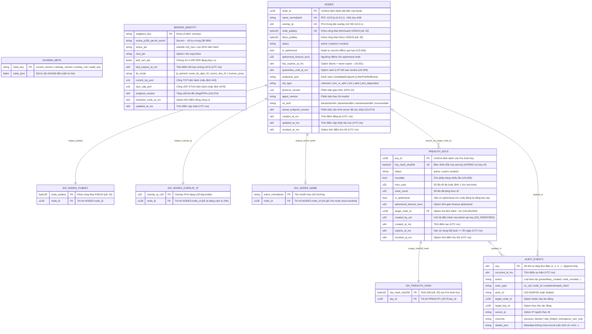
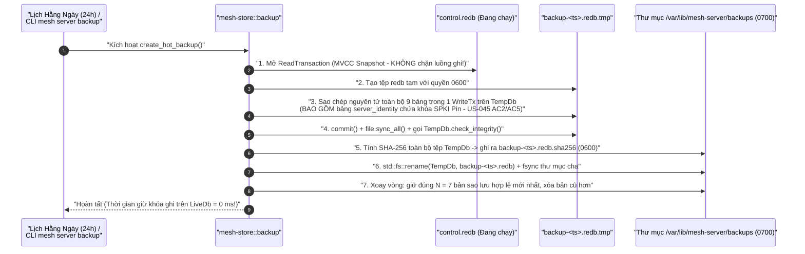

# Database & Persistent State Design — Mesh VPN (`redb` 2.4 & OS State Files)

| Thuộc tính | Giá trị |
|---|---|
| Tác giả | `agile-architect` |
| Ngày | 2026-11-12 |
| Phiên bản | **2.0** — Thiết kế lưu trữ **`redb` `2.4` (100% Pure-Rust ACID MVCC)** & tệp trạng thái đa nền tảng |
| Trạng thái | **Proposed-for-Gate-2** |
| Thành phần AI/Vector DB | **Không có** (Dự án không có RAG/Vector Index) |
| Đầu vào | [production-readiness-requirements.md](../01-discovery/production-readiness-requirements.md) (v1.2) · [product-backlog.md](../02-product-planning/product-backlog.md) (v1.2) · [tech-stack-decision.md](./tech-stack-decision.md) (v2.0) · [architecture-decision-record.md](./architecture-decision-record.md) (v2.0 `ADR-005`, `ADR-007`) · [coding-standards.md](./coding-standards.md) (v2.0) |
| Crate thực thi | `crates/mesh-store` (trên VPS) và `crates/mesh-net::{keystore, ledger}` + `crates/meshd::config` (trên Client/Node) |

---

## 1. Tổng Quan Kiến Trúc Lưu Trữ

Theo quyết định tại **`ADR-001`** và **`ADR-005`**, hệ thống loại bỏ hoàn toàn C-SQLite (`rusqlite`/`libsqlite3-sys`) để sử dụng **`redb` `2.4`** (MIT/Apache-2.0) — cơ sở dữ liệu nhúng B-tree Copy-on-Write (MVCC) viết **100% bằng Rust an toàn (0 dòng mã C)**:

1. **Giao dịch ACID Đa Bảng Nguyên Tử (`REL-11`, `US-007 AC1/AC2`)**:
   - `redb::Database::begin_write()` cung cấp một `WriteTransaction` tuần tự hóa duy nhất tại một thời điểm, đảm bảo mọi thao tác cập nhật bảng chính (`nodes`, `preauth_keys`, `audit_events`, `schema_meta`) và các bảng chỉ mục duy nhất (`idx_nodes_pubkey`, `idx_nodes_overlay_ip`, `idx_nodes_name`, `idx_preauth_hash`) thành công cùng nhau hoặc tự động rollback hoàn toàn nếu tiến trình bị `kill -9` hay mất điện.
2. **Đọc Không Chặn Ghi bằng MVCC (`ReadTransaction`)**:
   - `redb::Database::begin_read()` tạo snapshot cô lập dựa trên cây B-tree Copy-on-Write, không bao giờ chặn luồng `WriteTransaction` và cho phép tạo **Hot Atomic Snapshot Backup** (`US-045`) ngay khi server đang phục vụ lưu lượng.
3. **Tách Biệt Trạng Thái Cấu Trúc Bền Vững (`redb`) và Trạng Thái Runtime Trong RAM (`HR-03`, `US-009 AC1`, `US-013 AC4`)**:
   - Các nhịp heartbeat `last_seen_at_ms` chỉ cập nhật trong bộ nhớ RAM (`NodeRuntimePresence`), **không ghi đĩa liên tục và không bao giờ làm tăng `netmap_version`**.
   - Tập thu hồi khẩn cấp `RevokedSet` trong RAM luôn được ưu tiên kiểm tra và cập nhật trước tiên (< 100 ms) để cắt tức thì thiết bị bị mất ngay cả khi đĩa VPS bị đầy (`ENOSPC`).

---

## 2. Sơ Đồ Thực Thể Liên Kết (`erDiagram`)



---

## 3. Đặc Tả Chi Tiết 9 Bảng `TableDefinition` trong `crates/mesh-store`

### 3.1. Khai báo `TableDefinition` Định Kiểu (`crates/mesh-store/src/schema.rs`)

Tất cả tên bảng tuân thủ chuẩn `snake_case` của `coding-standards.md` §2.1:

```rust
use redb::TableDefinition;

/// 1. Schema version, monotonic counters (netmap_version, audit_seq), and immutable cluster metadata.
pub const TABLE_SCHEMA_META: TableDefinition<&str, &[u8]> =
    TableDefinition::new("schema_meta");

/// 2. Server identity keypair (ECDSA P-256), SPKI PinSet (active + next), and port migration state.
pub const TABLE_SERVER_IDENTITY: TableDefinition<&str, &[u8]> =
    TableDefinition::new("server_identity");

/// 3. Primary node records keyed by NodeId (u128 big-endian bytes / native u128 in redb).
pub const TABLE_NODES: TableDefinition<u128, &[u8]> =
    TableDefinition::new("nodes");

/// 4. Unique secondary index: X25519 node_pubkey ([u8; 32]) -> NodeId (u128).
pub const TABLE_IDX_NODES_PUBKEY: TableDefinition<&[u8; 32], u128> =
    TableDefinition::new("idx_nodes_pubkey");

/// 5. Unique secondary index: Overlay IPv4 (u32 host-order of Ipv4Addr) -> NodeId (u128).
pub const TABLE_IDX_NODES_OVERLAY_IP: TableDefinition<u32, u128> =
    TableDefinition::new("idx_nodes_overlay_ip");

/// 6. Unique secondary index: normalized node name (&str, RFC 1123 lowercase) -> NodeId (u128).
pub const TABLE_IDX_NODES_NAME: TableDefinition<&str, u128> =
    TableDefinition::new("idx_nodes_name");

/// 7. Pre-Auth key records keyed by KeyId (u128).
pub const TABLE_PREAUTH_KEYS: TableDefinition<u128, &[u8]> =
    TableDefinition::new("preauth_keys");

/// 8. Unique secondary index: SHA-256 hash of Pre-Auth key ([u8; 32]) -> KeyId (u128).
pub const TABLE_IDX_PREAUTH_HASH: TableDefinition<&[u8; 32], u128> =
    TableDefinition::new("idx_preauth_hash");

/// 9. Append-only audit log keyed by monotonic sequence number (u64).
pub const TABLE_AUDIT_EVENTS: TableDefinition<u64, &[u8]> =
    TableDefinition::new("audit_events");
```

### 3.2. Định dạng Tuần tự hóa Value (Deterministic Versioned Envelope)

Để không phải kéo thêm bất kỳ crate tuần tự hóa ngoài danh mục cho phép trong `tech-stack-decision.md` §7.1, mọi giá trị phức tạp (`&[u8]`) lưu trong `redb` sử dụng cấu trúc **Versioned JSON Envelope** thông qua `serde` + `serde_json`:
- Byte đầu tiên `b[0]` luôn là **byte phiên bản định dạng nhị phân `FORMAT_VERSION_V1 = 0x01`**.
- Phần còn lại `b[1..]` là chuỗi UTF-8 JSON được tuần tự hóa từ struct Rust có gắn `#[derive(Serialize, Deserialize)]` và `#[serde(deny_unknown_fields)]`.
- Nhờ byte tiền tố `0x01`, nếu các phiên bản sau nâng cấp cấu trúc bản ghi (`0x02`), hàm giải mã có thể đọc lười (lazy migration) hoặc chuyển đổi trong bước migration lúc khởi động mà không bao giờ giải mã nhầm dữ liệu.

### 3.3. Đặc tả Kiểu Dữ liệu & Ràng buộc Toàn vẹn của Từng Bảng

#### (1) Bảng `schema_meta` (`&str -> &[u8]`)
| Khóa (`&str`) | Kiểu dữ liệu Rust | Ràng buộc & Ý nghĩa |
|---|---|---|
| `"schema_version"` | `u32` (hiện tại = `1`) | Phiên bản schema DB hiện hành (`US-007 AC4`). |
| `"netmap_version"` | `u64` (khởi đầu = `1`) | Số thứ tự phiên bản Netmap **tăng đơn điệu** (`REL-03`, `US-009 AC1`). |
| `"audit_seq"` | `u64` (khởi đầu = `0`) | Bộ đếm thứ tự bản ghi `audit_events` tăng đơn điệu (`US-013`). |
| `"overlay_cidr"` | `OverlayCidr` (mặc định `"100.115.0.0/16"`) | Dải CIDR đã khóa khi khởi tạo; từ chối tự ý đổi dải khi đã có node (`US-008 AC3`). |
| `"last_alloc_ip"` | `u32` | Con trỏ cấp phát IP vòng tròn (Round-Robin) trong dải `overlay_cidr`. |

#### (2) Bảng `server_identity` (`&str -> ServerIdentityRecord`)
Chỉ chứa duy nhất 1 bản ghi với khóa `"primary"`:
```rust
#[derive(Debug, Clone, Serialize, Deserialize)]
#[serde(deny_unknown_fields)]
pub struct ServerIdentityRecord {
    /// PKCS#8 DER of the server's ECDSA P-256 identity private key.
    /// Stored on disk with 0600 permissions; loaded into Secret<Vec<u8>> in RAM.
    pub identity_pkcs8_der: Vec<u8>,
    /// Active SPKI pin: "sha256:<64_hex_lowercase>" (SEC-04c, US-047 AC3).
    pub active_pin: SpkiPin,
    /// Optional next SPKI pin announced ahead of planned key rotation (US-047 AC5).
    pub next_pin: Option<SpkiPin>,
    /// Next PKCS#8 DER private key staged for rotation.
    pub staged_next_pkcs8_der: Option<Vec<u8>>,
    /// Self-signed or ACME leaf certificate DER currently served.
    pub leaf_cert_der: Vec<u8>,
    pub leaf_not_before_at_ms: u64,
    pub leaf_expires_at_ms: u64,
    pub tls_mode: ServerTlsMode,
    pub public_host: String,
    pub control_tcp_port: Port,
    pub stun_udp_port: Port,
    /// Monotonic version incremented on port/IP/TLS/pin migration (US-074).
    pub endpoint_version: u64,
    /// Active dual-listener migration window if port/IP migration is in progress (US-074 AC1/AC7).
    pub migration_window: Option<EndpointMigrationWindow>,
    pub created_at_ms: u64,
    pub updated_at_ms: u64,
}
```

#### (3) Bảng `nodes` (`u128 -> NodeRecord`) & 3 Bảng Chỉ Mục Duy Nhất (`idx_nodes_*`)
```rust
#[derive(Debug, Clone, Copy, PartialEq, Eq, Serialize, Deserialize)]
#[serde(rename_all = "snake_case")]
pub enum NodeStatus {
    Active,
    Expired,
    Revoked,
}

#[derive(Debug, Clone, Serialize, Deserialize)]
#[serde(deny_unknown_fields)]
pub struct NodeRecord {
    pub node_id: NodeId,
    /// Normalized lowercase RFC 1123 label (1..=63 chars, [a-z0-9-], no leading/trailing '-').
    pub name_normalized: NodeName,
    pub overlay_ip: OverlayIp,
    pub node_pubkey: PublicKey,
    pub disco_pubkey: PublicKey,
    pub status: NodeStatus,
    pub is_ephemeral: bool,
    pub ephemeral_timeout_secs: Option<u32>,
    /// None means expiry is disabled ("never") for trusted servers (US-031 AC2).
    /// Some(ts) defaults to created_at_ms + 180 days (US-031 AC1).
    pub key_expires_at_ms: Option<u64>,
    /// When status == Revoked, overlay_ip cannot be reassigned until now_ms > quarantine_until_at_ms (default +24h, US-029 AC5).
    pub quarantine_until_at_ms: Option<u64>,
    pub endpoints: Vec<CandidateEndpoint>,
    pub nat_type: NatMappingType,
    pub protocol_version: u16,
    pub agent_version: String,
    pub os: String,
    pub arch: String,
    pub acked_endpoint_version: u64,
    pub registered_with_key_id: KeyId,
    pub created_at_ms: u64,
    pub updated_at_ms: u64,
    pub revoked_at_ms: Option<u64>,
}
```

#### (4) Bảng `preauth_keys` (`u128 -> PreAuthKeyRecord`) & `idx_preauth_hash`
```rust
#[derive(Debug, Clone, Copy, PartialEq, Eq, Serialize, Deserialize)]
#[serde(rename_all = "snake_case")]
pub enum PreAuthKeyStatus {
    Active,
    Used,
    Revoked,
}

#[derive(Debug, Clone, Serialize, Deserialize)]
#[serde(deny_unknown_fields)]
pub struct PreAuthKeyRecord {
    pub key_id: KeyId,
    /// SHA-256 digest of the raw "mpk_..." token. Plaintext key is NEVER stored (SEC-03, US-002 AC5).
    pub key_hash_sha256: [u8; 32],
    pub status: PreAuthKeyStatus,
    pub reusable: bool,
    pub max_uses: u32,
    pub used_count: u32,
    pub is_ephemeral: bool,
    pub ephemeral_timeout_secs: Option<u32>,
    /// Optional target NodeId when created with `--for <node>` for re-auth/key-rotation (US-031 AC5/AC6, US-032).
    pub target_node_id: Option<NodeId>,
    pub used_by_nodes: Vec<NodeId>,
    pub created_by_uid: u32,
    pub created_at_ms: u64,
    /// Mandatory TTL: 0 < (expires_at_ms - created_at_ms) <= 90 days (US-002 AC3).
    pub expires_at_ms: u64,
    pub revoked_at_ms: Option<u64>,
}
```

#### (5) Bảng `audit_events` (`u64 -> AuditRecord` — Append-Only Tuyệt Đối)
- **Ràng buộc `US-013 AC2`**: Module `crates/mesh-store::audit_repo` chỉ xuất 2 hàm: `append_audit_in_tx(&mut WriteTransaction, ...)` và `list_audit_events(&ReadTransaction, limit, offset)`. **Không tồn tại bất kỳ hàm xóa, ghi đè hay cắt bớt bảng `audit_events` nào trong toàn bộ codebase**.

---

## 4. Cưỡng Chế Ràng Buộc Toàn Vẹn & Giao Dịch ACID Nguyên Tử

### 4.1. Thuật toán Đăng ký Thiết bị Idempotent trong 1 `WriteTransaction` Duy Nhất (`US-004`, `US-005`, `US-007`, `US-031`)

Mọi yêu cầu `POST /v1/nodes/register` (sau khi đã vượt qua bước chứng minh sở hữu `node_pubkey` bằng `crypto_box` và băm `key_hash = sha256(preauth_key)`) đều chạy trong **đúng 1 `redb::WriteTransaction`**:

1. **Bước 1 — Kiểm tra Idempotency theo `node_pubkey` (`US-005 AC1/AC2`)**:
   - Tra `idx_nodes_pubkey.get(&req.node_pubkey)`:
   - Nếu đã tồn tại `existing_node_id`: đọc `node` từ bảng `nodes`.
     - Nếu `node.status == NodeStatus::Active` và `node.registered_with_key_id` khớp với key gửi lên (hoặc đang retry cùng yêu cầu): **không tạo node mới, không cấp IP mới, không trừ thêm lượt dùng key**, trả về ngay `NodeRecord` hiện có kèm `NetmapSnapshot` (`200 OK`).
     - Nếu `node.status == NodeStatus::Revoked`: từ chối với `ErrorKind::NodeRevoked`.
2. **Bước 2 — Đối chiếu Pre-Auth Key Constant-Time (`SEC-03`, `SEC-05`, `US-042 AC2`)**:
   - Tra `idx_preauth_hash.get(&key_hash)` và verify lại bằng `bool::from(record.key_hash_sha256.ct_eq(&key_hash))`.
   - Kiểm tra key không nằm trong `RevokedSet` RAM, `record.status == Active`, `now_ms < record.expires_at_ms`, và `record.used_count < record.max_uses`.
   - Nếu bất kỳ điều kiện nào sai: abort transaction và trả về lỗi đồng nhất `ErrorKind::Unauthenticated` (`"authentication failed"`, HTTP `401`) để không tiết lộ lý do key sai hay hết hạn (`US-004 AC4`).
3. **Bước 3 — Phân nhánh Đăng ký Mới vs Đăng ký Lại (`--for <node>`, `US-031 AC5/AC6`, `US-032`)**:
   - **Trường hợp A — Key có `target_node_id = Some(target_id)` (Re-auth / Key Rotation)**:
     - Đọc `target_node` từ bảng `nodes`. Yêu cầu `req.node_pubkey != target_node.node_pubkey` (bắt buộc sinh cặp khóa mới theo `US-031 AC5`).
     - Xóa `target_node.node_pubkey` cũ khỏi `idx_nodes_pubkey`, chèn `req.node_pubkey -> target_id` vào `idx_nodes_pubkey`, đưa khóa cũ vào danh sách vô hiệu hóa, giữ nguyên `target_node.overlay_ip` và `target_node.name_normalized`, đặt lại `status = Active` và `key_expires_at_ms = now_ms + 180 days`.
   - **Trường hợp B — Key thường (`target_node_id = None`)**:
     - Kiểm tra `req.node_name` qua `NodeName::parse()` (chặn tên cấm `localhost`, `broadcasthost`, `wpad`, `isatap`, `local` và `server_identity.public_host` theo `US-004 AC3`).
     - Tra `idx_nodes_name.get(req.node_name.as_str())`: nếu đã tồn tại (kể cả khi client cố tình đòi thay thế node đang có bằng key thường — `US-031 AC6`), từ chối ngay với `ErrorKind::Conflict` và ghi audit cảnh báo!
     - **Cấp phát `OverlayIp` không trùng (`UNIQUE(overlay_ip)`)**: duyệt từ `last_alloc_ip` trong dải `overlay_cidr` (bỏ qua địa chỉ mạng `.0`, địa chỉ broadcast và địa chỉ gateway dự phòng `.1`):
       - Nếu `ip` chưa có trong `idx_nodes_overlay_ip` $\to$ chọn `ip`.
       - Nếu `ip` trỏ tới một node đã `Revoked` và `now_ms > node.quarantine_until_at_ms` (đã hết 24h cách ly theo `US-029 AC5`) $\to$ thu hồi IP đó cấp cho node mới.
       - Nếu cả dải CIDR đã kín $\to$ abort transaction, trả `ErrorKind::Conflict` (`"overlay subnet address pool exhausted"`, `US-004 AC5`).
     - Ghi `NodeRecord` mới vào `nodes`, ghi đồng thời vào `idx_nodes_pubkey`, `idx_nodes_overlay_ip`, `idx_nodes_name`.
4. **Bước 4 — Cập nhật Pre-Auth Key, Tăng `netmap_version` & Ghi Audit**:
   - Tăng `key.used_count += 1`; nếu `!key.reusable || key.used_count >= key.max_uses` thì đặt `key.status = PreAuthKeyStatus::Used`.
   - Tăng `netmap_version += 1` trong `schema_meta`.
   - Tăng `audit_seq += 1` và chèn bản ghi `AuditRecord` vào `audit_events`.
   - Gọi `write_tx.commit()?`: đảm bảo cả 4 bước thành công nguyên tử 100%!

### 4.2. Cơ Chế `RevokedSet` Trong RAM Khi Đầy Đĩa `ENOSPC` (`US-013 AC4`, `US-029`)

```rust
pub struct EmergencyRevocationState {
    pub revoked_nodes: RwLock<HashSet<NodeId>>,
    pub revoked_pubkeys: RwLock<HashSet<PublicKey>>,
    pub revoked_keys: RwLock<HashSet<KeyId>>,
    pub disk_degraded: AtomicBool,
}
```

1. **Khi khởi động `mesh-server`**: nạp toàn bộ `NodeId`/`PublicKey` có `status != Active` và `KeyId` có `status == Revoked` từ `redb` vào `EmergencyRevocationState` trong RAM.
2. **Khi thực thi lệnh phòng vệ khẩn cấp (`node revoke`, `node expire`, `preauthkey revoke`)**:
   - **Bước 1 (Trong RAM, không thể thất bại do đĩa)**: Chèn ngay `NodeId`/`PublicKey`/`KeyId` vào `EmergencyRevocationState`, tăng `netmap_version` nguyên tử trong RAM, hủy `CancellationToken` của phiên Relay/Control tương ứng và đẩy `NetmapSnapshot` mới cho toàn bộ peer online (< 100 ms).
   - **Bước 2 (Ghi bền xuống `redb`)**: Mở `WriteTransaction` để cập nhật `nodes`/`preauth_keys` và `audit_events`.
   - **Bước 3 (Xử lý lỗi `ENOSPC` / I/O)**: Nếu `begin_write()` hoặc `commit()` trả lỗi đầy đĩa/I/O:
     - Đặt `disk_degraded = true` (khiến `/readyz` trả `503 Service Unavailable` theo `US-007 AC5`, `US-044 AC2`).
     - **Giữ nguyên hiệu lực thu hồi trong `EmergencyRevocationState` RAM** (kẻ trộm laptop vẫn bị cắt đứt hoàn toàn khỏi mạng).
     - Xuất bản ghi Audit kèm cảnh báo mức `CRITICAL` (`event = "emergency_revoke_persisted_in_ram_only"`) ra `stderr` / `journald` (`US-013 AC4`).
3. **Với mọi thao tác tạo mới/thay đổi thông thường (`register`, `preauthkey create`, `node rename`)**:
   - Nếu ghi `audit_events` hoặc `commit()` vào `redb` thất bại, hệ thống **bắt buộc từ chối thao tác (fail-closed)** và trả lỗi `503 Unavailable`.

---

## 5. Quy Tắc Tách Biệt Trạng Thái Runtime & Không Tăng `netmap_version` Mỗi Nhịp `last_seen` (`HR-03`, `US-009 AC1`)

Để giữ CPU của VPS lúc rảnh **< 2%** (`GNFR-06`) và băng thông nền mỗi node **≤ 1 KB/s** (`GNFR-07`), `mesh-server` tách bạch 2 nhóm trạng thái:

| Thuộc tính | Nhóm A: Trạng thái Cấu trúc (Lưu trong `redb` + Tăng `netmap_version`) | Nhóm B: Trạng thái Runtime (Chỉ lưu trong RAM `DashMap`/`RwLock<HashMap>`) |
|---|---|---|
| **Các trường dữ liệu** | `node_id`, `name_normalized`, `overlay_ip`, `node_pubkey`, `disco_pubkey`, `status` (`Active`/`Expired`/`Revoked`), `endpoints[]`, `key_expires_at_ms`, `relay_map`, `pin_set` | `last_seen_at_ms: u64`, `online: bool`, `disconnect_debounce_until_ms: Option<u64>`, `ws_stream_tx`, `relay_session_tx`, bộ đếm `rx_bytes`/`tx_bytes` |
| **Khi nhận nhịp Heartbeat (mỗi 30 s)** | **KHÔNG chạm vào `redb`**, **KHÔNG tăng `netmap_version`**, **KHÔNG phát lại `NetmapSnapshot`** | Chỉ cập nhật `runtime.last_seen_at_ms = now_ms` trong RAM (`O(1)`) |
| **Khi Peer chuyển `online ↔ offline`** | Không cần ghi đĩa mỗi lần rớt mạng ngắn | Khi mở stream: nếu `online == false` $\to$ chuyển `online = true`, tăng `netmap_version` trong RAM và đẩy thông báo. Khi đóng stream: chờ **debounce 10 giây** (tránh nhấp nháy khi roaming Wi-Fi $\to$ 4G); nếu sau 10 s chưa kết nối lại mới chuyển `online = false` và tăng `netmap_version`. |

---

## 6. Cấu Trúc Tệp Trạng Thái, Khóa (`0600`), `ResourceLedger` & `netmap-cache.json` Trên 3 Hệ Điều Hành

### 6.1. Bảng Đường Dẫn & Phân Quyền Hệ Điều Hành Chuẩn Hóa (`SEC-01`, `PLAT-01..06`, `US-033 AC6`, `US-073 AC2`)

| Thành phần | **macOS 13+ (`arm64` & `x86_64`)** | **Windows 10/11 x64** | **Ubuntu Linux LTS (VPS & Node/Lab)** |
|---|---|---|---|
| **Binary thực thi** | `/usr/local/libexec/mesh/meshd`<br/>`/usr/local/bin/mesh`<br/>*(Owner `root:wheel`, mode `0755`, kiểm tra `mode & 0o022 == 0`)* | `C:\Program Files\Mesh\meshd.exe`<br/>`C:\Program Files\Mesh\mesh.exe`<br/>`C:\Program Files\Mesh\wintun.dll`<br/>*(ACL: `SYSTEM` + `Administrators` ghi; kiểm SHA-256 `wintun.dll`)* | `/usr/bin/mesh-server`<br/>`/usr/bin/meshd`<br/>`/usr/bin/mesh`<br/>*(Owner `root:root`, mode `0755`)* |
| **Unit / Service file** | `/Library/LaunchDaemons/internal.mesh.meshd.plist`<br/>*(Owner `root:wheel`, mode `0644`)* | Windows Service `MeshVpnAgent`<br/>*(Chạy dưới `NT AUTHORITY\LocalSystem`)* | `/lib/systemd/system/mesh-server.service` *(User=`mesh`)*<br/>`/lib/systemd/system/meshd.service` *(CAP_NET_ADMIN)* |
| **Thư mục trạng thái bảo mật** | `/var/db/mesh/`<br/>*(Owner `root:wheel`, mode **`0700`**)* | `C:\ProgramData\Mesh\`<br/>*(SDDL DACL: **chỉ `SYSTEM` và `Administrators`**, tắt kế thừa `D:P(A;OICI;GA;;;SY)(A;OICI;GA;;;BA)`)* | Server: `/var/lib/mesh-server/` *(`0700` `mesh:mesh`)*<br/>Agent: `/var/lib/mesh/` *(`0700` `root:root`)* |
| **Tệp khóa Node & Disco (`SEC-01`)** | `/var/db/mesh/keys.json`<br/>*(Owner `root:wheel`, mode **`0600`**)* | `C:\ProgramData\Mesh\keys.json`<br/>*(ACL: chỉ `SYSTEM` + `Administrators`)* | `/var/lib/mesh/keys.json`<br/>*(Owner `root:root`, mode **`0600`**)* |
| **Cấu hình Bootstrap (`US-004 AC7`)** | `/var/db/mesh/bootstrap.toml` *(`0600`)* | `C:\ProgramData\Mesh\bootstrap.toml` | `/var/lib/mesh/bootstrap.toml` *(`0600`)* |
| **Cache Netmap & Cổng UDP (`US-019`, `US-033`)** | `/var/db/mesh/netmap-cache.json` *(`0600`)* | `C:\ProgramData\Mesh\netmap-cache.json` | `/var/lib/mesh/netmap-cache.json` *(`0600`)* |
| **Sổ cái Tài nguyên (`ResourceLedger` `US-055`)** | `/var/db/mesh/ledger.json` *(`0600`)* | `C:\ProgramData\Mesh\ledger.json` | `/var/lib/mesh/ledger.json` *(`0600`)* |
| **Kênh Local IPC (`SEC-14`, `ADR-006`)** | `/var/run/mesh/meshd.sock`<br/>*(Thư mục `0755 root:wheel`; socket `0660 root:admin` + kiểm tra `LOCAL_PEERCRED`)* | Admin: `\\.\pipe\mesh-agent-admin` *(SDDL `SY`+`BA`)*<br/>Read-only: `\\.\pipe\mesh-agent-ro` *(SDDL `AU` đọc)* | Server Admin: `/run/mesh/admin.sock` *(`0660 mesh:mesh-admin` + `SO_PEERCRED`)*<br/>Agent: `/run/mesh/meshd.sock` *(`0660` + `SO_PEERCRED`)* |
| **Thư mục Log xoay vòng (`US-043`)** | `/var/log/mesh/meshd.log` *(≤ 100 MB)* | `C:\ProgramData\Mesh\logs\meshd.log` *(≤ 100 MB)* | `/var/log/mesh/mesh-server.log` & `meshd.log` *(≤ 100 MB)* |

### 6.2. Schema JSON/TOML của Các Tệp Trạng Thái Phía Client (`meshd`)

#### (a) Tệp `bootstrap.toml` (Tối giản theo `SEC-15(1)` & `US-004 AC7` — Cấm lưu cứng cổng STUN/Relay)
```toml
schema_version = 1
node_id = "019321b4-7c8a-7000-8000-010203040506"
node_name = "macbook-pro"
control_endpoint = "203.0.113.10:443"
tls_auth_mode = "spki_pin"
active_pin = "sha256:9f86d081884c7d659a2feaa0c55ad015a3bf4f1b2b0b822cd15d6c15b0f00a08"
next_pin = "sha256:e3b0c44298fc1c149afbf4c8996fb92427ae41e4649b934ca495991b7852b855"
acked_endpoint_version = 2
```

#### (b) Tệp `netmap-cache.json` (Bền vững cổng UDP cục bộ `US-019 AC1` & Cache Offline có Checksum `US-033 AC2/AC3`)
```json
{
  "schema_version": 1,
  "local_udp_port": 51829,
  "cached_at_ms": 1762958151000,
  "offline_grace_hours": 24,
  "payload_sha256": "sha256:4a8b9c0d1e2f3a4b5c6d7e8f9a0b1c2d3e4f5a6b7c8d9e0f1a2b3c4d5e6f7a8b",
  "netmap": {
    "netmap_version": 42,
    "overlay_cidr": "100.115.0.0/16",
    "self_node": {
      "node_id": "019321b4-7c8a-7000-8000-010203040506",
      "name": "macbook-pro",
      "overlay_ip": "100.115.0.2",
      "key_expires_at_ms": 1778510151000
    },
    "relay_map": {
      "endpoint_version": 2,
      "control_tcp_endpoint": "203.0.113.10:443",
      "relay_tcp_endpoint": "203.0.113.10:443",
      "stun_udp_endpoints": ["203.0.113.10:3478"]
    },
    "pin_set": {
      "active_pin": "sha256:9f86d081884c7d659a2feaa0c55ad015a3bf4f1b2b0b822cd15d6c15b0f00a08",
      "next_pin": null
    },
    "peers": []
  }
}
```
> **Kiểm tra toàn vẹn khi nạp (`US-033 AC3`)**: Khi `meshd` đọc `netmap-cache.json`, nó tính lại SHA-256 trên chuỗi JSON chuẩn hóa của trường `netmap` và đối chiếu với `payload_sha256`. Nếu tệp bị cắt cụt hoặc sai mã băm, `meshd` từ chối cache hỏng, giữ trạng thái `"waiting_for_control"` và không crash.

#### (c) Tệp `ledger.json` (`ResourceLedger` — Ghi trước khi tạo tài nguyên OS `REL-08`, `US-055`, `US-060`)
```json
{
  "schema_version": 1,
  "session_pid": 1482,
  "started_at_ms": 1762958100000,
  "cleanly_stopped": false,
  "tun_interface_name": "utun7",
  "windows_adapter_guid": null,
  "installed_routes": [
    {
      "cidr": "100.115.0.0/16",
      "interface_name": "utun7"
    }
  ],
  "hosts_block_active": true,
  "hosts_real_path": "/private/etc/hosts",
  "pf_anchor_name": "com.internal.mesh",
  "firewall_rule_names": []
}
```

---

## 7. Kiểm Tra Toàn Vẹn Khi Khởi Động, Migration Schema & Hot Atomic Snapshot Backup (`US-007`, `US-045`)

### 7.1. Kiểm tra Toàn vẹn Lúc Khởi Động (`db.check_integrity()` — `US-007 AC3`)

Ngay khi `mesh-server` mở tệp `/var/lib/mesh-server/control.redb`:
1. Kiểm tra quyền tệp trên đĩa phải là `0600` (nếu lỏng hơn thì tự siết về `0600` hoặc từ chối chạy nếu thuộc sở hữu user khác).
2. Gọi `db.check_integrity()` của `redb` để kiểm tra toàn bộ cây B-tree và checksum các trang dữ liệu.
3. Nếu `check_integrity()` trả về lỗi hỏng dữ liệu: `mesh-server` **dừng khởi động ngay lập tức (fail-closed)**, ghi log `ERROR` (`event = "db_integrity_check_failed"`) và in hướng dẫn khôi phục từ bản sao lưu gần nhất bằng lệnh `mesh server restore <backup_file>`.

### 7.2. Chiến lược Migration Schema An Toàn (`US-007 AC4`)

1. Đọc `"schema_version"` từ bảng `schema_meta`.
2. Nếu DB mới tinh (chưa có bảng `schema_meta`): khởi tạo toàn bộ 9 bảng ở phiên bản `CURRENT_SCHEMA_VERSION = 1` trong 1 `WriteTransaction`.
3. Nếu `db_version < CURRENT_SCHEMA_VERSION`:
   - **Tự động gọi `create_hot_backup("pre-migration")` trước khi chạy migration** (`US-007 AC4`, `REL-12`).
   - Thực thi từng hàm nâng cấp `migrate_vX_to_vY(&mut WriteTransaction)` theo kiểu idempotent; nếu bất kỳ bước nào lỗi thì transaction tự rollback và bản backup trước migration vẫn nguyên vẹn 100%.
4. Nếu `db_version > CURRENT_SCHEMA_VERSION` (hạ cấp nhầm binary cũ trên DB mới): từ chối khởi động để bảo vệ dữ liệu.

### 7.3. Quy trình Hot Atomic Snapshot Backup & Restore Kèm `server_identity` (`REL-12`, `US-045`)



#### Quy trình Khôi phục (`mesh server restore <backup_file>` — `US-045 AC2/AC4/AC6`)
1. Kiểm tra sự tồn tại của tệp `<backup_file>.sha256`, tính lại mã băm SHA-256 của `<backup_file>` và so sánh `ConstantTimeEq`. Nếu sai mã băm hoặc tệp bị cắt cụt $\to$ **từ chối khôi phục ngay lập tức** (`US-045 AC4`), không đụng tới DB hiện tại.
2. Mở `<backup_file>` bằng `redb::Database::open`, chạy `check_integrity()`, và kiểm tra bảng `server_identity` có chứa bản ghi `"primary"` hợp lệ hay không:
   - Nếu thiếu `server_identity` hoặc `active_pin` khác với pin đang cấu hình mà không có cờ `--force-repin`: từ chối và cảnh báo rõ `"mọi client sẽ phải pin lại thủ công"` (`US-045 AC6`).
3. Sao lưu tệp `control.redb` hiện tại (nếu có) sang `control.redb.before-restore`, chép `<backup_file>` vào `control.redb.tmp` (`0600`), gọi `sync_all()` và `rename` nguyên tử thành `control.redb`.
4. Khi `mesh-server` khởi động lại trên DB vừa khôi phục: khóa định danh ECDSA P-256 (`active_pin`), danh sách `nodes` và `OverlayIp` được giữ nguyên 100% $\to$ **toàn bộ máy client macOS/Windows/Linux tự động kết nối lại trong ≤ 5 phút (RTO) mà không cần đăng ký lại và không cần pin lại** (`US-045 AC2`).
