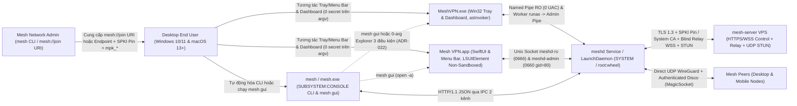
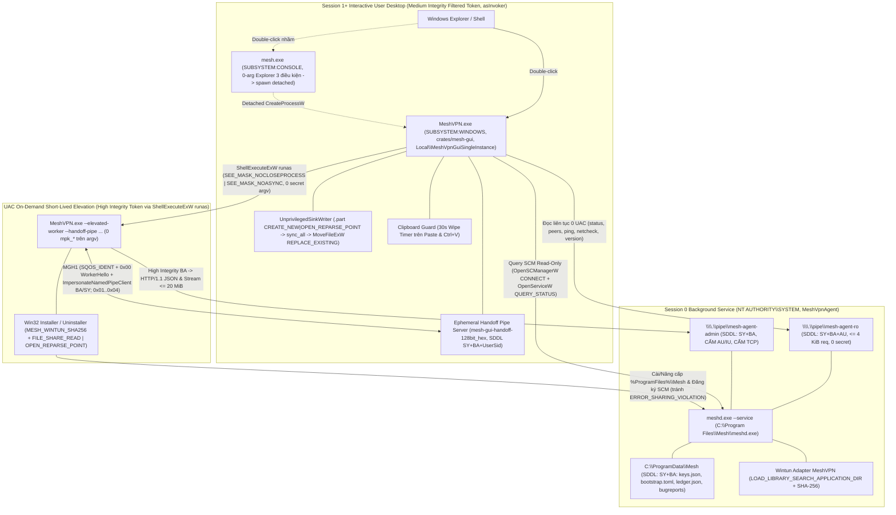
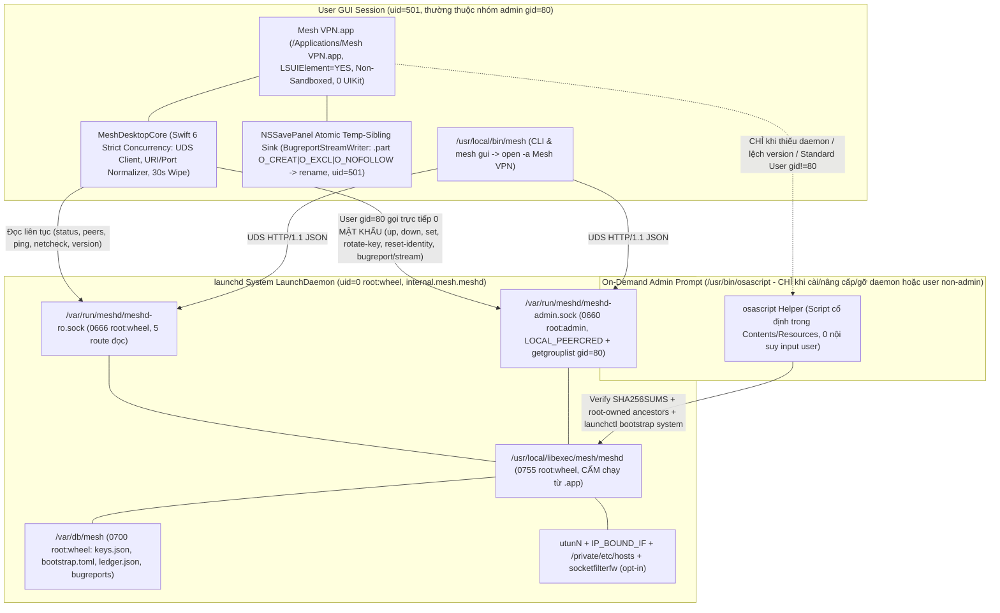
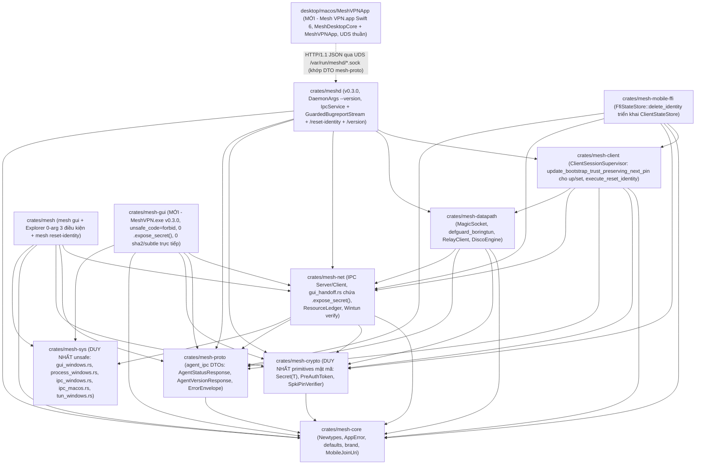
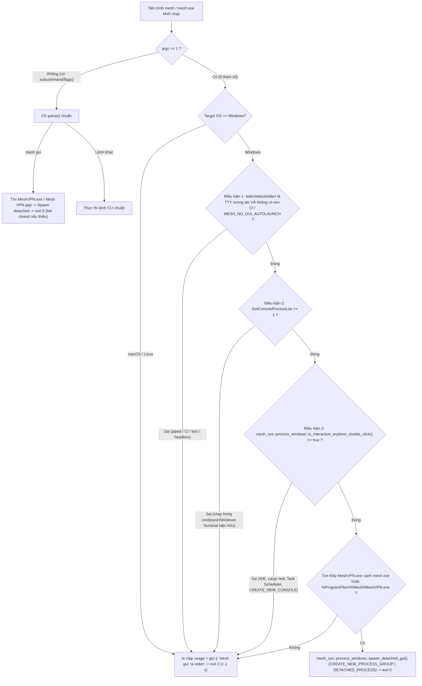
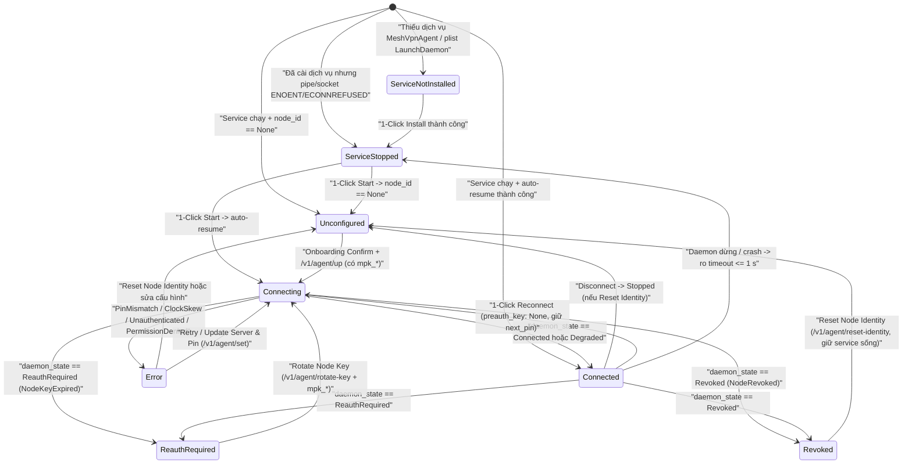

# Kiến trúc Hệ thống Desktop GUI & System Tray — Mesh VPN (`v0.3.0`)

| Thuộc tính | Giá trị |
|---|---|
| Tác giả | `agile-architect` (`architect-gui`) |
| Ngày lập | 2026-11-17 |
| Phiên bản | **1.0 — Design Lock (Gate 2 — Chặng 2)** |
| Nhánh làm việc | `feat/desktop-gui` (tách từ `feat/mobile-clients`; giữ nguyên `main` / `v0.1.0-rc1`) |
| Đầu vào chuẩn tắc Gate 1 | [desktop-gui-readiness-requirements.md](../01-discovery/desktop-gui-readiness-requirements.md) v1.1 (`43` `DGUI-*`) · [desktop-gui-product-backlog.md](../02-product-planning/desktop-gui-product-backlog.md) v1.1 (`US-100..117`, `78 SP`) · [desktop-gui-gate-1-critique.md](../05-quality-assurance/critique-reviews/desktop-gui-gate-1-critique.md) |
| Tài liệu nền tảng `v0.1.0` / `v0.2.0` | [system-architecture.md](./system-architecture.md) · [api-design.md](./api-design.md) · [database-design.md](./database-design.md) · [mobile-system-architecture.md](./mobile-system-architecture.md) · [mobile-ffi-and-storage-design.md](./mobile-ffi-and-storage-design.md) · [`.agents/rules/coding-standards.md`](../../.agents/rules/coding-standards.md) |
| Bộ tài liệu Gate 2 đi kèm (`0` mâu thuẫn) | [desktop-gui-ipc-and-ui-contracts.md](./desktop-gui-ipc-and-ui-contracts.md) · [desktop-gui-tech-stack-decision.md](./desktop-gui-tech-stack-decision.md) · [desktop-gui-adr.md](./desktop-gui-adr.md) (`ADR-020..026`) · [desktop-gui-coding-standards.md](./desktop-gui-coding-standards.md) |

> [!IMPORTANT]
> **Nguyên tắc Kiến trúc Bất biến Kế thừa & Ràng buộc Gate 2:**
> - **Không phá vỡ `v0.1.0-rc1` & `v0.2.0`:** Toàn bộ Control Plane (`mesh-server`), Data Plane (`mesh-datapath`), lõi dùng chung (`mesh-client`), CLI tự động hóa (`crates/mesh`), dịch vụ nền (`crates/meshd`) và Mobile FFI (`crates/mesh-mobile-ffi`) giữ nguyên giao thức mạng, `redb` schema, và 100% test regression hiện hành.
> - **Bảo mật & An toàn Bộ nhớ Tuyệt đối:** `unsafe_code = "forbid"` cho mọi crate ngoài `crates/mesh-sys/` (bao gồm crate GUI Windows mới `crates/mesh-gui`); giữ nguyên allowlist 4 crate gọi `.expose_secret()` (`mesh-crypto`, `mesh-datapath`, `mesh-net`, `mesh`); giữ nguyên SDDL Admin Named Pipe `D:P(A;;GA;;;SY)(A;;GA;;;BA)` và socket macOS `0660 root:admin` (`gid = 80`); **0** Admin TCP listener; **0** TOFU; **0** `spctl --master-disable`; **0** `com.apple.security.app-sandbox` hay `CFBundleURLTypes` trên bản `.app` ngoài App Store.
> - **Phân tách Kiểm chứng Trung thực:** Mọi đặc tả phân định rõ phạm vi kiểm định tự động `$0` trên CI với hạng mục bắt buộc ký nghiệm thu trên phần cứng Windows 10/11 & macOS 13+ (`hardware_signoff_required`).

---

## 1. Mục tiêu Kiến trúc & Khắc phục Nguyên nhân Gốc rễ `v0.1.0-rc1`

Milestone **`v0.3.0`** bổ sung lớp **Desktop GUI & System Tray / Menu Bar** cho **Windows 10/11 (`x86_64`)** và **macOS 13+ (`arm64` & `x86_64`)** theo đúng 3 quyết định đã chốt từ Gate 1 (`OQ-DGUI-01..03`):

| Quyết định Gate 1 | Lựa chọn đã chốt | Hiện thực hóa trong Kiến trúc Gate 2 |
|---|---|---|
| **`OQ-DGUI-01`** | **A1 — Tray / Menu Bar + Full Dashboard Window** | Ứng dụng thường trú nhẹ tại khay hệ thống (`Shell_NotifyIconW` / `NSStatusItem`) với menu bật/tắt 1-click tức thì, đồng thời mở cửa sổ Dashboard đơn đầy đủ (Onboarding `mesh://join` + Manual, Confirmation Modal, Peers, Ping, Netcheck, Update Server/Pin, Rotate Key, Reset Identity, Export Bugreport). Thoát GUI không tắt tunnel nền của `meshd`. |
| **`OQ-DGUI-02`** | **A2 — Native UI Tối ưu theo từng OS** | **Windows**: `crates/mesh-gui` (`MeshVPN.exe`) viết bằng Rust + `windows-sys` Win32 thuần (`SUBSYSTEM:WINDOWS`, `PerMonitorV2` DPI, `0` WebView2/Electron, hỗ trợ MSVC + MinGW `gnu` + stub non-Windows). **macOS**: `desktop/macos/MeshVPNApp/` (`Mesh VPN.app`) viết bằng Swift 6 (`SWIFT_STRICT_CONCURRENCY = complete`, AppKit `NSStatusItem` + SwiftUI single-window Dashboard, `LSUIElement = YES`, Non-Sandboxed, `0` `UIKit`). |
| **`OQ-DGUI-03`** | **A3 — 1-Click Service Install/Start trong GUI** | Tự động thăm dò trạng thái dịch vụ nền `meshd` (`ServiceNotInstalled` / `ServiceStopped` / `Running`) không cần đặc quyền, cung cấp nút 1-click cài đặt/khởi động qua `ShellExecuteExW("runas")` (Windows, xác minh compile-time `MESH_WINTUN_SHA256` chống TOCTOU, đóng êm Tray cũ tránh `ERROR_SHARING_VIOLATION`) và `/usr/bin/osascript` (macOS, cài vào `/usr/local/libexec/mesh/meshd` `root:wheel`, bảo toàn `codesign -v` & `SHA256SUMS`). |

---

## 2. Sơ đồ Kiến trúc C4 (`Mermaid`)

### 2.1. C4 Level 1 — System Context Diagram



### 2.2. C4 Level 2 — Container & OS Privilege Boundary View (Two-Binary Split)

#### A. Kiến trúc Phân tách Đặc quyền trên Windows (`Session 0` vs `Session 1+` vs `High-Integrity Worker`)



#### B. Kiến trúc Phân tách Đặc quyền trên macOS (`LaunchDaemon root:wheel` vs `Non-Sandboxed Mesh VPN.app`)



### 2.3. C4 Level 3 — Workspace Component & Dependency DAG (`v0.3.0`)



#### Bảng Cô lập Trách nhiệm Crate & Ngôn ngữ (Khớp 100% `ADR-020` & `coding-standards.md`)

| Thành phần | Ngôn ngữ / Vị trí | Trách nhiệm chính | Ràng buộc An toàn & Static Gate (`scripts/check.{ps1,sh}`) |
|---|---|---|---|
| **`crates/mesh-gui`** | Rust (`[[bin]] name = "MeshVPN"`, `version = "0.3.0"`) | Điểm vào `MeshVPN.exe` (`SUBSYSTEM:WINDOWS` trên Windows, stub trên non-Windows): chế độ Tray+Dashboard thường trú (`asInvoker`) và chế độ `--elevated-worker --handoff-pipe <name>` (High Integrity). Dùng `mesh-crypto = { workspace = true, default-features = false }` cho `Secret<String>` và `sha256_digest`/`ct_eq_bytes`/`verify_file_sha256`. | `[lints] workspace = true` (`unsafe_code = "forbid"`). **0 dòng `unsafe`**, **0 `.expose_secret()`**, **0 import `sha2`/`subtle` trực tiếp**, **0 `println!`/`eprintln!`**, **0 `:443`/`:3478` hardcode**. Biên dịch xanh cả MSVC, `x86_64-pc-windows-gnu` và Linux/macOS CI. |
| **`crates/mesh-sys`** | Rust (chỉ crate dùng `unsafe`) | Thêm `gui_windows.rs` (`enable_per_monitor_v2_dpi()`, `launch_elevated_worker()`, `HandoffPipeServer`, `HandoffPipeClient`, `UnprivilegedSinkWriter` atomic temp-sibling `.part -> sync_all -> MoveFileExW`, `open_anti_toctou_read_locked()`, `acquire_single_instance_mutex()`, Win32 `Shell_NotifyIconW`, `TaskbarCreated`, `CreateWindowExW`, `ShellExecuteExW`, Named Pipe SDDL, `GetNamedPipeClientProcessId` + `ImpersonateNamedPipeClient(SecurityIdentification)` + `OpenThreadToken` + `CheckTokenMembership`, `Local\MeshVpnGuiSingleInstance`, `Local\MeshVpnGuiShutdownEvent`, `WM_APP_GRACEFUL_SHUTDOWN`, Clipboard & `SetTimer`, `HKCU\...\Run`, `SHGetKnownFolderPath` + `CoTaskMemFree` dọn `.lnk`, `FILE_FLAG_OPEN_REPARSE_POINT`) và `process_windows.rs` (`is_interactive_explorer_double_click()`, `spawn_detached_gui()` với `CREATE_NEW_PROCESS_GROUP \| DETACHED_PROCESS`), dùng RAII `OwnedWinHandle`, `OwnedIcon`, `OwnedMenu`, `OwnedGdiObj`, `OwnedRegKey`, `LocalAllocGuard`, `ClipboardGuard`. | `unsafe_op_in_unsafe_fn = "deny"`, `undocumented_unsafe_blocks = "deny"`, bắt buộc `// SAFETY:` trên từng khối `unsafe`; **CẤM** `OpenProcess`/`OpenProcessToken` từ Medium Integrity và **CẤM** `CREATE_BREAKAWAY_FROM_JOB`. |
| **`crates/mesh-net`** | Rust | Thêm `src/gui_handoff.rs` (đóng khung `MGH1` `0x00 WorkerHello` + `0x01..0x04`, `build_up_handoff_payload()`, `build_rotate_key_handoff_payload()`, tạo/đọc/ghi pipe handoff có timeout, giải bọc `Secret<String>` / `PreAuthToken` sang `Zeroizing<Vec<u8>>` cho `AgentUpRequest` / `AgentRotateKeyRequest`, client IPC 3 tầng timeout & streaming bugreport `<= 20 MiB`). | Giữ nguyên allowlist 4 crate `.expose_secret()` (`mesh-crypto`, `mesh-datapath`, `mesh-net`, `mesh`). |
| **`crates/mesh-core` & `crates/mesh-proto`** | Rust | `mesh-core`: re-export `pub use mobile_uri::validate_preauth_key` ở `src/lib.rs` (kiểm tra `mpk_` + `BASE64URL_NOPAD >= 32 B`). `mesh-proto`: giữ nguyên toàn bộ 13 trường `AgentStatusResponse` (`#[serde(deny_unknown_fields)]`), thêm `AgentVersionResponse`, `AgentResetIdentityRequest {}`, mở rộng fixtures golden JSON. | `proptest!`, `deny_unknown_fields`, không lộ `private_key`. |
| **`crates/mesh-client`, `crates/meshd` & `crates/mesh-mobile-ffi`** | Rust | Nâng `[workspace.package] version = "0.3.0"` trong `Cargo.toml` (tách bare `"0.3.0"` khỏi `"meshd/0.3.0"` tại `DaemonRuntimePaths`); thêm `ClientStateStore::delete_identity()` (triển khai trên `FileClientStateStore`, `InMemoryClientStateStore`, và **`FfiStateStore` tại `crates/mesh-mobile-ffi/src/bridge.rs:140`** -> `delete_state_file(SEALED_IDENTITY_FILENAME)`), `ClientSessionSupervisor::execute_reset_identity()`, hợp nhất `execute_up` (`session.rs:680`) & `execute_set` (`session.rs:752`) qua `update_bootstrap_trust_preserving_next_pin(...)`, thêm `#[command(version)]` trên `DaemonArgs`, gắn `X-Mesh-Agent-Version` & thêm `GET /v1/agent/version`, `POST /v1/agent/reset-identity`, `POST /v1/agent/bugreport/stream` bọc bởi **`GuardedBugreportStream`** (`drop(inner.take())` trước `remove_file`). | Bảo toàn 100% route & DTO `v0.1.0-rc1` (`POST /v1/agent/bugreport`, `up`, `down`, `cleanup`, `set`, `rotate-key`) và 100% test `mesh-mobile-ffi`. |
| **`crates/mesh`** | Rust | Thêm subcommand `mesh gui`, `mesh reset-identity [--yes]`, và hook 0-arg Explorer 3 điều kiện (Windows) trước `Cli::parse()`. | Không phá vỡ script/pipe/unit test `clap` (`exit 2 < 1 s`). |
| **`desktop/macos/MeshVPNApp`** | Swift 6 (`XcodeGen` `project.yml`) | Gồm 2 module: `MeshDesktopCore` (`UdsIpcClient`, `AgentIpcModels`, `EndpointNormalizer`, `JoinUriParser`, `ClipboardRedactor`, `DesktopUiStateMachine`, `BugreportStreamWriter`, `SafeOsLogger`, `AgentDefaults`) & `MeshVPNApp` (`AppDelegate`, `DashboardWindowController`, `LaunchDaemonInstaller` — `NSStatusItem` Menu Bar + single-window SwiftUI Dashboard, `osascript`). | `SWIFT_STRICT_CONCURRENCY = complete`, `swiftlint --strict`, **0 `import UIKit`**, **0 `app-sandbox`**, **0 `CFBundleURLTypes`**, **0 `NSAllowsArbitraryLoads`**, **0 `spctl --master-disable`**. Quét bởi `scripts/check.{ps1,sh}`. |

---

## 3. Phân tách Đặc quyền & Các Cơ chế Bảo mật Trọng yếu (`ADR-021`, `ADR-022`, `ADR-023`)

### 3.1. Luồng Khởi chạy An toàn `mesh` (`0-arg` Explorer vs CLI) & `mesh gui` (`ADR-022`)

Để người dùng double-click nhầm `mesh.exe` từ Windows Explorer không bị "chớp màn hình đen exit 2", đồng thời **không bao giờ** gây treo script, pipe, Task Scheduler hoặc hỏng unit test `crates/mesh/src/cli.rs`:



- **Chống giả mạo PID tái sử dụng trong `is_interactive_explorer_double_click()` (`crates/mesh-sys/src/process_windows.rs`)**:
  1. Lấy PID hiện tại (`GetCurrentProcessId`) và duyệt snapshot `CreateToolhelp32Snapshot(TH32CS_SNAPPROCESS, 0)` để tìm `th32ParentProcessID`.
  2. Mở handle tiến trình cha bằng `OpenProcess(PROCESS_QUERY_LIMITED_INFORMATION, FALSE, parent_pid)`.
  3. Kiểm tra `GetProcessTimes`: thời điểm tạo tiến trình cha **phải nhỏ hơn** thời điểm tạo tiến trình hiện tại (loại trừ trường hợp tiến trình cha đã thoát và PID bị tái sử dụng).
  4. Kiểm tra `QueryFullProcessImageNameW`: đường dẫn ảnh tiến trình cha chuẩn hóa không phân biệt hoa thường phải khớp chính xác `<GetWindowsDirectoryW()>\explorer.exe` (tuyệt đối không chỉ so sánh tên tệp `szExeFile` nhằm tránh giả mạo từ thư mục user).

### 3.2. Windows Ephemeral Named Pipe Handoff & OTS UAC (`ADR-021`)

Khi `MeshVPN.exe` (`Medium Integrity`, `asInvoker`) cần thực thi thao tác đặc quyền (`up`, `down`, `set`, `rotate-key`, `cleanup`, `reset-identity`, `bugreport/stream`, hoặc cài/nâng cấp/gỡ dịch vụ), luồng hoạt động tuyệt đối không truyền `mpk_*` qua `argv` (`lpParameters`) hay phụ thuộc kế thừa `stdin` (bị `AppInfo` UAC cắt bỏ):

```mermaid
sequenceDiagram
    autonumber
    participant User as "Người dùng Windows"
    participant GUI as "MeshVPN.exe (Session 1+ Medium Integrity)"
    participant WinOS as "Windows AppInfo / UAC"
    participant Worker as "MeshVPN.exe --elevated-worker (High Integrity)"
    participant Daemon as "meshd.exe (Session 0 SYSTEM)"

    User->>GUI: "Bấm Connect (gửi kèm mpk_* trong Secret(String))"
    GUI->>GUI: "1. Tạm ngắt polling meshd-ro nền"
    GUI->>GUI: "2. Sinh tên pipe ngẫu nhiên 128-bit hex: \\\\.\\pipe\\mesh-gui-handoff-{32_hex}"
    GUI->>GUI: "3. Tạo pipe server (FILE_FLAG_FIRST_PIPE_INSTANCE | PIPE_REJECT_REMOTE_CLIENTS | OVERLAPPED, SDDL SY+BA+CurrentUserSid)"
    GUI->>WinOS: "4. ShellExecuteExW(runas, path=MeshVPN.exe, params='--elevated-worker --handoff-pipe ...', SEE_MASK_NOCLOSEPROCESS | SEE_MASK_NOASYNC)"
    alt "User bấm No / Cancel UAC (ERROR_CANCELLED = 1223) hoặc timeout 120s UAC / 15s connect"
        WinOS-->>GUI: "Err(1223) hoặc hProcess thoát sớm"
        GUI->>GUI: "Zeroize RAM Secret(String) + đóng pipe + hủy handle <= 100 ms; hiện thông báo thân thiện"
    else "User xác nhận UAC (Split-Token hoặc Standard User Over-The-Shoulder Admin)"
        WinOS->>Worker: "Khởi chạy tiến trình High Integrity (có SID BA)"
        Worker->>GUI: "5. CreateFileW(SECURITY_SQOS_PRESENT | SECURITY_IDENTIFICATION | OVERLAPPED) -> gửi ngay Frame MGH1 0x00 WorkerHello (13 B)"
        GUI->>GUI: "6. Verify GetNamedPipeClientProcessId == child_pid -> đọc 13 B WorkerHello -> ImpersonateNamedPipeClient + OpenThreadToken + CheckTokenMembership(BA/SY) + RevertToSelf"
        GUI->>Worker: "7. Chỉ sau khi pass bước 6 mới gửi Frame MGH1 0x01 HandoffRequest (Zeroizing Vec(u8))"
        GUI->>GUI: "Zeroize ngay buffer secret phía GUI"
        Worker->>Daemon: "8. Kết nối \\\\.\\pipe\\mesh-agent-admin -> POST /v1/agent/up (timeout 35_000 ms)"
        Daemon-->>Worker: "9. 200 OK AgentActionResponse"
        Worker-->>GUI: "10. Gửi Frame MGH1 0x04 (HandoffResponse) -> Worker zeroize & thoát 0"
        GUI->>GUI: "11. Đóng pipe, nối lại polling meshd-ro & làm mới status <= 500 ms"
    end
```

- **Xác thực Peer 2 Lớp trên Medium Integrity & OTS UAC (`Over-The-Shoulder`, `BLK-DGUI-G2-04`):**
  - Ở `v0.1.0-rc1`, `inspect_named_pipe_peer` chạy trong `meshd` (`LocalSystem`), nhưng trong handoff pipe, pipe server lại là `MeshVPN.exe` (**Medium Integrity** `asInvoker`). Nếu gọi `inspect_named_pipe_peer` khi worker chưa ghi byte nào (`0` byte đọc), `ImpersonateNamedPipeClient` trả `ERROR_CANNOT_IMPERSONATE (1368)` và fallback `OpenProcess`/`OpenProcessToken` lên tiến trình High Integrity / OTS Admin sẽ **thất bại 100% với `ERROR_ACCESS_DENIED (5)`**.
  - Vì vậy, giao thức bắt buộc **`HandoffPipeClient`** mở pipe bằng **`SECURITY_SQOS_PRESENT | SECURITY_IDENTIFICATION | FILE_FLAG_OVERLAPPED`** và gửi ngay Frame **`0x00 WorkerHello`** (`13` bytes, `protocol_version = 1`) trước khi chờ lệnh. Sau khi kiểm `GetNamedPipeClientProcessId == GetProcessId(sei.hProcess)` và đọc đủ `13` bytes `WorkerHello` (`timeout <= 5_000 ms`), pipe server gọi `ImpersonateNamedPipeClient(pipe_handle)` (nhận thread token mức `SecurityIdentification` mà không cần `SeImpersonatePrivilege` hay `OpenProcessToken`), kiểm tra `OpenThreadToken(..., TOKEN_QUERY, 1, ...)` + `CheckTokenMembership` xác nhận `is_builtin_admin || is_local_system` rồi `RevertToSelf` (RAII guard) — hỗ trợ trọn vẹn cả Split-Token UAC lẫn Standard User OTS Admin trước khi phát Frame `0x01` chứa `mpk_*`.

### 3.3. Thiết kế *Atomic Temp-Sibling Sink Write* cho Bugreport Streaming `<= 20 MiB` (`ADR-023`)

Nhằm vừa giữ nguyên tuyệt đối thư mục state nhạy cảm (`/var/db/mesh` `0700 root:wheel` và `C:\ProgramData\Mesh` SDDL `SY+BA`) chứa `keys.json`, vừa hỗ trợ hợp lệ thao tác **Replace** tệp `.tar` đã tồn tại trong `SaveFileDialog`/`NSSavePanel` mà không dính lỗ hổng **Arbitrary File Overwrite EoP** (NTFS Junction / Oplock / Symlink), tiến trình đặc quyền (`meshd`, `--elevated-worker`) **tuyệt đối không bao giờ nhận, mở hoặc ghi đường dẫn tệp đích do người dùng chọn**:

```mermaid
sequenceDiagram
    autonumber
    participant User as "User (Windows / macOS)"
    participant GUI as "GUI Unprivileged (MeshVPN.exe Medium / Mesh VPN.app uid=501)"
    participant Worker as "Win Only: --elevated-worker (High Integrity)"
    participant Daemon as "meshd (SYSTEM / root)"

    User->>GUI: "Bấm Export Redacted Bugreport -> chọn đường dẫn dest.tar (tạo mới hoặc Replace) trên SaveFileDialog / NSSavePanel"
    GUI->>GUI: "Khi mở dialog: KHÔNG bật PollingSuspensionGuard; sau khi user xác nhận mới kiểm tra dest ngoài system dir, parent non-reparse, và dest nếu tồn tại là regular file"
    GUI->>GUI: "Bật PollingSuspensionGuard (tạm ngắt polling nền meshd-ro)"

    alt "macOS (User nhóm admin gid=80: 0 mật khẩu, 0 osascript)"
        GUI->>Daemon: "UDS /var/run/meshd/meshd-admin.sock: POST /v1/agent/bugreport/stream"
        Daemon->>Daemon: "Tạo .tar tạm trong /var/db/mesh/bugreports/ (<= 20 MiB) bọc bởi GuardedBugreportStream"
        Daemon-->>GUI: "200 OK (X-Mesh-Archive-Bytes, X-Mesh-Scrubbed-Items) + stream chunk 64 KiB"
        Daemon->>Daemon: "GuardedBugreportStream::drop() gọi drop(inner.take()) trước std::fs::remove_file"
    else "Windows (Medium -> High Worker -> SYSTEM)"
        GUI->>Worker: "Handoff MGH1 (0x00 WorkerHello + Impersonate -> 0x01 export_bugreport_stream, 0 chứa save path!)"
        Worker->>Daemon: "Pipe \\\\.\\pipe\\mesh-agent-admin: POST /v1/agent/bugreport/stream"
        Daemon->>Daemon: "Tạo .tar tạm trong C:\\ProgramData\\Mesh\\bugreports\\ (<= 20 MiB) bọc bởi GuardedBugreportStream"
        Daemon-->>Worker: "200 OK + stream chunk 64 KiB"
        Worker-->>GUI: "Handoff MGH1 Frame 0x02 (total_bytes) + N x Frame 0x03 (<= 64 KiB) + Frame 0x04 (Done)"
        Daemon->>Daemon: "GuardedBugreportStream::drop() gọi drop(inner.take()) trước std::fs::remove_file"
    end

    GUI->>GUI: "UnprivilegedSinkWriter/BugreportStreamWriter ghi .mesh-bugreport-{hex}.tar.part (O_CREAT|O_EXCL|O_NOFOLLOW / CREATE_NEW|OPEN_REPARSE_POINT)"
    GUI->>GUI: "Kiểm tra expected_total_bytes > 0 && cumulative_bytes == expected_total_bytes <= 20_971_520 -> sync_all -> re-check dest -> atomic rename"
    GUI-->>User: "Hiển thị size_bytes & scrubbed_items thành công (RAII xóa .part nếu lỗi/cắt cụt)"
```

---

## 4. Máy Trạng Thái Tổng Hợp (`DesktopUiState`) & Vòng Đời Tunnel

Thay vì phân mảnh trạng thái giữa service OS, lỗi IPC và `DaemonState`, cả `MeshVPN.exe` và `Mesh VPN.app` ánh xạ về một **máy trạng thái tổng hợp 8 trạng thái chuẩn (`DesktopUiState`)**:



### Quy tắc Ánh xạ Đầy đủ từ OS Probe + IPC sang 8 Trạng thái (`DesktopUiState`)

| `DesktopUiState` | Điều kiện kích hoạt chính xác | Trạng thái phụ / Banner | Hành động chính (Primary CTA) trên UI |
|---|---|---|---|
| **`ServiceNotInstalled`** | Windows: SCM `OpenServiceW("MeshVpnAgent")` trả `ERROR_SERVICE_DOES_NOT_EXIST (1060)`.<br/>macOS: `!FileExists(/Library/LaunchDaemons/internal.mesh.meshd.plist)` hoặc `!FileExists(/usr/local/libexec/mesh/meshd)` VÀ `meshd-ro.sock` `ENOENT`. | — | **"Install & Start Service"** (UAC `runas` / `osascript`). |
| **`ServiceStopped`** | Dịch vụ/plist đã tồn tại nhưng SCM trạng thái `STOPPED` (hoặc `meshd-ro.sock` trả `ENOENT`/`ECONNREFUSED`/`ERROR_FILE_NOT_FOUND`). | — | **"Start Service"** (UAC `runas` / `osascript`). |
| **`Unconfigured`** | `meshd-ro` trả `200 OK` với `daemon_state == "stopped"` và `node_id == None` (hoặc `bootstrap.server_endpoint == None`). | — | Hiện màn hình **Onboarding** (`mesh://join` + Manual). |
| **`Connecting`** | `daemon_state == "connecting"` (bao gồm đang trong tác vụ `up` / `rotate-key`). | Hiển thị `server_connection.last_error` nếu đang backoff tạm thời. | **"Disconnect"** (hoặc chờ kết nối). |
| **`Connected`** | `daemon_state == "connected"` **HOẶC** `daemon_state == "degraded"` (tunnel P2P chạy từ cache khi Control tạm rớt theo `US-033`) **HOẶC** `daemon_state == "stopped"` khi `node_id != None` (trạng thái sẵn sàng ngắt thủ công ở Dashboard!). | Khi `daemon_state == "degraded"`: banner vàng *"Control server temporarily unreachable — P2P tunnel active from cache"*. Khi `daemon_state == "stopped"` và `node_id != None`: nhãn badge *"Disconnected"* + nút **1-Click Connect**. | **"Disconnect"** (khi `connected`/`degraded`) hoặc **"Connect"** 1-click (`preauth_key: None`, giữ `next_pin`) khi `stopped` & đã enroll. |
| **`ReauthRequired`** | `daemon_state == "reauth_required"` (key node hết hạn — `meshd` đã dừng retry theo `US-034 AC5`). | Banner cảnh báo *"Node identity key expired; enter a scoped pre-auth key to rotate"*. | **"Rotate Node Key"** (mở form nhập `mpk_*` `--for <node>` -> Confirmation -> `/v1/agent/rotate-key`). |
| **`Revoked`** | `daemon_state == "revoked"` (`meshd` đã gỡ tunnel & dừng retry theo `US-029`). | Banner đỏ *"This device was revoked by administrator"*. | **"Reset Node Identity"** (xác nhận nguy hiểm -> `POST /v1/agent/reset-identity` -> về `Unconfigured` giữ `meshd` sống). |
| **`Error`** | Lỗi không hồi phục tức thời hoặc cần can thiệp người dùng: `PermissionDenied` (`ERROR_ACCESS_DENIED` / `EACCES` khi user `gid != 80`), `PinMismatch`, `ClockSkew`, `Unauthenticated` (`"authentication failed"` — `SEC-05`), `VersionMismatch` (trên macOS có banner nâng cấp daemon). | Hiển thị thông điệp lỗi chuẩn hóa (tuyệt đối `"authentication failed"` cho `Unauthenticated`). | Nút tương ứng: **"Update Server / Pin"**, **"Reset Node Identity"**, **"Install/Update Service"**, hoặc hướng dẫn chạy với quyền Administrator. |

---

## 5. Luồng Cài đặt, Nâng cấp Êm & Gỡ cài đặt (`ADR-025`, `ADR-026`, `G4`)

### 5.1. Windows: Anti-TOCTOU `MESH_WINTUN_SHA256`, Đóng Êm Tray Tránh `ERROR_SHARING_VIOLATION (32)` & Cleanup `HKCU\...\Run`

1. **Xác minh nguồn chống TOCTOU trước khi cài/nâng cấp (`DGUI-WIN-04`, `US-106`)**:
   - `MeshVPN.exe` nhúng compile-time `option_env!("MESH_WINTUN_SHA256")` đồng bộ với `crates/meshd/src/config.rs:84` (nếu thiếu ở dev build: fail-closed từ chối cài dịch vụ production; tuyệt đối **không** tin tệp rời `wintun.dll.sha256` ở thư mục user ghi được như `Downloads`).
   - Worker `--elevated-worker` mở tất cả tệp nguồn (`MeshVPN.exe`, `meshd.exe`, `mesh.exe`, `wintun.dll`) bằng **`FILE_SHARE_READ` + `FILE_FLAG_OPEN_REPARSE_POINT`** (khóa ghi/đổi tên/xóa và từ chối junction/symlink trên từng tệp và kiểm tra canonical parent).
   - Tính SHA-256 trên chính handle đã khóa đó (đối chiếu `ConstantTimeEq` với `MESH_WINTUN_SHA256`), giữ nguyên handle xuyên suốt bước copy sang `C:\Program Files\Mesh\`.
   - **Tránh Self-Copy:** Nếu đường dẫn chuẩn hóa của thư mục chạy hiện tại trùng với `%ProgramFiles%\Mesh\` (trường hợp user chỉ bấm *Start* hoặc cài lại dịch vụ tại chỗ), bỏ qua bước copy đè `MeshVPN.exe`.
2. **Giao thức Nâng cấp Êm tránh `ERROR_SHARING_VIOLATION (32)` (`DGUI-WIN-06`, `US-108`)**:
   - Phiên bản mới khởi chạy từ `Downloads` phát hiện mutex phiên **`Local\MeshVpnGuiSingleInstance`**.
   - So sánh phiên bản đang chạy (gửi `WM_APP_GRACEFUL_SHUTDOWN` / kiểm tra phiên bản qua `SendMessageTimeoutW` hoặc shared mapping nhỏ trong `Local\`):
     - Nếu bản đang chạy **cùng hoặc mới hơn**: gọi `SetForegroundWindow` đưa cửa sổ hiện hữu lên trước và thoát `0`.
     - Nếu bản vừa mở **mới hơn** (hoặc đang chạy tác vụ `UpdateService`): kích hoạt **`Local\MeshVpnGuiShutdownEvent`** (và gửi `WM_APP_GRACEFUL_SHUTDOWN`), chờ tiến trình cũ gọi `Shell_NotifyIconW(NIM_DELETE)`, zeroize RAM, nhả mutex `Local\MeshVpnGuiSingleInstance` và thoát hoàn toàn (timeout `<= 3_000 ms`) → tiếp tục dừng dịch vụ `MeshVpnAgent` (timeout `<= 10_000 ms`) → ghi đè sạch các tệp nhị phân trong `%ProgramFiles%\Mesh\` → **giữ nguyên 100% `C:\ProgramData\Mesh\{keys.json, bootstrap.toml}`** → khởi động lại `MeshVpnAgent` và mở `MeshVPN.exe` mới.
3. **Gỡ cài đặt Sạch đúng User Context (`DGUI-OPS-02`, `US-115`)**:
   - **Bước 1 (Trước khi gọi `runas`, dưới ngữ cảnh user đang đăng nhập):** `MeshVPN.exe` (Medium Integrity) tự xóa giá trị tự khởi chạy `MeshVPN` trong **`HKCU\Software\Microsoft\Windows\CurrentVersion\Run`** và xóa shortcut `.lnk` Start Menu/Desktop của chính user đó bằng `SHGetKnownFolderPath` + `CoTaskMemFree` + `std::fs::remove_file` (tạo `.lnk` do `scripts/install-windows.ps1` qua `WScript.Shell`, không dùng crate `windows`; tránh trường hợp OTS UAC làm `HKCU` trỏ nhầm sang tài khoản Admin khác và ghi rõ giới hạn OS nếu các tài khoản local khác tự bật `HKCU` riêng).
   - **Bước 2 (Worker nâng quyền High Integrity):** Dừng `MeshVpnAgent` (`StopService`), chạy `ResourceLedger::cleanup_all` (`WindowsCleanupOps` xóa adapter `MeshVPN`, routes, firewall rule `MeshVPN-Overlay-Inbound`, khối `# BEGIN mesh ... # END mesh`), gỡ đăng ký dịch vụ SCM (`DeleteService`), xóa đầy đủ toàn bộ tệp đóng gói trong `%ProgramFiles%\Mesh\` (`MeshVPN.exe`, `meshd.exe`, `mesh.exe`, `mesh-server.exe` nếu có, `wintun.dll`, `wintun.dll.sha256`, `WINTUN-LICENSE.txt`, `README-WINTUN.md`).
   - **Bước 3 (Bảo toàn mặc định vs Purge tường minh):** Giữ nguyên `C:\ProgramData\Mesh\{keys.json, bootstrap.toml}` mặc định; chỉ xóa toàn bộ `C:\ProgramData\Mesh` khi người dùng chọn tường minh **"Purge identity keys"** kèm hộp thoại xác nhận hai bước.

### 5.2. macOS: Thứ tự Ký mã Bảo toàn `SHA256SUMS`, Đường dẫn `root:wheel` & Tách Gỡ Service vs `.app` (`ADR-025`, `ADR-026`)

1. **Thứ tự Đóng gói & Ký số Bất biến (`.github/workflows/release.yml`, `US-114`, `US-117`)**:
   - Bước 1: Ký các nhị phân nội tại `meshd`, `mesh` (ad-hoc `codesign --force -s -` ở chế độ `$0`, hoặc Developer ID ở `US-117`) **trước**.
   - Bước 2: Tính **`SHA256SUMS`** cho `meshd`, `mesh`, `internal.mesh.meshd.plist` và nhúng vào `Mesh VPN.app/Contents/Resources/`.
   - Bước 3: Ký outer bundle `Mesh VPN.app` **KHÔNG dùng cờ `--deep`** (nếu dùng `--deep` sẽ ký lại các tệp trong `Contents/Resources/` làm sai lệch vĩnh viễn `SHA256SUMS`!).
   - Kiểm chứng tự động sau ký: `codesign -v` cho outer bundle **VÀ** kiểm tra `shasum -a 256` trên `Contents/Resources/{meshd,mesh,internal.mesh.meshd.plist}` khớp 100% `Contents/Resources/SHA256SUMS`.
2. **1-Click Cài đặt / Cập nhật LaunchDaemon qua `/usr/bin/osascript` (`US-111`, `US-113`)**:
   - `Mesh VPN.app` (`LaunchDaemonInstaller`) gọi `/usr/bin/osascript` thực thi kịch bản shell cố định đóng gói sẵn từ `scripts/install-macos.sh` vào **`Contents/Resources/install-macos.sh`** với đường dẫn bundle được truyền bằng **`quoted form of`** đã kiểm tra không chứa byte NUL / ký tự điều khiển (**0** input người dùng đi qua `osascript`).
   - Kịch bản xác minh `SHA256SUMS`, kiểm tra `verify_root_owned_ancestors` (`/usr/local`, `/Library/LaunchDaemons`, `/var/db`), sao chép vào **`/usr/local/libexec/mesh/meshd`** (`0755 root:wheel`), `/usr/local/bin/mesh` (`0755 root:wheel`), `/Library/LaunchDaemons/internal.mesh.meshd.plist` (`0644 root:wheel`), xóa `com.apple.quarantine` trên tệp vừa cài.
   - **Bảo toàn chữ ký hợp lệ:** Chỉ chạy `codesign --force -s -` dự phòng **khi và chỉ khi `codesign -v` thất bại** — bảo toàn nguyên vẹn hash khớp `SHA256SUMS` và chữ ký Developer ID thương mại khi kích hoạt `US-117`.
   - Kiểm tra `socketfilterfw --getglobalstate`: nếu người dùng đồng ý **opt-in**, thêm ngoại lệ cho `/usr/local/libexec/mesh/meshd`.
   - Nạp dịch vụ bằng `launchctl bootout system/internal.mesh.meshd || true` rồi `launchctl bootstrap system /Library/LaunchDaemons/internal.mesh.meshd.plist`, luôn **giữ nguyên `/var/db/mesh/{keys.json, bootstrap.toml}`**.
   - **Phát hiện lệch phiên bản & `LegacyPre030` (`DGUI-MAC-07`, `US-113`, `MED-DGUI-G2-01`):** Khi mở app, đọc header `X-Mesh-Agent-Version` trên `/v1/agent/status` hoặc `GET /v1/agent/version` (giá trị bare `"0.3.0"`, tách biệt `"meshd/0.3.0"` của `DaemonRuntimePaths`). Nếu `/v1/agent/status` trả `200 OK` mà thiếu header `X-Mesh-Agent-Version` **và** `GET /v1/agent/version` trả `404 NotFound`, phân loại ngay là **`LegacyPre030`** và hiển thị banner **"Update Background Service"**; khi daemon tắt và fallback chạy `meshd --version` trả exit code `2` (cờ chưa tồn tại trên `v0.1.0-rc1`), **cũng** phân loại là **`LegacyPre030`** chứ không báo lỗi hỏng binary.
3. **Tách biệt Gỡ cài đặt macOS (`DGUI-OPS-02`, `US-115`):**
   - Trong Dashboard / Menu cài đặt macOS cung cấp tường minh nút **"Uninstall Background Service..."** (gọi `osascript` tháo `launchd`, chạy `ResourceLedger` cleanup, xóa `/usr/local/libexec/mesh/meshd`, `/usr/local/bin/mesh`, `/Library/LaunchDaemons/internal.mesh.meshd.plist`, `/var/run/meshd`, `/var/log/mesh`, giữ `/var/db/mesh/{keys.json, bootstrap.toml}` trừ khi người dùng chọn *"Purge identity keys"*).
   - Sau khi gỡ service xong, hiển thị hướng dẫn rõ ràng nếu người dùng muốn xóa hẳn giao diện: kéo `/Applications/Mesh VPN.app` vào Trash.

---

## 6. Sửa 3 Khiếm khuyết Tái sử dụng SwiftUI & Ràng buộc Hiệu năng (`HR-DGUI-G1-02`, `D-GNFR-03`)

### 6.1. Ánh xạ Sửa 3 Lỗi Thực tế từ `mobile/ios/MeshApp/Sources/` sang `Mesh VPN.app` (`ADR-025`)

| # | Lỗi kiểm chứng trong `mobile/ios/MeshApp/Sources/` | Khắc phục Bắt buộc trong `desktop/macos/MeshVPNApp/` |
|---|---|---|
| **1** | `OnboardingView.swift:102-107` dùng `PasteButton` gọi `handlePastedText(first)` nhưng bỏ qua `scheduleClipboardRedactionIfMatching(...)` (`AppViewModel+Actions.swift:46`). | Hợp nhất xử lý vào 1 hàm duy nhất `handlePastedText(_:shouldScheduleWipe:)` trong `ClipboardRedactor` (`<= 30 s`, so sánh cả `NSPasteboard.general.changeCount` lẫn SHA-256 chuỗi khớp trước khi xóa; phía Rust `MeshVPN.exe` dùng `mesh_crypto::{sha256_digest, ct_eq_bytes}` — **0** `sha2`/`subtle` trực tiếp) cho **tất cả** `PasteButton` (macOS 13+), nút Paste fallback, và `Cmd+V` vào ô URI/`mpk_*`. |
| **2** | `AppViewModel+Actions.swift:71-128` & `DashboardView.swift:441-479` gửi endpoint thiếu `:<port>` (bị `split_host_port` ở `crates/mesh-client/src/config.rs:553-555` từ chối `400 InvalidArgument`) và chưa tự khóa `System CA` trên IP literal. | Triển khai `EndpointNormalizer` đối xứng ở cả `MeshDesktopCore` (Swift) và `crates/mesh-net` (Rust): tự điền `DEFAULT_CONTROL_TCP_PORT` hoặc `port_override` thành `<host>:<effective_port>` (bọc `[ipv6]:port`), và ngay khi host là IPv4/IPv6 literal thì **vô hiệu hóa lựa chọn `System CA`** + ép `SpkiPin`. |
| **3** | `[V]` Trong `9` tệp `.swift` tại `mobile/ios/MeshApp/Sources/`, có **`4/9`** tệp đang `import UIKit` (`AppViewModel.swift`, `AppViewModel+Actions.swift`, `QrScannerView.swift`, `ShareSheetView.swift`) trong khi `MeshApp.swift` & `DashboardView.swift` không `import UIKit`, còn `DashboardView.swift` & `OnboardingView.swift` dùng SwiftUI modifiers đặc thù iOS (`.navigationBarTitleDisplayMode`, `.navigationViewStyle(.stack)`, `.keyboardType`). | Cấm tuyệt đối `import UIKit` trong `desktop/macos/MeshVPNApp/`. Chuyển sang AppKit (`NSStatusItem`, `NSPasteboard`, `NSSavePanel`, `NSApp.setActivationPolicy`) + SwiftUI macOS `Window` đơn (`id: "dashboard"`), `applicationShouldTerminateAfterLastWindowClosed == false`. |

### 6.2. Bảng Ngân sách Hiệu năng & Tài nguyên (`DGUI-PERF-01..04`)

*(Lưu ý trung thực Gate 1/2: các ngưỡng kích thước binary được kiểm trên CI `$0`; các ngưỡng RAM Working Set/RSS, cold start, CPU idle và thoát êm là mục tiêu thiết kế bắt buộc đo kiểm chứng tại Gate 3 trên máy thật Windows & MacBook).*

| Chỉ số | Windows (`MeshVPN.exe`) | macOS (`Mesh VPN.app`) | Cơ chế Kiến trúc Đảm bảo |
|---|---|---|---|
| **Kích thước Binary Release** | Mục tiêu **`<= 4 MiB`** (trần cứng **`<= 6 MiB`**) | Gói `.app` + `meshd`/`mesh` tối ưu (`LTO thin`, `strip`) | Thuần Win32 `windows-sys` không WebView2/Chromium (`profile.release`: `opt-level = 3`, `lto = "thin"`, `codegen-units = 1`, `strip = "symbols"`, `panic = "abort"`). |
| **RAM Idle (Tray / Menu Bar)** | Mục tiêu **`<= 15 MiB` Working Set** | Mục tiêu **`<= 35 MiB` RSS** | Đóng cửa sổ Dashboard hủy view hierarchy/render buffer; chỉ giữ Win32 message loop / `NSStatusItem` và 1 timer polling thưa. |
| **RAM Mở Dashboard** | Mục tiêu **`<= 30 MiB` Working Set** | Mục tiêu **`<= 60 MiB` RSS** | Single-window Dashboard, `0` web engine, không cấp phát buffer > `64 KiB` cho JSON/stream. |
| **Cold Start** | **`<= 500 ms`** | **`<= 500 ms`** | Kết nối đọc `meshd-ro` bất đồng bộ (không block UI thread bởi timeout 850 ms), hiện Tray/cửa sổ tức thì. |
| **CPU Rảnh & Phản hồi UI** | **`< 0.5%`** CPU, cập nhật **`<= 500 ms`** | **`< 0.5%`** CPU, cập nhật **`<= 500 ms`** | Polling nền `8_000 ms` (Dashboard `2_000 ms`), ngắt polling khi chờ admin, refresh ngay sau khi thao tác hoàn tất. |
| **Thoát Êm (`Quit` / Shutdown)** | **`<= 2 s`** (`WM_QUERYENDSESSION`/`WM_ENDSESSION`) | **`<= 2 s`** (Menu Quit) | Hủy `CancellationToken`, zeroize secret RAM, gỡ `Shell_NotifyIconW(NIM_DELETE)` / nhả mutex, không dừng `meshd`. |
