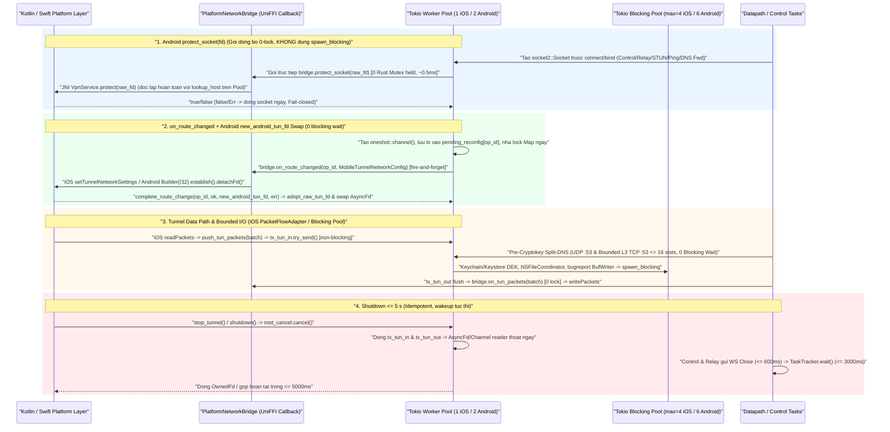
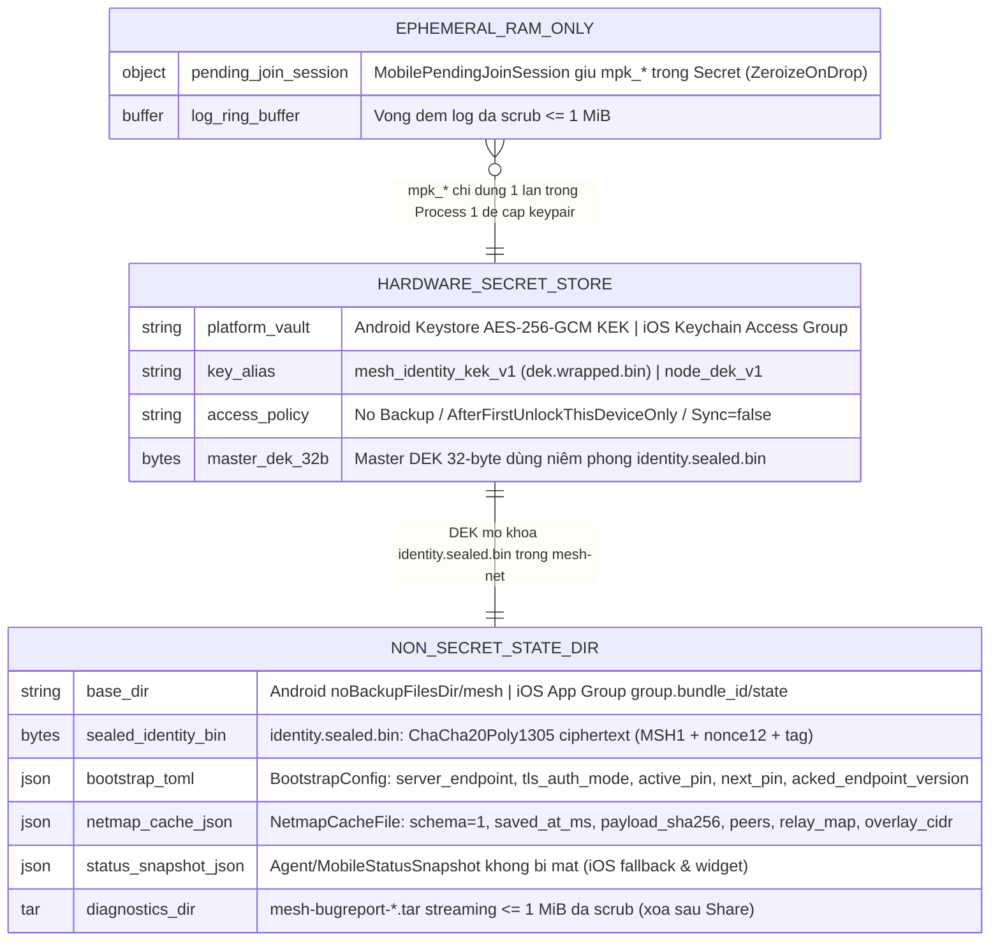

# Thiết kế Giao diện FFI (`UniFFI 0.29.5`), URI `mesh://join`, IPC iOS & Lưu trữ Khóa Di động (`v0.2.0`)

> **Trạng thái:** Design Lock (Gate 2 — Chặng 2)
> **Nhánh mục tiêu:** `feat/mobile-clients` (`v0.2.0` Mobile Clients: Android & iOS)
> **Tài liệu nền tảng bắt buộc đối chiếu:** [mobile-system-architecture.md](file:///D:/Project/Idea/mesh-vpn/docs/03-system-design/mobile-system-architecture.md), `ADR-012..019` ([mobile-adr.md](file:///D:/Project/Idea/mesh-vpn/docs/03-system-design/mobile-adr.md)), [mobile-coding-standards.md](file:///D:/Project/Idea/mesh-vpn/docs/03-system-design/mobile-coding-standards.md), và chuẩn API/DB `v0.1.0` tại [api-design.md](file:///D:/Project/Idea/mesh-vpn/docs/03-system-design/api-design.md), [database-design.md](file:///D:/Project/Idea/mesh-vpn/docs/03-system-design/database-design.md).

---

## 1. Tổ chức Crate `mesh-mobile-ffi`, `tools/uniffi-bindgen` & OS Primitives `mesh-sys`

### 1.1. Cô lập `unsafe` & Tránh lỗi biên dịch `E0453` (`SEC-02`)

1. **`crates/mesh-mobile-ffi/Cargo.toml`:**
   - Khai báo `crate-type = ["cdylib", "staticlib", "lib"]` (`cdylib` sinh `libmesh_mobile_ffi.so` cho Android; `staticlib` đóng gói `MeshMobileFFI.xcframework` cho iOS; `lib` chạy `cargo test` trên host).
   - Ghim **`uniffi = "0.29.5"`** (`>= 0.29.2` bắt buộc để macro tạo `#[unsafe(no_mangle)]` hợp lệ trên Rust `edition = "2024"`).
   - **Không** đặt `[lints] workspace = true` (tránh `E0453` khi macro `uniffi` sinh `#[unsafe(no_mangle)]` xung đột `unsafe_code = "forbid"` ở workspace). Thay vào đó khai báo tường minh:
     - `[lints.rust] unsafe_code = "allow"`, `unsafe_op_in_unsafe_fn = "deny"`
     - `[lints.clippy] unwrap_used = "deny"`, `expect_used = "deny"`, `panic = "deny"`, `indexing_slicing = "deny"`, `await_holding_lock = "deny"`, `undocumented_unsafe_blocks = "deny"`
   - Bộ kiểm tĩnh `scripts/check.{ps1,sh}` tiếp tục kiểm chứng **0 dòng `unsafe` viết tay** trong toàn bộ `crates/mesh-mobile-ffi/src/*.rs` (chỉ có macro sinh tự động bởi `uniffi`).
   - Không mở feature `"cli"` trên `uniffi` để tránh kéo `uniffi_bindgen` vào nhị phân `.so`/`.xcframework`.
2. **`tools/uniffi-bindgen`:** Package nhị phân tách riêng (`package.name = "mesh-uniffi-bindgen"`) ghim cùng phiên bản **`uniffi = "0.29.5"`** với `features = ["cli"]` trong `Cargo.lock`, chỉ dùng lúc build CI/local để sinh mã Kotlin & Swift.
3. **Mở rộng `crates/mesh-sys` (Nơi DUY NHẤT chứa `unsafe` viết tay, kèm `// SAFETY:`):**
   - `crates/mesh-sys/src/jni_android.rs` (`#[cfg(target_os = "android")]`, dùng **`jni = "0.21"`** với `default-features = false`, **CẤM `ndk-context`**):
     - Xuất entrypoint JNI chuẩn:
       ```rust
       // crates/mesh-sys/src/jni_android.rs
       #[unsafe(no_mangle)]
       pub extern "system" fn Java_dev_meshvpn_android_ffi_MeshNativeInit_initPlatformVerifier(
           mut env: jni::JNIEnv<'_>,
           _class: jni::objects::JClass<'_>,
           context: jni::objects::JObject<'_>,
       ) -> jni::sys::jboolean
       ```
     - Kiểm tra `!context.is_null()`, lấy `JavaVM` qua `env.get_java_vm()` và `GlobalRef` của `applicationContext` qua `env.new_global_ref(&context)`, lưu vào `OnceLock<(JavaVM, GlobalRef)>` (không `.unwrap()`/`.expect()`/`panic!()`, idempotent nếu gọi lại), rồi cung cấp hàm an toàn `with_attached_env_and_context(|env, ctx| ...)` (kèm `// SAFETY:` rõ ràng cho attachment).
     - `mesh-crypto` (`#[cfg(all(target_os = "android", feature = "mobile-platform-verifier"))]`) chỉ gọi hàm wrapper an toàn đó để khởi chạy `rustls_platform_verifier::android::init_hosted(env, ctx)` (`0` `unsafe` trong `mesh-crypto`).
     - `crates/mesh-mobile-ffi/src/lib.rs` (`#[cfg(target_os = "android")]`) gọi `mesh_sys::jni_android::ensure_jni_symbols_linked()` trong khởi tạo để linker (`--gc-sections` / ThinLTO) không loại bỏ symbol `Java_dev_meshvpn_android_ffi_MeshNativeInit_initPlatformVerifier` khỏi `libmesh_mobile_ffi.so`.
     - Phía Android: `MeshApplication.onCreate()` gọi `MeshNativeInit.initPlatformVerifier(applicationContext)` **trước** khi gọi `MobileEngine` / `mobile_enroll_or_rotate_node`; tích hợp AAR `rustls-platform-verifier-android` từ kho vendor/offline Maven và gắn ProGuard/R8 rule `-keep,includedescriptorclasses class org.rustls.platformverifier.** { *; }`.
   - `crates/mesh-sys/src/tun_android.rs` (`#[cfg(target_os = "android")]`):
     - `pub fn adopt_raw_tun_fd(raw_fd: i32) -> SysResult<OwnedFd>`: kiểm tra `raw_fd >= 0`, xác thực descriptor hợp lệ bằng `fcntl(raw_fd, F_GETFD)` trước khi gọi `OwnedFd::from_raw_fd(raw_fd)`. Android `MeshVpnService` **bắt buộc** gọi `parcelFileDescriptor.detachFd()` trước khi truyền sang Rust để chuyển giao quyền sở hữu `fd` đơn nhất, tránh double-close UB khi `stop_tunnel()` đóng `AsyncFd<OwnedFd>`.
   - `crates/mesh-sys/src/socket_android.rs` (`#[cfg(target_os = "android")]`):
     - `pub fn disable_ipv4_dont_fragment(fd: RawFd) -> SysResult<()>`: thiết lập `IP_MTU_DISCOVER = IP_PMTUDISC_DONT` tương đương `socket_linux.rs` (lưu ý: Android non-root dùng `SocketProtector::protect_socket(fd)` trực tiếp qua JNI chứ không dùng `SO_MARK`).
   - `crates/mesh-sys/src/socket_ios.rs` (`#[cfg(target_os = "ios")]`):
     - `pub fn bind_socket_to_interface_index(fd: RawFd, is_ipv6: bool, if_index: u32) -> SysResult<()>`: gán `IP_BOUND_IF` / `IPV6_BOUND_IF` khi cần ghim interface cụ thể.
     - `pub fn disable_ipv4_dont_fragment(fd: RawFd) -> SysResult<()>`: gán `IP_DONTFRAG = 0` tương đương Darwin.
   - `crates/mesh-sys/src/memory_ios.rs`:
     - Trên `#[cfg(target_os = "ios")]`, khai báo đúng chuẩn Rust `edition = "2024"`:
       ```rust
       #[cfg(target_os = "ios")]
       unsafe extern "C" {
           fn os_proc_available_memory() -> usize;
       }

       pub fn available_memory_bytes() -> usize {
           #[cfg(target_os = "ios")]
           {
               // SAFETY: `os_proc_available_memory` là symbol hệ thống chuẩn trong libSystem iOS (13+), không nhận con trỏ.
               unsafe { os_proc_available_memory() }
           }
           #[cfg(not(target_os = "ios"))]
           {
               usize::MAX
           }
       }
       ```
   - Đồng thời `crates/mesh-net/src/route.rs` bổ sung nhánh `#[cfg(target_os = "android")]` và `#[cfg(target_os = "ios")]` trong `bind_underlay_udp_socket`, `bind_underlay_socket2`, và `disable_udp_dont_fragment` (trên Android, `bind_underlay_*` ủy quyền gọi `SocketProtector` chứ không đọc `SO_MARK`).

---

## 2. Hợp đồng `UniFFI 0.29` Đầy đủ (`crates/mesh-mobile-ffi`)

### 2.1. Bảng Enums & Error Taxonomy (`MobileError` bảo toàn `SEC-05`)

```rust
// crates/mesh-mobile-ffi/src/types.rs

#[derive(Debug, Clone, Copy, PartialEq, Eq, uniffi::Enum)]
pub enum MobilePlatformKind {
    Android,
    Ios,
}

#[derive(Debug, Clone, Copy, PartialEq, Eq, uniffi::Enum)]
pub enum MobileDaemonState {
    Stopped,
    Connecting,
    Connected,
    ReauthRequired,
    Revoked,
    Degraded,
    ServerUpgradeRequired,
    DeviceLocked,
}

#[derive(Debug, Clone, Copy, PartialEq, Eq, uniffi::Enum)]
pub enum MobileTlsAuthMode {
    SpkiPin,
    SystemCa,
}

#[derive(Debug, Clone, Copy, PartialEq, Eq, uniffi::Enum)]
pub enum MobileActivePathKind {
    Direct,
    Relay,
    None,
}

#[derive(Debug, Clone, Copy, PartialEq, Eq, uniffi::Enum)]
pub enum MobileNatKind {
    Unknown,
    EndpointIndependent,
    AddressDependent,
    AddressAndPortDependent,
}

#[derive(Debug, Clone, Copy, PartialEq, Eq, uniffi::Enum)]
pub enum MobilePingVia {
    Direct,
    Relay,
    Timeout,
}

#[derive(Debug, Clone, Copy, PartialEq, Eq, uniffi::Enum)]
pub enum MobileNetEventKind {
    InterfaceChanged,
    AddressChanged,
    DnsServersChanged,
    ConnectivityLost,
    ConnectivityRestored,
}

#[derive(Debug, Clone, Copy, PartialEq, Eq, uniffi::Enum)]
pub enum MobileWarningKind {
    OverlaySubnetConflict,
    AndroidLockdownActive,
    AndroidPrivateDnsStrict,
    IosLowMemoryPressure,
    ProtocolServerUpgradeNeeded,
    DeviceKeystoreLocked,
}

/// Mọi lỗi trả qua FFI đều có `error_code` (`E_*`) chuẩn hóa từ `mesh-core::ErrorKind`.
///
/// BẤT BIẾN SEC-05: Biến thể `Unauthenticated` LUÔN giữ `message == "authentication failed"`,
/// không bao giờ lộ chi tiết token/chữ ký/khoá nội bộ sang UI hoặc log.
#[derive(Debug, thiserror::Error, uniffi::Error)]
pub enum MobileError {
    #[error("invalid argument: {message}")]
    InvalidArgument { error_code: String, message: String },

    /// SEC-05: `message` luôn cố định là `"authentication failed"`.
    #[error("{message}")]
    Unauthenticated { error_code: String, message: String },

    #[error("permission denied: {message}")]
    PermissionDenied { error_code: String, message: String },

    #[error("node revoked: {message}")]
    NodeRevoked { error_code: String, message: String },

    #[error("node key expired: {message}")]
    NodeKeyExpired { error_code: String, message: String },

    #[error("not found: {message}")]
    NotFound { error_code: String, message: String },

    #[error("conflict: {message}")]
    Conflict { error_code: String, message: String },

    #[error("rate limited: {message}")]
    RateLimited { error_code: String, message: String },

    #[error("unavailable: {message}")]
    Unavailable { error_code: String, message: String },

    #[error("clock skew detected: {message}")]
    ClockSkew { error_code: String, message: String },

    #[error("SPKI pin mismatch: {message}")]
    PinMismatch { error_code: String, message: String },

    /// Server VPS chạy `v0.1.0-rc1` trả HTTP 400 do chưa hỗ trợ `TargetOs::{Android, Ios}`.
    #[error("server upgrade required: {message}")]
    ServerUpgradeRequired { error_code: String, message: String },

    /// Android Keystore bị vô hiệu hóa vĩnh viễn (xóa lockscreen) hoặc hỏng blob -> cần re-enroll.
    #[error("keystore invalidated: {message}")]
    KeystoreInvalidated { error_code: String, message: String },

    /// Thiết bị chưa mở khóa lần đầu sau reboot (Android Direct Boot / iOS errSecInteractionNotAllowed).
    #[error("device locked: {message}")]
    DeviceLocked { error_code: String, message: String },

    #[error("internal error: {message}")]
    Internal { error_code: String, message: String },
}
```

> **Quy tắc ánh xạ `AppError` → `MobileError`:** Khi `AppError::kind() == ErrorKind::Unauthenticated`, lớp chuyển đổi cưỡng bức gán `error_code = "E_UNAUTHENTICATED"` và `message = "authentication failed"` (khớp hằng số `SEC-05`). Khi nhận `ErrorKind::InvalidArgument` khớp mẫu từ `POST /v1/auth/challenge` (server `v0.1.0-rc1` từ chối `"android"` / `"ios"`), ánh xạ sang `MobileError::ServerUpgradeRequired { error_code: "E_SERVER_UPGRADE_REQUIRED", ... }`.

### 2.2. Toàn bộ Records & Opaque Token Session (`#[derive(uniffi::Record)]` / `uniffi::Object`)

> **BẤT BIẾN `HR-MOB-G2-03` (`SEC-01`):** Khóa `mpk_*` **tuyệt đối không** trả ngược về Kotlin/Swift dưới dạng `String` lưu lâu dài trên UI (vì `java.lang.String` là bất biến trên heap JVM) và khóa dài hạn (`node_privkey`, `disco_privkey`) **tuyệt đối không** đi qua FFI `Vec<u8>` dưới dạng JSON trần. Mọi nạp URI/nhập tay chỉ giữ `mpk_*` trong `Arc<MobilePendingJoinSession>` (bọc `mesh_crypto::Secret<String>`, `ZeroizeOnDrop`).

```rust
#[derive(Debug, Clone, uniffi::Record)]
pub struct MobileEngineInitConfig {
    pub platform: MobilePlatformKind,
    pub agent_version: String,
    pub default_node_name: Option<String>,
    pub log_dir_path: String,
}

/// Dữ liệu hiển thị an toàn cho màn hình xác nhận Endpoint + SPKI Pin (`OQ-MOB-03`).
/// `preauth_key_masked` chỉ là bản che dạng `"mpk_AbCd...6789"`, KHÔNG chứa secret thật.
#[derive(Debug, Clone, uniffi::Record)]
pub struct MobileJoinUriData {
    pub version: u8,
    pub server_endpoint: String,
    pub tls_auth_mode: MobileTlsAuthMode,
    pub server_pin: Option<String>,
    pub preauth_key_masked: String,
    pub node_name: Option<String>,
}

/// Opaque session giữ `Secret<String>` (`mpk_*`) bên trong bộ nhớ Rust (`ZeroizeOnDrop`).
/// Tự xóa trắng ngay khi được tiêu thụ bởi `mobile_enroll_or_rotate_node` / `start_tunnel` / `rotate_key`,
/// hoặc khi người dùng bấm Hủy (`cancel()`) / đối tượng bị drop khỏi UI.
#[derive(uniffi::Object)]
pub struct MobilePendingJoinSession { /* Mutex<Option<Secret<String>>> */ }

#[uniffi::export]
impl MobilePendingJoinSession {
    pub fn masked_preview(&self) -> String;
    pub fn cancel(&self);
}

#[derive(Debug, Clone, uniffi::Record)]
pub struct MobileParsedJoinUri {
    pub summary: MobileJoinUriData,
    pub session: Arc<MobilePendingJoinSession>,
}

#[derive(Debug, Clone, uniffi::Record)]
pub struct MobileEnrollConfig {
    pub server_endpoint: String,
    pub port_override: Option<u16>,
    pub tls_auth_mode: MobileTlsAuthMode,
    pub server_pin: Option<String>,
    pub pending_join: Arc<MobilePendingJoinSession>,
    pub node_name: Option<String>,
    /// `false` khi tham gia mới; `true` khi `rotate_key` (gửi kèm `previous_node_pubkey`).
    pub rotate_existing_identity: bool,
}

#[derive(Debug, Clone, uniffi::Record)]
pub struct MobileUpConfig {
    pub server_endpoint: String,
    pub port_override: Option<u16>,
    pub tls_auth_mode: MobileTlsAuthMode,
    pub server_pin: Option<String>,
    /// Chỉ dùng nếu platform 1-process (Android) muốn enroll + start cùng lúc.
    /// Trên iOS (`MeshPacketTunnel`), LUÔN là `None` vì `MeshApp` đã enroll qua `mobile_enroll_or_rotate_node`.
    pub pending_join: Option<Arc<MobilePendingJoinSession>>,
    pub node_name: Option<String>,
    /// Trên Android: `None` khi enroll lần đầu chưa biết IP/CIDR (TUN fd được trao sau qua
    /// `complete_route_change(..., new_android_tun_fd: Some(fd), ...)`); hoặc `Some(detached_fd)` khi nối lại.
    /// Trên iOS (`NEPacketTunnelFlow`): luôn là `None`.
    pub android_tun_fd: Option<i32>,
    pub tun_interface_name: Option<String>,
}

#[derive(Debug, Clone, uniffi::Record)]
pub struct MobileSetConfig {
    pub server_endpoint: String,
    pub tls_auth_mode: MobileTlsAuthMode,
    pub server_pin: Option<String>,
}

#[derive(Debug, Clone, uniffi::Record)]
pub struct MobileRotateKeyConfig {
    pub pending_join: Arc<MobilePendingJoinSession>,
}

#[derive(Debug, Clone, uniffi::Record)]
pub struct MobileUnderlayState {
    pub active_interface_name: Option<String>,
    pub physical_if_index: Option<u32>,
    pub has_ipv4: bool,
    pub has_ipv6: bool,
    /// Danh sách IP DNS underlay đọc từ `LinkProperties.getDnsServers()` / `NWPath`.
    pub underlay_dns_servers: Vec<String>,
    /// Pref64 từ OS nếu có (`LinkProperties.getNat64Prefix()` / `NWPath`, vd `"64:ff9b::/96"`).
    pub os_nat64_prefix: Option<String>,
    /// Địa chỉ IP/CIDR của các giao diện vật lý để kiểm tra xung đột `US-037`.
    pub physical_subnets: Vec<String>,
    pub is_android_lockdown_enabled: bool,
    pub is_android_private_dns_strict: bool,
    pub private_dns_server_name: Option<String>,
}

#[derive(Debug, Clone, uniffi::Record)]
pub struct MobileTunnelNetworkConfig {
    pub overlay_ip: String,
    /// Prefix của giao diện point-to-point TUN: LUÔN là `32` (`"255.255.255.255"`), KHÔNG BAO GIỜ `/16`.
    pub tun_interface_prefix_len: u8,
    pub overlay_cidr: String,
    pub overlay_subnet_mask: String,
    pub overlay_dns_ip: String,
    pub domain_suffix: String,
    pub tun_mtu: u16,
    /// Ở chế độ bình thường chứa `[overlay_cidr]`. Khi phát hiện xung đột LAN/CGNAT (`US-037`),
    /// thu hẹp thành `[peer_ip/32..., overlay_dns_ip/32]` (BẮT BUỘC bao gồm `overlay_dns_ip/32`).
    pub included_routes_cidr: Vec<String>,
}

#[derive(Debug, Clone, uniffi::Record)]
pub struct MobilePlatformWarning {
    pub kind: MobileWarningKind,
    pub message: String,
}

#[derive(Debug, Clone, uniffi::Record)]
pub struct MobileServerStatus {
    pub control_endpoint: String,
    pub relay_endpoint: String,
    pub stun_endpoints: Vec<String>,
    pub tls_auth_mode: MobileTlsAuthMode,
    pub active_pin: Option<String>,
    pub next_pin: Option<String>,
    pub control_connected: bool,
    pub relay_connected: bool,
    pub relay_rtt_ms: Option<u64>,
    pub last_error: Option<String>,
}

#[derive(Debug, Clone, uniffi::Record)]
pub struct MobileSelfNetworkStatus {
    pub local_udp_port: u16,
    pub bound_physical_interface: Option<String>,
    pub nat_type: MobileNatKind,
    pub overlay_conflict_warning: Option<String>,
    pub nat64_active_prefix: Option<String>,
    pub candidates: Vec<String>,
}

#[derive(Debug, Clone, uniffi::Record)]
pub struct MobilePeerStatus {
    pub node_id: String,
    pub name: String,
    pub fqdn: String,
    pub overlay_ip: String,
    pub online: bool,
    pub active_path: MobileActivePathKind,
    pub direct_endpoint: Option<String>,
    pub rtt_ms: Option<u64>,
    pub last_handshake_at_ms: Option<u64>,
    pub rx_bytes: u64,
    pub tx_bytes: u64,
}

#[derive(Debug, Clone, uniffi::Record)]
pub struct MobileStatusSnapshot {
    pub daemon_state: MobileDaemonState,
    pub node_id: Option<String>,
    pub node_name: Option<String>,
    pub fqdn: Option<String>,
    pub overlay_ip: Option<String>,
    pub overlay_cidr: Option<String>,
    pub overlay_dns_ip: Option<String>,
    pub tun_interface_name: Option<String>,
    pub tun_mtu: u16,
    pub netmap_version: u64,
    pub key_expires_at_ms: Option<u64>,
    pub server_connection: Option<MobileServerStatus>,
    pub self_network: MobileSelfNetworkStatus,
    pub peers: Vec<MobilePeerStatus>,
    pub warnings: Vec<MobilePlatformWarning>,
}

#[derive(Debug, Clone, uniffi::Record)]
pub struct MobilePingRequest {
    pub target: String,
    pub count: u16,
    pub force_direct: bool,
    pub timeout_ms: u64,
}

#[derive(Debug, Clone, uniffi::Record)]
pub struct MobilePingSample {
    pub seq: u16,
    pub via: MobilePingVia,
    pub endpoint: Option<String>,
    pub rtt_ms: Option<f64>,
}

#[derive(Debug, Clone, uniffi::Record)]
pub struct MobilePingResponse {
    pub peer_id: String,
    pub peer_name: String,
    pub peer_overlay_ip: String,
    pub samples: Vec<MobilePingSample>,
    pub avg_rtt_ms: Option<f64>,
}

#[derive(Debug, Clone, uniffi::Record)]
pub struct MobileNetcheckResponse {
    pub udp_reachable: bool,
    pub ipv4_available: bool,
    pub ipv6_available: bool,
    pub nat_type: MobileNatKind,
    pub mapped_endpoint: Option<String>,
    pub relay_connected: bool,
    pub relay_rtt_ms: Option<u64>,
    pub nat64_prefix: Option<String>,
}

#[derive(Debug, Clone, uniffi::Record)]
pub struct MobileBugreportResult {
    pub bundle_path: String,
    pub size_bytes: u64,
    pub scrubbed_items: u32,
}
```

### 2.3. Callback Interface `PlatformNetworkBridge`, Hàm Enroll Độc lập & `MobileEngine`

```rust
#[uniffi::export(callback_interface)]
pub trait PlatformNetworkBridge: Send + Sync + std::fmt::Debug {
    /// Android: gọi đồng bộ trực tiếp `vpnService.protect(rawFd)` với 0 lock Rust (KHÔNG đẩy sang `spawn_blocking`).
    /// iOS: trả `Ok(true)` (no-op).
    /// BẮT BUỘC: không gọi ngược vào `MobileEngine` hoặc giữ lock ứng dụng bên trong hàm này.
    fn protect_socket(&self, raw_fd: i32) -> Result<bool, MobileError>;

    /// iOS (`NEPacketTunnelFlow`): nhận batch gói IPv4 L3 đã giải mã để ghi vào `packetFlow.writePackets`.
    /// Phía Rust dùng struct nội bộ `PacketFlowAdapter` (`crates/mesh-mobile-ffi/src/tun_bridge.rs`,
    /// cài đặt `mesh_net::tun::TunDevice`) nối `on_tun_packets` & `push_tun_packets`.
    /// Android (dùng `android_tun_fd` trực tiếp qua `AsyncFd`): không gọi tới hàm này.
    fn on_tun_packets(&self, packets: Vec<Vec<u8>>);

    /// Báo lớp OS cấu hình/cập nhật route động (`overlay_ip/32`, `included_routes_cidr`, `overlay_dns_ip`) không chặn.
    /// Android dựng `VpnService.Builder` -> `establish()?.detachFd()` rồi trả `new_android_tun_fd = Some(fd)` qua
    /// `MobileEngine::complete_route_change`. iOS gọi `setTunnelNetworkSettings` và trả `new_android_tun_fd = None`.
    fn on_route_changed(&self, op_id: u64, config: MobileTunnelNetworkConfig);

    /// Đẩy snapshot trạng thái không chứa bí mật cho Kotlin `StateFlow` / Swift UI (O(1) non-blocking).
    fn on_status_changed(&self, status: MobileStatusSnapshot);

    /// Đẩy cảnh báo vận hành (`AndroidLockdownActive`, `AndroidPrivateDnsStrict`, `IosLowMemoryPressure`).
    fn on_platform_warning(&self, warning: MobilePlatformWarning);

    /// Đọc trạng thái mạng vật lý hiện hành (DNS servers, NAT64 prefix, IPv4/IPv6, Lockdown/PrivateDNS).
    fn query_underlay_state(&self) -> Result<MobileUnderlayState, MobileError>;

    /// Lấy hoặc tạo Master DEK 32-byte được bảo vệ bởi phần cứng/OS (Android Keystore bọc `dek.wrapped.bin`,
    /// hoặc iOS Keychain Access Group `node_dek_v1`), trả 32 bytes ngắn hạn về Rust rồi wipe ngay buffer tạm
    /// trong `finally` (Kotlin `ByteArray.fill(0)`) / `defer` (Swift `resetBytes`).
    /// `mesh-net::keystore` dùng `ChaCha20Poly1305` niêm phong/giải mã ciphertext `identity.sealed.bin`
    /// qua `save_state_file` / `load_state_file` — 0 byte khóa riêng dài hạn đi qua FFI!
    fn load_or_create_platform_dek(&self) -> Result<Vec<u8>, MobileError>;

    /// Đọc/ghi các tệp trạng thái (`bootstrap.toml`, `netmap-cache.json`, `status-snapshot.json`,
    /// và ciphertext đã mã hóa AEAD `identity.sealed.bin`).
    fn load_state_file(&self, file_name: String) -> Result<Option<Vec<u8>>, MobileError>;
    fn save_state_file(&self, file_name: String, content: Vec<u8>) -> Result<(), MobileError>;
    fn delete_state_file(&self, file_name: String) -> Result<(), MobileError>;
}

/// Parse & validate URI `mesh://join?v=1&...`, trả bản summary không chứa `mpk_*` và session opaque `ZeroizeOnDrop`.
#[uniffi::export]
pub fn parse_mobile_join_uri(raw_uri: String) -> Result<MobileParsedJoinUri, MobileError>;

/// Tạo `MobilePendingJoinSession` cho luồng nhập tay 3 ô (UI xóa trắng chuỗi thô ngay sau lời gọi FFI).
#[uniffi::export]
pub fn create_pending_join_session(raw_preauth_key: String) -> Result<Arc<MobilePendingJoinSession>, MobileError>;

/// Hàm đăng ký / xoay khóa độc lập chạy KHÔNG CẦN bật TUN (dành riêng cho iOS `MeshApp` Process 1
/// trước khi kích hoạt `NEPacketTunnelProvider`, hoặc Android CLI/Onboarding tách rời).
/// Kết thúc bằng việc lưu ciphertext `identity.sealed.bin` + `bootstrap.toml` và zeroize `mpk_*` ngay tại RAM.
#[uniffi::export]
pub async fn mobile_enroll_or_rotate_node(
    init: MobileEngineInitConfig,
    bridge: Box<dyn PlatformNetworkBridge>,
    cfg: MobileEnrollConfig,
) -> Result<MobileStatusSnapshot, MobileError>;

#[derive(uniffi::Object)]
pub struct MobileEngine { /* tokio::runtime::Runtime + ClientSessionSupervisor + Control/TUN channels */ }

#[uniffi::export]
impl MobileEngine {
    #[uniffi::constructor]
    pub fn new(
        init: MobileEngineInitConfig,
        bridge: Box<dyn PlatformNetworkBridge>,
    ) -> Result<Self, MobileError>;

    /// Khởi động phiên tunnel (async trên Tokio runtime nội bộ của `MobileEngine`, không chặn thread UI).
    pub async fn start_tunnel(&self, cfg: MobileUpConfig) -> Result<MobileStatusSnapshot, MobileError>;

    /// Dừng phiên tunnel idempotent, đảm bảo hoàn tất `WS Close + Cleanup <= 5 s`.
    pub async fn stop_tunnel(&self) -> Result<MobileStatusSnapshot, MobileError>;

    /// Xoay khóa trực tiếp trên nền tảng 1-process (Android). Trên iOS, `MeshApp` dừng tunnel và gọi `mobile_enroll_or_rotate_node`.
    pub async fn rotate_key(&self, cfg: MobileRotateKeyConfig) -> Result<MobileStatusSnapshot, MobileError>;
    pub async fn update_server_config(&self, cfg: MobileSetConfig) -> Result<MobileStatusSnapshot, MobileError>;
    pub async fn status_snapshot(&self) -> Result<MobileStatusSnapshot, MobileError>;
    pub async fn ping_peer(&self, req: MobilePingRequest) -> Result<MobilePingResponse, MobileError>;
    pub async fn netcheck(&self) -> Result<MobileNetcheckResponse, MobileError>;

    /// iOS `NEPacketTunnelFlow.readPackets` đẩy batch gói plaintext L3 vào kênh `mpsc(128)` (`try_send`, non-blocking).
    pub fn push_tun_packets(&self, packets: Vec<Vec<u8>>) -> u32;

    /// Hoàn tất bất đồng bộ cho `PlatformNetworkBridge::on_route_changed(op_id, ...)`.
    /// Trên Android, truyền `new_android_tun_fd = Some(detached_fd)` để `AndroidTunDevice` adopt & swap nguyên tử
    /// `AsyncFd<OwnedFd>` (đóng fd cũ sạch sẽ). Trên iOS luôn truyền `None`.
    pub fn complete_route_change(
        &self,
        op_id: u64,
        ok: bool,
        new_android_tun_fd: Option<i32>,
        error_message: Option<String>,
    );

    /// Báo sự kiện đổi mạng từ `ConnectivityManager.NetworkCallback` / `NWPathMonitor`.
    pub fn on_network_change(&self, kind: MobileNetEventKind, underlay: MobileUnderlayState);

    /// Báo chế độ tiết kiệm pin (màn hình tắt / Doze) để co dãn heartbeat về `45 s ± 2 s`.
    pub fn set_power_saving_mode(&self, enabled: bool);

    /// Đóng gói streaming `mesh-bugreport-{ts}.tar` (tối đa `DEFAULT_MOBILE_MAX_BUGREPORT_BYTES = 1 MiB`)
    /// thẳng tới `dest_path` qua `BufWriter<File>` (`8 KiB`), đã scrub bí mật & không gọi `sysexec`.
    pub async fn export_bugreport_to_file(&self, dest_path: String) -> Result<MobileBugreportResult, MobileError>;

    /// Dừng toàn bộ runtime (`<= 5 s`) trước khi giải phóng object.
    pub fn shutdown(&self) -> Result<(), MobileError>;
}
```

> **Ghi chú về `ChaCha20Poly1305` DEK Sealing & `Zeroizing` tại biên giới FFI (`HR-MOB-G2-03`):** `mesh-net::keystore` cung cấp hai hàm hỗ trợ nằm trong allowlist `.expose_secret()`: `StoredNodeIdentity::seal_with_dek(&self, dek: &[u8; 32]) -> AppResult<Vec<u8>>` và `StoredNodeIdentity::unseal_with_dek(ciphertext: &[u8], dek: &[u8; 32]) -> AppResult<Self>` (bọc `chacha20poly1305` từ `mesh-crypto`, format `"MSH1" || nonce[12] || ct_and_tag` kèm AAD `"mesh-identity-v1"`). Nhờ vậy **0 byte khóa dài hạn (`node_privkey`, `disco_privkey`) dưới dạng JSON trần** đi qua `UniFFI` (`Vec<u8>`/`RustBuffer`); chỉ có 32-byte DEK nhất thời đi qua lúc mở phiên rồi lập tức bị `zeroize()` trên Rust và `.fill(0)` / `resetBytes` trên Kotlin/Swift.

---

## 3. Phân tích Luồng Thread/Async & Chứng minh Chống Deadlock (`UniFFI`)

### 3.1. Bảng Phân vùng Thread & Bất biến Thứ tự Lock (`BLK-MOB-G2-05`)

| Thực thể thực thi | Vai trò | Quy tắc Lock & FFI Bắt buộc (Zero-Deadlock Invariants) |
|---|---|---|
| **Tokio Worker Threads** (`1` trên iOS, `2` trên Android) | Chạy `DatapathEngine`, `ControlLoop`, `RelayClient`, `RoamingLoop`, `MobileSplitDnsInterceptor` (gồm L3 TCP `:53` bounded state machine `16` slots) | **CẤM** giữ `std::sync::MutexGuard` hay `tokio::sync::RwLockReadGuard` khi gọi bất kỳ hàm nào trên `PlatformNetworkBridge` hoặc qua `.await`. **Trên iOS (`worker_threads=1`):** CẤM chạy I/O đĩa/`NSFileCoordinator`/Keychain đồng bộ trực tiếp trên worker thread. |
| **Lời gọi `protect_socket(raw_fd)` (Android)** | Gọi đồng bộ **trực tiếp (inline)** tới JNI `VpnService.protect(raw_fd)` (~0.1–2 ms) với **0 lock Rust đang giữ** | **KHÔNG** đẩy qua `tokio::task::spawn_blocking` để không bao giờ bị nghẽn dây chuyền sau `tokio::net::lookup_host` (`getaddrinfo`) khi mạng rớt DNS. |
| **Tokio Blocking Pool** (`max_blocking_threads = 6` Android, `4` iOS) | Chỉ chạy `getaddrinfo` (`lookup_host`), đọc/ghi Keystore/Keychain (`load_or_create_platform_dek`), App Group `NSFileCoordinator`, và streaming `export_bugreport_to_file` (`BufWriter 8 KiB`) | Mọi tác vụ blocking đều có `tokio::time::timeout` (`<= 2_000 ms` cho DNS/Keychain, `<= 4_000 ms` cho bugreport); tách hẳn khỏi `protect_socket(fd)`. |
| **Kotlin Main / Binder / NetworkCallback Threads** | Giao diện Compose, nhận `NetworkCallback`, chạy `VpnService.Builder.establish()` | Tuyệt đối **KHÔNG gọi ngược (re-enter)** vào `MobileEngine` bên trong thân callback `protect_socket`, `on_route_changed`, `on_status_changed`, `query_underlay_state`, `load_or_create_platform_dek`. |
| **Swift `NEPacketTunnelProvider` Dispatch Queue** | Chạy `startTunnel`, `stopTunnel`, `packetFlow.readPackets` | `readPackets` chỉ gọi `push_tun_packets` (dùng `try_send` O(1) không lock dài hạn); các callback `on_status_changed`, `on_platform_warning`, `on_route_changed`, `on_tun_packets` chỉ dispatch O(1) bất đồng bộ và **TUYỆT ĐỐI KHÔNG** khóa `NEPacketTunnelProvider` queue hay re-enter `MobileEngine`. |

### 3.2. Kịch bản Chứng minh Không Deadlock trên 4 Đường nhạy cảm



---

## 4. Đặc tả Chuẩn URI `mesh://join?v=1&...`, CLI `crates/mesh` & Cấm Deep-Link (`OQ-MOB-03`)

### 4.1. Cú pháp Chuẩn Hóa & Tương thích `PreAuthKeyCreatedResponse`

Dựa theo chỉ đạo `OQ-MOB-03` và ràng buộc thiết kế Chặng 2 (nhằm giữ nguyên 100% struct `PreAuthKeyCreatedResponse` có `#[serde(deny_unknown_fields)]` tại [admin_ipc.rs](file:///D:/Project/Idea/mesh-vpn/crates/mesh-proto/src/admin_ipc.rs) mà không phá vỡ CLI/Server `v0.1.0-rc1`), URI chuẩn được sinh ngay tại **CLI `crates/mesh`** từ `PreAuthKeyCreatedResponse` (`server_endpoint`, `active_pin`, `raw_key`):

```text
mesh://join?v=1&ep=<urlenc_server_endpoint>&pin=<urlenc_spki_pin|system-ca>&key=<raw_preauth_key>[&name=<rfc1123_node_name>]
```

*Ví dụ cụ thể (SPKI-Pin mặc định — `:` trong `sha256:` được percent-encode thành `%3A`):*
```text
mesh://join?v=1&ep=203.0.113.10%3A443&pin=sha256%3A9f86d081884c7d659a2feaa0c55ad015a3bf4f1b2b0b822cd15d6c15b0f00a08&key=mpk_AbCdEfGhIjKlMnOpQrStUvWxYz0123456789
```

**Hành vi mở rộng trên `crates/mesh` (`admin_cmds.rs` & `output.rs`):**
- Thêm `--emit-uri` (`bool`) và `--qr` (`bool`, vẽ ASCII/UTF-8 QR block ra stdout) vào `PreauthkeyCreateArgs` (`crates/mesh/src/admin_cmds.rs:79`).
- Dùng `Secret<String>` bọc `resp.raw_key` khi dựng URI; **tuyệt đối không** in URI ra file log hay `tracing` (`stdout` terminal duy nhất theo yêu cầu admin lúc tạo key). Nếu dùng `--json`, `PreAuthKeyCreatedResponse` trên wire vẫn **không đổi**.

### 4.2. Ma trận Xác thực Parser `parse_mobile_join_uri` (kèm `proptest!`)

| Tham số / Ràng buộc | Quy tắc kiểm tra bắt buộc tại biên Rust (`mesh-core` + `mesh-mobile-ffi`) | Từ chối / Lỗi nếu vi phạm |
|---|---|---|
| **Tổng độ dài & ký tự** | `<= 1_024 bytes`, không chứa whitespace, `\r`, `\n`, `\0`, ký tự điều khiển, hoặc fragment `#...`. | `InvalidArgument` |
| **Scheme & Host** | Scheme phân biệt chuẩn lowercase `mesh`, host bắt buộc `"join"`; từ chối scheme khác (`http://`, `https://`, `intent://`). | `InvalidArgument` |
| **Version (`v`)** | Bắt buộc `v=1` (chỉ xuất hiện đúng 1 lần). Từ chối tham số lạ hoặc tham số lặp lại. | `InvalidArgument` |
| **Endpoint (`ep`)** | Giải mã phần trăm 1 lần; parse qua `split_host_port`: host IPv4/IPv6 `[...]` hoặc FQDN hợp lệ + port `1..=65535`; không chứa `://`, `@`, `/`, `?`. | `InvalidArgument` |
| **Pin / TLS (`pin`)** | Nếu là `"system-ca"`: **CHỈ ĐƯỢC PHÉP** khi host trong `ep` là **DNS domain hợp lệ** (`SystemCa`). Nếu host là **IP literal** → **CẤM `system-ca`** (zero-TOFU, `SEC-04`). Ngược lại bắt buộc parse qua `SpkiPin::parse` (`sha256:<64_lowercase_hex>`). | `InvalidArgument` |
| **Pre-Auth Key (`key`)** | Bắt buộc có, bắt đầu bằng `PREAUTH_KEY_PREFIX` (`"mpk_"`), pass qua `PreAuthToken::parse`, bọc ngay vào `Secret<String>`. | `InvalidArgument` |
| **Node Name (`name`)** | Tùy chọn; nếu có phải đạt `NodeName::parse` (`1..=63 [a-z0-9-]`, cấm `RESERVED_HOSTNAMES` như `localhost`, `wpad`, `isatap`, `local`). | `InvalidArgument` |

### 4.3. Bảo vệ UX & Cấm OS-Wide Clickable Deep-Link (`T-MOB-07`)

1. **Cấm đăng ký OS URL Scheme cho `mpk_*`:**
   - **Android (`AndroidManifest.xml`):** **0** thẻ `<intent-filter>` chứa `<data android:scheme="mesh" />` (không thể bấm link `mesh://join?...` từ trình duyệt/tin nhắn mở thẳng app khác hoặc bị app độc hại cướp URI).
   - **iOS (`Info.plist`):** **0** `CFBundleURLTypes` chứa `mesh` và **0** `com.apple.developer.associated-domains` cho luồng nạp khóa `mpk_*`.
2. **3 Phương thức Nạp Hợp lệ + Màn hình Xác nhận Bắt buộc (`US-080 AC4`):**
   - **(1) Quét QR nội bộ:** Android `CameraX + zxing-core`; iOS `AVCaptureMetadataOutput` (100% offline).
   - **(2) Dán chủ động trong app:** Android đọc Clipboard khi người dùng bấm nút "Paste URI" rồi gọi `ClipboardManager.clearPrimaryClip()` (API 33+, fallback chuỗi rỗng `< 33`); trên **iOS 15.0+**, dùng `#available(iOS 16.0, *)` để hiển thị **`SwiftUI.PasteButton(payloadType: String.self)`** (tránh popup hệ thống của iOS 16+) và nút "Dán URI" dùng `UIPasteboard.general.string` trên iOS 15.
   - **(3) Nhập tay 3 ô:** Endpoint (`IP:port` hoặc `domain:port`), SPKI Pin (`sha256:...`), Pre-Auth Key (`mpk_...`, ô masked — gọi `create_pending_join_session(...)` rồi xóa ngay bộ đệm UI).
   - **Bất biến xác nhận:** Dù nạp bằng cách nào, ứng dụng **TUYỆT ĐỐI KHÔNG tự động kết nối** ngay. Phải hiển thị màn hình xác nhận rõ **Server Endpoint** và toàn văn/rút gọn kiểm chứng **SPKI Pin** (hoặc badge cảnh báo nếu dùng `System CA` cho domain) trước khi người dùng bấm "Xác nhận & Tham gia".
   - Android bật `WindowManager.LayoutParams.FLAG_SECURE` ở màn hình Onboarding/Pin/Key; iOS phủ màn che khi `willResignActive`.

---

## 5. Đặc tả IPC 2 Tiến trình iOS (`sendProviderMessage` & App Group Fallback)

Trên iOS, `MeshApp` và `MeshPacketTunnel` chạy ở 2 tiến trình riêng biệt và **bị cấm mở bất kỳ socket TCP localhost nào** (`SEC-14`).

### 5.1. Hợp đồng Tin nhắn `sendProviderMessage` (`<= 4_096 bytes`, `#[serde(deny_unknown_fields)]`)

Mọi yêu cầu/phản hồi JSON qua `NETunnelProviderSession.sendProviderMessage(_:responseHandler:)` đều bị kiểm tra kích thước chặt **`<= 4_096 bytes`** (`MAX_RO_IPC_BODY_BYTES`), **chứa 0 bí mật** (`0` `mpk_*`, `0` private key).

```json
// IosTunnelIpcRequest (Main App -> PacketTunnel Extension)
// Kiểu 1: Truy vấn trạng thái đầy đủ (hoặc tóm tắt nếu peer đông, đảm bảo <= 4 KiB)
{ "op": "get_status", "max_peers": 32 }

// Kiểu 2: Chẩn đoán Ping / Netcheck khi tunnel đang chạy
{ "op": "ping", "target": "nas.mesh.internal", "count": 4, "force_direct": true, "timeout_ms": 2000 }
{ "op": "netcheck" }

// Kiểu 3: Xuất bugreport ra tệp trong App Group (KHÔNG trả tar bytes qua IPC)
{ "op": "export_bugreport" }

// Kiểu 4: Yêu cầu chuẩn bị ngừng sạch trước stopTunnel (hoặc khi đổi server config)
{ "op": "prepare_stop" }
```

```json
// IosTunnelIpcResponse (PacketTunnel Extension -> Main App, <= 4_096 bytes)
// Phản hồi chuẩn gồm status_code + payload chuyên biệt
{
  "ok": true,
  "error_code": null,
  "error_message": null,
  "status": {
    "daemon_state": "connected",
    "node_id": "019...",
    "node_name": "iphone-work",
    "overlay_ip": "100.115.0.12",
    "overlay_cidr": "100.115.0.0/16",
    "overlay_dns_ip": "100.115.0.1",
    "netmap_version": 48,
    "control_connected": true,
    "relay_connected": true,
    "relay_rtt_ms": 28,
    "peer_count": 4,
    "peers_truncated": false,
    "peers": [ ... ],
    "warnings": []
  }
}

// Phản hồi riêng của op == "export_bugreport" (chỉ trả đường dẫn tương đối trong App Group)
{
  "ok": true,
  "bugreport": {
    "relative_path": "diagnostics/mesh-bugreport-1763000000000.tar",
    "size_bytes": 184320,
    "scrubbed_items": 6
  }
}
```

> **Quy tắc co giãn `<= 4 KiB` khi danh sách peer lớn:** `PacketTunnel` tuần tự hóa phản hồi `get_status`; nếu kích thước JSON vượt `3_800 B`, tự động rút gọn `peers` xuống tối đa vừa khung `<= 4_096 B` kèm `"peers_truncated": true` và đặt đầy đủ danh sách vào `group.<bundle_id>/status-snapshot.json` để Main App đọc tiếp không lỗi IPC.

### 5.2. Luồng Enroll `mpk_*` (2-Process iOS), Đồng bộ Trạng thái, Disconnect & Bugreport

> **BẤT BIẾN `BLK-MOB-G2-02` (iOS 2-Process Enroll & Rotate Key):** `MeshApp` (Process 1) gọi hàm độc lập `mobile_enroll_or_rotate_node(...)` **trước khi** khởi chạy `MeshPacketTunnel` (Process 2). Toàn bộ `POST /v1/auth/challenge` + `POST /v1/nodes/register` kết thúc ngay trong `MeshApp`, khóa `mpk_*` bị zeroize khỏi RAM trước khi Extension được đánh thức. **0 byte `mpk_*`** bao giờ xuất hiện trong `providerConfiguration`, App Group hay `sendProviderMessage` — nhờ đó bật VPN từ `Settings.app` hay `NEOnDemandRule` luôn hoạt động độc lập! Khi `Rotate Key`, `MeshApp` gửi `{ "op": "prepare_stop" }` + dừng tunnel, gọi `mobile_enroll_or_rotate_node` (`rotate_existing_identity: true`) rồi khởi động lại tunnel.

```mermaid
sequenceDiagram
    participant App as "MeshApp (Main App)"
    participant OS as "iOS NEVPNManager / Session"
    participant Ext as "MeshPacketTunnel (NEPacketTunnelProvider)"
    participant KC as "Keychain Access Group (32B DEK)"
    participant AG as "App Group (group.bundle_id)"

    rect rgb(240, 248, 255)
        Note over App,AG: "0. Enroll / Rotate Key trên Process 1 (Khong dung mpk_* qua IPC hay providerConfiguration)"
        App->>App: "parse_mobile_join_uri / create_pending_join_session -> MobilePendingJoinSession"
        App->>App: "mobile_enroll_or_rotate_node() -> HTTPS /challenge + /register (SpkiPin + NAT64)"
        App->>KC: "Luu/Doc 32B Master DEK (AfterFirstUnlockThisDeviceOnly, Sync=false)"
        App->>AG: "Ghi identity.sealed.bin (ChaCha20Poly1305) + bootstrap.toml; zeroize mpk_*"
        App->>OS: "startVPNTunnel() [Settings / OnDemand / App deu doc tu KC + AG]"
    end

    alt "1. Extension đang Connected / Connecting"
        App->>OS: "sendProviderMessage({ op: get_status })"
        OS->>Ext: "handleAppMessage(_:completionHandler:)"
        Ext-->>App: "JSON <= 4 KiB (nếu >3.8KB thì ghi đủ peer vào status-snapshot.json)"
    else "2. Extension đang Disconnected (NEVPNStatus.disconnected)"
        App->>AG: "Đọc status-snapshot.json & bootstrap.toml (non-secret fallback, 0 wake Extension)"
    end

    rect rgb(255, 244, 230)
        Note over App,OS: "3. Manual Disconnect (US-092 AC2 - Chặn On-Demand tự bật lại)"
        App->>OS: "manager.isOnDemandEnabled = false; manager.saveToPreferences()"
        App->>OS: "session.stopTunnel()"
        OS->>Ext: "stopTunnel(with: .userInitiated)"
        Ext->>Ext: "MobileEngine.stop_tunnel() <= 5 s + cập nhật status-snapshot.json = stopped"
        Ext-->>OS: "completionHandler()"
    end

    rect rgb(235, 245, 255)
        Note over App,AG: "4. Xuất Bugreport streaming <= 1 MiB (ADR-016, HR-MOB-G2-04)"
        App->>Ext: "sendProviderMessage({ op: export_bugreport }) (hoặc tự tạo nếu đang Disconnected)"
        Ext->>AG: "Stream group.{bundle_id}/diagnostics/mesh-bugreport-{ts}.tar (BufWriter 8KiB <= 1 MiB, 0 sysexec)"
        Ext-->>App: "{ relative_path, size_bytes, scrubbed_items }"
        App->>App: "Mở UIActivityViewController Share Sheet trên file URL"
        App->>AG: "XÓA tệp .tar tạm ngay trong completionWithItemsHandler"
    end
```

---

## 6. Thiết kế Lưu trữ Khóa & Trạng thái Di động

### 6.1. Sơ đồ Phân vùng Lưu trữ (`erDiagram` — Tách biệt Tuyệt đối Secret vs Non-Secret)



### 6.2. Thiết kế Bảo mật Nền tảng Android (`ADR-017`, `HR-MOB-G2-03`)

1. **Mã hóa 2 Lớp KEK (Android Keystore `AES-256-GCM`) + DEK (`ChaCha20Poly1305` trong Rust):**
   - **Cấm** dùng `EncryptedSharedPreferences` (đã bị Google deprecate) và **cấm** đưa JSON khóa dài hạn trần qua `UniFFI` `Vec<u8>`.
   - Sinh khóa bọc phần cứng KEK (`SecretKey`) trong **`AndroidKeyStore`** với `alias = "mesh_identity_kek_v1"`, `KeyProperties.PURPOSE_ENCRYPT | PURPOSE_DECRYPT`, `BLOCK_MODE_GCM`, `ENCRYPTION_PADDING_NONE`, `KEY_SIZE = 256`, `setRandomizedEncryptionRequired(true)`, `setUserAuthenticationRequired(false)` (cho phép Always-On VPN tự kết nối lại sau reboot khi đã unlock máy).
   - Khi khởi tạo lần đầu, Kotlin sinh ngẫu nhiên Master DEK 32-byte (`SecureRandom`), dùng `AndroidKeyStore` KEK niêm phong DEK ghi nguyên tử ra `context.noBackupFilesDir/mesh/dek.wrapped.bin` (`"SDK1" || iv[12] || wrapped_dek_and_tag`), trả 32-byte DEK về Rust trong `ByteArray` ngắn hạn và **gọi `dek.fill(0)` ngay trong khối `finally`**.
   - Phía Rust (`mesh-net::keystore`), copy ngay sang `Zeroizing<[u8; 32]>` (`.zeroize()` vector đầu vào), dùng `ChaCha20Poly1305` niêm phong/mở khóa `StoredNodeIdentity` (AAD = `"mesh-identity-v1"`, format `"MSH1" || nonce[12] || ct_and_tag`) và lưu bản **ciphertext** qua `save_state_file("identity.sealed.bin", ...)` vào `context.noBackupFilesDir/mesh/identity.sealed.bin`.
2. **Chặn Cloud Backup & ADB Backup tuyệt đối:**
   - `AndroidManifest.xml` đặt `android:allowBackup="false"`, `android:fullBackupContent="@xml/full_backup_content"` (API 26–30, rule `<exclude domain="file" path="."/>`), và `android:dataExtractionRules="@xml/data_extraction_rules"` (API 31+, chặn cả `cloud-backup` và `device-transfer`).
   - Toàn bộ tệp trạng thái (`dek.wrapped.bin`, `identity.sealed.bin`, `bootstrap.toml`, `netmap-cache.json`) đặt trong **`context.noBackupFilesDir/mesh/`**.
3. **Direct Boot & Keystore Invalidation Recovery:**
   - Service gắn `android:directBootAware="true"`. Nếu OS đánh thức `MeshVpnService` tại `LOCKED_BOOT_COMPLETED` (Credential-Encrypted `noBackupFilesDir` chưa mở khóa, `UserManager.isUserUnlocked == false`): **không crash và không khởi động `MobileEngine`**, hiển thị Notification trạng thái *"Đang chờ mở khóa thiết bị để kết nối Mesh VPN"* và đăng ký receiver chờ **`Intent.ACTION_USER_UNLOCKED`** rồi mới mở khóa Keystore & chạy `start_tunnel()`.
   - Nếu gặp **`KeyPermanentlyInvalidatedException`** / `AEADBadTagException` trên `dek.wrapped.bin` (người dùng xóa/đặt lại khóa bảo mật OS) hoặc lỗi tag AEAD trên `identity.sealed.bin`: **TUYỆT ĐỐI KHÔNG tự ý tạo danh tính mới âm thầm**, trả `MobileError::KeystoreInvalidated` để UI giải thích rõ lý do và yêu cầu quản trị viên cấp `mesh://join` mới.

### 6.3. Thiết kế Bảo mật Nền tảng iOS (`ADR-018`, `HR-MOB-G2-03`)

1. **Keychain Access Group (`ThisDeviceOnly` — Lưu 32B Master DEK thống nhất):**
   - Chia sẻ giữa `MeshApp` và `MeshPacketTunnel` qua Keychain Access Group `$(AppIdentifierPrefix)com.internal.mesh.shared`:
     - `kSecClass = kSecClassGenericPassword`
     - `kSecAttrService = "internal.mesh.vpn.dek"`
     - `kSecAttrAccount = "node_dek_v1"`
     - `kSecAttrAccessible = kSecAttrAccessibleAfterFirstUnlockThisDeviceOnly` (cho phép On-Demand VPN chạy nền sau lần mở khóa đầu tiên mà **không sao chép lên iCloud Keychain** hay bản backup sang máy khác)
     - `kSecAttrSynchronizable = kCFBooleanFalse`
   - `load_or_create_platform_dek()` đọc (hoặc sinh ngẫu nhiên 32 byte bằng `SecRandomCopyBytes` và lưu `SecItemAdd`) trả về Rust trong buffer `Data` ngắn hạn được xóa bằng `resetBytes(in: 0..<count)` trong khối `defer`. Phía Rust dùng **cùng thuật toán `ChaCha20Poly1305` `identity.sealed.bin`** lưu tại App Group `state/identity.sealed.bin` — đảm bảo **0 byte khóa dài hạn đi qua biên giới FFI trên cả iOS lẫn Android**.
2. **Xử lý `errSecInteractionNotAllowed` (`-25308`):**
   - Khi iPhone vừa reboot và chưa mở khóa lần đầu, nếu Network Extension bị hệ thống kích hoạt trước unlock và Keychain trả `-25308` (`errSecInteractionNotAllowed`): Extension **bắt buộc không xóa và không tạo đè item Keychain mới**; trả `MobileError::DeviceLocked` (`DaemonState::DeviceLocked`), dừng cleanly và thử lại khi thiết bị mở khóa.
3. **App Group Shared Container (`group.<bundle_id>`):**
   - Cấu trúc thư mục chuẩn:
     - `group.<bundle_id>/state/identity.sealed.bin` (`ChaCha20Poly1305` ciphertext, giải mã bởi DEK từ Keychain)
     - `group.<bundle_id>/state/bootstrap.toml` (non-secret `BootstrapConfig`)
     - `group.<bundle_id>/state/netmap-cache.json` (`NetmapCacheFile` schema `1`)
     - `group.<bundle_id>/state/status-snapshot.json` (fallback UI khi Extension `Disconnected`)
     - `group.<bundle_id>/diagnostics/mesh-bugreport-{ts}.tar` (tệp `.tar` streaming **`<= 1 MiB`**, xóa ngay sau Share Sheet)
   - Ghi/đọc tệp trong App Group dùng `NSFileCoordinator` + `Data.write(to:options: .atomic)` chạy trên `spawn_blocking` để không chặn worker duy nhất và tránh đọc nửa chừng giữa 2 tiến trình.

---

## 7. Vệ sinh Log & Ma trận Kiểm thử Chống Rò Bí mật (`test_no_secrets_in_outputs`)

| Loại dữ liệu nhạy cảm | Cơ chế bảo vệ tại RAM / Disk / Log | Cách kiểm chứng tự động (`Wave A` & `Wave B`) |
|---|---|---|
| **`node_privkey_hex` & `disco_privkey_hex`** | Chỉ tồn tại trong `Secret<[u8; 32]>` (`ZeroizeOnDrop`) trong Rust; lưu đĩa dưới dạng **ciphertext `identity.sealed.bin`** mã hóa `ChaCha20Poly1305` bằng DEK 32-byte bảo vệ bởi Keystore/Keychain (`finally`/`defer` zeroize, **0 JSON khóa trần qua FFI**). | `test_no_secrets_in_outputs` bật log mức **`DEBUG`**, chạy enroll/kết nối giả lập + xuất streaming `bugreport` (`<= 1 MiB`), assert `0` lần xuất hiện canary private key hex/base64 trong log ring buffer, stdout/stderr, `identity.sealed.bin` thô và mọi entry trong `.tar`. |
| **Pre-Auth Token (`mpk_*`) & URI `mesh://join?...`** | Giữ kín trong **`MobilePendingJoinSession`** (`Secret<String>`, `ZeroizeOnDrop`); UI chỉ nhận `preauth_key_masked`; zeroize ngay sau `mobile_enroll_or_rotate_node` / `start_tunnel` / `cancel()`; xóa Clipboard trên Android / dùng `#available(iOS 16.0, *) PasteButton` trên iOS; `0` byte `mpk_*` qua iOS IPC/`providerConfiguration`. | `test_no_secrets_in_outputs` chèn canary `mpk_TestCanary...` vào `MobilePendingJoinSession` / URI lỗi và xác nhận mọi lỗi trả về GUI, `MobileJoinUriData`, `status_snapshot`, log JSON, `bootstrap.toml`, App Group và `.tar` chỉ chứa chuỗi che hoặc `[REDACTED]`, `0` ký tự canary thật. |
| **Raw TUN / WireGuard Payloads** | Bộ đệm `[u8; 2048]` tái sử dụng; log chỉ ghi độ dài gói, `ErrorKind`, mã lỗi DNS (`A`/`AAAA NODATA`/`NXDOMAIN`/`SERVFAIL`), **không bao giờ** log nội dung domain truy vấn cá nhân hay payload L3 ở mức `INFO`/`WARN`/`DEBUG` mặc định trên production. | Audit tĩnh + unit test `MobileSplitDnsInterceptor` kiểm tra tracing span khi phân giải tên miền ngoài. |
