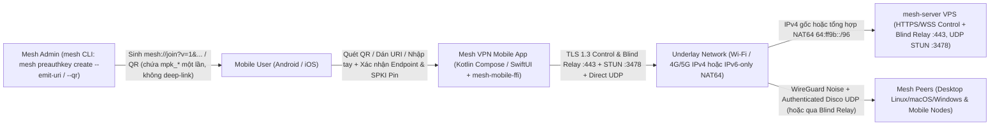
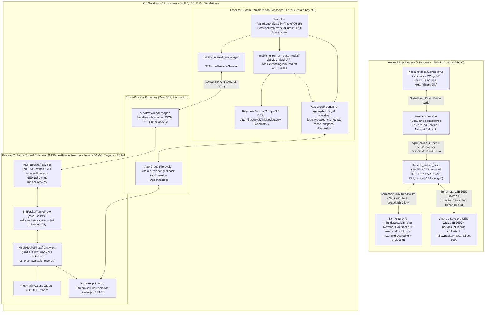
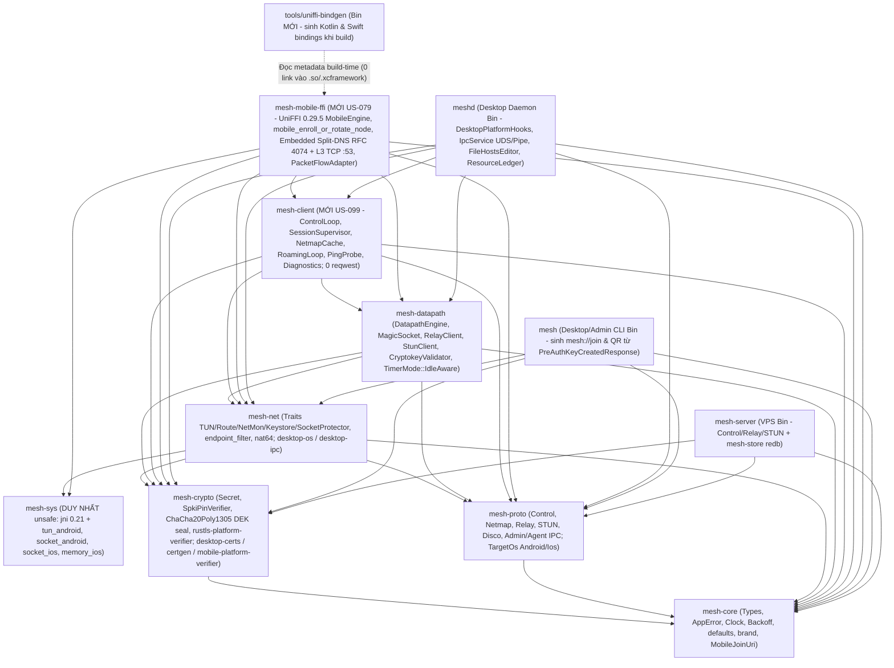
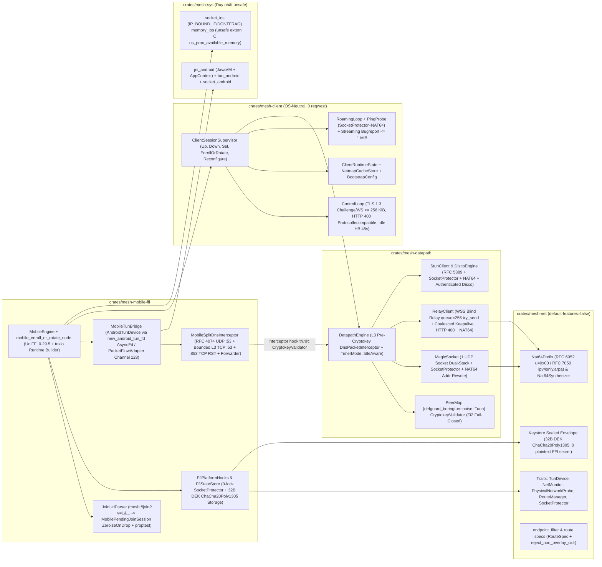
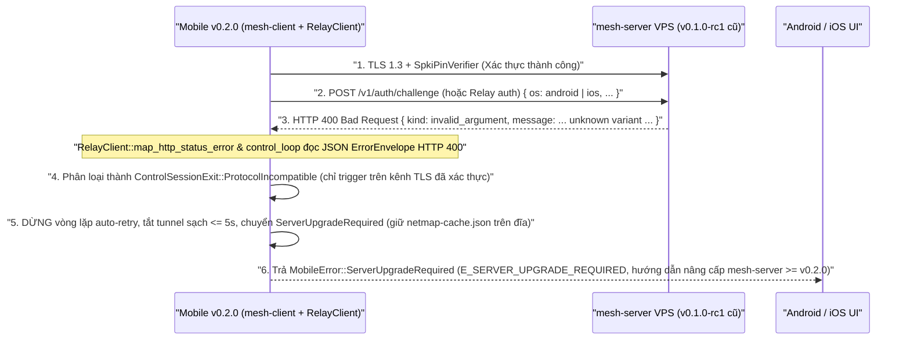
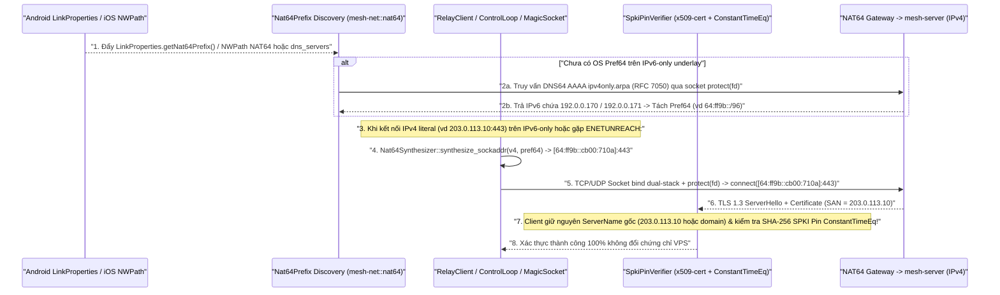
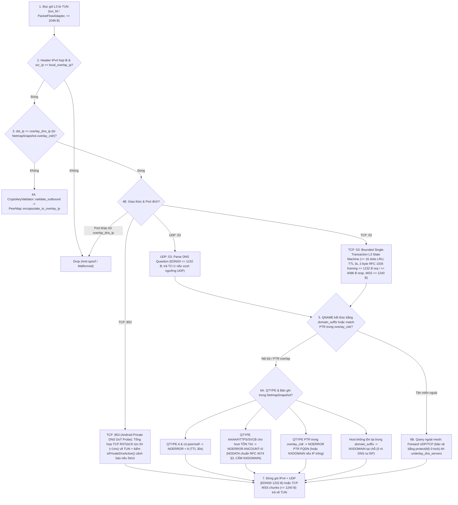

# Kiến trúc Hệ thống Di động (`v0.2.0` — Android & iOS)

> **Trạng thái:** Design Lock (Gate 2 — Chặng 2)
> **Nhánh mục tiêu:** `feat/mobile-clients` (`v0.2.0` Mobile Clients: Android & iOS)
> **Tài liệu nền tảng bắt buộc tham chiếu:** `ADR-012..019` ([mobile-adr.md](file:///D:/Project/Idea/mesh-vpn/docs/03-system-design/mobile-adr.md)), [mobile-tech-stack-decision.md](file:///D:/Project/Idea/mesh-vpn/docs/03-system-design/mobile-tech-stack-decision.md), [mobile-coding-standards.md](file:///D:/Project/Idea/mesh-vpn/docs/03-system-design/mobile-coding-standards.md), [mobile-product-backlog.md](file:///D:/Project/Idea/mesh-vpn/docs/02-product-planning/mobile-product-backlog.md) (`OQ-MOB-01..05`), [mobile-readiness-requirements.md](file:///D:/Project/Idea/mesh-vpn/docs/01-discovery/mobile-readiness-requirements.md), và chuẩn `v0.1.0` tại [system-architecture.md](file:///D:/Project/Idea/mesh-vpn/docs/03-system-design/system-architecture.md).

---

## 1. Mục tiêu, Phạm vi & Bất biến Kiến trúc Kế thừa

Kiến trúc di động `v0.2.0` mở rộng lõi WireGuard userspace (`defguard_boringtun`), Control Plane (`TLS 1.3` + WebSocket), STUN/Disco P2P và Blind Relay từ Desktop `v0.1.0-rc1` lên **Android (API 26–35)** và **iOS (15.0+)** theo nguyên tắc **lõi Rust dùng chung (`mesh-client`), vỏ OS tối giản qua `UniFFI 0.29.5`, 0 regression với Desktop**, đồng thời xử lý triệt để các ràng buộc đặc thù di động (`Jetsam ~50 MiB`, `IPv6-only NAT64`, `Android Private DNS`, `RRC_IDLE` pin).

### 1.1. Bảng Đối chiếu Thông số & Bất biến Runtime (`v0.1.0` ↔ `v0.2.0`)

| Tham số / Bất biến | Giá trị Desktop (`v0.1.0-rc1`) | Giá trị Mobile (`v0.2.0` Android / iOS) | Nguồn khóa / Lý do kỹ thuật |
|---|---|---|---|
| **MTU & Frame Buffer** | `DEFAULT_TUN_MTU = 1280`, `MAX_FRAME_SIZE = 2048` | Giữ nguyên `1280` / `[u8; 2048]`; prefix giao diện TUN luôn **`/32`** | `crates/mesh-core/src/defaults.rs`, `HR-MOB-G2-02` |
| **Chế độ Tunnel** | Overlay CIDR động (`100.115.0.0/16` mặc định) | **CHỈ Split-Tunnel** (`included_routes_cidr` = `NetmapSnapshot.overlay_cidr`, hoặc `/32` peer + `overlay_dns_ip/32` khi xung đột), **CẤM** `0.0.0.0/0` & Exit Node | `OQ-MOB-04`, `ADR-015`, `HR-MOB-G2-02` |
| **TLS mặc định** | `IP + SPKI Pin` (`SpkiPinVerifier`), cấm TOFU | Giữ nguyên `SpkiPinVerifier` (`x509-cert` + `ring` + `subtle`); `SystemCa` dùng `rustls-platform-verifier 0.6` (Android qua `jni = "0.21"` trong `mesh-sys`) | `SEC-04`, `ADR-014`, `BLK-MOB-G2-01` |
| **Kênh Admin TCP** | `0` TCP listener (`meshd-admin` qua UDS/Named Pipe) | `0` TCP listener (`/healthz`, `/readyz`, `/metrics`, Admin HTTP bị **CẤM** tuyệt đối trên app) | `SEC-14`, `ADR-019` |
| **Tokio Thread Pool** | `worker_threads(2)`, `thread_stack_size(512 KiB)` | **iOS:** `worker_threads(1)`, **`max_blocking_threads(4)`**, `thread_stack_size(512 KiB)`<br>**Android:** `worker_threads(2)`, **`max_blocking_threads(6)`**, `thread_stack_size(512 KiB)` | `M-GNFR-01`, `ADR-016`, `BLK-MOB-G2-05` |
| **Trần Control WS Frame** | `MAX_CONTROL_WS_FRAME_BYTES = 4 MiB` (`control_loop.rs:73`) | **`256 KiB` (`262_144 B`)** qua `ControlConfig::max_ws_frame_bytes` | Chặn spike RAM chạm trần iOS Jetsam `50 MiB` (`ADR-016`) |
| **Bộ định thời & Pin** | `TimerMode::Responsive` (`250 ms` liên tục, heartbeat `25 s`) | **`TimerMode::IdleAware`** (dừng tick `250 ms` khi rỗi, gộp heartbeat Control+Relay ở **`45 s ± 2 s`** trong biên `HEARTBEAT_TIMEOUT_MS = 60_000 ms`) | Hạ modem về `RRC_IDLE`, pin `<= 1.5%/giờ` (`ADR-016`) |
| **Trần RAM tiến trình & Bugreport** | `~4–10 MB` client, bugreport `20 MiB` | **iOS Extension:** `RSS <= 25 MiB` (áp suất `< 10 MiB` qua `os_proc_available_memory()`)<br>**Android Service:** `RSS <= 48 MiB`<br>**Bugreport streaming:** `mesh-bugreport-{ts}.tar` **`<= 1 MiB`** (`BufWriter` `8 KiB`, 0 `sysexec`) | `M-GNFR-01`, `ADR-016`, `HR-MOB-G2-04` |
| **Thời gian dừng** | `GRACEFUL_SHUTDOWN_BUDGET_MS = 5_000 ms` | Cứng `<= 5_000 ms` (mục tiêu nội bộ `<= 3_000 ms` trước watchdog iOS/Android ANR) | `REL-08`, `GRACEFUL_SHUTDOWN_BUDGET_MS` |
| **Hàng đợi Blind Relay** | `RELAY_QUEUE_CAPACITY = 256` + `try_send()` | Giữ nguyên `256` + `try_send()` drop-tail, cấm `unbounded_channel` | `US-025 AC6` |
| **Thông điệp Auth lỗi** | `"authentication failed"` (`SEC-05`) | Bảo toàn nguyên văn `"authentication failed"` qua `MobileError::Unauthenticated` | `crates/mesh-core/src/error.rs`, `SEC-05` |

---

## 2. Sơ đồ Kiến trúc C4 (`Mermaid`)

### 2.1. C4 Level 1 — System Context



### 2.2. C4 Level 2 — Container Diagram (Tách biệt Android 1 Tiến trình vs iOS 2 Tiến trình)

Android cho phép `android.net.VpnService` chạy chung một tiến trình OS với giao diện (`Activity`/`ViewModel`) và truyền thẳng raw `tun_fd` sau `detachFd()` vào Rust. Ngược lại, Apple ép buộc tách **Main App** và **Network Extension (`NEPacketTunnelProvider`)** thành 2 tiến trình sandbox độc lập với ngân sách Jetsam riêng trên Extension (`~50 MiB`).



### 2.3. C4 Level 3 — Component Diagram & Workspace Crate DAG

#### A. Đồ thị phụ thuộc Workspace & Ranh giới Feature Flags (`v0.2.0`)



#### B. Kiến trúc Component Bên trong Các Crate Cốt lõi Di động



---

## 3. Bản đồ Trích xuất `crates/meshd` → `crates/mesh-client` (`US-099`, `ADR-012`)

Việc tách `mesh-client` chuyển toàn bộ state machine điều khiển và vòng đời session khỏi phụ thuộc vào hệ điều hành Desktop (`IpcService`, `FileHostsEditor`, `ResourceLedger`, `StdCommandExecutor`, `windows-service`, `/var/lib/meshd`), giúp cả `meshd` và `mesh-mobile-ffi` dùng chung một mã nguồn lõi duy nhất.

### 3.1. Bảng Phân bổ Module & Struct

| File / Symbol gốc tại `crates/meshd/src/` | Đích đến sau Refactor | Vai trò & Thay đổi bắt buộc |
|---|---|---|
| `main.rs` | Giữ nguyên trong **`crates/meshd/src/main.rs`** | Điểm vào nhị phân `meshd`, CLI args, Linux/macOS/Windows Service host (`windows-service`). |
| `ipc_service.rs` (`IpcService`, `IpcRouterState`) | Giữ nguyên trong **`crates/meshd/src/ipc_service.rs`** | Server `axum` UDS (`meshd-ro.sock`/`meshd-admin.sock`) và Windows Named Pipe (`SEC-14`). `mesh-client` không kéo `axum`/`hyper`. |
| `supervisor.rs`: `PlatformAdapters`, `ProductionPlatformAdapters`, `Desktop` Wintun/utun/Linux cleanup, `enforce_macos_startup_path_security` | Giữ phần OS tại **`crates/meshd/src/desktop_adapters.rs`** (thực thi trait `ClientPlatformHooks`) | Đóng gói `ResourceLedger`, `LinuxCleanupOps`/`MacOsCleanupOps`/`WindowsCleanupOps`, `FileHostsEditor`, `WindowsHostsEditor`. |
| `supervisor.rs`: `DaemonSupervisor`, `SupervisorCommand`, `TunRouteSetupOutcome` | Trích lõi sang **`crates/mesh-client/src/session.rs`** (`ClientSessionSupervisor`) | Điều phối `up`, `down`, `set`, **`enroll_or_rotate`** (cho iOS Process 1 trước khi bật tunnel), `reconfigure`, graceful shutdown `<= 5 s` qua `ClientPlatformHooks` & `ClientStateStore`. `meshd::supervisor::DaemonSupervisor` bọc lại `ClientSessionSupervisor` + `IpcService`. |
| `control_loop.rs`: `ControlLoop`, `ControlLoopContext`, `ControlWakeSignal`, `DaemonRuntimeState`, `DaemonRuntimeData`, `execute_challenge`, `build_signed_headers`, `pump_control_ws_stream`, `build_netmap_stream_target`, `build_relay_client_config_for_runtime`, `probe_udp_routing_candidates` | Trích sang **`crates/mesh-client/src/control_loop.rs`** & **`crates/mesh-client/src/state.rs`** | Tham số hóa `max_ws_frame_bytes` (`4 MiB` Desktop / `256 KiB` Mobile), `TimerMode::IdleAware`, phân loại `ProtocolIncompatible` (HTTP `400` trên `/v1/auth/challenge`), truyền `Option<Arc<dyn SocketProtector>>` + `Option<Nat64Prefix>` vào `probe_udp_routing_candidates` (`control_loop.rs:2197`), ủy quyền sync DNS qua `DnsUpstreamHook`. |
| `control_loop.rs`: `sync_hosts_entries`, `sync_platform_hosts_entries` (`FileHostsEditor`, `ResourceLedger`), `discover_raw_local_interface_endpoints` (`StdCommandExecutor`) | Rút ra khỏi lõi, giữ phần thực thi Desktop tại **`crates/meshd/src/desktop_hooks.rs`** | Trừu tượng hóa qua `DnsUpstreamHook::sync_mesh_dns()` và `ClientPlatformHooks::discover_local_interface_endpoints()`. |
| `config.rs`: `BootstrapConfig`, `BOOTSTRAP_SCHEMA_VERSION`, `split_host_port`, `validate_tls_trust_policy`, `build_tls_client_config_for`, `sanitize_hostname_to_node_name`, `scrub_diagnostic_secrets`, `BoundedTarArchive` | Trích phần thuần logic sang **`crates/mesh-client/src/{config,diagnostics}.rs`** | `Cargo.toml` của `mesh-client` giữ `toml` nhưng **loại bỏ hoàn toàn `reqwest`** (`0` `reqwest`). `build_tls_client_config_for` chọn `build_system_ca_client_config()` (`desktop-certs`) hoặc `rustls-platform-verifier` (`mobile-platform-verifier`). `diagnostics.rs` stream `mesh-bugreport-{ts}.tar` qua `BufWriter<File>` (`8 KiB`) với trần **`DEFAULT_MOBILE_MAX_BUGREPORT_BYTES = 1_048_576` (`1 MiB`)** trên mobile (thay vì giữ `20 MiB` `Vec<u8>` trên RAM). |
| `config.rs`: `BootstrapStore`, `DaemonRuntimePaths`, `collect_os_route_table`, `write_private_file_atomic`, `create_bugreport_tar_bundle` phần đọc đĩa OS | Giữ tại **`crates/meshd/src/desktop_store.rs`** (thực thi `ClientStateStore`) | Lưu TOML/JSON tại `/var/lib/meshd`, `/var/db/mesh`, `C:\ProgramData\Mesh` với `0600` ACL. Mobile dùng `ClientPlatformHooks::collect_route_diagnostics()` từ `MobileTunnelNetworkConfig` + `MobileUnderlayState` trong RAM (**0 `sysexec`**). |
| `netmap_cache.rs`: `NetmapCacheFile`, `NETMAP_CACHE_SCHEMA_VERSION`, `DEFAULT_OFFLINE_GRACE_HOURS = 168`, `DEFAULT_KEY_EXPIRY_GRACE_HOURS = 24`, `NetmapCacheStore` logic kiểm grace & SHA-256 | Trích sang **`crates/mesh-client/src/netmap_cache.rs`** | Tách thao tác đọc/ghi đĩa sang `ClientStateStore::{load_netmap_cache, save_netmap_cache}`. |
| `roaming_loop.rs`: `RoamingLoop` (`NETWORK_CHANGE_CHANNEL_CAPACITY`) | Trích nguyên vẹn sang **`crates/mesh-client/src/roaming_loop.rs`** | Chỉ phụ thuộc `mesh_net::netmon::{NetMonitor, PhysicalNetworkProbe}`, `RebindHandle`, `Clock`. |
| `ping_probe.rs`: `PingProbe` (`execute_netcheck`, `run_ephemeral_stun_probe`, `probe_tcp_reachability`) | Trích sang **`crates/mesh-client/src/ping_probe.rs`** | Bổ sung `Option<Arc<dyn SocketProtector>>` + `Option<Nat64Prefix>` cho cả UDP ephemeral `MagicSocket::bind` (`ping_probe.rs:154,225`) và `connect_bound_tcp_with_timeout` (`ping_probe.rs:444`). |

### 3.2. Hợp đồng Trait Trừu tượng trong `crates/mesh-client`

Mọi tên trait thống nhất khớp `ADR-012`: **`ClientPlatformHooks`**, **`ClientStateStore`**, **`DnsUpstreamHook`**, kết hợp với **`SocketProtector`** (trong `mesh-net` / `mesh-datapath`) và **`PacketFlowAdapter`** — **struct nội bộ** trong `crates/mesh-mobile-ffi/src/tun_bridge.rs` cài đặt `mesh_net::tun::TunDevice` để nối kênh L3 với **`PlatformNetworkBridge::on_tun_packets`** & `push_tun_packets`.

```rust
// crates/mesh-client/src/hooks.rs (chỉ đặc tả hợp đồng kiến trúc)
pub type ClientFuture<'a, T> = std::pin::Pin<Box<dyn std::future::Future<Output = T> + Send + 'a>>;

/// Kết quả cấu hình TUN & định tuyến overlay cho mỗi nền tảng.
pub struct TunActivationOutcome {
    pub tun: Arc<dyn TunDevice>,
    pub route_installed: bool,
    pub conflict_warning: Option<String>,
    pub lockdown_warning: Option<String>,
    pub private_dns_warning: Option<String>,
}

/// Ranh giới trừu tượng hóa tài nguyên mạng/OS giữa lõi `mesh-client` với Desktop/Mobile.
pub trait ClientPlatformHooks: Send + Sync + std::fmt::Debug {
    fn network_probe(&self) -> Arc<dyn PhysicalNetworkProbe>;
    fn net_monitor(&self) -> Arc<dyn NetMonitor>;
    fn dns_hook(&self) -> Arc<dyn DnsUpstreamHook>;

    /// Trả về `Some(...)` trên Android (`VpnService.protect(fd)` — gọi đồng bộ 0-lock), `None` trên Desktop/iOS.
    fn socket_protector(&self) -> Option<Arc<dyn SocketProtector>>;

    /// Mở hoặc gắn lại TUN & áp dụng route overlay động (`/32` interface + `included_routes_cidr`).
    /// Trên Android initial enroll (`android_tun_fd = None`), gọi `PlatformNetworkBridge::on_route_changed`
    /// sau khi có Netmap đầu tiên rồi nhận `new_android_tun_fd` qua `complete_route_change` để swap `AsyncFd<OwnedFd>`.
    fn activate_tun_and_routes<'a>(
        &'a self,
        tun_cfg: TunConfig,
        overlay_cidr: OverlayCidr,
        dns_server_ip: Option<OverlayIp>,
        domain_suffix: Option<&'a str>,
        now_ms: u64,
    ) -> ClientFuture<'a, AppResult<TunActivationOutcome>>;

    /// Cập nhật route / DNS / firewall khi Netmap đổi CIDR hoặc khi `NetworkChangeEvent` xảy ra
    /// (trên mobile kích hoạt `PlatformNetworkBridge::on_route_changed` không chặn).
    fn reconcile_on_roam_or_netmap<'a>(
        &'a self,
        tun_ifname: &'a str,
        overlay_cidr: OverlayCidr,
        dns_server_ip: Option<OverlayIp>,
        domain_suffix: Option<&'a str>,
    ) -> ClientFuture<'a, AppResult<Option<String>>>;

    /// Thu hồi route/TUN/hosts theo nền tảng khi tắt session (`<= 5 s`).
    fn deactivate_and_cleanup<'a>(&'a self) -> ClientFuture<'a, AppResult<()>>;

    /// Liệt kê địa chỉ giao diện vật lý (Desktop dùng `ip`/`ifconfig`; Mobile dùng `LinkProperties`/`getifaddrs`).
    fn discover_local_interface_endpoints(&self, udp_port: u16) -> Vec<DiscoveredInterfaceEndpoint>;

    /// Snapshot cấu hình định tuyến & underlay phục vụ `bugreport` (Mobile serialize state RAM, 0 `sysexec`).
    fn collect_route_diagnostics(&self) -> String;

    /// Dung lượng RAM còn lại trước Jetsam (iOS trả `Some(bytes)`, Desktop/Android trả `None`).
    fn available_memory_bytes(&self) -> Option<u64> { None }
}

/// Ranh giới đồng bộ phân giải tên miền `.mesh.internal` giữa Desktop `/etc/hosts` và Mobile Split-DNS.
pub trait DnsUpstreamHook: Send + Sync + std::fmt::Debug {
    fn sync_mesh_dns<'a>(
        &'a self,
        snapshot: &'a NetmapSnapshot,
        self_overlay_ip: Option<OverlayIp>,
        self_name: Option<&'a NodeName>,
    ) -> ClientFuture<'a, AppResult<()>>;

    fn clear_mesh_dns<'a>(&'a self) -> ClientFuture<'a, AppResult<()>>;
}

/// Ranh giới lưu trữ khóa danh tính và cấu hình runtime OS-neutral (`SEC-01`, `HR-MOB-G2-03`).
///
/// LƯU Ý BẢO MẬT: `StoredNodeIdentity` chứa `NodeKeypair`/`DiscoKeypair` bọc `Secret<[u8; 32]>`.
/// Trên mobile, `mesh-net::keystore` niêm phong/mở niêm phong `identity.sealed.bin` bằng `ChaCha20Poly1305`
/// với Master DEK 32-byte từ Android Keystore / iOS Keychain; 0 byte khóa bí mật JSON trần đi qua FFI.
pub trait ClientStateStore: Send + Sync + std::fmt::Debug {
    fn load_or_create_identity(&self, now_ms: u64) -> AppResult<StoredNodeIdentity>;
    fn load_existing_identity(&self) -> AppResult<Option<StoredNodeIdentity>>;
    fn save_rotated_identity(&self, identity: &StoredNodeIdentity) -> AppResult<()>;
    fn set_identity_node_id(&self, node_id: NodeId) -> AppResult<StoredNodeIdentity>;

    fn load_bootstrap(&self) -> AppResult<BootstrapConfig>;
    fn save_bootstrap(&self, config: &BootstrapConfig) -> AppResult<()>;

    fn load_netmap_cache(&self) -> AppResult<Option<NetmapCacheFile>>;
    fn save_netmap_cache(&self, cache: &NetmapCacheFile) -> AppResult<()>;
    fn clear_netmap_cache(&self) -> AppResult<()>;
}
```

### 3.3. Đảm bảo 0% Phá vỡ Regression Tests Desktop (`meshd`)

1. **`meshd` giữ 100% default features:** `mesh-client` mặc định bật `desktop-os` (truyền xuống `mesh-net/desktop-os`, `mesh-datapath/desktop-os`), nên mọi binary Desktop (`meshd`, `mesh`) giữ nguyên hành vi và tên IPC/config.
2. **Bảo tồn In-Memory Fakes:** `InMemoryPlatformAdapters` trong test của `meshd` tiếp tục kiểm thử toàn bộ quy trình `ResourceLedger::cleanup_all`, `FileHostsEditor`, `IpcService` (`meshd-ro`/`meshd-admin`), `DaemonSupervisor::run` không cần chỉnh sửa logic test hay nới lỏng assertion.
3. **Di chuyển sạch Test nội bộ:** Các unit test của `control_loop`, `netmap_cache`, `roaming_loop`, `ping_probe` đi cùng module sang `crates/mesh-client` dùng `FakePlatformHooks` & `FakeStateStore` không cần quyền root/Admin; các test tích hợp `IpcService + ResourceLedger` ở `crates/meshd` vẫn chạy đủ qua `cargo test --workspace --all-features`.

---

## 4. Tương thích Giao thức `v0.1.0-rc1` ↔ `v0.2.0` (`US-075`, `US-094`)

### 4.1. Mở rộng `TargetOs` và đồng bộ nhãn OS toàn workspace

Hiện tại `crates/mesh-proto/src/control.rs` định nghĩa `TargetOs` với 3 biến thể `Darwin | Windows | Linux`, đồng thời `RelayClient::current_target_os_str()` (`crates/mesh-datapath/src/relay_client.rs:1879`) và `control_loop::current_target_os()` (`crates/meshd/src/control_loop.rs:2771`) đang fallback mọi nền tảng không phải macOS/Windows thành `"linux"` / `TargetOs::Linux`.

**Các điểm cập nhật khóa cứng cho Wave A:**
1. **`crates/mesh-proto/src/control.rs`**: Bổ sung `TargetOs::Android` (`"android"`) và `TargetOs::Ios` (`"ios"`) với `#[serde(rename_all = "lowercase")]` (giữ `TargetArch::{Amd64, Arm64}` nguyên vẹn).
2. **`crates/mesh-server/src/control_handlers.rs` (`os_label` tại dòng 1758)**: Map `TargetOs::Android => "android"` và `TargetOs::Ios => "ios"`.
3. **`crates/mesh-datapath/src/relay_client.rs` (`current_target_os_str` tại dòng 1879)**: Thêm nhánh `#[cfg(target_os = "android")] { "android" }` và `#[cfg(target_os = "ios")] { "ios" }` (và xử lý `x86_64` trên Simulator/Emulator đã trả `"amd64"`).
4. **`crates/mesh-client/src/control_loop.rs` (`current_target_os`) & `diagnostics.rs` (`version.txt`)**: Thêm `cfg!(target_os = "android") -> TargetOs::Android` và `cfg!(target_os = "ios") -> TargetOs::Ios`.

### 4.2. Chứng minh Tương thích Ngược 100% cho `redb` (`SCHEMA_VERSION = 1`) & Desktop `v0.1.0-rc1`

| Thành phần `v0.1.0-rc1` | Kiểm chứng tương thích khi thêm `TargetOs::{Android, Ios}` | Kết luận |
|---|---|---|
| **`mesh-store` (`redb` `SCHEMA_VERSION = 1`)** | `NodeRecord` lưu trường chuỗi `os_arch: String` được tạo từ `format!("{}/{}", os_label(req.os), arch_label(req.arch))` (`control_handlers.rs:130`). Giá trị `"android/arm64"` hoặc `"ios/arm64"` lưu tự nhiên vào `redb` không cần migration schema. | **Tương thích 100% (0 migration)** |
| **Admin IPC / CLI `mesh node list`** | `AdminNodeSummary` (`mesh-proto/src/admin_ipc.rs` / `admin.rs`) dùng `os: String, arch: String`. CLI `v0.1.0-rc1` in `"android"` / `"ios"` bình thường. | **Tương thích 100%** |
| **Control Stream & Netmap (`NetmapSnapshot`)** | `CONTROL_PROTOCOL_VERSION = 1` giữ nguyên. `NetmapSnapshot`, `PeerEntry` (không chứa enum `TargetOs`), `RelayMap`, `PinSetDto` **không đổi bất kỳ trường nào** dưới `#[serde(deny_unknown_fields)]`. | **Tương thích 100%** |
| **Datapath (WireGuard / Disco / STUN / Blind Relay)** | Định dạng gói WireGuard Noise (`0x01..0x04`), Disco header, STUN RFC 5389 và Blind Relay frames **không thay đổi byte nào**. Desktop `v0.1.0-rc1` kết nối ngang hàng với Mobile `v0.2.0` trơn tru. | **Tương thích 100%** |

### 4.3. Hành vi Xác định khi Mobile `v0.2.0` kết nối VPS `mesh-server v0.1.0-rc1` chưa nâng cấp

Trên `mesh-server v0.1.0-rc1`, `handle_challenge` (`control_handlers.rs:243`) và `handle_relay_auth` giải mã `ChallengeRequest` / `RelayAuthRequest` (`#[serde(deny_unknown_fields)]`) bằng `serde_json::from_slice`. Khi Mobile `v0.2.0` gửi `"os": "android"` hoặc `"os": "ios"`, server `v0.1.0-rc1` không nhận diện biến thể enum mới và trả về **HTTP `400 Bad Request`** chứa `ErrorEnvelope` (`kind = "invalid_argument"`, `code = "E_INVALID_ARG"`, `message = "invalid challenge JSON: unknown variant ..."`).

> [!IMPORTANT]
> **Quy tắc khóa cứng:** Hiện tại cả `map_verified_tls_http_error` (`control_loop.rs:2355`) lẫn `RelayClient::map_http_status_error` (`relay_client.rs:1849` — vốn bỏ qua body HTTP `400`) đều khiến client tự retry vô hạn đốt pin. Từ `v0.2.0`, cả `ControlLoop` và `RelayClient` **TUYỆT ĐỐI KHÔNG** giả mạo `os: "linux"` và **KHÔNG** retry mù quáng khi gặp lỗi này.



**Điều kiện kích hoạt chính xác trên `control_loop` và `RelayClient::map_http_status_error` (`relay_client.rs:1849`):**
1. Kết nối TLS 1.3 đã vượt qua `SpkiPinVerifier` (hoặc `rustls-platform-verifier`), loại trừ hoàn toàn Captive Portal (vốn trả HTTP `3xx`/`511`/HTML chứ không phải JSON `ErrorEnvelope` hợp lệ qua cert đã pin).
2. Endpoint là `POST /v1/auth/challenge` hoặc bước handshake HTTP của `RelayClient`: nhận HTTP `400`, parse thân JSON thành `ErrorEnvelope` (`ErrorKind::InvalidArgument`) và kiểm tra `message` chứa `"unknown variant"` (liên quan `"android"` / `"ios"`) hoặc `"agent upgrade required"` (`control_handlers.rs:256`).
3. Kết quả chuyển sang nhánh terminal **`ControlSessionExit::ProtocolIncompatible { error_code: "E_SERVER_UPGRADE_REQUIRED", message }`**: dừng auto-retry ngay, đóng tunnel sạch (không để Foreground Service / Extension chạy ngầm vô ích đốt pin), giữ nguyên `netmap-cache.json` an toàn trên đĩa và phát `MobileError::ServerUpgradeRequired` ra UI để quản trị viên nâng cấp VPS `mesh-server` lên `>= v0.2.0`.

---

## 5. Định tuyến Động theo `NetmapSnapshot.overlay_cidr` (`OQ-MOB-04`)

Hệ thống **cấm hardcode** chuỗi `"100.115.0.0/16"` ở bất kỳ tầng cấu hình TUN, bộ lọc gói hay Split-DNS nào (`DEFAULT_OVERLAY_CIDR` chỉ dùng làm gợi ý khởi tạo mặc định ở server config). Mọi thông số lấy động từ `NetmapSnapshot`:

### 5.1. Quy tắc Suy dẫn Động `overlay_cidr` & `overlay_dns_ip`

1. **Nguồn chân lý:** `NetmapSnapshot.overlay_cidr` (`OverlayCidr`, phạm vi hợp lệ `/8..=/25` theo `mesh-core/src/types.rs:353`), `local_overlay_ip` (`OverlayIp`), và `NetmapSnapshot.domain_suffix` (ví dụ `mesh.internal`).
2. **Suy dẫn `overlay_dns_ip` an toàn & không trùng lặp:**
   - Dựa theo bộ cấp phát IP của server tại `crates/mesh-store/src/nodes_repo.rs:997` (`// Skip index 0 (.1 gateway reserve)`), `overlay_cidr.nth_usable_ip(0)` (tức `network + 1`, ví dụ `100.115.0.1` cho `100.115.0.0/16` hoặc `10.200.0.1` cho `10.200.0.0/24`) **luôn nằm trong `overlay_cidr`** và không bao giờ được cấp cho bất kỳ peer node nào.
   - **Kiểm tra phòng vệ tại client (chống trùng peer VÀ trùng underlay):** Trước khi gán `overlay_dns_ip = overlay_cidr.nth_usable_ip(0)`, kiểm tra đồng thời `candidate != local_overlay_ip`, không trùng `peer.overlay_ip` trong `NetmapSnapshot.peers`, **và không nằm trong tập IP giao diện vật lý hay `MobileUnderlayState.underlay_dns_servers`**. Nếu có va chạm, lùi dần từ cuối dải **`nth_usable_ip(usable_host_count() - 1 - k)`** (`k = 0..`) tới địa chỉ rỗi an toàn đầu tiên.
3. **Cấu hình Giao diện `/32` & Route Split-Tunnel theo nền tảng (`0.0.0.0/0` BỊ CẤM):**
   - Kiểm chứng bằng `RouteSpec::new(snapshot.overlay_cidr, snapshot.overlay_cidr, ...)` + `reject_non_overlay_cidr(...)` trong `mesh-net/src/route.rs`.
   - **BẤT BIẾN PREFIX `/32` (`HR-MOB-G2-02`):** Cả Android lẫn iOS **LUÔN** gắn địa chỉ giao diện point-to-point TUN với prefix **`/32`** (`32` / `"255.255.255.255"` — TUYỆT ĐỐI KHÔNG gắn `/16`), để kernel không tự sinh implicit connected route `/16` lấn át cơ chế thu hẹp `/32` khi đụng xung đột LAN/CGNAT. Phạm vi định tuyến được điều khiển **100% qua `included_routes_cidr`**.
   - **Android (`VpnService.Builder`):** `addAddress(local_overlay_ip, 32)` + `addRoute(...)` theo `included_routes_cidr` + `addDnsServer(overlay_dns_ip)` + `addSearchDomain(domain_suffix)` + `setMtu(1280)`. Nếu `VpnService.isLockdownEnabled()` (API 29+) trả `true`: vẫn giữ nguyên nguyên tắc Split-Tunnel + `protect(fd)` và phát cảnh báo **`MobilePlatformWarning::AndroidLockdownActive`** hướng dẫn người dùng tắt Lockdown ("Block connections without VPN") vì Android chặn mọi lưu lượng không đi qua VPN trong chế độ đó (`G4`).
   - **iOS (`NEPacketTunnelNetworkSettings`):** `NEIPv4Settings(addresses: [local_overlay_ip], subnetMasks: ["255.255.255.255"])` với `includedRoutes` sinh từ `included_routes_cidr`, `MTU = 1280`, `NEDNSSettings(servers: [overlay_dns_ip])` với `matchDomains = [domain_suffix]`.
4. **Phát hiện xung đột LAN / CGNAT (`US-037`) & Thay đổi `overlay_cidr`:**
   - Trước khi cài route mới và mỗi lần `NetworkChangeEvent`, chạy `detect_overlay_subnet_conflict(&physical_subnets, overlay_cidr)`. Nếu dải mạng Wi-Fi/LTE vật lý chồng lấn `overlay_cidr`, giữ TUN ở trạng thái kiểm soát, phát cảnh báo `OverlaySubnetConflict` và thu hẹp `included_routes_cidr` thành danh sách **`[peer_ip/32..., overlay_dns_ip/32]`** (**BẮT BUỘC luôn bao gồm `overlay_dns_ip/32`** để Split-DNS tiếp tục hoạt động; nếu không thì bị mất Internet máy thật hoặc gãy phân giải `.mesh.internal`).
   - Khi `NetmapSnapshot.overlay_cidr` hoặc `domain_suffix` đổi trong lúc tunnel đang chạy (hoặc lúc initial enroll nhận Netmap lần đầu): `ControlLoop` / `ClientSessionSupervisor` kích hoạt **`PlatformNetworkBridge::on_route_changed(op_id, MobileTunnelNetworkConfig)`** để tái cấu hình `NEPacketTunnelNetworkSettings` (`reasserting = true`) trên iOS hoặc dựng lại `VpnService.Builder` và trả **`new_android_tun_fd`** qua `complete_route_change` trên Android mà không làm mất danh tính node.

---

## 6. NAT64 (`64:ff9b::/96`), L3 Packet Pipeline & Split-DNS RFC 4074

### 6.1. Khám phá Pref64 (RFC 7050) & Tổng hợp NAT64 (`US-095`)

Trên mạng di động IPv6-only + DNS64/NAT64, thiết bị không có địa chỉ hay route IPv4 vật lý. Vì cấu hình mặc định của Mesh VPN dùng `IPv4 literal + SPKI Pin` (`SEC-04`), việc gọi `connect(ipv4:443)` trực tiếp sẽ thất bại ngay với `ENETUNREACH`.



**Quy tắc kỹ thuật áp dụng đồng bộ trên toàn bộ đường truyền (`Control`, `Relay`, `STUN`, `PingProbe`, `MagicSocket`, `Disco`):**
1. **`mesh-net::nat64` & Bất biến `u = 0x00` (RFC 6052 §2.2):** Định nghĩa `Nat64Prefix` hỗ trợ chuẩn **RFC 6052** 6 độ dài hợp lệ (`/96`, `/64`, `/56`, `/48`, `/40`, `/32`), kèm hàm `Nat64Prefix::from_ipv4only_arpa_addrs(&[Ipv6Addr])` nhận diện 2 địa chỉ RFC 7050 (`192.0.0.170` và `192.0.0.171`). Đối với mọi prefix ngắn hơn `/96`, **bits `64..71` (byte chỉ số `8`) BẮT BUỘC phải là octet dự trữ `u = 0x00`**, các octet IPv4 nằm sau ranh giới bit 63 phải nhảy qua byte `8` vào bits `72..` và các bit còn lại tới bit `127` điền `0`:
   - `/96`: `prefix[0..12] || v4[0..4]` — ví dụ `64:ff9b::/96` + `192.0.2.33` → `64:ff9b::c000:221`
   - `/64`: `prefix[0..8] || 0x00 || v4[0..4] || 0[13..16]` — ví dụ `2001:db8:122:344::/64` + `192.0.2.33` → `2001:db8:122:344:c0:2:2100::`
   - `/56`: `prefix[0..7] || v4[0] || 0x00 || v4[1..4] || 0[12..16]` — ví dụ `2001:db8:122:300::/56` + `192.0.2.33` → `2001:db8:122:3c0:0:221::`
   - `/48`: `prefix[0..6] || v4[0..2] || 0x00 || v4[2..4] || 0[11..16]` — ví dụ `2001:db8:122::/48` + `192.0.2.33` → `2001:db8:122:c000:2:2100::`
   - `/40`: `prefix[0..5] || v4[0..3] || 0x00 || v4[3] || 0[10..16]` — ví dụ `2001:db8:100::/40` + `192.0.2.33` → `2001:db8:1c0:2:21::`
   - `/32`: `prefix[0..4] || v4[0..4] || 0x00 || 0[9..16]` — ví dụ `2001:db8::/32` + `192.0.2.33` → `2001:db8:c000:221::`
   - Bảng vector trên bắt buộc có test đơn vị + `proptest!` round-trip (`synthesize -> desynthesize == original_v4`) và kiểm tra byte `8 == 0x00` ở `crates/mesh-net/src/nat64.rs`.
2. **TCP Control, Blind Relay & Diagnostic Probes (`connect_with_nat64` + `SocketProtector`):**
   - Thử địa chỉ ưu tiên theo trạng thái IP của giao diện vật lý (`has_ipv4` / `has_ipv6`). Nếu chỉ có IPv6 hoặc kết nối IPv4 gặp `ENETUNREACH` / `EHOSTUNREACH` và tồn tại `Nat64Prefix`, tự động tổng hợp `SocketAddr::V6` để nối TCP, đồng thời truyền `ServerName` logic ban đầu (IPv4 literal hoặc domain cấu hình) vào `rustls::ClientConfig` (`SpkiPinVerifier` hoặc `rustls-platform-verifier`).
   - **Bao phủ 100% các socket phụ (khắc phục `HR-MOB-G2-01`):** Truyền `Option<Arc<dyn SocketProtector>>` và `Option<Nat64Prefix>` tới **tất cả 3 đường socket bổ trợ** sau để không rớt vào vòng lặp TUN hoặc chết trên IPv6-only:
     - `probe_udp_routing_candidates` (`control_loop.rs:2197`): bảo vệ socket probe bằng `SocketProtector` trước khi `connect`/`send_to`.
     - `PingProbe::execute_netcheck` (`ping_probe.rs:154,225,444`): cả `run_ephemeral_stun_probe` (`MagicSocket::bind`) lẫn `probe_tcp_reachability` (`connect_bound_tcp_with_timeout`) đều gọi `SocketProtector::protect_socket(fd)` + hỗ trợ tổng hợp NAT64.
     - `StunClient::resolve_stun_target_addrs` (`stun_client.rs:161,410`): dùng `SocketProtector` + `Nat64Synthesizer` cho địa chỉ STUN IPv4/domain khi underlay là IPv6-only.
3. **UDP `MagicSocket`, `StunClient` & `PeerMap` (`Disco` + WireGuard):**
   - `MagicSocket` trên mobile luôn ưu tiên bind `[::]:0` ở chế độ dual-stack (`IPV6_V6ONLY = false` — đã sẵn có tại `magic_socket.rs:316`).
   - Khi `underlay_is_ipv6_only` và có `Nat64Prefix`: mọi địa chỉ đích IPv4 (`STUN` trong `RelayMap` hoặc candidate IPv4 của peer) được biến đổi bởi `Nat64Synthesizer::synthesize_sockaddr` ngay trước `try_send_to`; ở chiều `recv_from`, `Nat64Synthesizer::desynthesize_sockaddr(remote_addr, nat64_prefix)` khôi phục ngược lại `SocketAddr::V4` trước khi đưa vào `StunClient::handle_incoming_stun`, `DiscoEngine::handle_incoming` và `PeerMap::decapsulate_from_udp`.
   - Khi gói STUN đi qua NAT64 Gateway của nhà mạng, `mesh-server` thấy IPv4 public của cổng NAT64 đó và trả về trong `XOR-MAPPED-ADDRESS` — đây chính là reflexive candidate thực tế dùng cho hole-punching hoặc tự động fallback Blind Relay nếu nhà mạng dùng symmetric CGNAT.

### 6.2. L3 Packet Pipeline & Split-DNS chuẩn RFC 4074 §3

Trên `DatapathEngine::process_tun_packet` (`crates/mesh-datapath/src/engine.rs:656`), hiện tại mọi gói ra từ TUN đi thẳng vào `self.cryptokey.validate_outbound(...)`. Vì `overlay_dns_ip` là điểm cuối phân giải nội bộ chứ không phải một WireGuard peer trong `PeerMap`, **nhánh chặn DNS bắt buộc đứng TRƯỚC `CryptokeyValidator`**.



**Các bất biến bắt buộc của Split-DNS Responder (`BLK-MOB-G2-03`):**
1. **Không bao giờ trả `NXDOMAIN` cho `AAAA` của tên `.mesh.internal` hợp lệ (`RFC 4074 §3`):** Khi node có IPv4 (`A`) mà chưa cấp IPv6 overlay, truy vấn `AAAA` (hoặc `HTTPS`/`SVCB`) phải trả **`RCODE = 0` (`NOERROR`), `ANCOUNT = 0`** kèm bản ghi Authority giả lập `SOA` tối giản (giúp Safari/Chrome/OpenSSH hoàn tất Happy Eyeballs ngay bằng `A` mà không đầu độc negative cache).
2. **UDP `:53` với EDNS0 `1_232 B` & Cờ `TC=1`:** Luôn đáp ứng kích thước UDP payload tối đa **`1_232 bytes`** qua EDNS0 `OPT` RR để vừa gọn trong TUN `MTU = 1280` (không phân mảnh IPv4). Chỉ khi câu trả lời hợp lệ (ví dụ chuyển tiếp tên miền ngoài có nhiều bản ghi) vượt `512 B` (client không gửi EDNS0) hoặc `1_232 B`, mới cắt gọn và bật **`TC = 1`** để stub resolver mở phiên TCP `:53`.
3. **Bounded Single-Transaction L3 TCP `:53` Responder (thuần Rust trong `crates/mesh-mobile-ffi/src/split_dns.rs`, 0 `smoltcp`):** Do TUN cung cấp gói IP/TCP L3 thô (nơi 2-byte length prefix và nội dung DNS có thể tách rời `SYN`/`ACK` hoặc nhiều segment), bộ chặn cài đặt một máy trạng thái TCP thu gọn giới hạn cứng bộ nhớ:
   - **Bảng LRU cố định `16` slot đồng thời**, TTL cứng **`3_000 ms`** mỗi slot; đầy bảng sẽ bắn `TCP RST|ACK` thu hồi slot cũ nhất.
   - **Đúng 1 giao dịch DNS / kết nối:** Xử lý chuẩn `SYN` -> `SYN|ACK` (`MSS = 1_240 B`, `WSCALE = 0`) -> `ACK` + `PSH|ACK` đọc 2-byte framing RFC 1035 (chỉ nhận request `<= 1_232 B`, chịu được tách nhiều segment trong ngưỡng `1_232 B`) -> giải đáp nội bộ hoặc forward upstream -> phân mảnh payload trả lời (`<= 4_096 B` tối đa) thành các segment `<= 1_240 B` kèm **`PSH|ACK` + `FIN|ACK`** -> nhận `ACK` đóng và giải phóng slot ngay.
   - **Fail-closed:** Mọi hành vi sai giao thức (gửi pipeline truy vấn thứ 2, vượt `1_232 B`, sai `seq`/`ack`, timeout `3_000 ms`) lập tức đáp **`TCP RST|ACK`** và thu hồi slot (`0` OOM, `0` half-open leak).
4. **Android Private DNS (`:853`):** Android 9+ thăm dò `DNS-over-TLS` tới DNS server trên VPN. Trả **`TCP RST|ACK`** tức thì ép Opportunistic mode rớt về `:53` trong `~0 ms`; đồng thời đọc `LinkProperties.isPrivateDnsActive()` & `getPrivateDnsServerName()`: nếu người dùng bật **Strict Private DNS** (có `serverName`), Android chặn truy vấn `:53` cho mọi domain → UI hiển thị cảnh báo **`AndroidPrivateDnsStrict`**.
5. **Chuyển tiếp DNS Ngoài (Android Forwarder):** Tạo socket UDP/TCP với giới hạn đồng thời tối đa **64 truy vấn** (timeout **`2_000 ms`**), mỗi socket **bắt buộc gọi `SocketProtector::protect_socket(fd)`** đồng bộ không giữ lock trước khi gửi tới `LinkProperties.getDnsServers()` (hỗ trợ cả IPv4 lẫn IPv6 upstream DNS). Nếu danh sách DNS underlay rỗng, trả **`SERVFAIL`** tường minh (tuyệt đối không tự ý hardcode gửi lén qua `8.8.8.8` nếu mạng cục bộ chặn DNS ngoài).

---

## 7. Kiến trúc Tiết kiệm Pin (`RRC_IDLE`) & Chống Jetsam iOS (`<= 25 MiB` RSS)

### 7.1. Máy Trạng thái `TimerMode::IdleAware` & Coalescing Heartbeat

Trên Desktop, `DatapathEngine` chạy 2 `tokio::time::interval(250 ms)` (`wg_tick` và `disco_tick`) liên tục (`8 Hz`) và `ControlLoop` / `RelayClient` tự chạy 2 timer `25 s` lệch pha nhau. Để đạt mức tiêu thụ pin **`<= 1.5%/giờ`** khi màn hình tắt trên 4G/5G (`M-GNFR-03`), `DatapathConfig` & `ControlConfig` bổ sung **`TimerMode`**:

```mermaid
stateDiagram-v2
    [*] --> Active250ms : "Bắt đầu tunnel hoặc vừa có gói TUN / UDP / Relay / Ping"
    Active250ms --> Active250ms : "Tick 250 ms: step_wg_timers() & step_disco_tick()"
    Active250ms --> IdleZeroTick : "Không có gói TX/RX và không còn STUN/Ping đang chờ >= 10_000 ms"

    state IdleZeroTick {
        [*] --> Sleeping
        Sleeping --> CoalescedWake : "Đến min(next_wg_rekey_or_keepalive, next_control_relay_hb_45s)"
        CoalescedWake --> Sleeping : "Gửi chung 1 burst Control Heartbeat + Relay Keepalive (nếu Relay đang mở)"
    }

    IdleZeroTick --> Active250ms : "Notify từ tun.read_packet / MagicSocket::recv / Relay / DatapathCommand"
```

**Cơ chế giảm wakeup radio modem (`RRC_IDLE`):**
1. **Dừng hẳn tick `250 ms` khi rỗi (`0` CPU wakeup):** Sau `IDLE_ENTRY_WINDOW_MS = 10_000 ms` không có lưu lượng TUN/UDP hay Disco probe chờ phản hồi, vòng `tokio::select!` trong `DatapathEngine` chuyển sang chờ `sleep_until(next_exact_deadline)` (tính từ timer WireGuard/Disco thực sự kế tiếp) kết hợp `idle_wake_notify.notified()`.
2. **Đồng bộ hóa (Coalescing) Heartbeat trong biên `60 s`:** `HEARTBEAT_TIMEOUT_MS` của `mesh-server` là `60_000 ms`. Khi `TimerMode::IdleAware` (hoặc `set_power_saving_mode(true)` được kích hoạt lúc màn hình tắt / Doze), cả `ControlLoop` (`CONTROL_HEARTBEAT_INTERVAL`) và `RelayClient` (`RELAY_KEEPALIVE_INTERVAL`) dịch sang chu kỳ **`45_000 ms` (± `2_000 ms` jitter)** dùng chung **1 pha đồng bộ (`HeartbeatSyncClock`)** và trượt mốc hẹn giờ mỗi khi vừa truyền/nhận bất kỳ gói WS hợp lệ nào — giúp modem 4G/5G có cửa sổ nghỉ đủ dài để tụt xuống `RRC_IDLE` thay vì giữ `RRC_CONNECTED` suốt ngày.
3. **Relay On-Demand khi Power Saving:** Nếu toàn bộ peer hiện đi `Direct` hoặc không có lưu lượng trong `180 s` (`DISCO_DEFAULT_IDLE_WINDOW_MS`) lúc đang bật `power_saving_mode`, `RelayClient` đóng phiên WebSocket Blind Relay nhàn rỗi và chỉ mở lại tức thì (`wake_reconnect()`) khi `PeerMap` có gói cần relay hoặc khi Peer gửi `CallMeMaybe` qua Control.

### 7.2. Ngân sách Bộ nhớ, Thread Pool & Cơ chế Backpressure `os_proc_available_memory()` (iOS Jetsam)

| Thành phần tiêu tốn RAM / Pool | Ngân sách khóa cứng | Cơ chế kiểm soát |
|---|---|---|
| **Tokio Runtime (`iOS Extension`)** | `worker_threads(1)`, **`max_blocking_threads(4)`**, `thread_stack_size(512 KiB)` | Giới hạn tổng stack worker + blocking trong tầm `~2.5 MiB`; mọi I/O đĩa/Keychain/`NSFileCoordinator` đẩy sang `spawn_blocking` để không khóa 1 worker duy nhất. |
| **Tokio Runtime (`Android Service`)** | `worker_threads(2)`, **`max_blocking_threads(6)`**, `thread_stack_size(512 KiB)` | **`protect_socket(fd)` gọi đồng bộ 0-lock** (KHÔNG xếp hàng chung `spawn_blocking` với `getaddrinfo`/`lookup_host`). |
| **Control WS Buffer** | `MAX_CONTROL_WS_FRAME_BYTES = 262_144 B` (`256 KiB`) | Giảm **16x** so với Desktop `4 MiB` (`control_loop.rs:73`) qua `ControlConfig`. |
| **Data-plane TUN / UDP & TCP :53** | Cấp phát tĩnh `[u8; 2048]` (`MAX_FRAME_SIZE`); `PacketFlow` channel **`128`** gói (`~256 KiB`), Relay per-peer **`256`** gói (`try_send()`), L3 TCP `:53` tối đa **`16` slots** | Tuyệt đối không dùng `Vec` tăng vô hạn hay `unbounded_channel`. |
| **Diagnostic Ring-Buffer & Bugreport** | Ring-buffer log **`<= 1 MiB`** trong RAM; `DEFAULT_MOBILE_MAX_BUGREPORT_BYTES = 1_048_576 B` (`1 MiB`) | Đóng gói `mesh-bugreport-{ts}.tar` **streaming qua `BufWriter<File>` (`8 KiB`)** thẳng ra đĩa (KHÔNG giữ `20 MiB` `Vec<u8>` trong RAM, **0 `sysexec`**). |
| **Cảm biến Áp suất Jetsam (iOS)** | Gọi `mesh_sys::memory_ios::available_memory_bytes()` (`unsafe extern "C" { fn os_proc_available_memory() -> usize; }`) | - **`< 15 MiB` (Vàng):** Xả buffer tạm DNS forwarder & log ring.<br>- **`< 10 MiB` (Đỏ):** Drop-tail sớm hàng đợi Relay/TUN nhàn rỗi, từ chối xuất `bugreport` mới (`Unavailable`) để **tuyệt đối không bị kernel bắn `SIGKILL` Jetsam tại `50 MiB`**. |

---

## 8. Tham chiếu Phân rã Work Packages Song song (`mobile-sprint-backlog.md`)

Kế hoạch thực thi chính thức (**Single Source of Truth**) gồm **4 Waves · 9 Work Packages (`WP-M-A0..WP-M-C2`)** với nguyên tắc **`0% File Overlap`** được khóa đầy đủ tại [mobile-sprint-backlog.md](file:///D:/Project/Idea/mesh-vpn/docs/04-sprint-management/mobile-sprint-backlog.md) (`117 SP` / `25 Stories` / `34 MOB-*`). Bảng dưới đây tóm tắt các điểm chốt kiến trúc gắn với từng WP:

| Wave | Work Package (SSOT) | Ranh giới Kỹ thuật & Ràng buộc Khóa cho Nhánh Song song |
|---|---|---|
| **Wave A.0** | **`WP-M-A0`**: Workspace, `deny.toml`, Protocol & Compile-Green Stubs | Khóa `uniffi = "0.29.5"`, `TargetOs::{Android, Ios}` (`redb` `SCHEMA_VERSION=1`), `DEFAULT_MOBILE_MAX_BUGREPORT_BYTES = 1_048_576`, parser `mesh://join?v=1&...`, và **khóa 100% chữ ký public stub** cho `crates/mesh-net/src/nat64.rs`, `SocketProtector`, `crates/mesh-sys/src/*_{android,ios}.rs` để `WP-M-A1 \|\| WP-M-A2` biên dịch song song không lệch chữ ký. |
| **Wave A.1** | **`WP-M-A1`**: `mesh-sys` (`jni 0.21`), `mesh-crypto`, `mesh-net` (`nat64`, `keystore`) | Hoàn thiện `Java_dev_meshvpn_android_ffi_MeshNativeInit_initPlatformVerifier`, `rustls-platform-verifier 0.6`, `unsafe extern "C" os_proc_available_memory`, `Nat64Prefix` (`u = 0x00` RFC 6052 §2.2 + `proptest!`), sealed DEK `ChaCha20Poly1305` codec (`0` plaintext FFI). |
| **Wave A.1** | **`WP-M-A2`**: `mesh-datapath` (`SocketProtector`, NAT64, `TimerMode::IdleAware`, Pre-Cryptokey DNS) | Bọc `SocketProtector` + NAT64 cho `MagicSocket`/`RelayClient`/`StunClient` (`resolve_stun_target_addrs`), sửa `RelayClient::current_target_os_str()` & HTTP `400` `ProtocolIncompatible`, pre-Cryptokey `DnsPacketInterceptor`. |
| **Wave A.2** | **`WP-M-A3`**: Trích `crates/mesh-client` & Refactor vỏ mỏng `crates/meshd` | Trích `ClientSessionSupervisor`, `ControlLoop` (`probe_udp_routing_candidates`), `PingProbe` (`execute_netcheck`), `NetmapCacheStore`, `RoamingLoop`, streaming `diagnostics.rs` (`<= 1 MiB`), `0` `reqwest`; bảo toàn 100% regression tests Desktop `meshd`. |
| **Wave A.3** | **`WP-M-A4`**: `crates/mesh-mobile-ffi`, `tools/uniffi-bindgen` & `crates/mesh` (`--emit-uri`/`--qr`) | Xuất `MobileEngine`, `mobile_enroll_or_rotate_node`, `MobilePendingJoinSession`, `new_android_tun_fd`, Bounded L3 TCP `:53` + EDNS0 `1232 B`, `PacketFlowAdapter`, `test_no_secrets_in_outputs`, sinh Kotlin & Swift bindings. |
| **Wave B** | **`WP-M-B1`** (Android) \|\| **`WP-M-B2`** (iOS) | **B1:** `MeshApplication` (`initPlatformVerifier`), `VpnService` `/32` + `overlay_dns_ip/32` + `android_tun_fd = None -> new_android_tun_fd`, Keystore 32B DEK, R8 keep rule, local AAR.<br>**B2:** `iOS 15.0+` (`#available(iOS 16.0, *) PasteButton`), `MeshApp` chạy `mobile_enroll_or_rotate_node` (0 `mpk_*` sang Extension), Keychain 32B DEK, `sendProviderMessage <= 4 KiB`, Simulator `$0` CI. |
| **Wave C** | **`WP-M-C1`** (QA E2E) \|\| **`WP-M-C2`** (Release & Docs) | **C1:** E2E IPv6 NAT64 (`u = 0x00`), Split-DNS `A`/`AAAA NODATA`/L3 TCP `:53`, VPS `v0.1.0-rc1` HTTP `400` stop clean, đo pin `IdleAware` & Jetsam `<= 25 MiB` RSS.<br>**C2:** Runbooks, store privacy/foreground justification, CI release tags + `hardware_signoff_required` gating. |
