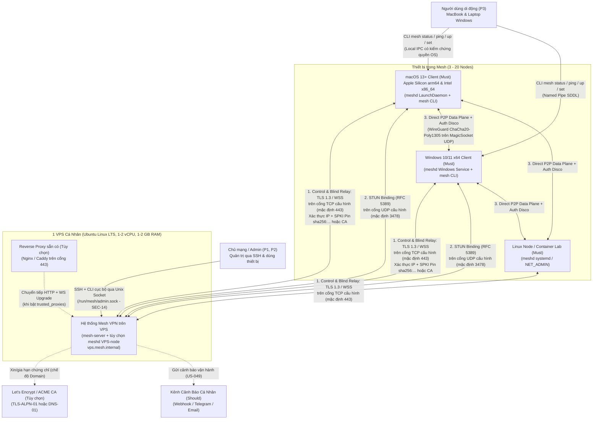
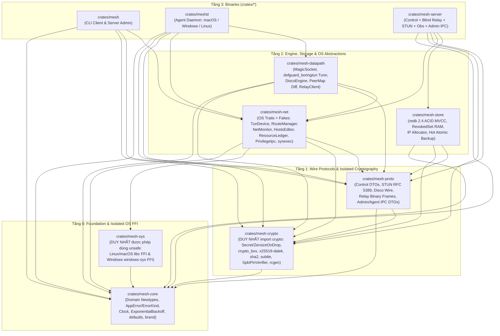
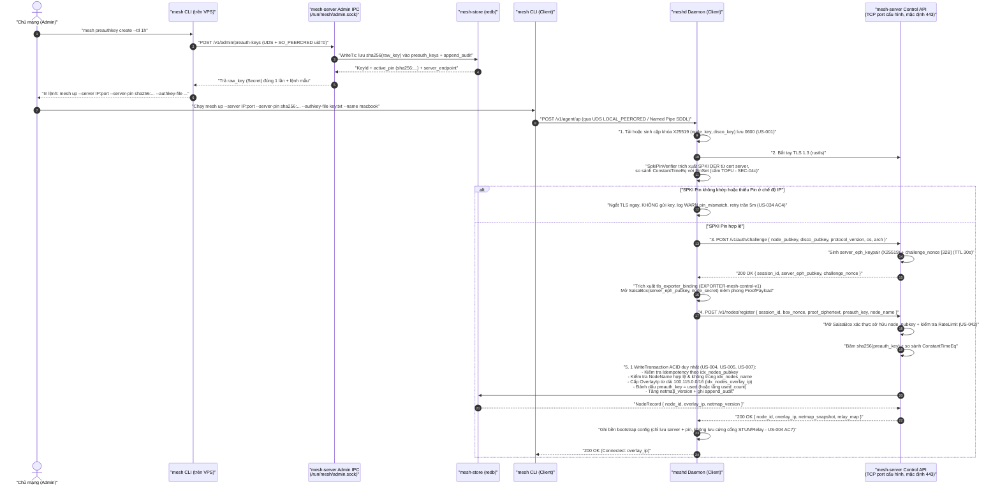
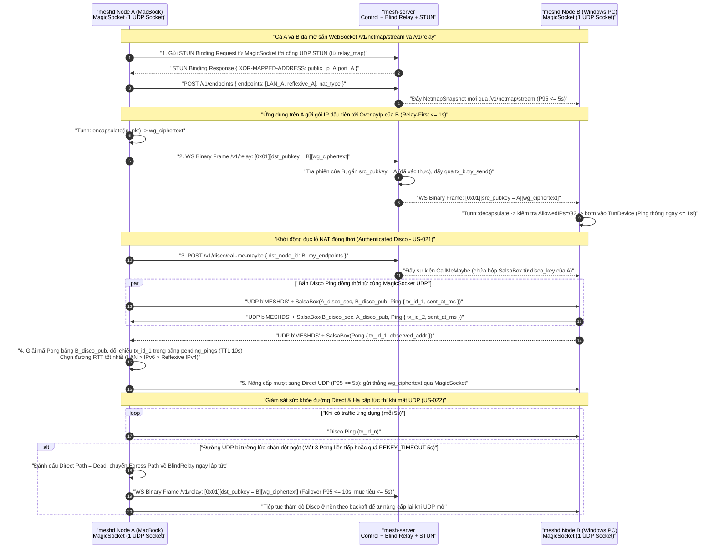
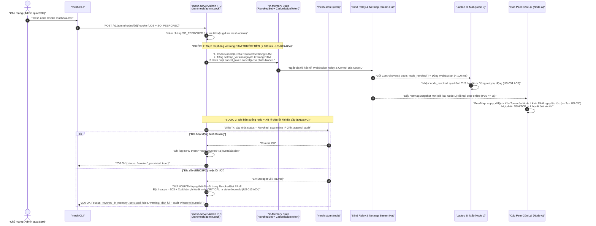
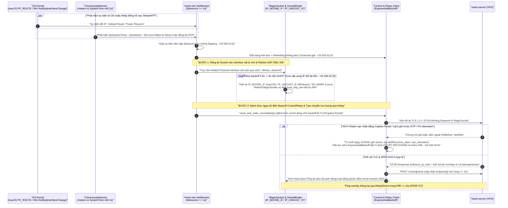
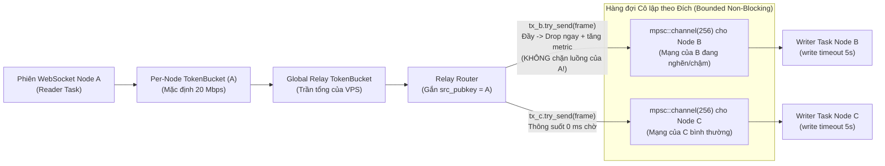
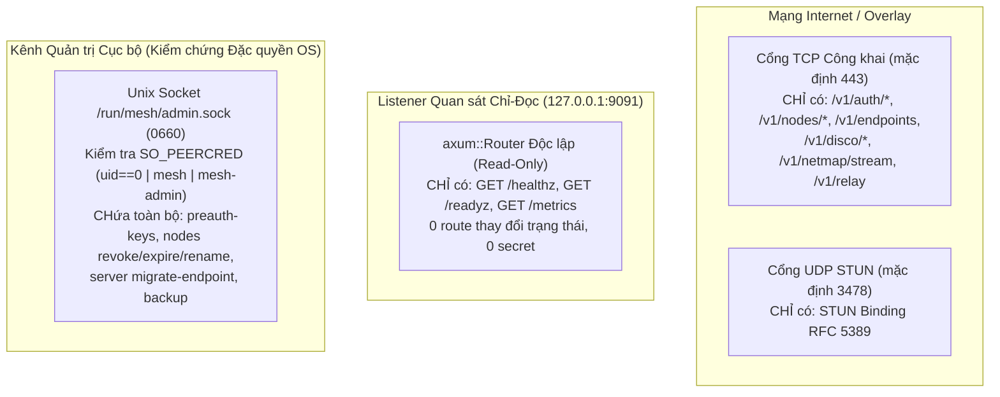

# System Architecture — Mesh VPN Cá Nhân Kiểu Tailscale (Rust 1.94.1)

| Thuộc tính | Giá trị |
|---|---|
| Tác giả | `agile-architect` |
| Ngày | 2026-11-12 |
| Phiên bản | **2.0** — Kiến trúc **Rust `1.94.1` (`edition = "2024"`, `resolver = "3"`)** đồng bộ Gate 1 (D1–D5) & `ADR-001..011` |
| Trạng thái | **Proposed-for-Gate-2** |
| Thành phần AI/SLM | **Không có** (Dự án thuần phần mềm hệ thống & hạ tầng mạng Mesh VPN → không áp dụng mục Kiến trúc AI) |
| Đầu vào | [production-readiness-requirements.md](../01-discovery/production-readiness-requirements.md) (v1.2) · [product-backlog.md](../02-product-planning/product-backlog.md) (v1.2) · [tech-stack-decision.md](./tech-stack-decision.md) (v2.0) · [architecture-decision-record.md](./architecture-decision-record.md) (v2.0) · [coding-standards.md](./coding-standards.md) (v2.0) |
| Tài liệu đi kèm | [database-design.md](./database-design.md) · [api-design.md](./api-design.md) |

---

## 1. Tổng Quan Kiến Trúc & Nguyên Tắc Thiết Kế Bất Biến

Hệ thống **Mesh VPN** là mạng phủ cá nhân (Personal Overlay Network) theo mô hình điều phối tập trung trên **1 VPS Ubuntu Linux LTS** kết hợp đường truyền dữ liệu ngang hàng (**Direct P2P WireGuard Userspace**) và chuyển tiếp mù dự phòng (**Blind Relay over WebSocket/TLS**).

### 1.1. 8 Nguyên tắc Kiến trúc Bất biến (Architectural Invariants)

1. **Tách biệt hoàn toàn Control Plane và Data Plane (`REL-01`, `US-033`)**:
   - Khi `mesh-server` trên VPS khởi động lại hoặc mất kết nối, các đường hầm P2P đang hoạt động trên `meshd` giữ nguyên khóa phiên và tiếp tục truyền dữ liệu với **0% mất gói do Control**. Khi `meshd` khởi động lại lúc Control offline, nó nạp `netmap-cache.json` (đã kiểm chứng SHA-256 + quyền `0600`) và bind lại đúng cổng UDP cục bộ (`local_udp_port`) đã lưu bền (`US-019 AC1`) để khôi phục kết nối P2P.
2. **Một Socket UDP Duy nhất cho Data Plane + STUN + Disco (`ADR-002`, `US-019`, `US-021`)**:
   - `MagicSocket` trong `crates/mesh-datapath` sở hữu duy nhất **1 `tokio::net::UdpSocket`** kết hợp máy trạng thái **sans-I/O** `defguard_boringtun::noise::Tunn`. Mọi gói STUN Binding, gói dò đường Authenticated Disco (`b"MESHDS"`) và gói dữ liệu WireGuard đều đi ra/vào trên cùng một cổng UDP cục bộ, đảm bảo NAT mapping quan sát được từ STUN/Disco trùng khớp 100% với đường hầm WireGuard.
3. **Kết nối bằng IP VPS + SPKI Pinning là Mặc định Hạng nhất (`SEC-04(c)`, `ADR-008`, `US-003`, `US-047`)**:
   - Ngay từ Milestone 1, client kết nối trực tiếp tới `IP:port` của VPS kèm mã ghim khóa công khai `sha256:<64_hex>` (băm SHA-256 trên `subjectPublicKeyInfo` DER của server). **Cấm tuyệt đối TOFU (Trust-On-First-Use)** và **không tồn tại cờ tắt kiểm tra chứng chỉ/pin** trong bản phát hành. Tái phát hành chứng chỉ X.509 giữ nguyên khóa định danh ECDSA P-256 của server giúp client không bao giờ phải pin lại.
4. **Cổng & Địa chỉ Cấu hình Tùy chỉnh, Di chuyển Không Mất Danh tính (`GNFR-11`, `SEC-15`, `ADR-009`, `US-074`)**:
   - Không mã hóa cứng cổng `443` hay `3478` ngoài `mesh_core::defaults`. Cổng Relay và STUN được phân phối động qua trường `relay_map` trong `NetmapSnapshot`. Khi đổi cổng/IP/chế độ TLS, `mesh-server` mở `ListenerSet` lắng nghe song song cổng cũ và cổng mới trong cửa sổ `transition_window`, giữ nguyên `NodeId`, khóa node, tên và `OverlayIp`.
5. **Cô lập Kênh Quản trị theo Đặc quyền OS (`SEC-14`, `ADR-006`, `US-012`, `US-052`, `US-073`)**:
   - **Tuyệt đối cấm** mở Admin API trên IP public, IP overlay hay TCP loopback `127.0.0.1` trần.
   - Trên VPS Linux: CLI `mesh` giao tiếp với `mesh-server` qua Unix Domain Socket `/run/mesh/admin.sock` (`0660`, kiểm tra `SO_PEERCRED` chỉ cho phép `root`/`mesh`/`mesh-admin`).
   - Trên Client macOS: `/var/run/mesh/meshd.sock` kiểm tra `LOCAL_PEERCRED` (chỉ `uid == 0` hoặc `gid == 80` mới gọi được lệnh thay đổi trạng thái).
   - Trên Client Windows: tách 2 Named Pipe `\\.\pipe\mesh-agent-admin` (SDDL DACL chỉ `LocalSystem` + `Administrators`) và `\\.\pipe\mesh-agent-ro` (chỉ-đọc).
   - Listener Quan sát (`/healthz`, `/readyz`, `/metrics`) nằm trên một `axum::Router` và socket chỉ-đọc hoàn toàn tách biệt.
6. **Không Bao Giờ Làm Hỏng Mạng Máy Thật (`G4`, `REL-08`, `REL-09`, `ADR-007`, `US-016`, `US-055`, `US-060`)**:
   - Mọi tài nguyên hệ thống (`utunN` trên macOS, adapter GUID trên Windows, `mesh0` trên Linux, route CIDR, khối `# BEGIN mesh … # END mesh` trong `hosts`, anchor `pf`, firewall rule) đều được ghi nguyên tử vào **`ResourceLedger` (`ledger.json`, `0600`) trước khi tạo**. Khi tắt hoặc khởi động lại sau `kill -9`, daemon chỉ dọn đúng tài nguyên trong sổ cái (tuyệt đối không quét xóa `utun*` để bảo vệ iCloud Private Relay và các VPN khác).
   - Mọi socket ngoại biên (`MagicSocket` UDP, TCP tới Control/Relay) bắt buộc ràng cứng vào card mạng vật lý mặc định (`IP_BOUND_IF` trên macOS, `IP_UNICAST_IF` trên Windows, `SO_MARK` trên Linux) để triệt tiêu 100% routing loop.
7. **An toàn Bộ nhớ & Bí mật Tuyệt đối (`ADR-001`, `ADR-010`, `SEC-01`, `SEC-02`)**:
   - Toàn bộ workspace đặt `unsafe_code = "forbid"`, ngoại trừ duy nhất `crates/mesh-sys` bọc OS FFI.
   - Mọi khóa bí mật và pre-auth key thô chỉ tồn tại trong `mesh_crypto::Secret<T>` (`ZeroizeOnDrop`, tự động xuất `"[REDACTED]"` trên `Debug`/`Display`/`Serialize`).
8. **Footprint Cực Nhỏ & Không Nghẽn Dây Chuyền (`PERF-01`, `PERF-09`, `US-025 AC6`)**:
   - `tokio` giới hạn 2 worker threads (stack 512 KiB trên `meshd`); đường truyền gói dùng buffer tĩnh `[u8; 2048]` tái sử dụng (0 cấp phát heap trên mỗi gói UDP/TUN).
   - Blind Relay dùng hàng đợi có trần `mpsc::channel(256)` theo từng node đích kết hợp **`try_send()`** (đầy thì drop-tail không chặn + tăng metric), chống triệt để Cross-Peer Head-of-Line Blocking.

---

## 2. Sơ Đồ Kiến Trúc C4 (Mermaid)

### 2.1. C4 Level 1 — System Context Diagram



### 2.2. C4 Level 2 — Container & OS Privilege Boundary View

```mermaid
flowchart TB
    subgraph VPS["VPS Ubuntu Linux LTS"]
        subgraph ServerProc["Tiến trình mesh-server (User: mesh, Không đặc quyền; CAP_NET_BIND_SERVICE nếu port < 1024)"]
            ListenerSet["ListenerSet (TCP cấu hình, mặc định 443)<br/>Hỗ trợ nghe song song cổng cũ + mới (US-074)"]
            ControlApi["Control REST & Netmap WS (/v1/...)<br/>(axum + tokio-rustls + RateLimiter)"]
            BlindRelay["Blind Relay Router (/v1/relay)<br/>(mpsc::channel(256) + try_send + TokenBucket)"]
            StunServer["STUN UDP Server (UDP cấu hình, mặc định 3478)<br/>(RFC 5389 Binding + RateLimit 100 pkt/s/IP)"]
            AdminIpcSrv["Admin IPC Server (/run/mesh/admin.sock)<br/>(0660 mesh:mesh-admin + SO_PEERCRED)"]
            ObsSrv["Read-Only Observability Server<br/>(127.0.0.1:9091 -> /healthz, /readyz, /metrics)"]
            RedbStore["mesh-store (redb 2.4 ACID MVCC)<br/>(/var/lib/mesh/control.redb 0600 + RevokedSet RAM)"]
        end

        subgraph VpsNodeProc["Tiến trình meshd trên VPS (Tùy chọn US-056 - vps.mesh.internal, User: root/CAP_NET_ADMIN)"]
            VpsAgent["meshd Agent (Linux)<br/>(/dev/net/tun mesh0 + SO_MARK fwmark)"]
        end

        VpsCli["mesh CLI (Admin / Node)<br/>Chạy qua SSH"]
    end

    subgraph ClientOS["Máy Client: macOS 13+ (arm64/x86_64) hoặc Windows 10/11 x64"]
        subgraph DaemonProc["Tiến trình meshd (macOS: root:wheel LaunchDaemon | Windows: LocalSystem Service)"]
            AgentIpc["Local Agent IPC Server<br/>macOS: /var/run/mesh/meshd.sock (LOCAL_PEERCRED)<br/>Win: \\.\pipe\mesh-agent-admin (SDDL SY+BA) & -ro"]
            ControlClient["Control & Relay WS Client<br/>(SpkiPinVerifier + ExponentialBackoff)"]
            MagicSock["MagicSocket (1 tokio::net::UdpSocket)<br/>(Ràng IP_BOUND_IF / IP_UNICAST_IF / SO_MARK)"]
            WgEngine["WireGuard Sans-I/O Engine<br/>(defguard_boringtun::noise::Tunn + PeerMap Diff)"]
            DiscoEngine["Authenticated Disco Engine<br/>(b'MESHDS' + crypto_box + pending_pings)"]
            TunDev["TunDevice & RouteManager<br/>macOS: utun[0-9]+ | Win: wintun.dll (SHA-256)"]
            HostsMgr["HostsEditor & DNS Flusher<br/>(# BEGIN mesh ... # END mesh)"]
            NetMon["NetMonitor & ClockJumpDetector<br/>macOS: PF_ROUTE | Win: NotifyIpInterfaceChange"]
            Ledger["ResourceLedger & Keystore (0600)<br/>(ledger.json, node.key, netmap-cache.json)"]
        end

        ClientCli["mesh CLI (Client)<br/>(status, ping, netcheck, up, down, cleanup, set)"]
    end

    VpsCli -->|"HTTP/1.1 JSON qua UDS<br/>(SO_PEERCRED)"| AdminIpcSrv
    ClientCli -->|"HTTP/1.1 JSON qua UDS / Named Pipe"| AgentIpc

    ListenerSet --> ControlApi
    ListenerSet --> BlindRelay
    ControlApi --> RedbStore
    AdminIpcSrv --> RedbStore
    AdminIpcSrv --> BlindRelay
    ObsSrv --> RedbStore

    ControlClient <-->|"TLS 1.3 + SPKI Pin / CA<br/>(/v1/auth/challenge, /v1/nodes/register, /v1/netmap/stream)"| ListenerSet
    MagicSock <-->|"WSS Binary Frames (/v1/relay)"| BlindRelay
    MagicSock <-->|"UDP STUN Binding"| StunServer
    MagicSock <-->|"UDP Direct P2P (WG + Disco)"| VpsAgent

    MagicSock <--> WgEngine
    MagicSock <--> DiscoEngine
    WgEngine <--> TunDev
    ControlClient --> WgEngine
    ControlClient --> HostsMgr
    ControlClient --> Ledger
    NetMon --> MagicSock
    NetMon --> ControlClient
    TunDev --> Ledger
    HostsMgr --> Ledger
```



### 2.3. C4 Level 3 — Cargo Workspace Crate Dependency DAG (Quy tắc Phụ thuộc Một chiều)

> **Quy tắc bất biến**: Đồ thị phụ thuộc giữa 10 crates trong workspace là một **DAG (Directed Acyclic Graph) nghiêm ngặt**, đi từ tầng cao xuống tầng thấp. **Cấm tuyệt đối phụ thuộc vòng (circular dependency)**.
> - Chỉ `crates/mesh-sys` được phép dùng `unsafe`.
> - Chỉ `crates/mesh-crypto` (và `defguard_boringtun` nội bộ trong `mesh-datapath`) được phép import các crate mật mã học.
> - Chỉ `crates/mesh-store` được phép import `redb`.



#### Bảng Ma trận Phụ thuộc Hợp lệ giữa các Crates

| Crate | Phụ thuộc nội bộ được phép (`mesh-*`) | Ràng buộc cô lập đặc biệt |
|---|---|---|
| `mesh-core` | *(Không phụ thuộc crate nội bộ nào)* | `unsafe_code = "forbid"`, OS-neutral 100%, chứa `mesh_core::defaults` |
| `mesh-sys` | `mesh-core` | **Duy nhất** `#![allow(unsafe_code)]` + `#![deny(unsafe_op_in_unsafe_fn)]` + `// SAFETY:` |
| `mesh-crypto` | `mesh-core` | **Duy nhất** import `crypto_box`, `x25519-dalek`, `chacha20poly1305`, `sha2`, `subtle`, `rcgen` |
| `mesh-proto` | `mesh-core`, `mesh-crypto` | `unsafe_code = "forbid"`, `clippy::indexing_slicing = "deny"`, bắt buộc có `proptest!` |
| `mesh-net` | `mesh-core`, `mesh-crypto`, `mesh-proto`, `mesh-sys` | Định nghĩa Trait + In-Memory Fake; tách file `*_linux.rs`, `*_macos.rs`, `*_windows.rs` |
| `mesh-store` | `mesh-core`, `mesh-crypto`, `mesh-proto` | **Duy nhất** import `redb`; không có hàm xóa/sửa bảng `audit_events` |
| `mesh-datapath` | `mesh-core`, `mesh-crypto`, `mesh-proto`, `mesh-net` | **Duy nhất** import `defguard_boringtun`; tái sử dụng buffer tĩnh `[u8; 2048]` |
| `mesh-server` | `mesh-core`, `mesh-crypto`, `mesh-proto`, `mesh-store`, `mesh-net` | Chạy quyền user `mesh` không đặc quyền trên VPS Linux |
| `meshd` | `mesh-core`, `mesh-crypto`, `mesh-proto`, `mesh-datapath`, `mesh-net` | Giới hạn `tokio` `worker_threads(2)`, `thread_stack_size(512 * 1024)` |
| `mesh` | `mesh-core`, `mesh-crypto`, `mesh-proto`, `mesh-net` | Dùng `tokio` `new_current_thread()`; duy nhất được phép in `stdout`/`stderr` |

---

## 3. Sơ Đồ Tuần Tự Cho 6 Luồng Giao Dịch Trọng Yếu (`sequenceDiagram`)

### 3.1. Luồng 1: Đăng Ký Thiết Bị Mới qua IP + SPKI Pinning + Challenge–Response `crypto_box` + Pre-Auth Key SHA-256 (`US-001..005`, `US-047`)



### 3.2. Luồng 2: Thiết Lập Kết Nối Relay-First → STUN + `CallMeMaybe` + Authenticated Disco trên `MagicSocket` → Nâng Cấp Direct P2P & Hạ Cấp ≤ 1 s (`US-019..026`)



### 3.3. Luồng 3: Thu Hồi Khẩn Cấp Thiết Bị Bị Mất (`mesh node revoke`) — Ưu Tiên Cắt Trong RAM Kể Cả Khi Đĩa Đầy `ENOSPC` (`US-013 AC4`, `US-029`, `US-030`)



### 3.4. Luồng 4: Phục Hồi Sau Đổi Mạng (`Roaming`), `Sleep/Wake` & Lỗi TLS Tạm Thời trên macOS & Windows (`US-034 AC4/AC5`, `US-035`, `US-036`)



### 3.5. Luồng 5: Di Chuyển Cổng / IP / Chế Độ TLS Không Mất Danh Tính (`US-074`, `SEC-15`, `ADR-009`)

```mermaid
sequenceDiagram
    autonumber
    actor Admin as "Chủ mạng (Admin)"
    participant SrvCli as "mesh CLI (trên VPS)"
    participant Srv as "mesh-server<br/>(ListenerSet + Store)"
    participant OnlineAgent as "Agent Đang Online<br/>(macOS / Windows / Linux)"
    participant OfflineAgent as "Agent Đang Tắt Máy<br/>(Offline suốt cửa sổ chuyển tiếp)"
    actor LocalAdmin as "Admin Cục Bộ Máy Client<br/>(root/admin macOS | Admin Win)"

    Admin->>SrvCli: "mesh server migrate-endpoint --tcp-port 8443 --stun-port 3479 --transition-window 24h"
    SrvCli->>Srv: "POST /v1/admin/server/migrate-endpoint (qua /run/mesh/admin.sock)"
    Srv->>Srv: "1. Thử bind trước TCP :8443 và UDP :3479 (US-046 AC5)<br/>Nếu cổng đang bị chiếm -> Từ chối ngay, giữ nguyên cổng cũ 443/3478!"
    Srv->>Srv: "2. Mở thêm listener :8443 trong ListenerSet (nghe song song :443 và :8443)<br/>3. Ghi cấu hình mới + PinSet (active_pin, next_pin) vào redb + append_audit<br/>4. Tăng netmap_version"

    Srv-->>OnlineAgent: "5. Đẩy NetmapSnapshot mới (chứa relay_map :8443/:3479 & PinSet) qua stream đã xác thực"
    OnlineAgent->>OnlineAgent: "Kiểm chứng bản tin đến từ kênh TLS đã xác thực bằng Pin/CA hiện hành (SEC-15e)<br/>Ghi bền control_endpoint mới (:8443) vào đĩa (0600)"
    OnlineAgent->>Srv: "6. Chuyển kết nối Control/Relay sang :8443 và gửi STUN tới :3479<br/>(Giữ nguyên NodeId, node_key, OverlayIp; 0% mất gói P2P đang chạy!)"
    OnlineAgent->>Srv: "Báo xác nhận acked_endpoint_version lên Server"

    Note over Admin,Srv: "Kiểm tra tiến độ & Đóng cổng cũ sau khi hết transition_window (US-074 AC7)"
    Admin->>SrvCli: "mesh server status"
    SrvCli->>Srv: "GET /v1/admin/server/status"
    Srv-->>Admin: "Hiển thị danh sách node đã chuyển & node chưa xác nhận (OfflineAgent)"
    Srv->>Srv: "Khi hết transition_window: đóng listener cổng cũ :443 và gỡ rule firewall cổng cũ"

    Note over OfflineAgent,LocalAdmin: "Khôi phục máy Offline sau khi cổng cũ đã đóng (US-074 AC5)"
    LocalAdmin->>OfflineAgent: "Chạy: mesh set --server <IP:8443> --server-pin sha256:..."
    OfflineAgent->>OfflineAgent: "Kiểm tra quyền IPC (LOCAL_PEERCRED uid=0/gid=80 hoặc Named Pipe SDDL SY+BA)<br/>(Nếu user thường gọi -> Từ chối PermissionDenied ngay!)"
    OfflineAgent->>OfflineAgent: "Cập nhật bootstrap config, giữ nguyên node.key & OverlayIp cũ"
    OfflineAgent->>Srv: "Kết nối tới :8443 bằng đúng node_key cũ (Không cần pre-auth key mới!)"
```

### 3.6. Luồng 6: Shared UDP Socket Multiplexing (`MagicSocket` + `defguard_boringtun::noise::Tunn` Sans-I/O) (`ADR-002`, `SEC-11`, `US-014..026`)

```mermaid
sequenceDiagram
    autonumber
    participant Tun as "TunDevice<br/>(utunN / Wintun / mesh0)"
    participant Loop as "mesh-datapath::DatapathLoop<br/>(Static Buffers [u8; 2048])"
    participant PeerTunn as "PeerMap & noise::Tunn<br/>(Sans-I/O + AllowedIPs /32)"
    participant Disco as "DiscoEngine & StunCodec"
    participant Udp as "MagicSocket (1 UdpSocket)<br/>(Bound to Physical NIC)"
    participant Relay as "RelayClient<br/>(WebSocket /v1/relay)"

    rect rgb(235, 245, 255)
        Note over Tun,Relay: "CHIỀU GỬI (EGRESS: Từ Ứng dụng qua TUN ra Mạng)"
        Tun->>Loop: "1. Đọc gói IPv4 vào tun_buf: [u8; 2048] (MTU <= 1280)"
        Loop->>Loop: "Đọc dst_ip (byte 16..20 của IPv4 header)"
        Loop->>PeerTunn: "2. Tra Peer theo dst_ip (/32); gọi tunn.encapsulate(&tun_buf[..n], &mut wg_buf)"
        PeerTunn-->>Loop: "TunnResult::WriteToNetwork(&wg_buf[..enc_len])"
        alt "Peer đã có đường Direct(SocketAddr) còn sống"
            Loop->>Udp: "3a. udp_socket.send_to(wg_ciphertext, peer_direct_addr)"
        else "Peer chưa có Direct hoặc Direct vừa mất 3 Pong / quá REKEY_TIMEOUT"
            Loop->>Relay: "3b. relay_tx.try_send([0x01, dst_pubkey, wg_ciphertext]) (<= 1s)"
            Loop->>Disco: "Kích hoạt trigger_hole_punch(peer_id) (có節 chế tốc độ)"
        end
    end

    rect rgb(240, 255, 240)
        Note over Tun,Relay: "CHIỀU NHẬN (INGRESS: Demux không cấp phát Heap từ 1 UDP Socket hoặc Relay)"
        alt "Gói đến từ MagicSocket UDP (recv_from vào udp_buf: [u8; 2048])"
            Udp->>Loop: "Nhận (len, src_addr)"
            alt "Case A: STUN Packet (len >= 20 && udp_buf[4..8] == [0x21, 0x12, 0xA4, 0x42])"
                Loop->>Disco: "StunCodec::decode(&udp_buf[..len]) -> Cập nhật Reflexive Endpoint"
            else "Case B: Authenticated Disco Packet (len >= 62 && udp_buf[0..6] == b'MESHDS')"
                Loop->>Disco: "DiscoEngine::handle_udp(&udp_buf[..len], src_addr)<br/>Giải mã SalsaBox + kiểm tra tx_id trong pending_pings -> Cập nhật DirectAddr"
            else "Case C: WireGuard Packet (len >= 32 && udp_buf[0] in 1..=4 && udp_buf[1..4] == [0,0,0])"
                Loop->>PeerTunn: "Tra Peer (theo sender_index hoặc thử handshake) -> tunn.decapsulate(None, &udp_buf[..len], &mut dec_buf)"
                PeerTunn->>PeerTunn: "KIỂM TRA CRYPTOKEY ROUTING (SEC-11, US-014 AC4):<br/>IPv4 src_ip bên trong gói đã giải mã PHẢI bằng đúng peer.overlay_ip (/32)!"
                alt "src_ip == peer.overlay_ip (/32)"
                    PeerTunn-->>Tun: "Ghi gói IPv4 đã giải mã ra TunDevice"
                else "src_ip giả mạo (Spoofed Inner IP)"
                    PeerTunn->>PeerTunn: "Drop ngay lập tức + tăng metric mesh_agent_spoofed_packets_dropped_total"
                end
            else "Gói rác / Không khớp định dạng"
                Loop->>Loop: "Drop im lặng (0 panic, 0 log spam)"
            end
        else "Gói đến từ Blind Relay WebSocket ([0x01][src_pubkey: 32B][payload])"
            Relay->>Loop: "Tra Peer theo src_pubkey do Relay chứng thực (nếu không thuộc Netmap -> Drop)"
            Loop->>PeerTunn: "Đưa vào DiscoEngine (nếu đầu b'MESHDS') hoặc tunn.decapsulate + kiểm tra AllowedIPs /32"
        end
    end
```

---

## 4. Cơ Chế Chống Routing Loop Đa Nền Tảng (`US-016`, `REL-09`, `ADR-007`)

Một trong những rủi ro nghiêm trọng nhất của mọi phần mềm VPN là hiện tượng **Routing Loop** (gói tin UDP/TCP đã mã hóa của chính daemon bị bảng định tuyến đẩy ngược vào card mạng ảo TUN của nó, làm treo máy và mất kết nối Internet). Kiến trúc Mesh VPN phòng vệ **4 lớp đồng thời**:

### 4.1. Lớp 1 — Ràng Cứng Socket Ngoại Biên vào Card Mạng Vật Lý Mặc Định (Socket-to-Interface Binding)

Mọi socket đi ra Internet của `meshd` (bao gồm `MagicSocket` UDP và mọi kết nối TCP tới Control/Relay) đều được cấu hình qua `crates/mesh-sys` **trước khi gửi gói đầu tiên** và **ràng lại mỗi khi `NetMonitor` báo thay đổi interface mặc định** (`US-035 AC7`, `US-036 AC3`):

| Hệ điều hành | Cơ chế Kernel / Syscall trong `crates/mesh-sys` | Chi tiết Kỹ thuật & Xử lý Đặc thù |
|---|---|---|
| **macOS 13+ (`arm64` & `x86_64`)** | `libc::setsockopt(fd, IPPROTO_IP, IP_BOUND_IF, &if_index, 4)` và `setsockopt(fd, IPPROTO_IPV6, IPV6_BOUND_IF, &if_index, 4)` | `NetMonitor` đọc bảng route qua `PF_ROUTE` để tìm interface vật lý giữ default route (vd. `en0`, `en1`, `pdp_ip0`), lấy `if_index` qua `libc::if_nametoindex`, và ràng trực tiếp socket vào `if_index` đó. Tuyệt đối không bao giờ ràng vào `utun[0-9]+`. Không dùng host route tĩnh tới IP VPS để tránh để lại route mồ côi khi `kill -9` rồi đổi Wi-Fi (`US-016 AC3`). |
| **Windows 10/11 x64** | `windows_sys::Win32::Networking::WinSock::setsockopt(sock, IPPROTO_IP, IP_UNICAST_IF, &if_index_be, 4)` và `setsockopt(sock, IPPROTO_IPV6, IPV6_UNICAST_IF, &if_index_le, 4)` | Tìm interface vật lý có metric thấp nhất giữ default route qua `GetBestInterfaceEx` / bảng interface (loại trừ `InterfaceLuid` của adapter Wintun `MeshVPN`). **Lưu ý sống còn của WinSock**: với IPv4, tham số `IP_UNICAST_IF` bắt buộc phải chuyển sang **Network Byte Order (`if_index.to_be()`)**, còn với IPv6 (`IPV6_UNICAST_IF`) dùng Host Byte Order (`if_index`). |
| **Linux (VPS-node `US-056` & Container Lab `US-057`)** | `libc::setsockopt(fd, SOL_SOCKET, SO_MARK, &0x5d56_u32, 4)` (`fwmark = 0x5d56`) + ràng `SO_BINDTODEVICE` hoặc policy rule | Đặt dấu `fwmark = 0x5d56` trên mọi socket ngoại biên của `meshd`. Khi VPS vừa chạy `mesh-server` vừa chạy `meshd` làm node `vps.mesh.internal`, gói điều khiển/relay/STUN/WireGuard mang `fwmark = 0x5d56` luôn đi theo bảng route `main` ra card vật lý (`eth0`/`ens3`), không bao giờ đi vào `mesh0`. |

### 4.2. Lớp 2 — Chỉ Định Tuyến Dải CIDR Overlay (Subnet-Only Routing) & Phát Hiện Xung Đột CGNAT

1. **Cấm cài Default Route ở MVP (`US-014 AC1`, `US-016 AC4`, `US-060 AC1`)**:
   - `RouteManager` chỉ chấp nhận cài route cho đúng dải CIDR overlay (mặc định **`100.115.0.0/16`**, cấu hình được tại `mesh-server` theo `US-008`). Mọi yêu cầu cài `0.0.0.0/0`, `0.0.0.0/1`, `128.0.0.0/1` hay `::/0` đều bị từ chối ngay trong `RouteManager`.
2. **Phát hiện xung đột dải IP vật lý (`REL-14`, `US-008`, `US-037`)**:
   - Chọn mặc định **`100.115.0.0/16`** (nằm trong dải RFC 6598 `100.64.0.0/10` nhưng tách biệt khỏi dải `100.64.0.0/24` thường dùng của ISP CGNAT và tránh hoàn toàn `192.168.0.0/16`, `10.0.0.0/8`, `172.16.0.0/12` của LAN/Docker).
   - Trước khi cài route (lúc khởi động hoặc khi roaming sang mạng 4G CGNAT), `meshd` kiểm tra toàn bộ địa chỉ/subnet của các card mạng vật lý đang hoạt động: nếu phát hiện một interface vật lý có IP/subnet chồng lấn với `overlay_cidr`, `meshd` **từ chối cài route chồng chéo**, giữ mạng máy thật an toàn, ghi cảnh báo `WARN` (`event = "overlay_subnet_conflict"`) và hiển thị trạng thái `"overlay_conflict"` trong `mesh status` (`US-037 AC1`).

### 4.3. Lớp 3 — Bộ Lọc Card Mạng Ảo & Endpoint Ứng Viên (`US-011 AC4`, `US-016 AC2`, `US-020 AC2/AC4`)

Khi thu thập `endpoints[]` cục bộ hoặc khi nhận danh sách `endpoints[]` của peer từ Netmap/Disco, hàm `mesh_net::endpoint_filter::is_valid_candidate_endpoint()` tự động loại bỏ:
1. Bất kỳ địa chỉ IP nào nằm trong `overlay_cidr` (vd. `100.115.0.0/16`), loopback (`127.0.0.0/8`, `::1`), link-local (`169.254.0.0/16`, `fe80::/10`), multicast, broadcast hoặc unspecified (`0.0.0.0`, `::`).
2. Bất kỳ địa chỉ nào gắn với chính interface tunnel của `meshd` hoặc các interface ảo/bridge nội bộ:
   - **macOS**: `utun*` (bao gồm cả `utun` của iCloud Private Relay và VPN khác), `awdl0`, `llw0`, `bridge*`, `anpi*`, `gif*`, `stf*`, `ap1`, `vmnet*`, `vboxnet*`, `lo*`.
   - **Windows**: adapter Wintun `MeshVPN`, các vEthernet của WSL / Hyper-V / Docker Desktop, Loopback Pseudo-Interface, Teredo/ISATAP.
   - **Linux**: `mesh*`, `lo`, `docker*`, `br-*`, `veth*`, `virbr*`, `cni*`, `flannel*`, `cali*`, `wg*`, `tailscale*`.

### 4.4. Lớp 4 — Chống Vòng Lặp DNS trong Khối `hosts` (`PLAT-04`, `US-004 AC3`, `US-038 AC5`, `US-056 AC2`)

Khi VPS vừa chạy `mesh-server` vừa tham gia mesh làm một node (`vps.mesh.internal`):
- Cả `mesh-server` (lúc đăng ký/đổi tên) và `meshd` (trước khi ghi khối `# BEGIN mesh … # END mesh` vào `/etc/hosts`) đều chặn danh sách tên cấm (`localhost`, `broadcasthost`, `wpad`, `isatap`, `local`) **VÀ chặn chính hostname/domain công khai đang dùng cho Control/Relay/STUN**.
- Không một mục nào trong khối `# BEGIN mesh` được phép ánh xạ tới địa chỉ IP public của VPS đang làm Control/Relay/STUN. Nhờ đó, việc phân giải địa chỉ VPS để duy trì kênh Control/Relay không bao giờ bị bẻ hướng vào bên trong đường hầm.

---

## 5. Cấu Trúc Thư Mục Mã Nguồn Chi Tiết (Directory Layout)

> **Quy ước bắt buộc**:
> - Tuân thủ 100% tên crate và quy ước đặt tên tệp theo hệ điều hành trong `coding-standards.md` §2.2: dùng hậu tố **`_linux.rs`**, **`_macos.rs`**, **`_windows.rs`** (và `_unix.rs` khi dùng chung giữa Linux/macOS). **Cấm dùng `_darwin.rs` hay `util.rs`/`common.rs`/`helpers.rs`**.

```text
mesh-vpn/
├── Cargo.toml                          # Workspace root (resolver = "3", edition = "2024", rust-version = "1.94.1")
├── Cargo.lock                          # Khóa phiên bản chính xác của toàn bộ dependency tree
├── rust-toolchain.toml                 # channel = "1.94.1", components = ["rustfmt", "clippy"]
├── rustfmt.toml                        # max_width = 100, edition = "2024", reorder_imports = true
├── clippy.toml                         # Cấu hình ngưỡng kiểm tra tĩnh
├── deny.toml                           # Chặn AGPL/GPL/LGPL/MPL-2.0, chặn openssl-sys/rusqlite/anyhow
├── .editorconfig                       # UTF-8 No BOM, LF (CRLF cho .ps1)
├── .gitattributes                      # Cưỡng chế line endings
├── .gitignore
├── scripts/
│   ├── bootstrap-toolchain.ps1         # Cài đặt Portable Zig / MSVC + cargo-deny + rcodesign
│   ├── check.ps1                       # Bộ lệnh kiểm định chuẩn 1 chạm trên Windows
│   ├── check.sh                        # Bộ lệnh kiểm định chuẩn 1 chạm trên Linux/macOS
│   ├── install-server.sh               # Trình cài đặt/nâng cấp mesh-server an toàn trên VPS Ubuntu (US-051)
│   ├── install-macos.sh                # Trình cài đặt LaunchDaemon macOS không qua trình duyệt + kiểm SHA-256 (US-073)
│   └── install-windows.ps1             # Trình cài đặt Windows Service + kiểm SHA-256 wintun.dll (US-052)
├── deploy/
│   ├── systemd/
│   │   ├── mesh-server.service         # Unit systemd không đặc quyền cho mesh-server (US-046, US-051)
│   │   └── meshd.service               # Unit systemd tách riêng với CAP_NET_ADMIN cho VPS-node (US-056)
│   ├── launchd/
│   │   └── internal.mesh.meshd.plist   # LaunchDaemon plist cho macOS 13+ (root:wheel 0644 - US-073)
│   └── reverse-proxy/
│       ├── nginx-mesh.conf.example     # Cấu hình mẫu Nginx chuyển tiếp HTTP + WS Upgrade (US-051)
│       └── Caddyfile.example           # Cấu hình mẫu Caddy (US-051)
├── lab/                                # Phòng lab mạng Chaos NAT container (US-057, US-058)
│   ├── docker-compose.nat-lab.yml      # Topo 5 node + 1 VPS + router EIM/APDM/UDP-block/MTU-1400
│   └── scenarios/
└── crates/
    ├── mesh-core/                      # [Lib - Tầng 0] Kiểu miền, lỗi, thời gian, backoff, hằng số mặc định
    │   ├── Cargo.toml
    │   └── src/
    │       ├── lib.rs
    │       ├── brand.rs                # Tên CLI "mesh", hậu tố ".mesh.internal", magic bytes
    │       ├── defaults.rs             # Duy nhất chứa DEFAULT_CONTROL_TCP_PORT=443, DEFAULT_STUN_UDP_PORT=3478, MTU=1280
    │       ├── error.rs                # AppError & ErrorKind (Unauthenticated luôn trả "authentication failed")
    │       ├── types.rs                # NodeId, KeyId, NodeName (RFC 1123 + cấm tên hệ thống), OverlayIp, OverlayCidr, Port, PublicKey, SpkiPin
    │       ├── clock.rs                # Trait Clock + SystemClock + FakeClock (dò nhảy đồng hồ > 30s)
    │       └── backoff.rs              # ExponentialBackoff + Full Jitter (trần 60s mạng thường, trần 5m lỗi TLS/Pin)
    │
    ├── mesh-sys/                       # [Lib - Tầng 0] DUY NHẤT được phép dùng unsafe cho OS FFI
    │   ├── Cargo.toml
    │   └── src/
    │       ├── lib.rs                  # #![allow(unsafe_code)] #![deny(unsafe_op_in_unsafe_fn)] #![deny(clippy::undocumented_unsafe_blocks)]
    │       ├── error.rs                # SysError -> AppError conversion
    │       ├── socket_linux.rs         # SO_MARK (fwmark), IP_MTU_DISCOVER (tắt ép DF=1)
    │       ├── socket_macos.rs         # IP_BOUND_IF, IPV6_BOUND_IF, IP_DONTFRAG
    │       ├── socket_windows.rs       # IP_UNICAST_IF (big-endian), IPV6_UNICAST_IF, IP_DONTFRAGMENT
    │       ├── tun_linux.rs            # /dev/net/tun ioctl(TUNSETIFF, IFF_TUN | IFF_NO_PI)
    │       ├── tun_macos.rs            # AF_SYSTEM com.apple.net.utun_control & getsockopt(UTUN_OPT_IFNAME)
    │       ├── tun_windows.rs          # Kiểm SHA-256 wintun.dll + LoadLibraryExW(LOAD_LIBRARY_SEARCH_APPLICATION_DIR)
    │       ├── ipc_linux.rs            # getsockopt(SO_PEERCRED) lấy (uid, gid, pid)
    │       ├── ipc_macos.rs            # getsockopt(LOCAL_PEERCRED) & getpeereid
    │       ├── ipc_windows.rs          # CreateNamedPipeW kèm SDDL DACL (SY + BA) & FILE_FLAG_FIRST_PIPE_INSTANCE
    │       ├── netmon_linux.rs         # Socket NETLINK_ROUTE
    │       ├── netmon_macos.rs         # BSD Routing Socket PF_ROUTE
    │       ├── netmon_windows.rs       # NotifyIpInterfaceChange & GetBestInterfaceEx
    │       └── fs_unix.rs              # Kiểm tra stat uid==0, mode & 0o022 == 0, chống symlink leo thang đặc quyền
    │
    ├── mesh-crypto/                    # [Lib - Tầng 1] DUY NHẤT import mật mã học & bảo vệ khóa trong RAM
    │   ├── Cargo.toml
    │   └── src/
    │       ├── lib.rs
    │       ├── secret.rs               # Secret<T> (ZeroizeOnDrop, Debug/Display/Serialize -> "[REDACTED]")
    │       ├── keys.rs                 # Sinh & bọc NodeKeypair, DiscoKeypair (X25519), PreAuthToken (mpk_...)
    │       ├── hash.rs                 # SHA-256 + ConstantTimeEq (subtle) cho Pre-Auth Key, SPKI Pin, file checksum
    │       ├── auth_box.rs             # Challenge-Response SalsaBox (crypto_box) + TLS exporter binding (ADR-003)
    │       ├── disco_box.rs            # Niêm phong/mở hộp bản tin Disco (Ping/Pong/CallMeMaybe) + chống replay tx_id
    │       ├── tlspin.rs               # SpkiPinVerifier (rustls ServerCertVerifier, PinSet active+next, cấm TOFU)
    │       └── certgen.rs              # Sinh khóa định danh Server ECDSA P-256 & phát hành lại X.509 giữ nguyên SPKI (rcgen)
    │
    ├── mesh-proto/                     # [Lib - Tầng 1] Định nghĩa bản tin & bộ giải mã có kiểm biên (0 unsafe, 0 slice[i])
    │   ├── Cargo.toml
    │   └── src/
    │       ├── lib.rs
    │       ├── control.rs              # DTOs cho /v1/auth/challenge, /v1/nodes/register, /v1/endpoints, /v1/disco/call-me-maybe
    │       ├── netmap.rs               # NetmapSnapshot, PeerDescriptor, RelayMap, PinSet, ControlStreamEvent
    │       ├── stun.rs                 # Codec STUN RFC 5389/8489 (0x2112A442, XOR-MAPPED-ADDRESS, FINGERPRINT CRC-32)
    │       ├── disco.rs                # Định dạng nhị phân b"MESHDS" + DiscoPayload (Ping, Pong, CallMeMaybe)
    │       ├── relay.rs                # Định dạng frame nhị phân Blind Relay (max_frame_size = 2048)
    │       ├── admin_ipc.rs            # DTOs cho Server Local Admin IPC (/run/mesh/admin.sock)
    │       └── agent_ipc.rs            # DTOs cho Client CLI <-> Daemon IPC (status, ping, netcheck, bugreport, up, down, set...)
    │
    ├── mesh-store/                     # [Lib - Tầng 2] Lưu trữ ACID thuần Rust trên redb 2.4
    │   ├── Cargo.toml
    │   └── src/
    │       ├── lib.rs
    │       ├── schema.rs               # Định nghĩa 9 TableDefinition của redb & phiên bản migration
    │       ├── store.rs                # ControlStore: mở DB, check_integrity(), quản lý WriteTransaction/ReadTransaction
    │       ├── nodes_repo.rs           # Đăng ký Idempotent (UNIQUE pubkey/IP/name), cập nhật endpoint, quarantine IP 24h
    │       ├── keys_repo.rs            # Tạo/liệt kê/thu hồi Pre-Auth Key, hỗ trợ --for <node> & reusable/ephemeral
    │       ├── identity_repo.rs        # Lưu khóa định danh Server, PinSet, trạng thái chuyển tiếp cổng (US-074)
    │       ├── audit_repo.rs           # Bảng audit_events chỉ append (cấm xóa/sửa) + fallback stderr/journald
    │       ├── revoked_ram.rs          # RevokedSet trong RAM ưu tiên cắt tức thì kể cả khi đĩa đầy ENOSPC (US-013 AC4)
    │       └── backup.rs               # Hot Atomic Snapshot Backup + SHA-256 + giữ 7 bản + Restore (US-045)
    │
    ├── mesh-net/                       # [Lib - Tầng 2] Trừu tượng hóa mạng/OS bằng Trait + Fake trong bộ nhớ
    │   ├── Cargo.toml
    │   └── src/
    │       ├── lib.rs
    │       ├── sysexec.rs              # Thực thi lệnh hệ thống bằng đường dẫn tuyệt đối cố định (0 shell)
    │       ├── ledger.rs               # ResourceLedger nguyên tử (ledger.json 0600) & trình dọn dẹp tàn dư sau crash
    │       ├── keystore.rs             # Đọc/ghi khóa 0600 (root:wheel macOS, root Linux, SYSTEM+Admins Windows)
    │       ├── endpoint_filter.rs      # Lọc card mạng ảo (utun*, awdl0, docker0, veth*, WSL) & phát hiện xung đột CGNAT
    │       ├── tun.rs                  # Trait TunDevice + FakeTunDevice
    │       ├── tun_linux.rs            # AsyncTunDevice cho Linux (/dev/net/tun)
    │       ├── tun_macos.rs            # AsyncTunDevice cho macOS (utun[0-9]+, xử lý 4-byte AF_INET header)
    │       ├── tun_windows.rs          # AsyncTunDevice cho Windows (Wintun ring buffer)
    │       ├── route.rs                # Trait RouteManager + FakeRouteManager (chỉ cho phép CIDR overlay)
    │       ├── route_linux.rs          # Cài/gỡ route & fwmark rule trên Linux
    │       ├── route_macos.rs          # Cài/gỡ route qua /sbin/route trên đúng utunN của phiên
    │       ├── route_windows.rs        # Cài/gỡ route trên adapter Wintun cố định
    │       ├── hosts.rs                # Trait HostsEditor + parser/writer khối # BEGIN mesh ... # END mesh
    │       ├── hosts_linux.rs          # Ghi nguyên tử + fallback ghi tại chỗ cho bind-mount container (US-038 AC2d)
    │       ├── hosts_macos.rs          # Giải symlink /etc/hosts -> /private/etc/hosts + dscacheutil/mDNSResponder flush
    │       ├── hosts_windows.rs        # Giữ ACL đọc cho Users/Dnscache + retry backoff <= 2s + DnsFlushResolverCache
    │       ├── netmon.rs               # Trait NetMonitor + ClockJumpDetector + Debouncer (1s)
    │       ├── netmon_linux.rs         # Theo dõi Netlink route/addr/link
    │       ├── netmon_macos.rs         # Theo dõi PF_ROUTE
    │       ├── netmon_windows.rs       # Theo dõi NotifyIpInterfaceChange + Windows PowerEvent
    │       ├── ipc.rs                  # Trait PrivilegeIpc & phân loại CallerPrivilege (Admin vs ReadOnly)
    │       ├── ipc_linux.rs            # UnixListener + SO_PEERCRED
    │       ├── ipc_macos.rs            # UnixListener + LOCAL_PEERCRED (uid==0 || gid==80)
    │       ├── ipc_windows.rs          # Named Pipe Server (mesh-agent-admin SDDL & mesh-agent-ro)
    │       ├── firewall_linux.rs       # Firewall opt-in có dry-run + auto-rollback 90s, giữ SSH (US-046)
    │       ├── firewall_macos.rs       # Kiểm tra socketfilterfw opt-in & anchor pf riêng (US-073 AC6)
    │       └── firewall_windows.rs     # Đặt profile adapter & rule dải overlay trên Windows Firewall (US-053)
    │
    ├── mesh-datapath/                  # [Lib - Tầng 2] Data Plane WireGuard Sans-I/O + MagicSocket + Disco + Relay
    │   ├── Cargo.toml
    │   └── src/
    │       ├── lib.rs
    │       ├── magic_socket.rs         # 1 tokio::net::UdpSocket demuxer trên static buffer [u8; 2048]
    │       ├── peer_map.rs             # Bảng Peer & defguard_boringtun::noise::Tunn, áp Netmap theo diff (US-010)
    │       ├── cryptokey.rs            # Kiểm chứng chặt AllowedIPs = /32 & tùy chọn packet filter (SEC-11, US-018)
    │       ├── disco_engine.rs         # Bảng pending_pings, đục lỗ đồng thời, chọn đường, keepalive on-demand 25s
    │       ├── relay_client.rs         # Kết nối WebSocket /v1/relay, gửi/nhận frame nhị phân, tự reconnect
    │       └── engine.rs               # Vòng lặp phối hợp TunDevice <-> PeerMap <-> MagicSocket <-> RelayClient
    │
    ├── mesh-server/                    # [Binary - Tầng 3] Máy chủ Control + Blind Relay + STUN + Obs + Admin IPC
    │   ├── Cargo.toml
    │   └── src/
    │       ├── main.rs                 # Khởi tạo tokio (2 worker threads), nạp config, chạy ServiceSupervisor
    │       ├── config.rs               # Cấu hình TOML của mesh-server (cổng, CIDR, trusted_proxies, ACME)
    │       ├── listener_set.rs         # Quản lý lắng nghe TCP/UDP & chạy song song cổng cũ + mới (US-074)
    │       ├── acme.rs                 # Tự động xin/gia hạn chứng chỉ TLS-ALPN-01 (cổng 443) / DNS-01 (instant-acme)
    │       ├── rate_limit.rs           # Token-bucket theo IP nguồn thật (hỗ trợ trusted_proxies - US-042)
    │       ├── control_handlers.rs     # Handlers cho /v1/auth/challenge, /v1/nodes/register, /v1/endpoints...
    │       ├── netmap_hub.rs           # Quản lý WebSocket /v1/netmap/stream (chỉ đẩy khi đổi cấu trúc/online debounce)
    │       ├── relay_hub.rs            # Blind Relay /v1/relay: mpsc::channel(256) + try_send() + TokenBucket 20 Mbps
    │       ├── stun_service.rs         # Dịch vụ UDP STUN RFC 5389 trên cổng cấu hình (giới hạn 100 pkt/s/IP)
    │       ├── admin_service.rs        # Router quản trị trên /run/mesh/admin.sock (SO_PEERCRED)
    │       ├── obs_service.rs          # Listener chỉ-đọc tách biệt (/healthz, /readyz, /metrics)
    │       └── alert_worker.rs         # Cảnh báo cá nhân tối giản (chứng chỉ, đĩa, relay, key expiry - US-049)
    │
    ├── meshd/                          # [Binary - Tầng 3] Tiến trình nền Agent Daemon (macOS / Windows / Linux)
    │   ├── Cargo.toml
    │   └── src/
    │       ├── main.rs                 # Khởi tạo tokio (2 worker threads, stack 512 KiB), chạy daemon hoặc Windows Service
    │       ├── config.rs               # Bootstrap config (chỉ lưu server_endpoint + PinSet) & netmap-cache.json
    │       ├── supervisor.rs           # Quản lý CancellationToken + TaskTracker, đảm bảo Graceful Shutdown <= 5s
    │       ├── control_loop.rs         # Kết nối Control, đồng bộ Netmap, xử lý chuyển tiếp cổng (US-074)
    │       ├── roaming_loop.rs         # Xử lý sự kiện từ NetMonitor & ClockJumpDetector (US-035, US-036)
    │       ├── ipc_service.rs          # Phục vụ lệnh từ CLI mesh (tách quyền ReadOnly vs Admin)
    │       ├── ping_probe.rs           # Thực thi lệnh mesh ping <peer> và mesh netcheck
    │       └── service_windows.rs      # Tích hợp Windows Service Control Manager & PowerEvent (cfg(windows))
    │
    └── mesh/                           # [Binary - Tầng 3] Công cụ dòng lệnh CLI thống nhất (Client & Server Admin)
        ├── Cargo.toml
        └── src/
            ├── main.rs                 # runtime current_thread, phân tích lệnh clap
            ├── cli.rs                  # Định nghĩa toàn bộ cấu trúc lệnh mesh <noun> <verb>
            ├── client_cmds.rs          # up, down, status, ping, netcheck, set, rotate-key, cleanup, bugreport
            ├── admin_cmds.rs           # preauthkey, node, server, backup, restore, hardening-check
            └── output.rs               # Định dạng bảng dễ đọc cho người dùng & --json ổn định cho script
```

---

## 6. Thiết Kế Đảm Bảo Độ Tin Cậy Production (Production-Readiness Mechanisms)

### 6.1. Mô hình Concurrency, Lock Hierarchy & Vòng đời Tác vụ (`Graceful Shutdown ≤ 5 s`)

1. **Cấm `tokio::spawn` mồ côi & Ngân sách Dừng ≤ 5 giây (`REL-08`, `US-055 AC1`)**:
   - Mọi tác vụ chạy nền trong `meshd` và `mesh-server` đều được đăng ký vào `tokio_util::task::TaskTracker` và nhận một `CancellationToken` phân cấp từ `root_cancel`.
   - Trình tự tắt chuẩn khi nhận `SIGTERM`/`SIGINT` (`launchd`/`systemd`) hoặc `ServiceControl::Stop` (Windows Service):
     - **`T + 0.0 s`**: Gọi `root_cancel.cancel()`; ngừng nhận kết nối IPC/HTTP mới.
     - **`T + ≤ 1.0 s`**: `ControlClient` và `RelayClient` gửi WebSocket `Close` frame báo offline rồi đóng socket.
     - **`T + ≤ 4.0 s`**: `ResourceLedger::cleanup_all()` đọc `ledger.json` và thực thi tuần tự: (i) gỡ route CIDR overlay, (ii) xóa khối `# BEGIN mesh … # END mesh` trong `hosts` và xả cache DNS, (iii) gỡ anchor `pf` (macOS) hoặc rule firewall của phiên, (iv) đóng file descriptor `utunN` / giải phóng adapter Wintun / xóa `mesh0`, (v) cập nhật `ledger.json` về trạng thái sạch.
     - **`T + 5.0 s`**: `tokio::time::timeout(Duration::from_secs(5), tracker.wait())` kết thúc; tiến trình thoát với mã `0`.
2. **Thứ tự Khóa (Lock Hierarchy) & Cấm giữ Lock qua `.await`**:
   - Cưỡng chế bằng `clippy::await_holding_lock = "deny"`.
   - Trên `mesh-server`, thứ tự khóa bất biến (khi cần đọc kết hợp): `RevokedSet (RwLock)` $\to$ `RelayHub::SessionTable (RwLock)` $\to$ `NetmapHub::Subscribers (Mutex)`. Không bao giờ lấy khóa theo chiều ngược lại (0 deadlock).
   - Trên `meshd`, `PeerMap` nằm trong `DatapathLoop` hoặc được bảo vệ bởi `std::sync::RwLock` chỉ giữ trong vài micro-giây để gọi `Tunn::encapsulate`/`decapsulate` trên slice bộ nhớ sẵn có (không bao giờ `.await` bên trong vùng khóa).

### 6.2. Hàng Đợi Có Trần & Không Chặn trên Blind Relay (`US-025 AC6`) + Điều Tiết Băng Thông (`US-027`)



- **Cô lập hàng đợi theo đích (`US-025 AC6`)**: Mỗi phiên kết nối của node đích sở hữu đúng 1 kênh `tokio::sync::mpsc::channel::<Bytes>(256)`. Khi Node A gửi gói tới Node B (đang bị nghẽn mạng TCP) và Node C (mạng khỏe) trên cùng kết nối TLS của A, luồng đọc của A chỉ gọi **`tx_b.try_send(frame)`**:
  - Nếu `QueueB` đầy (256 gói): trả về `TrySendError::Full` ngay lập tức, gói tới B bị hủy (drop-tail) và tăng bộ đếm `mesh_relay_dropped_packets_total{reason="dest_queue_full"}`. Luồng đọc của A **không bao giờ gọi `.send().await`**, nhờ đó lưu lượng từ A tới C hoàn toàn không bị ảnh hưởng!
- **Giới hạn băng thông (`US-027`)**: Mỗi phiên Relay có một `TokenBucket` nguyên tử (tốc độ nạp mặc định **20 Mbps/node**, burst 256 KiB, cấu hình được) kết hợp với `GlobalTokenBucket` của toàn VPS. Khi vượt ngưỡng, gói bị điều tiết/drop và tăng `mesh_relay_throttled_bytes_total`.

### 6.3. Rate Limiting Chống Brute-Force & Xử Lý `trusted_proxies` (`SEC-05`, `US-042`)

1. **Xác định IP nguồn thật (`ClientIpExtractor`)**:
   - Mặc định (`trusted_proxies = []` — chế độ Standalone): **chỉ lấy địa chỉ IP từ socket TCP trực tiếp (`peer_addr().ip()`)**; bỏ qua hoàn toàn mọi header `X-Forwarded-For` hay `X-Real-IP` do kẻ tấn công tự chèn (`US-042 AC6`).
   - Chế độ sau Reverse Proxy (`trusted_proxies` được admin cấu hình tường minh, vd. `["127.0.0.1", "::1"]`): chỉ khi `peer_addr().ip()` nằm trong `trusted_proxies`, server mới trích xuất IP client thật từ header chuyển tiếp để tính rate-limit — đảm bảo **không bao giờ khóa nhầm `127.0.0.1`** làm sập toàn bộ dịch vụ.
2. **Chính sách khóa tăng dần & Phản hồi Constant-Time**:
   - Ngưỡng theo IP nguồn: tối đa **10 lần xác thực/đăng ký thất bại trong cửa sổ 5 phút / IP**. Từ lần thứ 11, IP đó bị khóa tạm **15 phút** (tái phạm nhân đôi `×2` lên 30 phút, 60 phút…, trần tối đa **24 giờ**), trả lỗi `429 Too Many Requests` (`ErrorKind::RateLimited`) ngay tại tầng middleware trước khi chạm vào `redb` (`US-042 AC1`).
   - Ngưỡng toàn cục: tối đa **60 yêu cầu đăng ký/phút** trên toàn server (`US-042 AC4`).
   - Khi kiểm tra Pre-Auth Key, server **luôn tính `sha256(input)` trước** rồi so sánh bằng `subtle::ConstantTimeEq::ct_eq`, và mọi lỗi (key không tồn tại, hết hạn, đã dùng, đã thu hồi, hoặc sai `--for <node>`) đều trả về **duy nhất mã HTTP `401 Unauthorized` kèm thông báo `"authentication failed"`** (`US-004 AC4`, `US-042 AC2`).

### 6.4. Sổ Cái Tài Nguyên Nguyên Tử (`ResourceLedger` — `REL-08`, `US-055`, `US-060`)

Để đảm bảo kể cả khi `meshd` bị `kill -9`, mất điện hoặc panic, máy thật không bao giờ bị kẹt mạng hay mất các `utun` của hệ thống khác:
- **Quy tắc Ghi-Trước-Khi-Tạo (Write-Ahead Resource Registration)**:
  1. Trước khi mở/cấu hình interface, cài route, sửa khối `hosts` hay thêm anchor `pf`/firewall rule, `meshd` ghi mục tài nguyên đó vào `ledger.json` (ghi ra `ledger.json.tmp` $\to$ `sync_all()` $\to$ `rename` sang `ledger.json` với quyền `0600`).
  2. Trên **macOS**, ngay khi `utun` socket vừa được kernel cấp tên động (vd. `utun7`), tên `"utun7"` được ghi vào `ledger.json` **trước khi** gọi `/sbin/route` gán IP/CIDR (`US-060 AC2`).
- **Quy tắc Khởi động Tự Dọn Dẹp (Startup Crash Recovery)**:
  - Ngay bước đầu tiên khi `meshd` khởi động (trước khi tạo bất kỳ tài nguyên mới nào), nó đọc `ledger.json`. Nếu phát hiện còn tài nguyên của phiên trước chưa được đánh dấu `cleaned = true`, `meshd` dọn sạch đúng danh sách tài nguyên đó (gỡ đúng route CIDR, xóa khối `# BEGIN mesh … # END mesh`, gỡ anchor `pf` `com.internal.mesh`, xóa adapter Wintun `MeshVPN` bị kẹt), hoàn toàn không đụng tới bất kỳ `utunK` hay quy tắc tường lửa nào khác của máy!

### 6.5. Tách Biệt Tuyệt Đối Listener Quan Sát và Kênh Admin (`SEC-14`, `OPS-05`, `OPS-06`)



- Ba nhóm giao tiếp trên sử dụng **3 `axum::Router` và 3 listener hoàn toàn riêng biệt**, không dùng chung middleware hay route table.
- Lệnh `mesh server hardening-check` (`US-046 AC4`) tự động kiểm tra: tiến trình `mesh-server` không chạy dưới `root`, quyền `/run/mesh/admin.sock` không lỏng hơn `0660`, không có listener Admin trên TCP, và cảnh báo nếu bật Reverse Proxy mà chưa cấu hình `trusted_proxies`.
