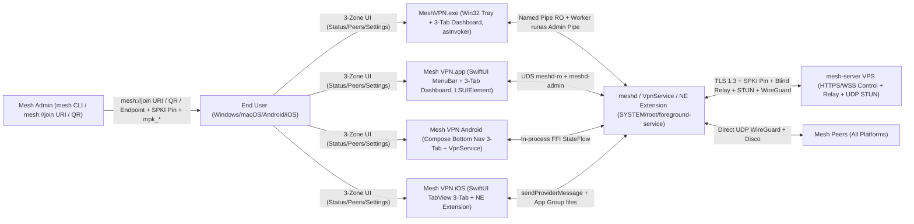
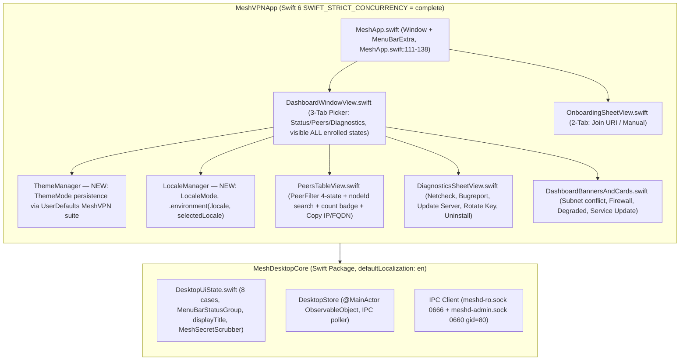
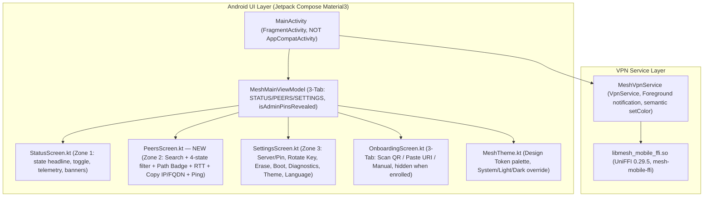
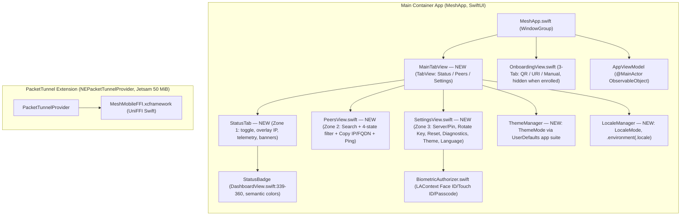
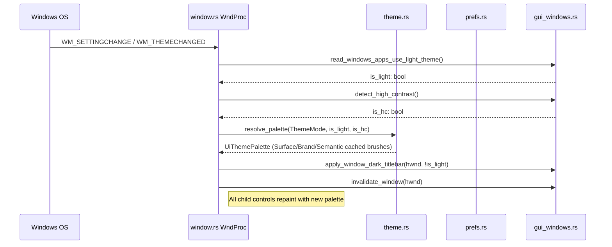
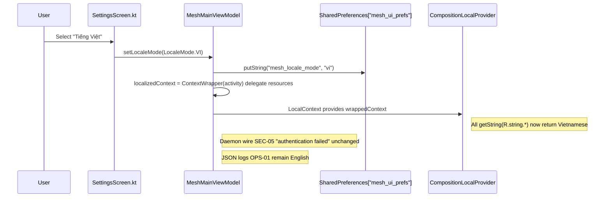
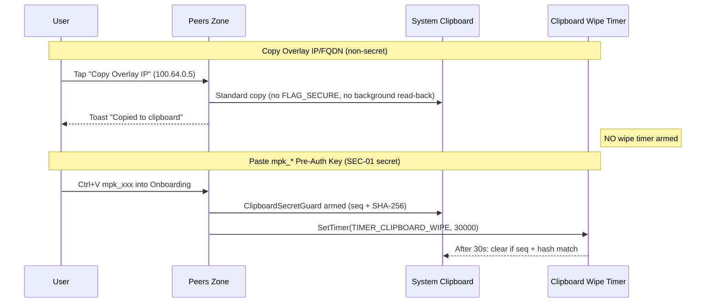

# Kiến trúc Hệ thống Unified UI — Mesh VPN (`v0.4.0`)

| Thuộc tính | Giá trị |
|---|---|
| Tác giả | `agile-architect` (`architect-ui`) |
| Ngày lập | 2026-11-20 |
| Phiên bản | **1.1 — Revision (Gate 2 — Chặng 2, Round 2 Remediation)** |
| Nhánh làm việc | `feat/unified-ui` (tách từ `feat/desktop-gui`; giữ nguyên `main`, `v0.1.0-rc1`, `feat/mobile-clients @ v0.2.0`, `feat/desktop-gui @ v0.3.0`) |
| Đầu vào chuẩn tắc Gate 1 | [unified-ui-readiness-requirements.md](../01-discovery/unified-ui-readiness-requirements.md) v1.1 (`38` `UUI-*`, `213` Glossary keys) · [unified-ui-product-backlog.md](../02-product-planning/unified-ui-product-backlog.md) v1.1 (`US-118..US-139`, `93 SP`) · [unified-ui-gate-1-critique.md](../05-quality-assurance/critique-reviews/unified-ui-gate-1-critique.md) (`IG-UUI-G1-01..03`) |
| Tài liệu nền tảng `v0.3.0` / `v0.2.0` | [desktop-gui-system-architecture.md](./desktop-gui-system-architecture.md) · [desktop-gui-ipc-and-ui-contracts.md](./desktop-gui-ipc-and-ui-contracts.md) · [mobile-system-architecture.md](./mobile-system-architecture.md) · [`.agents/rules/coding-standards.md`](../../.agents/rules/coding-standards.md) |
| Bộ tài liệu Gate 2 đi kèm (`0` mâu thuẫn) | [unified-ui-contracts-and-tokens.md](./unified-ui-contracts-and-tokens.md) · [unified-ui-tech-stack-decision.md](./unified-ui-tech-stack-decision.md) (`@techlead-ui`) · [unified-ui-adr.md](./unified-ui-adr.md) (`ADR-027..031`, `@techlead-ui`) · [unified-ui-coding-standards.md](./unified-ui-coding-standards.md) (`@techlead-ui`) |

> [!IMPORTANT]
> **Nguyên tắc Kiến trúc Bất biến Kế thừa & Ràng buộc Gate 2:**
> - **Không phá vỡ `v0.1.0-rc1`, `v0.2.0` & `v0.3.0`:** Control Plane, Data Plane, `mesh-client`, `crates/mesh`, `crates/meshd`, Mobile FFI, 13-field `AgentStatusResponse`, `protocol_version = 1` giữ nguyên.
> - **Bảo mật & An toàn Bộ nhớ Tuyệt đối:** `unsafe_code = "forbid"` cho `crates/mesh-gui` và mọi crate ngoài `crates/mesh-sys/`; giữ nguyên allowlist 4 crate `.expose_secret()` (`mesh-crypto`, `mesh-datapath`, `mesh-net`, `mesh`); giữ nguyên `ADMIN_PIPE_SDDL` và `meshd-admin.sock 0660 root:admin gid=80`.
> - **`ThemeMode` / `LocaleMode` lưu hoàn toàn phía client user-space** — `0` UAC/root, `0` sửa IPC contract.
> - **`linux_gui.rs` tương thích:** Mọi thay đổi shared modules (`app.rs`, `peers_view.rs`, `diagnostics_view.rs`, `onboarding.rs`) phải maintain `cargo clippy -D warnings` trên `x86_64-unknown-linux-musl` via `scripts/check.ps1 -Cross`.

---

## 1. Mục tiêu Kiến trúc `v0.4.0`

Milestone **`v0.4.0`** bổ sung lớp **Unified UI 3-Zone Navigation, Design Tokens Light/Dark, và Bilingual vi/en** trên 4 nền tảng theo `DEC-UI-01..04`:

| Quyết định Gate 1 | Lựa chọn đã chốt | Hiện thực hóa trong Kiến trúc |
|---|---|---|
| **`DEC-UI-01`** | 3-Zone Navigation thống nhất + Onboarding tách riêng | Header Hero + 3-tab Desktop; Bottom Nav 3-tab Mobile; Rotate Key / Update Server di chuyển sang Zone 3 modals + CTA Zone 1 |
| **`DEC-UI-02`** | Windows GDI/DWM hiện đại (giữ `ADR-020`) | `OwnedMemDc`/`PaintGuard`/`UiThemePalette`/dark titlebar, tách module `theme.rs`/`i18n.rs`/`prefs.rs`/`status_view.rs` |
| **`DEC-UI-03`** | Design Token Light/Dark thống nhất | Hex chuẩn từ Discovery §2.1; `System / Light / Dark` trên 4 app |
| **`DEC-UI-04`** | Song ngữ vi/en tức thì | `213` Glossary keys; `System / Tiếng Việt / English`; `0` restart daemon |

---

## 2. Sơ đồ Kiến trúc C4 (`Mermaid`)

### 2.1. C4 Level 1 — System Context (Unified 4 Platforms)



### 2.2. C4 Level 2 — Windows Component Architecture (`crates/mesh-gui` + `crates/mesh-sys`)

```mermaid
flowchart TB
    subgraph WIN_GUI["crates/mesh-gui (unsafe_code = forbid, MeshVPN.exe)"]
        direction TB
        main_rs["main.rs (cfg entry point, mod declarations)"]
        app_rs["app.rs (DesktopUiState 8 variants, TunnelSubState 7)"]
        theme_rs["theme.rs (NEW: UiTheme struct, ThemeMode, resolve_palette)"]
        i18n_rs["i18n.rs (NEW: LocaleMode, static key table, i18n::t fn, i18n::t_for fn)"]
        prefs_rs["prefs.rs (NEW: UiPrefs JSON load/save, atomic write)"]
        status_view_rs["status_view.rs (NEW: Header Hero + Status Zone 1 painting)"]
        peers_view_rs["peers_view.rs (filter_peers, format_peer_list_entry, 4-state filter)"]
        diagnostics_rs["diagnostics_view.rs (Zone 3 content, Rotate Key CTA, Update Server modal)"]
        onboarding_rs["onboarding.rs (Onboarding form, hidden when enrolled)"]
        window_rs["window.rs (WindowEventHandler impl, Tab Bar, WM_* dispatch, reduced from 1656 lines)"]
        clipboard_rs["clipboard.rs (ClipboardSecretGuard + TIMER_CLIPBOARD_WIPE)"]
        icons_rs["icons.rs (UiIconTone, procedural tray icons)"]
        tray_rs["tray.rs (TrayStateManager, 9 menu items + bilingual labels)"]
        linux_gui_rs["linux_gui.rs (GTK4 fallback, calls filter_peers/label/headline/tray_tooltip_summary)"]

        main_rs --> app_rs
        main_rs --> theme_rs
        main_rs --> i18n_rs
        main_rs --> prefs_rs
        main_rs --> status_view_rs
        main_rs --> window_rs
        main_rs --> peers_view_rs
        main_rs --> diagnostics_rs
        main_rs --> onboarding_rs
        main_rs --> clipboard_rs
        main_rs --> icons_rs
        main_rs --> tray_rs
        main_rs -.->|"cfg target_os = linux"| linux_gui_rs

        window_rs --> theme_rs
        window_rs --> i18n_rs
        window_rs --> prefs_rs
        window_rs --> status_view_rs
        window_rs --> peers_view_rs
        window_rs --> diagnostics_rs
        window_rs --> onboarding_rs
        tray_rs --> i18n_rs
    end

    subgraph WIN_SYS["crates/mesh-sys/src/gui_windows.rs (unsafe_code = allow)"]
        direction TB
        owned_gdi["OwnedGdiObj(HGDIOBJ) — DeleteObject after stock SelectObject restore"]
        owned_memdc["OwnedMemDc(HDC) — NEW: DeleteDC, impl Debug"]
        paint_guard["PaintGuard — NEW: BeginPaint/EndPaint, impl Debug, mem::zeroed PAINTSTRUCT"]
        ui_palette["UiThemePalette — in mesh-gui/src/theme.rs, wraps OwnedGdiObj via safe constructors"]
        weh["WindowEventHandler trait (13 callbacks + NEW: on_theme_changed, on_ctlcolor)"]
        dwm_wrap["apply_window_dark_titlebar(hwnd: isize, is_dark: bool) — DwmSetWindowAttribute(20/19 as u32)"]
        theme_read["read_windows_apps_use_light_theme() — registry HKCU"]
        hc_read["detect_high_contrast() — SPI_GETHIGHCONTRAST cbSize+uiParam = size_of HIGHCONTRASTW"]
        locale_read["detect_windows_system_locale_is_vi() — HKCU registry Win32_System_Registry"]
        invalidate["invalidate_window(hwnd: isize) — InvalidateRect + UpdateWindow"]
        owned_icon["OwnedIcon(HICON) — DestroyIcon"]
    end

    WIN_GUI -->|"safe calls only (0 unsafe)"| WIN_SYS
    WIN_SYS -->|"Win32 Graphics Dwm + Accessibility + Registry (only 2 new features)"| win_api["windows-sys (workspace)"]
```



**Module Tách Mới cho Windows** (giảm `window.rs` từ `1,656` dòng, cho phép chia Work Packages song song):

| Module mới | Trách nhiệm | Phụ thuộc | WP (Work Package) |
|---|---|---|---|
| `theme.rs` | `UiTheme` struct, `ThemeMode` enum, `UiThemePalette` (wraps `OwnedGdiObj` created via safe constructors in `gui_windows.rs`), `resolve_palette()` → `UiThemePalette` lookup | `app.rs`, `crates/mesh-sys` | `WP-U-A0` (skeleton) → `WP-U-B1` |
| `i18n.rs` | `LocaleMode` enum, `i18n::t(key) -> &'static str`, `i18n::t_for(key, locale) -> &'static str` (pure, no `AtomicU8` race for parallel tests), static glossary tables `EN_STRINGS` / `VI_STRINGS` `213` keys | `app.rs` | `WP-U-A0` (skeleton) → `WP-U-C1` |
| `prefs.rs` | `UiPrefs { theme: ThemeMode, locale: LocaleMode }`, atomic JSON `%LOCALAPPDATA%\MeshVPN\ui-prefs.json` | — | `WP-U-A0` (skeleton) → `WP-U-C1` |
| `status_view.rs` | Header Hero painting (status pill, overlay IP, connect/disconnect CTA) | `theme.rs`, `i18n.rs`, `app.rs` | `WP-U-A0` (skeleton) → `WP-U-B1` |

### 2.3. C4 Level 2 — macOS Component Architecture (`MeshDesktopCore` + `MeshVPNApp`)



**Kiến trúc macOS — Thay đổi chính `v0.4.0`:**

1. **3-Tab xuyên mọi enrolled state** (`DEC-UI-01`): `DashboardWindowView.swift` hiện chỉ hiển thị `Picker` 2 tabs (`Peers` / `Diagnostics & Settings`) trong `.connected` (`DashboardWindowView.swift:203-222` `[V]`). Mở rộng thành 3-tab `Segmented Picker` (`Status` / `Peers` / `Diagnostics & Settings`) hiển thị cho **tất cả** trạng thái `connected`, `connecting`, `degraded`, `reauthRequired`, `revoked`, `error`, `disconnected (enrolled)`. Chỉ `serviceNotInstalled`, `serviceStopped`, `unconfigured` hiển thị `DashboardCenteredCard` + nút hành động.
2. **`MeshDesktopCore/Package.swift`**: Thêm `defaultLocalization: "en"` và `resources: [.process("Resources")]` trong `.target(name: "MeshDesktopCore", ...)`. Resource bundle tại `Sources/MeshDesktopCore/Resources/{en,vi}.lproj/Localizable.strings`. Xuất `public enum MeshL10n` từ `MeshDesktopCore` cho cả `MeshDesktopCore` lẫn `MeshVPNApp` dùng chung.
3. **Live Locale**: **Cấm** `String(localized:)` + `.environment(\.locale)` (vì `String(localized:)` đọc tĩnh `Locale.current`, không đổi ngôn ngữ trực tiếp được). Dùng `Locale(identifier: "vi")` / `Locale(identifier: "en")` (cấm `Locale("vi")` không nhãn vì lỗi biên dịch trên iOS 15.0). Cơ chế: pure `Sendable` lookup đọc `.lproj` bundle (`bundle.path(forResource: lang, ofType: "lproj").flatMap(Bundle.init(path:))?.localizedString(forKey: key, value: enFallback, table: nil)`) qua `MeshL10n.tr(_:locale:)` trong `MeshDesktopCore`, kết hợp `@EnvironmentObject` / `@ObservedObject` chứa `localeMode` để SwiftUI tự render lại tức thì.
4. **Theme**: `NSApp.appearance = NSAppearance(named: .darkAqua)` / `.aqua` / `nil` (system).
5. **PeersTableView**: Bổ sung `nodeId` vào `filteredPeers` search, thêm count badge lên filter chips.

### 2.4. C4 Level 2 — Android Component Architecture



**Kiến trúc Android — Thay đổi chính `v0.4.0`:**

1. **3-Tab Bottom Nav** (`DEC-UI-01`): `MainTab` enum mở rộng từ 2 (`STATUS`/`SETTINGS`) sang 3 (`STATUS`/`PEERS`/`SETTINGS`). `Peers` tách từ inline `PeersSection` trong `StatusScreen.kt:406-427` `[V]` thành `PeersScreen.kt` riêng.
2. **`isAdminPinsRevealed = false`** khi chuyển từ `SETTINGS` sang `PEERS` (`MED-UUI-G1-03`).
3. **Giữ `FragmentActivity`** — không thêm `androidx.appcompat`. Live locale qua `createConfigurationContext` + `ContextWrapper(activity)` delegate `getResources()` sang `localizedConfigContext.resources` (tránh `ClassCastException` khi Compose tra cứu `FragmentActivity` từ `LocalContext.current`). `LocaleHelper.wrapActivityContext(activity: FragmentActivity, mode: LocaleMode)` bọc qua `ContextWrapper` ủy quyền. `MainActivity.authorizeAdminPurpose()` và `MeshVpnService` đọc chuỗi qua `LocaleHelper`.
4. **Giữ 100% `testTag` hiện có**: `"daemon_state_label"`, `"toggle_tunnel_button"`, `"error_card"`, `"warning_lockdown"`, `"warning_private_dns"`, và chuỗi `"Verify Control Server Identity"` trong `OnboardingComposeUiTest.kt:68-78` `[V]`. Thêm `testTag` mới cho filter chips (`"peers_filter_all"`, `"peers_filter_online"`, `"peers_filter_direct"`, `"peers_filter_relay"`).
5. **`MeshTheme.kt` colors**: Căn chỉnh theo bảng Design Token §2.1 Discovery v1.1 (Cobalt `#0B57D0`, Surface Light `#F8FAFC`, Surface Dark `#0F172A`, v.v.).

### 2.5. C4 Level 2 — iOS Component Architecture



**Kiến trúc iOS — Thay đổi chính `v0.4.0`:**

1. **TabView 3 tabs** (`DEC-UI-01`): `DashboardView.swift` hiện là single `NavigationView` list (`DashboardView.swift:16-101` `[V]`). Tách thành `MainTabView` chứa 3 tab: `Status` / `Peers` / `Settings`.
2. **`PeersView.swift`** (mới): Tách phần `peersSection` (`DashboardView.swift:187-210` `[V]`) thành view riêng, thêm Search, 4-state filter, Copy IP/FQDN, Ping result inline.
3. **`SettingsView.swift`** (mới): Tách phần Settings từ `DashboardView` (Update Server, Rotate Key, Reset Identity, Diagnostics, Bugreport) thành view riêng, thêm Theme + Language selectors.
4. **Onboarding 3 tabs** (QR + URI + Manual): Hiện tại `OnboardingView.swift` đã có. Ẩn khi enrolled.
5. **Live Locale**: **Cấm** `String(localized:)` + `.environment(\.locale)` và cấm `Locale("vi")` (lỗi biên dịch iOS 15.0). Dùng `Locale(identifier: "vi")` / `Locale(identifier: "en")` + pure `Sendable` `L10n.tr(_:locale:)` tra cứu `.lproj` bundle, kết hợp `@EnvironmentObject` chứa `localeMode`. `Localizable.xcstrings` mở rộng lên đúng `213` dot-keys từ Discovery v1.1 §4.1 (xóa `"nav.*"` không tồn tại; chuyển khóa cũ tiếng Anh thô sang khóa chuẩn như `"Connected"` → `"state.connected"`).
6. **`StatusBadge`** colors: Áp dụng semantic tokens từ Design Token §2.1.

---

## 3. Luồng Giao dịch Chính (Sequence Diagrams)

### 3.1. Theme Change — Windows



### 3.2. Live Locale Switch — Android



### 3.3. Copy IP/FQDN vs SEC-01 Clipboard Boundary — Cross-Platform



---

## 4. Kiến trúc Thông tin 3-Zone — Cross-Platform Mapping

### 4.1. Zone Mapping Matrix

| Zone | Desktop Tab | Mobile Tab | Content |
|---|---|---|---|
| **Zone 1 — Status** | `Status` (tab 1) | `Status` (bottom tab 1) | Connection toggle, state headline, overlay IP/FQDN, self-network telemetry, warning banners, error actions, CTA ReauthRequired → "Rotate Key" |
| **Zone 2 — Peers** | `Peers` (tab 2) | `Peers` (bottom tab 2) | Search (name, FQDN, IP, nodeId), 4-state filter (All/Online/Direct/Relay) with count badges, peer list with Path Badge/RTT, Copy IP/FQDN + toast, Ping + result inline |
| **Zone 3 — Diagnostics & Settings** | `Diagnostics & Settings` (tab 3) | `Settings` (bottom tab 3) | Netcheck + Bugreport export, Update Control Server / Pin (modal), Rotate Node Key (modal), Theme selector (System/Light/Dark), Language selector (System/vi/en), Reset Identity, Start/Repair Service (desktop), Always-On hint (mobile) |
| **Onboarding** | Separate flow (not a tab) | Separate flow (not a tab) | Hidden when `is_enrolled == true`. Desktop: 2-tab (Join URI / Manual). Mobile: 3-tab (Scan QR / Paste URI / Manual). |

### 4.2. Tab Visibility Rule

| State | Desktop 3 Tabs Visible | Mobile 3 Tabs Visible |
|---|---|---|
| `Connected` | ✅ | ✅ |
| `Connecting` | ✅ | ✅ |
| `Degraded` | ✅ | ✅ |
| `Disconnected (enrolled)` | ✅ | ✅ |
| `ReauthRequired` | ✅ | ✅ |
| `Revoked` | ✅ | ✅ |
| `ErrorRecoverable` | ✅ | ✅ |
| `NotEnrolled` | Onboarding + reduced Settings (Theme/Language) | Onboarding + reduced Settings (Theme/Language) |
| `AgentUnavailable` | Onboarding + reduced Settings (Theme/Language) | N/A (Android/iOS: service lifecycle is implicit) |
| `ServiceStopped` | Action card + reduced Settings | N/A |

---

## 5. User Preferences Architecture (Client User-Space Only)

### 5.1. Schema

```json
{
  "theme": "system",
  "locale": "system"
}
```

| Field | Type | Values | Default |
|---|---|---|---|
| `theme` | `ThemeMode` | `"system"` \| `"light"` \| `"dark"` | `"system"` |
| `locale` | `LocaleMode` | `"system"` \| `"en"` \| `"vi"` | `"system"` |

### 5.2. Storage Per Platform

| Platform | Storage Location | Mechanism | Failure Behavior |
|---|---|---|---|
| **Windows** | `%LOCALAPPDATA%\MeshVPN\ui-prefs.json` | Atomic write (`.part` → `MoveFileExW REPLACE_EXISTING`) | Fallback to `{theme: "system", locale: "system"}` |
| **macOS** | `UserDefaults` suite `"MeshVPN"` | `UserDefaults(suiteName: "MeshVPN")` | System defaults |
| **Android** | `SharedPreferences` `"mesh_ui_prefs"` | `context.getSharedPreferences("mesh_ui_prefs", MODE_PRIVATE)` | System defaults |
| **iOS** | `UserDefaults` app suite | `UserDefaults.standard` | System defaults |

> **Security note**: These preferences contain no secrets (only `"system"`, `"light"`, `"dark"`, `"en"`, `"vi"` string values). No encryption needed. No UAC/root required. Corrupt file → silently reset to defaults. Permission error → use defaults, log warning via `tracing::warn!`.

---

## 6. Work Packages (`WP-U-A0..E0`) — 0% File Overlap (`93 SP`)

Phân bổ Work Packages thống nhất `100%` với [unified-ui-sprint-backlog.md](../04-sprint-management/unified-ui-sprint-backlog.md) §1 & §3 (**5 Waves tuần tự `U-A → U-B → U-C → U-D → U-E` · `10` Work Packages `WP-U-A0..E0` · `22` Stories `US-118..US-139` = `93 SP`: `16 Must = 75 SP`, `4 Should = 12 SP`, `2 Could = 6 SP`, `0% File Overlap` trong từng Wave song song**):

### 6.1. Bảng Tổng hợp `10` Work Packages (`WP-U-A0..E0`)

| Wave | WP | Scope | Files Owned (Exclusive in Wave) | Stories (Lead / Contributor) | Must SP | Should SP | Could SP | Tổng SP (Lead) | Deps |
|---|---|---|---|---|---:|---:|---:|---:|---|
| **Wave U-A** (Tuần tự) | **`WP-U-A0`** | **Foundation**: SemVer `0.3.0 → 0.4.0` toàn workspace (20+ files per `ADR-031`, giữ nguyên `< 0.3.0` / `LegacyPre030`), bật đúng 2 features `Win32_Graphics_Dwm` & `Win32_UI_Accessibility` trong `crates/mesh-sys/Cargo.toml`, stubs `OwnedMemDc` (`impl Debug`, `from_compatible(hdc_ref: isize)`) + `PaintGuard` (`impl Debug`, `mem::zeroed` `PAINTSTRUCT`) trong `gui_windows.rs`, skeleton `theme.rs`, `i18n.rs`, `prefs.rs`, `status_view.rs` (`#[cfg(any(target_os = "windows", target_os = "linux"))]`), cập nhật `scripts/check.{ps1,sh}`. | `Cargo.toml` (`[workspace.package]` + 8 `[workspace.dependencies]` lines 40–47: `mesh-core`, `mesh-sys`, `mesh-crypto`, `mesh-proto`, `mesh-net`, `mesh-store`, `mesh-datapath`, `mesh-client`), `Cargo.lock`, 6 member `crates/{mesh-gui,mesh-client,mesh-datapath,mesh-mobile-ffi,mesh-net,mesh-proto}/Cargo.toml`, `crates/mesh-sys/Cargo.toml`, `crates/mesh-sys/src/gui_windows.rs` (stubs), `crates/mesh-gui/src/{main,theme,i18n,prefs,status_view}.rs` (skeletons), `crates/mesh-gui/tests/qa_desktop_security_audit.rs:689`, `desktop/macos/project.yml:18`, `desktop/macos/MeshDesktopCore/Sources/MeshDesktopCore/Models/DesktopUiState.swift:36`, `mobile/android/app/build.gradle.kts:20-21`, `mobile/ios/project.yml:14`, `mobile/ios/MeshCoreKit/Sources/MeshConstants.swift:15`, `scripts/package-linux-deb.sh:9`, `.github/workflows/release.yml:398`, `scripts/check.{ps1,sh}` | Foundation (0 SP) | 0 | 0 | 0 | **0 SP** | — |
| **Wave U-B** (Song song) | **`WP-U-B1`** | **Windows Nav + Zone 3 Modals + GDI/DWM**: `WS_OVERLAPPEDWINDOW \| WS_CLIPCHILDREN` (`dwStyle`), `BS_OWNERDRAW` (`WM_DRAWITEM`) CTA/Tab/Pill, `apply_window_dark_titlebar(hwnd: isize, is_dark: bool)`, `detect_high_contrast()`, `detect_windows_system_locale_is_vi()`, `UiThemePalette` trong `theme.rs`, additive `DesktopUiState::display_label(self, sub_state)` (giữ `label(self)`), additive `PeerFilterMode` + `filter_peers_by_mode` + `count_peers_by_mode` (giữ `filter_peers(peers, query)`), Copy IP/FQDN tách biệt `ClipboardSecretGuard`. | `crates/mesh-gui/src/{app,window,theme,status_view,peers_view,diagnostics_view,onboarding,icons,clipboard,tray,linux_gui}.rs`, `crates/mesh-sys/src/gui_windows.rs` | **Lead**: `US-118`(8), `US-120`(5), `US-121`(3), `US-122`(8), `US-123`(3), `US-126`(3) | 27 | 3 | 0 | **30 SP** | `WP-U-A0` |
| **Wave U-B** (Song song) | **`WP-U-B2`** | **macOS Nav + Peers + Design Tokens**: 3-Tab `Segmented Picker` hiển thị cho mọi enrolled state, `PeersTableView` tìm theo `nodeId` + count badge + Copy IP/FQDN, `ThemeManager` (`UserDefaults(suiteName: "MeshVPN")` key `"mesh_theme_mode"`), `ReauthRequired` Amber `#D97706`/`#FBBF24`. | `desktop/macos/MeshVPNApp/Sources/{MeshApp,DashboardWindowView,PeersTableView,OnboardingSheetView,DiagnosticsSheetView,DashboardBannersAndCards,ThemeManager}.swift` | **Lead**: `US-124`(5); *Contrib*: `US-118`, `US-120`, `US-126` | 5 | 0 | 0 | **5 SP** | `WP-U-A0` |
| **Wave U-B** (Song song) | **`WP-U-B3`** | **Android 3-Tab BottomNav + Peers + Design Tokens**: `MainTab` (`STATUS`/`PEERS`/`SETTINGS`), `PeersScreen.kt` (Search, 4-state filter, Copy IP/FQDN, Ping), reset `isAdminPinsRevealed = false` khi rời `SETTINGS → PEERS`, `MeshTheme.kt` tokens (`#F8FAFC`/`#0F172A`/`#60A5FA`), `SharedPreferences("mesh_ui_prefs")` key `"mesh_theme_mode"`, giữ nguyên 100% `testTag` cũ. | `mobile/android/app/src/main/kotlin/dev/meshvpn/android/**`, `mobile/android/app/src/main/res/values/*` (excl. `values-vi/`) | **Lead**: `US-119`(5); *Contrib*: `US-120`, `US-121`, `US-124`, `US-137` | 5 | 0 | 0 | **5 SP** | `WP-U-A0` |
| **Wave U-B** (Song song) | **`WP-U-B4`** | **iOS `MainTabView` 3-Tab + Peers + Design Tokens**: Tách `DashboardView.swift` thành `MainTabView.swift`, `StatusTab.swift`, `PeersView.swift`, `SettingsView.swift`, `ThemeManager` (`UserDefaults.standard` key `"mesh_theme_mode"`), `StatusBadge` semantic tokens. | `mobile/ios/MeshApp/Sources/*.swift` | *Contrib*: `US-119`, `US-120`, `US-121`, `US-124`, `US-137` | 0 | 0 | 0 | **0 SP** | `WP-U-A0` |
| **Wave U-C** (Song song) | **`WP-U-C1`** | **Windows Bilingual 213 Keys + Window Size Persistence**: `EN_STRINGS` / `VI_STRINGS` (213 keys), `i18n::t(key)` + `i18n::t_for(key, locale)` (pure), `prefs.rs` `%LOCALAPPDATA%\MeshVPN\ui-prefs.json` (`theme`, `locale`) + window size/position persistence (`US-125`), nối `i18n::t` vào toàn bộ views & tray menu. | `crates/mesh-gui/src/{i18n,prefs,tray,window,diagnostics_view,app,status_view,peers_view,onboarding}.rs`, `crates/mesh-gui/tests/` (parity tests) | **Lead**: `US-127`(5), `US-125`(3); *Contrib*: `US-131` | 5 | 3 | 0 | **8 SP** | `WP-U-B1` |
| **Wave U-C** (Song song) | **`WP-U-C2`** | **macOS Bilingual `MeshL10n` + `.lproj`**: `MeshDesktopCore/Package.swift` (`defaultLocalization: "en"`, `resources: [.process("Resources")]`), `Resources/{en,vi}.lproj/Localizable.strings` (213 keys), `public enum MeshL10n` (`Locale(identifier:)`), `LocaleManager.swift` (`"mesh_locale_mode"`), nối `MeshL10n.tr` vào `MeshVPNApp` & `DesktopUiState.swift`. | `desktop/macos/MeshDesktopCore/Package.swift`, `desktop/macos/MeshDesktopCore/Sources/MeshDesktopCore/Resources/{en,vi}.lproj/Localizable.strings`, `desktop/macos/MeshDesktopCore/Sources/MeshDesktopCore/Models/DesktopUiState.swift`, `desktop/macos/MeshVPNApp/Sources/*.swift`, `desktop/macos/MeshDesktopCore/Tests/MeshDesktopCoreTests/` | **Lead**: `US-128`(5); *Contrib*: `US-131` | 5 | 0 | 0 | **5 SP** | `WP-U-B2` |
| **Wave U-C** (Song song) | **`WP-U-C3`** | **Android Bilingual 213 Keys + `ContextWrapper`**: Đồng bộ cả `res/values/strings.xml` & `res/values-vi/strings.xml` (dot→underscore `tab.status → R.string.tab_status`, giữ 17 key cũ), `LocaleHelper.wrapActivityContext` qua `ContextWrapper(activity)`, nối `LocaleHelper` vào `MainActivity` / `MeshVpnService` / screens, thêm `OnboardingComposeUiTestVi.kt` (**cấm sửa `OnboardingComposeUiTest.kt`**). | `mobile/android/app/src/main/res/values/strings.xml`, `mobile/android/app/src/main/res/values-vi/strings.xml`, `mobile/android/app/src/main/kotlin/dev/meshvpn/android/**`, `mobile/android/app/src/test/kotlin/dev/meshvpn/android/LocaleHelperTest.kt`, `mobile/android/app/src/androidTest/kotlin/dev/meshvpn/android/OnboardingComposeUiTestVi.kt` | **Lead**: `US-129`(5); *Contrib*: `US-131` | 5 | 0 | 0 | **5 SP** | `WP-U-B3` |
| **Wave U-C** (Song song) | **`WP-U-C4`** | **iOS Bilingual 213 Keys + `L10n.tr`**: Mở rộng `Localizable.xcstrings` lên đúng 213 dot-keys (chuyển 13 khóa tiếng Anh cũ sang dot-keys như `"state.connected"`), `L10n.tr(_:locale:)` đọc `.lproj` từ **`Bundle.main`** (`Locale(identifier:)` iOS 15.0+), `"mesh_locale_mode"`. | `mobile/ios/MeshApp/Resources/Localizable.xcstrings`, `mobile/ios/MeshApp/Sources/*.swift`, `mobile/ios/MeshVPNTests/` | **Lead**: `US-130`(3); *Contrib*: `US-131` | 3 | 0 | 0 | **3 SP** | `WP-U-B4` |
| **Wave U-D** (Tuần tự) | **`WP-U-D0`** | **Cross-Platform Quality, State Labels, Accessibility & GDI Leak Gate**: Tích hợp 3-way locale selector 4 OS (`US-131`), đồng nhất nhãn trạng thái 10-state (`US-132`), Windows Tab traversal + High-Contrast (`US-135`), **Windows GDI Handle Leak Automated Gate Test** 100x cycles `GetGuiResources delta == 0` (`US-136`), Mobile Notification & Status Badge semantic colors (`US-137`), **Android Tablet & iPad Adaptive 2-Column Peers Layout** (`US-138`), Windows Screen Reader `SetWindowTextW` + `NotifyWinEvent` (`US-139`). | `crates/mesh-gui/src/{app,window}.rs`, `crates/mesh-gui/tests/qa_*.rs`, `desktop/macos/MeshDesktopCore/Sources/MeshDesktopCore/Models/DesktopUiState.swift`, `mobile/android/app/src/main/kotlin/dev/meshvpn/android/**`, `mobile/ios/MeshApp/Sources/*.swift`, `docs/05-quality-assurance/unified-ui-*.md`, `docs/06-operations/unified-ui-*.md` | **Lead**: `US-131`(5), `US-132`(2), `US-135`(5), `US-136`(3), `US-137`(3), `US-138`(3), `US-139`(3) | 12 | 6 | 6 | **24 SP** | `WP-U-B1..B4`, `WP-U-C1..C4` |
| **Wave U-E** (Tuần tự) | **`WP-U-E0`** | **Security Invariants & Full Regression Suite**: Kiểm toán bảo mật `SEC-01`/`SEC-04`/`SEC-05`/`OPS-01`/13-field IPC (`US-133`), full regression suite 4 OS (`US-134`: `scripts/check.ps1 -Cross`, `xcodebuild test -scheme MeshVPNApp CODE_SIGNING_ALLOWED=NO` macOS, `xcodebuild test -scheme MeshApp CODE_SIGNING_ALLOWED=NO` iOS, `./gradlew ktlintCheck detekt lintVitalRelease testDebugUnitTest`). | `crates/mesh-gui/tests/security_regression_*.rs`, `scripts/run-desktop-qa.{ps1,sh}`, `lab/unified-ui/**`, `docs/05-quality-assurance/unified-ui-*.md` | **Lead**: `US-133`(5), `US-134`(3) | 8 | 0 | 0 | **8 SP** | `WP-U-D0` |
| **Tổng cộng** | **`10` WPs** | **`0% File Overlap` trong từng Wave song song (`U-B`, `U-C`)** | **4 Platforms (`Windows · macOS · Android · iOS`)** | **`22/22` Stories (`US-118..US-139`)** | **75** | **12** | **6** | **`93 SP`** | **5 Waves** |

### 6.2. Bảng Truy Vết `22/22` Stories (`US-118..US-139` = `93 SP`) → Work Package

| Story | Tên Story (Theo Product Backlog v1.1) | SP | MoSCoW | WP Lead | WP Contributors |
|---|---|:---:|---|---|---|
| `US-118` | Desktop 3-Tab Navigation & Zone 3 Modal Extraction | 8 | Must | `WP-U-B1` | `WP-U-B2` |
| `US-119` | Mobile 3-Tab Bottom Navigation & Tab State Reset | 5 | Must | `WP-U-B3` | `WP-U-B4` |
| `US-120` | Unified Peers Zone: 4-Field Search, 4-State Filter & Count Badges | 5 | Must | `WP-U-B1` | `WP-U-B2`, `WP-U-B3`, `WP-U-B4` |
| `US-121` | Peers Quick Actions: Copy Overlay IP/FQDN & Inline Ping | 3 | Must | `WP-U-B1` | `WP-U-B3`, `WP-U-B4` |
| `US-122` | Windows GDI/DWM Modern Surface, Double-Buffering & Dark Titlebar | 8 | Must | `WP-U-B1` | — |
| `US-123` | Windows DPI-Aware Reflow, Segoe UI Typography & Custom Cards/Pills | 3 | Must | `WP-U-B1` | — |
| `US-124` | Cross-Platform Design Token Palette & 3-Way Theme Selector | 5 | Must | `WP-U-B2` | `WP-U-B3`, `WP-U-B4` |
| `US-125` | Windows Window Size & Position Persistence | 3 | Should | `WP-U-C1` | — |
| `US-126` | Desktop System Tray & Menu Bar Bilingual / Theme Sync | 3 | Should | `WP-U-B1` | `WP-U-B2` |
| `US-127` | Windows Static 213-Key Bilingual Table (`vi`/`en`) | 5 | Must | `WP-U-C1` | — |
| `US-128` | macOS Bilingual `.lproj` Bundle & `MeshL10n` Live Lookup | 5 | Must | `WP-U-C2` | — |
| `US-129` | Android Bilingual `strings.xml` (`values`/`values-vi`) & `ContextWrapper` | 5 | Must | `WP-U-C3` | — |
| `US-130` | iOS Bilingual `Localizable.xcstrings` 213 Dot-Keys & `L10n.tr` | 3 | Must | `WP-U-C4` | — |
| `US-131` | Live 3-Way Language Selector (`System / Tiếng Việt / English`) Without Daemon Restart | 5 | Must | `WP-U-D0` | `WP-U-C1`, `WP-U-C2`, `WP-U-C3`, `WP-U-C4` |
| `US-132` | Cross-Platform 10-State Label & Amber `ReauthRequired` Unification | 2 | Must | `WP-U-D0` | — |
| `US-133` | Security Invariants Preservation Regression Suite (`SEC-01/04/05`, 13-Field IPC) | 5 | Must | `WP-U-E0` | — |
| `US-134` | Existing Test Suite & Cross-Compilation Regression Safety (`linux_gui.rs`, `testTag`) | 3 | Must | `WP-U-E0` | — |
| `US-135` | Windows Keyboard Tab Traversal & High-Contrast Mode (`SPI_GETHIGHCONTRAST`) | 5 | Must | `WP-U-D0` | — |
| `US-136` | Windows GDI Handle Leak Automated Gate Test (`GetGuiResources` Delta == 0) | 3 | Should | `WP-U-D0` | — |
| `US-137` | Mobile Foreground Notification & Status Badge Semantic Colors | 3 | Should | `WP-U-D0` | `WP-U-B3`, `WP-U-B4` |
| `US-138` | Android Tablet & iPad Adaptive 2-Column Peers Layout | 3 | Could | `WP-U-D0` | — |
| `US-139` | Windows Screen Reader Accessibility Names (`SetWindowTextW` + `NotifyWinEvent`) | 3 | Could | `WP-U-D0` | — |
| **Tổng** | **`16 Must (75 SP) + 4 Should (12 SP) + 2 Could (6 SP)`** | **`93`** | **22 Stories** | **`10` WPs** | **Khớp 100% Product & Sprint Backlog v1.1** |

---

## 7. Kiến trúc Chống Thoái Lui & Ràng Buộc Biên Dịch

### 7.1. `linux_gui.rs` Cross-Compilation Contract

`crates/mesh-gui/src/main.rs:9-29` `[V]` compiles `app.rs`, `diagnostics_view.rs`, `onboarding.rs`, `peers_view.rs` cho cả `target_os = "windows"` và `target_os = "linux"`. Module `linux_gui.rs:574-602` `[V]` calls:

- `filter_peers()` — `peers_view.rs` (2-param signature preserved)
- `ui_state.label()` — `app.rs` (**preserved unchanged**)
- `ui_state.headline()` — `app.rs`
- `ui_state.tray_tooltip_summary()` — `app.rs`

**Ràng buộc**: `label()` signature giữ nguyên — `linux_gui.rs` KHÔNG cần sửa. `display_label(sub_state)` chỉ gọi từ `window.rs` / `status_view.rs` (Windows only). `filter_peers(peers, query)` giữ nguyên 2 tham số — `PeerFilterMode` / `filter_peers_by_mode` / `count_peers_by_mode` chỉ gọi từ `peers_view.rs` Windows rendering code. Module mới (`theme.rs`, `i18n.rs`, `prefs.rs`, `status_view.rs`) phải gắn `#[cfg(any(target_os = "windows", target_os = "linux"))]` trong `main.rs` (vì `app.rs`/`peers_view.rs` gọi `i18n::t()` trên cả hai targets).

**Kiểm chứng**: `scripts/check.ps1 -Cross` phải xanh (`cargo clippy --target x86_64-unknown-linux-musl --workspace --all-targets --all-features -- -D warnings`).

### 7.2. `AgentStatusResponse` 13-Field Invariant

Giữ nguyên 13 trường đã khóa của `AgentStatusResponse`. UI layer `v0.4.0` chỉ **đọc** từ IPC — không thêm/xóa/đổi kiểu trường nào. `protocol_version = 1` không đổi.

### 7.3. Binary Budget Verification

| Platform | Budget | Current | Verification |
|---|---|---|---|
| Windows `MeshVPN.exe` | ≤ 6 MiB | 2.43 MiB (60% headroom) | `cargo build --release`, file size check |
| macOS `Mesh VPN.app` | No WebView, no Sandbox | — | `codesign -v`, no `com.apple.security.app-sandbox` |
| Android `libmesh_mobile_ffi.so` | ≤ 6 MiB | — | `./gradlew assembleRelease`, file size check |
| iOS static lib | No increase threshold | — | `xcodebuild archive`, size delta |

---

## Appendix A — File Reference Index

| Platform | Key Files Read for `[V]` Verification |
|---|---|
| **Windows** | `crates/mesh-gui/src/{main.rs,app.rs,window.rs,onboarding.rs,peers_view.rs,diagnostics_view.rs,clipboard.rs,icons.rs,tray.rs,linux_gui.rs}`; `crates/mesh-sys/src/gui_windows.rs`; `crates/mesh-gui/Cargo.toml`; `crates/mesh-sys/Cargo.toml` |
| **macOS** | `desktop/macos/MeshVPNApp/Sources/{MeshApp.swift,DashboardWindowView.swift,PeersTableView.swift,OnboardingSheetView.swift,DiagnosticsSheetView.swift,DashboardBannersAndCards.swift}`; `desktop/macos/MeshDesktopCore/Sources/MeshDesktopCore/Models/DesktopUiState.swift`; `desktop/macos/MeshDesktopCore/Package.swift`; `desktop/macos/project.yml` |
| **Android** | `mobile/android/app/src/main/kotlin/dev/meshvpn/android/{MainActivity.kt,vpn/MeshVpnService.kt,ui/MeshMainViewModel.kt,ui/status/StatusScreen.kt,ui/settings/SettingsScreen.kt,ui/onboarding/OnboardingScreen.kt,ui/theme/MeshTheme.kt}`; `mobile/android/app/src/androidTest/.../OnboardingComposeUiTest.kt`; `mobile/android/gradle/libs.versions.toml`; `mobile/android/app/src/main/res/values/strings.xml` |
| **iOS** | `mobile/ios/MeshApp/Sources/{DashboardView.swift,AppViewModel.swift,BiometricAuthorizer.swift,OnboardingView.swift}`; `mobile/ios/MeshApp/Resources/Localizable.xcstrings` |
| **Docs** | `docs/01-discovery/unified-ui-readiness-requirements.md` v1.1; `docs/02-product-planning/unified-ui-product-backlog.md` v1.1; `docs/05-quality-assurance/critique-reviews/unified-ui-gate-1-critique.md`; `docs/03-system-design/{desktop-gui-system-architecture.md,desktop-gui-ipc-and-ui-contracts.md,mobile-system-architecture.md}` |
