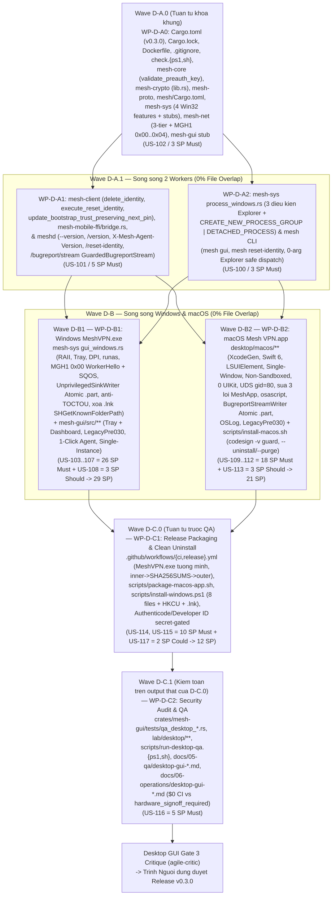

# Desktop GUI Sprint Backlog & Parallel Work Package Plan — Mesh VPN (`v0.3.0`: Windows `MeshVPN.exe` & macOS `Mesh VPN.app`)

| Thuộc tính | Giá trị |
|---|---|
| Tác giả | `agile-scrum-master` (`sm-gui`) |
| Ngày lập | 2026-11-17 |
| Phiên bản | **1.1 (Revision Round 2 — Desktop GUI Gate 2)** — Khắc phục 100% phát hiện [desktop-gui-gate-2-critique.md](../05-quality-assurance/critique-reviews/desktop-gui-gate-2-critique.md) và đồng bộ 5 tài liệu Thiết kế Gate 2 bản final |
| Nhánh làm việc | `feat/desktop-gui` (tách từ `feat/mobile-clients`; giữ nguyên `main`, `v0.1.0-rc1`, [sprint-backlog.md](./sprint-backlog.md) v1.2 và [mobile-sprint-backlog.md](./mobile-sprint-backlog.md) v1.1) |
| Đầu vào khóa cứng | [desktop-gui-readiness-requirements.md](../01-discovery/desktop-gui-readiness-requirements.md) v1.1 (`43` mã `DGUI-*`) · [desktop-gui-product-backlog.md](../02-product-planning/desktop-gui-product-backlog.md) v1.1 (`4` Epics `EP-17..EP-20`, `18` Stories `US-100..US-117` = `78 SP`) · [desktop-gui-tech-stack-decision.md](../03-system-design/desktop-gui-tech-stack-decision.md) · [desktop-gui-adr.md](../03-system-design/desktop-gui-adr.md) (`ADR-020..026`) · [desktop-gui-coding-standards.md](../03-system-design/desktop-gui-coding-standards.md) · [desktop-gui-system-architecture.md](../03-system-design/desktop-gui-system-architecture.md) · [desktop-gui-ipc-and-ui-contracts.md](../03-system-design/desktop-gui-ipc-and-ui-contracts.md) · [desktop-gui-gate-2-critique.md](../05-quality-assurance/critique-reviews/desktop-gui-gate-2-critique.md) · [agile-state.md](./agile-state.md) |
| Quy tắc chạy song song | **0% File Overlap trong cùng một Wave song song và giữa mọi nhánh song song** (`workspace: "share"` an toàn tuyệt đối) + **DAG phi chu trình** + Quy trình Review bắt buộc (`Check Script → agile-qa → agile-critic`) |

### Lịch sử sửa đổi

| Phiên bản | Ngày | Nội dung |
|---|---|---|
| 1.0 | 2026-11-17 | Bản đầu phân rã `18/18` Stories (`78 SP`) thành 7 Work Packages (`WP-D-A0..WP-D-C2`) trình Desktop GUI Gate 2. |
| **1.1** | 2026-11-17 | **Khắc phục triệt để toàn bộ phát hiện Gate 2 Vòng 1 giao cho `@sm-gui` (`BLK-DGUI-G2-01..05`, `HR-DGUI-G2-02/03/04/05`, `MED-DGUI-G2-01/02/04`, `LOW-DGUI-G2-01`):** (1) `BLK-DGUI-G2-01`: thêm `crates/mesh-mobile-ffi/src/bridge.rs` vào `WP-D-A1` triển khai `FfiStateStore::delete_identity(&self)`; (2) `BLK-DGUI-G2-02`: giao `crates/mesh/Cargo.toml` (`mesh-sys`) & bổ sung `Win32_UI_Controls_Dialogs`, `Win32_UI_Input_KeyboardAndMouse`, `Win32_System_Com`, `Win32_System_Ole` vào `WP-D-A0`, chốt xóa `.lnk` via `SHGetKnownFolderPath` + `CoTaskMemFree` + `std::fs::remove_file` và tạo `.lnk` via `install-windows.ps1`; (3) `BLK-DGUI-G2-03`: giao `Dockerfile` cho `WP-D-A0` (Stage 1 `cargo fetch --locked`); (4) `BLK-DGUI-G2-04`: đồng bộ Handoff Pipe dùng `SECURITY_SQOS_PRESENT \| SECURITY_IDENTIFICATION \| FILE_FLAG_OVERLAPPED` + Frame `0x00 WorkerHello` (`13 B`) + `ImpersonateNamedPipeClient(SecurityIdentification)` → `OpenThreadToken` → `CheckTokenMembership`; (5) `BLK-DGUI-G2-05` & `MED-DGUI-G2-02`: hợp nhất **Atomic Temp-Sibling Sink Write (`UnprivilegedSinkWriter` / `BugreportStreamWriter`)** hỗ trợ *Replace* với bất biến `expected_total_bytes > 0 && cumulative_bytes == expected_total_bytes <= 20_971_520`; (6) `HR-DGUI-G2-02`: `mesh-gui` dùng `mesh-crypto` (`0` `sha2`/`subtle`), giao `crates/mesh-crypto/src/lib.rs` cho `WP-D-A0`; (7) `HR-DGUI-G2-03`: nâng `Cargo.toml` `[workspace.package] version = "0.3.0"` tại `WP-D-A0` & đặc tả `GuardedBugreportStream` (`drop(self.inner.take())` trước `remove_file`) tại `WP-D-A1`; (8) `HR-DGUI-G2-04` & `MED-DGUI-G2-01`: dùng `update_bootstrap_trust_preserving_next_pin` cho cả `execute_up` & `execute_set`, xử lý `LegacyPre030`; (9) `HR-DGUI-G2-05`: chuyển Wave D-C thành **tuần tự có kiểm soát `Wave D-C.0 (WP-D-C1) → Wave D-C.1 (WP-D-C2)`** để `WP-D-C2` kiểm toán trực tiếp trên script/workflow cuối của `WP-D-C1`; (10) `MED-DGUI-G2-04` & `LOW-DGUI-G2-01`: re-export `validate_preauth_key` trong `crates/mesh-core/src/lib.rs` tại `WP-D-A0` và neo đường dẫn `.gitignore` kèm `git check-ignore`. |

---

## 1. Tổng Quan Lộ Trình Desktop GUI `v0.3.0` & Tuân Thủ Gate 1 / Gate 2

Milestone **`v0.3.0` (Desktop GUI & System Tray Client — Windows & macOS)** gồm **`4` Epics (`EP-17..EP-20`) · `18` User Stories (`US-100..US-117`) = `78 SP`** (`15 Must = 70 SP` + `2 Should = 6 SP` + `1 Could = 2 SP`), phủ **`43/43` mã `DGUI-*`** (`33 P0, 9 P1, 1 P2`) và **`7/7` quyết định `ADR-020..026`**, phân rã thành **4 làn thực thi (`Wave D-A`, `Wave D-B1`, `Wave D-B2`, `Wave D-C`)** với **7 Work Packages (`WP-D-A0`, `WP-D-A1`, `WP-D-A2`, `WP-D-B1`, `WP-D-B2`, `WP-D-C1`, `WP-D-C2`)**:

| Wave / Làn thực thi | Mục tiêu Wave | Work Packages | Must (Story / SP) | Should / Could | Tổng SP | Cổng kiểm định (`$0` CI vs Phần cứng) |
|---|---|---|---:|---:|---:|---|
| **Wave D-A — Shared Contract, IPC, Session/Reset/Version & CLI Launcher** | Nâng `Cargo.toml` `version = "0.3.0"`, cập nhật `Dockerfile` Stage 1, mở rộng `scripts/check.{ps1,sh}` quét `desktop/macos/`, khóa khung `crates/mesh-gui` (dùng `mesh-crypto`, 0 `sha2`/`subtle`), `crates/mesh/Cargo.toml` (`mesh-sys`), `crates/mesh-sys` (`gui_windows.rs`/`process_windows.rs` stubs + 4 features `windows-sys` mới), re-export `validate_preauth_key` (`mesh-core`), `AgentVersionResponse` (giữ nguyên 13 trường `AgentStatusResponse`), 3 tầng timeout IPC + `gui_handoff.rs` (`.expose_secret()`, `MGH1` `0x00..0x04`), `delete_identity()` (đủ 3 impls gồm `FfiStateStore`) + `update_bootstrap_trust_preserving_next_pin`, `meshd` (`#[command(version)]`, `/version`, `X-Mesh-Agent-Version`, `/reset-identity`, `/bugreport/stream` `GuardedBugreportStream`), CLI `mesh gui` + `mesh reset-identity` + 0-arg Explorer 3 điều kiện | `WP-D-A0` → (`WP-D-A1` \|\| `WP-D-A2`) | **3 / 11** | — | **11** | `$0` CI: `scripts/check.{ps1,sh}` (MSVC, MinGW `gnu`, `-Cross`), `cargo fmt/clippy/test --workspace --all-features`, `cargo deny check`, `docker build`, `git check-ignore`, `v0.1.0-rc1` CLI regression → `agile-qa` → `agile-critic` |
| **Wave D-B1 — Windows Native Tray & Dashboard `MeshVPN.exe`** *(song song với Wave D-B2)* | Triển khai `crates/mesh-sys/src/gui_windows.rs` (`Shell_NotifyIconW`, `TaskbarCreated`, `CreateWindowExW`, `PerMonitorV2` DPI, `ShellExecuteExW("runas")`, `HandoffPipeServer`/`Client` với `SECURITY_SQOS_PRESENT \| SECURITY_IDENTIFICATION` + Frame `0x00 WorkerHello` + `ImpersonateNamedPipeClient`, **`UnprivilegedSinkWriter`** Atomic Temp-Sibling `.part` hỗ trợ *Replace*, `open_anti_toctou_read_locked`, `Local\MeshVpnGuiSingleInstance`, `Local\MeshVpnGuiShutdownEvent`, `HKCU\...\Run`, xóa `.lnk` via `SHGetKnownFolderPath` + `CoTaskMemFree`, Clipboard `30 s`), `crates/mesh-net/src/tun_windows.rs`, và `crates/mesh-gui/src/**` (`MeshVPN.exe` Tray + Full Dashboard, `LegacyPre030`, 1-Click Reconnect, `runas` worker, 1-Click `MeshVpnAgent` `MESH_WINTUN_SHA256`, logging JSON lọc secret) | `WP-D-B1` | **5 / 26** | `US-108` (`1 Should / 3 SP`) | **29** | `$0` CI: `scripts/check.{ps1,sh}`, MinGW `x86_64-pc-windows-gnu` + MSVC release `<= 6 MiB` (mục tiêu `<= 4 MiB`), unit tests Win32 state/handoff/SDDL/clipboard/Atomic Sink Replace → `agile-qa` → `agile-critic` *(UI/UAC/DPI thật thuộc `hardware_signoff_required`)* |
| **Wave D-B2 — macOS Menu Bar & Dashboard `Mesh VPN.app`** *(song song với Wave D-B1)* | Xây dựng `desktop/macos/` (`XcodeGen` `project.yml`, `.swiftlint.yml`, `MeshDesktopCore` + `MeshVPNApp` Swift `6.0` `SWIFT_STRICT_CONCURRENCY = complete`, `macOS 13.0+`), `LSUIElement = YES`, Single-Window Dashboard, Non-Sandboxed, `0` `UIKit` / `CFBundleURLTypes` / `NSAllowsArbitraryLoads`, UDS `/var/run/meshd/meshd-{ro,admin}.sock` (`gid = 80` `0` mật khẩu), sửa 3 lỗi `mobile/ios/MeshApp` (`PasteButton` + `Cmd+V` xóa clipboard `30 s`, `<host>:<port>` + khóa `System CA` trên IP, `AppKit`), `osascript` chống injection cài `/usr/local/libexec/mesh/meshd` (`root:wheel`) qua `scripts/install-macos.sh` (giữ `codesign -v`, `--uninstall`/`--purge`, `socketfilterfw` opt-in), **`BugreportStreamWriter`** Atomic Temp-Sibling `.part` hỗ trợ *Replace*, `OSLog` `%{private}@`, `LegacyPre030` version mismatch banner | `WP-D-B2` | **4 / 18** | `US-113` (`1 Should / 3 SP`) | **21** | `$0` CI: `scripts/check.sh`, `xcodegen generate`, `swiftlint lint --strict`, `xcodebuild test CODE_SIGNING_ALLOWED=NO`, `bash -n` + `plutil -lint` → `agile-qa` → `agile-critic` *(MacBook thật `gid=80`/Gatekeeper/RSS thuộc `hardware_signoff_required`)* |
| **Wave D-C — Release Packaging, Cleanup/Uninstall & Desktop QA** *(tuần tự `D-C.0 → D-C.1` sau hội tụ `D-B1` & `D-B2`)* | **`WP-D-C1` (D-C.0)**: Hoàn thiện `.github/workflows/{ci.yml,release.yml}`, `scripts/package-macos-app.sh`, `scripts/install-windows.ps1` (8 tệp + `HKCU\...\Run` + tạo `.lnk` `WScript.Shell`, giữ `keys.json` mặc định), `US-117` secret-gated.<br/>**`WP-D-C2` (D-C.1)**: Chạy kiểm toán thực tế trên artifact & script cuối của `D-C1`: `qa_desktop_*`, `lab/desktop/**`, `scripts/run-desktop-qa.{ps1,sh}`, `desktop-gui-{test-plan,dod-verification}.md`, `desktop-gui-{hardware-acceptance-protocol,operational-runbook,go-live-checklist}.md` | `WP-D-C1` → `WP-D-C2` | **3 / 15** | `US-117` (`1 Could / 2 SP`) | **17** | `$0` CI: toàn bộ CI Gate + Release dry-run + `run-desktop-qa.{ps1,sh}` PASS 100%, tách minh bạch `VERIFIED_AT_CI_$0` vs `hardware_signoff_required` → `agile-qa` → `agile-critic` → Trình Người dùng duyệt **Desktop GUI Gate 3** |
| **Tổng cộng Milestone `v0.3.0`** | **Phủ `100%` `EP-17..EP-20`, `18/18` Stories, `43/43` `DGUI-*` & `ADR-020..026`** | **7 Work Packages** | **15 / 70** | **2 Should (`6 SP`) + 1 Could (`2 SP`)** | **78** | **Khớp 100% `desktop-gui-product-backlog.md` v1.1** |

> [!IMPORTANT]
> **Ràng buộc Bất biến Gate 1 (`OQ-DGUI-01..03`) & Gate 2 (`ADR-020..026`) Thực thi trong Chặng 3:**
> 1. **Cô lập `unsafe`, Mật mã & `.expose_secret()` (`ADR-020`, `HR-DGUI-G2-02`):** `crates/mesh-gui` bắt buộc `[lints] workspace = true` (`unsafe_code = "forbid"`), **0** dòng `unsafe`, **0** `sha2`/`subtle` trực tiếp (dùng `mesh-crypto` cho `Secret<String>`, `sha256_digest`, `ct_eq_bytes`, `verify_file_sha256`), **0** `embed-resource`/`winres`, **0** thay đổi `deny.toml`; toàn bộ Win32 FFI nằm trong `crates/mesh-sys/src/{gui_windows,process_windows}.rs` kèm `// SAFETY:` và RAII guards. Giữ nguyên allowlist **4 crate** `.expose_secret()` (`mesh-crypto`, `mesh-datapath`, `mesh-net`, `mesh`) — thao tác đọc bí mật đóng gói Handoff `MGH1` đặt trong `crates/mesh-net/src/gui_handoff.rs`.
> 2. **Phân tách Đặc quyền, Handoff `0x00 WorkerHello` & Atomic Temp-Sibling Sink Write (`ADR-021`, `ADR-023`, `BLK-DGUI-G2-04/05`):** Giữ nguyên `ADMIN_PIPE_SDDL = "D:P(A;;GA;;;SY)(A;;GA;;;BA)"` và `/var/run/meshd/meshd-admin.sock` (`0660 root:admin`, `gid = 80`), **0** Admin TCP listener. `HandoffPipeClient` mở pipe bằng `SECURITY_SQOS_PRESENT | SECURITY_IDENTIFICATION | FILE_FLAG_OVERLAPPED` và gửi Frame `0x00 WorkerHello` (`13 B`) trước `0x01`; `GUI` xác thực `GetNamedPipeClientProcessId == child_pid` + `ImpersonateNamedPipeClient(SecurityIdentification)` + `OpenThreadToken` + `CheckTokenMembership` (`BA`/`SY`), **cấm** `OpenProcess`/`OpenProcessToken`. Export bugreport dùng `POST /v1/agent/bugreport/stream` (`<= 20 MiB`, `GuardedBugreportStream`) + **Atomic Temp-Sibling Sink Write (`UnprivilegedSinkWriter` / `BugreportStreamWriter`)** hỗ trợ *Replace* với kiểm chứng `expected_total_bytes > 0 && cumulative_bytes == expected_total_bytes <= 20_971_520`.
> 3. **Tương thích ngược `v0.1.0-rc1`, `version = "0.3.0"` & 3 tầng Timeout (`ADR-022`, `ADR-024`, `HR-DGUI-G2-03/04`):** Nâng `[workspace.package] version = "0.3.0"` trong `Cargo.toml`; giữ nguyên 13 trường `AgentStatusResponse` (`#[serde(deny_unknown_fields)]`), đọc version qua `GET /v1/agent/version` + `X-Mesh-Agent-Version` + `meshd --version` (phân loại `v0.1.0-rc1` thành `LegacyPre030`). Hợp nhất `update_bootstrap_trust_preserving_next_pin` cho cả `execute_up` & `execute_set`; triển khai `ClientStateStore::delete_identity` cho đủ `3` implementors (gồm `FfiStateStore`). CLI `mesh` giữ `SUBSYSTEM:CONSOLE` & exit code `2` cho script/pipe/test/CI/`CREATE_NEW_CONSOLE`; 0-arg Explorer chỉ mở `MeshVPN.exe` (`CREATE_NEW_PROCESS_GROUP | DETACHED_PROCESS`) khi thỏa **3 điều kiện**.
> 4. **macOS Non-Sandboxed & Sửa 3 Lỗi `MeshApp` (`ADR-025`, `ADR-026`):** `desktop/macos/` không `UIKit`, không `com.apple.security.app-sandbox`, không `CFBundleURLTypes`, không `NSAllowsArbitraryLoads`, không `spctl --master-disable`; mọi thao tác dán (`PasteButton` + `Cmd+V`) xóa clipboard sau `30 s` theo `(changeCount, sha256)`; `<host>:<port>` tự chuẩn hóa & khóa `System CA` trên IP literal; `PreAuthToken` khớp `validate_preauth_key` (`mpk_` + `BASE64URL_NOPAD >= 32 B`); LaunchDaemon cài vào `/usr/local/libexec/mesh/meshd` (`root:wheel`, cấm `.app`); thứ tự đóng gói macOS: ký inner → `SHA256SUMS` → outer `.app` **không `--deep`**.
> 5. **Trung thực kiểm chứng (`$0` CI vs `hardware_signoff_required`):** Mọi test tự động trên CI gắn trạng thái `VERIFIED_AT_CI_$0`; mọi kiểm thử tương tác Windows/MacBook thật giữ nguyên nhãn **`hardware_signoff_required`** tới khi có biên bản ký phần cứng.

---

## 2. Nguyên Tắc Chống Đụng Độ File (`0% File Overlap`) & Thứ Tự DAG Thực Thi

Để nhiều worker (`agile-developer`, `agile-qa`, `agile-devops`) chạy song song trong `workspace: "share"` mà **không bao giờ** sửa trùng tệp hoặc đọc đầu ra chưa hoàn thành của WP chạy song song:

1. **Nguyên tắc "Khóa Khung Tuần Tự Trước — Triển Khai Song Song Sau" trong Wave D-A:**
   - **`WP-D-A0` (Wave D-A.0 — Tuần tự đầu tiên)** giữ **độc quyền** toàn bộ file gốc workspace, CI container & kiểm định (`Cargo.toml` nâng `version = "0.3.0"`, `Cargo.lock`, `Dockerfile` Stage 1, `.gitignore` neo phạm vi `desktop/macos/`, `.editorconfig`, `scripts/check.ps1`, `scripts/check.sh`), phần mở rộng `crates/mesh-core/src/{defaults.rs,lib.rs}` (gồm `MAX_BUGREPORT_ARCHIVE_BYTES` & re-export `validate_preauth_key`), `crates/mesh-crypto/src/lib.rs` (`sha256_digest`, `ct_eq_bytes`, `verify_file_sha256`), `crates/mesh-proto/src/agent_ipc.rs` (+ golden fixtures), `crates/mesh/Cargo.toml` (`mesh-sys` cho Windows), `crates/mesh-sys/{Cargo.toml,src/lib.rs}` (bổ sung đủ `windows-sys` features gồm `Win32_UI_Controls_Dialogs`, `Win32_UI_Input_KeyboardAndMouse`, `Win32_System_Com`, `Win32_System_Ole`) + **100% chữ ký công khai cuối cùng (compile-green stubs)** cho `gui_windows.rs` & `process_windows.rs`, triển khai đầy đủ `crates/mesh-net/src/{lib.rs,ipc.rs,gui_handoff.rs}` (3 tầng timeout + `MGH1` `0x00..0x04` + `.expose_secret()` + validation), và skeleton compile-green `crates/mesh-gui/{Cargo.toml,build.rs,src/main.rs}` (dùng `mesh-crypto` thay `sha2`/`subtle`, hỗ trợ MSVC + MinGW `gnu` + stub non-Windows).
   - **Wave D-A.1 (`WP-D-A1` \|\| `WP-D-A2`)** chạy **song song 2 workers** với **0% File Overlap**:
     - `WP-D-A1` chỉ chạm `crates/mesh-client/**`, `crates/meshd/**`, và **`crates/mesh-mobile-ffi/src/bridge.rs`** (triển khai `FfiStateStore::delete_identity(&self)` tránh `E0046` — `BLK-DGUI-G2-01`).
     - `WP-D-A2` chỉ chạm `crates/mesh-sys/src/process_windows.rs` và `crates/mesh/src/**` + `crates/mesh/tests/**` (không chạm `crates/mesh/Cargo.toml` đã khóa ở `A0`).
2. **Wave D-B1 (`WP-D-B1`) & Wave D-B2 (`WP-D-B2`) chạy song song 100% (`0% File Overlap`):**
   - `WP-D-B1` (Windows) chỉ chạm `crates/mesh-sys/src/gui_windows.rs`, `crates/mesh-net/src/tun_windows.rs` (nếu cần expose helper SHA-256), `crates/mesh-gui/src/**` và `crates/mesh-gui/tests/gui_unit_tests.rs`. **Không chạm** `scripts/install-windows.ps1` hay `desktop/macos/**`.
   - `WP-D-B2` (macOS) chỉ chạm `desktop/macos/**` và `scripts/install-macos.sh`. **Không chạm** bất kỳ tệp `.rs` hay `Cargo.toml` nào.
3. **Wave D-C Thực thi Tuần tự Có Kiểm soát (`Wave D-C.0: WP-D-C1` → `Wave D-C.1: WP-D-C2`, `HR-DGUI-G2-05`):**
   - Để loại bỏ hoàn toàn xung đột phụ thuộc ngầm (khi `WP-D-C2` chạy `run-desktop-qa.{ps1,sh}`, `audit-desktop-security.sh` và `verify-desktop-uninstall.ps1` để kiểm toán chính `.github/workflows/{ci.yml,release.yml}`, `scripts/package-macos-app.sh` và `scripts/install-windows.ps1` do `WP-D-C1` tạo/sửa), Wave D-C chạy **tuần tự `WP-D-C1` → `WP-D-C2`** với **0% File Overlap**:
     - **`WP-D-C1` (`Wave D-C.0`)** sở hữu `.github/workflows/{ci.yml,release.yml}`, `scripts/package-macos-app.sh`, và `scripts/install-windows.ps1`.
     - **`WP-D-C2` (`Wave D-C.1`)** chạy ngay sau khi `WP-D-C1` hoàn tất, sở hữu `crates/mesh-gui/tests/qa_desktop_*.rs`, `lab/desktop/**`, `scripts/run-desktop-qa.{ps1,sh}`, `docs/05-quality-assurance/desktop-gui-*.md` và `docs/06-operations/desktop-gui-*.md`.
4. **Quy tắc leo thang bắt buộc:** Nếu một worker phát hiện cần đổi signature công khai đã khóa ở `WP-D-A0` hoặc sửa tệp ngoài `Exclusive File Ownership List` của mình, **DỪNG NGAY và báo `@coordinator` / `agile-scrum-master`**, tuyệt đối không tự ý sửa chéo ranh giới.

### 2.1. Sơ đồ DAG Thực thi 4 Làn (`Wave D-A → D-B1 || D-B2 → D-C.0 → D-C.1`)



---

## 3. Đặc Tả Chi Tiết Context Packet Từng Work Package (`WP-D-*`)

---

### 3.1. Wave D-A — Shared Contract, IPC, Session/Reset/Version & CLI Launcher (`3 Must = 11 SP`)

#### `WP-D-A0` — Workspace (`v0.3.0`), `Dockerfile`, Static Hygiene (`scripts/check.{ps1,sh}`), `mesh-core`/`mesh-crypto`, `mesh-proto`, `mesh-sys` Features/Stubs & `mesh-net` (`3-Tier Timeout` + `MGH1`) (Wave D-A.0 — Tuần tự)
- **Goal**: Mở rộng workspace và bộ kiểm tra tĩnh cho `v0.3.0` mà không phá `v0.1.0-rc1`/`v0.2.0` hay `deny.toml`:
  1. **Workspace, Docker & Hygiene (`BLK-DGUI-G2-02/03`, `HR-DGUI-G2-03`, `LOW-DGUI-G2-01`)**:
     - Nâng **`[workspace.package] version = "0.3.0"`** (và version nội bộ `0.3.0` tại `Cargo.toml:40-47`) khớp `MARKETING_VERSION = "0.3.0"` trên `desktop/macos/project.yml`, rồi khóa `Cargo.lock`.
     - Cập nhật [`Dockerfile`](../../Dockerfile#L32-L66) Stage 1: thêm `COPY crates/mesh-gui/Cargo.toml crates/mesh-gui/Cargo.toml`, thêm `crates/mesh-gui/src` vào `mkdir -p`, và thêm `mesh-gui` vào vòng lặp tạo stub `main.rs` trước `cargo fetch --locked` (giữ nguyên build `--bin mesh-server --bin meshd --bin mesh`).
     - Cập nhật `.gitignore` với các pattern neo phạm vi rõ ràng (`desktop/macos/*.xcodeproj/`, `desktop/macos/build/`, `desktop/macos/.build/`, `desktop/macos/DerivedData/`, `*.xcworkspace/`, `*.dmg`, `*.pkg`, `Mesh VPN.app/`) và `.editorconfig` (UTF-8 No-BOM LF cho `.swift`, `.yml`, `.plist`, `.entitlements`, `.strings`, `.xcstrings`).
     - Thêm `[target.'cfg(windows)'.dependencies] mesh-sys.workspace = true` vào `crates/mesh/Cargo.toml` (`BLK-DGUI-G2-02`).
  2. **Mở rộng `scripts/check.ps1` & `scripts/check.sh`**:
     - Quét thêm thư mục `desktop/macos/` trong bước `[2/5]` (loại trừ `.build/`, `DerivedData/`, `*.xcodeproj/`): kiểm tra UTF-8 No-BOM + 100% LF; cấm `.p12`, `.mobileprovision`, `.cer`, `.dmg`, `.pkg`, `.app`; cấm `com.apple.security.app-sandbox`, `CFBundleURLTypes`, `NSAllowsArbitraryLoads`, `import UIKit`, `spctl --master-disable`; giữ nguyên allowlist `unsafe` duy nhất tại `crates/mesh-sys/*`, allowlist `.expose_secret()` đúng 4 crate (`mesh-crypto`, `mesh-datapath`, `mesh-net`, `mesh`), và quy tắc `:443`/`:3478` ngoài `crates/mesh-core/*`.
  3. **Mở rộng `crates/mesh-core` & `crates/mesh-crypto` (`HR-DGUI-G2-02`, `MED-DGUI-G2-04`)**:
     - `crates/mesh-core/src/{defaults.rs,lib.rs}`: bổ sung `MAX_BUGREPORT_ARCHIVE_BYTES` (`20 * 1024 * 1024` = `20_971_520` B) và **re-export `validate_preauth_key`** từ `mobile_uri.rs` tại `crates/mesh-core/src/lib.rs` (bắt buộc `mpk_` + `BASE64URL_NOPAD >= 32` bytes `<= 256` chars, zeroize buffer giải mã) kèm helper chuẩn hóa endpoint `<host>:<effective_port>` + khóa `System CA` trên IPv4/IPv6 literal + `NodeName` RFC 1123 + `proptest!`.
     - `crates/mesh-crypto/src/lib.rs`: bảo đảm export các helper không lộ khóa dùng cho clipboard/file integrity của `mesh-gui` (`Secret<T>`, `sha256_digest`, `ct_eq_bytes`, `verify_file_sha256`) để `mesh-gui` tuyệt đối **không** import trực tiếp `sha2` hay `subtle`.
  4. **Mở rộng `crates/mesh-proto/src/agent_ipc.rs`**:
     - **Giữ nguyên 100% 13 trường của `AgentStatusResponse`** (`#[serde(deny_unknown_fields)]`), thêm `AgentVersionResponse { agent_version: String, protocol_version: u16, binary_name: String }` (`#[serde(deny_unknown_fields)]`) và `AgentResetIdentityRequest {}` (`#[serde(deny_unknown_fields)]`), kèm golden JSON fixture tests.
  5. **Khóa khung `crates/mesh-sys/{Cargo.toml,src/lib.rs}` & Stubs (`BLK-DGUI-G2-02/04/05`)**:
     - Bật đủ các feature `windows-sys = "0.59.0"` (đã có trong `Cargo.lock`, `0` thêm crate mới): `Win32_UI_WindowsAndMessaging`, `Win32_UI_Shell`, `Win32_UI_Controls`, **`Win32_UI_Controls_Dialogs`**, **`Win32_UI_Input_KeyboardAndMouse`**, `Win32_UI_HiDpi`, `Win32_Graphics_Gdi`, `Win32_System_DataExchange`, **`Win32_System_Ole`**, **`Win32_System_Com`**, `Win32_System_Memory`, `Win32_System_Registry`, `Win32_System_Diagnostics_ToolHelp`, `Win32_System_Console`.
     - Khai báo `#[cfg(target_os = "windows")] pub mod gui_windows; pub mod process_windows;` trong `crates/mesh-sys/src/lib.rs` *(lưu ý: `crates/mesh-sys` dùng `src/lib.rs`, không có `mod.rs`)* và khóa **100% chữ ký công khai compile-green stubs** cho `crates/mesh-sys/src/gui_windows.rs` (gồm `UnprivilegedSinkWriter`, `HandoffPipeServer`, `HandoffPipeClient`, `launch_elevated_worker`, `enable_per_monitor_v2_dpi`, `open_anti_toctou_read_locked`, `acquire_single_instance_mutex`, `remove_user_shortcuts_and_autostart`) và `crates/mesh-sys/src/process_windows.rs` (`is_interactive_explorer_double_click`, `spawn_detached_gui`).
  6. **Triển khai `crates/mesh-net/src/{lib.rs,ipc.rs,gui_handoff.rs}` (`BLK-DGUI-G2-04`)**:
     - `ipc.rs`: áp dụng **3 tầng timeout IPC** (`IPC_CONNECT_TIMEOUT = 850 ms`, `IPC_RO_QUERY_TIMEOUT = 2_000 ms`, `IPC_NETCHECK_TIMEOUT = 10_000 ms`, `IPC_PING_MAX_TIMEOUT = 35_000 ms`, `IPC_ADMIN_MUTATION_TIMEOUT = 35_000 ms`), reader JSON `meshd-ro` bounded `<= MAX_HTTP_BODY_BYTES (65_536 B)` đủ cho 50 peers (`> 4 KiB`), retry có giới hạn cho `ERROR_PIPE_BUSY (231)` trong ngân sách `850 ms`, map `PermissionDenied` / `ServiceUnavailable` / `BusyRetryable`, phân loại `LegacyPre030` khi thiếu header `X-Mesh-Agent-Version` & `404` `/v1/agent/version`, và streaming `POST /v1/agent/bugreport/stream` (`0 < expected_total_bytes <= 20_971_520`, chunk `<= 64 KiB`).
     - `gui_handoff.rs`: codec đóng khung nhị phân `MGH1` (`9`-byte header `[b"MGH1", frame_type, len_le]` cho **`0x00` `WorkerHello` `len == 4` `protocol_version = 1`**, và `0x01..0x04` + `proptest!`), schema `HandoffRequest` (`up_with_secret`, `rotate_key_with_secret`, `down`, `cleanup`, `set`, `reset_identity`, `export_bugreport_stream`, `install_or_start_service`, `update_service`, `uninstall_service`) & `HandoffResponse`, và hàm `build_up_handoff_payload()` / `build_rotate_key_handoff_payload()` (**duy nhất** gọi `.expose_secret()` tại `mesh-net`, trả `Zeroizing<Vec<u8>>`).
  7. **Khung compile-green `crates/mesh-gui/{Cargo.toml,build.rs,src/main.rs}` (`HR-DGUI-G2-02`)**:
     - Khai báo `[lints] workspace = true` (`unsafe_code = "forbid"`), `[[bin]] name = "MeshVPN"`, dependencies tối giản từ workspace (`mesh-core`, **`mesh-crypto = { workspace = true, default-features = false }`**, `mesh-proto`, `mesh-net`, `mesh-sys`, `serde`, `serde_json`, `tokio`, `tokio-util`, `hyper`, `tracing`, `tracing-subscriber`, `tracing-appender`, `zeroize`, `rand` — **cấm** `sha2`/`subtle` trực tiếp); `#![cfg_attr(target_os = "windows", windows_subsystem = "windows")]`; `build.rs` rào `CARGO_CFG_TARGET_ENV == "msvc"`, và stub `#[cfg(not(windows))]`.
- **User Stories & SP (`1 Must = 3 SP`)**:
  - `US-102` (`3 SP`, `Must`, `EP-17`, Trace: `DGUI-UX-02`, `DGUI-SEC-04`, `DGUI-SEC-05`, `DGUI-SEC-06`, `GNFR-11`): Kiểm chứng Onboarding Desktop (Chuẩn hóa `<host>:<port>`, Zero-TOFU, `validate_preauth_key`) & Hàng rào Tĩnh `scripts/check.{ps1,sh}`. *(Đồng thời khóa khung workspace `0.3.0`, `Dockerfile`, DTO/IPC/stub cho `US-100` và `US-101`.)*
- **Dependency DAG**:
  - *Đầu vào*: Codebase `feat/desktop-gui` hiện hành, Gate 1 `OQ-DGUI-01..03`, Gate 2 `ADR-020..026`, `desktop-gui-coding-standards.md`, `desktop-gui-ipc-and-ui-contracts.md`.
  - *Mở khóa*: `WP-D-A1` và `WP-D-A2` chạy song song ngay sau khi `WP-D-A0` đạt DoD.
- **Phạm vi File Sở hữu Độc quyền (`Exclusive File Ownership List`)**:
  - `Cargo.toml`, `Cargo.lock`, `crates/{mesh-client,mesh-datapath,mesh-mobile-ffi,mesh-net,mesh-proto}/Cargo.toml` *(đồng bộ `version = "0.3.0"` cho internal path deps)*, `Dockerfile`, `.gitignore`, `.editorconfig`
  - `scripts/check.ps1`, `scripts/check.sh`
  - `crates/mesh-core/src/{defaults.rs,lib.rs,mobile_uri.rs}` *(mở `pub fn validate_preauth_key`)*, `crates/mesh-core/tests/**`
  - `crates/mesh-crypto/src/lib.rs`
  - `crates/mesh-proto/src/agent_ipc.rs`, `crates/mesh-proto/tests/**`
  - `crates/mesh/Cargo.toml`
  - `crates/mesh-sys/{Cargo.toml,src/lib.rs}` + compile-green signature stubs ban đầu của `crates/mesh-sys/src/{gui_windows.rs,process_windows.rs}`
  - `crates/mesh-net/src/{lib.rs,ipc.rs,gui_handoff.rs}`, `crates/mesh-net/tests/**`
  - `crates/mesh-gui/{Cargo.toml,build.rs,src/main.rs}` *(skeleton stub bàn giao phần triển khai cho `WP-D-B1` sau khi Wave D-A xong)*
- **Input / Output Contracts**:
  - *Input*: `ADR-020`, `ADR-021`, `ADR-023`, `ADR-024`, `desktop-gui-tech-stack-decision.md §3.2`, `desktop-gui-coding-standards.md §1, §3`, `desktop-gui-ipc-and-ui-contracts.md §1.2, §1.6, §2, §3, §4.1`.
  - *Output*: Toàn bộ workspace `0.3.0` biên dịch sạch và PASS `scripts/check.{ps1,sh}` + `cargo deny check` (`0` thay đổi `deny.toml`) + `docker build` Stage 1 `cargo fetch --locked` + `git check-ignore`; `proptest!` cho `<host>:<port>`, Zero-TOFU, `validate_preauth_key` và `MGH1` (`0x00..0x04`) xanh; `AgentStatusResponse` giữ nguyên 13 trường; 100% chữ ký public stub của `mesh-sys::{gui_windows,process_windows}` đã khóa cứng.
- **Quy trình Review**: `scripts/check.{ps1,sh}` (gồm MinGW `gnu` / `-Cross`) + `cargo deny check` + `git check-ignore` → `agile-qa` → `agile-critic` trước khi mở Wave D-A.1.
- **Lệnh kiểm chứng DoD cụ thể (`$0` CI)**:
  ```powershell
  powershell -ExecutionPolicy Bypass -File scripts/check.ps1
  powershell -ExecutionPolicy Bypass -File scripts/check.ps1 -Cross
  cargo test -p mesh-core -p mesh-crypto -p mesh-proto -p mesh-net -p mesh-sys -p mesh-gui --all-features
  git check-ignore -v desktop/macos/MeshVPNApp.xcodeproj/project.pbxproj desktop/macos/build/out.txt
  ```

---

#### `WP-D-A1` — Backend Daemon, Mobile State Bridge & Shared Session (`mesh-client`, `mesh-mobile-ffi/bridge.rs`, `meshd`) (Wave D-A.1 — Song song #1)
- **Goal**: Triển khai hoàn chỉnh tầng quản trị phiên và dịch vụ IPC trên `crates/mesh-client`, `crates/mesh-mobile-ffi/src/bridge.rs` và `crates/meshd` khớp 100% hợp đồng khóa ở `WP-D-A0` (`ADR-023`, `ADR-024`):
  1. `crates/mesh-client/src/{hooks.rs,session.rs,config.rs,state.rs}` & **`crates/mesh-mobile-ffi/src/bridge.rs` (`BLK-DGUI-G2-01`)**:
     - Thêm `ClientStateStore::delete_identity(&self) -> AppResult<()>` tại `crates/mesh-client/src/hooks.rs` và triển khai đầy đủ cho **cả 3 implementors**: `FileClientStateStore` (xóa nguyên tử `keys.json` & `.tmp`, bỏ qua `NotFound`), `InMemoryClientStateStore`, và **`FfiStateStore` (`crates/mesh-mobile-ffi/src/bridge.rs:140`)** gọi `self.run_bridge_io(|b| b.delete_state_file(SEALED_IDENTITY_FILENAME.to_owned())).map_err(|err| err.to_app_error())`.
     - Thêm `ClientSessionSupervisor::execute_reset_identity(&mut self)`: chạy `stop_active_session_and_cleanup().await?` (idempotent `ResourceLedger::cleanup_all`), `clear_netmap_cache()`, `save_bootstrap(&BootstrapConfig::default())`, `delete_identity()`, reset toàn bộ `ClientRuntimeData` trong RAM (`daemon_state = Stopped`, `node_id = None`, `peers.clear()`, `last_error = None`) trong khi **giữ sống tiến trình `meshd`**.
     - Hợp nhất helper **`update_bootstrap_trust_preserving_next_pin(&mut bootstrap, &endpoint, tls_auth_mode, req_pin, is_re_enrollment)` (`HR-DGUI-G2-04`)** dùng chung cho **cả `execute_up` (`session.rs:680`) lẫn `execute_set` (`session.rs:752`)**: kiểm đủ `bootstrap.server_endpoint.as_deref() == Some(endpoint) && bootstrap.tls_auth_mode == tls_auth_mode && bootstrap.active_pin == req_pin`, bảo toàn `bootstrap.next_pin` khi `same_trust == true`, và xử lý edge-case khi promote `next_pin` (`!is_re_enrollment && tls_auth_mode == SpkiPin && req_pin.is_some() && req_pin == bootstrap.next_pin`).
  2. `crates/meshd/src/{main.rs,ipc_service.rs,supervisor.rs,config.rs}` (`HR-DGUI-G2-03`):
     - `DaemonArgs`: bổ sung `#[command(version)]` (`meshd --version` in bare SemVer `"0.3.0"` cùng `[workspace.package] version = "0.3.0"`, tách bạch với user-agent `"meshd/0.3.0"` trong `DaemonRuntimePaths` nếu dùng).
     - `IpcService`: gắn response header **`X-Mesh-Agent-Version: <CARGO_PKG_VERSION>`** (`"0.3.0"`) trên mọi HTTP response của `meshd-ro` và `meshd-admin`; bổ sung `GET /v1/agent/version` (`AgentVersionResponse`) vào cả `build_ro_router` & `build_admin_router`; bổ sung `POST /v1/agent/reset-identity` và `POST /v1/agent/bugreport/stream` **duy nhất** vào `build_admin_router` (`build_ro_router` từ chối `404 NotFound`).
     - Handler `/v1/agent/bugreport/stream`: chấp nhận body rỗng/`{}`/`null`, gọi `create_bugreport_tar_bundle` kiểm chứng `0 < size_bytes <= MAX_BUGREPORT_ARCHIVE_BYTES (20_971_520 B)`, mở `tokio::fs::File` bọc `ReaderStream::with_capacity(file, 65_536)` trong wrapper **`GuardedBugreportStream { inner: Option<ReaderStream<tokio::fs::File>>, path: PathBuf }`** — **`impl Drop` bắt buộc chạy `drop(self.inner.take());` trước `std::fs::remove_file(&self.path)`** để không khóa tệp trên Windows ở EOF, lỗi I/O hay ngắt kết nối giữa chừng; phát headers `Content-Type: application/x-tar`, `Content-Length`, `X-Mesh-Scrubbed-Items`, `X-Mesh-Archive-Bytes`, `X-Mesh-Agent-Version`, `Cache-Control: no-store`; bảo toàn nguyên vẹn `POST /v1/agent/bugreport` cho CLI.
- **User Stories & SP (`1 Must = 5 SP`)**:
  - `US-101` (`5 SP`, `Must`, `EP-17`, Trace: `DGUI-IPC-01`, `DGUI-IPC-02`, `DGUI-IPC-03`, `DGUI-IPC-04`, `DGUI-IPC-05`, `DGUI-UX-01`, `DGUI-UX-02`, `DGUI-UX-03`, `DGUI-UX-04`, `DGUI-UX-07`, `DGUI-MAC-07`, `D-GNFR-01`, `GNFR-03`): Hợp đồng IPC Dual-Channel, Stream Bugreport `<= 20 MiB`, Reset Identity, Bảo toàn `next_pin`, `agent_version` & Timeout 3 Tầng.
- **Dependency DAG**:
  - *Đầu vào*: `WP-D-A0` (đã khóa `Cargo.toml` `0.3.0`, `AgentVersionResponse`, `AgentResetIdentityRequest`, `AgentStatusResponse`, `mesh-net::ipc` 3 tầng timeout).
  - *Chạy song song với*: `WP-D-A2` (**0% File Overlap**).
  - *Mở khóa*: `WP-D-B1`, `WP-D-B2`.
- **Phạm vi File Sở hữu Độc quyền (`Exclusive File Ownership List`)**:
  - `crates/mesh-client/src/{hooks.rs,session.rs,config.rs,state.rs}` & `crates/mesh-client/tests/**`
  - `crates/mesh-mobile-ffi/src/bridge.rs` *(triển khai `FfiStateStore::delete_identity` — `BLK-DGUI-G2-01`)*
  - `crates/meshd/src/{main.rs,ipc_service.rs,supervisor.rs,config.rs}` & `crates/meshd/tests/**`
- **Input / Output Contracts**:
  - *Input*: `ADR-023`, `ADR-024`, `desktop-gui-coding-standards.md §1.3`, `desktop-gui-ipc-and-ui-contracts.md §1.1..1.5, §3.1`.
  - *Output*: Toàn bộ workspace (bao gồm `mesh-mobile-ffi`) biên dịch xanh; regression tests `v0.1.0-rc1` (`meshd` + `mesh-client`) PASS 100%; tests mới chứng minh `execute_up` & `execute_set` giữ `next_pin`, `execute_reset_identity` xóa sạch danh tính giữ `meshd` sống, `FfiStateStore::delete_identity` hoạt động, `/v1/agent/bugreport/stream` stream `<= 20 MiB` và `GuardedBugreportStream` đóng handle trước khi xóa tệp tạm, `build_ro_router` từ chối mọi mutation/bugreport, `GET /v1/agent/version` & `X-Mesh-Agent-Version` trả `"0.3.0"`, `meshd --version` exit `0`.
- **Quy trình Review**: `scripts/check.{ps1,sh}` → `agile-qa` → `agile-critic` (cùng lượt nghiệm thu Wave D-A.1).
- **Lệnh kiểm chứng DoD cụ thể (`$0` CI)**:
  ```powershell
  powershell -ExecutionPolicy Bypass -File scripts/check.ps1
  cargo test -p mesh-client -p meshd -p mesh-mobile-ffi --all-features
  cargo run -p meshd -- --version
  ```

---

#### `WP-D-A2` — Win32 Explorer Process Detection (`mesh-sys/process_windows.rs`) & Safe CLI Launcher (`mesh gui`, `mesh reset-identity`, 0-arg Explorer 3 Điều kiện) (Wave D-A.1 — Song song #2)
- **Goal**: Triển khai hoàn chỉnh tầng launcher & nhận diện Explorer an toàn trên CLI `crates/mesh` và `crates/mesh-sys/src/process_windows.rs` (`ADR-022`, `ADR-024`, `HR-DGUI-G2-01`):
  1. `crates/mesh-sys/src/process_windows.rs` *(theo đúng chữ ký public đã khóa ở `WP-D-A0`)*:
     - `is_interactive_explorer_double_click() -> SysResult<bool>`: thực hiện tuần tự với `// SAFETY:` và `OwnedWinHandle`: (a) `GetConsoleProcessList == 1`; (b) `CreateToolhelp32Snapshot(TH32CS_SNAPPROCESS, 0)` lấy `th32ParentProcessID` của `GetCurrentProcessId()`; (c) `OpenProcess(PROCESS_QUERY_LIMITED_INFORMATION, FALSE, parent_pid)`; (d) kiểm tra `GetProcessTimes` (`parent_creation_time < self_creation_time`) chống tái sử dụng PID; (e) kiểm tra `QueryFullProcessImageNameW` chuẩn hóa khớp `<GetWindowsDirectoryW>\explorer.exe` (case-insensitive).
     - `spawn_detached_gui(exe_path: &Path) -> SysResult<()>`: khởi chạy tách tiến trình với **`CREATE_NEW_PROCESS_GROUP | DETACHED_PROCESS`** (**cấm** `CREATE_BREAKAWAY_FROM_JOB` để không gặp `ERROR_ACCESS_DENIED (5)` trên Windows Job Objects — `HR-DGUI-G2-01`), không qua `cmd.exe`/`powershell.exe`, không mở cửa sổ console con.
  2. `crates/mesh/src/{cli.rs,main.rs,client_cmds.rs,admin_cmds.rs}` & `crates/mesh/tests/**` *(không chạm `crates/mesh/Cargo.toml` đã khóa ở `A0`)*:
     - Giữ nguyên `#[command(subcommand)] pub(crate) command: TopCommand` trên `Cli` để `Cli::try_parse_from(["mesh"])` luôn trả `Err` (`exit code 2` với gợi ý `after_help`: `"Hint: run 'mesh gui' or open MeshVPN.exe / Mesh VPN.app for the desktop interface."`).
     - Thêm `ClientCommand::Gui` (`mesh gui`): Windows tìm `MeshVPN.exe` (cạnh `current_exe` hoặc `%ProgramFiles%\Mesh\MeshVPN.exe`) gọi `spawn_detached_gui`; macOS tìm `/Applications/Mesh VPN.app` (hoặc cạnh bundle) gọi `/usr/bin/open -a`; Linux/headless/thiếu binary fail-closed `AppError::not_found`/`unavailable` exit `!= 0`.
     - Thêm `ClientCommand::ResetIdentity { #[arg(long)] yes: bool }` (`mesh reset-identity [--yes]`): yêu cầu `--yes` khi non-TTY (hoặc xác nhận trên TTY tương tác), gọi `POST /v1/agent/reset-identity` trên `meshd-admin` dùng timeout Tầng 3 (`35_000 ms`).
     - Hook 0-arg Explorer trong `crates/mesh/src/main.rs` trước `Cli::parse()`: chỉ trên `#[cfg(target_os = "windows")]` khi `args_os().len() == 1`, thỏa đồng thời **3 điều kiện**: (i) `stdin/stdout/stderr.is_terminal()` và không có `CI` / `MESH_NO_GUI_AUTOLAUNCH`, (ii) `is_interactive_explorer_double_click() == Ok(true)`, (iii) tồn tại `MeshVPN.exe` hợp lệ → spawn detached (`CREATE_NEW_PROCESS_GROUP | DETACHED_PROCESS`) và `ExitCode::SUCCESS`; mọi trường hợp khác rơi xuống `Cli::parse()` thoát mã `2` trong `< 1 s`.
     - Cập nhật mọi lời gọi `send_ipc_json_request` trong `client_cmds.rs`/`admin_cmds.rs` tương thích với chữ ký timeout 3 tầng mới của `mesh-net::ipc`.
- **User Stories & SP (`1 Must = 3 SP`)**:
  - `US-100` (`3 SP`, `Must`, `EP-17`, Trace: `DGUI-UX-06`, `DGUI-SEC-01`, `DGUI-SEC-06`): Lệnh `mesh gui`, bảo toàn CLI `0-arg` tự động hóa & fallback Explorer 3 điều kiện. *(Kèm CLI `mesh reset-identity` hỗ trợ `US-101`.)*
- **Dependency DAG**:
  - *Đầu vào*: `WP-D-A0` (đã khóa `crates/mesh/Cargo.toml`, chữ ký `process_windows.rs` và `mesh-net::ipc` 3 tầng timeout).
  - *Chạy song song với*: `WP-D-A1` (**0% File Overlap**).
  - *Mở khóa*: `WP-D-B1`, `WP-D-B2`.
- **Phạm vi File Sở hữu Độc quyền (`Exclusive File Ownership List`)**:
  - `crates/mesh-sys/src/process_windows.rs`
  - `crates/mesh/src/{cli.rs,main.rs,client_cmds.rs,admin_cmds.rs}` & `crates/mesh/tests/**`
- **Input / Output Contracts**:
  - *Input*: `ADR-022`, `ADR-024`, `desktop-gui-coding-standards.md §1.2`, `desktop-gui-system-architecture.md §3.1`.
  - *Output*: 100% unit test `cli.rs` PASS (`--authkey` bị cấm, `Cli::try_parse_from(["mesh"])` trả `Err`); integration tests chứng minh piped `mesh`, `MESH_NO_GUI_AUTOLAUNCH=1`, `CREATE_NEW_CONSOLE` với parent non-Explorer thoát mã `2` `< 1 s`; `mesh gui` fail-closed khi thiếu GUI binary; `mesh reset-identity --yes` chạy chuẩn; `0` `unsafe` trong `crates/mesh`.
- **Quy trình Review**: `scripts/check.{ps1,sh}` → `agile-qa` → `agile-critic` (nghiệm thu trọn Wave D-A trước khi mở song song Wave D-B1 & D-B2).
- **Lệnh kiểm chứng DoD cụ thể**:
  - **`$0` CI**:
    ```powershell
    powershell -ExecutionPolicy Bypass -File scripts/check.ps1
    cargo test -p mesh-sys -p mesh --all-features
    ```
  - **Máy thật (`hardware_signoff_required`)**: Double-click `mesh.exe` trực tiếp từ Windows Explorer cạnh `MeshVPN.exe` mở `MeshVPN.exe`; chạy `mesh gui` trong PowerShell & macOS Terminal.

---

### 3.2. Wave D-B1 & Wave D-B2 — Song Song Windows & macOS (`0% File Overlap`)

#### `WP-D-B1` — Windows Native System Tray & Full Dashboard `MeshVPN.exe` (`5 Must = 26 SP` + `1 Should = 3 SP` = `29 SP`) (Wave D-B1 — Song song với `WP-D-B2`)
- **Goal**: Hoàn thiện toàn bộ tầng Win32 FFI (`crates/mesh-sys/src/gui_windows.rs`), chia sẻ helper xác minh Wintun nếu cần (`crates/mesh-net/src/tun_windows.rs`), và ứng dụng `MeshVPN.exe` (`crates/mesh-gui/src/**`) theo đúng `OQ-DGUI-01..03` và `ADR-020..024, ADR-026`:
  1. **Win32 Safe Wrappers (`crates/mesh-sys/src/gui_windows.rs` — `// SAFETY:` + RAII `OwnedWinHandle`, `OwnedIcon`, `OwnedMenu`, `OwnedGdiObj`, `OwnedRegKey`, `LocalAllocGuard`, `ClipboardGuard`, `ImpersonationGuard`)**:
     - `enable_per_monitor_v2_dpi()` (`SetProcessDpiAwarenessContext(PER_MONITOR_AWARE_V2)` với fallback `SetProcessDPIAware`), `InitCommonControlsEx`, `CreateWindowExW`, `GetSaveFileNameW` (`OFN_OVERWRITEPROMPT`), điều hướng bàn phím (`SetFocus`/`GetFocus`/`EnableWindow`), 5 trạng thái `HICON` bitmap trong RAM (`CreateIconIndirect`, `0` `.rc`/`.res`), `Shell_NotifyIconW` (`NIM_ADD`, `NIM_MODIFY`, `NIM_DELETE` + bounded retry), `RegisterWindowMessageW("TaskbarCreated")` khôi phục icon khi `explorer.exe` restart, `WM_CLOSE` ẩn về Tray, `WM_QUERYENDSESSION`/`WM_ENDSESSION` dọn sạch `<= 2 s`.
     - **Handoff Pipe An toàn (`BLK-DGUI-G2-04`)**: `launch_elevated_worker(exe_path, handoff_pipe_name)` (`ShellExecuteExW` `lpVerb = "runas"`, `SEE_MASK_NOCLOSEPROCESS | SEE_MASK_NOASYNC`, từ chối mọi `handoff_pipe_name` không khớp `\\.\pipe\mesh-gui-handoff-[a-f0-9]{32}`, map `ERROR_CANCELLED (1223)`). `HandoffPipeClient` (`--elevated-worker`) mở pipe với **`SECURITY_SQOS_PRESENT | SECURITY_IDENTIFICATION | FILE_FLAG_OVERLAPPED`** và gửi ngay Frame **`0x00 WorkerHello`** (`13 B`). `HandoffPipeServer` (`GUI` Medium Integrity) kiểm tra `GetNamedPipeClientProcessId == child_pid`, đọc đủ `WorkerHello` (`<= 5_000 ms`), rồi gọi **`ImpersonateNamedPipeClient`** (`SecurityIdentification`) → **`OpenThreadToken(..., TOKEN_QUERY, 1, ...)`** → **`CheckTokenMembership`** (`is_builtin_admin || is_local_system`) bọc trong `ImpersonationGuard` (`RevertToSelf`) trước khi gửi Frame `0x01`, **cấm** gọi `OpenProcess`/`OpenProcessToken`.
     - **Atomic Temp-Sibling Sink Write (`UnprivilegedSinkWriter`, `BLK-DGUI-G2-05`, `MED-DGUI-G2-02`)**: hỗ trợ cả lưu mới lẫn **Replace** tệp `.tar` đã chọn từ `GetSaveFileNameW`: từ chối thư mục hệ thống (`%SystemRoot%`, `%ProgramFiles%`, `%ProgramData%\Mesh`), kiểm tra thư mục cha (`FILE_FLAG_BACKUP_SEMANTICS | FILE_FLAG_OPEN_REPARSE_POINT` không phải reparse point), nếu `dest` đang tồn tại kiểm tra là regular file (không phải symlink/reparse/dir/FIFO); tạo `parent/.mesh-bugreport-<128bit_hex>.tar.part` (`CREATE_NEW | FILE_FLAG_OPEN_REPARSE_POINT`, share mode `0`), ghi từng chunk `<= 64 KiB`, kiểm **`expected_total_bytes > 0 && cumulative_bytes == expected_total_bytes <= 20_971_520`**, `sync_all()`, đóng handle, re-check `dest`, atomic rename qua `MoveFileExW(tmp, dest, MOVEFILE_REPLACE_EXISTING | MOVEFILE_WRITE_THROUGH)` (RAII `Drop` xóa `.part` khi hủy/lỗi).
     - `open_anti_toctou_read_locked(path)` (`FILE_SHARE_READ | FILE_FLAG_OPEN_REPARSE_POINT` giữ handle xuyên suốt check `MESH_WINTUN_SHA256` → copy sang `%ProgramFiles%\Mesh\`); Win32 SCM read-only probe (`0` UAC) & service install/upgrade/delete; `acquire_single_instance_mutex()` (`Local\MeshVpnGuiSingleInstance`), `Local\MeshVpnGuiShutdownEvent` + `WM_APP_GRACEFUL_SHUTDOWN` (`<= 3_000 ms`); `HKCU\Software\Microsoft\Windows\CurrentVersion\Run\MeshVPN` & xóa shortcut `.lnk` qua `SHGetKnownFolderPath` + `CoTaskMemFree` + `std::fs::remove_file` (`BLK-DGUI-G2-02`); Win32 Clipboard (`SetTimer` `30_000 ms` + `GetClipboardSequenceNumber()` + `mesh_crypto::sha256_digest` trước `EmptyClipboard()`).
  2. **Ứng dụng `MeshVPN.exe` (`crates/mesh-gui/src/**` — `[lints] workspace = true`, `0` `unsafe`, `0` `.expose_secret()`, `0` `sha2`/`subtle`, `0` `println!`/`eprintln!`)**:
     - Kiến trúc luồng: Win32 UI message loop + background Tokio runtime (`worker_threads(1)`) qua `mpsc` + `PostMessageW`; kích thước release `<= 6 MiB` (mục tiêu `<= 4 MiB`), working set idle `<= 15 MiB` (Dashboard `<= 30 MiB`), cold start `<= 500 ms`, CPU `< 0.5%`, thoát `<= 2 s`.
     - **Tray & Dashboard (`US-104`, `MED-DGUI-G2-01/04`)**: Đọc `\\.\pipe\mesh-agent-ro` (`0` UAC) theo 3 tầng timeout (`850 ms` / `2_000 ms` / `10–35 s`, `PollingSuspensionGuard` khi chờ admin — chỉ bật **sau khi** user xác nhận đường dẫn trên `SaveFileDialog`); nhận diện daemon cũ `v0.1.0-rc1` thành `LegacyPre030` khi thiếu header `X-Mesh-Agent-Version` & `404` `/v1/agent/version`; menu Tray 6 trạng thái + **1-Click Connect/Disconnect** (`preauth_key: None` bảo toàn `next_pin`, không hiện modal xác nhận) + Copy IP + Peers + Open Dashboard + Install/Start Service + Quit UI; Dashboard 8 trạng thái `DesktopUiState`, Onboarding (`mesh://join` + Manual chuẩn hóa `<host>:<effective_port>` + khóa `System CA` trên IP literal + `validate_preauth_key` từ `mesh_core` + `ES_PASSWORD` + `EnrollmentConfirmation` dùng `mesh_crypto::Secret<String>`), Peers (`Ping`), `Netcheck`, `Update Server/Pin`, `ReauthRequired` → **Rotate Node Key**, `Revoked` → **Reset Node Identity**, `Cleanup`, `0` URL protocol `mesh:` trong Registry.
     - **Handoff & Elevation (`US-105`)**: Worker `--elevated-worker --handoff-pipe <name>` giao tiếp khung `MGH1` (`0x00 WorkerHello` + `0x01..0x04`), giữ nguyên `ADMIN_PIPE_SDDL`, zeroize `Zeroizing`/`Secret` RAM `<= 100 ms` khi `ERROR_CANCELLED` (`1223`) hoặc timeout UAC (`15 s` / `120 s`), thông báo thân thiện cho Standard User.
     - **1-Click `MeshVpnAgent` (`US-106`)**: Đọc compile-time `option_env!("MESH_WINTUN_SHA256")` (fail-closed nếu thiếu/sai băm; không tin tệp rời `wintun.dll.sha256` trong `Downloads`), giữ handle `FILE_SHARE_READ | FILE_FLAG_OPEN_REPARSE_POINT` chống TOCTOU, bỏ qua self-copy, đóng Tray cũ + dừng service tránh `ERROR_SHARING_VIOLATION (32)`, bảo toàn `keys.json` & `bootstrap.toml`.
     - **Unprivileged Sink Write & Structured Logs (`US-107`)**: `SaveFileDialog` -> `UnprivilegedSinkWriter` Atomic Temp-Sibling `.part` (`<= 20 MiB`); JSON logs vào `%LOCALAPPDATA%\MeshVPN\logs` có rotation và lọc chặn `mpk_*` / `mesh://join?...&key=...` / private key ở mọi level.
     - **Single-Instance, Smooth Upgrade & Login Auto-Start (`US-108`, `Should`)**: Triển khai sau khi 5 `Must` ổn định — `Local\MeshVpnGuiSingleInstance` đưa cửa sổ cũ lên trước khi cùng/cũ version và ra hiệu thoát êm `Local\MeshVpnGuiShutdownEvent` khi mở version mới hơn; toggle `HKCU\...\Run\MeshVPN` (`--minimized`) không cần Admin và dọn `HKCU` + `.lnk` shortcut trước khi `runas` uninstall.
- **User Stories & SP (`5 Must = 26 SP` + `1 Should = 3 SP` = `29 SP`)**:
  - `US-103` (`5 SP`, `Must`, `EP-18`, Trace: `DGUI-WIN-01`, `DGUI-WIN-05`, `DGUI-SEC-06`, `DGUI-PERF-01`, `DGUI-PERF-02`, `DGUI-PERF-04`, `D-GNFR-03`)
  - `US-104` (`5 SP`, `Must`, `EP-18`, Trace: `DGUI-UX-01`, `DGUI-UX-02`, `DGUI-UX-03`, `DGUI-UX-04`, `DGUI-WIN-02`, `DGUI-SEC-02`, `DGUI-SEC-03`, `DGUI-SEC-04`, `DGUI-SEC-08`, `DGUI-PERF-03`, `D-GNFR-01`)
  - `US-105` (`8 SP`, `Must`, `EP-18`, Trace: `DGUI-WIN-03`, `DGUI-WIN-07`, `DGUI-SEC-01`, `DGUI-SEC-05`, `DGUI-IPC-03`, `DGUI-UX-07`, `D-GNFR-01`, `D-GNFR-02`)
  - `US-106` (`5 SP`, `Must`, `EP-18`, Trace: `DGUI-UX-05`, `DGUI-WIN-04`, `DGUI-WIN-06`, `DGUI-SEC-05`, `DGUI-SEC-07`, `DGUI-OPS-02`, `D-GNFR-04`)
  - `US-107` (`3 SP`, `Must`, `EP-18`, Trace: `DGUI-UX-07`, `DGUI-SEC-01`, `DGUI-SEC-05`, `DGUI-OPS-03`, `D-GNFR-02`, `GNFR-02`)
  - `US-108` (`3 SP`, `Should`, `EP-18`, Trace: `DGUI-WIN-06`, `DGUI-OPS-02`) *(triển khai sau 5 `Must`)*
- **Dependency DAG**:
  - *Đầu vào*: `WP-D-A1` + `WP-D-A2` (Wave D-A xanh 100%).
  - *Chạy song song với*: `WP-D-B2` (macOS — **0% File Overlap**).
  - *Mở khóa*: `WP-D-C1` (Wave D-C.0).
- **Phạm vi File Sở hữu Độc quyền (`Exclusive File Ownership List`)**:
  - `crates/mesh-sys/src/gui_windows.rs`
  - `crates/mesh-net/src/tun_windows.rs` *(chỉ nếu cần expose lại helper SHA-256 anti-TOCTOU có sẵn; không đụng `ipc.rs`, `gui_handoff.rs`, `lib.rs`)*
  - `crates/mesh-gui/src/**` (`main.rs`, `app.rs`, `tray.rs`, `dashboard.rs`, `onboarding.rs`, `settings.rs`, `worker.rs`, `installer.rs`, `state.rs`, `validation.rs`, `handoff_codec.rs`, `ipc_client.rs`, `logging.rs`, `single_instance.rs`, `clipboard.rs`)
  - `crates/mesh-gui/tests/gui_unit_tests.rs` *(dành riêng cho unit tests của `WP-D-B1`; không đụng `qa_desktop_*.rs` thuộc `WP-D-C2`)*
- **Input / Output Contracts**:
  - *Input*: `ADR-020`, `ADR-021`, `ADR-023`, `ADR-024`, `ADR-026`, `desktop-gui-tech-stack-decision.md §3`, `desktop-gui-coding-standards.md §1`, `desktop-gui-system-architecture.md §2.2A, §3.2, §3.3, §4, §5.1`, `desktop-gui-ipc-and-ui-contracts.md §2, §3, §4`.
  - *Output*: `MeshVPN.exe` build release `<= 6 MiB` (mục tiêu `<= 4 MiB`), biên dịch xanh MSVC + MinGW `x86_64-pc-windows-gnu` + Linux/macOS `#[cfg(not(windows))]` stub; `0` `unsafe` ngoài `crates/mesh-sys/`; `0` `.expose_secret()` / `sha2` / `subtle` trong `crates/mesh-gui/`; `0` WebView2/Electron; unit tests ViewModel/Handoff (`0x00 WorkerHello` + SQOS)/Atomic Sink Replace/Installer/Logger/SingleInstance PASS 100%.
- **Quy trình Review**: `scripts/check.{ps1,sh}` (MSVC + MinGW `gnu` + `-Cross`) + release binary size check → `agile-qa` → `agile-critic`.
- **Lệnh kiểm chứng DoD cụ thể**:
  - **`$0` CI**:
    ```powershell
    powershell -ExecutionPolicy Bypass -File scripts/check.ps1
    powershell -ExecutionPolicy Bypass -File scripts/check.ps1 -Cross
    cargo check --locked --target x86_64-pc-windows-gnu --bin MeshVPN
    cargo build --release --locked --target x86_64-pc-windows-msvc --bin MeshVPN
    python -c "import pathlib; p=pathlib.Path('target/x86_64-pc-windows-msvc/release/MeshVPN.exe'); assert p.exists() and p.stat().st_size <= 6*1024*1024"
    ```
  - **Máy thật (`hardware_signoff_required`)**: Chạy `MeshVPN.exe` trên Windows 10/11 sạch (không WebView2), DPI 125%–200%, restart `explorer.exe` (`TaskbarCreated`), test UAC (Split-Token & Standard User OTS) + Process Explorer `CommandLine` (`0` `mpk_*`), 1-click `MeshVpnAgent` + `wintun.dll`, nâng cấp đè từ `Downloads` (`0` `ERROR_SHARING_VIOLATION`), xuất bugreport `SaveFileDialog` (cả tạo mới lẫn **Replace** tệp có sẵn), đo Working Set `<= 15 MiB` idle / `< 0.5%` CPU / quit `<= 2 s`.

---

#### `WP-D-B2` — macOS Menu Bar & SwiftUI Dashboard `Mesh VPN.app` (`4 Must = 18 SP` + `1 Should = 3 SP` = `21 SP`) (Wave D-B2 — Song song với `WP-D-B1`)
- **Goal**: Xây dựng hoàn chỉnh ứng dụng macOS bản địa `Mesh VPN.app` (`macOS 13.0+`, `arm64` + `x86_64`, **Swift `6.0`** `SWIFT_STRICT_CONCURRENCY = complete`, `swiftlint --strict`, `XcodeGen` `project.yml`) và nâng cấp `scripts/install-macos.sh` theo `OQ-DGUI-01..03`, `ADR-023..026`:
  1. **Bundle & Single-Window Menu Bar (`US-109`)**:
     - `desktop/macos/project.yml` (`MARKETING_VERSION = "0.3.0"`) & `Info.plist`: `LSUIElement = YES`, `NSPrincipalClass = NSApplication`, `CFBundleIdentifier = dev.meshvpn.macos`, **KHÔNG** bật `com.apple.security.app-sandbox`, **KHÔNG** `CFBundleURLTypes`, **KHÔNG** `NSAllowsArbitraryLoads`, **0 `import UIKit`**, **0** `!`/`try!`/`as!`/`fatalError`/`print` trong production code.
     - `AppDelegate` + `StatusBarController` (`NSStatusItem`, 6 trạng thái icon/menu: 1-Click Connect/Disconnect, Copy Overlay IP, Peers rút gọn, Open Dashboard, Service Status/Install, Quit GUI `<= 2 s` giữ `internal.mesh.meshd` sống) + `DashboardWindowController` (`NSWindowController` đơn duy nhất, `applicationShouldTerminateAfterLastWindowClosed == false`, chuyển `.regular` khi mở và `.accessory` khi đóng). Mục tiêu idle RSS `<= 35 MiB` (`<= 60 MiB` khi mở Dashboard), cold start `<= 500 ms`.
  2. **UDS IPC Client (`gid=80` 0-Mật khẩu) & SwiftUI Dashboard Sửa 3 Lỗi `MeshApp` (`US-110`, `MED-DGUI-G2-04`)**:
     - `MeshDesktopCore/UdsIpcClient.swift`: `actor` giao tiếp HTTP/1.1 JSON trực tiếp qua `/var/run/meshd/meshd-ro.sock` (`0666`) & `/var/run/meshd/meshd-admin.sock` (`0660 root:admin`), khớp DTO `agent_ipc.rs` (`50` peers `<= 64 KiB`), 3 tầng timeout (`850 ms` / `2_000 ms` / `10_000–35_000 ms`, `PollingSuspensionGuard` khi chờ admin — chỉ bật **sau khi** user xác nhận đường dẫn trên `NSSavePanel`), map rõ `EACCES` (`PermissionDenied` cho Standard User) vs `ENOENT`/`ECONNREFUSED` (`ServiceUnavailable`).
     - Tái sử dụng UX từ `mobile/ios/MeshApp/Sources/` nhưng **khắc phục triệt để 3 lỗi (`HR-DGUI-G1-02`, `MED-DGUI-G2-03`)**: (a) bỏ 100% `UIKit` & modifier iOS-only sang AppKit/macOS SwiftUI; (b) `EndpointNormalizer` chuẩn hóa `<host>:<effective_port>` và **tự khóa `System CA`** khi host là IPv4/IPv6 literal ở cả Onboarding & `UpdateServerSheet`, đồng bộ `PreAuthToken` theo quy tắc `mpk_` + `BASE64URL_NOPAD >= 32` bytes (`<= 256` chars); (c) thống nhất `ClipboardRedactor.handlePastedText` cho **cả `PasteButton` (macOS 13+), nút Paste fallback lẫn `Cmd+V`** xóa `NSPasteboard.general` sau `30 s` theo `(changeCount, sha256)`, xóa rỗng `manualPreauthKey` ngay trong `defer`.
     - Tách **1-Click Reconnect** (`preauth_key: None`, giữ `next_pin`) khỏi `EnrollmentConfirmationSheet` (`mpk_*` đã che + full SPKI Fingerprint); điều hướng `ReauthRequired` → `RotateKeyPromptSheet`, `Revoked` → **Reset Node Identity** (`POST /v1/agent/reset-identity`).
  3. **1-Click `LaunchDaemon` via `/usr/bin/osascript` & Bảo toàn Chữ ký (`US-111`)**:
     - `LaunchDaemonInstaller` gọi `/usr/bin/osascript` chạy script cố định đóng gói trong `Contents/Resources/install-macos.sh` với đường dẫn bundle kiểm tra sạch ký tự điều khiển/NUL và bọc `quoted form of` (**0** input người dùng đi qua `osascript`, **0** `spctl --master-disable`).
     - Cập nhật `scripts/install-macos.sh`: xác minh `SHA256SUMS`, `verify_root_owned_ancestors`, cài `/usr/local/libexec/mesh/meshd` (`0755 root:wheel`, **CẤM** trỏ `ProgramArguments` vào `.app`), `/usr/local/bin/mesh` (`0755 root:wheel`), `/Library/LaunchDaemons/internal.mesh.meshd.plist` (`0644 root:wheel`), xóa `com.apple.quarantine` trên tệp vừa cài, **chỉ chạy `codesign --force -s -` nếu `codesign -v` thất bại** (bảo toàn hash khớp `SHA256SUMS` & chữ ký thương mại `US-117`), opt-in `socketfilterfw`, `launchctl bootout` + `bootstrap system`, hỗ trợ `--uninstall` (tách riêng gỡ service vs xóa `/Applications/Mesh VPN.app`) & `--purge` (giữ `/var/db/mesh/{keys.json,bootstrap.toml}` mặc định).
  4. **Atomic Temp-Sibling Sink Write Bugreport (`0` Mật khẩu) & `OSLog` Hygiene (`US-112`, `BLK-DGUI-G2-05`, `MED-DGUI-G2-02`)**:
     - `BugreportStreamWriter`: gọi `POST /v1/agent/bugreport/stream` qua `/var/run/meshd/meshd-admin.sock` (**0 mật khẩu, 0 `osascript`** cho user `gid = 80`), hỗ trợ **cả lưu mới lẫn Replace tệp `.tar` đã tồn tại** trên `NSSavePanel`: kiểm tra `dest` ngoài thư mục hệ thống (`/System`, `/usr`, `/Library`, `/var/db/mesh`), xác minh `parent` không phải symlink (`lstat`), nếu `dest` tồn tại xác minh là regular file; tạo `parent/.mesh-bugreport-<128bit_hex>.tar.part` qua `open(..., O_WRONLY | O_CREAT | O_EXCL | O_NOFOLLOW, 0o600)`, ghi chunk `<= 64 KiB`, kiểm **`expected_total_bytes > 0 && cumulative_bytes == expected_total_bytes <= 20_971_520`**, `fsync`, đóng fd, re-check `dest`, rồi atomic rename `libc::rename` (RAII/defer xóa `.part` khi hủy/lỗi), giữ `/var/db/mesh` `0700 root:wheel`.
     - `SafeOsLogger`: `os.Logger` gắn `%{private}@` + canary filter chặn `mpk_*` và `mesh://join?...&key=...`.
  5. **Version Mismatch Detection (`LegacyPre030`) & 1-Click Update (`US-113`, `Should`, `MED-DGUI-G2-01`)**:
     - Đọc `X-Mesh-Agent-Version` / `GET /v1/agent/version`: nếu `GET /v1/agent/status` trả `200 OK` mà thiếu header và `/version` trả `404`, hoặc khi daemon tắt mà probe `/usr/local/libexec/mesh/meshd --version` thoát mã `2` (binary `v0.1.0-rc1`), phân loại là **`LegacyPre030`** (không báo lỗi hỏng tệp nhị phân) và hiển thị banner *"Update Background Service"* giữ nguyên `/var/db/mesh/{keys.json,bootstrap.toml}`.
- **User Stories & SP (`4 Must = 18 SP` + `1 Should = 3 SP` = `21 SP`)**:
  - `US-109` (`5 SP`, `Must`, `EP-19`, Trace: `DGUI-MAC-01`, `DGUI-MAC-03`, `DGUI-UX-01`, `DGUI-SEC-02`, `DGUI-PERF-01`, `DGUI-PERF-02`, `DGUI-PERF-04`, `D-GNFR-03`)
  - `US-110` (`5 SP`, `Must`, `EP-19`, Trace: `DGUI-MAC-02`, `DGUI-MAC-04`, `DGUI-UX-02`, `DGUI-UX-03`, `DGUI-UX-04`, `DGUI-SEC-01`, `DGUI-SEC-03`, `DGUI-SEC-04`, `DGUI-SEC-08`, `DGUI-PERF-03`, `D-GNFR-01`)
  - `US-111` (`5 SP`, `Must`, `EP-19`, Trace: `DGUI-UX-05`, `DGUI-MAC-05`, `DGUI-MAC-06`, `DGUI-SEC-05`, `DGUI-SEC-07`, `D-GNFR-04`)
  - `US-112` (`3 SP`, `Must`, `EP-19`, Trace: `DGUI-UX-07`, `DGUI-MAC-04`, `DGUI-OPS-03`, `DGUI-SEC-01`, `DGUI-SEC-05`, `D-GNFR-02`, `GNFR-02`)
  - `US-113` (`3 SP`, `Should`, `EP-19`, Trace: `DGUI-MAC-07`, `DGUI-OPS-02`) *(triển khai sau 4 `Must`)*
- **Dependency DAG**:
  - *Đầu vào*: `WP-D-A1` + `WP-D-A2` (Wave D-A xanh 100%).
  - *Chạy song song với*: `WP-D-B1` (Windows — **0% File Overlap**).
  - *Mở khóa*: `WP-D-C1` (Wave D-C.0).
- **Phạm vi File Sở hữu Độc quyền (`Exclusive File Ownership List`)**:
  - `desktop/macos/**` (`project.yml`, `.swiftlint.yml`, `MeshDesktopCore/**`, `MeshVPNApp/**`, `MeshVPNAppTests/**`)
  - `scripts/install-macos.sh`
- **Input / Output Contracts**:
  - *Input*: `ADR-023`, `ADR-024`, `ADR-025`, `ADR-026`, `desktop-gui-tech-stack-decision.md §4`, `desktop-gui-coding-standards.md §2`, `desktop-gui-system-architecture.md §2.2B, §5.2, §6.1`, `desktop-gui-ipc-and-ui-contracts.md §1, §3, §4`.
  - *Output*: Build Swift 6 (`SWIFT_STRICT_CONCURRENCY = complete`), `swiftlint lint --strict`, `xcodebuild test CODE_SIGNING_ALLOWED=NO` PASS 100% ở `$0` trên `macos-15` (gồm test `BugreportStreamWriter` *Replace* tệp cũ, `validate_preauth_key`, `LegacyPre030`, clipboard 30s `PasteButton` + `Cmd+V`); `scripts/check.sh` xác nhận `0` `UIKit`, `0` `app-sandbox`, `0` `CFBundleURLTypes`, `0` `NSAllowsArbitraryLoads`, `0` `spctl --master-disable`; `scripts/install-macos.sh` pass `bash -n` và bảo toàn `codesign -v`.
- **Quy trình Review**: `scripts/check.sh` + `xcodegen generate` + `swiftlint lint --strict` + `xcodebuild test CODE_SIGNING_ALLOWED=NO` + `bash -n` → `agile-qa` → `agile-critic`.
- **Lệnh kiểm chứng DoD cụ thể**:
  - **`$0` CI (`macos-15`)**:
    ```sh
    sh scripts/check.sh
    bash -n scripts/install-macos.sh
    cd desktop/macos
    xcodegen generate
    swiftlint lint --strict
    xcodebuild test \
      -project MeshVPNApp.xcodeproj \
      -scheme MeshVPNApp \
      -destination 'platform=macOS' \
      CODE_SIGNING_ALLOWED=NO
    ```
  - **Máy thật (`hardware_signoff_required`)**: Mở `Mesh VPN.app` từ `/Applications` trên MacBook thật (`arm64`/`x86_64`), single-window Dashboard, 1-click `osascript` cài `/usr/local/libexec/mesh/meshd`, user `admin` (`gid=80`) bật/tắt & xuất bugreport `0` mật khẩu (cả lưu mới lẫn **Replace** tệp cũ), Standard User (`gid != 80`) bị `EACCES`, `socketfilterfw` opt-in, nâng cấp `.app` qua `LegacyPre030` giữ `OverlayIp`, đo RSS `<= 35 MiB` idle / `< 0.5%` CPU / quit `<= 2 s`.

---

### 3.3. Wave D-C — Release Packaging, Cleanup/Uninstall & Desktop QA (`3 Must = 15 SP` + `1 Could = 2 SP` = `17 SP`)

> [!NOTE]
> **Thứ tự Tuần tự Có Kiểm soát (`HR-DGUI-G2-05`):** **`WP-D-C1` (`Wave D-C.0`)** hoàn tất và land toàn bộ workflow/script đóng gói & gỡ cài đặt trước, rồi **`WP-D-C2` (`Wave D-C.1`)** mới chạy để kiểm toán trực tiếp trên chính các tệp cuối của `WP-D-C1` (bảo đảm `0%` xung đột và `0` bài test giả).

#### `WP-D-C1` — CI/Release Packaging (`$0` Mode & Thứ tự Ký mã), Clean Upgrade/Uninstall Scripts & Commercial Signing Readiness (Wave D-C.0 — Tuần tự sau Wave D-B1 & D-B2)
- **Goal**: Hoàn thiện hệ thống đóng gói CI/Release `$0`, sửa sạch quy trình nâng cấp/gỡ cài đặt trên Windows & đồng bộ sẵn sàng ký số thương mại (`US-114`, `US-115`, `US-117`, `ADR-026`):
  1. **Mở rộng `.github/workflows/ci.yml` (`$0`)**:
     - Cập nhật job `static-and-lab-lint` quét UTF-8 No-BOM + LF cả `desktop/macos/` (trừ `.build/`, `DerivedData/`, `*.xcodeproj/`).
     - Cập nhật job Windows: chạy `scripts/check.ps1`, kiểm tra compile `--target x86_64-pc-windows-gnu --bin MeshVPN`, build release `--target x86_64-pc-windows-msvc --bin MeshVPN` (nhúng `MESH_WINTUN_SHA256`), assert `MeshVPN.exe <= 6_291_456` bytes (cảnh báo nếu `> 4_194_304` bytes).
     - Thêm job `desktop-macos` trên `macos-15`: `xcodegen generate`, `swiftlint lint --strict`, `xcodebuild test -project MeshVPNApp.xcodeproj -scheme MeshVPNApp -destination 'platform=macOS' CODE_SIGNING_ALLOWED=NO`, kiểm `plutil -lint` và static constraints `desktop/macos/`.
  2. **Mở rộng `.github/workflows/release.yml` & `scripts/package-macos-app.sh` (`$0` + `US-117` Secret-Gated)**:
     - **Windows (`mesh-windows-x86_64-msvc.zip`)**: build `--bin MeshVPN --bin mesh --bin meshd --bin mesh-server` kèm `MESH_WINTUN_SHA256`; kiểm kích thước `MeshVPN.exe <= 6 MiB`; đóng gói đủ `MeshVPN.exe`, `mesh.exe`, `meshd.exe`, `mesh-server.exe`, `wintun.dll`, `wintun.dll.sha256`, `WINTUN-LICENSE.txt`, `README-WINTUN.md`, `scripts/install-windows.ps1`; **bỏ glob `mesh*`** và **liệt kê tường minh `MeshVPN.exe mesh.exe meshd.exe mesh-server.exe wintun.dll`** khi sinh `SHA256SUMS`; nếu có repository secrets Authenticode (`US-117` Could) thì ký số `MeshVPN.exe`/`mesh.exe`/`meshd.exe`, không có secrets thì bỏ qua sạch không làm đỏ `$0` CI.
     - **macOS (`arm64` & `x86_64`)**: gọi `scripts/package-macos-app.sh` tuân thủ nghiêm ngặt thứ tự bất biến: **(1)** ký ad-hoc `meshd`, `mesh`, `mesh-server` (hoặc Developer ID khi có secrets `US-117`) **trước** → **(2)** sinh `SHA256SUMS` cho `meshd`, `mesh`, `internal.mesh.meshd.plist` nhúng vào `Mesh VPN.app/Contents/Resources/` (+ nhúng `install-macos.sh`) → **(3)** ký outer `Mesh VPN.app` **KHÔNG `--deep`** (nếu có Apple Developer ID secrets thì chạy `notarytool` + `stapler` cho `.app`/`.dmg`/`.pkg`, không có thì giữ ad-hoc `$0`) → hậu kiểm `codesign -v` và `shasum -a 256 -c` trong `Contents/Resources/` khớp 100%; ghi tường minh archive/bundle vào `SHA256SUMS` phát hành. Cập nhật ghi chú phát hành trung thực cấm `spctl --master-disable`.
  3. **Cập nhật `scripts/install-windows.ps1` (`US-115`, `BLK-DGUI-G2-02`)**:
     - Hỗ trợ cài/nâng cấp cả `MeshVPN.exe` (tùy chọn tạo shortcut `.lnk` qua `WScript.Shell`, bảo toàn `C:\ProgramData\Mesh\{keys.json, bootstrap.toml}` khi nâng cấp từ `v0.1.0-rc1` lên `v0.3.0`).
     - Cập nhật `-Uninstall`: trước nâng quyền / dưới user context cung cấp helper dọn `HKCU\Software\Microsoft\Windows\CurrentVersion\Run\MeshVPN` + shortcut `.lnk` Start Menu/Desktop (ghi chú giới hạn nhiều tài khoản local); bước đặc quyền dừng êm `MeshVPN.exe` + `MeshVpnAgent`, chạy `mesh cleanup` (`ResourceLedger`) + `Remove-MeshFirewallAndRoutes`, xóa service `MeshVpnAgent`, và **xóa đầy đủ toàn bộ 8 tệp** (`MeshVPN.exe`, `meshd.exe`, `mesh.exe`, `mesh-server.exe`, `wintun.dll`, `wintun.dll.sha256`, `WINTUN-LICENSE.txt`, `README-WINTUN.md`) trong `%ProgramFiles%\Mesh\`, giữ `keys.json` & `bootstrap.toml` trừ khi truyền `-Uninstall -Purge`.
- **User Stories & SP (`2 Must = 10 SP` + `1 Could = 2 SP` = `12 SP`)**:
  - `US-114` (`5 SP`, `Must`, `EP-20`, Trace: `DGUI-OPS-01`, `DGUI-WIN-01`, `DGUI-MAC-01`, `DGUI-MAC-03`, `DGUI-MAC-05`, `DGUI-MAC-06`, `DGUI-SEC-06`, `DGUI-PERF-02`, `D-GNFR-05`)
  - `US-115` (`5 SP`, `Must`, `EP-20`, Trace: `DGUI-OPS-02`, `DGUI-SEC-07`, `D-GNFR-04`)
  - `US-117` (`2 SP`, `Could`, `EP-20`, Trace: `DGUI-OPS-05`, `DGUI-MAC-05`, `D-GNFR-05`)
- **Dependency DAG**:
  - *Đầu vào*: `WP-D-B1`, `WP-D-B2`.
  - *Mở khóa*: `WP-D-C2` (`Wave D-C.1`).
- **Phạm vi File Sở hữu Độc quyền (`Exclusive File Ownership List`)**:
  - `.github/workflows/ci.yml`, `.github/workflows/release.yml`
  - `scripts/package-macos-app.sh`
  - `scripts/install-windows.ps1`
- **Input / Output Contracts**:
  - *Input*: `ADR-026`, `desktop-gui-tech-stack-decision.md §5`, `desktop-gui-system-architecture.md §5`, `desktop-gui-product-backlog.md` (`US-114`, `US-115`, `US-117`).
  - *Output*: Toàn bộ jobs CI & release packaging dry-run hợp lệ YAML/BOM/LF/bash; `SHA256SUMS` Windows liệt kê tường minh `MeshVPN.exe`; macOS bundle pass `codesign -v` và `shasum -a 256 -c` giữ nguyên hash sau ký outer; `install-windows.ps1` gỡ đủ 8 tệp + giữ `keys.json` mặc định; các bước `US-117` tự bỏ qua sạch khi thiếu secrets.
- **Quy trình Review**: `scripts/check.{ps1,sh}` + `bash -n scripts/package-macos-app.sh` + CI matrix run → `agile-qa` → `agile-critic` trước khi mở `WP-D-C2`.
- **Lệnh kiểm chứng DoD cụ thể (`$0` CI)**:
  ```powershell
  powershell -ExecutionPolicy Bypass -File scripts/check.ps1
  # Trên macOS / Linux:
  # bash -n scripts/package-macos-app.sh
  # python3 -c "import yaml; yaml.safe_load(open('.github/workflows/ci.yml')); yaml.safe_load(open('.github/workflows/release.yml'))"
  ```

---

#### `WP-D-C2` — Cross-OS Desktop Security Audit, E2E QA Runner, DoD & Hardware Acceptance Protocol (`1 Must = 5 SP`) (Wave D-C.1 — Tuần tự sau `WP-D-C1`)
- **Goal**: Thực hiện kiểm toán bảo mật độc lập xuyên nền tảng (`$0` CI Gate) trực tiếp trên toàn bộ mã nguồn, workflow và script đóng gói/gỡ cài đặt vừa hoàn tất ở `WP-D-C1`, xây dựng runner QA tổng hợp và ban hành bộ tài liệu vận hành & biên bản nghiệm thu máy thật phân tách rạch ròi `$0` CI vs `hardware_signoff_required` (`US-116`, `D-GNFR-01..05`):
  1. **Bộ Kiểm thử QA & Kiểm toán Bảo mật Tự động (`crates/mesh-gui/tests/qa_desktop_*.rs`, `lab/desktop/**`, `scripts/run-desktop-qa.{ps1,sh}`)**:
     - `qa_desktop_security_audit.rs`: bơm canary `mpk_*` & `mesh://join?...&key=...` qua logger GUI, handoff `MGH1`, `ErrorResponse`, và `bugreport/stream` xác nhận **`0` rò rỉ** (`test_no_secrets_in_outputs`); xác nhận `ADMIN_PIPE_SDDL` giữ nguyên (`0` `AU`/`IU`), `0` TCP Admin listener, `0` Registry `mesh:` handler, `0` nút bypass TLS/TOFU, `ERROR_CANCELLED (1223)` zeroize `<= 100 ms`.
     - `qa_desktop_e2e_ipc.rs`: kiểm thử E2E dual-channel `meshd` ↔ `mesh-net` ↔ `mesh-gui` (`50` peers `> 4 KiB` qua `meshd-ro`, 3 tầng timeout `850 ms` / `2_000 ms` / `10–35 s`, `bugreport/stream` `<= 20 MiB` + `GuardedBugreportStream` cleanup + `UnprivilegedSinkWriter` Atomic Temp-Sibling *Replace* & chặn symlink/junction, `reset-identity` giữ `meshd` sống, `1-Click Reconnect` giữ `next_pin`, `ResourceLedger` isolation).
     - `lab/desktop/audit-desktop-security.sh` & `lab/desktop/verify-desktop-uninstall.ps1`: kiểm tra tĩnh toàn diện `desktop/macos/` (0 `UIKit`, 0 `app-sandbox`, 0 `CFBundleURLTypes`, 0 `NSAllowsArbitraryLoads`, 0 `spctl --master-disable`), xác nhận danh sách 8 tệp dọn dẹp trong `scripts/install-windows.ps1` & `scripts/install-macos.sh` (`codesign -v` guard, preserve `keys.json` mặc định vs purge, `0` đụng chạm VPN ngoài Mesh), và kiểm chứng `release.yml` / `package-macos-app.sh` liệt kê tường minh `MeshVPN.exe` (không dùng glob `mesh*`).
     - `scripts/run-desktop-qa.{ps1,sh}`: chạy tuần tự toàn bộ `scripts/check`, bộ `qa_desktop_*`, `lab/desktop/*`, và sinh báo cáo trạng thái trung thực (`VERIFIED_AT_CI_$0` vs `hardware_signoff_required`).
  2. **Bộ Tài liệu QA & Operations (`docs/05-quality-assurance/` & `docs/06-operations/`)**:
     - `docs/05-quality-assurance/desktop-gui-test-plan.md` & `docs/05-quality-assurance/desktop-gui-dod-verification.md`: đối soát `18/18` Stories (`78/78 SP`), `43/43` `DGUI-*`, `5/5` `D-GNFR-*`, tách bạch cột `$0 CI Verified` vs `hardware_signoff_required`.
     - `docs/06-operations/desktop-gui-hardware-acceptance-protocol.md`, `docs/06-operations/desktop-gui-operational-runbook.md` & `docs/06-operations/desktop-gui-go-live-checklist.md`: kịch bản đo thực địa bắt buộc trên **Windows 10/11 thật** và **MacBook thật `arm64`/`x86_64`**.
- **User Stories & SP (`1 Must = 5 SP`)**:
  - `US-116` (`5 SP`, `Must`, `EP-20`, Trace: `DGUI-OPS-03`, `DGUI-OPS-04`, `DGUI-SEC-01`, `DGUI-SEC-02`, `DGUI-SEC-03`, `DGUI-SEC-04`, `DGUI-SEC-05`, `DGUI-SEC-06`, `DGUI-SEC-07`, `DGUI-PERF-01`, `DGUI-PERF-02`, `DGUI-PERF-03`, `DGUI-PERF-04`, `D-GNFR-01`, `D-GNFR-02`, `D-GNFR-03`, `D-GNFR-04`, `D-GNFR-05`)
- **Dependency DAG**:
  - *Đầu vào*: `WP-D-C1` (đã land xong workflows & scripts đóng gói/gỡ cài đặt cuối).
  - *Mở khóa*: `Desktop GUI Gate 3`.
- **Phạm vi File Sở hữu Độc quyền (`Exclusive File Ownership List`)**:
  - `crates/mesh-gui/tests/qa_desktop_security_audit.rs`, `crates/mesh-gui/tests/qa_desktop_e2e_ipc.rs`
  - `lab/desktop/**` (`audit-desktop-security.sh`, `verify-desktop-uninstall.ps1`)
  - `scripts/run-desktop-qa.ps1`, `scripts/run-desktop-qa.sh`
  - `docs/05-quality-assurance/desktop-gui-test-plan.md`, `docs/05-quality-assurance/desktop-gui-dod-verification.md`
  - `docs/06-operations/desktop-gui-hardware-acceptance-protocol.md`, `docs/06-operations/desktop-gui-operational-runbook.md`, `docs/06-operations/desktop-gui-go-live-checklist.md`
- **Input / Output Contracts**:
  - *Input*: `desktop-gui-product-backlog.md` (`US-116` AC), `desktop-gui-system-architecture.md`, `desktop-gui-ipc-and-ui-contracts.md`, đầu ra cuối của `WP-D-C1`, mẫu `docs/06-operations/mobile-*.md` & `docs/05-quality-assurance/mobile-dod-verification.md`.
  - *Output*: 100% kiểm toán `$0` CI xanh (`VERIFIED_AT_CI_$0`); `43/43` `DGUI-*` và `18/18` Stories truy vết kín; biên bản nghiệm thu máy thật tách rạch ròi `hardware_signoff_required` (không trộn lẫn pass giả).
- **Quy trình Review**: `agile-qa` chạy `scripts/run-desktop-qa.{ps1,sh}` độc lập + đối chiếu chéo với `WP-D-C1` → `agile-critic` thẩm định **Desktop GUI Gate 3**.
- **Lệnh kiểm chứng DoD cụ thể (`$0` CI)**:
  ```powershell
  powershell -ExecutionPolicy Bypass -File scripts/check.ps1
  powershell -ExecutionPolicy Bypass -File scripts/run-desktop-qa.ps1
  cargo test -p mesh-gui --test qa_desktop_security_audit --test qa_desktop_e2e_ipc --all-features
  ```

---

## 4. Ma Trận Sở Hữu File Độc Quyền Toàn Dự Án (`0% File Overlap Matrix`)

Bảng dưới đây xác nhận mọi tệp/thư mục được tạo mới hoặc chỉnh sửa trong Milestone `v0.3.0` chỉ có **đúng 1 chủ sở hữu tại mỗi pha** và **0% File Overlap** giữa mọi Work Package chạy song song (`WP-D-A1` vs `WP-D-A2`, `WP-D-B1` vs `WP-D-B2`) cũng như tuần tự có kiểm soát (`WP-D-C1` → `WP-D-C2`):

| Nhóm File / Đường dẫn | Chủ sở hữu | Wave thực thi | Ghi chú khóa xung đột |
|---|---|---|---|
| `Cargo.toml`, `Cargo.lock`, `crates/{mesh-client,mesh-datapath,mesh-mobile-ffi,mesh-net,mesh-proto}/Cargo.toml`, `Dockerfile`, `.gitignore`, `.editorconfig` | **`WP-D-A0`** | Wave D-A.0 (Tuần tự) | Nâng `[workspace.package] version = "0.3.0"` & path deps nội bộ, khóa `crates/mesh-gui`, giữ `deny.toml` (`0` thay đổi), cập nhật `Dockerfile` Stage 1 `cargo fetch --locked`, neo `.gitignore` cho `desktop/macos/` |
| `scripts/check.ps1`, `scripts/check.sh` | **`WP-D-A0`** | Wave D-A.0 (Tuần tự) | Mở rộng `[2/5]` quét `desktop/macos/`, giữ nguyên allowlist `unsafe` (`mesh-sys`) & `.expose_secret()` (`4` crates) |
| `crates/mesh-core/src/{defaults.rs,lib.rs,mobile_uri.rs}`, `crates/mesh-core/tests/**` | **`WP-D-A0`** | Wave D-A.0 (Tuần tự) | Bổ sung `MAX_BUGREPORT_ARCHIVE_BYTES` (`20_971_520`) và `pub fn validate_preauth_key` + helper chuẩn hóa dùng chung |
| `crates/mesh-crypto/src/lib.rs` | **`WP-D-A0`** | Wave D-A.0 (Tuần tự) | Export helper `sha256_digest`, `ct_eq_bytes`, `verify_file_sha256` phục vụ `mesh-gui` (cấm `sha2`/`subtle` trực tiếp ngoài `mesh-crypto`) |
| `crates/mesh-proto/src/agent_ipc.rs`, `crates/mesh-proto/tests/**` | **`WP-D-A0`** | Wave D-A.0 (Tuần tự) | Giữ nguyên 13 trường `AgentStatusResponse` (`deny_unknown_fields`), thêm `AgentVersionResponse` & `AgentResetIdentityRequest` |
| `crates/mesh/Cargo.toml` | **`WP-D-A0`** | Wave D-A.0 (Tuần tự) | Thêm `[target.'cfg(windows)'.dependencies] mesh-sys.workspace = true` cho `WP-D-A2` |
| `crates/mesh-sys/{Cargo.toml,src/lib.rs}` + stub signatures `gui_windows.rs`/`process_windows.rs` | **`WP-D-A0`** | Wave D-A.0 (Tuần tự) | Bật đủ 4 features `windows-sys` mới (`Win32_UI_Controls_Dialogs`, `Win32_UI_Input_KeyboardAndMouse`, `Win32_System_Com`, `Win32_System_Ole`), khai báo `pub mod` trong `lib.rs` (không có `mod.rs`), khóa 100% chữ ký public stub |
| `crates/mesh-net/src/{lib.rs,ipc.rs,gui_handoff.rs}`, `crates/mesh-net/tests/**` | **`WP-D-A0`** | Wave D-A.0 (Tuần tự) | 3 tầng timeout IPC (`850 ms / 2_000 ms / 10_000–35_000 ms`), `LegacyPre030`, `MGH1` (`0x00 WorkerHello` + `0x01..0x04`), `.expose_secret()` tại `gui_handoff.rs` |
| `crates/mesh-gui/{Cargo.toml,build.rs,src/main.rs}` *(skeleton stub)* | **`WP-D-A0`** | Wave D-A.0 (Tuần tự) | `[lints] workspace = true` (`unsafe_code = "forbid"`), dùng `mesh-crypto` (`0` `sha2`/`subtle`), `[[bin]] name = "MeshVPN"`, `CARGO_CFG_TARGET_ENV == "msvc"`, `#[cfg(not(windows))]` stub |
| `crates/mesh-client/src/{hooks.rs,session.rs,config.rs,state.rs}`, `crates/mesh-client/tests/**` | **`WP-D-A1`** | Wave D-A.1 (Song song `A2`) | `delete_identity()`, `execute_reset_identity()`, `update_bootstrap_trust_preserving_next_pin` cho cả `execute_up` & `execute_set` |
| `crates/mesh-mobile-ffi/src/bridge.rs` | **`WP-D-A1`** | Wave D-A.1 (Song song `A2`) | Triển khai `FfiStateStore::delete_identity(&self)` tại `bridge.rs:140` (tránh `E0046`) |
| `crates/meshd/src/{main.rs,ipc_service.rs,supervisor.rs,config.rs}`, `crates/meshd/tests/**` | **`WP-D-A1`** | Wave D-A.1 (Song song `A2`) | `#[command(version)]`, `X-Mesh-Agent-Version` (`"0.3.0"`), `/v1/agent/version`, `/v1/agent/reset-identity`, `/v1/agent/bugreport/stream` (`GuardedBugreportStream` drop handle trước `remove_file`) |
| `crates/mesh-sys/src/process_windows.rs` *(full impl)* | **`WP-D-A2`** | Wave D-A.1 (Song song `A1`) | `is_interactive_explorer_double_click()` & `spawn_detached_gui()` (`CREATE_NEW_PROCESS_GROUP \| DETACHED_PROCESS`) |
| `crates/mesh/src/{cli.rs,main.rs,client_cmds.rs,admin_cmds.rs}`, `crates/mesh/tests/**` | **`WP-D-A2`** | Wave D-A.1 (Song song `A1`) | `mesh gui`, `mesh reset-identity [--yes]`, 0-arg Explorer 3 điều kiện (giữ `exit 2` cho script/pipe/test/CI) |
| `crates/mesh-sys/src/gui_windows.rs` *(full impl)* | **`WP-D-B1`** | Wave D-B1 (Song song `D-B2`) | Win32 FFI + RAII (`Tray`, DPI, `runas`, `HandoffPipe` `SQOS` + `0x00 WorkerHello` + `ImpersonateNamedPipeClient`, **`UnprivilegedSinkWriter`** Atomic `.part`, `open_anti_toctou_read_locked`, `Local\` mutex/event, `HKCU\...\Run`, xóa `.lnk` via `SHGetKnownFolderPath`+`CoTaskMemFree`, Clipboard `30 s`) |
| `crates/mesh-net/src/tun_windows.rs` *(nếu expose helper SHA-256)* | **`WP-D-B1`** | Wave D-B1 (Song song `D-B2`) | Tái sử dụng kiểm tra SHA-256 + `LockedWintunFile` không tạo bản sao logic |
| `crates/mesh-gui/src/**`, `crates/mesh-gui/tests/gui_unit_tests.rs` | **`WP-D-B1`** | Wave D-B1 (Song song `D-B2`) | `MeshVPN.exe` Tray + Dashboard, `LegacyPre030`, `validate_preauth_key`, `runas` worker, 1-Click `MeshVpnAgent` (`MESH_WINTUN_SHA256`), Atomic Sink Write, JSON logging, Single-Instance |
| `desktop/macos/**` (`project.yml`, `.swiftlint.yml`, `MeshDesktopCore/**`, `MeshVPNApp/**`, `MeshVPNAppTests/**`) | **`WP-D-B2`** | Wave D-B2 (Song song `D-B1`) | `Mesh VPN.app` Swift `6.0` (`LSUIElement`, single-window, Non-Sandboxed, `0 UIKit`, UDS `gid=80`, sửa 3 lỗi `MeshApp`, `osascript`, **`BugreportStreamWriter`** Atomic `.part`, `OSLog`, `LegacyPre030`) |
| `scripts/install-macos.sh` | **`WP-D-B2`** | Wave D-B2 (Song song `D-B1`) | Nhúng vào `Contents/Resources/`, kiểm `codesign -v` trước ad-hoc sign, hỗ trợ `--uninstall`/`--purge`/`socketfilterfw`, giữ `/var/db/mesh/{keys.json,bootstrap.toml}` |
| `.github/workflows/ci.yml`, `.github/workflows/release.yml`, `scripts/package-macos-app.sh` | **`WP-D-C1`** | Wave D-C.0 (Tuần tự trước `D-C.1`) | CI Windows + macOS `xcodebuild test`, Release `MeshVPN.exe` tường minh (bỏ glob `mesh*`), ký inner → `SHA256SUMS` → outer `.app` không `--deep`, `US-117` secret-gated |
| `scripts/install-windows.ps1` | **`WP-D-C1`** | Wave D-C.0 (Tuần tự trước `D-C.1`) | Cập nhật `-Uninstall` dọn đủ 8 tệp + `HKCU\...\Run` + `.lnk`, tạo `.lnk` via `WScript.Shell`, giữ `keys.json` mặc định, nâng cấp `v0.1.0-rc1 -> v0.3.0` |
| `crates/mesh-gui/tests/qa_desktop_security_audit.rs`, `crates/mesh-gui/tests/qa_desktop_e2e_ipc.rs` | **`WP-D-C2`** | Wave D-C.1 (Tuần tự sau `D-C.0`) | `test_no_secrets_in_outputs`, `MGH1` proptest, E2E 3-tier timeout, 50 peers, Atomic Sink Write *Replace*, `reset-identity`, `next_pin`, `ResourceLedger` |
| `lab/desktop/**`, `scripts/run-desktop-qa.{ps1,sh}` | **`WP-D-C2`** | Wave D-C.1 (Tuần tự sau `D-C.0`) | Audit tĩnh `desktop/macos/` + kiểm tra trực tiếp script/workflow cuối vừa land từ `WP-D-C1` (chỉ đọc, không sửa) |
| `docs/05-quality-assurance/desktop-gui-*.md`, `docs/06-operations/desktop-gui-*.md` | **`WP-D-C2`** | Wave D-C.1 (Tuần tự sau `D-C.0`) | Test Plan, DoD Verification, Operational Runbook, Go-Live Checklist & Hardware Acceptance Protocol (`$0` CI vs `hardware_signoff_required`) |

**Kiểm tra giao tập hợp giữa mọi cặp song song & thứ tự DAG:**
- `Files(WP-D-A1) ∩ Files(WP-D-A2) = ∅` (Rust `mesh-client` + `mesh-mobile-ffi/bridge.rs` + `meshd` vs `mesh-sys/process_windows.rs` + `mesh/src` → **0% overlap**).
- `Files(WP-D-B1) ∩ Files(WP-D-B2) = ∅` (Rust Windows `mesh-sys/gui_windows.rs` + `mesh-net/tun_windows.rs` + `mesh-gui` vs Swift macOS `desktop/macos/**` + `scripts/install-macos.sh` → **0% overlap**).
- `WP-D-C1` → `WP-D-C2` chạy nối tiếp (`Wave D-C.0 → Wave D-C.1`) và `Files(WP-D-C1) ∩ Files(WP-D-C2) = ∅` → **0% overlap** và **0 xung đột phụ thuộc**.

---

## 5. Cổng Kiểm Định (`$0` CI vs Máy Thật) & Quy Trình Review Bắt Buộc

### 5.1. Quy trình Review Chuẩn cho Mọi Wave (`Wave D-A`, `Wave D-B1/B2`, `Wave D-C.0`, `Wave D-C.1`)

Mọi Work Package chỉ được đánh dấu hoàn tất khi vượt qua đúng 3 tầng nối tiếp:
1. **Tầng 1 — Tự động hóa (`Check Script + Unit/Integration Tests`):**
   - Chạy bộ kiểm tra tĩnh & Rust/Swift của Wave tương ứng đạt **exit code `0`** với `0` warning (`-D warnings`, `SWIFT_TREAT_WARNINGS_AS_ERRORS = YES`, `swiftlint lint --strict`, `cargo deny check` `0` error/warning).
   - Bảo đảm 100% tệp mới/sửa là **UTF-8 Không BOM**, **100% LF** (`0 \r` trừ `*.ps1`/`*.bat`/`*.cmd` CRLF).
2. **Tầng 2 — Nghiệm thu Độc lập (`agile-qa`):**
   - Kiểm chứng toàn bộ AC `[H]`, `[E]`, `[F]`, `[N]` theo scope Wave, chạy `test_no_secrets_in_outputs`, kiểm tra kích thước `MeshVPN.exe <= 6 MiB`, xác minh phân tách trung thực `VERIFIED_AT_CI_$0` vs `hardware_signoff_required`.
3. **Tầng 3 — Phản biện Độc lập (`agile-critic`):**
   - Rà soát an toàn bộ nhớ (`unsafe` chỉ trong `crates/mesh-sys`), ranh giới `.expose_secret()` (4 crates), cô lập mật mã (`mesh-crypto`), `ADMIN_PIPE_SDDL`/`0660 root:admin`, `MGH1` `0x00 WorkerHello` + `SecurityIdentification`, Atomic Temp-Sibling Sink Write (*Replace*), Zero-TOFU, chống injection `osascript`/`runas`, `0% File Overlap`, và cấp `[APPROVED FOR GATE]` trước khi mở Wave kế tiếp (hoặc trình Người dùng duyệt **Desktop GUI Gate 3**).

### 5.2. Ma Trận Lệnh Kiểm Chứng Cụ Thể Theo Wave (`$0` CI vs `hardware_signoff_required`)

| Wave | Lệnh kiểm chứng `$0` CI bắt buộc XANH 100% | Hạng mục tách sang `hardware_signoff_required` / `paid_cert_required` |
|---|---|---|
| **Wave D-A** (`WP-D-A0..A2`) | - `powershell -ExecutionPolicy Bypass -File scripts/check.ps1` (MSVC & nhánh MinGW `gnu`)<br/>- `powershell -ExecutionPolicy Bypass -File scripts/check.ps1 -Cross`<br/>- `sh scripts/check.sh` & `sh scripts/check.sh --cross`<br/>- `cargo deny check advisories bans licenses sources`<br/>- `cargo test --workspace --all-features`<br/>- `git check-ignore` cho `desktop/macos/*.xcodeproj/` & `build/`<br/>- `docker build` Stage 1 `cargo fetch --locked` | - Double-click `mesh.exe` trực tiếp trong Windows Explorer (cạnh `MeshVPN.exe`); chạy `mesh gui` trên PowerShell & macOS Terminal thật. |
| **Wave D-B1** (`WP-D-B1`) | - `scripts/check.ps1` + `scripts/check.ps1 -Cross` + `scripts/check.sh`<br/>- `cargo check --locked --target x86_64-pc-windows-gnu --bin MeshVPN`<br/>- `cargo build --release --locked --target x86_64-pc-windows-msvc --bin MeshVPN` (`MESH_WINTUN_SHA256` nhúng) & assert size `<= 6_291_456` B (mục tiêu `<= 4_194_304` B)<br/>- `cargo test -p mesh-sys -p mesh-gui --all-features` | - Chạy trên Windows 10/11 sạch không WebView2; DPI 125%–200%; restart `explorer.exe` (`TaskbarCreated`); UAC thật (Split-Token & Standard User OTS) + Process Explorer `CommandLine` (`0` `mpk_*`) & bấm Cancel; 1-click `MeshVpnAgent` + `wintun.dll`; nâng cấp đè `Downloads` (`0` `ERROR_SHARING_VIOLATION`); Export Bugreport `SaveFileDialog` (cả tạo mới & *Replace*); Working Set `<= 15 MiB` idle, `< 0.5%` CPU, quit `<= 2 s`. |
| **Wave D-B2** (`WP-D-B2`) | - `sh scripts/check.sh` (quét `desktop/macos/` `0` `UIKit` / `app-sandbox` / `CFBundleURLTypes` / `NSAllowsArbitraryLoads` / `spctl --master-disable`)<br/>- `bash -n scripts/install-macos.sh`<br/>- `cd desktop/macos && xcodegen generate && swiftlint lint --strict && xcodebuild test -project MeshVPNApp.xcodeproj -scheme MeshVPNApp -destination 'platform=macOS' CODE_SIGNING_ALLOWED=NO` | - Mở `Mesh VPN.app` trên MacBook `arm64`/`x86_64` thật (Gatekeeper `$0` ad-hoc); single-window `LSUIElement`; 1-click `osascript` cài `/usr/local/libexec/mesh/meshd`; `admin` (`gid=80`) bật/tắt & bugreport `0` mật khẩu (cả tạo mới & *Replace*); Standard User `EACCES`; `socketfilterfw` opt-in; nâng cấp `.app` qua `LegacyPre030` giữ `OverlayIp`; RSS `<= 35 MiB` idle, `< 0.5%` CPU, quit `<= 2 s`. |
| **Wave D-C.0 → D-C.1** (`WP-D-C1` → `WP-D-C2`) | - `WP-D-C1`: `scripts/check.{ps1,sh}`, `bash -n scripts/package-macos-app.sh`, YAML check `ci.yml`/`release.yml`, GitHub Actions `ci.yml` + `release.yml` dry-run (`SHA256SUMS` chứa tường minh `MeshVPN.exe`, macOS `.app` pass `codesign -v` & `shasum -a 256 -c`)<br/>- `WP-D-C2`: `powershell -ExecutionPolicy Bypass -File scripts/run-desktop-qa.ps1` / `sh scripts/run-desktop-qa.sh`, `cargo test -p mesh-gui --test qa_desktop_security_audit --test qa_desktop_e2e_ipc --all-features`, `sh lab/desktop/audit-desktop-security.sh` | - Toàn bộ biên bản ký tay trên máy Windows 10/11 & MacBook thật trong [desktop-gui-hardware-acceptance-protocol.md](../06-operations/desktop-gui-hardware-acceptance-protocol.md) (`hardware_signoff_required`) trước tag GA `v0.3.0`.<br/>- **Hậu `v0.3.0` (`paid_cert_required`, `US-117` Could)**: ký số Authenticode & Apple Developer ID / `notarytool` / `.pkg` khi kích hoạt chứng chỉ thương mại. |

---

## 6. Kiểm Tra Toán Học & Ma Trận Truy Vết 100%

### 6.1. Bảng Đối Soát Toán Học (`4 Epics · 18 Stories · 78 SP`)

| Wave / Work Package | Epic | Danh sách User Story Chính Xác (`ID`, `SP`, `MoSCoW`) | Must (Story / SP) | Should (Story / SP) | Could (Story / SP) | Tổng (Story / SP) | Khớp Backlog v1.1 |
|---|---|---|---:|---:|---:|---:|---|
| **`WP-D-A0`** (Wave D-A.0 — Tuần tự) | `EP-17` | `US-102` (`3`, `Must`) | 1 / 3 | 0 / 0 | 0 / 0 | 1 / 3 | ✅ |
| **`WP-D-A1`** (Wave D-A.1 — Song song #1) | `EP-17` | `US-101` (`5`, `Must`) | 1 / 5 | 0 / 0 | 0 / 0 | 1 / 5 | ✅ |
| **`WP-D-A2`** (Wave D-A.1 — Song song #2) | `EP-17` | `US-100` (`3`, `Must`) | 1 / 3 | 0 / 0 | 0 / 0 | 1 / 3 | ✅ |
| **Tổng Wave D-A (`EP-17`)** | **`EP-17`** | **`US-100, US-101, US-102`** | **3 / 11** | **0 / 0** | **0 / 0** | **3 / 11** | **✅ (`3 Must = 11 SP`)** |
| **`WP-D-B1`** (Wave D-B1 — Song song D-B2) | `EP-18` | `US-103` (`5`, `Must`), `US-104` (`5`, `Must`), `US-105` (`8`, `Must`), `US-106` (`5`, `Must`), `US-107` (`3`, `Must`), `US-108` (`3`, `Should`) | 5 / 26 | 1 / 3 | 0 / 0 | 6 / 29 | ✅ |
| **Tổng Wave D-B1 (`EP-18`)** | **`EP-18`** | **`US-103..US-108`** | **5 / 26** | **1 / 3** | **0 / 0** | **6 / 29** | **✅ (`5 Must 26 SP + 1 Should 3 SP`)** |
| **`WP-D-B2`** (Wave D-B2 — Song song D-B1) | `EP-19` | `US-109` (`5`, `Must`), `US-110` (`5`, `Must`), `US-111` (`5`, `Must`), `US-112` (`3`, `Must`), `US-113` (`3`, `Should`) | 4 / 18 | 1 / 3 | 0 / 0 | 5 / 21 | ✅ |
| **Tổng Wave D-B2 (`EP-19`)** | **`EP-19`** | **`US-109..US-113`** | **4 / 18** | **1 / 3** | **0 / 0** | **5 / 21** | **✅ (`4 Must 18 SP + 1 Should 3 SP`)** |
| **`WP-D-C1`** (Wave D-C.0 — Tuần tự trước `D-C.1`) | `EP-20` | `US-114` (`5`, `Must`), `US-115` (`5`, `Must`), `US-117` (`2`, `Could`) | 2 / 10 | 0 / 0 | 1 / 2 | 3 / 12 | ✅ |
| **`WP-D-C2`** (Wave D-C.1 — Tuần tự sau `D-C.0`) | `EP-20` | `US-116` (`5`, `Must`) | 1 / 5 | 0 / 0 | 0 / 0 | 1 / 5 | ✅ |
| **Tổng Wave D-C (`EP-20`)** | **`EP-20`** | **`US-114..US-117`** | **3 / 15** | **0 / 0** | **1 / 2** | **4 / 17** | **✅ (`3 Must 15 SP + 1 Could 2 SP`)** |
| **TỔNG CỘNG `v0.3.0`** | **`EP-17..20`** | **18 Stories (`US-100..US-117`) · 43/43 `DGUI-*`** | **15 / 70** | **2 / 6** | **1 / 2** | **18 / 78** | **✅ Khớp 100% (`18 Stories / 78 SP`)** |

### 6.2. Ma Trận Truy Vết `43/43` Mã `DGUI-*` → Story → Work Package → `ADR-020..026`

| STT | Mã `DGUI-*` | Mức | User Stories (`US-100..117`) | Work Package thực thi | `ADR` điều phối |
|:-:|:---|:-:|---|---|---|
| 1 | `DGUI-UX-01` | P0 | `US-101`, `US-104`, `US-109` | `WP-D-A1`, `WP-D-B1`, `WP-D-B2` | `ADR-020`, `ADR-024`, `ADR-025` |
| 2 | `DGUI-UX-02` | P0 | `US-101`, `US-102`, `US-104`, `US-110` | `WP-D-A0`, `WP-D-A1`, `WP-D-B1`, `WP-D-B2` | `ADR-024`, `ADR-025` |
| 3 | `DGUI-UX-03` | P0 | `US-101`, `US-104`, `US-110` | `WP-D-A1`, `WP-D-B1`, `WP-D-B2` | `ADR-024`, `ADR-025` |
| 4 | `DGUI-UX-04` | P0 | `US-101`, `US-104`, `US-110` | `WP-D-A1`, `WP-D-B1`, `WP-D-B2` | `ADR-024`, `ADR-025` |
| 5 | `DGUI-UX-05` | P0 | `US-106`, `US-111` | `WP-D-B1`, `WP-D-B2` | `ADR-025`, `ADR-026` |
| 6 | `DGUI-UX-06` | P0 | `US-100` | `WP-D-A2` *(+ `WP-D-A0` stub)* | `ADR-022` |
| 7 | `DGUI-UX-07` | P1 | `US-101`, `US-105`, `US-107`, `US-112` | `WP-D-A1`, `WP-D-B1`, `WP-D-B2` | `ADR-023` |
| 8 | `DGUI-WIN-01` | P0 | `US-103`, `US-114` | `WP-D-B1`, `WP-D-C1` *(+ `WP-D-A0` skeleton)* | `ADR-020` |
| 9 | `DGUI-WIN-02` | P0 | `US-104` | `WP-D-B1` | `ADR-021` |
| 10 | `DGUI-WIN-03` | P0 | `US-105` | `WP-D-B1` *(+ `WP-D-A0` `MGH1`)* | `ADR-021` |
| 11 | `DGUI-WIN-04` | P0 | `US-106` | `WP-D-B1` | `ADR-026` |
| 12 | `DGUI-WIN-05` | P0 | `US-103` | `WP-D-B1` | `ADR-020` |
| 13 | `DGUI-WIN-06` | P1 | `US-106`, `US-108` *(Should)* | `WP-D-B1` | `ADR-026` |
| 14 | `DGUI-WIN-07` | P1 | `US-105` | `WP-D-B1` | `ADR-021` |
| 15 | `DGUI-MAC-01` | P0 | `US-109`, `US-114` | `WP-D-B2`, `WP-D-C1` | `ADR-025`, `ADR-026` |
| 16 | `DGUI-MAC-02` | P0 | `US-110` | `WP-D-B2` | `ADR-025` |
| 17 | `DGUI-MAC-03` | P0 | `US-109`, `US-114` | `WP-D-B2`, `WP-D-C1` | `ADR-025` |
| 18 | `DGUI-MAC-04` | P0 | `US-110`, `US-112` | `WP-D-B2` | `ADR-023`, `ADR-025` |
| 19 | `DGUI-MAC-05` | P0 | `US-111`, `US-114`, `US-117` *(Could)* | `WP-D-B2`, `WP-D-C1` | `ADR-025`, `ADR-026` |
| 20 | `DGUI-MAC-06` | P1 | `US-111`, `US-114` | `WP-D-B2`, `WP-D-C1` | `ADR-025`, `ADR-026` |
| 21 | `DGUI-MAC-07` | P1 | `US-101`, `US-113` *(Should)* | `WP-D-A1`, `WP-D-B2` | `ADR-024`, `ADR-026` |
| 22 | `DGUI-SEC-01` | P0 | `US-100`, `US-105`, `US-107`, `US-110`, `US-112`, `US-116` | `WP-D-A0`, `WP-D-A2`, `WP-D-B1`, `WP-D-B2`, `WP-D-C2` | `ADR-020`, `ADR-021`, `ADR-022` |
| 23 | `DGUI-SEC-02` | P0 | `US-104`, `US-109`, `US-116` | `WP-D-A0`, `WP-D-B1`, `WP-D-B2`, `WP-D-C2` | `ADR-025` |
| 24 | `DGUI-SEC-03` | P0 | `US-104`, `US-110`, `US-116` | `WP-D-B1`, `WP-D-B2`, `WP-D-C2` | `ADR-025` |
| 25 | `DGUI-SEC-04` | P0 | `US-102`, `US-104`, `US-110`, `US-116` | `WP-D-A0`, `WP-D-B1`, `WP-D-B2`, `WP-D-C2` | `ADR-025` |
| 26 | `DGUI-SEC-05` | P0 | `US-102`, `US-105`, `US-106`, `US-107`, `US-111`, `US-112`, `US-116` | `WP-D-A0`, `WP-D-B1`, `WP-D-B2`, `WP-D-C2` | `ADR-021`, `ADR-023`, `ADR-025` |
| 27 | `DGUI-SEC-06` | P0 | `US-100`, `US-102`, `US-103`, `US-114`, `US-116` | `WP-D-A0`, `WP-D-A2`, `WP-D-B1`, `WP-D-C1`, `WP-D-C2` | `ADR-020` |
| 28 | `DGUI-SEC-07` | P0 | `US-106`, `US-111`, `US-115`, `US-116` | `WP-D-B1`, `WP-D-B2`, `WP-D-C1`, `WP-D-C2` | `ADR-026` |
| 29 | `DGUI-SEC-08` | P1 | `US-104`, `US-110` | `WP-D-B1`, `WP-D-B2` | `ADR-021`, `ADR-025` |
| 30 | `DGUI-IPC-01` | P0 | `US-101` | `WP-D-A0`, `WP-D-A1` | `ADR-023`, `ADR-024` |
| 31 | `DGUI-IPC-02` | P0 | `US-101` | `WP-D-A0`, `WP-D-A1` | `ADR-023`, `ADR-024` |
| 32 | `DGUI-IPC-03` | P0 | `US-101`, `US-105` | `WP-D-A0`, `WP-D-A1`, `WP-D-B1` | `ADR-021`, `ADR-023` |
| 33 | `DGUI-IPC-04` | P0 | `US-101` | `WP-D-A0`, `WP-D-A1` | `ADR-024` |
| 34 | `DGUI-IPC-05` | P1 | `US-101` | `WP-D-A0`, `WP-D-A1` | `ADR-024` |
| 35 | `DGUI-OPS-01` | P0 | `US-114` | `WP-D-C1` | `ADR-026` |
| 36 | `DGUI-OPS-02` | P0 | `US-106`, `US-108` *(Should)*, `US-113` *(Should)*, `US-115` | `WP-D-B1`, `WP-D-B2`, `WP-D-C1` | `ADR-026` |
| 37 | `DGUI-OPS-03` | P0 | `US-107`, `US-112`, `US-116` | `WP-D-B1`, `WP-D-B2`, `WP-D-C2` | `ADR-020`, `ADR-025` |
| 38 | `DGUI-OPS-04` | P0 | `US-116` | `WP-D-C2` | `ADR-026` |
| 39 | `DGUI-OPS-05` | P2 | `US-117` *(Could)* | `WP-D-C1` | `ADR-026` |
| 40 | `DGUI-PERF-01` | P0 | `US-103`, `US-109`, `US-116` | `WP-D-B1`, `WP-D-B2`, `WP-D-C2` | `ADR-020`, `ADR-025` |
| 41 | `DGUI-PERF-02` | P0 | `US-103`, `US-109`, `US-114`, `US-116` | `WP-D-B1`, `WP-D-B2`, `WP-D-C1`, `WP-D-C2` | `ADR-020`, `ADR-025` |
| 42 | `DGUI-PERF-03` | P1 | `US-104`, `US-110`, `US-116` | `WP-D-B1`, `WP-D-B2`, `WP-D-C2` | `ADR-024`, `ADR-025` |
| 43 | `DGUI-PERF-04` | P1 | `US-103`, `US-109`, `US-116` | `WP-D-B1`, `WP-D-B2`, `WP-D-C2` | `ADR-020`, `ADR-025` |

### 6.3. Kiểm Toán Đồng Bộ Ngược Với 5 Tài Liệu Gate 2 (`0` Lỗi Tham Chiếu)

| Tài liệu Gate 2 | Kiểm tra đồng bộ trong Sprint Backlog v1.1 | Trạng thái |
|---|---|:-:|
| [desktop-gui-tech-stack-decision.md](../03-system-design/desktop-gui-tech-stack-decision.md) | `Cargo.toml` `version = "0.3.0"`, `Dockerfile` Stage 1, `crates/mesh-gui` dùng `mesh-crypto` (`0` `sha2`/`subtle`), `crates/mesh/Cargo.toml` (`mesh-sys`), `crates/mesh-sys/Cargo.toml` đủ 4 features `windows-sys 0.59.0` mới, `0` thay đổi `deny.toml`, `XcodeGen` + Swift `6.0` + `macOS 13.0+` | ✅ Khớp 100% |
| [desktop-gui-adr.md](../03-system-design/desktop-gui-adr.md) | Đầy đủ `ADR-020..026`, giải quyết `5/5` `*(KN)*`, đóng `BLK-DGUI-G2-01..05` (`FfiStateStore::delete_identity`, `SQOS` + Frame `0x00 WorkerHello` + `ImpersonateNamedPipeClient`, `UnprivilegedSinkWriter` Atomic `.part`) & `HR-DGUI-G2-02/03/04` | ✅ Khớp 100% |
| [desktop-gui-coding-standards.md](../03-system-design/desktop-gui-coding-standards.md) | `[lints] workspace = true` trên `mesh-gui`, RAII wrappers (gồm `ImpersonationGuard`) trong `mesh-sys/{gui_windows,process_windows}.rs`, `GuardedBugreportStream` drop handle trước `remove_file`, `update_bootstrap_trust_preserving_next_pin`, SwiftLint `--strict`, `SWIFT_STRICT_CONCURRENCY = complete`, mở rộng `scripts/check.{ps1,sh}` | ✅ Khớp 100% |
| [desktop-gui-system-architecture.md](../03-system-design/desktop-gui-system-architecture.md) | 2-binary split, `CREATE_NEW_PROCESS_GROUP \| DETACHED_PROCESS` (`0` `CREATE_BREAKAWAY_FROM_JOB`), `gui_win --> crypto`, 8 trạng thái `DesktopUiState`, `FfiStateStore::delete_identity`, `UnprivilegedSinkWriter` / `BugreportStreamWriter`, `LegacyPre030` | ✅ Khớp 100% |
| [desktop-gui-ipc-and-ui-contracts.md](../03-system-design/desktop-gui-ipc-and-ui-contracts.md) | Giữ 13 trường `AgentStatusResponse`, `AgentVersionResponse`, `X-Mesh-Agent-Version` (`"0.3.0"`), `GuardedBugreportStream`, `update_bootstrap_trust_preserving_next_pin`, framing `MGH1` `0x00..0x04`, `validate_preauth_key`, `PollingSuspensionGuard`, `LegacyPre030` | ✅ Khớp 100% |
