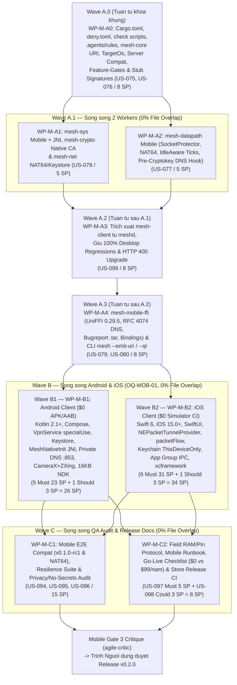

# Mobile Sprint Backlog & Parallel Work Package Plan — Mesh VPN (`v0.2.0`: Android & iOS)

| Thuộc tính | Giá trị |
|---|---|
| Tác giả | `agile-scrum-master` (`sm-mob`) |
| Ngày lập | 2026-11-15 |
| Phiên bản | **1.1 (Revision Round 1 — Mobile Gate 2)** — Kế hoạch phân rã Chặng 3 (Milestone `v0.2.0` — Mobile Clients: Android & iOS) trình duyệt **Mobile Gate 2** |
| Nhánh làm việc | `feat/mobile-clients` (giữ nguyên `main`, `v0.1.0-rc1` và toàn bộ [sprint-backlog.md](./sprint-backlog.md) v1.2) |
| Đầu vào khóa cứng | [mobile-product-backlog.md](../02-product-planning/mobile-product-backlog.md) v1.1 (`25 Stories / 117 SP`, `OQ-MOB-01..05`) · [mobile-tech-stack-decision.md](../03-system-design/mobile-tech-stack-decision.md) · [mobile-adr.md](../03-system-design/mobile-adr.md) (`ADR-012..019`) · [mobile-coding-standards.md](../03-system-design/mobile-coding-standards.md) · [mobile-system-architecture.md](../03-system-design/mobile-system-architecture.md) · [mobile-ffi-and-storage-design.md](../03-system-design/mobile-ffi-and-storage-design.md) · [agile-state.md](./agile-state.md) |
| Quy tắc chạy song song | **0% File Overlap trong cùng một Wave song song** (`workspace: "share"` an toàn tuyệt đối) + Quy trình Review bắt buộc (`Check Script → agile-critic / agile-qa`) |

---

## 1. Tổng Quan Lộ Trình Mobile `v0.2.0` & Tuân Thủ Gate 1 (`OQ-MOB-01..05`)

Milestone **`v0.2.0` (Mobile Clients — Android & iOS)** gồm **25 User Stories (`US-075..099`) = `117 SP`** (`22 Must = 108 SP` + `2 Should = 6 SP` + `1 Could = 3 SP`), phủ **34/34 mã `MOB-*`** (`25 P0, 8 P1, 1 P2`), chia thành **3 Wave lớn** theo phương án đã chốt tại Gate 1 (`OQ-MOB-01`):

| Wave / Làn thực thi | Mục tiêu Wave | Work Packages | Must (Story / SP) | Should / Could | Tổng SP | Cổng kiểm định |
|---|---|---|---:|---:|---:|---|
| **Wave A — Shared Core, Control Extraction & CLI** | Mở khóa lõi Rust dùng chung (`mesh-client`, `mesh-mobile-ffi`, `tools/uniffi-bindgen`), tương thích ngược `TargetOs::{Android, Ios}` không migrate `redb`, feature-gate 5 mobile targets + `deny.toml` (`uniffi 0.29.5`), NAT64 (`64:ff9b::/96`), `TimerMode::IdleAware`, Split-DNS RFC 4074 & CLI `mesh://join` | `WP-M-A0` → (`WP-M-A1` \|\| `WP-M-A2`) → `WP-M-A3` → `WP-M-A4` | **7 / 34** | — | **34** | Check Script + `cargo deny` 5 targets (`0` warning) + `meshd` Desktop regression 100% + `test_no_secrets_in_outputs` + `agile-critic` |
| **Wave B1 — Android Client** *(song song với Wave B2)* | Ứng dụng Kotlin `2.1+` + Jetpack Compose (`minSdk 26 / targetSdk 35`), `VpnService` `specialUse` + `protect(fd)` 100%, `MeshNativeInit` JNI + local Maven AAR + R8, Keystore DEK + `ChaCha20Poly1305` trong `noBackupFilesDir`, Split-DNS + `:853 TCP RST` + `NetworkCallback`, QR CameraX+ZXing, NDK `16 KB` page size, CI `.apk`/`.aab` (`$0`) | `WP-M-B1` | **5 / 23** | `US-085` (`1 Should / 3 SP`) | **26** | `./gradlew ktlintCheck detekt lintDebug testDebugUnitTest assembleDebug` + `.so <= 6 MiB` + `16 KB` ELF + `agile-critic` |
| **Wave B2 — iOS Client** *(song song với Wave B1)* | Ứng dụng Swift `6` (`iOS 15.0+` với `#available(iOS 16.0, *)` `PasteButton`, `XcodeGen`) 2 tiến trình (`MeshApp` + `MeshPacketTunnel` `NEPacketTunnelProvider`), `packetFlow`, `includedRoutes` (`/32` TUN + `overlay_dns_ip/32`), `NEDNSSettings`, `NWPathMonitor`, Keychain `ThisDeviceOnly` non-sync, App Group IPC `<= 4 KiB` + `.tar` bugreport `<= 1 MiB`, CI `.xcframework` + Simulator `CODE_SIGNING_ALLOWED=NO` (`$0`) | `WP-M-B2` | **6 / 31** | `US-092` (`1 Should / 3 SP`) | **34** | `xcodegen generate` + `swiftlint lint --strict` + `xcodebuild test` Simulator `$0` + `3` slices `<= 6 MiB` + `agile-critic` |
| **Wave C — Mobile QA, Security Audit & Release `v0.2.0`** | Kiểm thử tương thích ngược `v0.1.0-rc1` + NAT64 + Control offline, chịu lỗi di động (roaming `<= 5 s`, Idle/Doze, Captive Portal/Clock Skew/Revoke), kiểm toán `0` rò bí mật / `0` deep-link `mpk_*` / `0` TCP listener, Runbook & Go-Live Checklist (`$0` vs `hardware_signoff_required`) | `WP-M-C1` \|\| `WP-M-C2` | **4 / 20** | `US-098` (`1 Could / 3 SP`) | **23** | `agile-qa` + `agile-devops` + `agile-critic` → Trình Người dùng duyệt **Mobile Gate 3** |
| **Tổng cộng Milestone `v0.2.0`** | **Phủ 100% `EP-13..EP-16` & 34/34 `MOB-*`** | **9 Work Packages** | **22 / 108** | **2 Should (6 SP) + 1 Could (3 SP)** | **117** | **Khớp 100% `mobile-product-backlog.md` v1.1** |

> [!IMPORTANT]
> **Thực thi cứng 5 Quyết định Gate 1 (`OQ-MOB-01..05`) & Điểm đồng bộ Chặng 2:**
> 1. **`OQ-MOB-01` (Phương án A):** Bắt buộc hoàn tất **Wave A** trước khi mở đồng thời **Wave B1 (Android)** và **Wave B2 (iOS)** chạy song song với **0% File Overlap**, sau đó hội tụ tại **Wave C**.
> 2. **`OQ-MOB-02` (`$0` Mode):**
>    - **Wave B1 (Android):** Đóng gói `.apk`/`.aab` thật cài sideload trên điện thoại Android thật với chi phí `$0` (hỗ trợ Android 15 `16 KB` ELF page size).
>    - **Wave B2 (iOS):** Hoàn thiện đầy đủ mã nguồn SwiftUI + `NEPacketTunnelProvider` + `MeshMobileFFI.xcframework` (`3` slices) và kiểm chứng build + unit test trên iOS Simulator (`CODE_SIGNING_ALLOWED=NO`, chi phí `$0` trên `macos-latest`).
>    - **Wave C (`US-097 AC2`):** Tách rạch ròi hạng mục **chạy được ngay (`$0`)** (E2E Rust/Lab, Android máy thật `RSS <= 48 MiB`, CI iOS Simulator) với hạng mục **chạy tunnel thật trên iPhone vật lý** (`NEPacketTunnelProvider`, Xcode Instruments `RSS <= 25 MiB`, Energy Log `<= 1.5%/giờ`, roaming 4G thật) gắn nhãn **`hardware_signoff_required (chờ Apple Developer $99/năm)`** (tương tự mô hình `v0.1.0-rc1`).
> 3. **`OQ-MOB-03` (`mesh://join` & `--emit-uri` / `--qr`):** Hỗ trợ đủ 3 luồng nhập trong app (**QR camera nội bộ** + **dán URI trong app** + **nhập tay `IP:cổng + Pin + mpk_*`**) kèm màn hình xác nhận tường minh Endpoint + SPKI Pin; **cấm 100% đăng ký OS-wide clickable deep-link (`intent-filter` / `CFBundleURLTypes` / `Associated Domains`) cho `mpk_*`**. `ADR-019` và `mobile-ffi-and-storage-design.md §4.1` chốt đồng nhất URI **`mesh://join?v=1&ep=...&pin=sha256%3A...&key=mpk_...[&name=...]`** (khớp `SpkiPin` `sha256:<64_hex>`) và cờ CLI **`mesh preauthkey create --emit-uri`** / **`--qr`**.
> 4. **`OQ-MOB-04` (Chỉ Split-Tunnel):** `includedRoutes` / `VpnService.Builder` chỉ nhận `NetmapSnapshot.overlay_cidr` động + `.mesh.internal` chuẩn RFC 4074; cấm `0.0.0.0/0`; Android cảnh báo nổi bật khi `isLockdownEnabled()` hoặc `isPrivateDnsActive()` Strict bật.
> 5. **`OQ-MOB-05` (`MPL-2.0` hẹp cho `uniffi*`):** Chỉ mở ngoại lệ `MPL-2.0` (`[[licenses.exceptions]]`) và `anyhow` (`[bans] wrappers`) cho nhóm crate `uniffi*` ở `crates/mesh-mobile-ffi` và `tools/uniffi-bindgen`; giữ nguyên lệnh cấm `unsafe` viết tay ngoài `crates/mesh-sys/*` và giữ nguyên allowlist `.expose_secret()` 4 crates (`mesh-crypto`, `mesh-datapath`, `mesh-net`, `mesh`).

---

## 2. Nguyên Tắc Chống Đụng Độ File (`0% File Overlap`) & Thứ Tự DAG Trong Wave A

Để nhiều `agile-developer`, `agile-qa`, `agile-devops` chạy song song trong cùng `workspace: "share"` mà **không bao giờ** xảy ra xung đột sửa chung `Cargo.toml`, `lib.rs`, `deny.toml` hay script kiểm tra:

1. **Nguyên tắc "Khóa Khung Tuần Tự Trước — Triển Khai Song Song Sau" trong Wave A:**
   - **`WP-M-A0` (Wave A.0 — Tuần tự đầu tiên)** giữ **độc quyền** toàn bộ file gốc workspace và cấu hình chung (`Cargo.toml`, `Cargo.lock`, `deny.toml`, `scripts/check.ps1`, `scripts/check.sh`, `.agents/rules/coding-standards.md`, `.gitignore`, `.editorconfig`, `.gitattributes`), đồng thời cập nhật `Cargo.toml` + `src/lib.rs` (feature flags & `#[cfg]` module gates) + nhánh `route.rs` + khung compile-green kèm **100% chữ ký công khai cuối cùng (`final public signatures`)** cho `Nat64Prefix`, `Nat64Synthesizer`, `SocketProtector`, 5 file mobile `mesh-sys` (`tun_android.rs`, `socket_android.rs`, `socket_ios.rs`, `memory_ios.rs`, `jni_android.rs`), `mesh-client`, `mesh-mobile-ffi` và `tools/uniffi-bindgen`. Nhờ vậy cuối `WP-M-A0`, toàn workspace & đồ thị 5 mobile targets hợp lệ ngay trước khi chia song song.
   - **Wave A.1 (`WP-M-A1` \|\| `WP-M-A2`)** chạy **song song 2 workers** với **0% File Overlap**: `WP-M-A1` chỉ sửa file triển khai chi tiết trong `mesh-sys` (5 file mobile gồm cả `jni_android.rs`), `mesh-crypto` (`tlspin.rs`/`keys.rs`/`secret.rs`) và `mesh-net` (`nat64.rs`/`keystore.rs`/`tun.rs`/`netmon.rs`); `WP-M-A2` chỉ sửa `crates/mesh-datapath/src/**` (bao gồm `src/lib.rs`, `engine.rs`, `magic_socket.rs`, `relay_client.rs`, `stun_client.rs`, `cryptokey.rs`). **Không bên nào chạm `Cargo.toml`, `lib.rs` ngoài phạm vi mình, hay sửa lại chữ ký công khai đã khóa ở `A0`.**
   - **`WP-M-A3` (Wave A.2 — Tuần tự sau Wave A.1)** trích xuất `crates/mesh-client/src/**` từ `crates/meshd/src/**` dựa trên trait/NAT64/TLS đã hoàn chỉnh ở A.1, giữ 100% regression tests `meshd` Desktop xanh.
   - **`WP-M-A4` (Wave A.3 — Tuần tự sau Wave A.2)** hoàn thiện `crates/mesh-mobile-ffi/src/**` (`UniFFI 0.29.5`, `MobileEngine`, RFC 4074 Split-DNS, `export_bugreport_to_file`, `test_no_secrets_in_outputs`, sinh bindings Kotlin/Swift) và `crates/mesh/src/{admin_cmds.rs,output.rs}` (`--emit-uri`/`--qr`).
2. **Wave B1 (`WP-M-B1`) & Wave B2 (`WP-M-B2`) chạy song song 100% (`0% File Overlap`):**
   - `WP-M-B1` chỉ chạm `mobile/android/**`, `.github/workflows/mobile-android.yml`, `scripts/build-android-ffi.sh`.
   - `WP-M-B2` chỉ chạm `mobile/ios/**`, `.github/workflows/mobile-ios.yml`, `scripts/build-ios-xcframework.sh`.
3. **Wave C (`WP-M-C1` \|\| `WP-M-C2`) chạy song song 100% (`0% File Overlap`):**
   - `WP-M-C1` sở hữu `crates/mesh-mobile-ffi/tests/**`, `lab/mobile/**`, `docs/05-quality-assurance/mobile-*.md`.
   - `WP-M-C2` sở hữu `.github/workflows/mobile-release.yml`, `scripts/run-mobile-qa.{ps1,sh}`, `docs/06-operations/mobile-*.md`.
4. **Quy tắc leo thang bắt buộc:** Nếu một worker phát hiện cần đổi signature ở crate/tệp thuộc chủ sở hữu khác hoặc đã khóa ở `WP-M-A0`, **DỪNG NGAY và báo `@coordinator` / `agile-scrum-master`**, tuyệt đối không tự ý sửa vượt ranh giới.

### 2.1. Sơ đồ DAG Thực thi Wave A → Wave B1/B2 → Wave C



---

## 3. Đặc Tả Chi Tiết Context Packet Từng Work Package (`WP-M-*`)

---

### 3.1. Wave A — Shared Core, Control Extraction & CLI (`7 Must = 34 SP`)

#### `WP-M-A0` — Workspace Foundation, `deny.toml` (`MPL-2.0`/`anyhow`), Governance, `TargetOs::{Android, Ios}`, `mesh-core` URI & Feature-Gate Skeletons (Wave A.0 — Tuần tự)
- **Goal**: Mở rộng workspace Rust `1.94.1` cho 2 crate mới (`crates/mesh-client`, `crates/mesh-mobile-ffi`) và `tools/uniffi-bindgen`; đồng bộ `.agents/rules/coding-standards.md` và `scripts/check.{ps1,sh}` (mở rộng phạm vi quét sang `crates/`, `tools/`, `mobile/` và cập nhật `-Cross`/`--cross`); cấu hình `deny.toml` (`0` error & `0` warning) với 5 mobile targets + ngoại lệ `MPL-2.0`/`anyhow` cô lập riêng đúng các crate `uniffi*` có trong `Cargo.lock`; thêm `TargetOs::{Android, Ios}` giữ 100% tương thích `redb` `SCHEMA_VERSION = 1` & Desktop `v0.1.0-rc1`; triển khai `mesh_core::mobile_uri` (`mesh://join?v=1&...` + `proptest!`) & `DEFAULT_MOBILE_MAX_BUGREPORT_BYTES`; và khóa khung feature-gate + **100% chữ ký công khai cuối cùng** trong stub compile-green trên toàn workspace.
- **User Stories & SP (`2 Must = 8 SP`)**:
  - `US-075` (`3 SP`, `Must`, `EP-13`, Trace: `MOB-OPS-03`, `M-GNFR-05`): Mở rộng `TargetOs::{Android, Ios}` trên `mesh-proto` & `mesh-server` giữ nguyên `protocol_version = 1` và `NetmapSnapshot`/`PeerEntry` (`#[serde(deny_unknown_fields)]`). *(Lưu ý: nhánh `RelayClient::current_target_os_str()` trong `crates/mesh-datapath/src/relay_client.rs` do `WP-M-A2` hoàn thiện để 0% trùng file `mesh-datapath/src/*`.)*
  - `US-076` (`5 SP`, `Must`, `EP-13`, Trace: `MOB-PERF-05`, `MOB-OPS-03`, `M-GNFR-06`, `M-GNFR-08`): Feature-gate tách `axum`/`hyper*`/`redb`/`clap`/`rustls-native-certs`/`rcgen`/`windows-*` khỏi đồ thị build mobile; xử lý nhánh `android`/`ios` trong `crates/mesh-net/src/route.rs` tránh `E0308`; cập nhật `deny.toml` cho 5 mobile targets.
- **Dependency DAG**:
  - *Đầu vào*: Codebase `v0.1.0-rc1` hiện hành trên `feat/mobile-clients`, Gate 1 `OQ-MOB-05`, Gate 2 `ADR-012`, `ADR-013`, `ADR-019`.
  - *Mở khóa*: `WP-M-A1` và `WP-M-A2` chạy song song ngay sau khi `WP-M-A0` đạt DoD.
- **Phạm vi File Sở hữu Độc quyền (`Exclusive File Ownership List`)**:
  - Gốc workspace & cấu hình kiểm định:
    - `Cargo.toml` (`members = ["crates/*", "tools/uniffi-bindgen"]`, `[workspace.dependencies]` thêm `mesh-client`, `uniffi = "0.29.5"`, `rustls-platform-verifier = "0.6"`, `jni = "0.21"` — **không dùng `ndk-context`**)
    - `Cargo.lock`
    - `deny.toml` (thêm 5 mobile targets; sau khi cập nhật `Cargo.lock`, chỉ giữ `[[licenses.exceptions]]` `MPL-2.0` và `[bans] wrappers` cho đúng danh sách crate `uniffi*` thực sự xuất hiện trong `Cargo.lock` để `cargo deny 0.20.2` đạt **0 error & 0 warning** `license-exception-not-encountered`)
    - `scripts/check.ps1`, `scripts/check.sh` (quét toàn bộ `crates/`, `tools/`, `mobile/` — kiểm tra UTF-8 no-BOM & LF trên `.rs/.kt/.kts/.swift/.xml/.yml/.sh/.ps1`; giữ nguyên tuyệt đối rule cấm `unsafe` viết tay ở cả `crates/` ngoài `mesh-sys/*` lẫn `tools/`, allowlist `.expose_secret()` 4 crates, cấm `:443/:3478` ngoài `mesh-core`; cập nhật `-Cross`/`--cross` dùng `--workspace --exclude mesh-mobile-ffi --exclude mesh-uniffi-bindgen` cho Desktop cross checks)
    - `.agents/rules/coding-standards.md` (cập nhật mục 1 & 3 ghi nhận `mesh-client`, `mesh-mobile-ffi` `[lints]` riêng tránh `E0453` nhưng cấm `unsafe` viết tay, `tools/uniffi-bindgen`, ngoại lệ `MPL-2.0`/`anyhow` hẹp cho `uniffi*`)
    - `.gitignore`, `.editorconfig`, `.gitattributes` (chặn commit `.apk`, `.aab`, `.ipa`, `.xcframework`, `*.xcodeproj/`, `local.properties`, `keystore.jks`, `*.mobileprovision`, `*.p12`; quy chuẩn indent 4 LF cho `.kt`, `.kts`, `.swift`)
  - Crates lõi hoàn chỉnh trong `WP-M-A0`:
    - `crates/mesh-core/**` (`defaults.rs` thêm `DEFAULT_MOBILE_MAX_WS_FRAME_BYTES`, `DEFAULT_IDLE_ENTRY_WINDOW_MS`, `DEFAULT_MOBILE_COALESCED_HEARTBEAT_MS`, **`DEFAULT_MOBILE_MAX_BUGREPORT_BYTES = 1_048_576`**; `mobile_uri.rs` parser/validator `mesh://join?v=1&...` + `proptest!`; `lib.rs`)
    - `crates/mesh-proto/**` (`control.rs` thêm `TargetOs::{Android, Ios}`)
    - `crates/mesh-server/**` (`control_handlers.rs` cập nhật `os_label()` cho `Android`/`Ios` + unit/integration test `v0.1.0-rc1` & `redb` `SCHEMA_VERSION = 1` compat)
  - Khung Feature-gate & Stub biên dịch xanh **với 100% chữ ký công khai cuối cùng** (bàn giao phần ruột cho `WP-M-A1..A4` sau `A.0`):
    - `crates/mesh-sys/{Cargo.toml,src/lib.rs}` (thêm `jni` dưới `[target.'cfg(target_os = "android")'.dependencies]`, **0 phụ thuộc TLS trong `mesh-sys`**) + stub compile-green khóa chữ ký cho `crates/mesh-sys/src/{tun_android.rs,socket_android.rs,socket_ios.rs,memory_ios.rs,jni_android.rs}`
    - `crates/mesh-crypto/{Cargo.toml,src/lib.rs}` (features `desktop-certs`, `certgen`, `mobile-platform-verifier` gắn gate `cfg(any(target_os = "android", target_os = "ios"))` để Desktop `--all-features` xanh)
    - `crates/mesh-net/{Cargo.toml,src/lib.rs,src/route.rs}` (features `desktop-ipc`, `desktop-os`, `#[cfg]` gate Desktop modules, nhánh `android`/`ios` trong `route.rs`, khóa 100% chữ ký công khai của `pub trait SocketProtector`, `pub struct Nat64Prefix`, `pub struct Nat64Synthesizer` trong `nat64.rs` & codec chữ ký trong `keystore.rs`)
    - `crates/mesh-datapath/Cargo.toml` (feature `desktop-os = ["mesh-net/desktop-os"]` — **KHÔNG chạm `crates/mesh-datapath/src/**`**)
    - `crates/mesh-client/{Cargo.toml,src/lib.rs}` (skeleton crate với `default = ["desktop-os"]`, `[lints] workspace = true`, giữ `toml`, **KHÔNG có `reqwest`**)
    - `crates/mesh-mobile-ffi/{Cargo.toml,src/lib.rs}` (skeleton crate với `crate-type = ["cdylib", "staticlib", "lib"]`, `uniffi = "0.29.5"`, `[lints]` riêng tránh `E0453`, gọi `mesh_sys::jni_android::ensure_jni_symbols_linked()` và **không** khai báo `jni` trực tiếp — giữ `jni = "0.21"` duy nhất trong `crates/mesh-sys/Cargo.toml`, `0` dòng `unsafe` viết tay)
    - `crates/meshd/Cargo.toml` (thêm `mesh-client.workspace = true`), `crates/mesh/Cargo.toml`
    - `tools/uniffi-bindgen/**` (`Cargo.toml` với `package.name = "mesh-uniffi-bindgen"`, `src/main.rs` gọi `uniffi::uniffi_bindgen_main()`)
- **Input / Output Contracts**:
  - *Input*: `mobile-adr.md` (`ADR-012, 013, 019`), `mobile-tech-stack-decision.md §3, §5, §9`, `mobile-coding-standards.md §0, §1`, `mobile-ffi-and-storage-design.md §1, §4.1, §4.2`.
  - *Output*: Toàn bộ workspace Desktop kiểm định xanh với `0` warning; `cargo deny check` pass `0` error & `0` warning trên cả 5 mobile targets; đồ thị `cargo tree` của `mesh-mobile-ffi` không chứa `axum/hyper/redb/clap/rcgen/rustls-native-certs/openssl-sys/aws-lc-rs/ndk-context`; toàn bộ chữ ký stub công khai cho `WP-M-A1`/`A2` khóa cứng 100%; `mesh_core::mobile_uri::parse_join_uri` chuẩn `mesh://join?v=1&...`.
- **Quy trình Review**: `scripts/check.{ps1,sh}` + `cargo deny` (`0` warning) + kiểm đồ thị/biên dịch 5 mobile targets → `agile-critic` review WP trước khi mở khóa Wave A.1.
- **Lệnh kiểm chứng DoD cụ thể**:
  ```sh
  powershell -ExecutionPolicy Bypass -File scripts/check.ps1   # hoặc sh scripts/check.sh (gồm --all-features Desktop)
  cargo deny check advisories bans licenses sources --target aarch64-linux-android --target x86_64-linux-android --target aarch64-apple-ios --target aarch64-apple-ios-sim --target x86_64-apple-ios
  cargo metadata --filter-platform aarch64-linux-android --no-deps > /dev/null
  cargo tree -p mesh-mobile-ffi --target aarch64-apple-ios -e normal | grep -E "axum|hyper|redb|clap|rcgen|rustls-native-certs|openssl-sys|aws-lc-rs|ndk-context" # phải rỗng
  cargo check -p mesh-net --no-default-features --target aarch64-linux-android
  # Lưu ý toolchain C/NDK/Xcode khi compile crate có `mesh-crypto` (`ring 0.17` C/ASM) hoặc `mesh-mobile-ffi`:
  #   - Android (`aarch64-linux-android`, `x86_64-linux-android`): chạy `cargo check` (-p `mesh-client`, `mesh-datapath`, `mesh-mobile-ffi`) / `cargo ndk` trên host có Android NDK (`CC_aarch64_linux_android`, CI `ubuntu-latest`).
  #   - iOS (`aarch64-apple-ios`, `aarch64-apple-ios-sim`, `x86_64-apple-ios`): chạy `cargo check` trên runner `macos-latest` có Xcode SDK.
  ```

---

#### `WP-M-A1` — Mobile OS Primitives (`mesh-sys` + JNI), Native Trust Store (`mesh-crypto`), NAT64 & Keystore Codec (`mesh-net`) (Wave A.1 — Song song #1)
- **Goal**: Hoàn thiện toàn bộ phần triển khai di động ở tầng hệ thống (`mesh-sys` mobile với `// SAFETY:`, bao gồm cầu nối `jni_android.rs` cho `MeshNativeInit` không chứa TLS deps), tầng mật mã/TLS (`mesh-crypto` `SpkiPinVerifier` + `rustls-platform-verifier 0.6` Android `init_hosted` & iOS + phân loại lỗi `PinMismatch`/`ClockSkew`/`CaptivePortalSuspected`), và tầng mạng OS-neutral (`mesh-net::nat64` RFC 6052 §2.2 có byte `u = 0x00` + RFC 7050 + `proptest!`, `mesh-net::keystore` `Zeroizing<Vec<u8>>` giữ nguyên allowlist `.expose_secret()`).
- **User Stories & SP (`1 Must = 5 SP`)**:
  - `US-078` (`5 SP`, `Must`, `EP-13`, Trace: `MOB-SEC-03`, `MOB-SEC-05`, `MOB-REL-04`, `MOB-PERF-04`, `MOB-OPS-04`, `GNFR-01`, `GNFR-02`, `M-GNFR-07`, `M-GNFR-09`): Xác thực TLS đa nền tảng (`SpkiPinVerifier` cho IP+Pin kể cả qua NAT64, `rustls-platform-verifier` cho Domain+CA qua JNI `init_hosted` trên Android & Security.framework trên iOS, fail-closed khi thiếu `initPlatformVerifier`, backoff `300_000 ms`, lọc bí mật). *(Đồng thời cung cấp `mesh-sys` mobile primitives & `mesh-net::nat64` cho `US-077`/`US-079`.)*
- **Dependency DAG**:
  - *Đầu vào*: `WP-M-A0` (đã khóa khung `Cargo.toml`, `lib.rs`, `route.rs` và 100% chữ ký stub công khai).
  - *Chạy song song với*: `WP-M-A2` (0% trùng file).
  - *Mở khóa*: `WP-M-A3`.
- **Phạm vi File Sở hữu Độc quyền (`Exclusive File Ownership List`)**:
  - `crates/mesh-sys/src/{tun_android.rs,socket_android.rs,socket_ios.rs,memory_ios.rs,jni_android.rs}` (`adopt_raw_tun_fd` kiểm `raw_fd >= 0` + `fcntl(F_GETFD)`, `disable_ipv4_dont_fragment` Android/iOS, `bind_socket_to_interface_index` iOS, `available_memory_bytes` bọc `os_proc_available_memory()`, `Java_dev_meshvpn_android_ffi_MeshNativeInit_initPlatformVerifier` + `with_attached_env_and_context` giữ `Arc<JavaVM>` & `GlobalRef` `Context` với `0` TLS deps trong `mesh-sys`, kèm `// SAFETY:` và unit test — giữ nguyên 100% chữ ký khóa ở `A0`)
  - `crates/mesh-crypto/src/{tlspin.rs,keys.rs,secret.rs}` & `crates/mesh-crypto/tests/**` (`#[cfg(all(feature = "mobile-platform-verifier", any(target_os = "android", target_os = "ios")))]` gọi `rustls_platform_verifier::android::init_hosted` qua `mesh_sys::jni_android::with_attached_env_and_context`, `build_platform_ca_client_config`, bọc đồng thời CA + `SpkiPinVerifier` khi có pin, phân biệt `PinMismatch` / `ClockSkew` / `CaptivePortalSuspected`, fail-closed nếu chưa init trên Android, `0` TOFU, `0` bypass)
  - `crates/mesh-net/src/{nat64.rs,keystore.rs,tun.rs,netmon.rs}` & `crates/mesh-net/tests/**` (`Nat64Prefix` RFC 6052 §2.2 chèn byte dự phòng `u = 0x00` tại bits `64..71` cho `/32,/40,/48,/56,/64` + `/96` + `from_ipv4only_arpa_addrs` RFC 7050 + `Nat64Synthesizer` + test vector RFC 6052 §2.2 + `proptest!`; `StoredNodeIdentity::seal_with_dek(&self, dek: &[u8; 32])` / `unseal_with_dek(ciphertext: &[u8], dek: &[u8; 32])` niêm phong/giải mã AEAD với `Zeroizing<Vec<u8>>`; cập nhật trait `TunDevice`/`NetMonitor` nếu cần cho mobile adapter mà không chạm `route.rs` hay `lib.rs`)
- **Input / Output Contracts**:
  - *Input*: `ADR-013`, `ADR-014`, `mobile-system-architecture.md §6.1`, `mobile-ffi-and-storage-design.md §1.1, §2.3`.
  - *Output*: Triển khai đầy đủ bám sát chữ ký công khai đã khóa ở `WP-M-A0` của `mesh-sys`, `mesh-crypto`, `mesh-net`; đạt test trên host + cross-check pure-Rust/mobile CI; `0` `.expose_secret()` mới ngoài allowlist; `0` `unsafe` ngoài `crates/mesh-sys/*`.
- **Quy trình Review**: `scripts/check.{ps1,sh}` → `agile-critic` (kiểm tra đồng thời sau khi Wave A.1 hoàn tất).
- **Lệnh kiểm chứng DoD cụ thể**:
  ```sh
  powershell -ExecutionPolicy Bypass -File scripts/check.ps1
  cargo test -p mesh-sys -p mesh-crypto -p mesh-net --all-features
  cargo check -p mesh-net --no-default-features --target aarch64-linux-android
  cargo check -p mesh-net --no-default-features --target aarch64-apple-ios
  # Kiểm tra `mesh-crypto` kèm `mobile-platform-verifier`: chạy trên CI có NDK (`aarch64-linux-android`) & `macos-latest` (`aarch64-apple-ios`)
  ```

---

#### `WP-M-A2` — Mobile Datapath Engine (`SocketProtector`, NAT64 `MagicSocket`/`RelayClient`/`StunClient`, `TimerMode::IdleAware` & Pre-Cryptokey DNS Hook) (Wave A.1 — Song song #2)
- **Goal**: Nâng cấp `crates/mesh-datapath` để bảo vệ 100% socket underlay qua `SocketProtector` (fail-closed khi `false`), hỗ trợ IPv6-only NAT64 (`64:ff9b::/96`) xuyên suốt `MagicSocket`/`StunClient`/`RelayClient` — bao gồm truyền `SocketProtector` + `Nat64Synthesizer` vào `StunClient::resolve_stun_target_addrs` (`stun_client.rs`) và parse `ErrorEnvelope` cho `HTTP 400` (`ProtocolIncompatible` / `E_SERVER_UPGRADE_REQUIRED`) trong `RelayClient::map_http_status_error` (`relay_client.rs`); hỗ trợ `MobileTunAdapter` (`tun_fd` / async `PacketFlow`); gắn hook chặn L3 `DnsPacketInterceptor` trước `CryptokeyValidator`; chuyển vòng lặp `DatapathEngine` sang `TimerMode::IdleAware` (dừng tick `250 ms` khi rỗi 10 s); và sửa `RelayClient::current_target_os_str()` trả `"android"`/`"ios"`.
- **User Stories & SP (`1 Must = 5 SP`)**:
  - `US-077` (`5 SP`, `Must`, `EP-13`, Trace: `MOB-PLAT-AND-02`, `MOB-PLAT-IOS-03`, `MOB-REL-01..03`, `MOB-REL-05`, `MOB-PERF-03`, `M-GNFR-01`, `M-GNFR-03`, `M-GNFR-09`): Trừu tượng hóa `SocketProtector`, `MobileTunAdapter`, IPv6-only NAT64 (cả `StunClient::resolve_stun_target_addrs`) & `TimerMode::IdleAware` trong `mesh-datapath`. *(Cộng hoàn tất `RelayClient::current_target_os_str()` & `RelayClient::map_http_status_error` `HTTP 400` `ErrorEnvelope` cho `US-075`/`US-099`.)*
- **Dependency DAG**:
  - *Đầu vào*: `WP-M-A0` (đã khóa 100% chữ ký stub `SocketProtector`, `Nat64Synthesizer`).
  - *Chạy song song với*: `WP-M-A1` (0% trùng file — `WP-M-A2` chỉ chạm `crates/mesh-datapath/src/**` và `tests/**`).
  - *Mở khóa*: `WP-M-A3`.
- **Phạm vi File Sở hữu Độc quyền (`Exclusive File Ownership List`)**:
  - `crates/mesh-datapath/src/**` (`lib.rs`, `engine.rs`, `magic_socket.rs`, `relay_client.rs`, `stun_client.rs`, `peer_map.rs`, `cryptokey.rs`, `disco_engine.rs`, `rebind.rs`)
  - `crates/mesh-datapath/tests/**` (bổ sung test `SocketProtector` fail-closed trên `MagicSocket`/`StunClient::resolve_stun_target_addrs`/`RelayClient`, `RelayClient::map_http_status_error` HTTP 400 `ProtocolIncompatible`, `TimerMode::IdleAware` 0-wakeup khi rỗi, NAT64 address rewrite, pre-`CryptokeyValidator` DNS intercept, burst 1.000 gói queue `256` + `try_send()` không OOM)
- **Input / Output Contracts**:
  - *Input*: `ADR-014`, `ADR-015`, `ADR-016`, `mobile-system-architecture.md §6.1, §6.2, §7.1`.
  - *Output*: `DatapathEngine` hỗ trợ `TimerMode::{Responsive, IdleAware}`, `DnsPacketInterceptor` hook trước `CryptokeyValidator`, `SocketProtector` + `Nat64Synthesizer` xuyên suốt UDP/Relay/`StunClient::resolve_stun_target_addrs`, `RelayClient::map_http_status_error` parse `ErrorEnvelope` HTTP 400, `RelayClient::current_target_os_str()` trả `"android"`/`"ios"`, giữ 100% test `v0.1.0` (`qa_sprint1_*`, `qa_sprint2_*`, `slo_wave2_suite`) xanh.
- **Quy trình Review**: `scripts/check.{ps1,sh}` → `agile-critic` (cùng lượt review Wave A.1).
- **Lệnh kiểm chứng DoD cụ thể**:
  ```sh
  powershell -ExecutionPolicy Bypass -File scripts/check.ps1
  cargo test -p mesh-datapath --all-features
  # Trên host có Android NDK (`CC_aarch64_linux_android`) & trên runner `macos-latest` có Xcode SDK (vì `mesh-datapath` kéo `mesh-crypto -> ring 0.17`):
  cargo check -p mesh-datapath --no-default-features --target aarch64-linux-android
  cargo check -p mesh-datapath --no-default-features --target aarch64-apple-ios
  ```

---

#### `WP-M-A3` — Trích xuất Lõi Client Control Plane (`crates/mesh-client`) khỏi `crates/meshd` (Wave A.2 — Tuần tự sau Wave A.1)
- **Goal**: Trích xuất toàn bộ lõi Client Control Plane (`control_loop`, `netmap_cache`, `roaming_loop`, `ping_probe`, `session`, `state`, `config`, `diagnostics`) từ `crates/meshd` sang thư viện OS-neutral `crates/mesh-client` thông qua trait `ClientPlatformHooks`, `ClientStateStore`, `DnsUpstreamHook`; truyền `SocketProtector` + `Nat64Synthesizer` vào **`probe_udp_routing_candidates`** (`control_loop.rs`) và **`PingProbe::execute_netcheck`** (`ping_probe.rs`); tham số hóa `max_ws_frame_bytes` (`4 MiB` Desktop / `256 KiB` Mobile), `HeartbeatSyncClock` (coalesced `45 s`), suy dẫn động `overlay_dns_ip` từ `NetmapSnapshot.overlay_cidr`, đặt prefix **`/32`** cho TUN và luôn bao gồm **`overlay_dns_ip/32`** trong tập tuyến split-tunnel; tạo streaming `.tar` bugreport `<= 1 MiB` (`DEFAULT_MOBILE_MAX_BUGREPORT_BYTES`, `BufWriter` `8 KiB`, `0` `sysexec`); xử lý `HTTP 400` `ProtocolIncompatible` (`E_SERVER_UPGRADE_REQUIRED`); và refactor `crates/meshd` thành vỏ Desktop mảnh giữ xanh 100% regression tests Desktop (`0` `reqwest` trong `mesh-client`).
- **User Stories & SP (`1 Must = 8 SP`)**:
  - `US-099` (`8 SP`, `Must`, `EP-13`, Trace: `MOB-REL-01`, `MOB-SEC-03`, `MOB-SEC-05`, `MOB-OPS-03`, `M-GNFR-05`): Trích xuất & tái sử dụng lõi Client Control Plane (`control_loop`, `NetmapCacheStore`, `roaming_loop`, `ping_probe`) khỏi `crates/meshd`.
- **Dependency DAG**:
  - *Đầu vào*: `WP-M-A1` + `WP-M-A2` (Wave A.1 xanh 100%).
  - *Mở khóa*: `WP-M-A4`.
- **Phạm vi File Sở hữu Độc quyền (`Exclusive File Ownership List`)**:
  - `crates/mesh-client/src/**` (`lib.rs`, `hooks.rs`, `session.rs`, `control_loop.rs`, `state.rs`, `netmap_cache.rs`, `roaming_loop.rs`, `ping_probe.rs`, `config.rs`, `diagnostics.rs`)
  - `crates/mesh-client/tests/**` (unit/integration tests OS-neutral dùng `FakePlatformHooks` & `FakeStateStore`, kiểm tra `SocketProtector` + `Nat64Synthesizer` trong `probe_udp_routing_candidates` & `PingProbe::execute_netcheck`, `256 KiB` WS cap, `ProtocolIncompatible` HTTP 400 dừng retry, `NetmapCacheStore` 24h grace & fail-closed checksum, TUN prefix `/32` + `overlay_dns_ip/32`, streaming `.tar` `<= 1_048_576 B`)
  - `crates/meshd/src/**` & `crates/meshd/tests/**` (`main.rs`, `supervisor.rs`, `ipc_service.rs`, `desktop_adapters.rs`, `desktop_hooks.rs`, `desktop_store.rs`, `service_windows.rs` — bảo toàn 100% `meshd` Desktop regression tests & `InMemoryPlatformAdapters`)
- **Input / Output Contracts**:
  - *Input*: `ADR-012`, `ADR-016`, `mobile-system-architecture.md §3, §4, §5, §7.1`.
  - *Output*: `crates/mesh-client` biên dịch sạch với `--no-default-features` trên mobile targets (0 phụ thuộc `axum`/`hyper`/`redb`/`clap`/`reqwest`) và `--all-features` cho `meshd` Desktop; toàn bộ tests `meshd` Desktop + `mesh-client` PASS 100%, `0` `.expose_secret()` trong `mesh-client` và `meshd`.
- **Quy trình Review**: `scripts/check.{ps1,sh}` → `agile-critic` review `US-099` trước khi mở `WP-M-A4`.
- **Lệnh kiểm chứng DoD cụ thể**:
  ```sh
  powershell -ExecutionPolicy Bypass -File scripts/check.ps1
  cargo test -p mesh-client -p meshd --all-features
  cargo check -p mesh-client --no-default-features --target aarch64-linux-android
  cargo tree -p mesh-client --no-default-features | grep -E "axum|hyper|redb|clap|windows-service|reqwest" # phải rỗng
  ```

---

#### `WP-M-A4` — Cầu nối `crates/mesh-mobile-ffi` (`UniFFI 0.29.5`), Embedded Split-DNS RFC 4074 & CLI `crates/mesh` (`--emit-uri` / `--qr`) (Wave A.3 — Tuần tự sau Wave A.2)
- **Goal**: Hoàn thiện `crates/mesh-mobile-ffi` xuất đối tượng `MobileEngine` (`UniFFI 0.29.5`), `PlatformNetworkBridge`, `MobileUpConfig` (`android_tun_fd: Option<i32>`), `complete_route_change(..., new_android_tun_fd: Option<i32>, ...)`, `mobile_enroll_or_rotate_node` (`MobilePendingJoinSession` chỉ giữ `preauth_key_masked`, `0` lưu `mpk_*` thô), `ensure_jni_symbols_linked()` trên Android, `MobileError` (bảo toàn `SEC-05` `"authentication failed"` & ánh xạ `ServerUpgradeRequired`/`DeviceLocked`/`KeystoreInvalidated`), runtime Tokio di động (`worker_threads(2)` / `max_blocking_threads(6)` Android; `worker_threads(1)` / `max_blocking_threads(4)` iOS; gọi `protect_socket` đồng bộ ngoài lock chống `spawn_blocking` starvation; `os_proc_available_memory()` backpressure), teardown `<= 5_000 ms`, `export_bugreport_to_file` streaming `.tar <= 1 MiB` (`DEFAULT_MOBILE_MAX_BUGREPORT_BYTES`), bộ lọc `test_no_secrets_in_outputs` mức `DEBUG`; triển khai Embedded Split-DNS Responder chuẩn RFC 4074 §3 (`A`, `AAAA NODATA`, `PTR`, `NXDOMAIN`, UDP `:53`, **Bounded Single-Transaction L3 TCP `:53` Responder** `16` LRU slots / TTL `3 s` / MSS `<= 1_240 B`, TCP `:853 RST`, underlay forwarder + `proptest!`); bổ sung `mesh preauthkey create --emit-uri` / `--qr` sinh chuẩn `mesh://join?v=1&...` vào `crates/mesh`; và kiểm chứng sinh Kotlin/Swift bindings + kích thước nhị phân release `<= 6 MiB`.
- **User Stories & SP (`2 Must = 8 SP`)**:
  - `US-079` (`5 SP`, `Must`, `EP-13`, Trace: `MOB-OPS-03`, `MOB-REL-03`, `MOB-REL-06`, `MOB-PERF-01`, `MOB-PERF-03`, `MOB-OPS-04`, `MOB-SEC-05`, `M-GNFR-01`, `M-GNFR-06`, `M-GNFR-07`): Lớp cầu nối FFI di động (`mesh-mobile-ffi`), vòng đời engine, giới hạn Jetsam & `RRC_IDLE`.
  - `US-080` (`3 SP`, `Must`, `EP-13`, Trace: `MOB-PLAT-AND-05`, `MOB-PLAT-IOS-05`, `MOB-SEC-04`, `M-GNFR-04`): Bộ phân giải Split-DNS `.mesh.internal` chuẩn RFC 4074 & công cụ sinh URI `mesh://join` / QR trên CLI `crates/mesh`.
- **Dependency DAG**:
  - *Đầu vào*: `WP-M-A3` (`mesh-client` hoàn tất).
  - *Mở khóa*: Song song **Wave B1 (`WP-M-B1`)** và **Wave B2 (`WP-M-B2`)**.
- **Phạm vi File Sở hữu Độc quyền (`Exclusive File Ownership List`)**:
  - `crates/mesh-mobile-ffi/src/**` (`lib.rs`, `types.rs`, `engine.rs`, `bridge.rs`, `dns_responder.rs`, `tun_bridge.rs`, `bugreport.rs`, kèm unit test & `proptest!` cho DNS RFC 4074 UDP/Bounded-TCP `:53` + `test_no_secrets_in_outputs` mức `DEBUG`)
  - `crates/mesh/src/{admin_cmds.rs,output.rs}` & `crates/mesh/tests/**` (bổ sung `--emit-uri` & `--qr` — pure-Rust QR UTF-8 block renderer, đồng nhất 100% với `ADR-019` và `mobile-ffi-and-storage-design.md`, không ghi `mpk_*` vào log/DB, giữ nguyên JSON `PreAuthKeyCreatedResponse` `#[serde(deny_unknown_fields)]`)
- **Input / Output Contracts**:
  - *Input*: `ADR-013`, `ADR-015`, `ADR-016`, `ADR-019`, `mobile-ffi-and-storage-design.md §2..§4, §7`, `mobile-coding-standards.md §1`.
  - *Output*: `crates/mesh-mobile-ffi` pass `cargo test` & `cargo deny check` 5 targets (`0` error, `0` warning); sinh được bindings Kotlin & Swift qua `cargo run -p mesh-uniffi-bindgen -- generate`; `libmesh_mobile_ffi.so` / `libmesh_mobile_ffi.a` ở release profile trên NDK / Xcode CI đạt `<= 6 MiB`/ABI (`US-076 AC4`).
- **Quy trình Review**: `scripts/check.{ps1,sh}` + `cargo deny` (`0` warning) + `mesh-uniffi-bindgen` smoke check → `agile-critic` nghiệm thu Wave A trước khi mở Wave B1 + Wave B2.
- **Lệnh kiểm chứng DoD cụ thể**:
  ```sh
  powershell -ExecutionPolicy Bypass -File scripts/check.ps1
  cargo test -p mesh-mobile-ffi -p mesh --all-features
  cargo test -p mesh-mobile-ffi test_no_secrets_in_outputs
  cargo deny check advisories bans licenses sources --target aarch64-linux-android --target x86_64-linux-android --target aarch64-apple-ios --target aarch64-apple-ios-sim --target x86_64-apple-ios
  cargo run -p mesh-uniffi-bindgen -- --help
  ```

---

### 3.2. Wave B1 & Wave B2 — Song Song Android & iOS (`OQ-MOB-01`, `0% File Overlap`)

#### `WP-M-B1` — Android Native Client (`Kotlin 2.1+`, `Jetpack Compose`, `VpnService`, Keystore DEK+`ChaCha20Poly1305`, Offline QR & CI `.apk`/`.aab` `$0`) (Wave B1 — Song song với `WP-M-B2`)
- **Goal**: Xây dựng hoàn chỉnh ứng dụng Android (`minSdk = 26`, `compileSdk = 35`, `targetSdk = 35`) trong `mobile/android/` với `VpnService` (`specialUse`), cấu hình TUN prefix **`/32`** + luôn bao gồm `overlay_dns_ip/32`, truyền **`new_android_tun_fd`** vào `complete_route_change(...)` ngay sau `establish()`, `protect(fd)` đồng bộ 100% socket underlay, khởi tạo **`MeshNativeInit.initPlatformVerifier(applicationContext)`** trong `MeshApplication.onCreate()` & `MeshVpnService.onCreate()` (0 `ndk-context`), local Maven repo cho **`rustls-platform-verifier-android`** AAR + rule ProGuard/R8 `-keep,includedescriptorclasses class org.rustls.platformverifier.** { *; }`, lưu trữ dùng **Android Keystore Master DEK (`AES-256-GCM`) bọc `ChaCha20Poly1305` sealed ciphertext** trong `noBackupFilesDir` + `allowBackup="false"`, Split-DNS RFC 4074 + `:853 TCP RST` + `LinkProperties.getDnsServers()` + cảnh báo Strict Private DNS, `NetworkCallback` roaming `<= 5 s`, `onRevoke()`, UI Jetpack Compose onboarding (CameraX + `zxing-core` QR / dán URI `mesh://join` + `clearPrimaryClip` / nhập tay + `FLAG_SECURE`), `bugreport` `.tar` Share Intent sạch, hỗ trợ Always-On + Direct Boot + cảnh báo Lockdown Mode + `BiometricPrompt` (`US-085` Should), và GitHub Actions CI `ubuntu-latest` xuất `.apk`/`.aab` (`16 KB` ELF NDK r27c+, mỗi `.so <= 6 MiB`, `$0`).
- **User Stories & SP (`5 Must = 23 SP` + `1 Should = 3 SP` = `26 SP`)**:
  - `US-081` (`5 SP`, `Must`, `EP-14`, Trace: `MOB-PLAT-AND-01..03`, `M-GNFR-03`): `VpnService` không root, `protect(fd)` 100%, TUN `/32` + `new_android_tun_fd` & Android 14+ `specialUse`.
  - `US-082` (`5 SP`, `Must`, `EP-14`, Trace: `MOB-SEC-01`, `MOB-PERF-02`, `M-GNFR-02`, `M-GNFR-08`): Android Keystore Master DEK (`AES-256-GCM`) + `ChaCha20Poly1305` sealed ciphertext trong `noBackupFilesDir`, chống Cloud/ADB Backup, ngân sách `RSS <= 48 MiB`.
  - `US-083` (`5 SP`, `Must`, `EP-14`, Trace: `MOB-PLAT-AND-05/06`, `MOB-REL-02/04/06`, `M-GNFR-04`, `M-GNFR-07`): Split-DNS `.mesh.internal` (`overlay_dns_ip/32`), Private DNS `:853`, `NetworkCallback` roaming `<= 5 s`, Airplane Mode & `onRevoke()`.
  - `US-084` (`5 SP`, `Must`, `EP-14`, Trace: `MOB-SEC-04..06`, `MOB-REL-04`, `MOB-OPS-04`): Jetpack Compose Onboarding (`MeshNativeInit`, QR CameraX+ZXing / Dán URI / Nhập tay + xác nhận Endpoint+Pin, 0 OS deep-link `mpk_*`, `FLAG_SECURE`), Peer/Ping/Netcheck, `bugreport` Share Intent sạch, hiển thị Captive Portal/Clock Skew/Pin Mismatch/Revoked.
  - `US-086` (`3 SP`, `Must`, `EP-14`, Trace: `MOB-OPS-AND-01`, `MOB-PERF-05`, `M-GNFR-06`, `M-GNFR-08`): Workflow CI `ubuntu-latest` build `arm64-v8a` + `x86_64` (`cargo-ndk`, NDK r27c+ `-Wl,-z,max-page-size=16384`, local Maven AAR `rustls-platform-verifier-android`), lint/unit test & xuất `.apk`/`.aab` (`$0`).
  - `US-085` (`3 SP`, `Should`, `EP-14`, Trace: `MOB-PLAT-AND-04`, `MOB-SEC-06`): Always-On VPN + Direct Boot (`LOCKED_BOOT_COMPLETED` → chờ `ACTION_USER_UNLOCKED`), cảnh báo `isLockdownEnabled()` (`G4`), `BiometricPrompt` cho thao tác nhạy cảm *(triển khai sau khi 5 `Must` ổn định)*.
- **Dependency DAG**:
  - *Đầu vào*: `WP-M-A4` (hợp đồng UniFFI `MobileEngine`, `PlatformNetworkBridge`, `new_android_tun_fd`, `MeshNativeInit`, sinh Kotlin bindings).
  - *Chạy song song với*: `WP-M-B2` (iOS — 0% trùng file).
  - *Mở khóa*: `WP-M-C1`, `WP-M-C2`.
- **Phạm vi File Sở hữu Độc quyền (`Exclusive File Ownership List`)**:
  - `mobile/android/**` (Gradle `.kts`, `gradle/libs.versions.toml`, local Maven repo AAR `rustls-platform-verifier-android`, `proguard-rules.pro` với `-keep,includedescriptorclasses class org.rustls.platformverifier.** { *; }`, `detekt.yml`, `AndroidManifest.xml` 0 deep-link `mpk_*`, `res/xml/{data_extraction_rules,full_backup_content}.xml`, `res/values/strings.xml`, `app/src/main/kotlin/dev/meshvpn/android/**` gồm `ffi/MeshNativeInit.kt`, `app/src/test/**`, `app/src/androidTest/**`)
  - `scripts/build-android-ffi.sh` (gọi `cargo-ndk` + `mesh-uniffi-bindgen` + cờ `-Wl,-z,max-page-size=16384`, kiểm mỗi `.so <= 6_291_456` bytes & ELF `LOAD` alignment `>= 16384`)
  - `.github/workflows/mobile-android.yml` (CI `ubuntu-latest` `$0`, xuất `.apk`/`.aab` artifacts)
- **Input / Output Contracts**:
  - *Input*: `ADR-014`, `ADR-015`, `ADR-017`, `ADR-019`, `mobile-coding-standards.md §0, §2`, `mobile-ffi-and-storage-design.md §2, §3, §4, §6.2`.
  - *Output*: `.apk` + `.aab` cài chạy `$0` trên Android 14/15+; 0 lỗi `ktlint`/`detekt`/`lintDebug`; JVM unit tests xanh 100%; 0 `!!`, 0 `GlobalScope`, 0 `EncryptedSharedPreferences`, 0 `ndk-context`, 0 Google ML Kit/GMS, 0 `<intent-filter>` scheme `mesh` cho `mpk_*`.
- **Quy trình Review**: `scripts/check.{ps1,sh}` (UTF-8 no-BOM & LF trên `.kt/.kts/.xml/.sh`) + Gradle checks → `agile-critic` review WP.
- **Lệnh kiểm chứng DoD cụ thể**:
  ```sh
  sh scripts/check.sh
  sh scripts/build-android-ffi.sh
  cd mobile/android && ./gradlew ktlintCheck detekt lintDebug testDebugUnitTest assembleDebug
  # Xác minh 16 KB ELF page alignment & kích thước .so <= 6 MiB:
  python3 -c "import pathlib; assert all(p.stat().st_size <= 6291456 for p in pathlib.Path('mobile/android/app/src/main/jniLibs').rglob('*.so'))"
  ```

---

#### `WP-M-B2` — iOS Native Client (`Swift 6`, `iOS 15.0+`, `SwiftUI`, `NEPacketTunnelProvider`, Keychain, App Group IPC & CI `.xcframework` + Simulator `$0`) (Wave B2 — Song song với `WP-M-B1`)
- **Goal**: Xây dựng hoàn chỉnh ứng dụng iOS (`Swift 6`, `SWIFT_STRICT_CONCURRENCY = complete`, **`IPHONEOS_DEPLOYMENT_TARGET = 15.0` / `iOS 15.0+`**, quản lý bằng `mobile/ios/project.yml` XcodeGen) với 2 tiến trình (`MeshApp` + `MeshPacketTunnel` `NEPacketTunnelProvider`), `MeshApp` gọi trực tiếp **`mobile_enroll_or_rotate_node`** và lưu identity vào Keychain (`0` `mpk_*` trong `providerConfiguration`, App Group, hoặc `sendProviderMessage`), `packetFlow.readPackets`/`writePackets` qua channel `128`, cấu hình TUN prefix **`/32`** & `includedRoutes = [overlay_cidr, overlay_dns_ip/32]` (0 `0.0.0.0/0`), `NEDNSSettings(matchDomains)` chuẩn RFC 4074, `NWPathMonitor` roaming `<= 5 s` & teardown `<= 5 s`, Keychain Access Group `AfterFirstUnlockThisDeviceOnly` + `kSecAttrSynchronizable = false` + xử lý `errSecInteractionNotAllowed`, App Group IPC (`sendProviderMessage <= 4 KiB` + streaming `.tar` `bugreport <= 1 MiB` qua `group.<bundle_id>/diagnostics/`), SwiftUI UI (`#available(iOS 16.0, *)` `PasteButton` + fallback nút `UIPasteboard` cho iOS 15, `AVCaptureMetadataOutput` QR, 0 `CFBundleURLTypes` cho `mpk_*`, Share Sheet xóa tệp tạm), `NEOnDemandRule` + tắt sạch `isOnDemandEnabled = false` khi Disconnect + `LocalAuthentication` (`US-092` Should), và CI `macos-latest` build `MeshMobileFFI.xcframework` (`3` slices `<= 6 MiB`) + `xcodebuild test` trên Simulator (`CODE_SIGNING_ALLOWED=NO`, `$0`).
- **User Stories & SP (`6 Must = 31 SP` + `1 Should = 3 SP` = `34 SP`)**:
  - `US-087` (`5 SP`, `Must`, `EP-15`, Trace: `MOB-PLAT-IOS-01/02`, `MOB-OPS-04`, `M-GNFR-01`, `M-GNFR-07`): Kiến trúc 2 tiến trình, `mobile_enroll_or_rotate_node` từ `MeshApp`, App Group & `sendProviderMessage <= 4 KiB`, `bugreport` `.tar <= 1 MiB` qua tệp App Group, `0` TCP server.
  - `US-088` (`5 SP`, `Must`, `EP-15`, Trace: `MOB-SEC-02`, `MOB-SEC-05`, `M-GNFR-07`): iOS Keychain Access Group (`AfterFirstUnlockThisDeviceOnly`, non-sync), xử lý `errSecInteractionNotAllowed` (`-25308`) không xóa khóa, `OSLog` `%{private}@`.
  - `US-089` (`8 SP`, `Must`, `EP-15`, Trace: `MOB-PLAT-IOS-03/04`, `MOB-PERF-01/04`, `M-GNFR-01`, `M-GNFR-03`, `M-GNFR-09`): `packetFlow` async TUN, prefix `/32` + `includedRoutes`, NAT64 iOS, kiểm soát `os_proc_available_memory()` dưới trần Jetsam (`RSS <= 25 MiB`), 0 hack dò `utun` fd.
  - `US-090` (`5 SP`, `Must`, `EP-15`, Trace: `MOB-PLAT-IOS-05`, `MOB-REL-02/04/06`, `M-GNFR-04`, `M-GNFR-07`, `M-GNFR-09`): Split-DNS `NEDNSSettings` RFC 4074 (`overlay_dns_ip/32`), `NWPathMonitor` roaming `<= 5 s`, Airplane Mode & `stopTunnel` `<= 5 s`.
  - `US-091` (`5 SP`, `Must`, `EP-15`, Trace: `MOB-SEC-04..06`, `MOB-REL-04`, `MOB-OPS-04`): SwiftUI Onboarding (`AVCaptureMetadataOutput` QR / `#available(iOS 16.0, *)` `PasteButton` + fallback iOS 15 / Nhập tay + xác nhận Endpoint+Pin, 0 `CFBundleURLTypes` cho `mpk_*`), Status/Ping/Netcheck, `bugreport` Share Sheet xóa file tạm, hiển thị lỗi/thu hồi.
  - `US-093` (`3 SP`, `Must`, `EP-15`, Trace: `MOB-OPS-IOS-01`, `MOB-PERF-05`, `M-GNFR-06`, `M-GNFR-08`): Workflow CI `macos-latest` build `.xcframework` (`3` slices `<= 6 MiB`) + Simulator unit tests `CODE_SIGNING_ALLOWED=NO` (`$0`) + Entitlements template cho `$99/năm`.
  - `US-092` (`3 SP`, `Should`, `EP-15`, Trace: `MOB-PLAT-IOS-06`, `MOB-SEC-06`): `NEOnDemandRule` (đặt `isOnDemandEnabled = false` + `saveToPreferences` trước khi `stopTunnel` khi Disconnect thủ công) & `LocalAuthentication` Face ID/Touch ID *(triển khai sau khi 6 `Must` ổn định)*.
- **Dependency DAG**:
  - *Đầu vào*: `WP-M-A4` (hợp đồng UniFFI `MobileEngine`, `PlatformNetworkBridge`, `mobile_enroll_or_rotate_node`, sinh Swift bindings).
  - *Chạy song song với*: `WP-M-B1` (Android — 0% trùng file).
  - *Mở khóa*: `WP-M-C1`, `WP-M-C2`.
- **Phạm vi File Sở hữu Độc quyền (`Exclusive File Ownership List`)**:
  - `mobile/ios/**` (`project.yml` XcodeGen đặt `IPHONEOS_DEPLOYMENT_TARGET: "15.0"`, `.swiftlint.yml`, `MeshCoreKit/**` protocol/wrapper kiểm thử được trên Simulator, `MeshApp/**` SwiftUI + `Localizable.xcstrings`, `MeshPacketTunnel/**` `PacketTunnelProvider`, `Entitlements/**` template cho `MeshApp` & `MeshPacketTunnel`, `MeshAppTests/**`)
  - `scripts/build-ios-xcframework.sh` (biên dịch 3 slices `aarch64-apple-ios`, `aarch64-apple-ios-sim`, `x86_64-apple-ios`, sinh Swift bindings qua `mesh-uniffi-bindgen`, tạo `MeshMobileFFI.xcframework`, kiểm mỗi slice `<= 6_291_456` bytes)
  - `.github/workflows/mobile-ios.yml` (CI `macos-latest` `$0`, `xcodegen generate`, `swiftlint lint --strict`, `xcodebuild test ... CODE_SIGNING_ALLOWED=NO`)
- **Input / Output Contracts**:
  - *Input*: `ADR-014`, `ADR-015`, `ADR-016`, `ADR-018`, `ADR-019`, `mobile-coding-standards.md §0, §3`, `mobile-ffi-and-storage-design.md §2, §3, §4, §5, §6.3`.
  - *Output*: Build + unit test iOS Simulator (`iOS 15.0+`) xanh 100% ở chi phí `$0`; 3 slices `.xcframework` `<= 6 MiB`; 0 force-unwrap `!`/`try!`/`as!`/`fatalError`; 0 private `utun` fd hack; 0 `CFBundleURLTypes` cho `mpk_*`; 0 `mpk_*` qua IPC App Group; 0 TCP listener; sẵn sàng Entitlements template cho cổng `$99/năm`.
- **Quy trình Review**: `scripts/check.sh` + `swiftlint lint --strict` + `xcodebuild test` → `agile-critic` review WP.
- **Lệnh kiểm chứng DoD cụ thể**:
  ```sh
  sh scripts/check.sh
  sh scripts/build-ios-xcframework.sh
  cd mobile/ios && xcodegen generate && swiftlint lint --strict
  xcodebuild test -project MeshVPN.xcodeproj -scheme MeshApp -destination 'platform=iOS Simulator,name=iPhone 16' CODE_SIGNING_ALLOWED=NO
  ```

---

### 3.3. Wave C — Mobile QA, Security Audit & Release `v0.2.0` (`4 Must = 20 SP` + `1 Could = 3 SP`)

#### `WP-M-C1` — Bộ Kiểm thử Tương thích Ngược `v0.1.0-rc1`, Chịu lỗi Di động (`NAT64`/Roaming/Idle/Doze) & Kiểm toán Bảo mật Bí mật (Wave C — Song song #1)
- **Goal**: Xây dựng và chạy toàn bộ bộ kiểm thử tích hợp/E2E độc lập chứng minh: (1) `mesh-server` mới tương thích 100% với Desktop `v0.1.0-rc1` & Mobile FFI (`TargetOs::{Android, Ios}`) ở cả cổng mặc định lẫn tùy chọn (`8443`/`3479`), Control offline 30 phút, Double-CGNAT Relay `256` + `try_send()` và NAT64 (`64:ff9b::/96`); (2) 10 vòng roaming Wi-Fi ↔ IPv6 NAT64 đạt handshake `<= 2 s`, phục hồi `<= 5 s`, trạng thái idle `0` wakeup cứng `8 Hz` (`RRC_IDLE`), nhảy đồng hồ Doze `> 30_000 ms`, Captive Portal/Clock Skew `300_000 ms`, Airplane Mode, `node_revoked`/`node_key_expired`; (3) kiểm toán tự động `test_no_secrets_in_outputs` mức `DEBUG` + audit tĩnh cấu hình Android & iOS (`0` backup, `0` deep-link `mpk_*`, `0` TCP listener).
- **User Stories & SP (`3 Must = 15 SP`)**:
  - `US-094` (`5 SP`, `Must`, `EP-16`, Trace: `MOB-OPS-03`, `MOB-REL-01/05`, `M-GNFR-05`, `M-GNFR-09`, `GNFR-11`)
  - `US-095` (`5 SP`, `Must`, `EP-16`, Trace: `MOB-REL-02..04`, `MOB-SEC-06`, `MOB-PERF-04`, `M-GNFR-07`, `M-GNFR-09`)
  - `US-096` (`5 SP`, `Must`, `EP-16`, Trace: `MOB-SEC-01/02/04/05`, `MOB-OPS-04`, `GNFR-02`)
- **Dependency DAG**:
  - *Đầu vào*: `WP-M-B1`, `WP-M-B2`.
  - *Chạy song song với*: `WP-M-C2` (0% trùng file).
  - *Mở khóa*: `Mobile Gate 3`.
- **Phạm vi File Sở hữu Độc quyền (`Exclusive File Ownership List`)**:
  - `crates/mesh-mobile-ffi/tests/**` (`qa_mobile_e2e_compat.rs`, `qa_mobile_resilience.rs`, `qa_mobile_security_audit.rs`)
  - `lab/mobile/**` (script mô phỏng NAT64 `64:ff9b::/96` + script audit tĩnh `AndroidManifest.xml`, `Info.plist`, `project.yml`, kiểm tra `0` deep-link `mpk_*`, `allowBackup="false"`, `ThisDeviceOnly`, `0` TCP socket)
  - `docs/05-quality-assurance/mobile-test-plan.md`, `docs/05-quality-assurance/mobile-dod-verification.md`
- **Input / Output Contracts**:
  - *Input*: `mobile-product-backlog.md` (`US-094..096` AC), `mobile-system-architecture.md`, `mobile-ffi-and-storage-design.md §7`.
  - *Output*: 100% test E2E/Resilience/Privacy xanh; báo cáo đối soát `34/34` `MOB-*` & `9/9` `M-GNFR-*` trong `mobile-dod-verification.md`.
- **Quy trình Review**: `agile-qa` chạy kiểm thử độc lập + `scripts/check.{ps1,sh}` → `agile-critic` thẩm định Gate 3.
- **Lệnh kiểm chứng DoD cụ thể**:
  ```sh
  powershell -ExecutionPolicy Bypass -File scripts/check.ps1
  cargo test -p mesh-mobile-ffi --tests --all-features
  sh lab/mobile/audit-mobile-security.sh
  ```

---

#### `WP-M-C2` — Runbook Di động, Go-Live Checklist (`$0` vs `hardware_signoff_required`), Đo đạc Thực địa & Store Release Pipeline (Wave C — Song song #2)
- **Goal**: Hoàn thiện bộ tài liệu vận hành & nghiệm thu thực địa `v0.2.0` (`US-097`), bộ runner tổng hợp QA di động (`scripts/run-mobile-qa.{ps1,sh}`), và workflow phát hành tự động Google Play Internal / TestFlight (`US-098` Could, an toàn khi chưa có secret Store). **Tuân thủ cứng `OQ-MOB-02` (`$0` Mode)**: tách rạch ròi hạng mục chạy ngay (`$0`: Rust/Lab E2E, Android máy thật 14+ sideload `.apk` đo `RSS <= 48 MiB`, CI iOS Simulator) với hạng mục chạy tunnel thật trên iPhone vật lý (`RSS <= 25 MiB` Xcode Instruments, Energy Log `<= 1.5%/giờ`) gắn nhãn **`hardware_signoff_required (chờ Apple Developer $99/năm)`**.
- **User Stories & SP (`1 Must = 5 SP` + `1 Could = 3 SP` = `8 SP`)**:
  - `US-097` (`5 SP`, `Must`, `EP-16`, Trace: `MOB-PERF-01..03`, `MOB-OPS-IOS-01`, `MOB-OPS-05`, `M-GNFR-01/02/07/09`): Đo đạc RAM/Pin thực địa, Ma trận nghiệm thu máy thật & Runbook/Go-Live Mobile Checklist (`v0.2.0`).
  - `US-098` (`3 SP`, `Could`, `EP-16`, Trace: `MOB-OPS-AND-01`, `MOB-OPS-IOS-01`, `MOB-OPS-05`): Workflow `.github/workflows/mobile-release.yml` xuất `.apk` GitHub Release (`$0`) và đẩy `.aab`/`.ipa` lên Google Play Internal / TestFlight khi tag `v0.2.*` + đủ secrets (tự bỏ qua an toàn khi thiếu secrets để không làm đỏ CI `$0`).
- **Dependency DAG**:
  - *Đầu vào*: `WP-M-B1`, `WP-M-B2`.
  - *Chạy song song với*: `WP-M-C1` (0% trùng file).
  - *Mở khóa*: `Mobile Gate 3`.
- **Phạm vi File Sở hữu Độc quyền (`Exclusive File Ownership List`)**:
  - `.github/workflows/mobile-release.yml`
  - `scripts/run-mobile-qa.ps1`, `scripts/run-mobile-qa.sh`
  - `docs/06-operations/mobile-operational-runbook.md`
  - `docs/06-operations/mobile-go-live-checklist.md`
  - `docs/06-operations/mobile-hardware-acceptance-protocol.md`
- **Input / Output Contracts**:
  - *Input*: `OQ-MOB-02`, `US-097`, `US-098`, mẫu `docs/06-operations/{go-live-checklist,hardware-sleep-wake-protocol,operational-runbook}.md` của `v0.1.0-rc1`.
  - *Output*: Checklist & Runbook `v0.2.0` phân tách minh bạch `$0` đã xác minh vs `hardware_signoff_required (chờ Apple Developer $99/năm)`; `run-mobile-qa.{ps1,sh}` xuất báo cáo JSON/MD; `mobile-release.yml` pass static YAML/BOM/LF check.
- **Quy trình Review**: `agile-devops` + `agile-qa` đối chiếu chéo với `WP-M-C1` → `agile-critic` thẩm định Gate 3.
- **Lệnh kiểm chứng DoD cụ thể**:
  ```sh
  powershell -ExecutionPolicy Bypass -File scripts/check.ps1
  powershell -ExecutionPolicy Bypass -File scripts/run-mobile-qa.ps1   # hoặc sh scripts/run-mobile-qa.sh
  ```

---

## 4. Ma Trận Sở Hữu File Độc Quyền Toàn Dự Án (`0% Overlap Matrix`)

Bảng sau xác nhận mọi tệp/thư mục cập nhật ở Chặng 3 chỉ có **đúng 1 chủ sở hữu triển khai cuối** và **0% trùng lặp giữa bất kỳ hai Work Package nào chạy song song**:

| Nhóm File / Đường dẫn | Chủ sở hữu | Wave thực thi | Ghi chú khóa xung đột |
|---|---|---|---|
| `Cargo.toml`, `Cargo.lock`, `deny.toml` | **`WP-M-A0`** | Wave A.0 (Tuần tự) | Khóa workspace members, `uniffi = "0.29.5"`, `jni = "0.21"`, pruning `uniffi*`/`anyhow` khớp `Cargo.lock` (`0` warning) & 5 mobile targets |
| `scripts/check.ps1`, `scripts/check.sh`, `.agents/rules/coding-standards.md`, `.gitignore`, `.editorconfig`, `.gitattributes` | **`WP-M-A0`** | Wave A.0 (Tuần tự) | Quét `crates/`, `tools/`, `mobile/`, cập nhật `-Cross` (`--exclude mesh-mobile-ffi --exclude mesh-uniffi-bindgen`) & quy tắc `mesh-mobile-ffi` `[lints]` |
| `crates/mesh-core/**`, `crates/mesh-proto/**`, `crates/mesh-server/**`, `tools/uniffi-bindgen/**` | **`WP-M-A0`** | Wave A.0 (Tuần tự) | `TargetOs::{Android, Ios}`, `DEFAULT_MOBILE_MAX_BUGREPORT_BYTES`, `mobile_uri` `mesh://join`, `mesh-uniffi-bindgen` |
| `crates/mesh-sys/{Cargo.toml,src/lib.rs}` + stub signatures | **`WP-M-A0`** | Wave A.0 (Tuần tự) | Khai báo `jni` Android-gated (`0` TLS deps), `#[cfg]` module & khóa 100% chữ ký stub 5 file mobile (`tun_android, socket_android, socket_ios, memory_ios, jni_android`) |
| `crates/mesh-sys/src/{tun_android,socket_android,socket_ios,memory_ios,jni_android}.rs` | **`WP-M-A1`** | Wave A.1 (Song song) | Nơi **duy nhất** chứa `unsafe` mobile (gồm `MeshNativeInit` JNI) kèm `// SAFETY:`, giữ nguyên chữ ký khóa ở `A0` |
| `crates/mesh-crypto/{Cargo.toml,src/lib.rs}` | **`WP-M-A0`** | Wave A.0 (Tuần tự) | Feature flags `desktop-certs`, `certgen`, `mobile-platform-verifier` (`cfg(any(android, ios))`) |
| `crates/mesh-crypto/src/{tlspin,keys,secret}.rs`, `crates/mesh-crypto/tests/**` | **`WP-M-A1`** | Wave A.1 (Song song) | `rustls-platform-verifier` (`init_hosted` Android & iOS) + `SpkiPinVerifier` error taxonomy |
| `crates/mesh-net/{Cargo.toml,src/lib.rs,src/route.rs}` + stub signatures | **`WP-M-A0`** | Wave A.0 (Tuần tự) | Feature flags `desktop-ipc`/`desktop-os`, nhánh `android`/`ios` trong `route.rs`, khóa 100% chữ ký `Nat64Prefix`/`Nat64Synthesizer`/`SocketProtector` |
| `crates/mesh-net/src/{nat64,keystore,tun,netmon}.rs`, `crates/mesh-net/tests/**` | **`WP-M-A1`** | Wave A.1 (Song song) | `Nat64Prefix` (RFC 6052 §2.2 byte `u = 0x00`) / `Nat64Synthesizer` + `Zeroizing` keystore codec |
| `crates/mesh-datapath/Cargo.toml` | **`WP-M-A0`** | Wave A.0 (Tuần tự) | Feature flag `desktop-os = ["mesh-net/desktop-os"]` |
| `crates/mesh-datapath/src/**`, `crates/mesh-datapath/tests/**` | **`WP-M-A2`** | Wave A.1 (Song song) | `SocketProtector` + `Nat64Synthesizer` (kể cả `StunClient::resolve_stun_target_addrs`), `RelayClient::map_http_status_error` HTTP 400, `IdleAware` ticks, pre-Cryptokey DNS hook |
| `crates/mesh-client/{Cargo.toml,src/lib.rs}` *(skeleton)* | **`WP-M-A0`** | Wave A.0 (Tuần tự) | Khởi tạo manifest (`toml`, **`0` `reqwest`**) để `Cargo.toml` workspace hợp lệ từ A.0 |
| `crates/mesh-client/src/**`, `crates/mesh-client/tests/**` | **`WP-M-A3`** | Wave A.2 (Tuần tự) | Toàn bộ lõi Client Control Plane trích từ `meshd` (`US-099`), `/32` TUN + `overlay_dns_ip/32`, streaming `.tar <= 1 MiB`, `probe_udp_routing_candidates` & `PingProbe` |
| `crates/meshd/Cargo.toml` | **`WP-M-A0`** | Wave A.0 (Tuần tự) | Thêm dependency `mesh-client` |
| `crates/meshd/src/**`, `crates/meshd/tests/**` | **`WP-M-A3`** | Wave A.2 (Tuần tự) | Refactor thành vỏ Desktop giữ xanh 100% regression tests Desktop |
| `crates/mesh/Cargo.toml` | **`WP-M-A0`** | Wave A.0 (Tuần tự) | Giữ nhất quán manifest workspace |
| `crates/mesh/src/{admin_cmds.rs,output.rs}`, `crates/mesh/tests/**` | **`WP-M-A4`** | Wave A.3 (Tuần tự) | CLI `mesh preauthkey create --emit-uri` / `--qr` (`mesh://join`) đồng nhất 100% `ADR-019` |
| `crates/mesh-mobile-ffi/Cargo.toml` *(skeleton + `[lints]` riêng)* | **`WP-M-A0`** | Wave A.0 (Tuần tự) | Cấu hình `crate-type`, `uniffi = "0.29.5"` & `[lints.rust]` tránh `E0453` (`jni` giữ duy nhất ở `mesh-sys`) |
| `crates/mesh-mobile-ffi/src/**` | **`WP-M-A4`** | Wave A.3 (Tuần tự) | `MobileEngine`, `new_android_tun_fd`, `mobile_enroll_or_rotate_node`, `ensure_jni_symbols_linked`, RFC 4074 UDP + Bounded TCP `:53`, `.tar <= 1 MiB`, `test_no_secrets_in_outputs` |
| `mobile/android/**`, `.github/workflows/mobile-android.yml`, `scripts/build-android-ffi.sh` | **`WP-M-B1`** | Wave B1 (Song song B2) | Ứng dụng Android (`MeshNativeInit`, local Maven AAR + R8, Keystore DEK+`ChaCha20Poly1305`, NDK `16 KB`) & CI `.apk`/`.aab` (`$0`) |
| `mobile/ios/**`, `.github/workflows/mobile-ios.yml`, `scripts/build-ios-xcframework.sh` | **`WP-M-B2`** | Wave B2 (Song song B1) | Ứng dụng iOS (`iOS 15.0+`, `project.yml` XcodeGen, `mobile_enroll_or_rotate_node` từ `MeshApp`, `/32` TUN, `.xcframework`) & Simulator CI (`$0`) |
| `crates/mesh-mobile-ffi/tests/**`, `lab/mobile/**`, `docs/05-quality-assurance/mobile-*.md` | **`WP-M-C1`** | Wave C (Song song C2) | Bộ kiểm thử E2E `v0.1.0-rc1`/NAT64, Resilience & Security/Privacy Audit |
| `.github/workflows/mobile-release.yml`, `scripts/run-mobile-qa.{ps1,sh}`, `docs/06-operations/mobile-*.md` | **`WP-M-C2`** | Wave C (Song song C1) | Runbook, Go-Live Checklist (`$0` vs `hardware_signoff_required`), QA Runner & Release CI |

---

## 5. Bảng Đối Soát Toán Học 100% Backlog (`mobile-product-backlog.md` v1.1)

| Wave / Work Package | Danh sách User Story Chính Xác (`ID`, `SP`, `MoSCoW`) | Must (Story / SP) | Should (Story / SP) | Could (Story / SP) | Tổng (Story / SP) | Khớp Backlog v1.1 |
|---|---|---:|---:|---:|---:|---|
| **`WP-M-A0`** (Wave A.0) | `US-075` (3, Must), `US-076` (5, Must) | 2 / 8 | 0 / 0 | 0 / 0 | 2 / 8 | ✅ |
| **`WP-M-A1`** (Wave A.1) | `US-078` (5, Must) | 1 / 5 | 0 / 0 | 0 / 0 | 1 / 5 | ✅ |
| **`WP-M-A2`** (Wave A.1) | `US-077` (5, Must) | 1 / 5 | 0 / 0 | 0 / 0 | 1 / 5 | ✅ |
| **`WP-M-A3`** (Wave A.2) | `US-099` (8, Must) | 1 / 8 | 0 / 0 | 0 / 0 | 1 / 8 | ✅ |
| **`WP-M-A4`** (Wave A.3) | `US-079` (5, Must), `US-080` (3, Must) | 2 / 8 | 0 / 0 | 0 / 0 | 2 / 8 | ✅ |
| **Tổng Wave A (`EP-13`)** | **`US-075..080, US-099`** | **7 / 34** | **0 / 0** | **0 / 0** | **7 / 34** | **✅ (`7 Must = 34 SP`)** |
| **`WP-M-B1`** (Wave B1 — Android) | `US-081` (5, Must), `US-082` (5, Must), `US-083` (5, Must), `US-084` (5, Must), `US-086` (3, Must), `US-085` (3, Should) | 5 / 23 | 1 / 3 | 0 / 0 | 6 / 26 | ✅ |
| **Tổng Wave B1 (`EP-14`)** | **`US-081..086`** | **5 / 23** | **1 / 3** | **0 / 0** | **6 / 26** | **✅ (`5 Must 23 SP + 1 Should 3 SP`)** |
| **`WP-M-B2`** (Wave B2 — iOS) | `US-087` (5, Must), `US-088` (5, Must), `US-089` (8, Must), `US-090` (5, Must), `US-091` (5, Must), `US-093` (3, Must), `US-092` (3, Should) | 6 / 31 | 1 / 3 | 0 / 0 | 7 / 34 | ✅ |
| **Tổng Wave B2 (`EP-15`)** | **`US-087..093`** | **6 / 31** | **1 / 3** | **0 / 0** | **7 / 34** | **✅ (`6 Must 31 SP + 1 Should 3 SP`)** |
| **`WP-M-C1`** (Wave C) | `US-094` (5, Must), `US-095` (5, Must), `US-096` (5, Must) | 3 / 15 | 0 / 0 | 0 / 0 | 3 / 15 | ✅ |
| **`WP-M-C2`** (Wave C) | `US-097` (5, Must), `US-098` (3, Could) | 1 / 5 | 0 / 0 | 1 / 3 | 2 / 8 | ✅ |
| **Tổng Wave C (`EP-16`)** | **`US-094..098`** | **4 / 20** | **0 / 0** | **1 / 3** | **5 / 23** | **✅ (`4 Must 20 SP + 1 Could 3 SP`)** |
| **TỔNG CỘNG `v0.2.0`** | **25 Stories (`US-075..099`) · 34/34 `MOB-*`** | **22 / 108** | **2 / 6** | **1 / 3** | **25 / 117** | **✅ Khớp 100% (`25 / 117 SP`)** |
