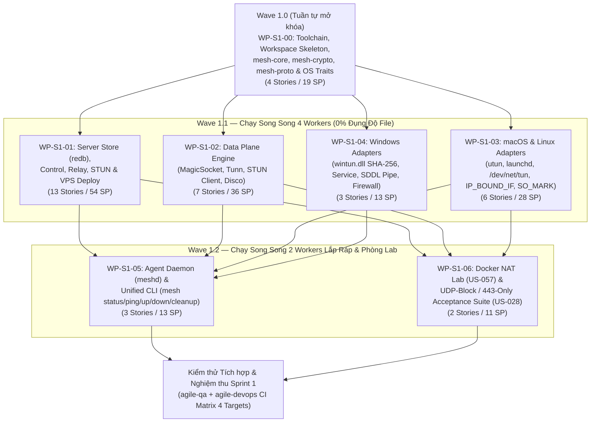
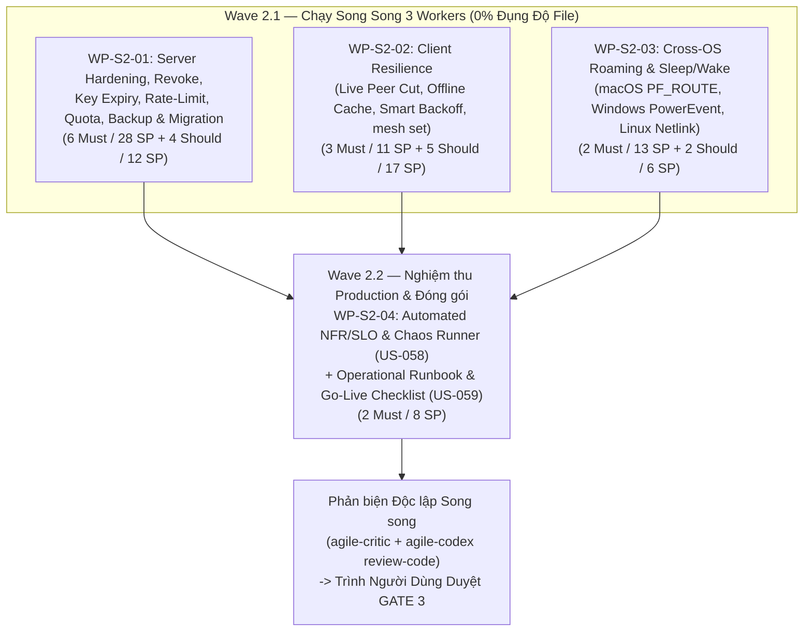

# Sprint Backlog & Parallel Work Package Plan — Mesh VPN (Rust 1.94.1)

| Thuộc tính | Giá trị |
|---|---|
| Tác giả | `agile-scrum-master` |
| Ngày | 2026-11-12 |
| Phiên bản | **1.1** — Kế hoạch phân rã Sprint 1 (Milestone 1) & Sprint 2 (Milestone 2) trình duyệt **Gate 2** *(đã đóng `HR-G2-04` & Codex `#14`)* |
| Đầu vào khóa cứng | [product-backlog.md](../02-product-planning/product-backlog.md) (v1.2 — 51 `Must` / 234 SP, 11 `Should` / 35 SP) · [tech-stack-decision.md](../03-system-design/tech-stack-decision.md) (v2.0 Rust `1.94.1`) · [system-architecture.md](../03-system-design/system-architecture.md) (v2.0) · [database-design.md](../03-system-design/database-design.md) (v2.0) · [api-design.md](../03-system-design/api-design.md) (v2.0) · [coding-standards.md](../03-system-design/coding-standards.md) (v2.0) |
| Quy tắc chạy song song | **0% File Overlap trong cùng một Wave** (`workspace: "share"` an toàn tuyệt đối) + Review từng gói bằng `agile-codex` (`review-wp`) trước khi chuyển `agile-qa` |

---

## 1. Tổng Quan Lộ Trình 2 Sprints (Khớp 2 Milestones Đã Duyệt Tại Gate 1)

| Đợt bàn giao | Mục tiêu Sprint (Sprint Goal) | Stories `Must` | SP `Must` | Buffer `Should` (nếu còn dung lượng) | Cổng nghiệm thu |
|---|---|---:|---:|---|---|
| **Sprint 1 (Milestone 1)** | **Walking Skeleton + Direct P2P dùng hằng ngày trên macOS 13+ (`arm64`/`x86_64`), Windows 10/11 x64 ↔ Ubuntu Linux VPS (kiêm Node `vps.mesh.internal`)**: kết nối trực tiếp bằng **IP VPS + SPKI Pin (`sha256:…`)**, cổng TCP/UDP cấu hình tùy ý, kênh Admin IPC khóa chặt theo quyền OS (`SEC-14`), chuyển mạch tự động Relay ↔ Direct P2P trên 1 `MagicSocket` UDP, khối `.mesh.internal` an toàn và tự dọn sạch tài nguyên (`ResourceLedger`). | **38** | **174** | — *(Ưu tiên dứt điểm 100% nền tảng cốt lõi & 3 OS)* | Sprint 1 Review / Demo nội bộ (hoặc Gate 3 M1) |
| **Sprint 2 (Milestone 2)** | **Production Hardening, Vòng đời Khóa & Chịu lỗi Tự động 24/7**: thu hồi khẩn cấp cắt tức thì trong RAM kể cả khi đầy đĩa (`ENOSPC`), hết hạn khóa & đăng ký lại `--for <node>`, cache Netmap offline, tự phục hồi sau Roaming & Sleep/Wake trên MacBook + Laptop Windows (P95 ≤ 15 s), chống brute-force + hạn mức băng thông Relay 20 Mbps, sao lưu nóng nguyên tử `redb`, đổi cổng/IP không mất danh tính (`US-074`) và bộ kiểm thử Chaos NAT/SLO + Runbook. | **13** | **60** | **11 stories / 35 SP** (`US-006, 011, 018, 023, 032, 037, 041, 048, 049, 050, 054`) | **Gate 3 (Go-Live Production)** |
| **Tổng cộng MVP** | **Phủ 100% `SEC-01..15`, `REL-01..14`, `OPS-01..10`, `PERF-01..12`, `PLAT-01..06`** *(12 stories `US-061..072` thuộc `EP-12` Phase 2+ giữ nguyên ngoài phạm vi MVP)* | **51** | **234** | **11 / 35 SP** | — |

> [!IMPORTANT]
> **Ghi nhận đầy đủ các ràng buộc từ Gate 1, `agile-critic` & `agile-codex`:**
> 1. **Khóa kênh Admin IPC ngay từ Sprint 1 (`BLK-01` / `BLK-G2-03` / `SEC-14`)**: `US-012` (Unix Socket `/run/mesh/admin.sock` `0660 mesh:mesh-admin` + kiểm chứng `SO_PEERCRED` + supplementary group `getgrouplist`), `US-002` (`preauthkey`) và `US-013` (`audit_events` + `RevokedSet` RAM + file cố định `emergency-revocations.bin` chống mất trạng thái khi `ENOSPC`) được gom chung trong `WP-S1-01`. Trên Client (`meshd`), tách rõ socket quản trị (`meshd-admin.sock` / `\\.\pipe\mesh-agent-admin`) và socket chỉ-đọc (`meshd-ro.sock` `0666` / `\\.\pipe\mesh-agent-ro`) để user thường chạy được `mesh status` / `mesh ping` (`US-039 AC5`) mà không lộ quyền ghi.
> 2. **Gom phụ thuộc vòng triển khai VPS**: `US-046` (Hardening & kiểm tra xung đột cổng) và `US-051` (Trình cài đặt/nâng cấp trên VPS sạch hoặc VPS dùng chung) nằm cùng `WP-S1-01`.
> 3. **Gom phụ thuộc vòng chống Routing Loop & VPS-Node**: `US-016` và `US-056` được thiết kế đồng bộ trên `mesh-sys`/`mesh-net` (`WP-S1-03` Linux `SO_MARK` + policy routing `table 51820` + `ip rule` lưu trong `ResourceLedger`, macOS `IP_BOUND_IF`; `WP-S1-04` Windows `IP_UNICAST_IF`) và kiểm chứng tích hợp trong `WP-S1-05`/`WP-S1-06`.
> 4. **Điểm xác nhận `OQ-15` trình người dùng tại Gate 2**: Mặc định giữ đúng phân bổ Milestone 1 (`38 Must / 174 SP`) và Milestone 2 (`13 Must / 60 SP`). Nếu người dùng muốn có ngay tính năng **thu hồi laptop bị mất & smart reconnect backoff** trước khi dùng hằng ngày ở cuối Sprint 1, chỉ cần xác nhận kéo `US-029`, `US-030`, `US-034` (`11 SP`) từ Sprint 2 sang Sprint 1 (`41 Must / 185 SP` vs `10 Must / 49 SP`, tổng `234 SP` không đổi).

---

## 2. Quy Tắc Chống Đụng Độ File Khi Chạy Song Song Nhiều `agile-developer` (`workspace: "share"`)

Để chạy nhiều worker `agile-developer` song song trên cùng workspace mà **0% xảy ra xung đột ghi đè file (`Cargo.toml`, `lib.rs`, `mod.rs`)**:

1. **Nguyên tắc "Khóa Khung Trước — Lấp Ruột Song Song Sau"**:
   - Ở đầu Sprint 1, gói nền tảng **`WP-S1-00` chạy tuần tự đầu tiên** để khởi tạo `Cargo.toml` gốc, `Cargo.lock`, toàn bộ 10 `Cargo.toml` con, hoàn thiện `mesh-core`, `mesh-crypto`, `mesh-proto`, **và tạo sẵn toàn bộ Trait + Fake + khai báo `#[cfg(target_os = "...")] mod ...;` trong `mesh-sys/src/lib.rs` và `mesh-net/src/lib.rs`** (kèm các file stub rỗng `*_linux.rs`, `*_macos.rs`, `*_windows.rs` biên dịch xanh với `scripts/check.ps1`).
   - Nhờ vậy, ở **Wave 1.1**, khi 4 worker `WP-S1-01`, `WP-S1-02`, `WP-S1-03`, `WP-S1-04` chạy **đồng thời**, `WP-S1-03` chỉ sửa các file `*_linux.rs` / `*_macos.rs` còn `WP-S1-04` chỉ sửa các file `*_windows.rs` — **không một worker nào cần sửa lại `Cargo.toml` gốc hay `lib.rs` dùng chung**!
2. **Quy tắc Cấm Vượt Ranh Giới**:
   - Mỗi Work Package chỉ được phép tạo/sửa file nằm trong cột **Phạm vi File Sở hữu Độc quyền** của gói đó. Nếu phát hiện cần sửa signature của Trait/DTO ở `mesh-core`/`mesh-proto`/`mesh-net`, Developer **bắt buộc dừng lại báo Scrum Master** thay vì tự ý sửa file của gói khác.
3. **Cổng Kiểm Định Từng Gói Việc (`Author → Check Script → agile-codex review-wp → QA`)**:
   - Mọi Work Package chỉ được đánh dấu hoàn tất khi: (a) chạy xanh 100% `scripts/check.ps1` (hoặc `scripts/check.sh`), (b) vượt qua vòng review độc lập của `agile-codex` (`--mode review-wp`), và (c) Scrum Master tự mở file kiểm chứng + commit Conventional Commit.

---

## 3. Kế Hoạch Chi Tiết Sprint 1 (Milestone 1 — 38 `Must` Stories / 174 SP)

### 3.1. Sơ Đồ Luồng Thực Thi Theo Wave (Sprint 1 Execution DAG)

---

### 3.2. Đặc Tả Từng Work Package Của Sprint 1

#### `WP-S1-00` — Workspace Foundation, Core Domain, Isolated Crypto, Wire Codecs & OS Trait Skeletons (Wave 1.0)
- **Vai trò thực thi**: `agile-developer` (1 worker chạy đầu tiên) + `agile-devops` hỗ trợ kiểm tra toolchain.
- **Stories `Must` sở hữu chính (4 stories / 19 SP)**:
  - `US-001` (3 SP): Sinh khóa X25519 (`node_key`, `disco_key`) tại client, bọc `Secret<T>` (`ZeroizeOnDrop`), lưu bền `0600` (`keystore.rs`), không tự ghi đè khi file khóa hỏng.
  - `US-003` (5 SP): TLS 1.3 `SpkiPinVerifier` (`ConstantTimeEq`, hỗ trợ `PinSet` `active`+`next`, fail-closed khi thiếu pin, cấm TOFU, 0 cờ bypass) + `SalsaBox` challenge–response (`tls_exporter_binding`).
  - `US-043` (3 SP): Structured JSON logging (`tracing` + `tracing-subscriber` + `tracing-appender` xoay vòng ≤ 100 MB) + bộ kiểm thử Canary `test_no_secrets_in_outputs` ở mức `DEBUG`.
  - `US-047` *(phần nền tảng mật mã & chứng chỉ)* (8 SP): `certgen.rs` (`rcgen` sinh khóa định danh ECDSA P-256 bền vững, tính `sha256:<64_hex>` SPKI DER, tái phát hành chứng chỉ giữ nguyên SPKI không cần pin lại; phần ACME runtime gắn vào `mesh-server` ở `WP-S1-01`).
- **Phạm vi File Sở hữu Độc quyền**:
  - Gốc workspace: `Cargo.toml`, `Cargo.lock` (chạy `scripts/bootstrap-toolchain.ps1` cài prebuilt `llvm-mingw`/`winlibs` + `zig` + `cargo-deny` + `cargo-zigbuild` + `rcodesign` nếu máy chưa có).
  - Toàn bộ `crates/mesh-core/**`, `crates/mesh-crypto/**` (`SpkiPinVerifier` dùng `x509-cert` + `rustls` `ring`), `crates/mesh-proto/**` (bao gồm `proptest!` cho STUN demux đúng offset, Disco chống phản xạ hai chiều `sender`+`recipient`, Relay frames `0x01`/`0x02`, `NodeName`, `SpkiPin`).
  - Khung Trait + In-Memory Fake + khai báo module theo OS trong `crates/mesh-sys/{Cargo.toml,src/lib.rs,src/error.rs}` (`mesh-sys/Cargo.toml` cấu hình `[lints]` riêng không kế thừa `unsafe_code = "forbid"` để tránh `E0453`) và `crates/mesh-net/{Cargo.toml,src/lib.rs,src/sysexec.rs,src/ledger.rs,src/keystore.rs,src/endpoint_filter.rs,src/tun.rs,src/route.rs,src/hosts.rs,src/netmon.rs,src/ipc.rs}` cùng các file stub biên dịch được cho 10 crates. **Đặc biệt (`HR-G2-04`)**: hoàn thiện đầy đủ 100% bộ parser/validator OS-neutral cho khối `# BEGIN mesh … # END mesh` (chặn tên cấm RFC 1123 & IP/hostname VPS `US-038 AC4, AC5` kèm `proptest!`) ngay trong `crates/mesh-net/src/hosts.rs` tại `WP-S1-00` để `WP-S1-03` và `WP-S1-04` dùng trực tiếp ở Wave 1.1 mà không cần chạm lại `hosts.rs`.
- **Tiêu chí Hoàn thành (DoD)**: `powershell -ExecutionPolicy Bypass -File scripts/check.ps1` xanh 100% (`fmt`, `clippy -D warnings`, `cargo test`, `cargo deny`).

---

#### `WP-S1-01` — Server ACID Store (`redb`), Control Plane, Blind Relay, STUN Server & VPS Deployment (Wave 1.1 — Song song #1)
- **Vai trò thực thi**: `agile-developer` (Worker A).
- **Stories `Must` sở hữu chính (13 stories / 54 SP)**:
  - `US-007` (5 SP): `crates/mesh-store` trên `redb` `2.4` (9 bảng `TableDefinition`, giao dịch ACID nguyên tử, `check_integrity()` lúc boot, versioned migration).
  - `US-008` (2 SP): Dải CIDR overlay cấu hình được (mặc định `100.115.0.0/16`), từ chối đổi dải âm thầm khi đã có node, cảnh báo CGNAT.
  - `US-012` (3 SP): Kênh Admin IPC cục bộ `/run/mesh/admin.sock` (`0660 mesh:mesh-admin`, xác minh `SO_PEERCRED` `uid` + supplementary groups qua `getgrouplist`, `SEC-14`), các route `nodes` (`list`, `get`, `rename`, `expire`), `server/status` (hiển thị cổng TCP/UDP + `active_pin`).
  - `US-013` (3 SP): Bảng `audit_events` append-only tuyệt đối + `EmergencyRevocationState` (`RevokedSet` trong RAM ưu tiên cắt tức thì + ghi đè tại chỗ vào file cấp phát sẵn `emergency-revocations.bin` `64 KiB` khi đĩa đầy `ENOSPC` + hợp nhất lại lúc boot + xuất `CRITICAL` ra `stderr`/`journald`).
  - `US-002` (3 SP): Tạo/liệt kê/thu hồi Pre-Auth Key (`mpk_...` 256-bit `OsRng`, TTL ≤ 90 ngày, chỉ lưu `sha256` constant-time, hỗ trợ `--for <node>`, trả sẵn chuỗi lệnh `mesh up --server IP:port --server-pin sha256:... --authkey-file ...`).
  - `US-004` (5 SP) & `US-005` (3 SP): `POST /v1/auth/challenge` & `POST /v1/nodes/register` idempotent trong 1 `WriteTransaction` (`UNIQUE` trên `node_pubkey`, `overlay_ip`, `name_normalized`; chặn tên cấm hệ thống & hostname server; lỗi xác thực luôn trả đồng nhất `401 "authentication failed"`).
  - `US-009` (5 SP): `GET /v1/netmap/stream` WebSocket đẩy `NetmapSnapshot` (kèm `disco_pubkey`, `relay_map`, `pin_set`), heartbeat 25 s, **không tăng `netmap_version` mỗi nhịp `last_seen`** (`HR-03`).
  - `US-024` (8 SP) & `US-025` (5 SP): Blind Relay `GET /v1/relay` chung cổng TCP cấu hình được (Standalone TLS + `instant-acme` `TLS-ALPN-01`/`DNS-01` của `US-047`, hoặc sau Reverse Proxy), đóng phiên cũ cùng node, tự gắn `src_pubkey` đã chứng thực, hàng đợi `mpsc::channel(256)` + **`try_send()`** drop-tail không chặn (`US-025 AC6`). *(Bao gồm cả `stun_service.rs` UDP RFC 5389 giới hạn 100 pkt/s/IP trên cổng cấu hình cho `US-019`).*
  - `US-044` (2 SP): Listener Quan sát chỉ-đọc riêng biệt (`127.0.0.1:9091` → `/healthz`, `/readyz` kiểm DB + listener TCP/UDP đúng cổng cấu hình).
  - `US-046` (5 SP) & `US-051` (5 SP): Hardening tiến trình `mesh-server` (user `mesh` không đặc quyền, `CAP_NET_BIND_SERVICE` chỉ khi cổng < 1024, kiểm tra xung đột cổng trước khi bind, lệnh `hardening-check`, firewall opt-in có dry-run + auto-rollback giữ SSH, script `install-server.sh` idempotent + mẫu Nginx/Caddy).
- **Phạm vi File Sở hữu Độc quyền (0 đụng độ với WP-02/03/04)**:
  - `crates/mesh-store/**`
  - `crates/mesh-server/**`
  - `deploy/systemd/mesh-server.service`, `deploy/reverse-proxy/**`, `scripts/install-server.sh`

---

#### `WP-S1-02` — Data Plane Engine: `MagicSocket`, Sans-I/O WireGuard (`defguard_boringtun`), STUN Client & Authenticated Disco (Wave 1.1 — Song song #2)
- **Vai trò thực thi**: `agile-developer` (Worker B).
- **Stories `Must` sở hữu chính (7 stories / 36 SP)**:
  - `US-010` (5 SP): `PeerMap::apply_diff()` cập nhật peer theo diff, giữ nguyên phiên WireGuard của các peer không đổi (0% mất gói).
  - `US-017` (3 SP): MTU mặc định `1280` (cấu hình `576..=1420`), kiểm tra ngân sách frame Relay ≤ 2048 B, tắt ép cứng `DF=1` trên socket UDP ngoài.
  - `US-019` (5 SP): STUN client trên chính `MagicSocket` UDP, lưu bền `local_udp_port` ưu tiên bind lại khi restart, phân loại NAT 1-IP (`APDM` vs `EIM/ADM`), đổi cổng STUN động theo `relay_map`.
  - `US-020` (5 SP): Thu thập `endpoints[]` (`lan` > `ipv6` > `reflexive`) trong ≤ 2 s sau STUN và lọc bỏ mọi địa chỉ ảo/overlay/loopback/link-local.
  - `US-021` (8 SP): Đục lỗ NAT đồng thời (Authenticated Disco `b"MESHDS"` + `SalsaBox` + `tx_id: [u8; 12]` TTL 10 s trong `pending_pings`), chống phát lại & chống Endpoint Poisoning, kiểm thử `proptest` ≥ $10^5$ gói ngẫu nhiên/đột biến trên demuxer 0-panic.
  - `US-022` (5 SP): Phát hiện đường Direct chết (mất 3 Pong liên tiếp / `REKEY_TIMEOUT`), hạ cấp về Relay (P95 ≤ 10 s, mục tiêu ≤ 5 s), nâng cấp lại mượt, keepalive on-demand 25 s (tự nghỉ sau cửa sổ rảnh 3–5 phút để giữ băng thông nền ≤ 1 KB/s).
  - `US-026` (5 SP): Khởi đầu qua Blind Relay tức thì (≤ 1 s) cho gói đầu tiên trong khi chờ Disco nâng cấp Direct; kiểm chứng chặt `AllowedIPs = /32` (`cryptokey.rs`).
- **Phạm vi File Sở hữu Độc quyền (0 đụng độ với WP-01/03/04)**:
  - `crates/mesh-datapath/**` *(kiểm thử 100% trong bộ nhớ bằng `FakeTunDevice` và socket loopback không cần quyền Admin/root)*.

---

#### `WP-S1-03` — macOS & Linux OS Integration (`utun`, `launchd`, `/dev/net/tun`, `IP_BOUND_IF`, `SO_MARK`, `hosts` & VPS-Node) (Wave 1.1 — Song song #3)
- **Vai trò thực thi**: `agile-developer` (Worker C).
- **Stories `Must` sở hữu chính (6 stories / 28 SP)**:
  - `US-014` (5 SP): Adapter Linux `/dev/net/tun` (`IFF_TUN | IFF_NO_PI` + `AsyncFd`), cài route chỉ cho dải overlay, `/32` `AllowedIPs`, chạy với `--cap-add=NET_ADMIN --device /dev/net/tun` (không `--privileged`, không ghi đè `/etc/resolv.conf`, không flush firewall).
  - `US-060` (5 SP): Adapter macOS 13+ (`arm64` & `x86_64`) qua `AF_SYSTEM` `com.apple.net.utun_control`, đọc tên động `utun[0-9]+`, **ghi vào `ResourceLedger` trước khi cài route**, bảo toàn 100% `utun` của iCloud Private Relay / VPN khác.
  - `US-073` (5 SP): Daemon `launchd` (`/Library/LaunchDaemons/internal.mesh.meshd.plist`), tự kiểm tra đường dẫn binary/plist thuộc `root` (`mode & 0o022 == 0`), tách 2 kênh IPC `/var/run/mesh/meshd-admin.sock` (`0660 root:admin`, xác minh `LOCAL_PEERCRED` `xucred.cr_groups` chứa `gid == 80` hoặc `uid == 0`) và `/var/run/mesh/meshd-ro.sock` (`0666` chỉ-đọc cho `mesh status`/`ping`), script `install-macos.sh` kiểm SHA-256 + ký ad-hoc (cấm `spctl --master-disable`), phát hiện `socketfilterfw` opt-in & anchor `pf` riêng `com.internal.mesh`.
  - `US-016` *(phần macOS/Linux & kiểm tra chéo)* (5 SP): Ràng socket ngoại biên vào card vật lý mặc định (`IP_BOUND_IF`/`IPV6_BOUND_IF` trên macOS; `SO_MARK = 0x5d56` + policy routing `table 51820` + `ip rule` lưu vào `ResourceLedger` trên Linux), không để lại host route hay `ip rule` mồ côi khi `kill -9`.
  - `US-038` *(phần tích hợp OS macOS/Linux — dùng bộ parser chung `hosts.rs` từ `WP-S1-00`)* (5 SP): Ghi nguyên tử khối `# BEGIN mesh … # END mesh` giữ nguyên symlink `/etc/hosts -> /private/etc/hosts` (`root:wheel 0644`) + xả cache `dscacheutil`/`mDNSResponder` trên macOS; fallback ghi tại chỗ khi `/etc/hosts` là bind-mount trong container Linux.
  - `US-056` (3 SP): Cấu hình `deploy/systemd/meshd.service` chạy tách biệt khỏi `mesh-server` để VPS tham gia làm 1 node (`vps.mesh.internal`) với 0 vòng lặp mạng/DNS.
- **Phạm vi File Sở hữu Độc quyền (Chỉ chạm file `*_linux.rs`, `*_macos.rs`, `*_unix.rs` và deploy Unix — 0 đụng độ với WP-04 Windows)**:
  - `crates/mesh-sys/src/{socket_linux.rs,socket_macos.rs,tun_linux.rs,tun_macos.rs,ipc_linux.rs,ipc_macos.rs,netmon_linux.rs,netmon_macos.rs,fs_unix.rs}`
  - `crates/mesh-net/src/{tun_linux.rs,tun_macos.rs,route_linux.rs,route_macos.rs,hosts_linux.rs,hosts_macos.rs,netmon_linux.rs,netmon_macos.rs,ipc_linux.rs,ipc_macos.rs,firewall_linux.rs,firewall_macos.rs}`
  - `deploy/launchd/internal.mesh.meshd.plist`, `deploy/systemd/meshd.service`, `scripts/install-macos.sh`

---

#### `WP-S1-04` — Windows OS Integration (`wintun.dll` SHA-256, Windows Service, Named Pipe SDDL, `IP_UNICAST_IF` & Firewall) (Wave 1.1 — Song song #4)
- **Vai trò thực thi**: `agile-developer` (Worker D).
- **Stories `Must` sở hữu chính (3 stories / 13 SP)**:
  - `US-015` (5 SP): Kiểm chứng hằng số SHA-256 của `wintun.dll` **trước khi** gọi `LoadLibraryExW(..., LOAD_LIBRARY_SEARCH_APPLICATION_DIR)` (`ADR-011`), tạo/tái sử dụng adapter tên & GUID cố định (0 adapter ma `#2`), cài route chỉ cho dải overlay (`US-016` Windows `IP_UNICAST_IF` big-endian).
  - `US-052` (5 SP): Tích hợp Windows Service (`MeshVpnAgent`, auto-recovery ≤ 10 s), tách 2 Named Pipe `\\.\pipe\mesh-agent-admin` (SDDL `D:P(A;;GA;;;SY)(A;;GA;;;BA)` + `FILE_FLAG_FIRST_PIPE_INSTANCE`) và `\\.\pipe\mesh-agent-ro`, script `install-windows.ps1` cài/gỡ sạch (giữ khóa trừ khi `--purge`).
  - `US-053` (3 SP): Cấu hình Windows Firewall cho phép inbound trên dải CIDR overlay & tự phục hồi nếu Windows gán nhầm profile Public sau crash, kèm `hosts_windows.rs` giữ ACL đọc cho `Users`/`Dnscache` + retry backoff ≤ 2 s + xả cache DNS (`US-038 AC2/AC8`).
- **Phạm vi File Sở hữu Độc quyền (Chỉ chạm file `*_windows.rs` và `install-windows.ps1`)**:
  - `crates/mesh-sys/src/{socket_windows.rs,tun_windows.rs,ipc_windows.rs,netmon_windows.rs}`
  - `crates/mesh-net/src/{tun_windows.rs,route_windows.rs,hosts_windows.rs,netmon_windows.rs,ipc_windows.rs,firewall_windows.rs}`
  - `scripts/install-windows.ps1`

---

#### `WP-S1-05` — Agent Daemon (`meshd`), Unified CLI (`mesh`) & Graceful Shutdown ≤ 5 s (Wave 1.2 — Song song #1)
- **Vai trò thực thi**: `agile-developer` (Worker A/B sau khi Wave 1.1 xong).
- **Stories `Must` sở hữu chính (3 stories / 13 SP)**:
  - `US-055` (5 SP): `ServiceSupervisor` (`CancellationToken` + `TaskTracker`) đảm bảo dừng sạch **≤ 5 s** (gửi WS Close, gỡ route, xóa khối `hosts`, gỡ anchor `pf`/firewall rule, đóng đúng `utunN`/Wintun theo `ResourceLedger`), tự dọn tàn dư lúc boot sau `kill -9`, lệnh idempotent `mesh down` & `mesh cleanup`.
  - `US-039` (5 SP): `mesh status` & `mesh status --json` hoàn tất ≤ 1 s (hiển thị `IP:port` server, `tls_auth_mode`, `active_pin`, tên `utunN`/adapter, loại NAT, trạng thái từng peer `direct`/`relay`, RTT, handshake, `rx`/`tx` bytes; 0 secret).
  - `US-040` (3 SP): `mesh ping <peer> [-c N] [--direct]` hiển thị trực quan từng nhịp `via relay` → nâng cấp `via direct` kèm thống kê min/avg/max/loss.
  - Lắp ghép toàn bộ lệnh CLI của Sprint 1 và **tách sẵn cấu trúc module CLI + kênh Roaming để mở khóa song song cho Sprint 2 (`HR-G2-04` & Codex `#14`)**:
    1. Trong `crates/mesh/src/`: tách `admin_cmds.rs` (chứa toàn bộ `#[derive(Subcommand)]` và handler của `preauthkey`, `node`, `server` gọi Admin IPC) khỏi `client_cmds.rs` (chứa toàn bộ subcommand của agent client `up`, `down`, `cleanup`, `status`, `ping`, và nơi mở rộng `set`/`netcheck`/`rotate-key`/`bugreport` ở Sprint 2) để `WP-S2-01` và `WP-S2-02` không cần chạm `main.rs`/`cli.rs` ở Wave 2.1.
    2. Trong `crates/meshd/src/` & `crates/mesh-datapath/src/rebind.rs`: định nghĩa sẵn kênh `mpsc::Sender<NetworkChangeEvent>` nối từ `supervisor.rs` sang `control_loop.rs` và cổng điều khiển `RebindHandle` trên `MagicSocket`, giúp `WP-S2-02` và `WP-S2-03` chạy song song 0% đụng độ file ở Wave 2.1.
- **Phạm vi File Sở hữu Độc quyền**:
  - `crates/meshd/**`
  - `crates/mesh/**`

---

#### `WP-S1-06` — Docker Container NAT Lab & UDP-Blocked / 443-Only Acceptance Suite (Wave 1.2 — Song song #2)
- **Vai trò thực thi**: `agile-devops` (dựng hạ tầng Docker NAT Lab & GitHub Actions 4-target CI) + `agile-developer` / `agile-qa` (viết kịch bản test tự động).
- **Stories `Must` sở hữu chính (2 stories / 11 SP)**:
  - `US-057` (8 SP): Môi trường lab tự động 1 lệnh (`docker-compose.nat-lab.yml`, ≥ 5 node Linux `--cap-add=NET_ADMIN --device /dev/net/tun` không `--privileged` + 1 VPS mô phỏng Standalone `443`, cổng tùy chọn `8443`/`3479`, chế độ IP+Pin, Reverse Proxy, EIM NAT, APDM hard NAT, UDP-block, 443-only, MITM sai pin, MTU 1400 chặn ICMP, script `kill -9`/flap/clock-jump) + bộ script kiểm chứng cho máy Mac thật/runner macOS (`GNFR-12`).
  - `US-028` (3 SP): Bộ kiểm thử nghiệm thu tự động chứng minh 10/10 cặp node kết nối thành công qua Blind Relay khi chặn toàn bộ UDP hoặc chỉ mở TCP 443, và báo chẩn đoán trung thực khi mạng khóa cứng ngoài 80/443 mà server đặt ở `8443`.
- **Phạm vi File Sở hữu Độc quyền**:
  - `lab/**`, `.github/workflows/**`, `Dockerfile*`

---

## 4. Kế Hoạch Chi Tiết Sprint 2 (Milestone 2 — 13 `Must` Stories / 60 SP + `Should` Buffer 35 SP)

### 4.1. Sơ Đồ Luồng Thực Thi Theo Wave (Sprint 2 Execution DAG)

---

### 4.2. Đặc Tả Từng Work Package Của Sprint 2

| Mã WP | Vai trò | Stories `Must` (Bắt buộc 100%) | Stories `Should` (Kéo vào nếu còn dung lượng, cùng ranh giới file) | Phạm vi File Sở hữu Độc quyền (0% Overlap trong Wave 2.1) |
|---|---|---|---|---|
| **`WP-S2-01`** | `agile-developer` (Worker A) | **6 stories / 28 SP**: - `US-027` (5 SP): Relay TokenBucket 20 Mbps/node + trần tổng VPS - `US-029` (5 SP): `node revoke` tức thì (< 100 ms RAM) + cách ly IP 24h - `US-031` (5 SP): Key Expiry 180 ngày, `--never`, đăng ký lại với key `--for <node>` - `US-042` (5 SP): Rate-limit theo IP (10 lỗi/5m → khóa 15m ×2 trần 24h), trần 60/phút, `trusted_proxies` - `US-045` (5 SP): Hot Atomic `redb` Backup + `.sha256` + giữ 7 bản + `restore` kèm `server_identity` - `US-074` (3 SP): Đổi cổng TCP/UDP, IP, TLS mode & xoay khóa server qua `ListenerSet` song song + `relay_map` *(kèm toàn bộ subcommand CLI quản trị `mesh server backup/restore/migrate-endpoint/rotate-tls-key`, `mesh node revoke`, `mesh preauthkey` mở rộng trong `admin_cmds.rs`)* | **4 stories / 12 SP**: - `US-006` (3 SP): Reusable & ephemeral keys - `US-048` (3 SP): Prometheus `/metrics` - `US-049` (3 SP): Webhook/Telegram alerts - `US-050` (3 SP): Protocol versioning N-1 | `crates/mesh-store/**` `crates/mesh-server/**` `crates/mesh/src/admin_cmds.rs` |
| **`WP-S2-02`** | `agile-developer` (Worker B) | **3 stories / 11 SP**: - `US-030` (3 SP): Agent gỡ peer bị thu hồi khỏi `PeerMap` & cắt phiên SSH đang sống ≤ 2 s - `US-033` (5 SP): Cache `netmap-cache.json` (`0600` + SHA-256 + `local_udp_port`) & 0% mất gói P2P khi Control tắt 30 phút - `US-034` (3 SP): `ExponentialBackoff` + Full Jitter; trần 5 phút không khóa chết máy khi lỗi Captive Portal / Clock Skew / Pin Mismatch; chỉ dừng khi nhận `node_revoked`/`node_key_expired` hợp lệ; kèm CLI `mesh set --server --server-pin` (`US-074 AC5`) | **5 stories / 17 SP**: - `US-011` (3 SP): Agent Netmap sanity validator - `US-018` (3 SP): Inbound packet filter - `US-023` (3 SP): CLI `mesh netcheck` - `US-032` (5 SP): CLI `mesh rotate-key` - `US-041` (3 SP): CLI `mesh bugreport` (0 secret) | `crates/mesh-datapath/src/{lib.rs,engine.rs,peer_map.rs,disco.rs,stun_client.rs,packet_filter.rs}` `crates/meshd/src/{config.rs,control_loop.rs,ipc_service.rs,ping_probe.rs,netmap_cache.rs}` `crates/mesh/src/{client_cmds.rs,output.rs}` |
| **`WP-S2-03`** | `agile-developer` (Worker C) | **2 stories / 13 SP**: - `US-035` (8 SP): macOS (`PF_ROUTE` + dò nhảy đồng hồ > 30 s + debounce 1 s + ràng lại `IP_BOUND_IF`) & Linux (`netlink`) tự phục hồi P95 ≤ 15 s - `US-036` (5 SP): Windows (`NotifyIpInterfaceChange` + `PowerEvent` + dò nhảy đồng hồ > 30 s + chờ DHCP ≤ 60 s + ràng lại `IP_UNICAST_IF`) tự phục hồi P95 ≤ 15 s | **2 stories / 6 SP**: - `US-037` (3 SP): Cảnh báo xung đột CGNAT `100.64.0.0/10` - `US-054` (3 SP): Gói cài Linux desktop *(chỉ làm sau khi macOS + Windows đạt DoD)* | `crates/mesh-sys/src/netmon_{linux,macos,windows}.rs` `crates/mesh-net/src/{netmon.rs,netmon_linux.rs,netmon_macos.rs,netmon_windows.rs,endpoint_filter.rs}` `crates/mesh-datapath/src/rebind.rs` `crates/meshd/src/{main.rs,supervisor.rs,roaming_loop.rs,service_windows.rs}` `deploy/linux-desktop/**` `scripts/install-linux.sh` |
| **`WP-S2-04`** | `agile-qa` + `agile-devops` + `agile-developer` | **2 stories / 8 SP**: - `US-058` (5 SP): Lệnh chạy tự động toàn bộ bộ đo NFR/SLO (`PERF-01..12`, `SEC-01..15`, `REL-01..12`, `PLAT-01..06`) xuất báo cáo JSON + Markdown, exit `!= 0` nếu FAIL - `US-059` (3 SP): Runbook vận hành từng bước (≤ 30 phút/quy trình) & Go-Live Checklist có bằng chứng thực nghiệm | — | `lab/scenarios/**` `scripts/run-slo-suite.{ps1,sh}` `docs/05-quality-assurance/**` `docs/06-operations/**` |

---

## 5. Bảng Đối Soát Toán Học 100% Backlog (Không Bỏ Sót, Không Đếm Trùng)

| Nhóm | Danh sách Mã User Story Chính Xác | Số lượng Story | Tổng SP | Khớp `product-backlog.md` v1.2 |
|---|---|---:|---:|---|
| `WP-S1-00` | `US-001 (3), US-003 (5), US-043 (3), US-047 (8)` | 4 | 19 | ✅ |
| `WP-S1-01` | `US-002 (3), US-004 (5), US-005 (3), US-007 (5), US-008 (2), US-009 (5), US-012 (3), US-013 (3), US-024 (8), US-025 (5), US-044 (2), US-046 (5), US-051 (5)` | 13 | 54 | ✅ |
| `WP-S1-02` | `US-010 (5), US-017 (3), US-019 (5), US-020 (5), US-021 (8), US-022 (5), US-026 (5)` | 7 | 36 | ✅ |
| `WP-S1-03` | `US-014 (5), US-060 (5), US-073 (5), US-016 (5), US-038 (5), US-056 (3)` | 6 | 28 | ✅ |
| `WP-S1-04` | `US-015 (5), US-052 (5), US-053 (3)` | 3 | 13 | ✅ |
| `WP-S1-05` | `US-055 (5), US-039 (5), US-040 (3)` | 3 | 13 | ✅ |
| `WP-S1-06` | `US-057 (8), US-028 (3)` | 2 | 11 | ✅ |
| **Tổng Sprint 1 (`Must`)** | **Toàn bộ Milestone 1 (`S0 + S1 + S2 + S3 + S4`)** | **38** | **174** | **✅ Khớp 100% (`38 / 174 SP`)** |
| `WP-S2-01` | `US-027 (5), US-029 (5), US-031 (5), US-042 (5), US-045 (5), US-074 (3)` | 6 | 28 | ✅ |
| `WP-S2-02` | `US-030 (3), US-033 (5), US-034 (3)` | 3 | 11 | ✅ |
| `WP-S2-03` | `US-035 (8), US-036 (5)` | 2 | 13 | ✅ |
| `WP-S2-04` | `US-058 (5), US-059 (3)` | 2 | 8 | ✅ |
| **Tổng Sprint 2 (`Must`)** | **Toàn bộ Milestone 2 (`S5 + S6 + S7 + S8`)** | **13** | **60** | **✅ Khớp 100% (`13 / 60 SP`)** |
| **Tổng Cộng `Must` MVP** | **51 Stories bắt buộc** | **51** | **234** | **✅ Khớp 100% (`51 / 234 SP`)** |
| **Buffer `Should` (MVP+)** | `US-006 (3), US-011 (3), US-018 (3), US-023 (3), US-032 (5), US-037 (3), US-041 (3), US-048 (3), US-049 (3), US-050 (3), US-054 (3)` | **11** | **35** | **✅ Khớp 100% (`11 / 35 SP`)** |
| **Phase 2+ (`EP-12`)** | `US-061..072` *(Ngoài MVP — chỉ mở qua Gate mới)* | **12** | — | **✅ Khớp 100% (`74` tổng stories)** |
