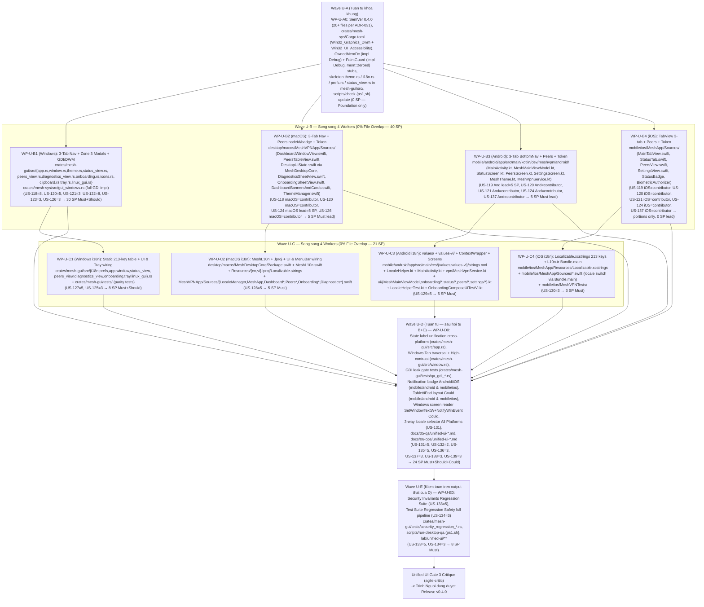

# Unified UI Sprint Backlog & Parallel Work Package Plan — Mesh VPN (`v0.4.0`: Windows · macOS · Android · iOS)

| Thuộc tính | Giá trị |
|---|---|
| Tác giả | `agile-scrum-master` (`sm-ui`) |
| Ngày lập | 2026-11-20 |
| Phiên bản | **1.2 — Revision (Gate 2 — Chặng 2, Round 3 Final Remediation)** |
| Nhánh làm việc | `feat/unified-ui` (tách từ `feat/desktop-gui`; giữ nguyên `main`, `v0.1.0-rc1`, `feat/mobile-clients @ v0.2.0`, `feat/desktop-gui @ v0.3.0`) |
| Đầu vào khóa cứng | [unified-ui-readiness-requirements.md](../01-discovery/unified-ui-readiness-requirements.md) v1.1 (`38` mã `UUI-*`, `213` Glossary keys) · [unified-ui-product-backlog.md](../02-product-planning/unified-ui-product-backlog.md) v1.1 (`4` Epics `EP-21..EP-24`, `22` Stories `US-118..US-139` = `93 SP`) · [unified-ui-tech-stack-decision.md](../03-system-design/unified-ui-tech-stack-decision.md) · [unified-ui-adr.md](../03-system-design/unified-ui-adr.md) (`ADR-027..031`) · [unified-ui-coding-standards.md](../03-system-design/unified-ui-coding-standards.md) · [unified-ui-system-architecture.md](../03-system-design/unified-ui-system-architecture.md) · [unified-ui-contracts-and-tokens.md](../03-system-design/unified-ui-contracts-and-tokens.md) · [desktop-gui-sprint-backlog.md](./desktop-gui-sprint-backlog.md) (tham chiếu cấu trúc) |
| Quy tắc chạy song song | **0% File Overlap trong cùng một Wave song song** (`workspace: "share"` an toàn tuyệt đối) + **DAG phi chu trình** + Quy trình Review bắt buộc (`Check Script → agile-qa → agile-critic`) |

### Lịch sử sửa đổi

| Phiên bản | Ngày | Nội dung |
|---|---|---|
| 1.0 | 2026-11-20 | Bản đầu: phân rã `22/22` Stories (`US-118..US-139` = `93 SP`) thành 10 Work Packages (`WP-U-A0`, `WP-U-B1..B4`, `WP-U-C1..C4`, `WP-U-D0`, `WP-U-E0`) trong 5 Waves (`U-A`, `U-B`, `U-C`, `U-D`, `U-E`); phủ `38/38` mã `UUI-*`. |
| 1.1 | 2026-11-20 | Round 2 Remediation: (1) Sửa toàn bộ đường dẫn thật repo Android/macOS/iOS; (2) Mở rộng `WP-U-A0` Owned Files phủ đủ 20+ file SemVer `0.4.0` per ADR-031 v1.1; (3) Sửa SP math `WP-U-B1 = 30 SP`, Grand Total = `93 SP`; (4) Cập nhật Win32 FFI contract (`WS_CLIPCHILDREN`, `mem::zeroed`, `impl Debug`, `detect_high_contrast` đúng `cbSize`/`uiParam`, `detect_windows_system_locale_is_vi`, bỏ `MulDiv`/`IAccessible`); (5) Sửa macOS/iOS i18n (`.lproj`, cấm `String(localized:)`+`Locale("vi")`); (6) Sửa Android i18n (`values/strings.xml` + `values-vi/strings.xml`, `ContextWrapper`, đúng path); (7) `display_label` additive (giữ `label(self)`), `PeerFilterMode` additive (giữ `filter_peers` 2-param); (8) `CODE_SIGNING_ALLOWED=NO` tất cả xcodebuild. |
| 1.2 | 2026-11-21 | Round 3 Surgical Fixes (`BLK-UUI-G2-R2-01`, `HR-UUI-G2-R2-01`, `MED-UUI-G2-R2-01`): (1) Đổi `-scheme MeshVPNApp` → `-scheme MeshApp` ở toàn bộ 5 gói iOS (giữ `MeshVPNApp` cho macOS); (2) Đổi `Bundle.module` → `Bundle.main` trên iOS `WP-U-C4` (`MeshApp` `.xcodeproj` target); (3) Mở `Owned Files` cho các tệp màn hình UI từng nền tảng trong Wave `U-C` (`WP-U-C1..C3`, vẫn bảo toàn `0% File Overlap` nội bộ Wave `U-C`, giữ `Forbidden` cho `OnboardingComposeUiTest.kt` và crate lõi) + thêm `./gradlew lintVitalRelease` vào DoD `WP-U-C3`; (4) Chuẩn hóa toán học SP tại bảng §1, §3 Grand Total và §6 (`16 Must = 75 SP`, `4 Should = 12 SP`, `2 Could = 6 SP`, Tổng = `93 SP`: `U-A=0, U-B=40, U-C=21, U-D=24, U-E=8`); (5) Đồng bộ `mesh-client` trong `[workspace.dependencies]` (`WP-U-A0`), `OwnedMemDc::from_compatible(hdc_ref: isize)` và `AgentPeerStatus`. |

---

## 1. Tổng Quan Lộ Trình Unified UI `v0.4.0` & Tuân Thủ Gate 1 / Gate 2

Milestone **`v0.4.0` (Unified Cross-Platform UI & Bilingual Experience)** gồm **`4` Epics (`EP-21..EP-24`) · `22` User Stories (`US-118..US-139`) = `93 SP`** (`16 Must = 75 SP` + `4 Should = 12 SP` + `2 Could = 6 SP`), phủ **`38/38` mã `UUI-*`** và **`5/5` quyết định `ADR-027..031`**, phân rã thành **5 Waves thực thi** với **10 Work Packages (`WP-U-*`)**:

| Wave / Làn thực thi | Mục tiêu Wave | Work Packages | Must (Story / SP) | Should / Could | Tổng SP | Cổng kiểm định |
|---|---|---|---:|---:|---:|---|
| **Wave U-A — Foundation: SemVer 0.4.0, GDI/DWM Stubs & Cross-Build Gate** | Nâng SemVer `0.4.0` toàn workspace (20+ files per ADR-031), bật 2 features `Win32_Graphics_Dwm` + `Win32_UI_Accessibility` trong `crates/mesh-sys/Cargo.toml`, thêm `OwnedMemDc`+`PaintGuard` stubs (`impl Debug`, `mem::zeroed`), skeleton `theme.rs/i18n.rs/prefs.rs/status_view.rs`, giữ `LegacyPre030` strings | `WP-U-A0` (tuần tự) | **0 / 0** | — | **0** | CI: `scripts/check.ps1`, `scripts/check.ps1 -Cross`, `cargo deny check`, grep version ≡ 0.4.0 |
| **Wave U-B — Platform Implementation (4 làn song song)** | Triển khai đầy đủ 4 nền tảng song song: B1=Windows Nav+GDI+FFI, B2=macOS Nav+Token, B3=Android Nav+Token, B4=iOS Nav+Token | `WP-U-B1` \|\| `WP-U-B2` \|\| `WP-U-B3` \|\| `WP-U-B4` | **7 / 37** | `1 Should (3 SP)` | **40** | CI per platform; **0% File Overlap** matrix verified |
| **Wave U-C — i18n & Bilingual (4 làn song song)** | Triển khai song ngữ 213 keys + nối i18n vào màn hình UI + 3-way locale selector trên 4 nền tảng song song: C1=Windows i18n, C2=macOS i18n (`.lproj`+`MeshL10n`), C3=Android i18n (cả `values/`+`values-vi/`), C4=iOS i18n (`Bundle.main`) | `WP-U-C1` \|\| `WP-U-C2` \|\| `WP-U-C3` \|\| `WP-U-C4` | **4 / 18** | `1 Should (3 SP)` | **21** | 213-key parity test; `SEC-05`/`OPS-01` invariant; `OnboardingComposeUiTest` locale=en |
| **Wave U-D — Cross-Platform Quality & Accessibility** | State label unification, 3-way locale selector integration, accessibility Windows, GDI leak gate, notification badge, tablet layout; tuần tự sau hội tụ Wave B+C | `WP-U-D0` (tuần tự) | **3 / 12** | `2 Should (6 SP)` + `2 Could (6 SP)` | **24** | GDI 0-leak test; `display_label` invariant test |
| **Wave U-E — Security Regression & Full CI Gate** | Kiểm toán bảo mật + regression suite toàn bộ 4 nền tảng; phụ thuộc 100% Wave B+C+D | `WP-U-E0` (tuần tự) | **2 / 8** | — | **8** | `scripts/run-desktop-qa.{ps1,sh}`, `xcodebuild test`, `./gradlew test`; Gate 3 Critique |
| **Tổng cộng Milestone `v0.4.0`** | **Phủ `100%` `EP-21..EP-24`, `22/22` Stories, `38/38` `UUI-*` & `ADR-027..031`** | **10 Work Packages** | **16 / 75** | **4 Should (`12 SP`) + 2 Could (`6 SP`)** | **93** | **Khớp 100% `unified-ui-product-backlog.md` v1.1** |

> [!IMPORTANT]
> **Ràng buộc Bất biến Gate 1 (`OQ-UUI-01..03`) & Gate 2 (`ADR-027..031`) Thực thi trong Chặng 3:**
> 1. **`unsafe_code = "forbid"` trong `crates/mesh-gui`** (`[lints] workspace = true`): `0` dòng `unsafe` trong `crates/mesh-gui/src/*.rs`. Mọi Win32 FFI qua `crates/mesh-sys/src/gui_windows.rs` với `// SAFETY:`. `OwnedGdiObj(HGDIOBJ)` tại dòng `332` hiện có — **không generic**, `DeleteObject` trong `Drop`. `OwnedMemDc(HDC)` → `DeleteDC` (với `impl Debug`). `PaintGuard` → `EndPaint` (với `impl Debug`, `mem::zeroed` PAINTSTRUCT). **Không** dùng `ShouldAppsUseDarkMode()` (API ẩn). **Không** `WS_EX_CLIPCHILDREN` — dùng `WS_CLIPCHILDREN` trong `dwStyle`.
> 2. **`MeshVPN.exe <= 6 MiB`** (ADR-020 bất biến): Build release MSVC + MinGW `gnu` phải dưới ngưỡng. Allowlist `.expose_secret()` cố định 4 crate (`mesh-crypto`, `mesh-datapath`, `mesh-net`, `mesh`) — không mở rộng sang `mesh-gui`.
> 3. **`linux_gui.rs` cross-compatibility** (ADR-028): Mọi thay đổi `app.rs`, `peers_view.rs`, `diagnostics_view.rs`, `onboarding.rs` phải compile xanh trên `x86_64-unknown-linux-musl` via `scripts/check.ps1 -Cross`. Signatures `filter_peers(peers, query)` (2-param preserved), `ui_state.label()`, `ui_state.headline()`, `ui_state.tray_tooltip_summary()` phải maintain. `display_label(self, sub_state)` là **additive** — không replace `label(self)`. `PeerFilterMode`/`filter_peers_by_mode`/`count_peers_by_mode` là **additive** — không replace `filter_peers(peers, query)`.
> 4. **SemVer `0.4.0` đồng bộ** (ADR-031): 20+ files (xem WP-U-A0 Owned Files) nâng đồng bộ tại Wave U-A TRƯỚC mọi Wave U-B. Giữ nguyên chuỗi `< 0.3.0`/`LegacyPre030` (wire protocol compat).
> 5. **i18n `213` keys** (ADR-029): Nguồn chân lý là Discovery v1.1 §4.1. `i18n::t(key)` + `i18n::t_for(key, locale)` pure functions (không `AtomicU8` race). `EN_STRINGS`/`VI_STRINGS` (không `EN_TABLE`/`VI_TABLE`). `OnboardingComposeUiTest.kt` chạy locale `en` mặc định; vi test → `OnboardingComposeUiTestVi.kt` file mới riêng biệt tại `mobile/android/app/src/androidTest/kotlin/dev/meshvpn/android/`.
> 6. **Clipboard boundary** (ADR-030): `FLAG_SECURE` + 30s wipe chỉ cho `mpk_*`, `mesh://join?...`, SPKI Pin. Copy IP/FQDN = simple copy + toast — `0` `FLAG_SECURE`, `0` wipe timer.
> 7. **`AgentStatusResponse` 13 trường** (`#[serde(deny_unknown_fields)]`): Không thêm/xóa/đổi field. `ThemeMode`/`LocaleMode` lưu hoàn toàn phía client user-space — `0` IPC contract change.
> 8. **Trung thực kiểm chứng**: CI $0 gắn `VERIFIED_AT_CI_$0`; thử nghiệm vật lý Windows/Mac/Phone thật giữ nhãn `hardware_signoff_required`.

---

## 2. Nguyên Tắc Chống Đụng Độ File (`0% File Overlap`) & Thứ Tự DAG Thực Thi

Mọi worker `agile-developer` chạy song song trong `workspace: "share"` phải tuân thủ **Exclusive File Ownership** tuyệt đối:

1. **Wave U-A (Tuần tự đầu tiên)** giữ độc quyền toàn bộ file workspace-level và SemVer (xem §4.1 Owned Files đầy đủ 20+ files), skeleton mới `crates/mesh-gui/src/{theme.rs,i18n.rs,prefs.rs,status_view.rs}`, và 2 RAII stubs mới trong `crates/mesh-sys/src/gui_windows.rs`.

2. **Wave U-B (4 làn song song — 0% File Overlap):**
   - `WP-U-B1` chỉ chạm `crates/mesh-gui/src/` (trừ `i18n.rs`, `prefs.rs`), `crates/mesh-gui/tests/gui_windows_*.rs` & `crates/mesh-sys/src/gui_windows.rs` (phần GDI implementation). **Không** chạm `desktop/macos/`, `mobile/android/`, `mobile/ios/`.
   - `WP-U-B2` chỉ chạm `desktop/macos/MeshVPNApp/Sources/`, `desktop/macos/MeshDesktopCore/Sources/MeshDesktopCore/Models/DesktopUiState.swift`, `desktop/macos/MeshDesktopCore/Tests/MeshDesktopCoreTests/`, `desktop/macos/MeshVPNAppTests/`. **Không** chạm `crates/`, `mobile/`.
   - `WP-U-B3` chỉ chạm `mobile/android/app/src/main/kotlin/`, `mobile/android/app/src/main/res/` (ngoại trừ `values/strings.xml` và `values-vi/` dành riêng cho `WP-U-C3`), và `mobile/android/app/src/test/`. **Không** chạm `crates/`, `desktop/macos/`, `mobile/ios/`.
   - `WP-U-B4` chỉ chạm `mobile/ios/MeshApp/Sources/` và `mobile/ios/MeshVPNTests/`. **Không** chạm `crates/`, `desktop/macos/`, `mobile/android/`.

3. **Wave U-C (4 làn song song — 0% File Overlap, chạy tuần tự SAU khi Wave U-B đã merge 100%):**
   - `WP-U-C1` sở hữu `crates/mesh-gui/src/{i18n.rs,prefs.rs,app.rs,window.rs,status_view.rs,peers_view.rs,diagnostics_view.rs,onboarding.rs,tray.rs,linux_gui.rs}` + `crates/mesh-gui/tests/{i18n_parity_*.rs,locale_*.rs}` để hoàn thiện bảng 213 khóa và nối `i18n::t()` vào toàn bộ màn hình Windows.
   - `WP-U-C2` sở hữu `desktop/macos/MeshDesktopCore/Package.swift`, `MeshDesktopCore/Sources/MeshDesktopCore/Resources/{en,vi}.lproj/Localizable.strings` (mới), `MeshDesktopCore/Sources/MeshDesktopCore/MeshL10n.swift` (mới), `MeshDesktopCore/Sources/MeshDesktopCore/Models/DesktopUiState.swift`, `desktop/macos/MeshVPNApp/Sources/{LocaleManager.swift,MeshApp.swift,DashboardWindowView.swift,PeersTableView.swift,DiagnosticsSheetView.swift,OnboardingSheetView.swift,DashboardBannersAndCards.swift}`, và `MeshDesktopCoreTests/` + `MeshVPNAppTests/` để nối `MeshL10n.tr` vào toàn bộ màn hình macOS & Menu Bar.
   - `WP-U-C3` sở hữu `mobile/android/app/src/main/res/values/strings.xml`, `mobile/android/app/src/main/res/values-vi/strings.xml` (mới), `mobile/android/app/src/main/kotlin/dev/meshvpn/android/{LocaleHelper.kt,MainActivity.kt,vpn/MeshVpnService.kt,ui/MeshMainViewModel.kt,ui/onboarding/OnboardingScreen.kt,ui/onboarding/QrScannerPane.kt,ui/status/StatusScreen.kt,ui/peers/PeersScreen.kt,ui/settings/SettingsScreen.kt}`, `mobile/android/app/src/test/kotlin/dev/meshvpn/android/LocaleHelperTest.kt` (mới), và `mobile/android/app/src/androidTest/kotlin/dev/meshvpn/android/OnboardingComposeUiTestVi.kt` (mới) (**tuyệt đối cấm sửa** `OnboardingComposeUiTest.kt` và `ffi/`).
   - `WP-U-C4` sở hữu `mobile/ios/MeshApp/Resources/` (`Localizable.xcstrings` / `.lproj`), `mobile/ios/MeshApp/Sources/*.swift` (tra cứu `L10n.tr` qua `Bundle.main`, selector ngôn ngữ), và `mobile/ios/MeshVPNTests/`.

4. **Wave U-D (Tuần tự — sau hội tụ B+C):** `WP-U-D0` chạm cross-platform quality files: `crates/mesh-gui/src/{app.rs,window.rs}` (state label verify + accessibility), `crates/mesh-gui/tests/qa_*.rs`, `desktop/macos/MeshDesktopCore/Sources/MeshDesktopCore/Models/DesktopUiState.swift`, `mobile/android/app/src/main/kotlin/` (notification badge, state label, tablet layout), `mobile/ios/MeshApp/Sources/` (StatusTab, PeersView tablet layout), `docs/05-quality-assurance/unified-ui-*.md`, `docs/06-operations/unified-ui-*.md`.

5. **Wave U-E (Tuần tự — sau hội tụ B+C+D):** `WP-U-E0` chạm regression suite: `crates/mesh-gui/tests/security_regression_*.rs`, `scripts/run-desktop-qa.{ps1,sh}`, `lab/unified-ui/**`.

6. **Quy tắc leo thang bắt buộc:** Nếu worker phát hiện cần sửa file ngoài `Exclusive File Ownership List`, **DỪNG NGAY và báo `@coordinator` / `agile-scrum-master`** — tuyệt đối không tự ý sửa chéo ranh giới.

### 2.1. Ma Trận `0% File Overlap` Kiểm Chứng Wave U-B

| File / Module | WP-U-B1 (Win) | WP-U-B2 (macOS) | WP-U-B3 (Android) | WP-U-B4 (iOS) |
|---|:---:|:---:|:---:|:---:|
| `crates/mesh-gui/src/*` (excl. `i18n.rs`, `prefs.rs`) + `tests/gui_windows_*.rs` | ✅ OWN | ❌ | ❌ | ❌ |
| `crates/mesh-sys/src/gui_windows.rs` | ✅ OWN | ❌ | ❌ | ❌ |
| `desktop/macos/{MeshVPNApp/Sources/*,MeshDesktopCore/.../DesktopUiState.swift,*Tests/*}` | ❌ | ✅ OWN | ❌ | ❌ |
| `mobile/android/app/src/{main/kotlin/*,test/*}` + `res/*` (excl. `strings.xml`, `values-vi`) | ❌ | ❌ | ✅ OWN | ❌ |
| `mobile/ios/{MeshApp/Sources/*,MeshVPNTests/*}` | ❌ | ❌ | ❌ | ✅ OWN |
| **Overlap** | **0%** | **0%** | **0%** | **0%** |

### 2.2. Ma Trận `0% File Overlap` Kiểm Chứng Wave U-C

| File / Module | WP-U-C1 (Win i18n) | WP-U-C2 (macOS i18n) | WP-U-C3 (Android i18n) | WP-U-C4 (iOS i18n) |
|---|:---:|:---:|:---:|:---:|
| `crates/mesh-gui/src/{i18n,prefs,app,window,status_view,peers_view,diagnostics_view,onboarding,tray,linux_gui}.rs` + `tests/{i18n_parity_*,locale_*}.rs` | ✅ OWN | ❌ | ❌ | ❌ |
| `desktop/macos/MeshDesktopCore/{Package.swift,Sources/.../MeshL10n.swift,Sources/.../Resources/*.lproj/*,Sources/.../Models/DesktopUiState.swift,Tests/*}` | ❌ | ✅ OWN | ❌ | ❌ |
| `desktop/macos/MeshVPNApp/Sources/{LocaleManager,MeshApp,DashboardWindowView,PeersTableView,DiagnosticsSheetView,OnboardingSheetView,DashboardBannersAndCards}.swift` + `MeshVPNAppTests/*` | ❌ | ✅ OWN | ❌ | ❌ |
| `mobile/android/app/src/main/res/{values/strings.xml,values-vi/strings.xml}` | ❌ | ❌ | ✅ OWN | ❌ |
| `mobile/android/app/src/main/kotlin/dev/meshvpn/android/{LocaleHelper.kt,MainActivity.kt,vpn/MeshVpnService.kt,ui/MeshMainViewModel.kt,ui/onboarding/*,ui/status/StatusScreen.kt,ui/peers/PeersScreen.kt,ui/settings/SettingsScreen.kt}` | ❌ | ❌ | ✅ OWN | ❌ |
| `mobile/android/app/src/test/kotlin/dev/meshvpn/android/LocaleHelperTest.kt` + `src/androidTest/kotlin/dev/meshvpn/android/OnboardingComposeUiTestVi.kt` | ❌ | ❌ | ✅ OWN | ❌ |
| `mobile/ios/MeshApp/{Resources/*,Sources/*.swift}` + `mobile/ios/MeshVPNTests/*` | ❌ | ❌ | ❌ | ✅ OWN |
| **Overlap** | **0%** | **0%** | **0%** | **0%** |

> [!NOTE]
> Wave `U-B` và Wave `U-C` chạy ở **2 pha tuần tự tách biệt** (`U-B` hoàn tất và merge `100%` rồi mới khởi chạy `U-C`). Bên trong Wave `U-C`, cả 4 gói `WP-U-C1` (`crates/mesh-gui`), `WP-U-C2` (`desktop/macos`), `WP-U-C3` (`mobile/android`), `WP-U-C4` (`mobile/ios`) nằm ở **4 cây thư mục nền tảng tách rời 100% (`0% File Overlap`)**, nên mỗi worker sở hữu trọn vẹn tầng tài nguyên ngôn ngữ lẫn các màn hình UI của nền tảng mình để nối hàm dịch trực tiếp mà không đụng độ bất kỳ worker song song nào. `OnboardingComposeUiTest.kt` và các crate lõi (`mesh-sys`, `mesh-proto`, `mesh-mobile-ffi`, `MeshCoreKit`) giữ nguyên trong `Forbidden Files`.

### 2.3. Sơ đồ DAG Thực thi 5 Waves



---

## 3. Story Points Kiểm Toán (`93 SP`)

| MoSCoW | Story Count | Total SP | Stories |
|---|:---:|:---:|---|
| **Must** | 16 | 75 | US-118(8) + US-119(5) + US-120(5) + US-121(3) + US-122(8) + US-123(3) + US-124(5) + US-127(5) + US-128(5) + US-129(5) + US-130(3) + US-131(5) + US-132(2) + US-133(5) + US-134(3) + US-135(5) = **75** ✓ |
| **Should** | 4 | 12 | US-125(3) + US-126(3) + US-136(3) + US-137(3) = **12** ✓ |
| **Could** | 2 | 6 | US-138(3) + US-139(3) = **6** ✓ |
| **Tổng cộng** | **22** | **93** | US-118..US-139 ✓ |

**Phân bổ theo Work Package (SP Lead chỉ tính 1 lần):**

| WP | SP Must (Lead) | SP Should (Lead) | SP Could (Lead) | Tổng SP WP |
|---|:---:|:---:|:---:|:---:|
| WP-U-A0 | 0 | 0 | 0 | **0** (Foundation) |
| WP-U-B1 | 8+5+3+8+3 = 27 Must | 3 | — | **30 SP** |
| WP-U-B2 | 5 | — | — | **5 SP** |
| WP-U-B3 | 5 | — | — | **5 SP** |
| WP-U-B4 | 0 (contributor only) | — | — | **0 SP** (lead none) |
| WP-U-C1 | 5 | 3 | — | **8 SP** |
| WP-U-C2 | 5 | — | — | **5 SP** |
| WP-U-C3 | 5 | — | — | **5 SP** |
| WP-U-C4 | 3 | — | — | **3 SP** |
| WP-U-D0 | 5+2+5 = 12 | 3+3 = 6 | 3+3 = 6 | **24 SP** |
| WP-U-E0 | 5+3 = 8 | — | — | **8 SP** |
| **Grand Total** | **75 SP (`16` Must)** | **12 SP (`4` Should)** | **6 SP (`2` Could)** | **93 SP (`22` Stories)** |

> [!IMPORTANT]
> **Kiểm toán SP cuối (không double-count):**
> - WP-U-B1 leads: US-118(8) + US-120(5) + US-121(3) + US-122(8) + US-123(3) + US-126(3) = **30 SP** ✓ (`8+5+3+8+3+3 = 30`)
> - WP-U-B2 leads: US-124(5) = **5 SP** ✓
> - WP-U-B3 leads: US-119(5) = **5 SP** ✓
> - WP-U-B4 leads: none (contributor to US-119,120,121,124,137) = **0 SP** (SP tính ở WP lead)
> - WP-U-C1 leads: US-127(5) + US-125(3) = **8 SP** ✓
> - WP-U-C2 leads: US-128(5) = **5 SP** ✓
> - WP-U-C3 leads: US-129(5) = **5 SP** ✓
> - WP-U-C4 leads: US-130(3) = **3 SP** ✓
> - WP-U-D0 leads: US-131(5) + US-132(2) + US-135(5) + US-136(3) + US-137(3) + US-138(3) + US-139(3) = **24 SP** ✓
> - WP-U-E0 leads: US-133(5) + US-134(3) = **8 SP** ✓
> - **Grand Total: 30+5+5+0+8+5+5+3+24+8 = 93 SP ✓**

### 3.1. Phân bổ Story → Work Package (Canonical)

| Story | SP | MoSCoW | WP Lead | WP Contributors |
|---|:---:|---|---|---|
| US-118 | 8 | Must | WP-U-B1 | WP-U-B2 (macOS) |
| US-119 | 5 | Must | WP-U-B3 | WP-U-B4 (iOS) |
| US-120 | 5 | Must | WP-U-B1 | WP-U-B2, WP-U-B3, WP-U-B4 |
| US-121 | 3 | Must | WP-U-B1 | WP-U-B3, WP-U-B4 |
| US-122 | 8 | Must | WP-U-B1 | — |
| US-123 | 3 | Must | WP-U-B1 | — |
| US-124 | 5 | Must | WP-U-B2 | WP-U-B3, WP-U-B4 |
| US-125 | 3 | Should | WP-U-C1 | — |
| US-126 | 3 | Should | WP-U-B1 | WP-U-B2 |
| US-127 | 5 | Must | WP-U-C1 | — |
| US-128 | 5 | Must | WP-U-C2 | — |
| US-129 | 5 | Must | WP-U-C3 | — |
| US-130 | 3 | Must | WP-U-C4 | — |
| US-131 | 5 | Must | WP-U-D0 | WP-U-C1, C2, C3, C4 (locale selector UI) |
| US-132 | 2 | Must | WP-U-D0 | — |
| US-133 | 5 | Must | WP-U-E0 | — |
| US-134 | 3 | Must | WP-U-E0 | — |
| US-135 | 5 | Must | WP-U-D0 | — |
| US-136 | 3 | Should | WP-U-D0 | — |
| US-137 | 3 | Should | WP-U-D0 | WP-U-B3, WP-U-B4 |
| US-138 | 3 | Could | WP-U-D0 | — |
| US-139 | 3 | Could | WP-U-D0 | — |
| **Tổng** | **93** | | | **22/22 Stories ✓** |

---

## 4. Đặc Tả Chi Tiết Context Packet Từng Work Package (`WP-U-*`)

---

### 4.1. Wave U-A — Foundation: SemVer `0.4.0`, GDI/DWM Stubs & Cross-Build Gate (Tuần tự)

#### `WP-U-A0` — Workspace `v0.4.0` SemVer Sync (20+ Files), `Win32_Graphics_Dwm` + `Win32_UI_Accessibility` Feature Enable, `OwnedMemDc`+`PaintGuard` Stubs (`impl Debug`, `mem::zeroed`), `mesh-gui/src` New Module Skeletons & `scripts/check.{ps1,sh}` Update

- **Goal**: Khóa khung foundation toàn workspace để Wave U-B có thể chạy song song an toàn:
  1. **SemVer `0.4.0` đồng bộ (`ADR-031`)** — phủ đầy đủ 20+ files:
     - `Cargo.toml`: `[workspace.package] version = "0.4.0"` + **8 entries** `[workspace.dependencies]` dòng 40-47 (`mesh-core`, `mesh-sys`, `mesh-crypto`, `mesh-proto`, `mesh-net`, `mesh-store`, `mesh-datapath`, `mesh-client`).
     - `Cargo.lock`: regenerate.
     - **6 member `Cargo.toml`**: `crates/{mesh-gui,mesh-client,mesh-datapath,mesh-mobile-ffi,mesh-net,mesh-proto}/Cargo.toml` → `version = "0.4.0"`.
     - `crates/mesh-gui/tests/qa_desktop_security_audit.rs:689` → `MARKETING_VERSION` assert từ `"0.3.0"` → `"0.4.0"`.
     - `desktop/macos/project.yml:18` → `MARKETING_VERSION: "0.4.0"`.
     - `desktop/macos/MeshDesktopCore/Sources/MeshDesktopCore/Models/DesktopUiState.swift:36` → `AgentDefaults.appBundleVersion = "0.4.0"`.
     - `mobile/android/app/build.gradle.kts:20-21` → `versionName = "0.4.0"` + `versionCode = 40000`.
     - `mobile/ios/project.yml:14` → `MARKETING_VERSION: "0.4.0"`.
     - `mobile/ios/MeshCoreKit/Sources/MeshConstants.swift:15` → `agentVersion = "0.4.0"`.
     - `scripts/package-linux-deb.sh:9` → version bump.
     - `.github/workflows/release.yml:398` → version bump.
     - `Dockerfile` (nếu có hardcode version label).
     - **Exception**: Giữ nguyên mọi chuỗi `< 0.3.0` / `LegacyPre030` tại `app.rs:208`, `window.rs:771`, `MeshApp.swift:299`, `DashboardBannersAndCards.swift:66` — đây là wire protocol compat checks, **không** nâng version.
  2. **Bật 2 features trong `crates/mesh-sys/Cargo.toml` (`ADR-027`)**: Thêm vào `[target.'cfg(windows)'.dependencies]` section `windows-sys`:
     - `"Win32_Graphics_Dwm"` — `DwmSetWindowAttribute` dark titlebar
     - `"Win32_UI_Accessibility"` — `SPI_GETHIGHCONTRAST`, `NotifyWinEvent` (US-139 Could)
     Giữ nguyên toàn bộ feature hiện có. **0 crate mới**, **0 thay đổi `deny.toml`**.
  3. **Thêm `OwnedMemDc` + `PaintGuard` stubs compile-green vào `crates/mesh-sys/src/gui_windows.rs`** (kế bên `OwnedGdiObj` tại dòng `332 [V]`) theo đúng contract trong `unified-ui-contracts-and-tokens.md §1.1`:
     - `OwnedMemDc(HDC)`: public API `isize` only. `impl fmt::Debug`. `from_compatible(hdc_ref: isize)` (tạo memory DC tương thích từ `hdc_ref`; còn ghép bitmap + DC dùng `create_double_buffer(hdc_ref: isize, width: i32, height: i32)`). `as_raw(&self) -> isize`. `Drop` → `DeleteDC`. **Không** export `HDC`.
     - `PaintGuard { hwnd: isize, ps: PAINTSTRUCT, hdc: isize }`: `begin(hwnd: isize) -> Option<Self>`, `hdc(&self) -> isize`, `rect(&self) -> ControlRect`. `impl fmt::Debug`. Init PAINTSTRUCT bằng `unsafe { mem::zeroed() }` (PAINTSTRUCT không `derive Default` trong `windows-sys 0.59`). **Không** export `HWND`/`HDC`/`RECT`.
     - Safe wrapper stubs: `apply_window_dark_titlebar(hwnd: isize, is_dark: bool)`, `read_windows_apps_use_light_theme() -> bool`, `detect_high_contrast() -> bool` (với `uiParam = size_of::<HIGHCONTRASTW>() as u32`, `hc.cbSize = size_of::<HIGHCONTRASTW>() as u32`, `(hc.dwFlags & HCF_HIGHCONTRASTON) != 0`), `detect_windows_system_locale_is_vi() -> bool` (đọc `HKCU\Control Panel\International\LocaleName` via `Win32_System_Registry`), `invalidate_window(hwnd: isize)`.
     - **Không** thêm `MulDiv` (không có feature `Win32_System_WindowsProgramming`). **Không** `IAccessible` (không có trong `windows-sys 0.59` COM). **Không** `WS_EX_CLIPCHILDREN` (không tồn tại trong `windows-sys 0.59`).
  4. **Tạo skeleton compile-green `crates/mesh-gui/src/` modules mới** (mỗi file chỉ chứa `pub(crate)` struct/fn stubs đủ để compile):
     - `theme.rs`: `ThemeMode`, `UiThemePalette` stub, `fn resolve_palette(...)`. **`UiThemePalette` live trong `theme.rs` (không phải `gui_windows.rs`)** — wraps `OwnedGdiObj` via safe constructors.
     - `i18n.rs`: `LocaleMode`, `fn t(key: &str) -> &'static str` (pure, no `AtomicU8`), `fn t_for(key: &str, locale: LocaleMode) -> &'static str` (pure). `const EN_STRINGS: [(&str, &str); 213]` và `const VI_STRINGS: [(&str, &str); 213]` (stubs trả empty).
     - `prefs.rs`: `UiPrefs { theme: ThemeMode, locale: LocaleMode }`, `fn load_prefs() -> UiPrefs`, `fn save_prefs(prefs: &UiPrefs)` stubs.
     - `status_view.rs`: `fn paint_status_zone(...)` stub.
     - Khai báo `#[cfg(any(target_os = "windows", target_os = "linux"))]` cho `mod i18n;` và `mod prefs;` trong `crates/mesh-gui/src/main.rs` (vì `app.rs`/`peers_view.rs` gọi `i18n::t()` trên cả hai targets). Đảm bảo `linux_gui.rs` vẫn compile xanh sau khi thêm mod declarations.
  5. **Cập nhật `scripts/check.ps1` & `scripts/check.sh`**: Bổ sung kiểm tra `version = "0.4.0"` đồng bộ 4 platform files; giữ nguyên toàn bộ kiểm tra hiện có.

- **User Stories & SP**: Foundation — không có story riêng (enabling work cho tất cả stories). **0 SP**.
- **Model đề xuất**: `agile-developer` đơn, `gemini-2.5-pro` hoặc tương đương.
- **Workspace mode**: `inherit` (không song song).
- **Dependency DAG**:
  - *Đầu vào*: Codebase `feat/unified-ui` hiện hành; `ADR-027` v1.1, `ADR-031` v1.1; `unified-ui-contracts-and-tokens.md §1.1` v1.1; `unified-ui-coding-standards.md §1.1, §1.2` v1.1.
  - *Mở khóa*: Toàn bộ Wave U-B (`WP-U-B1`, `WP-U-B2`, `WP-U-B3`, `WP-U-B4`) chạy song song ngay sau khi `WP-U-A0` đạt DoD.

- **Phạm vi File Sở hữu Độc quyền (`Exclusive File Ownership List`)**:
  - `Cargo.toml`, `Cargo.lock`
  - `crates/mesh-gui/Cargo.toml`, `crates/mesh-client/Cargo.toml`, `crates/mesh-datapath/Cargo.toml`, `crates/mesh-mobile-ffi/Cargo.toml`, `crates/mesh-net/Cargo.toml`, `crates/mesh-proto/Cargo.toml`
  - `crates/mesh-sys/Cargo.toml`
  - `crates/mesh-sys/src/gui_windows.rs` (thêm `OwnedMemDc`, `PaintGuard`, safe wrapper stubs)
  - `crates/mesh-gui/src/{main.rs,theme.rs,i18n.rs,prefs.rs,status_view.rs}` (skeleton mới)
  - `crates/mesh-gui/tests/qa_desktop_security_audit.rs` (dòng 689: `MARKETING_VERSION` assert)
  - `desktop/macos/project.yml`
  - `desktop/macos/MeshDesktopCore/Sources/MeshDesktopCore/Models/DesktopUiState.swift` (dòng 36: `appBundleVersion`)
  - `mobile/android/app/build.gradle.kts`
  - `mobile/ios/project.yml`
  - `mobile/ios/MeshCoreKit/Sources/MeshConstants.swift` (dòng 15: `agentVersion`)
  - `scripts/package-linux-deb.sh` (dòng 9)
  - `.github/workflows/release.yml` (dòng 398)
  - `scripts/check.ps1`, `scripts/check.sh`
  - `Dockerfile` (nếu cần sửa version label)

- **Forbidden Files**: Mọi file `.rs` trong `crates/mesh-gui/src/` **ngoài** danh sách trên; `desktop/macos/MeshVPNApp/**`; `mobile/android/app/src/main/kotlin/**`; `mobile/android/app/src/main/res/**`; `mobile/ios/MeshApp/**`.

- **Input / Output Contracts**:
  - *Input*: `ADR-027` v1.1 §Decision 1-4; `ADR-031` v1.1 §Decision (17-row table); `unified-ui-contracts-and-tokens.md §1.1` v1.1; `unified-ui-coding-standards.md` v1.1.
  - *Output*: `cargo build --workspace --all-features` xanh; `scripts/check.ps1 -Cross` xanh; `grep -r 'version = "0\.3\.0"' Cargo.toml` → 0 kết quả; `crates/mesh-sys/Cargo.toml` chứa `Win32_Graphics_Dwm` + `Win32_UI_Accessibility`; `OwnedMemDc`/`PaintGuard`/safe wrappers tồn tại với `impl Debug`, compile; `theme.rs`/`i18n.rs`/`prefs.rs`/`status_view.rs` tồn tại trong `crates/mesh-gui/src/`.

- **Lệnh kiểm chứng DoD (`$0` CI)**:
  ```powershell
  powershell -ExecutionPolicy Bypass -File scripts/check.ps1
  powershell -ExecutionPolicy Bypass -File scripts/check.ps1 -Cross
  cargo build --workspace --all-features
  cargo deny check advisories bans licenses sources
  ```
  ```powershell
  # Version sync verification:
  Select-String -Path "Cargo.toml" -Pattern 'version = \"0\.3\.0\"'
  Select-String -Path "desktop/macos/project.yml" -Pattern 'MARKETING_VERSION'
  Select-String -Path "mobile/android/app/build.gradle.kts" -Pattern 'versionName'
  Select-String -Path "mobile/ios/project.yml" -Pattern 'MARKETING_VERSION'
  Select-String -Path "mobile/ios/MeshCoreKit/Sources/MeshConstants.swift" -Pattern 'agentVersion'
  ```

- **Quy trình Review**: `scripts/check.{ps1,sh}` (gồm `-Cross`) → `agile-qa` → `agile-critic` trước khi mở Wave U-B.

---

### 4.2. Wave U-B — Platform Implementation (4 Làn Song Song, `0% File Overlap`)

#### `WP-U-B1` — Windows: 3-Tab Navigation + Zone 3 Modals + GDI/DWM Modern + Peers Zone + Copy IP/FQDN + Tray (Wave U-B.1 — Song song #1)

- **Goal**: Triển khai hoàn chỉnh Windows `MeshVPN.exe` với 3-Zone Navigation, GDI/DWM hiện đại, Peers Zone theo `ADR-027`, `ADR-028`, `ADR-030`:
  1. **3-Tab Navigation + Onboarding tách biệt + Zone 3 Modals (`ADR-028`)**: Triển khai `show_tab_bar()` hiển thị 3 tabs `Status/Peers/Diagnostics & Settings` khi `enrolled == true` và bất kể `DesktopUiState`. Ẩn `onboarding.rs` form khi enrolled. Di chuyển `Rotate Node Key` và `Update Control Server/SPKI Pin` vào Zone 3 modals. `window.rs` phải gọi đúng thứ tự tab display logic.
  2. **`DesktopUiState::display_label` + `PeerFilterMode` (Additive — `ADR-030`)**:
     - **Giữ nguyên** `pub(crate) const fn label(self) -> &'static str` tại `app.rs:42-52` — được gọi bởi `linux_gui.rs:597` và existing tests.
     - **Thêm mới (additive)** `pub(crate) const fn display_label(self, sub_state: TunnelSubState) -> &'static str`: trả `"Device Revoked"` cho `Revoked`, `"Attention Required"` cho `ErrorRecoverable`.
     - **Giữ nguyên** `filter_peers(peers, query)` 2-param signature — được gọi bởi `linux_gui.rs:574`.
     - **Thêm mới (additive)** `PeerFilterMode { All, Online, Direct, Relay }`, `filter_peers_by_mode(peers: &[AgentPeerStatus], mode: PeerFilterMode)` (`mesh_proto::AgentPeerStatus`), `count_peers_by_mode(peers: &[AgentPeerStatus]) -> PeerFilterCounts`.
  3. **GDI/DWM Hiện đại (`ADR-027`, `US-122`, `US-123`)**: Triển khai đầy đủ trong `crates/mesh-sys/src/gui_windows.rs`:
     - `OwnedMemDc`/`PaintGuard`/safe wrappers đầy đủ implementation (đã có stubs từ WP-U-A0).
     - `create_double_buffer`, `draw_rounded_card`, `draw_status_pill`, `create_font_for_dpi` (dùng `lfHeight = -(((pt * dpi) + 36) / 72)`, không `MulDiv`).
     - `detect_high_contrast()` đúng: `uiParam = size_of::<HIGHCONTRASTW>() as u32`, `hc.cbSize = size_of::<HIGHCONTRASTW>() as u32`, `(hc.dwFlags & HCF_HIGHCONTRASTON) != 0`.
     - `detect_windows_system_locale_is_vi()` via `Win32_System_Registry`.
     - `apply_window_dark_titlebar(hwnd: isize, is_dark: bool)`: `DWMWA_USE_IMMERSIVE_DARK_MODE as u32` (kiểu `i32` trong SDK → `as u32`), fallback `19_u32`.
     - `UiThemePalette` trong `crates/mesh-gui/src/theme.rs` (không phải `gui_windows.rs`), wraps `OwnedGdiObj` via safe constructors.
     - Window style: `WS_OVERLAPPEDWINDOW | WS_CLIPCHILDREN` trong `dwStyle` (**không** `dwExStyle`, **không** `WS_EX_CLIPCHILDREN` không tồn tại).
     - CTA/Tab buttons: `BS_OWNERDRAW` + `WM_DRAWITEM` (vì `BS_PUSHBUTTON` standard buttons bỏ qua `WM_CTLCOLORBTN` HBRUSH return).
     - `WindowEventHandler::on_theme_changed`, `on_ctlcolor`, `on_dpi_changed` (new callbacks).
     - `WM_DPICHANGED` → recalculate layout + regenerate icons + recalculate fonts.
     - `WS_TABSTOP` cho mọi interactive control.
  4. **`crates/mesh-gui/src/theme.rs`**: `UiThemePalette` đầy đủ per §1.2 contracts v1.1, `resolve_palette()`.
  5. **`crates/mesh-gui/src/status_view.rs`**: Header Hero Zone 1 (rounded cards, status pills semantic color per ADR-030 hex).
  6. **Peers Zone — Windows (`US-120`)**: `peers_view.rs` — search theo nodeId, count badge, 4-state filter chips (`All/Online/Direct/Relay`) qua `PeerFilterMode`. Đảm bảo `filter_peers(peers, query)` 2-param nguyên vẹn cho `linux_gui.rs:574`.
  7. **Copy IP/FQDN — Windows (`US-121`)**: Standard clipboard copy (không `ClipboardSecretGuard` timer, không `FLAG_SECURE`). Toast notification xác nhận.
  8. **Tray icon semantic color + bilingual labels skeleton (`US-126`)**: 10 state+sub-state → icon tone (hex exact từ ADR-030 §5). `count_non_separator_entries() == 9`. Labels dùng `i18n::t()` skeleton (đầy đủ tại Wave U-C1).
  9. **Windows screen reader stub (`US-139`, Could)**: `SetWindowTextW` label proxy + `NotifyWinEvent` (không `IAccessible` — không có trong `windows-sys 0.59`). Graceful skip nếu not Windows.
  10. **`i18n::t` / `i18n::t_for` gated**: `#[cfg(any(target_os = "windows", target_os = "linux"))]` cho `mod i18n` trong `main.rs` (đã set ở WP-U-A0, B1 chỉ dùng).

- **User Stories & SP** (`5 Must + 1 Should = 30 SP`):
  - `US-118` (`8 SP`, Must, EP-21): `UUI-01`, `UUI-03`, `UUI-33` — Windows 3-Tab Nav + Onboarding tách biệt + Zone 3 Maintenance CTAs.
  - `US-120` (`5 SP`, Must, EP-21): `UUI-04`, `UUI-05` — Peers Zone Search+Filter+NodeId+CountBadge Windows.
  - `US-121` (`3 SP`, Must, EP-21): `UUI-06`, `UUI-07` — Copy IP/FQDN Windows (simple copy + toast).
  - `US-122` (`8 SP`, Must, EP-22): `UUI-08`, `UUI-09`, `UUI-23`, `UUI-24`, `UUI-25`, `UUI-32` — Windows GDI/DWM Modern.
  - `US-123` (`3 SP`, Must, EP-22): `UUI-13`, `UUI-14`, `UUI-26`, `UUI-31`, `UUI-32` — DPI Per-Monitor V2 + OwnedGdiObj RAII Gate Test.
  - `US-126` (`3 SP`, **Should**, EP-22): `UUI-15`, `UUI-35` — Tray/Menu Bar Icon Semantic Color Windows.
  - **Tổng: 30 SP** (8+5+3+8+3+3 = **30**) ✓

- **Model đề xuất**: `agile-developer` đơn, `gemini-2.5-pro`.
- **Workspace mode**: `share`.
- **Dependency DAG**:
  - *Đầu vào*: `WP-U-A0` đã khóa version, features, stubs, và module skeletons.
  - *Chạy song song với*: `WP-U-B2`, `WP-U-B3`, `WP-U-B4` (**0% File Overlap**).
  - *Mở khóa*: `WP-U-C1` (Windows i18n).

- **Phạm vi File Sở hữu Độc quyền**:
  - `crates/mesh-gui/src/{app.rs,window.rs,theme.rs,status_view.rs,peers_view.rs,diagnostics_view.rs,onboarding.rs,icons.rs,clipboard.rs,tray.rs,linux_gui.rs}`
  - `crates/mesh-sys/src/gui_windows.rs` (phần GDI implementation — full)
  - `crates/mesh-gui/tests/gui_windows_*.rs` (mới)

- **Forbidden Files**: `crates/mesh-gui/src/{i18n.rs,prefs.rs}` (do Wave U-C1 sở hữu — để skeleton từ U-A0); `crates/mesh-sys/Cargo.toml` (đã xong ở A0); `desktop/macos/**`; `mobile/**`; `Cargo.toml` workspace.

- **Lệnh kiểm chứng DoD (`$0` CI)**:
  ```powershell
  powershell -ExecutionPolicy Bypass -File scripts/check.ps1
  powershell -ExecutionPolicy Bypass -File scripts/check.ps1 -Cross
  cargo test -p mesh-gui -p mesh-sys --all-features
  cargo build --release --target x86_64-pc-windows-msvc -p mesh-gui
  # Binary size check: MeshVPN.exe <= 6 MiB
  cargo build --release --target x86_64-pc-windows-gnu -p mesh-gui
  ```
  - **Unit tests bắt buộc PASS**: `test_gdi_obj_no_leak`, `test_owned_mem_dc_lifecycle`, `test_paint_guard_drop`, `test_tab_bar_visible_all_enrolled_states`, `test_display_label_revoked_device_revoked`, `test_display_label_error_attention_required`, `test_label_preserved_for_linux_compat`, `test_filter_peers_node_id`, `test_peer_filter_mode_all_online_direct_relay`, `test_clipboard_no_secret_guard_on_ip_copy`, `test_tray_state_color_mapping_10_states`, `test_detect_high_contrast_cbsize`, `test_ws_clipchildren_in_dwstyle`.
  - **Máy thật (`hardware_signoff_required`)**: DPI test 125%/150%/200%; Dark/Light toggle; High-contrast mode; Tab click visual; Tray icon visual.

---

#### `WP-U-B2` — macOS: 3-Tab Navigation Across All Enrolled States + Peers nodeId/Badge + Design Tokens + Tray Bilingual Skeleton (Wave U-B.2 — Song song #2)

- **Goal**: Nâng cấp `Mesh VPN.app` macOS với 3-Zone Navigation xuyên suốt mọi trạng thái enrolled, Peers Zone nodeId search + count badge, Design Token áp dụng:
  1. **3-Tab Navigation All States (`ADR-028`, `US-118`)**: Sửa `desktop/macos/MeshVPNApp/Sources/DashboardWindowView.swift` để hiển thị `Segmented Picker` 3 tabs (`Status`/`Peers`/`Diagnostics & Settings`) khi enrolled **bất kể** state (không chỉ `.connected` như hiện tại tại `DashboardWindowView.swift:203-222`). Chỉ `serviceNotInstalled`, `serviceStopped`, `unconfigured` hiển thị `DashboardCenteredCard` + nút hành động.
  2. **Peers Zone nodeId search + count badge (`US-120`)**: Mở rộng `PeersTableView.filteredPeers:38-41` để lọc theo `nodeId`. Thêm count badge hiển thị số peer cho mỗi filter chip (`PeersTableView.swift:73-79`).
  3. **Design Tokens macOS (`US-124`)**: `NSApp.appearance` toggle `System/Light/Dark` → `ThemeManager.swift` (mới). Áp dụng hex tokens §3.1 (ADR-030 v1.1) qua `Color(hex:)` extension. `reauthRequired` → Amber `#D97706` (sửa `DesktopUiState.swift:338` hiện mapping `.warning → .red`).
  4. **`ThemeManager.swift` (mới)**: `ThemeMode` persistence via `UserDefaults(suiteName: "MeshVPN")` key `"mesh_theme_mode"` (không phải `"themeMode"`). `NSApp.appearance = NSAppearance(named: .darkAqua)` / `.aqua` / `nil`.
  5. **Tray/MenuBar icon color bilingual skeleton (`US-126`)**: 10 states → SF Symbol + semantic color đúng per ADR-030 §5. Labels từ `.lproj` (skeleton — đầy đủ tại Wave U-C2). `DesktopStoreTests` icon mapping tests phải PASS.

- **User Stories & SP** (`1 Must lead + portions = 5 SP WP-B2 lead`):
  - `US-124` macOS lead (`5 SP`, Must, EP-22): `UUI-10`, `UUI-11`, `UUI-12`, `UUI-15`.
  - `US-118` macOS portion (`8 SP`, Must, EP-21): contributor — SP tính tại WP-U-B1 lead.
  - `US-120` macOS portion (`5 SP`, Must, EP-21): contributor.
  - `US-126` macOS portion (`3 SP`, Should, EP-22): contributor — SP tính tại WP-U-B1 lead.
  - **WP-U-B2 Lead SP: 5 SP** (US-124) ✓

- **Model đề xuất**: `agile-developer` đơn, `gemini-2.5-pro`.
- **Workspace mode**: `share`.
- **Dependency DAG**:
  - *Đầu vào*: `WP-U-A0` (SemVer `0.4.0` synced, `desktop/macos/project.yml` updated).
  - *Chạy song song với*: `WP-U-B1`, `WP-U-B3`, `WP-U-B4` (**0% File Overlap**).
  - *Mở khóa*: `WP-U-C2` (macOS i18n).

- **Phạm vi File Sở hữu Độc quyền**:
  - `desktop/macos/MeshVPNApp/Sources/{MeshApp.swift,DashboardWindowView.swift,PeersTableView.swift,DiagnosticsSheetView.swift,OnboardingSheetView.swift,DashboardBannersAndCards.swift}`
  - `desktop/macos/MeshVPNApp/Sources/ThemeManager.swift` (mới)
  - `desktop/macos/MeshDesktopCore/Sources/MeshDesktopCore/Models/DesktopUiState.swift` (sửa `reauthRequired` color — dòng 338)
  - `desktop/macos/MeshDesktopCore/Tests/MeshDesktopCoreTests/` (DesktopCoreTests)
  - `desktop/macos/MeshVPNAppTests/` (DesktopStoreTests)

- **Forbidden Files**: `desktop/macos/MeshDesktopCore/Package.swift` (WP-U-C2); `desktop/macos/MeshDesktopCore/Sources/MeshDesktopCore/Resources/` (WP-U-C2); `crates/**`; `mobile/**`; `Cargo.toml`; `scripts/**`.

- **Lệnh kiểm chứng DoD (`$0` CI)**:
  ```bash
  sh scripts/check.sh
  cd desktop/macos && xcodegen generate
  swiftlint lint --strict
  xcodebuild test -scheme MeshVPNApp CODE_SIGNING_ALLOWED=NO
  ```
  - **Tests bắt buộc PASS**: `DesktopStoreTests` (icon color mapping 10 states), `DesktopCoreTests` (tab visibility all enrolled states), `filteredPeers nodeId test`, `count badge test`, `ThemeMode UserDefaults key "mesh_theme_mode" test`.
  - **Máy thật (`hardware_signoff_required`)**: 3 tabs visible in `reauthRequired` state; Amber tint for ReauthRequired Tray icon; nodeId search visual.

---

#### `WP-U-B3` — Android: Bottom Nav 3-Tab + Peers Zone + SPKI Pin Lock + Design Tokens (Wave U-B.3 — Song song #3)

- **Goal**: Triển khai Android Bottom Navigation 3 tabs, Peers Zone đầy đủ, SPKI Pin lock, Design Tokens:
  1. **Bottom Nav 3-Tab (`ADR-028`, `US-119`)**: Mở rộng `MainTab` enum → 3 mục (`STATUS/PEERS/SETTINGS`). Triển khai `BottomNavigation` Compose component 3 tabs. `OnboardingScreen` tách biệt (flow riêng, không lẫn với Bottom Nav). `MeshMainViewModel.selectTab()` → khi switch `SETTINGS → PEERS` phải gọi `isAdminPinsRevealed = false`. `FLAG_SECURE` vẫn áp dụng Onboarding/pin reveal; **không** áp dụng Peers tab.
  2. **Peers Zone — Android (`US-120`)**: Thêm `mobile/android/app/src/main/kotlin/dev/meshvpn/android/ui/peers/PeersScreen.kt` với Search bar (filter name/FQDN/IP/nodeId), 4-state filter chips (`All/Online/Direct/Relay`) + `testTag("peers_filter_all/online/direct/relay")`, count badge. Giữ nguyên toàn bộ `testTag` hiện có (`"daemon_state_label"`, `"toggle_tunnel_button"`, `"error_card"`, `"warning_lockdown"`, `"warning_private_dns"`).
  3. **Copy IP/FQDN — Android (`US-121`)**: Nút Copy IP/FQDN trong PeersScreen. Standard clipboard copy (không `FLAG_SECURE`, không background wipe). Toast/Snackbar feedback.
  4. **Design Tokens 3-way + Theme Selector — Android (`US-124`)**: Mở rộng `mobile/android/app/src/main/kotlin/dev/meshvpn/android/ui/theme/MeshTheme.kt` với canonical hex tokens (ADR-030 §3.2 v1.1):
     - `surface.background` light: `#F8FAFC` (không `#F8F9FC`); dark: `#0F172A` (không `#111318`).
     - `brand.sky` dark: `#60A5FA` (không `#A8C7FA`).
     - 3-way `System/Light/Dark` selector trong Settings (`testTag("theme_selector")`).
     - Lưu `ThemeMode` vào `SharedPreferences("mesh_ui_prefs")` key `"mesh_theme_mode"`.
  5. **Notification badge semantic color (`US-137`)**: `NotificationCompat.Builder.setColor()` ánh xạ theo state → `semantic.*` token hex.

- **User Stories & SP** (`1 Must lead + portions = 5 SP`):
  - `US-119` Android lead (`5 SP`, Must, EP-21): `UUI-02`, `UUI-03`, `UUI-33`.
  - `US-120`, `US-121`, `US-124`, `US-137` portions: contributor — SP tính tại WP lead tương ứng.
  - **WP-U-B3 Lead SP: 5 SP** (US-119) ✓

- **Model đề xuất**: `agile-developer` đơn, `gemini-2.5-pro`.
- **Workspace mode**: `share`.
- **Dependency DAG**:
  - *Đầu vào*: `WP-U-A0` (SemVer `0.4.0` synced, `versionCode = 40000`).
  - *Chạy song song với*: `WP-U-B1`, `WP-U-B2`, `WP-U-B4` (**0% File Overlap**).
  - *Mở khóa*: `WP-U-C3` (Android i18n).

- **Phạm vi File Sở hữu Độc quyền**:
  - `mobile/android/app/src/main/kotlin/dev/meshvpn/android/MainActivity.kt`
  - `mobile/android/app/src/main/kotlin/dev/meshvpn/android/ui/MeshMainViewModel.kt`
  - `mobile/android/app/src/main/kotlin/dev/meshvpn/android/ui/status/StatusScreen.kt`
  - `mobile/android/app/src/main/kotlin/dev/meshvpn/android/ui/peers/PeersScreen.kt` (mới)
  - `mobile/android/app/src/main/kotlin/dev/meshvpn/android/ui/settings/SettingsScreen.kt`
  - `mobile/android/app/src/main/kotlin/dev/meshvpn/android/ui/theme/MeshTheme.kt`
  - `mobile/android/app/src/main/kotlin/dev/meshvpn/android/vpn/MeshVpnService.kt`
  - `mobile/android/app/src/main/res/` (layouts, drawables, **không** `values/strings.xml` → reserved for WP-U-C3)
  - `mobile/android/app/src/test/` (unit tests)

- **Forbidden Files**: `mobile/android/app/src/main/res/values/strings.xml` (WP-U-C3); `mobile/android/app/src/main/res/values-vi/**` (WP-U-C3); `mobile/android/app/src/androidTest/**` (WP-U-C3); `crates/**`; `desktop/**`; `mobile/ios/**`.

- **Lệnh kiểm chứng DoD (`$0` CI)**:
  ```powershell
  cd mobile/android
  ./gradlew ktlintCheck detekt lintDebug testDebugUnitTest
  ```
  - **Tests bắt buộc PASS**: `OnboardingComposeUiTest.kt` (locale=en, `"Verify Control Server Identity"` PASS); `testTag("daemon_state_label")` tồn tại; `selectTab(PEERS)` → `isAdminPinsRevealed == false`; `testTag("theme_selector")` tồn tại; filter chip unit test; `FLAG_SECURE` scope unit test; `SharedPreferences("mesh_ui_prefs")` key `"mesh_theme_mode"` test.
  - **Máy thật (`hardware_signoff_required`)**: Tab tap visual Android 14+; Bottom Nav 3-tab; Peers filter visual.

---

#### `WP-U-B4` — iOS: TabView 3-Tab + Peers Zone + Copy IP/FQDN + Design Tokens (Wave U-B.4 — Song song #4)

- **Goal**: Triển khai iOS `MainTabView` 3 tabs, Peers Zone đầy đủ, Design Tokens, StatusBadge semantic color:
  1. **TabView 3-Tab (`ADR-028`, `US-119`)**: Thay thế `NavigationView` scrollable đơn (`DashboardView.swift:16-101`) bằng `mobile/ios/MeshApp/Sources/MainTabView.swift` (mới) với `TabView` 3 tabs (`Status/Peers/Settings`). `OnboardingView` tách biệt. iOS Keychain ACL không thay đổi. `BiometricAuthorizer.swift` không thay đổi.
  2. **`StatusTab.swift` (mới)**: Tách Zone 1 từ `DashboardView.swift`.
  3. **Peers Zone — iOS (`US-120`)**: Thêm `mobile/ios/MeshApp/Sources/PeersView.swift` (mới) với Search bar (name/FQDN/IP/nodeId), 4-state filter chips + count badge. `TunnelLifecycleAndAppViewModelTests.swift` phải PASS.
  4. **Copy IP/FQDN — iOS (`US-121`)**: Nút Copy IP/FQDN. Standard clipboard copy (không 30s wipe — IP/FQDN không phải SEC-01 secret; không trigger iOS 16+ privacy paste banner). Toast feedback. `UniFFIBindingsAndSecurityTests.swift` PASS.
  5. **Design Tokens iOS + 3-way Theme (`US-124`)**: `preferredColorScheme` override `System/Light/Dark` trong `mobile/ios/MeshApp/Sources/SettingsView.swift` (mới). Lưu `ThemeMode` vào `UserDefaults.standard` key `"mesh_theme_mode"`. Canonical hex token colors từ ADR-030 §3.1 v1.1 cho `StatusBadge` và accent colors.
  6. **StatusBadge semantic color (`US-137`)**: `StatusBadge` → semantic token colors per state (ADR-030 §5).
  7. **Live Locale mechanism stub**: `LocaleManager` (mới, `@EnvironmentObject`) chứa `localeMode: LocaleMode` — đầy đủ tại Wave U-C4. `UserDefaults.standard` key `"mesh_locale_mode"`.
  8. **Cấm**: `Locale("vi")` (compile error iOS 15.0) → dùng `Locale(identifier: "vi")`. `String(localized:)` cho live switch.

- **User Stories & SP** (contributor only — no SP lead):
  - `US-119` iOS portion (contributor, US-119 lead = WP-U-B3).
  - `US-120`, `US-121`, `US-124`, `US-137` iOS portions: contributor.
  - **WP-U-B4 Lead SP: 0 SP** (tất cả SP tính tại WP lead tương ứng) ✓

- **Model đề xuất**: `agile-developer` đơn, `gemini-2.5-pro`.
- **Workspace mode**: `share`.
- **Dependency DAG**:
  - *Đầu vào*: `WP-U-A0` (SemVer `0.4.0` synced, `mobile/ios/project.yml` `MARKETING_VERSION: "0.4.0"`).
  - *Chạy song song với*: `WP-U-B1`, `WP-U-B2`, `WP-U-B3` (**0% File Overlap**).
  - *Mở khóa*: `WP-U-C4` (iOS i18n).

- **Phạm vi File Sở hữu Độc quyền**:
  - `mobile/ios/MeshApp/Sources/MainTabView.swift` (mới)
  - `mobile/ios/MeshApp/Sources/StatusTab.swift` (mới)
  - `mobile/ios/MeshApp/Sources/PeersView.swift` (mới)
  - `mobile/ios/MeshApp/Sources/SettingsView.swift` (mới)
  - `mobile/ios/MeshApp/Sources/DashboardView.swift` (refactor — tách các phần sang trên)
  - `mobile/ios/MeshApp/Sources/AppViewModel.swift`
  - `mobile/ios/MeshApp/Sources/BiometricAuthorizer.swift` (không thay đổi logic, chỉ nếu cần wire theme/locale)
  - `mobile/ios/MeshVPNTests/` (XCTest files)

- **Forbidden Files**: `mobile/ios/MeshApp/Resources/Localizable.xcstrings` (WP-U-C4); `mobile/ios/MeshCoreKit/Sources/MeshConstants.swift` (đã xong ở A0); `crates/**`; `desktop/**`; `mobile/android/**`.

- **Lệnh kiểm chứng DoD (`$0` CI)**:
  ```bash
  cd mobile/ios
  swiftlint lint --strict
  xcodebuild test -scheme MeshApp CODE_SIGNING_ALLOWED=NO
  ```
  - **Tests bắt buộc PASS**: `TunnelLifecycleAndAppViewModelTests.swift` (PASS); `UniFFIBindingsAndSecurityTests.swift` (PASS — `MeshSecretScrubber.scrub()` không leak); `StatusBadge` color unit test; `UserDefaults key "mesh_theme_mode" test`.
  - **Máy thật (`hardware_signoff_required`)**: 3-tab TabView visual iPhone; Peers filter; Copy IP toast.

---

### 4.3. Wave U-C — i18n & Bilingual (4 Làn Song Song, `0% File Overlap`)

> **Prerequisite**: Toàn bộ Wave U-B hội tụ và đạt DoD trước khi bắt đầu Wave U-C.

#### `WP-U-C1` — Windows i18n: Static 213-Key String Table + UI & Tray Bilingual Wiring + `WM_SETTINGCHANGE` Live Theme Reload (Wave U-C.1 — Song song #1)

- **Goal**: Triển khai đầy đủ song ngữ Windows và live theme reload:
  1. **Windows i18n 213 keys (`ADR-029`, `US-127`)**: Triển khai đầy đủ `crates/mesh-gui/src/i18n.rs` (thay skeleton từ U-A0):
     - `const EN_STRINGS: [(&str, &str); 213]` và `const VI_STRINGS: [(&str, &str); 213]` per Discovery v1.1 §4.1 — compile-time, count mismatch là build error.
     - `fn t(key: &str) -> &'static str` — đọc current locale mode qua `AtomicU8` (`Ordering::Relaxed`).
     - `fn t_for(key: &str, locale: LocaleMode) -> &'static str` — pure function, không global state, dùng cho unit test parallelism (tránh race condition).
     - `fn set_locale(mode: LocaleMode)` — lưu vào prefs + update `AtomicU8`.
     - **Cấm** dùng `i18n::t()` cho `SEC-05` wire error `"authentication failed"` và `OPS-01` JSON log.
     - `error.auth_failed` → `"authentication failed"` cả `en` và `vi` (SEC-05).
  2. **Triển khai đầy đủ `crates/mesh-gui/src/prefs.rs`**: `UiPrefs { theme: ThemeMode, locale: LocaleMode }`, atomic JSON `%LOCALAPPDATA%\MeshVPN\ui-prefs.json` (`.part` → `sync_all()` → `MoveFileExW REPLACE_EXISTING`), fields `"theme"` và `"locale"` (không `"themeMode"`/`"localeMode"`). Parse failure → log `tracing::warn!`, return `UiPrefs::default()`.
  3. **Cập nhật `tray.rs`**: 9 Tray items dùng `i18n::t("tray.*")` — vi/en. `count_non_separator_entries() == 9` assert bảo toàn.
  4. **Nối `i18n::t()` vào toàn bộ màn hình UI Windows**: Cập nhật `app.rs`, `window.rs`, `status_view.rs`, `peers_view.rs`, `diagnostics_view.rs`, `onboarding.rs` để dùng `i18n::t()` cho toàn bộ chuỗi giao diện người dùng (giữ nguyên `label(self)` và `filter_peers(peers, query)` 2 tham số cho `linux_gui.rs`). Trong `diagnostics_view.rs`, gắn 3-way Locale Selector UI Windows (`US-131` prep — tích hợp đầy đủ tại WP-U-D0).
  5. **`WM_SETTINGCHANGE` Live Theme Reload (`US-125`, Should)**: Xử lý `WM_SETTINGCHANGE` + `WM_THEMECHANGED` → `read_windows_apps_use_light_theme()` → rebuild `UiThemePalette` → `apply_window_dark_titlebar(hwnd, is_dark)` → `invalidate_window(hwnd)`. **Không** `ShouldAppsUseDarkMode()`.
  6. **Parity tests**: `crates/mesh-gui/tests/i18n_parity_*.rs` kiểm chứng 213 keys present vi và en.

- **User Stories & SP** (`1 Must + 1 Should = 8 SP`):
  - `US-127` (`5 SP`, Must, EP-23): `UUI-16`, `UUI-20`, `UUI-21`, `UUI-22`, `UUI-35`.
  - `US-125` (`3 SP`, **Should**, EP-22): `UUI-27`.

- **Model đề xuất**: `agile-developer` đơn.
- **Workspace mode**: `share`.
- **Dependency DAG**:
  - *Đầu vào*: `WP-U-B1` hoàn tất (nhận `i18n.rs`/`prefs.rs` skeleton từ U-A0, và tất cả UI module đã implement).
  - *Chạy song song với*: `WP-U-C2`, `WP-U-C3`, `WP-U-C4` (**0% File Overlap**).
  - *Mở khóa*: `WP-U-D0`.

- **Phạm vi File Sở hữu Độc quyền**:
  - `crates/mesh-gui/src/{i18n.rs,prefs.rs,app.rs,window.rs,status_view.rs,peers_view.rs,diagnostics_view.rs,onboarding.rs,tray.rs}` (cập nhật nối `i18n::t()` trên nền output đã merge của `WP-U-B1`)
  - `crates/mesh-gui/src/linux_gui.rs` (cập nhật nếu cần — giữ nguyên `label(self)` và `filter_peers` 2 tham số)
  - `crates/mesh-gui/tests/{i18n_parity_*.rs,locale_*.rs}` (mới)

- **Forbidden Files**: `crates/mesh-gui/src/{main.rs,theme.rs,icons.rs,clipboard.rs}` (đã khóa ở `U-A0`/`U-B1`; `ClipboardSecretGuard` bất biến); `crates/mesh-sys/**`, `crates/mesh-proto/**`, `crates/mesh-core/**`, `crates/mesh-crypto/**` (các crate lõi); `desktop/**`; `mobile/**`.

- **Lệnh kiểm chứng DoD (`$0` CI)**:
  ```powershell
  powershell -ExecutionPolicy Bypass -File scripts/check.ps1
  powershell -ExecutionPolicy Bypass -File scripts/check.ps1 -Cross
  cargo test -p mesh-gui --all-features -- test_i18n
  ```
  - **Tests bắt buộc PASS**: `test_i18n_all_213_keys_present_vi_and_en`, `test_t_for_pure_no_global_state`, `test_sec05_wire_string_not_localized`, `test_tray_label_vi_locale`, `test_locale_switch_no_daemon_restart`, `test_wm_settingchange_theme_rebuild` (US-125), `test_registry_dark_light_detection`, `test_prefs_json_fields_theme_locale`.

---

#### `WP-U-C2` — macOS i18n: `MeshL10n` + `.lproj` Bundle Lookup + `defaultLocalization` + UI & Menu Bar Live Locale Wiring (Wave U-C.2 — Song song #2)

- **Goal**: Triển khai đầy đủ song ngữ macOS theo cơ chế `.lproj` bundle (`ADR-029`):
  1. **`MeshDesktopCore/Package.swift` cập nhật (`ADR-029`)**: Thêm `defaultLocalization: "en"` và `resources: [.process("Resources")]` vào `.target(name: "MeshDesktopCore", ...)`.
  2. **`.lproj` Resource Files mới**: Tạo:
     - `desktop/macos/MeshDesktopCore/Sources/MeshDesktopCore/Resources/en.lproj/Localizable.strings`
     - `desktop/macos/MeshDesktopCore/Sources/MeshDesktopCore/Resources/vi.lproj/Localizable.strings`
     Với đủ 213 key-value pairs từ Discovery v1.1 §4.1. **Cấm** `.xcstrings` với `String(localized:)` cho live switch (không hoạt động với `.environment(\.locale)` vì `String(localized:)` đọc tĩnh `Locale.current`).
  3. **`public enum MeshL10n`** (mới, trong `MeshDesktopCore`): Pure `Sendable` lookup:
     ```swift
     // Dùng Locale(identifier: "vi") / Locale(identifier: "en") — KHÔNG Locale("vi")
     public static func tr(_ key: String, locale: Locale? = nil) -> String {
         let lang = locale?.identifier.prefix(2) == "vi" ? "vi" : "en"
         let bundle = Bundle.module.path(forResource: lang, ofType: "lproj")
             .flatMap(Bundle.init(path:)) ?? Bundle.module
         return bundle.localizedString(forKey: key, value: key, table: nil)
     }
     ```
  4. **`LocaleManager.swift` mới** (trong `desktop/macos/MeshVPNApp/Sources/`): `LocaleMode` persistence via `UserDefaults(suiteName: "MeshVPN")` key `"mesh_locale_mode"`. Publish `localeMode` → SwiftUI root re-render.
  5. **Nối Live Locale vào toàn bộ màn hình macOS**: Dùng `@EnvironmentObject` chứa `LocaleManager`, gọi `MeshL10n.tr(key, locale: localeManager.effectiveLocale)` tại mọi điểm hiển thị trong `MeshApp.swift`, `DashboardWindowView.swift`, `PeersTableView.swift`, `DiagnosticsSheetView.swift`, `OnboardingSheetView.swift`, `DashboardBannersAndCards.swift`, và `DesktopUiState.swift`. **Cấm** `String(localized:)` cho live switch.
  6. **3-way Locale Selector UI macOS (`US-131` prep)**: Selector `System/Tiếng Việt/English` trong `DiagnosticsSheetView.swift` / Settings tab (tích hợp đầy đủ tại WP-U-D0).
  7. **Menu Bar labels bilingual (`UUI-35`)**: Menu Bar context menu items trong `MeshApp.swift` dùng `MeshL10n.tr("tray.*", locale:)` keys.
  8. **`"mesh_locale_mode"` key**: `UserDefaults(suiteName: "MeshVPN")` key `"mesh_locale_mode"` (không phải `"localeMode"`).

- **User Stories & SP** (`1 Must = 5 SP`):
  - `US-128` (`5 SP`, Must, EP-23): `UUI-17`, `UUI-20`, `UUI-21`, `UUI-22`, `UUI-35`.

- **Model đề xuất**: `agile-developer` đơn.
- **Workspace mode**: `share`.
- **Dependency DAG**:
  - *Đầu vào*: `WP-U-B2` hoàn tất (macOS UI structure sẵn sàng cho i18n).
  - *Chạy song song với*: `WP-U-C1`, `WP-U-C3`, `WP-U-C4` (**0% File Overlap**).
  - *Mở khóa*: `WP-U-D0`.

- **Phạm vi File Sở hữu Độc quyền**:
  - `desktop/macos/MeshDesktopCore/Package.swift`
  - `desktop/macos/MeshDesktopCore/Sources/MeshDesktopCore/Resources/en.lproj/Localizable.strings` (mới)
  - `desktop/macos/MeshDesktopCore/Sources/MeshDesktopCore/Resources/vi.lproj/Localizable.strings` (mới)
  - `desktop/macos/MeshDesktopCore/Sources/MeshDesktopCore/MeshL10n.swift` (mới — public export)
  - `desktop/macos/MeshDesktopCore/Sources/MeshDesktopCore/Models/DesktopUiState.swift` (nối `MeshL10n` cho nhãn trạng thái)
  - `desktop/macos/MeshVPNApp/Sources/LocaleManager.swift` (mới)
  - `desktop/macos/MeshVPNApp/Sources/{MeshApp.swift,DashboardWindowView.swift,PeersTableView.swift,DiagnosticsSheetView.swift,OnboardingSheetView.swift,DashboardBannersAndCards.swift}` (nối `MeshL10n.tr` + selector ngôn ngữ trên nền output đã merge của `WP-U-B2`)
  - `desktop/macos/MeshDesktopCore/Tests/MeshDesktopCoreTests/` & `desktop/macos/MeshVPNAppTests/` (bổ sung test đối xứng `213` keys & live locale)

- **Forbidden Files**: `desktop/macos/MeshVPNApp/Sources/ThemeManager.swift` (logic theme đã khóa ở `WP-U-B2`); `desktop/macos/MeshDesktopCore/Sources/MeshDesktopCore/{IPC,Security,Storage,Validation}/**` (IPC/bảo mật lõi bất biến); `desktop/macos/project.yml` (đã khóa ở `WP-U-A0`); `crates/**`; `mobile/**`.

- **Lệnh kiểm chứng DoD (`$0` CI)**:
  ```bash
  cd desktop/macos && xcodegen generate
  swiftlint lint --strict
  xcodebuild test -scheme MeshVPNApp CODE_SIGNING_ALLOWED=NO
  ```
  - **Tests bắt buộc PASS**: `DesktopStoreTests` PASS (locale-aware label tests); `MeshDesktopCoreTests` PASS (`MeshL10n.tr` 213-key parity vi/en); `swiftlint --strict` 0 errors; `SWIFT_STRICT_CONCURRENCY = complete` PASS; test `defaultLocalization = "en"` loads correctly; test `MeshL10n.tr("state.connected", locale: Locale(identifier: "vi"))` → `"Đã kết nối"`; test `UserDefaults key "mesh_locale_mode"` exists.

---

#### `WP-U-C3` — Android i18n: `values/strings.xml` + `values-vi/strings.xml` + `ContextWrapper` + UI Wiring + `OnboardingComposeUiTestVi.kt` (Wave U-C.3 — Song song #3)

- **Goal**: Triển khai đầy đủ song ngữ Android theo cơ chế `ContextWrapper` (`ADR-029`):
  1. **`values/strings.xml` cập nhật (213 keys — bắt buộc)**: Thêm 213 canonical keys từ Discovery v1.1 §4.1 vào `mobile/android/app/src/main/res/values/strings.xml` (EN, default). Giữ nguyên 17 keys hiện có (backward compat). Dot → underscore mapping bắt buộc: `tab.status` → `R.string.tab_status`, `peers.filter.all` → `R.string.peers_filter_all`. **Bắt buộc**: nếu key có trong `values-vi/` thì phải có trong `values/` — thiếu gây lỗi `ExtraTranslation` lint dưới `warningsAsErrors = true` (`build.gradle.kts:88`).
  2. **`values-vi/strings.xml` mới (213 keys)**: Tạo `mobile/android/app/src/main/res/values-vi/strings.xml` với đủ 213 VI translations từ Discovery v1.1 §4.1 (cùng 17 keys hiện có). Dot → underscore mapping tương tự.
  3. **Locale mechanism & nối chuỗi vào màn hình Android**:
     - `LocaleHelper.wrapActivityContext(activity: FragmentActivity, mode: LocaleMode): ContextWrapper` — bọc qua `ContextWrapper(activity)` delegate `getResources()` sang `localizedConfigContext.resources` (tránh `ClassCastException` khi Compose/BiometricPrompt tra cứu `FragmentActivity` từ `LocalContext.current`).
     - Lưu `LocaleMode` vào `SharedPreferences("mesh_ui_prefs")` key `"mesh_locale_mode"` (không phải `"localeMode"`).
     - `MainActivity.authorizeAdminPurpose()` và `vpn/MeshVpnService.kt` đọc chuỗi qua `LocaleHelper`.
     - Nối `stringResource(R.string.*)` vào `OnboardingScreen.kt` (và `QrScannerPane.kt`), `StatusScreen.kt`, `PeersScreen.kt`, `SettingsScreen.kt` (gắn `testTag("locale_selector")`).
  4. **`MeshMainViewModel.kt` locale section**: Cập nhật `setLocaleMode(mode)` → `SharedPreferences("mesh_ui_prefs").putString("mesh_locale_mode", mode.value)` + notify UI rebuild.
  5. **Unit test & Instrumented test (`IG-UUI-G1-03`)**:
     - Tạo unit test `mobile/android/app/src/test/kotlin/dev/meshvpn/android/LocaleHelperTest.kt` kiểm tra `LocaleHelper` và đối xứng `213` khóa.
     - Tạo instrumented test mới tại `mobile/android/app/src/androidTest/kotlin/dev/meshvpn/android/OnboardingComposeUiTestVi.kt` (PascalCase, **không** `OnboardingComposeUiTest_vi.kt` vì vi phạm `ktlint standard:filename`), set locale `vi`, assert `onNodeWithText("Xác minh danh tính máy chủ điều khiển").assertIsDisplayed()`. **Tuyệt đối không sửa** `OnboardingComposeUiTest.kt`.

- **User Stories & SP** (`1 Must = 5 SP`):
  - `US-129` (`5 SP`, Must, EP-23): `UUI-18`, `UUI-20`, `UUI-21`, `UUI-22`.

- **Model đề xuất**: `agile-developer` đơn.
- **Workspace mode**: `share`.
- **Dependency DAG**:
  - *Đầu vào*: `WP-U-B3` hoàn tất (Android UI structure sẵn sàng cho i18n).
  - *Chạy song song với*: `WP-U-C1`, `WP-U-C2`, `WP-U-C4` (**0% File Overlap**).
  - *Mở khóa*: `WP-U-D0`.

- **Phạm vi File Sở hữu Độc quyền**:
  - `mobile/android/app/src/main/res/values/strings.xml` (thêm 213 keys, giữ 17 cũ)
  - `mobile/android/app/src/main/res/values-vi/strings.xml` (mới)
  - `mobile/android/app/src/main/kotlin/dev/meshvpn/android/LocaleHelper.kt` (mới)
  - `mobile/android/app/src/main/kotlin/dev/meshvpn/android/MainActivity.kt` (nối `LocaleHelper` cho Compose & `authorizeAdminPurpose`)
  - `mobile/android/app/src/main/kotlin/dev/meshvpn/android/vpn/MeshVpnService.kt` (nối `LocaleHelper` cho notification strings)
  - `mobile/android/app/src/main/kotlin/dev/meshvpn/android/ui/MeshMainViewModel.kt` (locale section trên nền output `WP-U-B3`)
  - `mobile/android/app/src/main/kotlin/dev/meshvpn/android/ui/onboarding/{OnboardingScreen.kt,QrScannerPane.kt}` (nối `stringResource`)
  - `mobile/android/app/src/main/kotlin/dev/meshvpn/android/ui/status/StatusScreen.kt` (nối `stringResource`)
  - `mobile/android/app/src/main/kotlin/dev/meshvpn/android/ui/peers/PeersScreen.kt` (nối `stringResource`)
  - `mobile/android/app/src/main/kotlin/dev/meshvpn/android/ui/settings/SettingsScreen.kt` (nối `stringResource` + `testTag("locale_selector")`)
  - `mobile/android/app/src/test/kotlin/dev/meshvpn/android/LocaleHelperTest.kt` (mới)
  - `mobile/android/app/src/androidTest/kotlin/dev/meshvpn/android/OnboardingComposeUiTestVi.kt` (mới)

- **Forbidden Files**: `mobile/android/app/src/androidTest/kotlin/dev/meshvpn/android/OnboardingComposeUiTest.kt` (**tuyệt đối không sửa — chỉ chạy hồi quy ở locale `en` mặc định**); `mobile/android/app/src/main/kotlin/dev/meshvpn/android/{ffi,data/keystore}/**` (`MeshMobileFFI` / Keystore bất biến); `mobile/android/app/src/main/kotlin/dev/meshvpn/android/ui/theme/MeshTheme.kt` (đã khóa ở `WP-U-B3`); `crates/**`; `desktop/**`; `mobile/ios/**`.

- **Lệnh kiểm chứng DoD (`$0` CI)**:
  ```powershell
  cd mobile/android
  ./gradlew ktlintCheck detekt lintDebug lintVitalRelease testDebugUnitTest
  ./gradlew connectedAndroidTest
  ```
  - **Tests bắt buộc PASS**: `OnboardingComposeUiTest.kt` PASS (locale=en, `"Verify Control Server Identity"` text assert PASS); `OnboardingComposeUiTestVi.kt` PASS (ktlint-compliant file name); `LocaleHelperTest.kt` PASS; `testTag` hiện có không thay đổi; `testTag("locale_selector")` tồn tại; `SEC-05` invariant `FfiErrorMapper.Unauthenticated → "authentication failed"` PASS; `lintVitalRelease` 0 errors (`MissingTranslation`/`ExtraTranslation` PASS trên cả `values/` và `values-vi/`).

---

#### `WP-U-C4` — iOS i18n: `Localizable.xcstrings` 213 Keys + `L10n.tr` (`Bundle.main`) iOS 15.0+ + 3-Way Locale Selector (Wave U-C.4 — Song song #4)

- **Goal**: Triển khai đầy đủ song ngữ iOS theo cơ chế `L10n.tr` pure Sendable (`ADR-029`):
  1. **`Localizable.xcstrings` 213 keys (`ADR-029`, `US-130`)**: Mở rộng `mobile/ios/MeshApp/Resources/Localizable.xcstrings` từ 13 → 213 keys. **Migration**: Khóa cũ tiếng Anh thô (`"Connected"` → `"state.connected"`, v.v.) chuyển sang khóa chuẩn dot-notation. **Xóa** tiền tố `"nav.*"` (không tồn tại trong Discovery v1.1 §4.1 — chỉ có `"tab.*"`). Giữ nguyên `"state.connected"` nếu đã có.
  2. **`L10n.tr(_:locale:)` pure Sendable lookup qua `Bundle.main`**: Triển khai trong `mobile/ios/MeshApp/Sources/`: dùng **`Bundle.main.path(forResource: lang, ofType: "lproj").flatMap(Bundle.init(path:))?.localizedString(forKey: key, value: key, table: nil) ?? Bundle.main.localizedString(forKey: key, value: key, table: nil)`**. **Cấm** `Bundle.module` trên iOS `MeshApp` (vì `MeshApp` là XcodeGen `.xcodeproj` `application` target tại `mobile/ios/project.yml:70`, không sinh `Bundle.module` → lỗi biên dịch Swift 6). **Cấm** `String(localized:)` cho live switch (đọc tĩnh `Locale.current`). **Cấm** `Locale("vi")` (compile error iOS 15.0) → dùng `Locale(identifier: "vi")` / `Locale(identifier: "en")`.
  3. **Live Locale iOS**: `@EnvironmentObject` chứa `LocaleManager.localeMode` → SwiftUI re-render toàn bộ tree khi `localeMode` thay đổi, gọi `L10n.tr(key, locale: resolvedLocale)` tại mọi render site trong `MeshApp/Sources/*.swift`. `UserDefaults.standard` key `"mesh_locale_mode"` (không phải `"localeMode"`).
  4. **3-way Locale Selector iOS (`US-131` prep)**: Thêm selector `System/Tiếng Việt/English` trong `SettingsView.swift` (tích hợp đầy đủ tại WP-U-D0). Lưu `localeMode` vào `UserDefaults.standard` key `"mesh_locale_mode"`.
  5. **Bảo toàn `UniFFIBindingsAndSecurityTests.swift`**: `MeshSecretScrubber.scrub()` test không bị ảnh hưởng. Wire error `"authentication failed"` không localize (SEC-05). `confirmationDialog` reset destructive tiếng Anh khi locale=en.

- **User Stories & SP** (`1 Must = 3 SP`):
  - `US-130` (`3 SP`, Must, EP-23): `UUI-19`, `UUI-20`, `UUI-21`, `UUI-22`.

- **Model đề xuất**: `agile-developer` đơn.
- **Workspace mode**: `share`.
- **Dependency DAG**:
  - *Đầu vào*: `WP-U-B4` hoàn tất (iOS UI structure sẵn sàng cho i18n).
  - *Chạy song song với*: `WP-U-C1`, `WP-U-C2`, `WP-U-C3` (**0% File Overlap**).
  - *Mở khóa*: `WP-U-D0`.

- **Phạm vi File Sở hữu Độc quyền**:
  - `mobile/ios/MeshApp/Resources/Localizable.xcstrings` (và tài nguyên ngôn ngữ trong `MeshApp/Resources/`)
  - `mobile/ios/MeshApp/Sources/*.swift` (ngoại trừ logic `LAContext` của `BiometricAuthorizer.swift` — nối `L10n.tr` qua `Bundle.main` và locale selector trên nền output `WP-U-B4`)
  - `mobile/ios/MeshVPNTests/` (iOS i18n parity & `L10n.tr` XCTest trên nền output `WP-U-B4`)

- **Forbidden Files**: `mobile/ios/MeshCoreKit/**` (gồm `MeshConstants.swift` đã xong ở A0); `mobile/ios/MeshPacketTunnel/**`; `mobile/ios/project.yml` (đã xong ở A0); `crates/**`; `desktop/**`; `mobile/android/**`.

- **Lệnh kiểm chứng DoD (`$0` CI)**:
  ```bash
  cd mobile/ios
  swiftlint lint --strict
  xcodebuild test -scheme MeshApp CODE_SIGNING_ALLOWED=NO
  ```
  - **Tests bắt buộc PASS**: `TunnelLifecycleAndAppViewModelTests.swift` PASS; `UniFFIBindingsAndSecurityTests.swift` PASS; `Localizable.xcstrings` has 213 vi keys; `L10n.tr("state.connected", locale: Locale(identifier: "vi"))` → `"Đã kết nối"`; `UserDefaults key "mesh_locale_mode" test`; `Locale(identifier: "vi")` & `Bundle.main` compile clean on iOS 15.0 under `SWIFT_TREAT_WARNINGS_AS_ERRORS=YES`.

---

### 4.4. Wave U-D — Cross-Platform Quality & Accessibility (Tuần tự — Sau Hội tụ Wave B+C)

#### `WP-U-D0` — State Label Unification + 3-Way Locale Selector Integration + Windows Accessibility + GDI Leak Gate + Notification Badge + Tablet Layout + Windows Screen Reader

- **Goal**: Khóa sổ chất lượng cross-platform sau khi tất cả Wave B+C hoàn tất:
  1. **Canonical State Label Unification (`US-132`, `ADR-030`)**:
     - `DesktopUiState::display_label(TunnelSubState)` đã thêm tại WP-B1 — verify và integrate vào Windows badge/tray tooltip mở rộng. **Giữ nguyên** `label(self)` unchanged.
     - macOS: `desktop/macos/MeshDesktopCore/Sources/MeshDesktopCore/Models/DesktopUiState.swift` — verify `reauthRequired displayTitle` → `"Re-auth Required"` đồng nhất; `AgentUnavailable` → `"Agent Unavailable"`.
     - Android `mobile/android/app/src/main/kotlin/dev/meshvpn/android/ui/status/StatusScreen.kt:118` raw enum print → canonical display label từ `R.string.*` (mapping `"Device Revoked"` / `"Attention Required"` đúng canonical).
     - Chạy `scripts/run-desktop-qa.ps1` 23/23 unit tests PASS.
  2. **3-Way Locale Selector Integration (`US-131`)**: Tích hợp và kiểm chứng locale selector hoạt động đúng trên cả 4 nền tảng (Windows/macOS từ C1/C2, Android từ C3, iOS từ C4). `test_locale_switch_no_daemon_restart` PASS tất cả platforms. `test_sec05_ops01_invariant_all_platforms` PASS.
  3. **Windows Tab Traversal + High-Contrast (`US-135`)**: Đảm bảo `WS_TABSTOP` cho mọi control (đã partial ở WP-B1). Viết unit test `WM_GETDLGCODE returns DLGC_WANTTAB`. Test `detect_high_contrast()` đúng `cbSize`/`uiParam`. Chạy `scripts/check.ps1 -Cross`.
  4. **GDI Handle Leak Gate Test (`US-136`, Should)**: Viết test `test_gdi_handle_lifecycle` trong `crates/mesh-gui/tests/qa_gdi_*.rs`: 100x create+destroy → `GetGuiResources delta == 0`. Alert nếu count > 5,000.
  5. **Notification Badge Integration (`US-137` integration, Should)**: Kiểm chứng Android `NotificationCompat.Builder.setColor()` và iOS `StatusBadge` color mapping cross-platform. Tích hợp vào regression suite.
  6. **Tablet/iPad Adaptive Layout (`US-138`, Could)**: Android `LazyVerticalGrid` (`PeersScreen.kt`) / iOS `LazyVGrid` (`PeersView.swift`) 2-column khi screen ≥ 600 dp landscape. Portrait fallback 1-column.
  7. **Windows Screen Reader (`US-139`, Could)**: MSAA via `SetWindowTextW` label proxy + `NotifyWinEvent` (không `IAccessible` COM không có trong `windows-sys 0.59`). Graceful fallback nếu `NotifyWinEvent` unavailable.
  8. **Docs QA & Operations**: Tạo `docs/05-quality-assurance/unified-ui-{test-plan,dod-verification}.md` và `docs/06-operations/unified-ui-{hardware-acceptance-protocol,operational-runbook,go-live-checklist}.md`.

- **User Stories & SP** (`3 Must + 2 Should + 2 Could = 24 SP`):
  - `US-131` (`5 SP`, Must, EP-23): `UUI-20`, `UUI-21`, `UUI-22` — 3-way locale selector integration all platforms.
  - `US-132` (`2 SP`, Must, EP-24): `UUI-33` — Canonical State Label unification.
  - `US-135` (`5 SP`, Must, EP-24): `UUI-28`, `UUI-29` — Windows Tab Traversal + High-Contrast.
  - `US-136` (`3 SP`, **Should**, EP-24): `UUI-31` — GDI Handle Leak Gate Test.
  - `US-137` (`3 SP`, **Should**, EP-24): `UUI-36` — Notification Badge/Status Semantic Color integration.
  - `US-138` (`3 SP`, **Could**, EP-24): `UUI-38` — Tablet/iPad Adaptive Layout.
  - `US-139` (`3 SP`, **Could**, EP-24): `UUI-30` — Windows Screen Reader.
  - **Tổng: 5+2+5+3+3+3+3 = 24 SP** ✓

- **Model đề xuất**: `agile-qa` + `agile-developer` phối hợp.
- **Workspace mode**: `inherit` (tuần tự, không song song trong Wave này).
- **Dependency DAG**:
  - *Đầu vào*: Toàn bộ `WP-U-B1`, `WP-U-B2`, `WP-U-B3`, `WP-U-B4`, `WP-U-C1`, `WP-U-C2`, `WP-U-C3`, `WP-U-C4` hoàn tất.
  - *Mở khóa*: `WP-U-E0`.

- **Phạm vi File Sở hữu Độc quyền**:
  - `crates/mesh-gui/src/{app.rs,window.rs,diagnostics_view.rs}` (state label verify + locale selector integration + accessibility additions)
  - `crates/mesh-gui/tests/{qa_gdi_*.rs,qa_accessibility_*.rs,qa_state_label_*.rs}` (mới)
  - `desktop/macos/MeshDesktopCore/Sources/MeshDesktopCore/Models/DesktopUiState.swift` & `desktop/macos/MeshVPNApp/Sources/DiagnosticsSheetView.swift` (state label + locale selector verify)
  - `desktop/macos/MeshDesktopCore/Tests/MeshDesktopCoreTests/` & `desktop/macos/MeshVPNAppTests/` (macOS QA tests)
  - `mobile/android/app/src/main/kotlin/dev/meshvpn/android/ui/{status/StatusScreen.kt,peers/PeersScreen.kt,settings/SettingsScreen.kt}` (canonical label + tablet 2-column layout + locale selector verify)
  - `mobile/android/app/src/main/kotlin/dev/meshvpn/android/vpn/MeshVpnService.kt` (notification badge verify)
  - `mobile/android/app/src/test/` (Android unit tests cho D items)
  - `mobile/ios/MeshApp/Sources/{StatusTab.swift,PeersView.swift,SettingsView.swift}` (tablet 2-column + badge + locale selector verify)
  - `mobile/ios/MeshVPNTests/` (iOS XCTest thêm)
  - `docs/05-quality-assurance/unified-ui-*.md` (mới)
  - `docs/06-operations/unified-ui-*.md` (mới)
  - `scripts/run-desktop-qa.{ps1,sh}` (nếu cần cập nhật)

- **Forbidden Files**: `crates/mesh-gui/src/{theme.rs,i18n.rs,prefs.rs,icons.rs,clipboard.rs,linux_gui.rs}` (đã khóa ở B1/C1); `crates/mesh-sys/src/gui_windows.rs` (đã khóa ở A0/B1); `mobile/android/app/src/androidTest/kotlin/dev/meshvpn/android/OnboardingComposeUiTest.kt`; `mobile/android/app/src/main/res/values/**`.

- **Lệnh kiểm chứng DoD (`$0` CI)**:
  ```powershell
  powershell -ExecutionPolicy Bypass -File scripts/check.ps1
  powershell -ExecutionPolicy Bypass -File scripts/check.ps1 -Cross
  cargo test -p mesh-gui --all-features -- qa_
  powershell -ExecutionPolicy Bypass -File scripts/run-desktop-qa.ps1
  ```
  ```bash
  cd desktop/macos && xcodebuild test -scheme MeshVPNApp CODE_SIGNING_ALLOWED=NO
  cd mobile/android && ./gradlew testDebugUnitTest
  cd mobile/ios && xcodebuild test -scheme MeshApp CODE_SIGNING_ALLOWED=NO
  ```
  - **Tests bắt buộc PASS**: `test_gdi_handle_lifecycle` (delta==0, 100x cycles); `test_wm_getdlgcode_dlgc_wanttab`; `test_display_label_revoked_device_revoked`; `test_display_label_error_attention_required`; `test_label_still_accessible_for_linux_gui`; `test_state_label_unified_8_states_windows_macos`; `test_android_canonical_label_not_raw_enum`; `test_locale_selector_all_platforms`; `test_sec05_ops01_invariant_locale_vi`; `test_tablet_layout_breakpoint_600dp`.
  - **213-key parity test**: `test_i18n_all_213_keys_present_vi_and_en` PASS.
  - **Máy thật (`hardware_signoff_required`)**: Narrator Tab traversal Windows; Tablet Android/iPad visual; High-contrast Windows visual.

---

### 4.5. Wave U-E — Security Regression & Full CI Gate (Tuần tự — Sau Hội tụ Wave D)

#### `WP-U-E0` — Security Invariants Regression Suite + Full Test Suite Regression Safety + Release Packaging Verification

- **Goal**: Kiểm toán bảo mật đầy đủ và xác nhận toàn bộ CI pipeline xanh 100%:
  1. **Security Invariants Regression Suite (`US-133`)**: Viết / hoàn thiện `crates/mesh-gui/tests/security_regression_*.rs`:
     - `test_no_secrets_in_outputs`: 0 chuỗi `mpk_*/private key` leak trong log/output.
     - `test_clipboard_secret_guard_timer_active_for_mpk_only`: `ClipboardSecretGuard` 30s wipe chỉ cho `mpk_*` path.
     - `test_clipboard_no_secret_guard_on_ip_copy`: IP/FQDN copy path **không** active guard.
     - `test_android_flag_secure_scope_not_peers_tab`: `FLAG_SECURE` không bật trên Peers tab.
     - `test_ios_biometric_authorizer_unmodified`: `BiometricAuthorizer.swift` test PASS.
     - `test_mgh1_handoff_no_mpk_in_argv`: `build_handoff_payload()` không lộ `mpk_*` qua argv.
     - `test_agent_status_response_13_fields`: IPC deserializes đúng 13 fields (không thêm/bỏ field).
     - `test_sec05_auth_failed_wire_en_all_platforms`: 4 platform SEC-05 invariants — `"authentication failed"` không localize.
     - `test_prefs_no_secrets_in_ui_prefs_json`: `ui-prefs.json` chỉ chứa `"system"/"light"/"dark"/"en"/"vi"`.
  2. **Full Test Suite Regression Safety (`US-134`)**: Chạy full pipeline và xác nhận 100% xanh:
     - `scripts/check.ps1 -Cross` (Rust UTF-8/LF/clippy/fmt/deny/unsafe check + musl cross-build).
     - `cargo test --workspace --all-features` PASS.
     - macOS: `swiftlint --strict` + `xcodebuild test -scheme MeshVPNApp CODE_SIGNING_ALLOWED=NO` 100% PASS.
     - Android: `./gradlew ktlintCheck detekt lintDebug lintVitalRelease testDebugUnitTest` PASS; `OnboardingComposeUiTest.kt` PASS (locale=en, `"Verify Control Server Identity"`); `OnboardingComposeUiTestVi.kt` PASS; tất cả `testTag` hiện có tồn tại.
     - iOS: `xcodebuild test -scheme MeshApp CODE_SIGNING_ALLOWED=NO` PASS.
     - `MeshVPN.exe <= 6 MiB` kiểm chứng release build.
     - `linux_gui.rs` cross-build xanh; `filter_peers(peers, query)` 2-param nguyên vẹn.
  3. **Lab QA Artifacts**: Tạo `lab/unified-ui/{security-audit.md,regression-report.md}`. Tách minh bạch `VERIFIED_AT_CI_$0` vs `hardware_signoff_required`.

- **User Stories & SP** (`2 Must = 8 SP`):
  - `US-133` (`5 SP`, Must, EP-24): `UUI-34` — Security Invariants Preservation Regression Suite.
  - `US-134` (`3 SP`, Must, EP-24): `UUI-37` — Existing Test Suite Regression Safety.

- **Model đề xuất**: `agile-qa` đơn.
- **Workspace mode**: `inherit`.
- **Dependency DAG**:
  - *Đầu vào*: `WP-U-D0` hoàn tất; toàn bộ Wave B+C+D output sẵn sàng.
  - *Mở khóa*: **Unified UI Gate 3** (`agile-critic` → Trình người dùng duyệt Release `v0.4.0`).

- **Phạm vi File Sở hữu Độc quyền**:
  - `crates/mesh-gui/tests/{security_regression_*.rs}` (mới/update)
  - `lab/unified-ui/**` (mới)
  - `scripts/run-desktop-qa.{ps1,sh}` (update với Unified UI checks)
  - `docs/05-quality-assurance/unified-ui-{test-plan,dod-verification}.md` (cập nhật từ D0)

- **Lệnh kiểm chứng DoD (`$0` CI)**:
  ```powershell
  powershell -ExecutionPolicy Bypass -File scripts/check.ps1
  powershell -ExecutionPolicy Bypass -File scripts/check.ps1 -Cross
  cargo test --workspace --all-features
  cargo deny check advisories bans licenses sources
  powershell -ExecutionPolicy Bypass -File scripts/run-desktop-qa.ps1
  ```
  ```bash
  sh scripts/check.sh
  cd desktop/macos && swiftlint lint --strict && xcodebuild test -scheme MeshVPNApp CODE_SIGNING_ALLOWED=NO
  cd mobile/android && ./gradlew ktlintCheck detekt lintDebug lintVitalRelease testDebugUnitTest connectedAndroidTest
  cd mobile/ios && swiftlint lint --strict && xcodebuild test -scheme MeshApp CODE_SIGNING_ALLOWED=NO
  ```
  - **Gate criterion**: Mọi lệnh trên exit `0`. `MeshVPN.exe <= 6 MiB`. `test_no_secrets_in_outputs` PASS. `OnboardingComposeUiTest.kt` PASS. `OnboardingComposeUiTestVi.kt` PASS. `testTag` hiện có không thay đổi. `filter_peers(peers, query)` 2-param signature nguyên vẹn. `label(self)` nguyên vẹn.
  - **Quy trình Review**: Toàn bộ CI Gate + `agile-critic` → Trình người dùng duyệt **Unified UI Gate 3**.

---

## 5. Bảng Truy vết `38/38` `UUI-*` → Work Package

| Mã UUI | Priority | Story | WP Lead | WP Contributors |
|---|:---:|---|---|---|
| **UUI-01** | P0 | US-118 | WP-U-B1 | WP-U-B2 |
| **UUI-02** | P0 | US-119 | WP-U-B3 | WP-U-B4 |
| **UUI-03** | P0 | US-118, US-119, US-132 | WP-U-B1 | WP-U-B2, WP-U-B3, WP-U-B4, WP-U-D0 |
| **UUI-04** | P0 | US-120 | WP-U-B1 | WP-U-B2, WP-U-B3, WP-U-B4 |
| **UUI-05** | P0 | US-120 | WP-U-B1 | WP-U-B2, WP-U-B3, WP-U-B4 |
| **UUI-06** | P1 | US-121 | WP-U-B1 | WP-U-B3, WP-U-B4 |
| **UUI-07** | P1 | US-121 | WP-U-B3 | WP-U-B4 |
| **UUI-08** | P0 | US-122 | WP-U-B1 | — |
| **UUI-09** | P0 | US-122 | WP-U-B1 | — |
| **UUI-10** | P0 | US-124 | WP-U-B2 | WP-U-B3, WP-U-B4 |
| **UUI-11** | P0 | US-124 | WP-U-B3 | — |
| **UUI-12** | P0 | US-124 | WP-U-B4 | WP-U-B2 |
| **UUI-13** | P1 | US-123 | WP-U-B1 | — |
| **UUI-14** | P1 | US-123 | WP-U-B1 | — |
| **UUI-15** | P1 | US-124, US-126 | WP-U-B2 | WP-U-B1 |
| **UUI-16** | P0 | US-127 | WP-U-C1 | — |
| **UUI-17** | P0 | US-128 | WP-U-C2 | — |
| **UUI-18** | P0 | US-129 | WP-U-C3 | — |
| **UUI-19** | P0 | US-130 | WP-U-C4 | — |
| **UUI-20** | P0 | US-131 | WP-U-D0 | WP-U-C1, C2, C3, C4 |
| **UUI-21** | P0 | US-127..131 | WP-U-C1 | WP-U-C2, C3, C4, D0 |
| **UUI-22** | P0 | US-127..131 | WP-U-C1 | WP-U-C2, C3, C4, D0 |
| **UUI-23** | P0 | US-122 | WP-U-B1 | — |
| **UUI-24** | P0 | US-122 | WP-U-B1 | — |
| **UUI-25** | P0 | US-122 | WP-U-B1 | — |
| **UUI-26** | P0 | US-123 | WP-U-B1 | — |
| **UUI-27** | P1 | US-125 | WP-U-C1 | — |
| **UUI-28** | P1 | US-135 | WP-U-D0 | — |
| **UUI-29** | P1 | US-135 | WP-U-D0 | — |
| **UUI-30** | P2 | US-139 | WP-U-D0 | — |
| **UUI-31** | P1 | US-123, US-136 | WP-U-B1 | WP-U-D0 |
| **UUI-32** | P0 | US-122, US-123 | WP-U-B1 | — |
| **UUI-33** | P0 | US-118, US-119, US-132 | WP-U-B1 | WP-U-B2, B3, B4, D0 |
| **UUI-34** | P0 | US-133 | WP-U-E0 | — |
| **UUI-35** | P1 | US-126, US-127, US-128 | WP-U-B1 | WP-U-B2, WP-U-C1, C2 |
| **UUI-36** | P1 | US-137 | WP-U-D0 | WP-U-B3, B4 |
| **UUI-37** | P1 | US-134 | WP-U-E0 | — |
| **UUI-38** | P2 | US-138 | WP-U-D0 | — |

> **Kiểm toán truy vết**: `38/38` `UUI-*` được phủ ✓. Tất cả `24 P0` được phủ bởi WP có story `Must` ✓.

---

## 6. Bảng Tóm Tắt Work Packages

| WP | Wave | Nền tảng | Stories Lead (SP) | MoSCoW | Model | Workspace |
|---|---|---|---|---|---|---|
| **WP-U-A0** | U-A (Tuần tự) | All (Foundation) | — Foundation — `0 SP` | — | developer | inherit |
| **WP-U-B1** | U-B (Parallel #1) | Windows | US-118(8)+US-120(5)+US-121(3)+US-122(8)+US-123(3)+US-126(3) = **30 SP** | Must+Should | developer | share |
| **WP-U-B2** | U-B (Parallel #2) | macOS | US-124(5) = **5 SP** (lead) | Must | developer | share |
| **WP-U-B3** | U-B (Parallel #3) | Android | US-119(5) = **5 SP** (lead) | Must | developer | share |
| **WP-U-B4** | U-B (Parallel #4) | iOS | — contributor only — `0 SP` lead | Must | developer | share |
| **WP-U-C1** | U-C (Parallel #1) | Windows | US-127(5)+US-125(3) = **8 SP** | Must+Should | developer | share |
| **WP-U-C2** | U-C (Parallel #2) | macOS | US-128(5) = **5 SP** | Must | developer | share |
| **WP-U-C3** | U-C (Parallel #3) | Android | US-129(5) = **5 SP** | Must | developer | share |
| **WP-U-C4** | U-C (Parallel #4) | iOS | US-130(3) = **3 SP** | Must | developer | share |
| **WP-U-D0** | U-D (Tuần tự) | All | US-131(5)+US-132(2)+US-135(5)+US-136(3)+US-137(3)+US-138(3)+US-139(3) = **24 SP** | Must+Should+Could | qa+developer | inherit |
| **WP-U-E0** | U-E (Tuần tự) | All | US-133(5)+US-134(3) = **8 SP** | Must | qa | inherit |
| **Tổng** | 5 Waves | 4 Platforms | **93 SP** (22/22 Stories) | 16M+4S+2C | | |

> **Kiểm toán SP cuối (không double-count):**
> - WP-U-B1: `8+5+3+8+3+3 = 30` ✓
> - WP-U-B2: `5` ✓
> - WP-U-B3: `5` ✓
> - WP-U-B4: `0` (contributor only) ✓
> - WP-U-C1: `5+3 = 8` ✓
> - WP-U-C2: `5` ✓
> - WP-U-C3: `5` ✓
> - WP-U-C4: `3` ✓
> - WP-U-D0: `5+2+5+3+3+3+3 = 24` ✓
> - WP-U-E0: `5+3 = 8` ✓
> - **Grand Total: `30+5+5+0+8+5+5+3+24+8 = 93 SP` ✓**
> - **MoSCoW: Must = `75 SP` (`B1:27 + B2:5 + B3:5 + C1:5 + C2:5 + C3:5 + C4:3 + D0:12 + E0:8`), Should = `12 SP` (`B1:3 + C1:3 + D0:6`), Could = `6 SP` (`D0:6`) = `75 + 12 + 6 = 93 SP` (`16 Must + 4 Should + 2 Could = 22 Stories`)** ✓

---

## Appendix A — Checklist Gate 2 (`ADR-027..031`) → Work Package

| ADR | Tiêu chí | WP thực thi | Lệnh kiểm chứng |
|---|---|---|---|
| ADR-027 | `Win32_Graphics_Dwm` + `Win32_UI_Accessibility` trong `crates/mesh-sys/Cargo.toml` | WP-U-A0 | `Select-String -Path crates/mesh-sys/Cargo.toml -Pattern Win32_Graphics_Dwm` |
| ADR-027 | `OwnedMemDc` + `PaintGuard` với `impl Debug`, `mem::zeroed`; `0 unsafe` trong `mesh-gui` | WP-U-A0, WP-U-B1 | `cargo clippy` + `scripts/check.ps1 -Cross` |
| ADR-027 | `detect_high_contrast()` đúng `cbSize`+`uiParam = size_of::<HIGHCONTRASTW>() as u32` | WP-U-A0, WP-U-B1 | `test_detect_high_contrast_cbsize` |
| ADR-027 | `WS_CLIPCHILDREN` trong `dwStyle` (không `WS_EX_CLIPCHILDREN`) | WP-U-B1 | `cargo build --workspace` (compile check) |
| ADR-027 | `GetGuiResources(GR_GDIOBJECTS) delta == 0` | WP-U-B1, WP-U-D0 | `test_gdi_handle_lifecycle` |
| ADR-028 | Tab Bar 3 mục hiện khi enrolled (bất kể state) | WP-U-B1, WP-U-B2 | `test_tab_bar_visible_all_enrolled_states` |
| ADR-028 | `linux_gui.rs` cross-build xanh; `label(self)` + `filter_peers(peers, query)` nguyên vẹn | WP-U-B1 | `cargo clippy --target x86_64-unknown-linux-musl` |
| ADR-029 | `i18n::t(key)` + `i18n::t_for(key, locale)` pure fns, `213` keys vi/en | WP-U-C1 | `test_i18n_all_213_keys_present_vi_and_en` |
| ADR-029 | `OnboardingComposeUiTest.kt` xanh locale `en`; `OnboardingComposeUiTestVi.kt` mới PASS + `lintVitalRelease` xanh | WP-U-C3 | `./gradlew lintVitalRelease connectedAndroidTest` |
| ADR-029 | macOS: `MeshL10n.tr` + `.lproj` (`Bundle.module` trong `MeshDesktopCore`); cấm `String(localized:)` + `Locale("vi")` | WP-U-C2 | `swiftlint lint --strict` + `xcodebuild test -scheme MeshVPNApp CODE_SIGNING_ALLOWED=NO` |
| ADR-029 | iOS: `L10n.tr(_:locale:)` qua `Bundle.main` + `Locale(identifier: "vi")` (iOS 15.0 compat) | WP-U-C4 | `swiftlint lint --strict` + `xcodebuild test -scheme MeshApp CODE_SIGNING_ALLOWED=NO` |
| ADR-030 | `display_label(TunnelSubState::Revoked)` → `"Device Revoked"` (not `"Revoked"`) | WP-U-B1 | `test_display_label_revoked_device_revoked` |
| ADR-030 | `display_label(TunnelSubState::ErrorRecoverable)` → `"Attention Required"` | WP-U-B1 | `test_display_label_error_attention_required` |
| ADR-030 | `label(self)` PRESERVED (backward compat `linux_gui.rs:597`) | WP-U-B1 | `test_label_preserved_for_linux_compat` |
| ADR-030 | Copy IP/FQDN: `FLAG_SECURE` không bật ở Peers tab | WP-U-B1, WP-U-B3 | `test_clipboard_no_flag_secure_on_ip_copy` |
| ADR-030 | `SharedPreferences("mesh_ui_prefs")` keys `"mesh_theme_mode"/"mesh_locale_mode"` | WP-U-B3, WP-U-C3 | `test_android_shared_prefs_key_names` |
| ADR-030 | `UserDefaults key "mesh_theme_mode"/"mesh_locale_mode"` macOS+iOS | WP-U-B2, WP-U-C2, WP-U-C4 | `test_userdefaults_key_names` |
| ADR-031 | `Cargo.toml workspace version == "0.4.0"` + 8 `[workspace.dependencies]` (`mesh-core..mesh-client`) | WP-U-A0 | `Select-String -Path Cargo.toml -Pattern '"0\.3\.0"'` → 0 |
| ADR-031 | 6 member `Cargo.toml` nâng `0.4.0` | WP-U-A0 | `cargo build --workspace` |
| ADR-031 | `qa_desktop_security_audit.rs:689` MARKETING_VERSION assert `0.4.0` | WP-U-A0 | `cargo test --workspace` |
| ADR-031 | `desktop/macos/MeshDesktopCore/Sources/MeshDesktopCore/Models/DesktopUiState.swift:36` `appBundleVersion = "0.4.0"` | WP-U-A0 | `Select-String` |
| ADR-031 | `MeshConstants.swift:15` `agentVersion = "0.4.0"` | WP-U-A0 | `Select-String` |
| ADR-031 | `versionCode == 40000`, `versionName == "0.4.0"` Android | WP-U-A0 | `Select-String -Path mobile/android/app/build.gradle.kts -Pattern versionName` |
| ADR-031 | `MARKETING_VERSION == "0.4.0"` macOS + iOS | WP-U-A0 | `Select-String -Path desktop/macos/project.yml, mobile/ios/project.yml -Pattern MARKETING_VERSION` |
| ADR-031 | `LegacyPre030` / `< 0.3.0` compatibility strings giữ nguyên | WP-U-A0 | Manual verify `app.rs:208`, `window.rs:771`, `MeshApp.swift:299`, `DashboardBannersAndCards.swift:66` |
