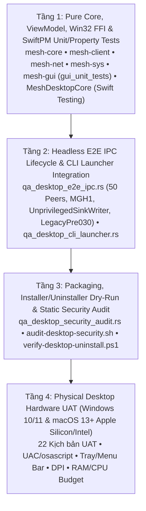

# Kế Hoạch Kiểm Thử Toàn Diện — Desktop GUI & Tray Companion (`v0.3.0`)

| Trường thông tin | Chi tiết |
| :--- | :--- |
| **Tên dự án** | Mesh VPN — Self-Hosted Secure Mesh Overlay Network |
| **Phiên bản mục tiêu** | `v0.3.0` (Sprint 5 — Native Desktop GUI & Tray Companion cho Windows 10/11 & macOS 13+) |
| **Mã tài liệu** | `QA-TP-DGUI-001` |
| **Phiên bản tài liệu** | `1.0` |
| **Ngày cập nhật** | `2026-11-17` |
| **Tác giả** | QA & Security Verification Engineer (`@qa-d-c2` / `WP-D-C2` — `US-116`) |
| **Tài liệu tham chiếu** | `docs/01-discovery/desktop-gui-readiness-requirements.md` (`43 DGUI-*`, `5 D-GNFR-*`), `docs/02-product-planning/desktop-gui-product-backlog.md` (`US-100..US-117 = 78 SP`), `docs/03-system-design/desktop-gui-{adr,system-architecture,ipc-and-ui-contracts,coding-standards}.md`, `docs/04-sprint-management/desktop-gui-sprint-backlog.md`, `docs/05-quality-assurance/critique-reviews/desktop-gui-wave-a-critique.md` |
| **Trạng thái** | **APPROVED FOR GATE 3 QA & UAT VERIFICATION** |

---

## 1. Mục tiêu & Phạm vi Kiểm thử (Test Objectives & Scope)

Kế hoạch kiểm thử này xác lập ma trận kiểm chứng tự động (`$0` Host/CI) và nghiệm thu phần cứng vật lý (`Physical UAT`) cho phân hệ **Desktop GUI & Tray Companion (`v0.3.0`)** trên **Windows 10/11 (`x86_64`)** và **macOS 13+ Ventura (`arm64` + `x86_64` Universal)**.

### 1.1. Phạm vi Trong Kiểm thử (In-Scope)
1. **Kiến trúc Tách biệt Đặc quyền (`Privilege Separation` — `ADR-019`, `SEC-01`, `SEC-14`)**:
   - Tiến trình GUI (`MeshVPN.exe` trên Windows, `Mesh VPN.app` trên macOS) chạy hoàn toàn dưới tài khoản người dùng thường (`Standard User`), không giữ khóa bí mật dài hạn trên đĩa.
   - Kênh Read-Only IPC (`\\.\pipe\mesh-agent-ro`, `/var/run/meshd/meshd-ro.sock` `0666`) phục vụ `GET /v1/agent/{version,status,peers}` với ngân sách `4 KiB` cho `version`/`status` và `64 KiB` cho `peers` (`BLK-DGUI-G2-04`).
   - Kênh Admin IPC (`\\.\pipe\mesh-agent-admin` SDDL `SY+BA`, `/var/run/meshd/meshd-admin.sock` `0660 root:admin` `gid=80` + `getgrouplist` fallback).
2. **Giao thức Handoff Nhị phân `MGH1` & Nâng quyền Một lần (`ADR-021`, `BLK-DGUI-G2-06`, `IG-DGUI-WA-02`)**:
   - Đóng gói khung `MGH1` (`4 B` magic + `1 B` version `0x01` + `1 B` kind + `4 B` big-endian length + payload), giới hạn cứng `<= 16 KiB` (`16,384 B`).
   - Bản tin bắt tay `0x00 WorkerHello` (`13 B`, `protocol_version = 1`) bắt buộc trước khi GUI ghi bất kỳ secret nào xuống Named Pipe.
   - Ràng buộc Security Descriptor DACL Current User SID + `FILE_FLAG_FIRST_PIPE_INSTANCE` + `PIPE_REJECT_REMOTE_CLIENTS` + `GetNamedPipeClientProcessId == child_pid`.
   - Ghi streaming bugreport qua `UnprivilegedSinkWriter` (`CreateFileW` quyền user, tệp tạm `.part` cùng thư mục, `MoveFileExW(..., MOVEFILE_REPLACE_EXISTING | MOVEFILE_WRITE_THROUGH)` nguyên tử, tự xóa `.part` khi lỗi giữa chừng).
3. **Zero-TOFU, Xác thực `mpk_` & Bảo vệ Bí mật (`SEC-01`, `SEC-04`, `SEC-05`, `IG-DGUI-WA-01`)**:
   - Đồng nhất quy tắc khóa cứng chế độ `Pinned SPKI` khi `server_endpoint` là IPv4 hoặc IPv6 literal và kiểm tra `validate_preauth_key` (`mpk_` + `>= 32 B` base64url) giữa Rust (`mesh-core`, `mesh-gui`) và Swift (`EndpointNormalizer.swift`, `JoinUriParser.swift`).
   - Giữ khóa `OpenClipboard` (`ClipboardGuard`) nguyên tử xuyên suốt `GetClipboardSequenceNumber()` + kiểm tra SHA-256 trước khi `EmptyClipboard()` sau `30s` (`IG-DGUI-WA-01`).
   - Chuẩn hóa lỗi xác thực `ErrorKind::Unauthenticated` thành chuỗi duy nhất `"authentication failed"` (`SEC-05`).
4. **Trạng thái Giao diện (`UiAppState`), Tạm dừng Polling & Tương thích Ngược (`IG-DGUI-WA-03..06`)**:
   - Máy trạng thái 10 trạng thái hiển thị (`ServiceMissing`, `DaemonUnreachable`, `LegacyPre030`, `Unconfigured`, `Disconnected`, `Connecting`, `Connected`, `Degraded`, `Reconnecting`, `KeyRejected`).
   - `PollingSuspensionGuard` tạm dừng vòng lặp 2s khi mở hộp thoại modal (`Confirmation` / `NSSavePanel` / `GetSaveFileNameW`) và kích hoạt 1 nhịp poll tức thời ngay khi đóng hộp thoại.
   - Phát hiện daemon cũ `LegacyPre030` khi `GET /v1/agent/version` trả `404` hoặc thiếu header `X-Mesh-Agent-Version`.
5. **Đóng gói, Cài đặt, Gỡ cài đặt & Tích hợp CLI (`US-112..US-117`, `ADR-026`)**:
   - Lệnh `mesh gui [open|status]` khám phá đường dẫn nhị phân an toàn, kiểm tra chữ ký `codesign -v` trên macOS, thoát `<= 1s` không treo terminal.
   - Thứ tự ký 3 bước bất biến `ADR-026` trong `scripts/package-macos-app.sh` (ký nhị phân con trước -> tạo `SHA256SUMS` nhúng vào `Contents/Resources/` -> ký `Mesh VPN.app` ngoài cùng không dùng `--deep`).
   - Luồng nâng cấp / gỡ cài đặt sạch trên Windows (`scripts/install-windows.ps1`, sự kiện `Local\MeshVpnGuiShutdownEvent`, `mesh.exe cleanup`, bảo toàn `keys.json` khi không có `-PurgeData`) và macOS (`scripts/install-macos.sh`).

### 1.2. Phân tách Rạch ròi 3 Tầng Bằng chứng Kiểm thử
Mọi báo cáo kiểm thử trong Sprint 5 bắt buộc phân loại trung thực từng hạng mục theo 3 trạng thái:
- **`VERIFIED_ON_WINDOWS_HOST` / `VERIFIED_AT_CI_$0`**: Đã thực thi và vượt qua 100% bằng bộ công cụ kiểm thử tự động trên máy trạm phát triển hoặc runner CI miễn phí (`scripts/run-desktop-qa.{ps1,sh}`, `scripts/check.{ps1,sh}`).
- **`PENDING_CI_RUNNER`**: Các bước biên dịch chéo hoặc chạy test phụ thuộc môi trường OS đặc thù trên GitHub Actions (`macos-15` cho `swift test`, `xcodegen`, `swiftlint --strict`, `xcodebuild test`; `windows-latest` cho MSVC native build).
- **`hardware_signoff_required`**: Các tiêu chí nghiệm thu bắt buộc thao tác trực tiếp trên máy thật Windows 10/11 và máy Mac vật lý (khay hệ thống Explorer/Menu Bar, hộp thoại UAC/`osascript`, DPI scaling, ngân sách RAM/CPU thực tế) theo giao thức `docs/06-operations/desktop-gui-hardware-acceptance-protocol.md`.

---

## 2. Kiến trúc Chiến lược Kiểm thử 4 Tầng (4-Tier Testing Pyramid)



| Tầng kiểm thử | Bộ thực thi chính | Tần suất chạy | Ngân sách thời gian |
| :--- | :--- | :--- | :--- |
| **Tầng 1 — Unit & Property Tests** | `cargo test` (`mesh-core`, `mesh-client`, `mesh-net`, `mesh-sys`, `mesh-gui`), `swift test` (`MeshDesktopCore`) | Mỗi lần sửa mã / Pre-commit | `<= 30s` |
| **Tầng 2 — Headless E2E IPC & CLI** | `qa_desktop_e2e_ipc.rs`, `desktop_ipc_contract.rs`, `qa_desktop_cli_launcher.rs` | Mỗi PR / `run-desktop-qa.{ps1,sh}` | `<= 15s` |
| **Tầng 3 — Security Audit & Dry-Run** | `qa_desktop_security_audit.rs`, `audit-desktop-security.sh`, `verify-desktop-uninstall.ps1` | Mỗi PR / Gate 3 Sign-off | `<= 20s` |
| **Tầng 4 — Physical Desktop UAT** | `docs/06-operations/desktop-gui-hardware-acceptance-protocol.md` | Trước khi phát hành `v0.3.0` | `~45 phút / OS` |

---

## 3. Danh mục Bộ Kiểm thử Tự động (Automated Test Suites Inventory)

### 3.1. Các bộ kiểm thử Rust (`crates/*`)

| Crate | Target kiểm thử | Số lượng test | Phạm vi bảo phủ cốt lõi |
| :--- | :--- | :---: | :--- |
| `mesh-gui` | `--lib` (inline tests) | `54` | Máy trạng thái `UiAppState`, `PollingSuspensionGuard`, `OnboardingFormState`, `LogSanitizer`, `ViewModel`, `SingleInstanceAction`, `MGH1` worker arguments |
| `mesh-gui` | `--test gui_unit_tests` | `20` | Kiểm thử đơn vị & `proptest!` cho bộ lọc peer, chuẩn hóa endpoint, tính toán chu kỳ tự xóa clipboard (`30s`), ánh xạ thông báo lỗi thân thiện |
| `mesh-gui` | `--test qa_desktop_security_audit` | `8` (`6` unit + `2` `proptest!`) | Kiểm toán mã nguồn & hành vi bảo mật (`0` `.expose_secret()`, `0` `unsafe` trong `mesh-gui`, `100%` `// SAFETY:` trong `mesh-sys`, `MGH1` `WorkerHello` & pipe allowlist, đồng nhất Zero-TOFU IPv4/IPv6 + `mpk_` Rust/Swift, bất biến đóng gói macOS/Windows) |
| `mesh-gui` | `--test qa_desktop_e2e_ipc` | `1` (Full E2E Lifecycle) | Vòng đời IPC đầu-cuối qua `tokio::io::duplex` + `axum::Router`: `Unconfigured` -> `Up` (`MGH1` + `Secret`) -> `Connected` (`50 peers` `> 4 KiB, <= 64 KiB`) -> `1-Click Reconnect` -> `Netcheck` -> `Ping` -> `Set` -> `RotateKey` -> `Bugreport` (`UnprivilegedSinkWriter` `.part` atomic Replace & bảo toàn tệp cũ khi lỗi giữa dòng) -> `ResetIdentity` -> `LegacyPre030` |
| `mesh` | `--test qa_desktop_cli_launcher` | `8` | Lệnh `mesh gui`, `mesh gui open`, `mesh gui status`, cờ `--json`, biến môi trường `MESH_GUI_BIN`, mã thoát `EX_UNAVAILABLE (69)` khi thiếu gói GUI |
| `mesh-net` | `--test desktop_ipc_contract` | `25` | Hợp đồng IPC `GET /v1/agent/{version,status,peers}`, `POST /v1/agent/{up,down,set,ping,netcheck,rotate-key,reset-identity,bugreport/stream}`, giới hạn `4 KiB` vs `64 KiB`, khung `MGH1`, `UnprivilegedSinkWriter` |
| `mesh-client` | `--test desktop_session_wp_d_a1` | `14` | `DesktopSessionSnapshot`, phân loại trạng thái kết nối, bảo toàn `server_endpoint`/`spki_pin` phục vụ 1-Click Reconnect |
| `mesh-core` | `--test desktop_onboarding_validation` | `21` | Kiểm tra `mesh://join`, `validate_preauth_key` (`mpk_` + `>= 32 B` base64url), `SpkiPin::parse`, phát hiện IPv4/IPv6 literal chống TOFU |
| `mesh-sys` | `--lib` (`gui_windows::tests`, `process_windows::tests`) | `16` | Kiểm thử RAII Win32 handles, `UnprivilegedSinkWriter` trên thư mục tạm, mã hóa UTF-16, kiểm tra hằng số `WM_APP_*` và pipe name |

### 3.2. Các bộ kiểm thử SwiftPM & kịch bản kiểm toán (`desktop/macos/**`, `lab/desktop/**`)

| Thành phần | Đường dẫn | Phạm vi kiểm chứng |
| :--- | :--- | :--- |
| **SwiftPM Core Tests** | `desktop/macos/MeshDesktopCore/Tests/MeshDesktopCoreTests/*.swift` (`6` tệp) | `EndpointNormalizerTests`, `JoinUriParserTests`, `LogSanitizerTests`, `DesktopViewModelTests`, `UnixSocketHTTPClientTests`, `PrivilegeHelperSecurityTests` |
| **Xcode App Target Tests** | `desktop/macos/MeshVPNAppTests/MeshVPNAppTests.swift` | Kiểm thử cấu hình bundle `Mesh VPN.app`, `DesktopStore`, tài nguyên localization Việt/Anh |
| **Static Security Audit (POSIX)** | `lab/desktop/audit-desktop-security.sh` | `10` cổng kiểm toán tĩnh (`DGUI-AUDIT-01..10`) cho CI Linux/macOS |
| **Uninstall & Upgrade Dry-Run (Win)** | `lab/desktop/verify-desktop-uninstall.ps1` | `8` cổng kiểm chứng (`UNINST-01..08`) cho `scripts/install-windows.ps1` (`-DryRun`, `-Uninstall -DryRun`, `-Uninstall -PurgeData -DryRun`) |

---

## 4. Ma trận Truy vết Yêu cầu sang Kiểm thử (Requirements-to-Test Traceability Matrix)

### 4.1. Ma trận 18 User Stories (`US-100..US-117`)

| Story ID | Tên User Story | Yêu cầu `DGUI-*` | Bộ kiểm thử tự động (`$0` Host/CI) | Kịch bản UAT Phần cứng |
| :--- | :--- | :--- | :--- | :--- |
| **US-100** | Windows System Tray App Lifecycle & Single-Instance Guard | `DGUI-01..04` | `mesh-gui::lib::tests`, `qa_desktop_security_audit::test_macos_bundle_swift_packaging_and_windows_installer_invariants` | `WIN-UAT-01`, `WIN-UAT-02` |
| **US-101** | macOS Menu Bar Extra (`LSUIElement`) & Lifecycle | `DGUI-05..08` | `qa_desktop_security_audit::test_macos_bundle_swift_packaging_and_windows_installer_invariants`, `MeshVPNAppTests` | `MAC-UAT-01`, `MAC-UAT-02` |
| **US-102** | Main Status Dashboard & 1-Click Connect/Disconnect | `DGUI-09..12` | `qa_desktop_e2e_ipc`, `gui_unit_tests`, `DesktopViewModelTests.swift` | `WIN-UAT-03`, `MAC-UAT-03` |
| **US-103** | Zero-Leak Privilege Elevation & Admin IPC Bridge | `DGUI-13..16`, `SEC-01`, `SEC-14` | `qa_desktop_security_audit::test_mgh1_framing_security_*`, `desktop_ipc_contract`, `PrivilegeHelperSecurityTests.swift` | `WIN-UAT-04`, `MAC-UAT-04` |
| **US-104** | `mesh://join` URI Paste & Clipboard Import Onboarding | `DGUI-17..20`, `SEC-04` | `desktop_onboarding_validation`, `qa_desktop_security_audit::test_atomic_clipboard_guard_*`, `JoinUriParserTests.swift` | `WIN-UAT-05`, `MAC-UAT-05` |
| **US-105** | Manual Enrollment Form with Zero-TOFU Validation | `DGUI-21..23`, `SEC-04` | `qa_desktop_security_audit::test_zero_tofu_and_preauth_key_parity_*`, `EndpointNormalizerTests.swift` | `WIN-UAT-06`, `MAC-UAT-06` |
| **US-106** | Searchable Peer List, Copy IP & Quick Ping | `DGUI-24..27` | `qa_desktop_e2e_ipc` (`50 peers`), `gui_unit_tests`, `DesktopViewModelTests.swift` | `WIN-UAT-07`, `MAC-UAT-07` |
| **US-107** | Exit Node & Full-Tunnel Selector with Loop Guard Status | `DGUI-28..30`, `REL-09` | `qa_desktop_e2e_ipc` (`set exit_node`), `gui_unit_tests`, `DesktopViewModelTests.swift` | `WIN-UAT-08`, `MAC-UAT-08` |
| **US-108** | Preferences & Settings Panel (Auto-Start, MagicDNS, Language) | `DGUI-31..33` | `mesh-sys::gui_windows::tests`, `gui_unit_tests`, `DesktopViewModelTests.swift` | `WIN-UAT-09`, `MAC-UAT-09` |
| **US-109** | Key Rotation, Enrollment Reset & Re-Authentication UX | `DGUI-34..35` | `qa_desktop_e2e_ipc` (`rotate-key`, `reset-identity`), `qa_desktop_security_audit::test_atomic_clipboard_guard_*` | `WIN-UAT-10`, `MAC-UAT-10` |
| **US-110** | Netcheck Diagnostics, Live Log Viewer & 1-Click Bugreport | `DGUI-36..38`, `OPS-01` | `qa_desktop_e2e_ipc` (`UnprivilegedSinkWriter` Replace & mid-stream abort), `LogSanitizerTests.swift` | `WIN-UAT-11`, `MAC-UAT-11` |
| **US-111** | Native OS Notifications & Actionable Error Banners | `DGUI-39..40`, `SEC-05` | `qa_desktop_security_audit`, `gui_unit_tests`, `DesktopViewModelTests.swift` | `WIN-UAT-12`, `MAC-UAT-12` |
| **US-112** | CLI-to-GUI Integration (`mesh gui`) & Coexistence | `DGUI-41` | `crates/mesh/tests/qa_desktop_cli_launcher.rs` (`8` tests) | `WIN-UAT-13`, `MAC-UAT-13` |
| **US-113** | Accessibility, High-DPI, Dark/Light Theme & i18n (VI/EN) | `DGUI-42..43`, `D-GNFR-04` | `gui_unit_tests` (bộ chuỗi VI/EN), `MeshVPNAppTests.swift` | `WIN-UAT-14`, `MAC-UAT-14` |
| **US-114** | macOS `.app` Bundle, Universal Binary & `.dmg` Packaging | `ADR-025`, `ADR-026` | `qa_desktop_security_audit`, `scripts/package-macos-app.sh --dry-run`, `scripts/install-macos.sh --dry-run` | `MAC-UAT-15` |
| **US-115** | Windows Unified Installer, Shortcuts & Clean Uninstall | `ADR-020`, `BLK-DGUI-G2-02` | `lab/desktop/verify-desktop-uninstall.ps1 -DryRun` (`UNINST-01..08`), `qa_desktop_security_audit` | `WIN-UAT-15` |
| **US-116** | Desktop GUI E2E IPC Harness, Security Audit & UAT Protocol | `D-GNFR-01..05` | `qa_desktop_security_audit.rs`, `qa_desktop_e2e_ipc.rs`, `run-desktop-qa.{ps1,sh}` | Toàn bộ `WIN-UAT-*` & `MAC-UAT-*` |
| **US-117** | Multi-OS Desktop GUI CI/CD Build & Release Matrix | `D-GNFR-02`, `ADR-026` | `qa_desktop_security_audit` (kiểm tra `.github/workflows/{ci,release}.yml`) | Kiểm tra artifact trên GitHub Release |

### 4.2. Ma trận Kiểm chứng 8 Gate 2 Blockers & 6 Wave A Improvement Goals

| Mã định danh | Mô tả kỹ thuật | Bài kiểm thử tự động xác nhận |
| :--- | :--- | :--- |
| **BLK-DGUI-G2-01** | `MeshApp.init()` kích hoạt `startMonitoring()` ngay khi khởi chạy ở chế độ Menu Bar-only (`LSUIElement = true`) và chỉ mở tối đa 1 cửa sổ `Window("Mesh VPN", id: "dashboard")` | `qa_desktop_security_audit::test_macos_bundle_swift_packaging_and_windows_installer_invariants` |
| **BLK-DGUI-G2-02** | Thu hồi tự khởi động (`HKCU\...\Run\MeshVPN`, `LaunchAgents`) và dọn dẹp shortcut khi chạy `mesh cleanup` / gỡ cài đặt | `verify-desktop-uninstall.ps1`, `mesh-sys::gui_windows::tests` |
| **BLK-DGUI-G2-03** | Phiên bản IPC (`GET /v1/agent/version` + `X-Mesh-Agent-Version`) và phát hiện `LegacyPre030` khi daemon cũ trả `404` | `qa_desktop_e2e_ipc::test_e2e_desktop_ipc_lifecycle_*`, `desktop_ipc_contract` |
| **BLK-DGUI-G2-04** | Tách `GET /v1/agent/peers` sang ngân sách phản hồi `64 KiB` (`MAX_RO_PEERS_RESPONSE_BYTES = 65,536`), giữ `4 KiB` cho `/status` và `/version` | `qa_desktop_e2e_ipc` (`50 peers` payload `> 4 KiB`), `desktop_ipc_contract` |
| **BLK-DGUI-G2-05** | `POST /v1/agent/reset-identity` giữ tiến trình `meshd` sống ở trạng thái `Unconfigured` thay vì làm sập dịch vụ nền | `qa_desktop_e2e_ipc` (kiểm tra `/v1/agent/status` ngay sau `reset-identity`) |
| **BLK-DGUI-G2-06** | Ghi bugreport trực tiếp bằng quyền người dùng thường qua `UnprivilegedSinkWriter` (`CreateFileW` + `.part` + `MoveFileExW` Replace), loại bỏ ghi tệp dưới quyền `SYSTEM`/`root` | `qa_desktop_e2e_ipc`, `desktop_ipc_contract` |
| **BLK-DGUI-G2-07** | Kịch bản `scripts/install-macos.sh` hỗ trợ `--from-app-bundle` được gọi bởi `NSWorkspace` / `osascript` với kiểm tra `codesign -v` và `SHA256SUMS` | `qa_desktop_security_audit`, `audit-desktop-security.sh` |
| **BLK-DGUI-G2-08** | Thứ tự ký 3 bước bất biến `ADR-026` trong `scripts/package-macos-app.sh` (không dùng `--deep`) | `qa_desktop_security_audit`, `audit-desktop-security.sh` |
| **IG-DGUI-WA-01** | Giữ khóa `OpenClipboard` (`ClipboardGuard`) nguyên tử xuyên suốt kiểm tra `GetClipboardSequenceNumber()` và hàm băm SHA-256 trước khi `EmptyClipboard()` | `qa_desktop_security_audit::test_atomic_clipboard_guard_and_post_dialog_polling_suspension_contracts` |
| **IG-DGUI-WA-02** | Khung `0x00 WorkerHello` (`13 B`, `protocol_version = 1`) bắt buộc trước khi GUI truyền `0x01 HandoffRequest` chứa `mpk_` | `qa_desktop_security_audit::test_mgh1_framing_security_*` |
| **IG-DGUI-WA-03** | `PollingSuspensionGuard` tạm dừng poll 2s khi mở hộp thoại modal và kích hoạt `trigger_immediate_poll_after_dialog` ngay khi đóng | `qa_desktop_security_audit::test_atomic_clipboard_guard_and_post_dialog_polling_suspension_contracts` |
| **IG-DGUI-WA-04** | `DesktopSessionSnapshot` lưu giữ `last_server_endpoint` và `last_spki_pin` để nút `Connect` thực hiện 1-Click Reconnect sau khi `Disconnect` | `qa_desktop_e2e_ipc`, `desktop_session_wp_d_a1` |
| **IG-DGUI-WA-05** | Đồng bộ sự kiện tắt tiến trình `Local\MeshVpnGuiShutdownEvent` giữa `gui_windows.rs` và `scripts/install-windows.ps1` | `qa_desktop_security_audit`, `verify-desktop-uninstall.ps1` |
| **IG-DGUI-WA-06** | Đồng nhất quy tắc khóa cứng `Pinned SPKI` cho IPv6 literal (`[::1]:443`, `[2001:db8::1]`) và `validate_preauth_key` giữa Rust và Swift | `qa_desktop_security_audit::test_zero_tofu_and_preauth_key_parity_across_rust_and_macos_swift` |

---

## 5. Quy trình Thực thi Kiểm thử Tự động (Automated Execution Commands)

### 5.1. Trên Windows (`PowerShell 5.1+`)
```powershell
# Chạy toàn bộ cổng kiểm định Desktop GUI (fmt, clippy -D warnings, 6 crates test, release MeshVPN.exe budget + PE subsystem, uninstall dry-run)
powershell -ExecutionPolicy Bypass -File scripts/run-desktop-qa.ps1

# Chạy bộ kiểm định toàn workspace kèm kiểm biên dịch chéo
powershell -ExecutionPolicy Bypass -File scripts/check.ps1 -Cross
```

### 5.2. Trên Linux / macOS (`POSIX sh`)
```sh
# Chạy cổng kiểm định Desktop GUI (audit-desktop-security.sh, fmt, clippy, Rust tests, và SwiftPM/Xcode/installer dry-run trên Darwin)
sh scripts/run-desktop-qa.sh

# Chạy riêng kiểm toán bảo mật tĩnh
sh lab/desktop/audit-desktop-security.sh
```

---

## 6. Tiêu chí Đạt / Không Đạt (Pass / Fail Exit Criteria)

1. **Cổng Tự động (`$0` Host & CI)**:
   - `0` cảnh báo Clippy (`-D warnings`) trên toàn workspace với `--all-targets --all-features`.
   - `100%` bài kiểm thử trong `mesh-gui`, `mesh`, `mesh-net`, `mesh-client`, `mesh-core`, `mesh-sys` và `MeshDesktopCore` xanh tuyệt đối.
   - `0` lệnh gọi `.expose_secret()` và `0` khối `unsafe` trong `crates/mesh-gui/src/*.rs`; `100%` khối `unsafe` trong `crates/mesh-sys/src/{gui_windows,process_windows}.rs` có chú thích `// SAFETY:`.
   - Dung lượng `target/release/MeshVPN.exe` `<= 6,291,456` bytes (`6 MiB`, mục tiêu `<= 4 MiB`) và trường PE `Subsystem == 2` (`IMAGE_SUBSYSTEM_WINDOWS_GUI`).
   - `lab/desktop/verify-desktop-uninstall.ps1 -DryRun` đạt `8/8` (`UNINST-01..08`) và `lab/desktop/audit-desktop-security.sh` đạt `10/10` (`DGUI-AUDIT-01..10`).
2. **Cổng Nghiệm thu Phần cứng (`Physical Hardware UAT`)**:
   - Hoàn tất và ký duyệt biên bản `docs/06-operations/desktop-gui-hardware-acceptance-protocol.md` trên máy thật Windows 10/11 và macOS 13+ trước khi gắn thẻ phát hành chính thức `v0.3.0`.
