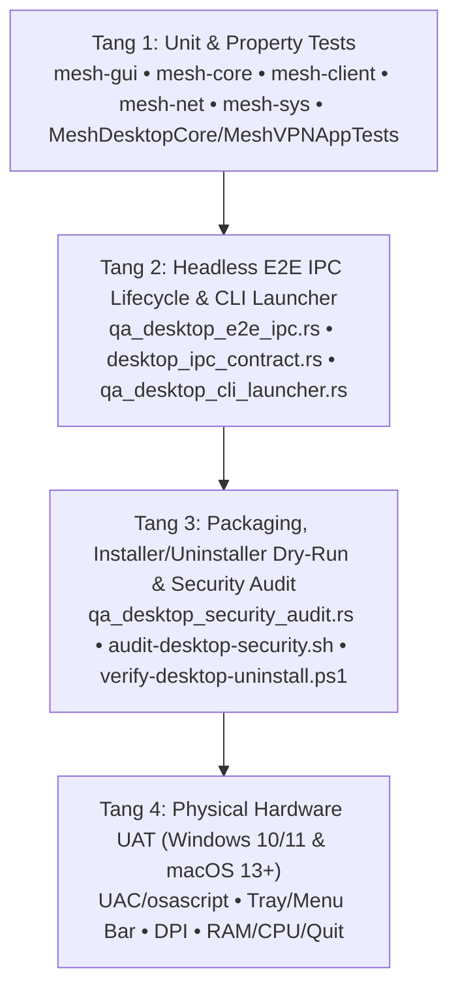

# Kế Hoạch Kiểm Thử Toàn Diện — Desktop GUI & Tray Companion (`v0.3.0`)

| Trường thông tin | Chi tiết |
| :--- | :--- |
| **Tên dự án** | Mesh VPN — Self-Hosted Secure Mesh Overlay Network |
| **Phiên bản mục tiêu** | `v0.3.0` (Desktop GUI & System Tray / Menu Bar cho Windows 10/11 & macOS 13+) |
| **Mã tài liệu** | `QA-TP-DGUI-001` |
| **Phiên bản tài liệu** | `1.1` |
| **Ngày cập nhật** | `2026-11-17` |
| **Tác giả** | QA & Security Verification (`WP-D-C2` — `US-116`) |
| **Tài liệu tham chiếu** | `docs/01-discovery/desktop-gui-readiness-requirements.md` v1.1 (`43` `DGUI-*`, `5` `D-GNFR-*`), `docs/02-product-planning/desktop-gui-product-backlog.md` v1.1 (`EP-17..20`, `US-100..US-117 = 78 SP`), `docs/03-system-design/desktop-gui-{adr,system-architecture,ipc-and-ui-contracts,coding-standards,tech-stack-decision}.md`, `docs/04-sprint-management/desktop-gui-sprint-backlog.md` v1.1 (`7` Work Packages `WP-D-A0..WP-D-C2`) |
| **Trạng thái** | **GROUNDED FOR GATE 3 QA & HARDWARE UAT VERIFICATION** |

---

## 1. Mục tiêu & Phạm vi Kiểm thử (Test Objectives & Scope)

Kế hoạch kiểm thử này xác lập ma trận kiểm chứng tự động (`$0` Host / CI) và nghiệm thu phần cứng vật lý (`hardware_signoff_required`) cho phân hệ **Desktop GUI (`v0.3.0`)** trên **Windows 10/11 (`x86_64`)** và **macOS 13+ (`arm64` + `x86_64` Universal)**.

### 1.1. Phạm vi Trong Kiểm thử (In-Scope — Đúng `US-100..US-117`, `78 SP`)
1. **Tách biệt Đặc quyền & Kênh IPC 2 Mức (`ADR-020`, `ADR-023`, `ADR-024`, `SEC-01`, `SEC-14`)**:
   - `MeshVPN.exe` (Windows `asInvoker`) và `Mesh VPN.app` (macOS Non-Sandboxed, `dev.meshvpn.macos`) chạy hoàn toàn ở quyền người dùng thường, giữ nguyên `0` `.expose_secret()` và `0` `unsafe` trong `crates/mesh-gui/src/*.rs`.
   - Kênh Read-Only (`\\.\pipe\mesh-agent-ro`, `/var/run/meshd/meshd-ro.sock` `0666`): request `<= 4 KiB` (`MAX_RO_IPC_BODY_BYTES = 4_096`), read JSON response bounded `<= 64 KiB` (`MAX_HTTP_BODY_BYTES = 65_536`) đủ cho `50+` peers trên `/v1/agent/{status,peers}`, kèm `/v1/agent/version`, `/v1/agent/netcheck`, `/v1/agent/ping`.
   - Kênh Admin (`\\.\pipe\mesh-agent-admin` SDDL `D:P(A;;GA;;;SY)(A;;GA;;;BA)`, `/var/run/meshd/meshd-admin.sock` `0660 root:admin` `gid = 80` + `getgrouplist` fallback): JSON `<= 64 KiB` (`MAX_ADMIN_IPC_BODY_BYTES = 65_536`), streaming bugreport `/v1/agent/bugreport/stream` `<= 20 MiB` (`MAX_BUGREPORT_ARCHIVE_BYTES = 20_971_520`) theo từng chunk `<= 64 KiB`.
   - Timeout 3 tầng (`850 ms` connect, `2_000 ms` RO query, `10_000 ms` netcheck / tối đa `35_000 ms` ping & admin mutation / `10_000 ms` chunk idle).
2. **Giao thức Handoff Nhị phân `MGH1` & Unprivileged Sink Write (`ADR-021`, `ADR-023`)**:
   - Khung wire `MGH1`: header **`9` bytes** (`4 B` magic `"MGH1"` + `1 B` `frame_type` + `4 B` **`u32` Little-Endian** `len_le`), giới hạn `<= 64 KiB` (`65_536 B`) cho khung điều khiển/chunk (`<= 4 KiB` cho `0x02 HandoffStreamHeader`).
   - Chuỗi bắt tay: worker `--elevated-worker --pipe \\.\pipe\mesh-gui-handoff-<32_hex>` mở pipe với `SECURITY_SQOS_PRESENT | SECURITY_IDENTIFICATION | FILE_FLAG_OVERLAPPED`, gửi **`0x00 WorkerHello` (`13 B`, `protocol_version = 1`)**, GUI xác thực `GetNamedPipeClientProcessId == child_pid` + `ImpersonateNamedPipeClient` + `OpenThreadToken` + `CheckTokenMembership` (`BA`/`SY`) trước khi gửi `0x01 HandoffRequest` (`Zeroizing<Vec<u8>>`).
   - Xuất `.tar` bugreport không để tiến trình đặc quyền chạm đường dẫn user chọn: Windows dùng `UnprivilegedSinkWriter` (`CreateFileW` quyền user + `.part` + `MoveFileExW` `MOVEFILE_REPLACE_EXISTING | MOVEFILE_WRITE_THROUGH`); macOS dùng `BugreportStreamWriter.swift` (`.mesh-bugreport-<32hex>.tar.part` + `fsync` + POSIX **`Darwin.rename(partURL.path, destURL.path)`**, hoạt động cho cả tệp đích mới tinh lẫn ghi đè tệp cũ).
3. **Zero-TOFU, `validate_preauth_key`, Clipboard `30 s` & `SEC-05`**:
   - Chuẩn hóa `<host>:<effective_port>`, khóa cứng `System CA` khi host là IPv4/IPv6 literal, và kiểm tra `mpk_` (`<= 256` chars, `BASE64URL_NOPAD >= 32 B`) đồng nhất giữa Rust (`mesh-core`, `mesh-gui/src/onboarding.rs`) và Swift (`EndpointNormalizer.swift`, `JoinUriParser.swift`).
   - `ClipboardGuard` trên Windows (`OpenClipboard` + `GetClipboardSequenceNumber()` + SHA-256) và `ClipboardAutoClear.swift` trên macOS (`changeCount` + SHA-256, xử lý cả trường hợp dán `Cmd+V` chứa `\n` cuối chuỗi vào `SecureField`).
   - Mọi lỗi `ErrorKind::Unauthenticated` ánh xạ duy nhất thành `"authentication failed"` (`SEC-05`).
4. **Máy trạng thái 8 Trạng thái, `PollingSuspensionGuard` & `LegacyPre030`**:
   - Windows `DesktopUiState` (`crates/mesh-gui/src/app.rs`): `AgentUnavailable`, `ServiceStopped`, `NotEnrolled`, `Connecting`, `Connected` (`TunnelSubState::{Connected,Degraded,Disconnected}`), `ReauthRequired`, `Revoked`, `ErrorRecoverable`.
   - macOS `DesktopUiState` (`DesktopUiState.swift`): `serviceNotInstalled`, `serviceStopped`, `unconfigured`, `connecting`, `connected` (`isDegradedTunnel`, `isManuallyDisconnected`), `reauthRequired`, `revoked`, `error`.
   - `PollingSuspensionGuard` / `withSuspendedPolling` tạm dừng vòng poll trong lúc thực thi admin handoff / xuất bugreport / thao tác đặc quyền (chỉ kích hoạt sau khi hộp thoại lưu tệp hoàn tất, và gọi refresh sau khi kết thúc suspension).
   - Nhận diện `LegacyPre030` khi `GET /v1/agent/version` trả `404` và thiếu header `X-Mesh-Agent-Version` (hoặc `meshd --version` exit `2`).
5. **CLI Launcher, Đóng gói & Cài đặt/Gỡ cài đặt Sạch (`US-100`, `US-114`, `US-115`)**:
   - Lệnh **`mesh gui`** (không nhận subcommand con) và `mesh reset-identity [--yes]`; kiểm tra 0-arg `mesh` trả exit code `2` trong `< 1 s` khi chạy qua pipe, `CI`, `MESH_NO_GUI_AUTOLAUNCH`, hoặc `CREATE_NEW_CONSOLE` từ tiến trình cha không phải `explorer.exe`.
   - Thứ tự đóng gói macOS 3 bước `ADR-026` trong `scripts/package-macos-app.sh` (ký inner trước -> sinh `SHA256SUMS` trong `Contents/Resources/` -> ký outer `Mesh VPN.app` không `--deep`); `AdminPrivilegeHelper.swift` truyền `--uninstall --keep-app [--purge]` tới `install-macos.sh`; Windows `elevation_worker.rs` đồng bộ SDDL `OICI`, bỏ qua self-copy, bắt mã lỗi `5 | 32` cho `MeshVPN.exe.new`, dọn đủ 12 tệp bundle & bảo toàn `keys.json`/`bootstrap.toml` mặc định trừ khi purge.

### 1.2. Phạm vi Ngoài Kiểm thử `v0.3.0` (Out-of-Scope theo `desktop-gui-product-backlog.md` §1)
- **Không** có gói `WP-D-B3` (chỉ có `7` Work Packages: `WP-D-A0`, `WP-D-A1`, `WP-D-A2`, `WP-D-B1`, `WP-D-B2`, `WP-D-C1`, `WP-D-C2`).
- **Không** có tính năng chọn Exit Node trên Desktop GUI, **không** có đa ngôn ngữ VI/EN hay tệp `gui-prefs.json` trong `v0.3.0`.

### 1.3. Phân tách Rạch ròi 3 Nhãn Bằng chứng
- **`VERIFIED_ON_WINDOWS_HOST`**: Kết quả thực thi thực tế trên máy trạm kiểm định Windows (`+1.94.1-x86_64-pc-windows-gnu` qua `scripts/run-desktop-qa.ps1` và `scripts/check.ps1 -Cross`).
- **`PENDING_CI_RUNNER`**: Các kiểm thử cần runner GitHub Actions OS đích: `macos-15` (`desktop-macos` & `package-macos-desktop` cho `swift test`, `xcodegen`, `swiftlint --strict`, `xcodebuild test`, `install-macos.sh --dry-run`, `package-macos-app.sh --dry-run`) và `windows-latest` (`check-windows` & `verify-and-build` MSVC native build).
- **`hardware_signoff_required`**: Nghiệm thu tương tác OS vật lý trên Windows 10/11 và macOS 13+ theo `docs/06-operations/desktop-gui-hardware-acceptance-protocol.md`.

---

## 2. Kiến trúc Chiến lược Kiểm thử 4 Tầng



---

## 3. Danh mục Bộ Kiểm thử Tự động Thực tế trong Repo (Verified Inventory)

### 3.1. Các bộ kiểm thử Rust (`crates/*`)

| Crate | Target / Tệp thực tế | Số lượng test thật | Phạm vi bảo phủ |
|---|---|:-:|:---|
| `mesh-gui` | Binary unit tests (`crates/mesh-gui/src/main.rs`) | **`3`** | `parse_gui_launch_args`, `resolve_expected_wintun_sha256`, 9-item tray menu, `PollingControl`, `ClipboardSecretGuard`, SDDL `OICI` / self-copy / `Some(5 \| 32)` / 12-file removal list *(lưu ý: `crates/mesh-gui` không có `src/lib.rs`)* |
| `mesh-gui` | `--test gui_unit_tests` (`crates/mesh-gui/tests/gui_unit_tests.rs`) | **`10`** (`8` unit + `2` `proptest!`) | 8 trạng thái `DesktopUiState` + `LegacyPre030`, Zero-TOFU + `mesh://join` + key rotation, `ClipboardSecretGuard`, `MGH1` framing/zeroize, SemVer & autostart & BGRA icons, `64 KiB` chunked bugreport stream, `test_no_secrets_in_outputs`, `UnprivilegedSinkWriter` |
| `mesh-gui` | `--test qa_desktop_security_audit` (`crates/mesh-gui/tests/qa_desktop_security_audit.rs`) | **`9`** (`7` unit + `2` `proptest!`) | `0` `.expose_secret()`/`0` `unsafe` trong `mesh-gui/src/*.rs`, `100%` `// SAFETY:` trong `mesh-sys`, `MGH1` `WorkerHello` (`13 B`) & `SEC-05`, parity Zero-TOFU & `mpk_` Rust/Swift, atomic clipboard & post-dialog `PollingSuspensionGuard`, bất biến Swift/macOS/Windows packaging, khóa hồi quy Gate 3 (`OICI`, `--keep-app`, `Darwin.rename`, Swift 6 `Package.swift`, `ipc_poller.rs` `suspend()`) |
| `mesh-gui` | `--test qa_desktop_e2e_ipc` (`crates/mesh-gui/tests/qa_desktop_e2e_ipc.rs`) | **`1`** (8 pha) | Vòng đời E2E qua `tokio::io::duplex` + `axum::Router`: `NotEnrolled` -> `MGH1` `Up` -> `50` peers (`> 4 KiB, <= 64 KiB`) -> 1-Click Reconnect giữ `next_pin` -> `Netcheck` -> `Ping` -> `Set` -> `RotateKey` -> `Bugreport` stream `UnprivilegedSinkWriter` Replace & abort -> `ResetIdentity` giữ `meshd` sống -> `LegacyPre030` |
| `mesh` | `--test qa_desktop_cli_launcher` (`crates/mesh/tests/qa_desktop_cli_launcher.rs`) | **`4`** | 0-arg `mesh` piped / `CI` / `MESH_NO_GUI_AUTOLAUNCH` thoát `2` `< 1 s`; `CREATE_NEW_CONSOLE` non-Explorer thoát `2` `< 1 s`; `mesh gui` fail-closed khi thiếu GUI binary; `mesh reset-identity` đòi `--yes` ở non-TTY |
| `mesh-net` | `--test desktop_ipc_contract` (`crates/mesh-net/tests/desktop_ipc_contract.rs`) | **`5`** *(+ `8` inline trong `src/{ipc,gui_handoff}.rs`)* | Timeout 3 tầng (`850 ms`/`2 s`/`10–35 s`), `ERROR_PIPE_BUSY (231)` retry & map `2`/`5`, `50` peers `> 4 KiB` + `LegacyPre030`, read hang timeout, stream bugreport `<= 64 KiB` chunks & reject truncation/oversize |
| `mesh-client` + `meshd` | `--test desktop_session_wp_d_a1` (`crates/mesh-client/tests/desktop_session_wp_d_a1.rs`) + `--test daemon_version_cli` (`crates/meshd/tests/daemon_version_cli.rs`) | **`1`** + **`1`** | `FileClientStateStore::delete_identity`, `execute_reset_identity` giữ supervisor sống, `update_bootstrap_trust_preserving_next_pin` (`execute_up` & `execute_set`), `meshd --version` |
| `mesh-core` | `--test desktop_onboarding_validation` (`crates/mesh-core/tests/desktop_onboarding_validation.rs`) | **`7`** (`4` unit + `3` `proptest!`) | `MAX_BUGREPORT_ARCHIVE_BYTES == 20_971_520`, chuẩn hóa `<host>:<port>`, IPv4/IPv6 khóa `System CA`, `validate_preauth_key`, RFC 1123 `NodeName` |
| `mesh-sys` | `--lib` (`gui_windows::tests` + `process_windows::tests`) | **`3`** + **`2`** = **`5`** | Handoff pipe regex & `ERROR_CANCELLED`, `UnprivilegedSinkWriter` atomic Replace + anti-TOCTOU read lock, DPI tray icons `16..=256 px`, Explorer double-click path check |

### 3.2. Các bộ kiểm thử Swift (`desktop/macos/**` — `PENDING_CI_RUNNER` trên `macos-15`) & Kịch bản Tĩnh

| Thành phần | Đường dẫn thật | Số lượng test / check | Phạm vi bảo phủ |
|---|---|:-:|:---|
| **SwiftPM Core Tests** | `desktop/macos/MeshDesktopCore/Tests/MeshDesktopCoreTests/DesktopCoreTests.swift` | **`7`** XCTests | `EndpointNormalizer`, Zero-TOFU IPv4/IPv6, `JoinUriParser`, decode `AgentStatusResponse` 13 fields & `AgentVersionResponse`, `ClipboardAutoClear` (bao gồm case dán token kèm `\n`) |
| **SwiftPM Store Tests** | `desktop/macos/MeshDesktopCore/Tests/MeshDesktopCoreTests/DesktopStoreTests.swift` | **`7`** XCTests | `DesktopStateMapper` 8 states (tách 2 test `<= 60` dòng), onboarding + 1-Click Reconnect `preauthKey == nil`, `PollingSuspensionGuard` bugreport `.tar`, `LegacyPre030` + canary redaction, quit clipboard wipe, `startOrRepairService` post-action refresh & `ManualOnboardingInput` |
| **SwiftPM UDS & Bugreport Tests** | `desktop/macos/MeshDesktopCore/Tests/MeshDesktopCoreTests/UdsIpcAndBugreportTests.swift` | **`5`** XCTests | `UdsIpcClient` 50 peers chunked & `LegacyPre030`, map `ENOENT`/`EACCES`, `BugreportStreamWriter` (`Darwin.rename` cho **cả tệp `.tar` mới tinh lẫn ghi đè tệp cũ**, bảo toàn khi stream đứt), từ chối symlink/system dir, `AdminPrivilegeHelper` (`--uninstall --keep-app [--purge]`) |
| **Xcode App Target Tests** | `desktop/macos/MeshVPNAppTests/MeshVPNAppTests.swift` | **`2`** XCTests | `AgentDefaults` & `MenuBarStatusGroup` symbols, kiểm tra `Info.plist` (`dev.meshvpn.macos`, `LSUIElement = true`, `0` `CFBundleURLTypes`, `0` `NSAllowsArbitraryLoads`) |
| **Static Security Audit (POSIX)** | `lab/desktop/audit-desktop-security.sh` | **`10`** checks | `DGUI-AUDIT-01..10` |
| **Uninstall Dry-Run (Windows)** | `lab/desktop/verify-desktop-uninstall.ps1` | **`8`** checks | `UNINST-01..08` |

---

## 4. Ma trận Truy vết 18 User Stories (`US-100..US-117` = `78 SP`) & 7 Work Packages

| Story | WP | SP / MoSCoW | Mã `DGUI-*` | Kiểm thử tự động (`$0`) | UAT Phần cứng |
|---|---|:---:|---|---|---|
| **US-100** | `WP-D-A2` | `3` / `Must` | `DGUI-UX-06`, `DGUI-SEC-01/06` | `qa_desktop_cli_launcher`, `process_windows::tests` | `WIN-UAT-13`, `MAC-UAT-13` |
| **US-101** | `WP-D-A1` | `5` / `Must` | `DGUI-IPC-01..05`, `DGUI-UX-01..04/07`, `DGUI-MAC-07` | `desktop_ipc_contract`, `desktop_session_wp_d_a1`, `daemon_version_cli` | `WIN-UAT-04/10/11`, `MAC-UAT-03/10/11` |
| **US-102** | `WP-D-A0` | `3` / `Must` | `DGUI-UX-02`, `DGUI-SEC-04/05/06`, `GNFR-11` | `desktop_onboarding_validation`, `scripts/check.{ps1,sh}` | `WIN-UAT-05/06`, `MAC-UAT-04/05` |
| **US-103** | `WP-D-B1` | `5` / `Must` | `DGUI-WIN-01/05`, `DGUI-SEC-06`, `DGUI-PERF-01/02/04` | `mesh-sys::gui_windows::tests`, `gui_unit_tests`, `run-desktop-qa.ps1` (`DGUI-QA-03`) | `WIN-UAT-01/02/14/16` |
| **US-104** | `WP-D-B1` | `5` / `Must` | `DGUI-UX-01..04`, `DGUI-WIN-02`, `DGUI-SEC-02..04/08`, `DGUI-PERF-03` | `gui_unit_tests`, `qa_desktop_e2e_ipc`, `qa_desktop_security_audit` | `WIN-UAT-03/05/06/07/10/12` |
| **US-105** | `WP-D-B1` | `8` / `Must` | `DGUI-WIN-03/07`, `DGUI-SEC-01/05`, `DGUI-IPC-03`, `DGUI-UX-07` | `qa_desktop_security_audit` (`MGH1`), `gui_unit_tests`, `gui_windows::tests` | `WIN-UAT-04` |
| **US-106** | `WP-D-B1` | `5` / `Must` | `DGUI-UX-05`, `DGUI-WIN-04/06`, `DGUI-SEC-05/07`, `DGUI-OPS-02` | `mesh-gui` `main.rs::tests`, `qa_desktop_security_audit`, `gui_windows::tests` | `WIN-UAT-08` |
| **US-107** | `WP-D-B1` | `3` / `Must` | `DGUI-UX-07`, `DGUI-SEC-01/05`, `DGUI-OPS-03` | `qa_desktop_e2e_ipc` (`UnprivilegedSinkWriter`), `gui_unit_tests` (`test_no_secrets_in_outputs`) | `WIN-UAT-11` |
| **US-108** | `WP-D-B1` | `3` / `Should` | `DGUI-WIN-06`, `DGUI-OPS-02` | `gui_unit_tests` (`SemVerTriple` + `format_autostart_command_line`), `verify-desktop-uninstall.ps1` | `WIN-UAT-02/09` |
| **US-109** | `WP-D-B2` | `5` / `Must` | `DGUI-MAC-01/03`, `DGUI-UX-01`, `DGUI-SEC-02`, `DGUI-PERF-01/02/04` | `qa_desktop_security_audit`, `MeshVPNAppTests.swift` (`PENDING_CI_RUNNER`) | `MAC-UAT-01/02/16` |
| **US-110** | `WP-D-B2` | `5` / `Must` | `DGUI-MAC-02/04`, `DGUI-UX-02..04`, `DGUI-SEC-01/03/04/08`, `DGUI-PERF-03` | `DesktopCoreTests.swift`, `DesktopStoreTests.swift`, `UdsIpcAndBugreportTests.swift` (`PENDING_CI_RUNNER`) | `MAC-UAT-03..07/10/12` |
| **US-111** | `WP-D-B2` | `5` / `Must` | `DGUI-UX-05`, `DGUI-MAC-05/06`, `DGUI-SEC-05/07` | `UdsIpcAndBugreportTests.swift` (`AdminPrivilegeHelper`), `audit-desktop-security.sh` | `MAC-UAT-03/08` |
| **US-112** | `WP-D-B2` | `3` / `Must` | `DGUI-UX-07`, `DGUI-MAC-04`, `DGUI-OPS-03`, `DGUI-SEC-01/05` | `UdsIpcAndBugreportTests.swift` (`BugreportStreamWriter` `Darwin.rename`), `DesktopStoreTests.swift` | `MAC-UAT-11` |
| **US-113** | `WP-D-B2` | `3` / `Should` | `DGUI-MAC-07`, `DGUI-OPS-02` | `DesktopStoreTests.swift` (`LegacyPre030`), `daemon_version_cli` | `MAC-UAT-12` |
| **US-114** | `WP-D-C1` | `5` / `Must` | `DGUI-OPS-01`, `DGUI-WIN-01`, `DGUI-MAC-01/03/05/06`, `DGUI-SEC-06`, `DGUI-PERF-02` | `qa_desktop_security_audit`, `verify-desktop-uninstall.ps1`, `ci.yml`/`release.yml` | `MAC-UAT-01`, `WIN-UAT-01` |
| **US-115** | `WP-D-C1` | `5` / `Must` | `DGUI-OPS-02`, `DGUI-SEC-07` | `verify-desktop-uninstall.ps1` (`UNINST-01..08`), `main.rs::tests`, `UdsIpcAndBugreportTests.swift` (`--keep-app`) | `WIN-UAT-15`, `MAC-UAT-15` |
| **US-116** | `WP-D-C2` | `5` / `Must` | `DGUI-OPS-03/04`, `DGUI-SEC-01..07`, `DGUI-PERF-01..04` | `scripts/run-desktop-qa.{ps1,sh}`, `qa_desktop_{security_audit,e2e_ipc}`, `audit-desktop-security.sh` | `WIN-UAT-01..16`, `MAC-UAT-01..16` |
| **US-117** | `WP-D-C1` | `2` / `Could` | `DGUI-OPS-05`, `DGUI-MAC-05` | `release.yml` conditional Authenticode / Apple Developer ID + `openssl rand -hex 24` | Xác nhận khi cấu hình cert thương mại |

---

## 5. Lệnh Thực thi Kiểm thử Tự động

### 5.1. Windows (`PowerShell 5.1+`)
```powershell
powershell -ExecutionPolicy Bypass -File scripts/run-desktop-qa.ps1
powershell -ExecutionPolicy Bypass -File scripts/check.ps1 -Cross
```

### 5.2. Linux / macOS (`POSIX sh`)
```sh
sh scripts/run-desktop-qa.sh
sh lab/desktop/audit-desktop-security.sh
sh scripts/check.sh
```

---

## 6. Tiêu chí Thoát Gate 3 (Pass / Fail Exit Criteria)
1. **Host & CI Tự động (`VERIFIED_ON_WINDOWS_HOST` + `PENDING_CI_RUNNER`)**:
   - `cargo fmt --all -- --check`, `cargo clippy --workspace --all-targets --all-features -- -D warnings`, `cargo test --workspace --all-features`, và `cargo deny check advisories bans licenses sources` xanh `100%`.
   - `MeshVPN.exe` release `<= 6_291_456` bytes (mục tiêu `<= 4_194_304` bytes) và `PE Subsystem == 2`.
   - Trên runner `macos-15` (`desktop-macos`): `swift test --package-path desktop/macos/MeshDesktopCore` (`19` SwiftPM XCTests), `(cd desktop/macos && swiftlint lint --strict)` (`0` cảnh báo), `xcodegen generate`, `xcodebuild test CODE_SIGNING_ALLOWED=NO` (`21` XCTests gồm `19` SwiftPM + `2` `MeshVPNAppTests`), và `install-macos.sh`/`package-macos-app.sh --dry-run` xanh `100%`.
2. **Phần cứng Vật lý (`hardware_signoff_required`)**:
   - Ký duyệt đầy đủ sổ cái `docs/06-operations/desktop-gui-hardware-acceptance-protocol.md` trên máy thật Windows 10/11 và macOS 13+ trước khi gắn thẻ phát hành `v0.3.0`.
