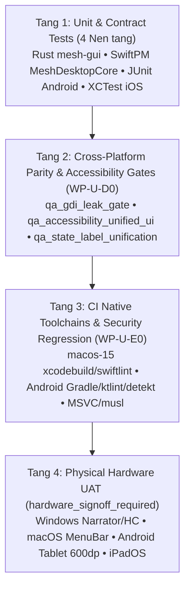

# Kế Hoạch Kiểm Thử Toàn Diện — Unified UI & Bilingual Experience (`v0.4.0`)

| Trường thông tin | Chi tiết |
| :--- | :--- |
| **Tên dự án** | Mesh VPN — Self-Hosted Secure Mesh Overlay Network |
| **Phiên bản mục tiêu** | `v0.4.0` (Windows `MeshVPN.exe` · macOS `Mesh VPN.app` · Android Compose · iOS SwiftUI) |
| **Mã tài liệu** | `QA-TP-UUI-001` |
| **Phiên bản tài liệu** | `1.0` |
| **Ngày cập nhật** | `2026-11-21` |
| **Tác giả** | `WP-U-D0` QA & Cross-Platform Integration (`US-131, 132, 135..139`) |
| **Tài liệu tham chiếu** | `docs/01-discovery/unified-ui-readiness-requirements.md` v1.1 (`213` canonical keys), `docs/03-system-design/unified-ui-{adr,contracts-and-tokens,coding-standards}.md` (`ADR-027..031`), `docs/04-sprint-management/unified-ui-sprint-backlog.md` (`WP-U-A0..WP-U-E0`) |
| **Trạng thái** | **GROUNDED FOR WAVE U-D / PRE-WAVE U-E GATE** |

---

## 1. Mục tiêu & Nguyên tắc Phân tách Bằng chứng 3 Tầng

Kế hoạch kiểm thử này xác lập ma trận xác minh cho toàn bộ **Unified UI `v0.4.0`** trên 4 nền tảng (**Windows 10/11**, **macOS 13+**, **Android API 26+**, **iOS 15.0+**), tuân thủ nghiêm ngặt nguyên tắc phân tách 3 tầng bằng chứng (không suy diễn hay giả lập kết quả công cụ chưa chạy):

1. **`VERIFIED_ON_WINDOWS_HOST`**: Các bài kiểm thử Rust, kiểm tra định dạng (`rustfmt`), phân tích tĩnh (`clippy -D warnings`), kiểm tra rò rỉ GDI `100` chu kỳ (`GetGuiResources`), kiểm tra truy cập bàn phím/High-Contrast/MSAA, kiểm tra hợp đồng đa nền tảng, và ngân sách nhị phân release `MeshVPN.exe <= 6 MiB` (`PE Subsystem == 2`) chạy trực tiếp trên máy chủ kiểm định Windows.
2. **`PENDING_CI_RUNNER`**: Các bài kiểm thử bắt buộc chạy trên runner GitHub Actions OS đích:
   - `macos-15`: `swift test` (`MeshDesktopCore`), `xcodegen`, `swiftlint lint --strict`, `xcodebuild test -scheme MeshVPNApp CODE_SIGNING_ALLOWED=NO` (macOS) và `xcodebuild test -scheme MeshApp CODE_SIGNING_ALLOWED=NO` (iOS Simulator).
   - `ubuntu-latest`: Android `./gradlew ktlintCheck detekt lintDebug lintVitalRelease testDebugUnitTest` + `connectedAndroidTest` (nếu có emulator) và Rust cross-check `x86_64-unknown-linux-musl` (`linux_gui.rs`).
   - `windows-latest`: Native MSVC `scripts/check.ps1 -Cross` & `scripts/run-desktop-qa.ps1`.
3. **`hardware_signoff_required`**: Nghiệm thu tương tác trên thiết bị vật lý thật theo `docs/06-operations/unified-ui-hardware-acceptance-protocol.md` (Windows Narrator Tab traversal + High-Contrast visual, macOS Dark/Light/Retina, Android Tablet `>= 600 dp` + Notification semantic tint, iPad `.regular` 2-column `LazyVGrid`).

---

## 2. Kiến trúc Chiến lược Kiểm thử 4 Tầng



---

## 3. Phạm vi Kiểm thử `WP-U-D0` (`US-131, 132, 135, 136, 137, 138, 139` = `24 SP`)

| Story | SP / MoSCoW | Hạng mục Kiểm chứng | Bộ kiểm thử Tự động | Tầng Xác minh |
|---|:---:|---|---|---|
| **US-131** | `5` / `Must` | Bộ chọn ngôn ngữ 3 chế độ (`System / Tiếng Việt / English`) không restart daemon; bất biến `SEC-05` `"authentication failed"` & `OPS-01` log tiếng Anh | `i18n_parity_windows.rs`, `qa_state_label_unification.rs` (`test_locale_selector_all_platforms`, `test_sec05_ops01_invariant_locale_vi`), `MeshL10nTests.swift`, `MeshVPNAppTests.swift`, `LocaleHelperTest.kt`, `LocalizationParityTests.swift` | `VERIFIED_ON_WINDOWS_HOST` (Rust) / `PENDING_CI_RUNNER` (macOS/Android/iOS) |
| **US-132** | `2` / `Must` | Đồng nhất nhãn trạng thái chuẩn 8/10 trạng thái (`ADR-030`): Windows `display_label` (giữ `label()` cho `linux_gui.rs`), macOS `displayTitle` (`Agent Unavailable`, `Re-auth Required`, `Device Revoked`, `Attention Required`), Android `daemonStateLabelRes` (`R.string.*`, 0 raw enum) | `qa_state_label_unification.rs` (`test_display_label_revoked_device_revoked`, `test_display_label_error_attention_required`, `test_label_still_accessible_for_linux_gui`, `test_state_label_unified_8_states_windows_macos`, `test_android_canonical_label_not_raw_enum`), `DesktopCoreTests.swift`, `ThemeAndNotificationTokensTest.kt` | `VERIFIED_ON_WINDOWS_HOST` (Rust) / `PENDING_CI_RUNNER` (macOS/Android) |
| **US-135** | `5` / `Must` | Điều hướng phím `Tab`/`Shift+Tab` Windows (`WS_TABSTOP`, `WS_EX_CONTROLPARENT`, `IsDialogMessageW`, `WM_GETDLGCODE -> DLGC_WANTTAB`) và chế độ High-Contrast (`SPI_GETHIGHCONTRAST` `cbSize`/`uiParam`) | `qa_accessibility_unified_ui.rs` (`test_wm_getdlgcode_dlgc_wanttab`, `test_detect_high_contrast_cbsize_and_palette_contract`), `window.rs::tests` | `VERIFIED_ON_WINDOWS_HOST` + `hardware_signoff_required` (Narrator / HC visual) |
| **US-136** | `3` / `Should` | Cổng chống rò rỉ GDI Handle Windows (`ADR-027`): `100` chu kỳ tạo/vẽ/hủy palette, `OwnedMemDc`, double-buffer, owner-draw, icon -> `GetGuiResources(GR_GDIOBJECTS)` `delta == 0` và tổng `< 5_000` | `qa_gdi_leak_gate.rs` (`test_gdi_handle_lifecycle`, `test_gdi_owned_mem_dc_double_buffer_and_paint_guard_100_cycles`) | `VERIFIED_ON_WINDOWS_HOST` |
| **US-137** | `3` / `Should` | Đồng bộ màu ngữ nghĩa thông báo/badge (`#16A34A`, `#D97706`, `#DC2626`, `#6B7280`): Android `NotificationCompat.Builder.setColor()` + text 8 trạng thái, iOS `StatusBadge`, macOS `MenuBarStatusGroup` (`reauthRequired` = Amber) | `qa_state_label_unification.rs` (`test_notification_badge_semantic_colors_cross_platform`), `ThemeAndNotificationTokensTest.kt`, `UnifiedUiFoundationTests.swift`, `DesktopStoreIconMappingTests.swift` | `VERIFIED_ON_WINDOWS_HOST` (Rust) / `PENDING_CI_RUNNER` (Android/iOS/macOS) |
| **US-138** | `3` / `Could` | Bố cục thích ứng 2 cột cho Tablet/iPad: Android `PeersScreen.kt` `LazyVerticalGrid(GridCells.Fixed(2))` tại `>= 600 dp` (1 cột khi `< 600 dp`, giữ nguyên 100% `testTag`); iOS `PeersView.swift` `LazyVGrid` 2 cột ở `.regular` / 1 cột ở `.compact` | `qa_state_label_unification.rs` (`test_tablet_layout_breakpoint_600dp`), `PeersFilteringTest.kt` (`tabletLayoutBreakpoint600dpUsesTwoColumnsAndPortraitOneColumn`), `UnifiedUiFoundationTests.swift` (`test_peersAdaptiveLayout_usesTwoColumnsForRegularAndOneForCompact`) | `VERIFIED_ON_WINDOWS_HOST` (Rust) / `PENDING_CI_RUNNER` (Android/iOS) + `hardware_signoff_required` |
| **US-139** | `3` / `Could` | Hỗ trợ trình đọc màn hình Windows MSAA qua `SetWindowTextW` label proxy + `NotifyWinEvent(EVENT_OBJECT_NAMECHANGE)` với `0` `IAccessible` COM, tự bỏ qua an toàn khi `hwnd == 0` | `qa_accessibility_unified_ui.rs` (`test_msaa_screen_reader_label_proxy_notify_win_event_zero_iaccessible`), `window.rs::tests` | `VERIFIED_ON_WINDOWS_HOST` + `hardware_signoff_required` (Narrator) |

---

## 4. Danh mục Bộ Kiểm thử Tự động trong Repo (`v0.4.0`)

### 4.1. Rust (`crates/mesh-gui`) — `VERIFIED_ON_WINDOWS_HOST`
- `crates/mesh-gui/src/{app,diagnostics_view,i18n,main,onboarding,peers_view,prefs,status_view,theme,window}.rs` (unit tests nội tuyến trong bin target `MeshVPN`)
- `crates/mesh-gui/tests/gui_unit_tests.rs` (hồi quy `v0.3.0`: 8 states, Zero-TOFU, `MGH1`, `ClipboardSecretGuard`, `UnprivilegedSinkWriter`, `test_no_secrets_in_outputs`)
- `crates/mesh-gui/tests/gui_windows_unified_ui.rs` (`WP-U-B1`: 3-tab bar, `display_label`, 4-state peer filter, non-secret copy boundary, 10-state tray tone, GDI RAII)
- `crates/mesh-gui/tests/i18n_parity_windows.rs` (`WP-U-C1`: đối chiếu 1-1 đủ `213` khóa Discovery v1.1 §4.1 EN/VI, `t_for` thuần túy, `SEC-05`, tray VI, live switch không restart daemon, `WM_SETTINGCHANGE`, `ui-prefs.json` fallback)
- `crates/mesh-gui/tests/qa_gdi_leak_gate.rs` (`WP-U-D0`: `100` chu kỳ create/paint/destroy -> `delta == 0`, `< 5_000`)
- `crates/mesh-gui/tests/qa_accessibility_unified_ui.rs` (`WP-U-D0`: `WM_GETDLGCODE -> DLGC_WANTTAB`, `WS_TABSTOP`, `IsDialogMessageW`, `SPI_GETHIGHCONTRAST`, MSAA `SetWindowTextW` + `NotifyWinEvent`, `0` `IAccessible`)
- `crates/mesh-gui/tests/qa_state_label_unification.rs` (`WP-U-D0`: đồng nhất nhãn trạng thái Windows/macOS/Android, 3-way locale selector 4 nền tảng, `SEC-05`/`OPS-01` ở `vi`, breakpoint `600 dp` / `.regular`, màu ngữ nghĩa notification/badge)
- `crates/mesh-gui/tests/qa_desktop_security_audit.rs` & `qa_desktop_e2e_ipc.rs` (kiểm toán bảo mật & E2E IPC 8 pha)

### 4.2. macOS / Android / iOS Native Suites — `PENDING_CI_RUNNER`
- **macOS (`macos-15`)**: `DesktopCoreTests.swift`, `DesktopStoreTests.swift`, `DesktopStoreIconMappingTests.swift`, `MeshL10nTests.swift`, `UdsIpcAndBugreportTests.swift`, `MeshVPNAppTests.swift`.
- **Android (`ubuntu-latest`)**: `LocaleHelperTest.kt`, `ThemeAndNotificationTokensTest.kt`, `PeersFilteringTest.kt`, `MeshMainViewModelTest.kt`, `FfiErrorMapperTest.kt`, `OnboardingInputValidatorTest.kt`, `UnderlayStateClassifierTest.kt`, `SafeLoggerTest.kt`, `DirectBootAndKeystoreTest.kt`, `AndroidPlatformBridgeTest.kt`, `SplitTunnelBuilderValidatorTest.kt`, cùng instrumented tests `OnboardingComposeUiTest.kt` (locale `en` giữ nguyên) và `OnboardingComposeUiTestVi.kt` (locale `vi`).
- **iOS (`macos-15`)**: `UnifiedUiFoundationTests.swift`, `LocalizationParityTests.swift`, `TunnelLifecycleAndAppViewModelTests.swift`, `UniFFIBindingsAndSecurityTests.swift`, `KeychainDekStoreTests.swift`, `TunnelIpcAndAppGroupTests.swift`, `TunnelNetworkSettingsBuilderTests.swift`.

---

## 5. Lệnh Thực thi Kiểm định Chuẩn

```powershell
# Windows Host (Rust + Release Binary Budget <= 6 MiB + PE Subsystem == 2)
powershell -ExecutionPolicy Bypass -File scripts/run-desktop-qa.ps1
powershell -ExecutionPolicy Bypass -File scripts/check.ps1 -Cross
```

```sh
# macOS (GitHub Actions macos-15)
swift test --package-path desktop/macos/MeshDesktopCore
(cd desktop/macos && xcodegen generate && swiftlint lint --strict)
xcodebuild test -project desktop/macos/MeshVPNApp.xcodeproj -scheme MeshVPNApp -destination "platform=macOS" CODE_SIGNING_ALLOWED=NO

# Android (GitHub Actions ubuntu-latest)
(cd mobile/android && ./gradlew ktlintCheck detekt lintDebug lintVitalRelease testDebugUnitTest)

# iOS (GitHub Actions macos-15)
(cd mobile/ios && xcodegen generate && swiftlint lint --strict)
xcodebuild test -project mobile/ios/MeshApp.xcodeproj -scheme MeshApp -destination "platform=iOS Simulator,name=iPhone 16" CODE_SIGNING_ALLOWED=NO
```
