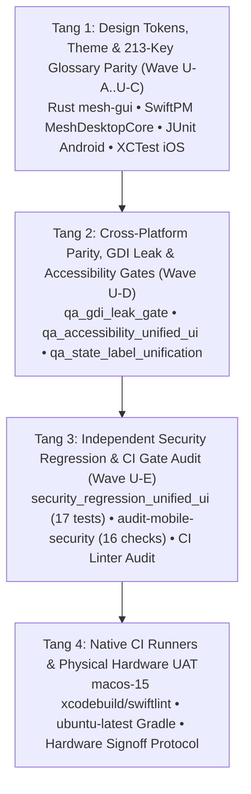

# Kế Hoạch Kiểm Thử Toàn Diện — Unified UI & Bilingual Experience (`v0.4.0`)

| Trường thông tin | Chi tiết |
| :--- | :--- |
| **Tên dự án** | Mesh VPN — Self-Hosted Secure Mesh Overlay Network |
| **Phiên bản mục tiêu** | `v0.4.0` (Windows `MeshVPN.exe` · macOS `Mesh VPN.app` · Android Compose · iOS SwiftUI) |
| **Mã tài liệu** | `QA-TP-UUI-001` |
| **Phiên bản tài liệu** | `1.2` (Đồng bộ truy vết `22/22 Stories = 93 SP`, đóng `BUG-UUI-001..004` & khắc phục Gate 3 Round 1) |
| **Ngày cập nhật** | `2026-11-21` |
| **Tác giả** | `WP-U-D0`, `@qa-ui` (`WP-U-E0`: `US-118..US-139`) & `@dev-fix-g3` |
| **Tài liệu tham chiếu** | `docs/01-discovery/unified-ui-readiness-requirements.md` v1.1 (`38 UUI-*`, `213` keys), `docs/02-product-planning/unified-ui-product-backlog.md` v1.1 (`22 Stories / 93 SP`), `docs/03-system-design/unified-ui-{adr,contracts-and-tokens,coding-standards}.md` (`ADR-027..031`), `docs/04-sprint-management/unified-ui-sprint-backlog.md` v1.2 (`WP-U-A0..WP-U-E0`) |
| **Trạng thái** | **WAVE U-E & GATE 3 ROUND 1 REMEDIATION VERIFIED (`QA-DOD-UUI-001` v1.3 · `BUG-UUI-001..004` `CLOSED`)** |

---

## 1. Mục Tiêu & Nguyên Tắc Phân Tách Bằng Chứng 3 Tầng

Kế hoạch kiểm thử này bao phủ toàn bộ **`22/22` User Stories (`93 SP` = `16 Must [75 SP]` + `4 Should [12 SP]` + `2 Could [6 SP]`; Wave `U-A` `WP-U-A0` = `0 Stories / 0 SP`)**, **`38/38` yêu cầu `UUI-01..UUI-38`**, **`ADR-027..031`**, và **`213/213` khóa từ điển song ngữ (`en`/`vi`)** của **Unified UI `v0.4.0`** trên 4 nền tảng (**Windows 10/11**, **macOS 13+**, **Android API 26+**, **iOS 15.0+**), tuân thủ nghiêm ngặt nguyên tắc trung thực 3 tầng bằng chứng:

1. **`VERIFIED_ON_WINDOWS_HOST`**: Các bài kiểm thử tự động Rust (`mesh-gui` `146/146`, `mesh-sys -- gui_windows` `12/12`), kiểm tra định dạng (`rustfmt`), phân tích tĩnh (`clippy -D warnings`), `cargo-deny check advisories bans licenses sources`, kiểm toán bảo mật di động (`lab/mobile/audit-mobile-security.ps1` `16/16`), kiểm toán đối xứng `213/213` khóa từ điển trên cả 4 kho tài nguyên + cấu hình `knownRegions`/`CFBundleLocalizations`, mô phỏng tĩnh các quy tắc linter CI (`detekt.yml`, `.swiftlint.yml`, `strings.xml` Android Lint — `0` vi phạm, `BUG-UUI-001..004` `CLOSED`), kiểm tra rò rỉ GDI `100` chu kỳ (`GetGuiResources` `delta == 0`), và ngân sách nhị phân release `MeshVPN.exe <= 6 MiB` (`PE Subsystem == 2`) chạy trực tiếp trên máy chủ Windows.
2. **`PENDING_CI_RUNNER`**: Các bài kiểm thử bắt buộc chạy trên runner GitHub Actions OS đích:
   - `macos-15` (`.github/workflows/ci.yml` & `mobile-ios.yml`): `swift test` (`MeshDesktopCore`), `xcodegen`, `swiftlint lint --strict`, `xcodebuild test -scheme MeshVPNApp CODE_SIGNING_ALLOWED=NO` (macOS) và `xcodebuild test -scheme MeshApp CODE_SIGNING_ALLOWED=NO` (iOS Simulator).
   - `ubuntu-latest` (`.github/workflows/mobile-android.yml` & `ci.yml`): Android `./gradlew ktlintCheck detekt lintDebug lintVitalRelease testDebugUnitTest` (+ `OnboardingComposeUiTest` EN & `OnboardingComposeUiTestVi` VI khi có emulator) và Rust cross-check `x86_64-unknown-linux-musl` (`linux_gui.rs`).
   - `windows-latest` (`.github/workflows/ci.yml`): Native MSVC `scripts/check.ps1 -Cross` & `scripts/run-desktop-qa.ps1`.
3. **`hardware_signoff_required`**: Nghiệm thu tương tác trên thiết bị vật lý thật theo `docs/06-operations/unified-ui-hardware-acceptance-protocol.md` (Windows Narrator Tab traversal + High-Contrast *Desert*/*Aquatic* visual, macOS Dark/Light/Retina, Android Tablet `>= 600 dp` + `FLAG_SECURE` + Notification semantic tint, iPad `.regular` 2-column `LazyVGrid` + Face ID/Touch ID).

---

## 2. Kiến Trúc Chiến Lược Kiểm Thử 4 Tầng



---

## 3. Ma Trận Bao Phủ Toàn Bộ `22` User Stories (`93 SP` · Wave U-B .. Wave U-E)

> **Ghi chú Wave `U-A` (`WP-U-A0`)**: Gói nền tảng `0 Stories / 0 SP` (đồng bộ SemVer `0.4.0`, bật `Win32_Graphics_Dwm`/`Win32_UI_Accessibility`, khung `OwnedMemDc`/`PaintGuard` và các tệp khởi tạo `theme.rs`/`i18n.rs`/`prefs.rs`/`status_view.rs`). Toàn bộ `22` Stories (`US-118..US-139` = `93 SP`) dưới đây khớp **1:1** với `unified-ui-product-backlog.md` v1.1 & `unified-ui-sprint-backlog.md` v1.2:

| Wave / WP (Lead) | Story | SP / MoSCoW | Mã `UUI-*` | Hạng mục Kiểm chứng Cốt lõi | Bộ kiểm thử Tự động Đối ứng | Tầng Xác minh |
| :---: | :--- | :---: | :--- | :--- | :--- | :--- |
| **U-B1 (`WP-U-B1`)** | **US-118** | `8` / `Must` | `UUI-01, UUI-03, UUI-33` | 3-Tab Navigation Desktop (Windows `window.rs` + macOS `DashboardWindowView.swift` `Window` + `MenuBarExtra` xuyên suốt mọi trạng thái enrolled), Onboarding tách biệt kèm quick prefs khi `!enrolled`, Zone 3 Maintenance CTAs, giữ tương thích `linux_gui.rs` | `gui_windows_unified_ui.rs`, `window.rs::tests`, `DesktopStoreTests.swift`, `MeshVPNAppTests.swift` | `VERIFIED_ON_WINDOWS_HOST` (Rust) / `PENDING_CI_RUNNER` (`macos-15`) |
| **U-B3 (`WP-U-B3`)** | **US-119** | `5` / `Must` | `UUI-02, UUI-03, UUI-33` | Bottom Tab Bar Mobile 3 tab (`Status` · `Peers` · `Settings`) trên Android (`MainActivity.kt`) & iOS (`MainTabView.swift`), Onboarding tách biệt kèm chọn Language/Appearance (`OnboardingQuickPreferencesCard` / `OnboardingView.swift`), SPKI Pin auto-lock khi rời Settings, không bật `FLAG_SECURE` ở tab `Peers` | `MeshMainViewModelTest.kt`, `security_regression_unified_ui.rs` (`test_android_flag_secure_scope_not_peers_tab`), `UnifiedUiFoundationTests.swift` | `VERIFIED_ON_WINDOWS_HOST` (contract) / `PENDING_CI_RUNNER` (`ubuntu-latest`, `macos-15`) |
| **U-B1 (`WP-U-B1`)** | **US-120** | `5` / `Must` | `UUI-04, UUI-05` | Peers Zone: tìm kiếm case-insensitive theo name/FQDN/IP/`nodeId` + 4-state filter chips (`All / Online / Direct / Relay`) lọc chuẩn `online &&` + count badge trên cả 4 nền tảng, bảo toàn `filter_peers(peers, query)` 2 tham số cho `linux_gui.rs` | `peers_view.rs::tests`, `gui_windows_unified_ui.rs`, `DesktopCoreTests.swift`, `PeersFilteringTest.kt`, `UnifiedUiFoundationTests.swift` | `VERIFIED_ON_WINDOWS_HOST` (Rust) / `PENDING_CI_RUNNER` |
| **U-B1 (`WP-U-B1`)** | **US-121** | `3` / `Must` | `UUI-06, UUI-07` | Peers Zone: sao chép 1 chạm Overlay IP & FQDN (simple copy + Toast xác nhận), tách biệt tuyệt đối khỏi `ClipboardSecretGuard` 30s (`mpk_*` / `mesh://join`) và `FLAG_SECURE` | `gui_windows_unified_ui.rs`, `security_regression_unified_ui.rs` (`test_clipboard_no_secret_guard_on_ip_copy`), `PeersFilteringTest.kt`, `UniFFIBindingsAndSecurityTests.swift` | `VERIFIED_ON_WINDOWS_HOST` (Rust + cross-platform audit) / `PENDING_CI_RUNNER` |
| **U-B1 (`WP-U-B1`)** | **US-122** | `8` / `Must` | `UUI-08, UUI-09, UUI-23, UUI-24, UUI-25, UUI-32` | Windows GDI/DWM Modern: rounded cards, status pills ngữ nghĩa, thanh 3 tab `BS_OWNERDRAW` + điều hướng `←`/`→`, Dark/Light titlebar `DwmSetWindowAttribute`, `WS_CLIPCHILDREN`, `MeshVPN.exe <= 6 MiB` | `mesh-sys -- gui_windows` (`12` tests), `gui_windows_unified_ui.rs`, `window.rs::tests`, `status_view.rs::tests` | `VERIFIED_ON_WINDOWS_HOST` |
| **U-B1 (`WP-U-B1`)** | **US-123** | `3` / `Must` | `UUI-13, UUI-14, UUI-26, UUI-31, UUI-32` | Windows DPI Per-Monitor V2 (`WM_DPICHANGED`, `calc_font_height_for_dpi`, regenerate icon) & vòng đời RAII (`OwnedGdiObj`, `OwnedMemDc`, `PaintGuard`, double-buffering) `0` rò rỉ | `mesh-sys -- gui_windows`, `gui_windows_unified_ui.rs`, `qa_gdi_leak_gate.rs` | `VERIFIED_ON_WINDOWS_HOST` |
| **U-B2 (`WP-U-B2`)** | **US-124** | `5` / `Must` | `UUI-10, UUI-11, UUI-12, UUI-15` | Design Token Color System Light/Dark (`ADR-030`) & 3-way Theme Selector (`System / Light / Dark`) trên macOS (`ThemeManager.swift`), Android (`MeshTheme.kt`, `BUG-UUI-001` `CLOSED`), iOS (`ThemeManager.swift`) | `MeshVPNAppTests.swift`, `ThemeAndNotificationTokensTest.kt`, `UnifiedUiFoundationTests.swift`, `theme.rs::tests` | `VERIFIED_ON_WINDOWS_HOST` (Rust + static) / `PENDING_CI_RUNNER` |
| **U-C1 (`WP-U-C1`)** | **US-125** | `3` / `Should` | `UUI-27` | Windows `WM_SETTINGCHANGE` / `WM_THEMECHANGED` cập nhật theme trực tiếp từ Registry `AppsUseLightTheme` và trạng thái High-Contrast (không dùng API ẩn `ShouldAppsUseDarkMode`) | `window.rs::tests` (`test_window_wm_settingchange_rebuilds_palette_for_system_theme_mode`), `mesh-sys -- gui_windows` | `VERIFIED_ON_WINDOWS_HOST` |
| **U-B1 (`WP-U-B1`)** | **US-126** | `3` / `Should` | `UUI-15, UUI-35` | Bản đồ màu ngữ nghĩa 10 trạng thái cho Tray Windows (vector shield DPI + `9` mục `IDM_*` song ngữ) & Menu Bar macOS (`MenuBarExtra` SF Symbols + màu ngữ nghĩa) | `gui_windows_unified_ui.rs` (`test_tray_state_color_mapping_10_states`), `DesktopStoreIconMappingTests.swift` | `VERIFIED_ON_WINDOWS_HOST` (Win) / `PENDING_CI_RUNNER` (`macos-15`) |
| **U-C1 (`WP-U-C1`)** | **US-127** | `5` / `Must` | `UUI-16, UUI-20, UUI-21, UUI-22, UUI-35` | Windows i18n: bảng chuỗi biên dịch tĩnh `EN_STRINGS`/`VI_STRINGS` (`213/213` khóa chuẩn) + `tr_inline` nhãn phụ + Tray song ngữ, đổi trực tiếp không khởi động lại `meshd` | `i18n_parity_windows.rs` (`21` tests), `i18n.rs::tests` | `VERIFIED_ON_WINDOWS_HOST` |
| **U-C2 (`WP-U-C2`)** | **US-128** | `5` / `Must` | `UUI-17, UUI-20, UUI-21, UUI-22, UUI-35` | macOS i18n: `MeshL10n` + `{en,vi}.lproj/Localizable.strings` (`213/213` khóa) + `knownRegions`/`CFBundleLocalizations` + `MeshL10n.inline`, `BUG-UUI-004` `CLOSED` | `MeshL10nTests.swift`, `MeshVPNAppTests.swift`, kiểm toán tĩnh `213/213` khóa | `VERIFIED_ON_WINDOWS_HOST` (parity) / `PENDING_CI_RUNNER` (`macos-15`) |
| **U-C3 (`WP-U-C3`)** | **US-129** | `5` / `Must` | `UUI-18, UUI-20, UUI-21, UUI-22` | Android i18n: `values/strings.xml` & `values-vi/strings.xml` (`230/230` mục đối xứng = `213` chuẩn + `17` kế thừa) + `LocaleHelper` `ContextWrapper` + tự cập nhật `NotificationChannel`, giữ nguyên `OnboardingComposeUiTest.kt` (`en`) + thêm `OnboardingComposeUiTestVi.kt` (`vi`), `BUG-UUI-002..003` `CLOSED` | `LocaleHelperTest.kt`, `OnboardingComposeUiTest.kt`, `OnboardingComposeUiTestVi.kt`, kiểm toán tĩnh `230/230` XML | `VERIFIED_ON_WINDOWS_HOST` (parity + static `0` lỗi) / `PENDING_CI_RUNNER` (`ubuntu-latest`) |
| **U-C4 (`WP-U-C4`)** | **US-130** | `3` / `Must` | `UUI-19, UUI-20, UUI-21, UUI-22` | iOS i18n: `Localizable.xcstrings` (`213/213` khóa EN/VI `translated`) + `knownRegions: [en, vi, Base]` + `CFBundleLocalizations` + `L10n.tr`/`L10n.inline` đổi trực tiếp qua `Bundle.main` không khởi động lại `PacketTunnelProvider` | `LocalizationParityTests.swift`, kiểm toán tĩnh JSON `213/213` khóa | `VERIFIED_ON_WINDOWS_HOST` (JSON/plist parity) / `PENDING_CI_RUNNER` (`macos-15`) |
| **U-D (`WP-U-D0`)** | **US-131** | `5` / `Must` | `UUI-20, UUI-21, UUI-22` | Bộ chọn ngôn ngữ 3 chế độ (`System / Tiếng Việt / English`) trên 4 nền tảng (cả sau enroll lẫn trước enroll), bảo toàn `SEC-05` `"authentication failed"` & `OPS-01` log tiếng Anh | `i18n_parity_windows.rs`, `qa_state_label_unification.rs`, `security_regression_unified_ui.rs`, `MeshVPNAppTests.swift`, `LocalizationParityTests.swift` | `VERIFIED_ON_WINDOWS_HOST` (Rust + static) / `PENDING_CI_RUNNER` |
| **U-D (`WP-U-D0`)** | **US-132** | `2` / `Must` | `UUI-33` | Đồng nhất nhãn trạng thái chuẩn 8/10 trạng thái (`ADR-030`) giữa Windows (`display_label`), macOS (`displayTitle`), Android (`daemonStateLabelRes`), và iOS (`StatusBadge`) | `qa_state_label_unification.rs` (`11` tests) | `VERIFIED_ON_WINDOWS_HOST` |
| **U-E (`WP-U-E0`)** | **US-133** | `5` / `Must` | `UUI-34` | Kiểm toán & hồi quy toàn diện bất biến bảo mật (`SEC-01`, `SEC-04`, `SEC-05`, `MGH1` `0` argv secret, `FLAG_SECURE`, iOS Biometrics, `13` trường `AgentStatusResponse`, `ui-prefs.json` `0` secrets) | `crates/mesh-gui/tests/security_regression_unified_ui.rs` (`17` tests gồm `9/9` bài bắt buộc) + `lab/mobile/audit-mobile-security.ps1` (`16/16`) + `lab/unified-ui/security-audit.md` | `VERIFIED_ON_WINDOWS_HOST` (**PASS 100%**) |
| **U-E (`WP-U-E0`)** | **US-134** | `3` / `Must` | `UUI-37` | Kiểm thử không hồi quy toàn bộ suite cũ + mới, ngân sách nhị phân `MeshVPN.exe <= 6 MiB` (`2.57 MiB`), kiểm toán tĩnh linter 4 nền tảng (`BUG-UUI-001..004` `CLOSED`) & xác nhận DoD `v0.4.0` | `scripts/run-desktop-qa.{ps1,sh}`, `lab/unified-ui/regression-report.md`, `docs/05-quality-assurance/bug-reports.md`, `unified-ui-dod-verification.md` | `VERIFIED_ON_WINDOWS_HOST` (**PASS 100%**) / `PENDING_CI_RUNNER` |
| **U-D (`WP-U-D0`)** | **US-135** | `5` / `Must` | `UUI-28, UUI-29` | Điều hướng bàn phím Windows (`handle_dialog_keydown_navigation` thoát `Tab`/`Shift+Tab` khỏi `ES_MULTILINE` `EDIT` qua `GetNextDlgTabItem` + `←`/`→` thanh 3 tab) & High-Contrast `GetSysColor` (*Desert* & *Aquatic*) | `mesh-sys -- gui_windows` (`test_gui_windows_multiline_edit_tab_escape_and_tab_bar_arrows`), `window.rs::tests`, `theme.rs::tests`, `qa_accessibility_unified_ui.rs` | `VERIFIED_ON_WINDOWS_HOST` + `hardware_signoff_required` |
| **U-D (`WP-U-D0`)** | **US-136** | `3` / `Should` | `UUI-31` | Cổng chống rò rỉ GDI Handle Windows (`100` chu kỳ create/paint/destroy -> `GetGuiResources` `delta == 0`, tổng `< 5_000`) | `qa_gdi_leak_gate.rs` (`10` tests) | `VERIFIED_ON_WINDOWS_HOST` |
| **U-D (`WP-U-D0`)** | **US-137** | `3` / `Should` | `UUI-36` | Đồng bộ màu ngữ nghĩa thông báo/badge (`#16A34A`, `#D97706`, `#DC2626`, `#6B7280`) trên Android `NotificationCompat` & iOS `StatusBadge` | `qa_state_label_unification.rs`, `ThemeAndNotificationTokensTest.kt`, `UnifiedUiFoundationTests.swift` | `VERIFIED_ON_WINDOWS_HOST` (contract) / `PENDING_CI_RUNNER` |
| **U-D (`WP-U-D0`)** | **US-138** | `3` / `Could` | `UUI-38` | Bố cục thích ứng 2 cột cho Tablet Android (`>= 600 dp`) và iPadOS (`.regular`), giữ nguyên 100% `testTag` | `qa_state_label_unification.rs`, `PeersFilteringTest.kt`, `UnifiedUiFoundationTests.swift` | `VERIFIED_ON_WINDOWS_HOST` (contract) / `PENDING_CI_RUNNER` + `hardware_signoff_required` |
| **U-D (`WP-U-D0`)** | **US-139** | `3` / `Could` | `UUI-30` | Trình đọc màn hình Windows MSAA (`SetWindowTextW` label proxy + `NotifyWinEvent(EVENT_OBJECT_NAMECHANGE)`, `0` `IAccessible` COM) | `qa_accessibility_unified_ui.rs`, `window.rs::tests` | `VERIFIED_ON_WINDOWS_HOST` + `hardware_signoff_required` |
| **Tổng cộng** | **`22` Stories** | **`93 SP`** (`16M/4S/2C`) | **`38/38 UUI-*`** | **Khớp 100% `unified-ui-product-backlog.md` v1.1 & `unified-ui-sprint-backlog.md` v1.2** | **`146` `mesh-gui` + `12` `mesh-sys` + native CI suites** | **3-Tier Honest Gate** |

---

## 4. Danh Mục Bộ Kiểm Thử Tự Động Trong Repo (`v0.4.0`)

### 4.1. Rust (`crates/mesh-gui` & `crates/mesh-sys`) — `VERIFIED_ON_WINDOWS_HOST`
- `crates/mesh-gui/src/{app,clipboard,diagnostics_view,i18n,main,onboarding,peers_view,prefs,status_view,theme,window}.rs` (unit tests nội tuyến trong bin target `MeshVPN`: `21` tests gồm High-Contrast *Desert*/*Aquatic* `GetSysColor`, 3-tab arrow nav, non-enrolled zero-RECT-overlap layout)
- `crates/mesh-gui/tests/gui_unit_tests.rs` (hồi quy `v0.3.0`: 8 states, Zero-TOFU, `MGH1`, `ClipboardSecretGuard`, `UnprivilegedSinkWriter`, `test_no_secrets_in_outputs`)
- `crates/mesh-gui/tests/gui_windows_unified_ui.rs` (`WP-U-B1`: 3-tab bar, `display_label`, 4-state peer filter, non-secret copy boundary, 10-state tray tone, GDI RAII)
- `crates/mesh-gui/tests/i18n_parity_windows.rs` (`WP-U-C1`: đối chiếu 1-1 đủ `213` khóa Discovery v1.1 §4.1 EN/VI, `t_for` thuần túy, `SEC-05`, tray VI, live switch không restart daemon, `WM_SETTINGCHANGE`, `ui-prefs.json` fallback)
- `crates/mesh-gui/tests/qa_gdi_leak_gate.rs` (`WP-U-D0`: `100` chu kỳ create/paint/destroy -> `delta == 0`, `< 5_000`)
- `crates/mesh-gui/tests/qa_accessibility_unified_ui.rs` (`WP-U-D0` + `HIGH-UUI-G3-01`: `handle_dialog_keydown_navigation` thoát `ES_MULTILINE` `EDIT` trước `IsDialogMessageW`, `on_tab_arrow_key` 3 tab `←`/`→`, `WS_TABSTOP`, `SPI_GETHIGHCONTRAST` + `GetSysColor`, MSAA `SetWindowTextW` + `NotifyWinEvent`, `0` `IAccessible`)
- `crates/mesh-gui/tests/qa_state_label_unification.rs` (`WP-U-D0`: đồng nhất nhãn trạng thái Windows/macOS/Android, 3-way locale selector 4 nền tảng, `SEC-05`/`OPS-01` ở `vi`, breakpoint `600 dp` / `.regular`, màu ngữ nghĩa notification/badge)
- `crates/mesh-gui/tests/qa_desktop_security_audit.rs` & `qa_desktop_e2e_ipc.rs` (kiểm toán bảo mật & E2E IPC 8 pha)
- `crates/mesh-gui/tests/security_regression_unified_ui.rs` (`WP-U-E0`: `9/9` bài kiểm thử hồi quy bảo mật bắt buộc của `US-133` cùng unit tests mô-đun đi kèm -> `17` tests)
- `crates/mesh-sys/src/gui_windows.rs` (`cargo test -p mesh-sys -- gui_windows`: `12` tests GDI/DWM/Shell/High-Contrast `GetSysColor` RAII + Win32 thực tế thoát `Tab` khỏi multiline readonly `EDIT` và `←`/`→` 3 tab)

### 4.2. macOS / Android / iOS Native Suites — `PENDING_CI_RUNNER`
- **macOS (`macos-15`)**: `DesktopCoreTests.swift`, `DesktopStoreTests.swift`, `DesktopStoreIconMappingTests.swift`, `DesktopStoreReconnectTests.swift`, `DesktopStoreTestMocks.swift`, `MeshL10nTests.swift`, `UdsIpcAndBugreportTests.swift`, `MeshVPNAppTests.swift`.
- **Android (`ubuntu-latest`)**: `LocaleHelperTest.kt`, `ThemeAndNotificationTokensTest.kt`, `PeersFilteringTest.kt`, `MeshMainViewModelTest.kt`, `FfiErrorMapperTest.kt`, `OnboardingInputValidatorTest.kt`, `UnderlayStateClassifierTest.kt`, `SafeLoggerTest.kt`, `DirectBootAndKeystoreTest.kt`, `AndroidPlatformBridgeTest.kt`, `SplitTunnelBuilderValidatorTest.kt`, cùng instrumented tests `OnboardingComposeUiTest.kt` (locale `en` giữ nguyên) và `OnboardingComposeUiTestVi.kt` (locale `vi`).
- **iOS (`macos-15`)**: `UnifiedUiFoundationTests.swift`, `LocalizationParityTests.swift`, `TunnelLifecycleAndAppViewModelTests.swift`, `UniFFIBindingsAndSecurityTests.swift`, `KeychainDekStoreTests.swift`, `TunnelIpcAndAppGroupTests.swift`, `TunnelNetworkSettingsBuilderTests.swift`.

---

## 5. Lệnh Thực Thi Kiểm Định Chuẩn

```powershell
# Windows Host (Rust + Security Regression + Release Binary Budget <= 6 MiB + Mobile Security Audit)
powershell -ExecutionPolicy Bypass -File scripts/run-desktop-qa.ps1
powershell -ExecutionPolicy Bypass -File lab/mobile/audit-mobile-security.ps1
```

```sh
# Linux / Cross Desktop QA Gate
sh scripts/run-desktop-qa.sh

# macOS (GitHub Actions macos-15)
swift test --package-path desktop/macos/MeshDesktopCore
(cd desktop/macos && xcodegen generate && swiftlint lint --strict --config .swiftlint.yml)
xcodebuild test -project desktop/macos/MeshVPNApp.xcodeproj -scheme MeshVPNApp -destination "platform=macOS" CODE_SIGNING_ALLOWED=NO

# Android (GitHub Actions ubuntu-latest)
(cd mobile/android && ./gradlew ktlintCheck detekt lintDebug lintVitalRelease testDebugUnitTest)

# iOS (GitHub Actions macos-15)
(cd mobile/ios && xcodegen generate && swiftlint lint --strict --config .swiftlint.yml)
xcodebuild test -project mobile/ios/MeshApp.xcodeproj -scheme MeshApp -destination "platform=iOS Simulator,name=iPhone 16" CODE_SIGNING_ALLOWED=NO
```
