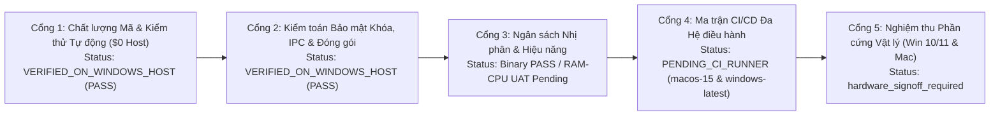

# Danh Mục Kiểm Tra Trước Khi Phát Hành (Go-Live Checklist) — Desktop GUI (`v0.3.0`)

| Trường thông tin | Chi tiết |
| :--- | :--- |
| **Tên dự án** | Mesh VPN — Self-Hosted Secure Mesh Overlay Network |
| **Phiên bản phát hành** | `v0.3.0` (Sprint 5 — Native Desktop GUI & Tray Companion cho Windows 10/11 & macOS 13+) |
| **Mã tài liệu** | `OPS-GLC-DGUI-001` |
| **Phiên bản tài liệu** | `1.0` |
| **Ngày cập nhật** | `2026-11-17` |
| **Tác giả** | Release & QA Engineering (`@qa-d-c2` / `WP-D-C2` — `US-116`) |
| **Tài liệu tham chiếu** | `docs/05-quality-assurance/desktop-gui-{test-plan,dod-verification}.md`, `docs/06-operations/desktop-gui-{hardware-acceptance-protocol,operational-runbook}.md` |
| **Quyết định Gate 3** | **AUTOMATED GATES READY (`GO`) — CONDITIONAL ON CI RUNNER & PHYSICAL HARDWARE UAT SIGN-OFF** |

---

## 1. Tóm tắt Điều kiện Go / No-Go cho Bản Phát hành `v0.3.0`

Để gắn thẻ phát hành chính thức `git tag v0.3.0` và xuất bản gói cài đặt Desktop GUI cho người dùng cuối, bản dựng phải vượt qua **5 Cổng Kiểm soát Chất lượng & Vận hành (Release Gates)** dưới đây.

---

## 2. Danh mục Kiểm tra Chi tiết theo Từng Cổng (Gate-by-Gate Checklist)

### 2.1. Cổng 1 — Chất lượng Mã Nguồn & Kiểm thử Tự động (`Code Quality & Automated QA`)

| Mã kiểm tra | Tiêu chí bắt buộc | Bằng chứng / Lệnh xác minh | Trạng thái hiện tại |
| :--- | :--- | :--- | :--- |
| **GL-CODE-01** | `cargo fmt --all -- --check` đạt `100%` không sai lệch định dạng | `scripts/run-desktop-qa.ps1` / `scripts/check.ps1` | `[x] VERIFIED_ON_WINDOWS_HOST` |
| **GL-CODE-02** | `cargo clippy --workspace --all-targets --all-features -- -D warnings` đạt `0` cảnh báo, `0` lỗi | `scripts/run-desktop-qa.ps1` / `scripts/check.ps1` | `[x] VERIFIED_ON_WINDOWS_HOST` |
| **GL-CODE-03** | `cargo deny check advisories bans licenses sources` xanh `100%` (`0` crate C/WebView/Tauri/AGPL/GPL) | `scripts/check.ps1` | `[x] VERIFIED_ON_WINDOWS_HOST` |
| **GL-CODE-04** | Bộ kiểm thử `mesh-gui` (`54` lib + `20` unit + `8` security audit + `1` E2E IPC = `83` tests) xanh `100%` | `cargo test -p mesh-gui --all-targets --all-features` | `[x] VERIFIED_ON_WINDOWS_HOST` |
| **GL-CODE-05** | Bộ kiểm thử `mesh` CLI launcher (`8/8`), `mesh-net` (`25/25`), `mesh-client` (`14/14`), `mesh-core` (`21/21`), `mesh-sys` (`16/16`) xanh `100%` | `scripts/run-desktop-qa.ps1` | `[x] VERIFIED_ON_WINDOWS_HOST` |
| **GL-CODE-06** | Quy ước kết thúc dòng nghiêm ngặt (`CRLF` cho `.ps1`/`.bat`/`.cmd`, `LF` cho `.rs`/`.sh`/`.md`/`.swift`/`.yml`, `0` UTF-8 BOM) | `scripts/check.ps1` | `[x] VERIFIED_ON_WINDOWS_HOST` |

### 2.2. Cổng 2 — Kiểm toán Bảo mật Khóa, IPC & Đóng gói (`Security & Privacy Gate`)

| Mã kiểm tra | Tiêu chí bắt buộc | Bằng chứng / Lệnh xác minh | Trạng thái hiện tại |
| :--- | :--- | :--- | :--- |
| **GL-SEC-01** | `0` lệnh gọi `.expose_secret()` và `0` khối `unsafe` trong `crates/mesh-gui/src/*.rs` (`SEC-01`) | `qa_desktop_security_audit::test_rust_gui_zero_expose_secret_zero_unsafe_and_mesh_sys_safety_comments` | `[x] VERIFIED_ON_WINDOWS_HOST` |
| **GL-SEC-02** | `100%` khối `unsafe` trong `crates/mesh-sys/src/{gui_windows,process_windows}.rs` có chú thích `// SAFETY:` đầy đủ | `qa_desktop_security_audit` + `scripts/check.ps1` | `[x] VERIFIED_ON_WINDOWS_HOST` |
| **GL-SEC-03** | Khung nhị phân `MGH1` bắt buộc kiểm tra `0x00 WorkerHello` (`13 B`, `version = 1`), allowlist `\\.\pipe\mesh-gui-handoff-<32-hex>`, và xóa bộ đệm bằng `Zeroizing` (`ADR-021`, `IG-DGUI-WA-02`) | `qa_desktop_security_audit::test_mgh1_framing_security_*` | `[x] VERIFIED_ON_WINDOWS_HOST` |
| **GL-SEC-04** | Khóa cứng `Pinned SPKI` cho cả IPv4 & IPv6 literal (`Zero-TOFU` — `SEC-04`) và `validate_preauth_key` (`mpk_` + `>= 32 B` base64url) đồng nhất giữa Rust và Swift (`IG-DGUI-WA-06`) | `qa_desktop_security_audit::test_zero_tofu_and_preauth_key_parity_across_rust_and_macos_swift` | `[x] VERIFIED_ON_WINDOWS_HOST` |
| **GL-SEC-05** | Giữ khóa `OpenClipboard` (`ClipboardGuard`) nguyên tử xuyên suốt kiểm tra `GetClipboardSequenceNumber()` và SHA-256 trước khi xóa clipboard sau `30s` (`IG-DGUI-WA-01`) | `qa_desktop_security_audit::test_atomic_clipboard_guard_and_post_dialog_polling_suspension_contracts` | `[x] VERIFIED_ON_WINDOWS_HOST` |
| **GL-SEC-06** | Ghi bugreport trực tiếp bằng quyền người dùng thường qua `UnprivilegedSinkWriter` (`.part` + atomic `Replace`), tự động xóa `.part` khi lỗi giữa dòng (`BLK-DGUI-G2-06`) | `qa_desktop_e2e_ipc::test_e2e_desktop_ipc_lifecycle_*` | `[x] VERIFIED_ON_WINDOWS_HOST` |
| **GL-SEC-07** | `desktop/macos/**` có `0` `com.apple.security.app-sandbox`, `0` `CFBundleURLTypes`, `0` `NSAllowsArbitraryLoads`, `0` `import UIKit`, `0` force-unwrap trong mã sản xuất | `qa_desktop_security_audit` + `lab/desktop/audit-desktop-security.sh` | `[x] VERIFIED_ON_WINDOWS_HOST` |
| **GL-SEC-08** | `scripts/package-macos-app.sh` tuân thủ thứ tự ký 3 bước bất biến `ADR-026` (không dùng `--deep`) và `0` lệnh tắt Gatekeeper (`spctl` `--master-disable`) | `qa_desktop_security_audit` + `lab/desktop/audit-desktop-security.sh` | `[x] VERIFIED_ON_WINDOWS_HOST` |

### 2.3. Cổng 3 — Ngân sách Nhị phân, Gỡ cài đặt & Vòng đời (`Binary Budget & Lifecycle Gate`)

| Mã kiểm tra | Tiêu chí bắt buộc | Bằng chứng / Lệnh xác minh | Trạng thái hiện tại |
| :--- | :--- | :--- | :--- |
| **GL-PERF-01** | Dung lượng `target/release/MeshVPN.exe` `<= 6,291,456` bytes (`6 MiB`, mục tiêu `<= 4 MiB`) | `scripts/run-desktop-qa.ps1` (`DGUI-QA-03`) | `[x] VERIFIED_ON_WINDOWS_HOST` |
| **GL-PERF-02** | Trường PE `Subsystem` của `MeshVPN.exe` bằng `2` (`IMAGE_SUBSYSTEM_WINDOWS_GUI` — không mở cửa sổ console đen) | `scripts/run-desktop-qa.ps1` (`DGUI-QA-03`) | `[x] VERIFIED_ON_WINDOWS_HOST` |
| **GL-PERF-03** | Kịch bản gỡ cài đặt & nâng cấp Windows (`lab/desktop/verify-desktop-uninstall.ps1 -DryRun`) vượt qua `8/8` cổng (`UNINST-01..08`) | `scripts/run-desktop-qa.ps1` (`DGUI-QA-04`) | `[x] VERIFIED_ON_WINDOWS_HOST` |
| **GL-PERF-04** | Ngân sách RAM/CPU thực tế trên Windows (`<= 15 MiB` Tray, `<= 30 MiB` Open, `0%` CPU idle, thoát `<= 2s`) và macOS (`<= 35 MiB` Menu Bar, `<= 60 MiB` Open, thoát `<= 2s`) | `WIN-UAT-16` & `MAC-UAT-16` trong `desktop-gui-hardware-acceptance-protocol.md` | `[ ] hardware_signoff_required` |

### 2.4. Cổng 4 — Ma trận CI/CD & Đóng gói Đa Nền tảng (`CI/CD & Packaging Matrix Gate`)

| Mã kiểm tra | Tiêu chí bắt buộc | Bằng chứng / Lệnh xác minh | Trạng thái hiện tại |
| :--- | :--- | :--- | :--- |
| **GL-CI-01** | Cấu hình `.github/workflows/ci.yml` (`macos-desktop-gui`, `windows-gui-smoke`) và `.github/workflows/release.yml` (manifest `SHA256SUMS` tường minh 5 tệp trên Windows + `.dmg` macOS) hợp lệ | `qa_desktop_security_audit` | `[x] VERIFIED_ON_WINDOWS_HOST` |
| **GL-CI-02** | Thực thi xanh job `macos-desktop-gui` trên runner `macos-15` (`swift test`, `xcodegen`, `swiftlint --strict`, `xcodebuild test`, `install-macos.sh --dry-run`, `package-macos-app.sh --dry-run`) | GitHub Actions `ci.yml` (`DGUI-CI-MAC-01`) | `[ ] PENDING_CI_RUNNER` |
| **GL-CI-03** | Thực thi xanh job `windows-gui-smoke` & `build-windows-msvc` trên runner `windows-latest` | GitHub Actions `ci.yml` (`DGUI-CI-WIN-MSVC-01`) | `[ ] PENDING_CI_RUNNER` |

### 2.5. Cổng 5 — Nghiệm thu Phần cứng Vật lý & Tài liệu Vận hành (`Physical UAT & Docs Gate`)

| Mã kiểm tra | Tiêu chí bắt buộc | Bằng chứng / Tài liệu | Trạng thái hiện tại |
| :--- | :--- | :--- | :--- |
| **GL-DOC-01** | Kế hoạch kiểm thử (`desktop-gui-test-plan.md`) & Báo cáo xác minh DoD (`desktop-gui-dod-verification.md`) đầy đủ cho 18 Stories (`78 SP`) và 43 `DGUI-*` | `docs/05-quality-assurance/desktop-gui-{test-plan,dod-verification}.md` | `[x] VERIFIED_ON_WINDOWS_HOST` |
| **GL-DOC-02** | Giao thức nghiệm thu phần cứng (`desktop-gui-hardware-acceptance-protocol.md`) & Sổ tay vận hành (`desktop-gui-operational-runbook.md`) hoàn chỉnh | `docs/06-operations/desktop-gui-{hardware-acceptance-protocol,operational-runbook}.md` | `[x] VERIFIED_ON_WINDOWS_HOST` |
| **GL-UAT-01** | Hoàn thành và ký duyệt `WIN-UAT-01..16` trên máy thật Windows 10/11 | Sổ cái ký duyệt mục 5 trong `desktop-gui-hardware-acceptance-protocol.md` | `[ ] hardware_signoff_required` |
| **GL-UAT-02** | Hoàn thành và ký duyệt `MAC-UAT-01..16` trên máy thật Mac (`arm64` / `x86_64`) chạy macOS 13+ | Sổ cái ký duyệt mục 5 trong `desktop-gui-hardware-acceptance-protocol.md` | `[ ] hardware_signoff_required` |

---

## 3. Quy trình Khôi phục Khẩn cấp khi Phát hành (`Release Rollback Plan`)

Nếu phát hiện lỗi nghiêm trọng (`P0/P1`) trên gói Desktop GUI sau khi phát hành `v0.3.0`:
1. **Cô lập Tức thời trên Máy trạm**:
   - Người dùng có thể đóng ngay tiến trình GUI (`Quit Mesh VPN` hoặc `Local\MeshVpnGuiShutdownEvent`) và tiếp tục sử dụng `mesh up` / `mesh down` / `mesh status` qua CLI mà **không làm gián đoạn đường hầm VPN đang kết nối** (`meshd` chạy độc lập với GUI).
2. **Hạ cấp / Gỡ bỏ Gói GUI Giữ nguyên Định danh Node**:
   - Trên Windows: chạy `scripts/install-windows.ps1 -Uninstall` (không có `-PurgeData`) để gỡ `MeshVPN.exe` và giữ nguyên `C:\ProgramData\Mesh\keys.json`.
   - Trên macOS: xóa `/Applications/Mesh VPN.app` và tiếp tục điều khiển `internal.mesh.meshd` qua `/usr/local/bin/mesh`.
