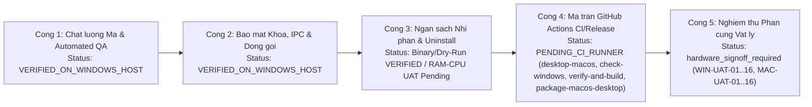

# Danh Mục Kiểm Tra Trước Khi Phát Hành (Go-Live Checklist) — Desktop GUI (`v0.3.0`)

| Trường thông tin | Chi tiết |
| :--- | :--- |
| **Tên dự án** | Mesh VPN — Self-Hosted Secure Mesh Overlay Network |
| **Phiên bản phát hành** | `v0.3.0` (`EP-17..EP-20`, `US-100..US-117 = 78 SP`, `7` Work Packages `WP-D-A0..WP-D-C2`) |
| **Mã tài liệu** | `OPS-GLC-DGUI-001` |
| **Phiên bản tài liệu** | `1.1` |
| **Ngày cập nhật** | `2026-11-17` |
| **Tác giả** | Release & QA Engineering (`WP-D-C2` — `US-116`) |
| **Tài liệu tham chiếu** | `docs/05-quality-assurance/desktop-gui-{test-plan,dod-verification}.md`, `docs/06-operations/desktop-gui-{hardware-acceptance-protocol,operational-runbook}.md` |
| **Trạng thái Gate 3** | **3-BUCKET RELEASE GATE (`VERIFIED_ON_WINDOWS_HOST` + `PENDING_CI_RUNNER` + `hardware_signoff_required`)** |

---

## 1. Kiến trúc 5 Cổng Phát hành (Release Gates)

---

## 2. Danh mục Kiểm tra Chi tiết Theo Cổng

### 2.1. Cổng 1 — Chất lượng Mã nguồn & Kiểm thử Tự động
| Mã | Tiêu chí | Lệnh / Tệp xác minh | Trạng thái |
|---|---|---|---|
| **GL-CODE-01** | `cargo fmt --all -- --check` sạch `100%` | `scripts/run-desktop-qa.ps1` / `scripts/check.ps1` | `[x] VERIFIED_ON_WINDOWS_HOST` |
| **GL-CODE-02** | `cargo clippy --workspace --all-targets --all-features -- -D warnings` đạt `0` warnings/errors | `scripts/run-desktop-qa.ps1` / `scripts/check.ps1` | `[x] VERIFIED_ON_WINDOWS_HOST` |
| **GL-CODE-03** | `cargo deny check advisories bans licenses sources` xanh `100%` (`0` thay đổi `deny.toml`, `0` WebView2/Electron/Tauri) | `scripts/check.ps1` | `[x] VERIFIED_ON_WINDOWS_HOST` |
| **GL-CODE-04** | Bộ kiểm thử `mesh-gui` (`3` bin + `10` `gui_unit_tests` + `9` `qa_desktop_security_audit` + `1` `qa_desktop_e2e_ipc` = **`23`** tests) xanh `100%` | `cargo test -p mesh-gui --all-targets --all-features` | `[x] VERIFIED_ON_WINDOWS_HOST` |
| **GL-CODE-05** | Bộ kiểm thử `mesh` (`4` `qa_desktop_cli_launcher`), `mesh-net` (`5` `desktop_ipc_contract` + `8` inline), `mesh-client` (`1` `desktop_session_wp_d_a1`), `meshd` (`1` `daemon_version_cli`), `mesh-core` (`7` `desktop_onboarding_validation`), `mesh-sys` (`5` `windows::tests`) xanh `100%` | `scripts/run-desktop-qa.ps1` | `[x] VERIFIED_ON_WINDOWS_HOST` |
| **GL-CODE-06** | UTF-8 Không BOM, CRLF chỉ cho `.ps1/.bat/.cmd`, LF cho `.rs/.swift/.sh/.yml/.md` | `scripts/check.ps1 -Cross` | `[x] VERIFIED_ON_WINDOWS_HOST` |

### 2.2. Cổng 2 — Bảo mật Khóa, IPC & Ranh giới Đặc quyền
| Mã | Tiêu chí | Bằng chứng | Trạng thái |
|---|---|---|---|
| **GL-SEC-01** | `0` `.expose_secret()` và `0` `unsafe` trong `crates/mesh-gui/src/*.rs` (`SEC-01`) | `qa_desktop_security_audit` + `audit-desktop-security.sh` | `[x] VERIFIED_ON_WINDOWS_HOST` |
| **GL-SEC-02** | `100%` khối `unsafe` và hàm `unsafe` callback trong `crates/mesh-sys/src/{gui_windows,process_windows}.rs` có `// SAFETY:` (và thu hồi an toàn `WindowBridge` nếu `CreateWindowExW` fail trước `WM_NCCREATE`) | `qa_desktop_security_audit` + `scripts/check.ps1` | `[x] VERIFIED_ON_WINDOWS_HOST` |
| **GL-SEC-03** | Giao thức `MGH1` (`9 B` LE `<= 64 KiB`, `0x00 WorkerHello` `13 B`, allowlist pipe `\\.\pipe\mesh-gui-handoff-<32_hex>`, `SQOS SecurityIdentification`, `Zeroizing`) | `qa_desktop_security_audit` + `desktop_ipc_contract` | `[x] VERIFIED_ON_WINDOWS_HOST` |
| **GL-SEC-04** | `Zero-TOFU` IPv4/IPv6 + `validate_preauth_key` (`mpk_` + `>= 32 B` base64url) đồng nhất Rust/Swift | `qa_desktop_security_audit` + `desktop_onboarding_validation` | `[x] VERIFIED_ON_WINDOWS_HOST` |
| **GL-SEC-05** | `ClipboardGuard` nguyên tử trên Windows & `ClipboardAutoClear` trên macOS (kèm xử lý trailing `\n` khi `Cmd+V`), và `PollingControl::suspend()` trong cả `spawn_handoff_action` lẫn `spawn_bugreport_export` | `qa_desktop_security_audit` | `[x] VERIFIED_ON_WINDOWS_HOST` |
| **GL-SEC-06** | *Unprivileged Sink Write*: `UnprivilegedSinkWriter` (`MoveFileExW`) trên Windows & `BugreportStreamWriter` (`Darwin.rename`) trên macOS (cả tệp `.tar` mới và Replace) | `qa_desktop_e2e_ipc` + `UdsIpcAndBugreportTests.swift` | `[x] VERIFIED_ON_WINDOWS_HOST` (Rust) / `[ ] PENDING_CI_RUNNER` (Swift) |
| **GL-SEC-07** | `desktop/macos/**` có `0` `app-sandbox`, `0` `CFBundleURLTypes`, `0` `NSAllowsArbitraryLoads`, `0` `import UIKit`, `0` force-unwrap, và `Package.swift` dùng Swift `6.0` không truyền `StrictConcurrency` | `qa_desktop_security_audit` + `audit-desktop-security.sh` | `[x] VERIFIED_ON_WINDOWS_HOST` |
| **GL-SEC-08** | `scripts/package-macos-app.sh` tuân thủ thứ tự 3 bước `ADR-026` (không `--deep`), `0` tắt Gatekeeper (`spctl` + `--master-disable`), `AdminPrivilegeHelper.swift` truyền `--uninstall --keep-app` | `qa_desktop_security_audit` + `audit-desktop-security.sh` | `[x] VERIFIED_ON_WINDOWS_HOST` |

### 2.3. Cổng 3 — Ngân sách Nhị phân, Cài đặt & Gỡ cài đặt
| Mã | Tiêu chí | Bằng chứng | Trạng thái |
|---|---|---|---|
| **GL-PERF-01** | `target/release/MeshVPN.exe` `<= 6_291_456` bytes (`6 MiB`, mục tiêu `<= 4 MiB`) và `PE Subsystem == 2` | `scripts/run-desktop-qa.ps1` (`DGUI-QA-03`) | `[x] VERIFIED_ON_WINDOWS_HOST` |
| **GL-PERF-02** | `lab/desktop/verify-desktop-uninstall.ps1 -DryRun` đạt `8/8` (`UNINST-01..08`); `elevation_worker.rs` đồng bộ SDDL `OICI`, self-copy guard, `Some(5 \| 32)` và đủ 12 tệp bundle | `scripts/run-desktop-qa.ps1` (`DGUI-QA-04`) + `main.rs::tests` | `[x] VERIFIED_ON_WINDOWS_HOST` |
| **GL-PERF-03** | Ngân sách RAM/CPU/Thoát thực tế trên Windows (`<= 15 MiB` Tray, `<= 30 MiB` Open, `< 0.5%` CPU, `<= 2 s` Quit) & macOS (`<= 35 MiB` Menu Bar, `<= 60 MiB` Open, `<= 2 s` Quit) | `WIN-UAT-16` & `MAC-UAT-16` (`desktop-gui-hardware-acceptance-protocol.md`) | `[ ] hardware_signoff_required` |

### 2.4. Cổng 4 — Ma trận CI/CD & Đóng gói GitHub Actions
| Mã | Tiêu chí | Job GitHub Actions thực tế | Trạng thái |
|---|---|---|---|
| **GL-CI-01** | Cấu hình `.github/workflows/{ci,release}.yml` hợp lệ (`0` tab, `SHA256SUMS` tường minh 5 tệp Windows, `KC_PASS="$(openssl rand -hex 24)"`, danh sách file release khớp thực tế không fail unmatched `.pkg`) | Static audit `qa_desktop_security_audit` & `verify-desktop-uninstall.ps1` | `[x] VERIFIED_ON_WINDOWS_HOST` |
| **GL-CI-02** | Job `desktop-macos` & `package-macos-desktop` xanh trên `macos-15` (`swift test` `21` XCTests, `xcodegen`, `(cd desktop/macos && swiftlint lint --strict)`, `xcodebuild test`, `package-macos-app.sh`) | `.github/workflows/ci.yml` (`desktop-macos`) & `release.yml` (`package-macos-desktop`) | `[ ] PENDING_CI_RUNNER` |
| **GL-CI-03** | Job `check-windows` & `verify-and-build` (Windows MSVC + GNU compatibility check) xanh trên `windows-latest` | `.github/workflows/ci.yml` (`check-windows`) & `release.yml` (`verify-and-build`) | `[ ] PENDING_CI_RUNNER` |

### 2.5. Cổng 5 — Tài liệu Gate 3 & Nghiệm thu Phần cứng Vật lý
| Mã | Tiêu chí | Bằng chứng | Trạng thái |
|---|---|---|---|
| **GL-DOC-01** | 5 tài liệu `WP-D-C2` (`test-plan`, `dod-verification`, `hardware-acceptance-protocol`, `operational-runbook`, `go-live-checklist`) khớp 100% số liệu, lệnh CLI, tên file, Bundle ID `dev.meshvpn.macos` và `US-100..117 = 78 SP` | Đối chiếu chéo Gate 3 (`desktop-gui-gate-3-critique.md`) | `[x] VERIFIED_ON_WINDOWS_HOST` |
| **GL-UAT-01** | Hoàn thành và ký duyệt `WIN-UAT-01..16` trên máy thật Windows 10/11 | `docs/06-operations/desktop-gui-hardware-acceptance-protocol.md` | `[ ] hardware_signoff_required` |
| **GL-UAT-02** | Hoàn thành và ký duyệt `MAC-UAT-01..16` trên máy thật Mac (`arm64` / `x86_64`) | `docs/06-operations/desktop-gui-hardware-acceptance-protocol.md` | `[ ] hardware_signoff_required` |

---

## 3. Kế hoạch Khôi phục Khẩn cấp (`Release Rollback Plan`)

Nếu phát hiện lỗi nghiêm trọng (`P0/P1`) sau khi phát hành `v0.3.0`:
1. **Giữ Tunnel Chạy qua CLI**: Đóng `MeshVPN.exe` / `Mesh VPN.app` (`Quit Mesh VPN (Keep Connected in Background)`) — `meshd` tiếp tục duy trì kết nối và điều khiển được bằng `mesh status`, `mesh up`, `mesh down`.
2. **Gỡ GUI An toàn Bảo toàn `keys.json`**:
   - Windows: `powershell -ExecutionPolicy Bypass -File .\scripts\install-windows.ps1 -Uninstall` (không `-PurgeData`).
   - macOS: `sudo /bin/sh "/Applications/Mesh VPN.app/Contents/Resources/install-macos.sh" --uninstall --keep-app` (hoặc xóa `/Applications/Mesh VPN.app` nếu chỉ gỡ giao diện và dùng `/usr/local/bin/mesh`).
