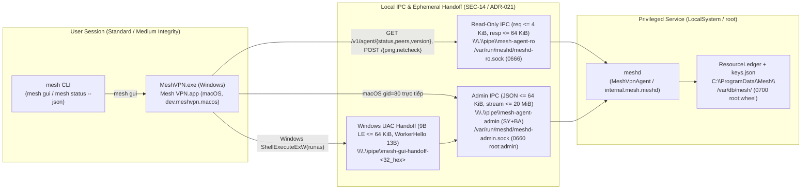

# Sổ Tay Vận Hành (Operational Runbook) — Desktop GUI (`v0.3.0`)

| Trường thông tin | Chi tiết |
| :--- | :--- |
| **Tên dự án** | Mesh VPN — Self-Hosted Secure Mesh Overlay Network |
| **Phiên bản áp dụng** | `v0.3.0` (`MeshVPN.exe` trên Windows 10/11 & `Mesh VPN.app` trên macOS 13+) |
| **Mã tài liệu** | `OPS-RB-DGUI-001` |
| **Phiên bản tài liệu** | `1.1` |
| **Ngày cập nhật** | `2026-11-17` |
| **Tác giả** | Operations & Systems Engineering (`WP-D-C2` — `US-116`) |
| **Tài liệu liên quan** | `docs/06-operations/operational-runbook.md`, `docs/06-operations/desktop-gui-hardware-acceptance-protocol.md`, `docs/03-system-design/desktop-gui-adr.md` (`ADR-020..026`) |
| **Trạng thái** | **GROUNDED FOR GATE 3 / PENDING PHYSICAL HARDWARE UAT** |

---

## 1. Tổng quan Kiến trúc Vận hành Desktop GUI

Phân hệ Desktop GUI (`v0.3.0`) cung cấp giao diện khay hệ thống và Dashboard bản địa chạy hoàn toàn ở quyền người dùng thường, tách bạch kênh đọc (`meshd-ro`) và kênh ghi đặc quyền (`meshd-admin`):



### 1.1. Bảng Đường dẫn, Socket, Bundle ID & Dịch vụ Thực tế

| Thành phần | Windows 10/11 (`x86_64`) | macOS 13+ (`arm64` / `x86_64` Universal) |
|---|---|---|
| **Nhị phân GUI** | `C:\Program Files\Mesh\MeshVPN.exe` | `/Applications/Mesh VPN.app/Contents/MacOS/Mesh VPN` |
| **Bundle ID & Entitlements** | — | `dev.meshvpn.macos` (`LSUIElement = true`, `ENABLE_APP_SANDBOX = NO`) |
| **Nhị phân Daemon & CLI** | `C:\Program Files\Mesh\{meshd.exe,mesh.exe,mesh-server.exe,wintun.dll}` | `/usr/local/libexec/mesh/meshd` (`0755 root:wheel`), `/usr/local/bin/mesh` (`0755 root:wheel`) |
| **Tên Dịch vụ Nền** | Windows Service `MeshVpnAgent` (`LocalSystem`) | LaunchDaemon `internal.mesh.meshd` (`/Library/LaunchDaemons/internal.mesh.meshd.plist`) |
| **SDDL / Quyền Thư mục** | Install: `D:P(A;OICI;GA;;;SY)(A;OICI;GA;;;BA)(A;OICI;GRGX;;;AU)`<br/>Data: `D:P(A;OICI;GA;;;SY)(A;OICI;GA;;;BA)` | State `/var/db/mesh`: `0700 root:wheel`<br/>Run `/var/run/meshd`: `0755 root:wheel` |
| **Kênh Read-Only IPC** | `\\.\pipe\mesh-agent-ro` | `/var/run/meshd/meshd-ro.sock` (`0666`) |
| **Kênh Admin IPC** | `\\.\pipe\mesh-agent-admin` (`SY+BA`) | `/var/run/meshd/meshd-admin.sock` (`0660 root:admin`, `gid = 80`) |
| **Handoff Nâng quyền** | `\\.\pipe\mesh-gui-handoff-<32_hex>` (`MGH1` `9 B` LE, `0x00 WorkerHello` `13 B`) | `/usr/bin/osascript` (tập lệnh cố định, không nội suy input người dùng) |
| **Khóa Định danh & Sổ cái** | `C:\ProgramData\Mesh\{keys.json,bootstrap.toml,ledger.json,netmap-cache.json}` | `/var/db/mesh/{keys.json,bootstrap.toml,ledger.json,netmap-cache.json}` |
| **Nhật ký GUI & Daemon** | GUI: `%LOCALAPPDATA%\MeshVPN\logs\meshvpn-{gui,worker}.*.log`<br/>Daemon: `C:\ProgramData\Mesh\logs\` | GUI: Apple `os.Logger` (`subsystem = dev.meshvpn.macos`, `%{private}@`)<br/>Daemon: `/var/log/mesh/` |
| **Tự khởi động GUI** | `HKCU\Software\Microsoft\Windows\CurrentVersion\Run\MeshVPN` | `SMAppService.mainApp` (`AppKitLaunchAtLoginController`) |
| **Đơn phiên bản & Tắt êm** | `Local\MeshVpnGuiSingleInstance` & `Local\MeshVpnGuiShutdownEvent` | `Window("Mesh VPN", id: "dashboard")` duy nhất (`CommandGroup(replacing: .newItem) {}`) |

---

## 2. Quy trình Cài đặt & Triển khai Chuẩn

### 2.1. Cài đặt trên Windows 10/11
1. Giải nén `mesh-windows-x86_64-msvc.zip` và mở PowerShell **Administrator**:
   ```powershell
   powershell -ExecutionPolicy Bypass -File .\scripts\install-windows.ps1 -DryRun
   powershell -ExecutionPolicy Bypass -File .\scripts\install-windows.ps1
   ```
   *(Hoặc mở trực tiếp `MeshVPN.exe` và bấm **Install & Start Service** trong GUI để chạy UAC 1 lần.)*
2. Mở giao diện từ shortcut **Mesh VPN** hoặc chạy từ CLI:
   ```powershell
   mesh gui
   ```

### 2.2. Cài đặt trên macOS 13+ (`$0` Ad-Hoc Mode & Signed Mode)
1. Mở `MeshVPN-macos-universal.dmg` và kéo **`Mesh VPN.app`** vào `/Applications`.
2. Với bản **`$0` Ad-Hoc Signed**: ở lần mở đầu tiên, chuột phải `/Applications/Mesh VPN.app` -> **Open** (hoặc *System Settings -> Privacy & Security -> Open Anyway*). **Tuyệt đối không** dùng `spctl` + `--master-disable`.
3. Cài đặt LaunchDaemon `internal.mesh.meshd`:
   - **Từ GUI**: Mở Dashboard -> bấm **Install Background Service** -> nhập mật khẩu quản trị trên hộp thoại `osascript`.
   - **Từ Terminal**:
     ```sh
     sudo /bin/sh "/Applications/Mesh VPN.app/Contents/Resources/install-macos.sh" \
       --from "/Applications/Mesh VPN.app/Contents/Resources" \
       --sha256-file "/Applications/Mesh VPN.app/Contents/Resources/SHA256SUMS" \
       --plist "/Applications/Mesh VPN.app/Contents/Resources/internal.mesh.meshd.plist"
     ```
4. Mở GUI từ Terminal khi cần:
   ```sh
   mesh gui
   ```

---

## 3. Quy trình Vận hành Thường nhật (Day-2 Operations)

### 3.1. Kiểm tra Trạng thái Daemon & Phiên bản từ CLI
```sh
mesh status --json
meshd --version
```
- Lệnh `mesh gui` chỉ khởi chạy giao diện (`MeshVPN.exe` hoặc `/usr/bin/open -a "/Applications/Mesh VPN.app"`) và trả prompt ngay; mọi truy vấn trạng thái dùng `mesh status --json` hoặc `mesh peers`.

### 3.2. Xoay Khóa (`Rotate Key`) & Đặt lại Danh tính (`Reset Identity`)
- **Xoay khóa (`ReauthRequired`)**: Dùng nút **Rotate Pre-Auth Key** trong GUI (hoặc `mesh rotate-key --authkey-file ...`) khi cần cấp lại chứng danh mà giữ nguyên `OverlayIp`.
- **Đặt lại danh tính (`Revoked` / chuyển mạng)**:
  - Trong GUI bấm **Reset Device Identity** (hoặc chạy `mesh reset-identity --yes` trên CLI).
  - Daemon `meshd` chạy `ResourceLedger` cleanup, xóa `keys.json`, `netmap-cache.json`, reset `bootstrap.toml`, đưa GUI về `Not Enrolled` mà **không** tắt dịch vụ nền.

### 3.3. Thu thập Bugreport An toàn (`Unprivileged Sink Write`)
- Trong tab **Diagnostics**, bấm **Export Bugreport...** và chọn vị trí lưu `.tar` qua `GetSaveFileNameW` (Windows) hoặc `NSSavePanel` (macOS).
- `meshd-admin` stream gói `.tar` đã lọc secret (`<= 20 MiB`, từng khúc `<= 64 KiB`) qua `/v1/agent/bugreport/stream`; tiến trình GUI user tự ghi vào tệp tạm `.part` rồi commit nguyên tử (`MoveFileExW` trên Windows; `Darwin.rename(partURL.path, destURL.path)` trên macOS). Hỗ trợ cả tạo tệp `.tar` mới tinh lẫn ghi đè tệp cũ.

---

## 4. Quy trình Nâng cấp & Gỡ cài đặt Sạch

### 4.1. Nâng cấp tại chỗ
- **Windows**: Chạy lại `scripts/install-windows.ps1` hoặc chạy `MeshVPN.exe` bản mới từ `Downloads`. Tiến trình mới phát tín hiệu `Local\MeshVpnGuiShutdownEvent` hoặc staging `MeshVPN.exe.new` khi binary đang bị khóa (`ERROR_ACCESS_DENIED (5)` | `ERROR_SHARING_VIOLATION (32)`), đồng thời **giữ nguyên `C:\ProgramData\Mesh\keys.json` & `bootstrap.toml`**.
- **macOS**: Kéo `Mesh VPN.app` mới đè vào `/Applications` -> mở app -> nếu lệch phiên bản daemon (`LegacyPre030` hoặc version mismatch), bấm **Update Background Service** để cập nhật `/usr/local/libexec/mesh/meshd` giữ nguyên `/var/db/mesh/keys.json`.

### 4.2. Gỡ cài đặt Giữ Định danh vs. Xóa sạch (`Purge`)

| Mục tiêu | Windows (Admin PowerShell) | macOS (Terminal) |
|---|---|---|
| **Kiểm tra thử (`Dry-Run`)** | `powershell -ExecutionPolicy Bypass -File .\scripts\install-windows.ps1 -Uninstall -DryRun` | `/bin/sh "/Applications/Mesh VPN.app/Contents/Resources/install-macos.sh" --uninstall --keep-app --dry-run` |
| **Gỡ dịch vụ (Giữ `keys.json`)** | `powershell -ExecutionPolicy Bypass -File .\scripts\install-windows.ps1 -Uninstall` | `sudo /bin/sh "/Applications/Mesh VPN.app/Contents/Resources/install-macos.sh" --uninstall --keep-app` |
| **Gỡ & Xóa sạch khóa (`Purge`)** | `powershell -ExecutionPolicy Bypass -File .\scripts\install-windows.ps1 -Uninstall -PurgeData` | `sudo /bin/sh "/Applications/Mesh VPN.app/Contents/Resources/install-macos.sh" --uninstall --keep-app --purge` |

*(Lưu ý macOS: nút **Uninstall Service...** trong `Mesh VPN.app` luôn truyền `--uninstall --keep-app` để chỉ gỡ LaunchDaemon/binary hệ thống và giữ nguyên `/Applications/Mesh VPN.app` đang chạy theo `ADR-026`.)*

---

## 5. Ma trận Xử lý Sự cố (Troubleshooting Playbook)

| Triệu chứng / Trạng thái GUI | Nguyên nhân gốc rễ | Khắc phục chuẩn |
|---|---|---|
| **`ServiceStopped` / `serviceNotInstalled`** | `MeshVpnAgent` / `internal.mesh.meshd` chưa cài hoặc chưa chạy. | Windows: bấm **Install & Start Service** hoặc chạy `install-windows.ps1`.<br/>macOS: bấm **Install Background Service** hoặc chạy `install-macos.sh --from ...`. |
| **`AgentUnavailable` / `Service Offline`** | Socket `/var/run/meshd/meshd-ro.sock` hoặc pipe `\\.\pipe\mesh-agent-ro` chưa mở. | Windows: `Start-Service MeshVpnAgent`.<br/>macOS: `sudo launchctl kickstart -kp system/internal.mesh.meshd`. |
| **`LegacyPre030`** | `meshd` đang chạy `< 0.3.0` (trả `404` cho `/v1/agent/version` và thiếu header `X-Mesh-Agent-Version`). | Chạy trình cài đặt `v0.3.0` (hoặc bấm **Update Background Service** trên GUI) để nâng `meshd` lên `0.3.0`. |
| **`"authentication failed"` / `Revoked` / `ReauthRequired`** | `mpk_` hết hạn/sai (`SEC-05`) hoặc node bị thu hồi trên Control server. | Khi `ReauthRequired`: dùng **Rotate Pre-Auth Key**.<br/>Khi `Revoked`: dùng **Reset Device Identity** rồi enroll lại với `mpk_` mới. |
| **Nút `System CA` bị vô hiệu hóa** | Endpoint nhập vào là IPv4 hoặc IPv6 literal (`Zero-TOFU`, `SEC-04`). | Nhập SPKI Pin `sha256:<64-hex>` của Control server, hoặc chuyển sang dùng tên miền DNS hợp lệ để bật `System CA`. |
| **macOS từ chối thao tác admin (`permissionDenied`)** | Tài khoản macOS là `Standard User` (`gid != 80`), không có quyền trên `/var/run/meshd/meshd-admin.sock` (`0660 root:admin`). | Thêm user vào nhóm `admin` (`gid = 80`) nếu được cấp phép quản trị máy, hoặc dùng `sudo mesh ...` từ tài khoản Admin. **Không** đổi quyền socket `0660 root:admin`. |
