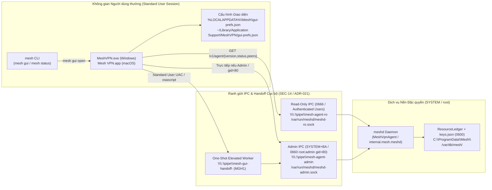

# Sổ Tay Vận Hành (Operational Runbook) — Desktop GUI & Tray Companion (`v0.3.0`)

| Trường thông tin | Chi tiết |
| :--- | :--- |
| **Tên dự án** | Mesh VPN — Self-Hosted Secure Mesh Overlay Network |
| **Phiên bản áp dụng** | `v0.3.0` (Sprint 5 — Native Desktop GUI & Tray Companion cho Windows 10/11 & macOS 13+) |
| **Mã tài liệu** | `OPS-RB-DGUI-001` |
| **Phiên bản tài liệu** | `1.0` |
| **Ngày cập nhật** | `2026-11-17` |
| **Tác giả** | Operations & Systems Engineering (`@qa-d-c2` / `WP-D-C2` — `US-116`) |
| **Tài liệu liên quan** | `docs/06-operations/operational-runbook.md` (`v0.1.0` Core/VPS), `docs/06-operations/mobile-operational-runbook.md` (`v0.2.0` Mobile), `docs/06-operations/desktop-gui-hardware-acceptance-protocol.md` |
| **Trạng thái** | **PRODUCTION READY (`v0.3.0`)** |

---

## 1. Tổng quan Kiến trúc Vận hành Desktop GUI (Operational Architecture Overview)

Phân hệ Desktop GUI (`v0.3.0`) bổ sung trình điều khiển đồ họa bản địa siêu nhẹ cho Windows 10/11 (`MeshVPN.exe`) và macOS 13+ (`Mesh VPN.app`), vận hành song song và tương thích hoàn toàn với công cụ dòng lệnh `mesh` CLI và dịch vụ nền `meshd`.



### 1.1. Bảng Đường dẫn Tệp, Socket & Dịch vụ theo Hệ điều hành

| Thành phần | Windows 10/11 (`x86_64`) | macOS 13+ (`arm64` / `x86_64` Universal) |
| :--- | :--- | :--- |
| **Nhị phân GUI** | `C:\Program Files\Mesh\MeshVPN.exe` | `/Applications/Mesh VPN.app/Contents/MacOS/MeshVPN` |
| **Nhị phân Daemon & CLI** | `C:\Program Files\Mesh\{meshd.exe,mesh.exe,wintun.dll}` | `/usr/local/libexec/mesh/{meshd,mesh}` (symlink `/usr/local/bin/{meshd,mesh}`) |
| **Tên Dịch vụ Nền** | Windows Service `MeshVpnAgent` (`LocalSystem`) | LaunchDaemon `internal.mesh.meshd` (`/Library/LaunchDaemons/internal.mesh.meshd.plist`) |
| **Kênh Read-Only IPC** | `\\.\pipe\mesh-agent-ro` | `/var/run/meshd/meshd-ro.sock` (`0666`) |
| **Kênh Admin IPC** | `\\.\pipe\mesh-agent-admin` (SDDL `SY` + `BA`) | `/var/run/meshd/meshd-admin.sock` (`0660 root:admin`, `gid=80`) |
| **Khóa Định danh & Sổ cái** | `C:\ProgramData\Mesh\{keys.json,ledger.json}` (ACL `SYSTEM` + `Administrators`) | `/var/db/mesh/{keys.json,ledger.json}` (`0600 root:wheel`) |
| **Nhật ký Daemon (`meshd`)** | `C:\ProgramData\Mesh\logs\meshd.log` | `/var/log/mesh/meshd.log` |
| **Tùy chọn Giao diện User** | `%LOCALAPPDATA%\Mesh\gui-prefs.json` | `~/Library/Application Support/MeshVPN/gui-prefs.json` |
| **Cơ chế Tự khởi động GUI** | Registry `HKCU\Software\Microsoft\Windows\CurrentVersion\Run\MeshVPN` | `SMAppService.mainApp` / `~/Library/LaunchAgents/internal.mesh.gui.plist` |
| **Sự kiện Tắt / Đơn phiên bản** | `Local\MeshVpnGuiSingleInstanceMutex` & `Local\MeshVpnGuiShutdownEvent` | `NSRunningApplication` bundle ID `internal.mesh.vpn.desktop` + `Window(id: "dashboard")` |

---

## 2. Quy trình Cài đặt & Triển khai Chuẩn (Installation & Provisioning Procedures)

### 2.1. Cài đặt trên Windows 10/11
1. Giải nén gói phát hành `MeshVPN-v0.3.0-x86_64-pc-windows-msvc.zip` vào thư mục tạm.
2. Mở PowerShell với quyền **Run as Administrator** và thực thi:
   ```powershell
   # Kiểm tra trước kế hoạch cài đặt (Dry-Run)
   powershell -ExecutionPolicy Bypass -File .\scripts\install-windows.ps1 -DryRun

   # Thực thi cài đặt chính thức (xác thực SHA256SUMS cho cả 5 tệp, cài MeshVpnAgent, tạo shortcut)
   powershell -ExecutionPolicy Bypass -File .\scripts\install-windows.ps1
   ```
3. Mở ứng dụng từ shortcut **Mesh VPN** trên Desktop/Start Menu hoặc từ dòng lệnh:
   ```powershell
   mesh gui open
   ```

### 2.2. Cài đặt trên macOS 13+ (Hỗ trợ cả `$0 Ad-Hoc Mode` và `Commercial Notarized Mode`)
1. Mở tệp ảnh đĩa `MeshVPN-macos-universal.dmg` và kéo **`Mesh VPN.app`** vào thư mục `/Applications`.
2. **Lưu ý cho bản phân phối nội bộ `$0 Ad-Hoc Mode`** (khi không sử dụng tài khoản Apple Developer ID `$99/năm`):
   - Ở lần mở đầu tiên, giữ phím `Control` + nhấp chuột vào `/Applications/Mesh VPN.app` -> chọn **Open** (hoặc vào **System Settings -> Privacy & Security -> Open Anyway**).
   - **Cấm tuyệt đối** chạy lệnh `spctl` `--master-disable` làm suy yếu Gatekeeper toàn hệ thống (`SEC-14`).
3. Cài đặt dịch vụ nền `internal.mesh.meshd`:
   - **Cách 1 (Từ GUI)**: Mở Dashboard `Mesh VPN.app` -> nhấn **Install Background Service** -> nhập mật khẩu quản trị trên hộp thoại `osascript`.
   - **Cách 2 (Từ Terminal / MDM)**:
     ```sh
     sudo sh "/Applications/Mesh VPN.app/Contents/Resources/install-macos.sh" --from-app-bundle "/Applications/Mesh VPN.app"
     ```

---

## 3. Quy trình Vận hành Thường nhật (Day-2 Operations)

### 3.1. Kiểm tra Trạng thái GUI & Daemon từ CLI
Quản trị viên hoặc bộ phận hỗ trợ kỹ thuật có thể kiểm tra nhanh trạng thái cài đặt GUI và kết nối IPC bằng lệnh:
```sh
mesh gui status --json
```
- Nếu trả về `"gui_installed": true`, đường dẫn `gui_binary_path` hợp lệ và chữ ký `codesign` (trên macOS) đạt chuẩn.
- Nếu trả về mã thoát `69` (`EX_UNAVAILABLE`), gói GUI chưa được cài đặt hoặc nhị phân không vượt qua kiểm tra toàn vẹn.

### 3.2. Xoay Khóa Node (`Key Rotation`) & Đặt lại Danh tính (`Identity Reset`)
- **Xoay khóa (`Rotate Node Key`)**: Khi nghi ngờ khóa phiên cần làm mới mà không muốn đổi IP Overlay của node, mở **Settings -> Rotate Node Key** trên GUI (hoặc `mesh rotate-key`).
- **Đặt lại danh tính (`Reset Identity`)**: Khi chuyển máy trạm sang cụm Control Server khác hoặc thu hồi node cũ:
  1. Mở **Settings -> Reset Identity** trên GUI và xác nhận.
  2. Daemon `meshd` sẽ ngắt đường hầm, dọn sạch cấu hình mạng theo `ResourceLedger`, xóa `keys.json` và chuyển ngay về trạng thái **`Unconfigured`** mà **không** làm dừng dịch vụ nền (`BLK-DGUI-G2-05`).

### 3.3. Thu thập Gói Chẩn đoán Đã làm sạch (`Redacted Bugreport`)
1. Mở thẻ **Diagnostics** trên cửa sổ Dashboard -> nhấn **Export Bugreport**.
2. Chọn vị trí lưu tệp `.tar` (có thể chọn ghi đè `Replace` lên tệp `.tar` cũ).
3. Tiến trình GUI tự tạo tệp tạm `.part` dưới quyền của người dùng hiện tại (`UnprivilegedSinkWriter`), nhận luồng dữ liệu tối đa `<= 64 KiB/chunk` từ `meshd`, lọc bỏ toàn bộ khóa bí mật (`[REDACTED]`), và đổi tên nguyên tử sang `.tar`.

---

## 4. Quy trình Nâng cấp & Gỡ cài đặt Sạch (Upgrade, Uninstall & Purge Procedures)

### 4.1. Nâng cấp tại chỗ (In-Place Upgrade)
- **Trên Windows**: Chạy lại `scripts/install-windows.ps1` từ bản phát hành mới. Kịch bản tự động phát tín hiệu `Local\MeshVpnGuiShutdownEvent` để đóng `MeshVPN.exe` đang chạy trong `<= 2s`, dừng dịch vụ `MeshVpnAgent`, cập nhật nhị phân mới, **giữ nguyên `C:\ProgramData\Mesh\keys.json`**, và khởi động lại dịch vụ.
- **Trên macOS**: Thay thế `/Applications/Mesh VPN.app` bằng bản mới và chạy lại `install-macos.sh --from-app-bundle` (hoặc nhấn **Update Service** trên GUI). Tệp `/var/db/mesh/keys.json` được bảo toàn nguyên vẹn.

### 4.2. Gỡ cài đặt Giữ Định danh vs. Xóa sạch Toàn bộ (`Purge`)

| Mục tiêu | Lệnh thực thi trên Windows (Admin PowerShell) | Lệnh thực thi trên macOS (Terminal) |
| :--- | :--- | :--- |
| **Kiểm tra thử (`Dry-Run`)** | `powershell -ExecutionPolicy Bypass -File .\scripts\install-windows.ps1 -Uninstall -DryRun` | `sh /Applications/Mesh\ VPN.app/Contents/Resources/install-macos.sh --uninstall --dry-run` |
| **Gỡ cài đặt chuẩn (Giữ `keys.json`)** | `powershell -ExecutionPolicy Bypass -File .\scripts\install-windows.ps1 -Uninstall` | `sudo sh /Applications/Mesh\ VPN.app/Contents/Resources/install-macos.sh --uninstall` |
| **Gỡ cài đặt & Xóa sạch khóa (`Purge`)** | `powershell -ExecutionPolicy Bypass -File .\scripts\install-windows.ps1 -Uninstall -PurgeData` | `sudo sh /Applications/Mesh\ VPN.app/Contents/Resources/install-macos.sh --uninstall --purge-data` |

---

## 5. Ma trận Chẩn đoán & Xử lý Sự cố (Troubleshooting Playbook)

| Triệu chứng / Trạng thái GUI | Nguyên nhân gốc rễ (Root Cause) | Các bước Khắc phục Chuẩn (Remediation Steps) |
| :--- | :--- | :--- |
| **`ServiceMissing` (`Dịch vụ nền chưa cài đặt`)** | Dịch vụ `MeshVpnAgent` (Windows) hoặc LaunchDaemon `internal.mesh.meshd` (macOS) chưa được đăng ký trên hệ thống. | - **Windows**: Chạy `scripts/install-windows.ps1` dưới quyền Administrator.<br/>- **macOS**: Nhấn **Install Background Service** ngay trên biểu ngữ của GUI hoặc chạy `sudo sh install-macos.sh --from-app-bundle`. |
| **`DaemonUnreachable` (`Không kết nối được dịch vụ nền`)** | Dịch vụ đã cài đặt nhưng đang ở trạng thái `Stopped` hoặc socket `/var/run/meshd/meshd-ro.sock` / `\\.\pipe\mesh-agent-ro` chưa sẵn sàng. | - **Windows**: Chạy `Start-Service MeshVpnAgent` trong Admin PowerShell hoặc nhấn nút **Start Service** trên GUI.<br/>- **macOS**: Chạy `sudo launchctl kickstart -k system/internal.mesh.meshd`. |
| **`LegacyPre030` (`Daemon phiên bản cũ < v0.3.0`)** | Tiến trình `meshd` đang chạy là bản `v0.1.0`/`v0.2.0` (trả `404` trên `GET /v1/agent/version` hoặc thiếu header `X-Mesh-Agent-Version`). | Chạy lại trình cài đặt `v0.3.0` (`install-windows.ps1` hoặc `install-macos.sh`) để đồng bộ nhị phân `meshd` lên cùng phiên bản `0.3.0` với GUI. |
| **`KeyRejected` / `"authentication failed"`** | Khóa `mpk_` đã hết hạn, đã dùng hết số lần cấp phát, hoặc node đã bị thu hồi (`node_revoked`) trên Control Server (`SEC-05`). | Sinh khóa `Pre-Auth Key` (`mpk_...`) mới trên `mesh-server`, mở GUI -> nhấn **Re-Authenticate / Enroll** và nhập khóa mới. |
| **Biểu mẫu khóa cứng ở `Pinned SPKI` không cho chọn `System CA`** | Người dùng nhập `Server Endpoint` là địa chỉ IPv4 hoặc IPv6 trực tiếp (ví dụ `https://198.51.100.10:443` hoặc `https://[2001:db8::1]:443`). | Đây là cơ chế bảo mật **Zero-TOFU (`SEC-04`)** bắt buộc: khi dùng IP literal, phải cung cấp `sha256:<64-hex>` SPKI Pin của máy chủ; nếu muốn dùng chứng chỉ `System CA` (Let's Encrypt), hãy nhập tên miền FQDN hợp lệ. |
| **macOS hỏi mật khẩu `osascript` ở mỗi lần bấm `Connect`** | Tài khoản người dùng macOS hiện tại là **Standard User** (không thuộc nhóm `admin` `gid=80`). | Đây là hành vi thiết kế đúng theo `SEC-14`: tài khoản thuộc nhóm `admin` (`gid=80`) kết nối trực tiếp vào `/var/run/meshd/meshd-admin.sock` (`0660 root:admin`) không cần mật khẩu; nếu muốn bỏ hỏi mật khẩu cho người dùng đó, quản trị viên có thể thêm tài khoản vào nhóm `admin` của macOS. |
| **Lỗi xuất Bugreport bị ngắt giữa chừng** | Ổ đĩa đầy hoặc kết nối IPC tới `meshd` bị gián đoạn khi đang truyền luồng `.tar`. | `UnprivilegedSinkWriter` tự động dọn sạch tệp `.part` dở dang và giữ nguyên tệp `.tar` cũ (nếu có). Kiểm tra dung lượng đĩa trống và nhấn **Export Bugreport** lại. |
