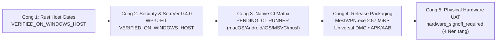

# Danh Mục Kiểm Tra Trước Khi Phát Hành (Go-Live Checklist) — Unified UI (`v0.4.0`)

| Trường thông tin | Chi tiết |
| :--- | :--- |
| **Tên dự án** | Mesh VPN — Self-Hosted Secure Mesh Overlay Network |
| **Phiên bản phát hành** | `v0.4.0` (Windows · macOS · Android · iOS Unified UI & Bilingual `vi`/`en`) |
| **Mã tài liệu** | `OPS-GLC-UUI-001` |
| **Phiên bản tài liệu** | `1.1` (Cập nhật kết quả thực tế `WP-U-E0` & khắc phục Gate 3 Round 1) |
| **Ngày cập nhật** | `2026-11-21` |
| **Tài liệu tham chiếu** | `docs/05-quality-assurance/unified-ui-{test-plan,dod-verification}.md`, `docs/06-operations/unified-ui-{hardware-acceptance-protocol,operational-runbook}.md` |
| **Trạng thái Gate** | **3-TIER GATE (`UUI-GL-01..08 VERIFIED_ON_WINDOWS_HOST` · `UUI-GL-09..12 PENDING_CI_RUNNER` · `UUI-GL-13..16 hardware_signoff_required`)** |

---

## 1. Lưu đồ 5 Cổng Phát hành `v0.4.0`

---

## 2. Danh mục Kiểm tra Chi tiết Theo Cổng

### 2.1. Cổng 1 — Kiểm định Tự động trên Windows Host (`VERIFIED_ON_WINDOWS_HOST`)
| Mã | Tiêu chí | Lệnh / Bằng chứng | Trạng thái |
|---|---|---|---|
| **UUI-GL-01** | `cargo fmt --all -- --check` sạch `100%` | `cargo +1.94.1-x86_64-pc-windows-gnu fmt --all -- --check` (`0` diffs) | `[x] VERIFIED_ON_WINDOWS_HOST` |
| **UUI-GL-02** | `cargo clippy -p mesh-gui -p mesh-sys --all-targets --all-features -- -D warnings` đạt `0` cảnh báo, `0` `unsafe` trong `mesh-gui`, `0` `.expose_secret()`, `0` `#[allow(clippy::...)]` | `qa_desktop_security_audit` (`12/12`) + `clippy -D warnings` (`0` warnings) | `[x] VERIFIED_ON_WINDOWS_HOST` |
| **UUI-GL-03** | Toàn bộ test `mesh-gui` (`146/146`, nâng từ `140/140` sau bản vá Gate 3: `gui_unit_tests`, `gui_windows_unified_ui`, `i18n_parity_windows` `213/213` khóa, `qa_gdi_leak_gate` `100x` `delta == 0` `< 5_000`, `qa_accessibility_unified_ui`, `qa_state_label_unification`, `qa_desktop_security_audit`, `qa_desktop_e2e_ipc`, `security_regression_unified_ui` `17/17`) + `mesh-sys -- gui_windows` (`12/12`) PASS `100%` | `cargo +1.94.1-x86_64-pc-windows-gnu test -p mesh-gui --all-targets --all-features` + `test -p mesh-sys -- gui_windows` | `[x] VERIFIED_ON_WINDOWS_HOST` |
| **UUI-GL-04** | Release `MeshVPN.exe <= 6_291_456` bytes (`6 MiB`), `PE Subsystem == 2` (`IMAGE_SUBSYSTEM_WINDOWS_GUI`) & `libmesh_mobile_ffi.so <= 6 MiB` | `MeshVPN.exe` = **`2,699,264` B (`2.57 MiB`, `PE = 2`)**; `libmesh_mobile_ffi.so` = **`4,379,040` B (`4.18 MiB`)** | `[x] VERIFIED_ON_WINDOWS_HOST` |
| **UUI-GL-05** | Vệ sinh toàn bộ `532` tệp văn bản (`0` UTF-8 BOM, `0` lỗi LF/CRLF), đối xứng `213/213` khóa 4 nền tảng (`230/230` Android XML), `knownRegions`/`CFBundleLocalizations` iOS & macOS, và `0` vi phạm tĩnh SwiftLint (`69` `.swift`) / Detekt (`51` `.kt`, `BUG-UUI-001..004` `CLOSED`) | Kiểm toán tĩnh PowerShell toàn kho (`WP-U-E0` + Gate 3 Round 1 fix) | `[x] VERIFIED_ON_WINDOWS_HOST` |

### 2.2. Cổng 2 — Bảo mật & Đồng bộ SemVer `0.4.0` (`WP-U-E0`)
| Mã | Tiêu chí | Bằng chứng | Trạng thái |
|---|---|---|---|
| **UUI-GL-06** | Đồng bộ SemVer `0.4.0` toàn workspace (`Cargo.toml`, `desktop/macos/project.yml`, `DesktopUiState.swift`, `mobile/android/app/build.gradle.kts` `versionCode = 40000`, `mobile/ios/project.yml`, `MeshConstants.swift`, `package-linux-deb.sh`) và giữ nguyên `13` trường `AgentStatusResponse` (`ADR-031`) | `security_regression_unified_ui::test_agent_status_response_13_fields` + `qa_desktop_security_audit` + kiểm tra đồng bộ `0.4.0` (`WP-U-E0`) | `[x] VERIFIED_ON_WINDOWS_HOST` |
| **UUI-GL-07** | Bất biến `SEC-01` (Clipboard 30s wipe chỉ cho `mpk_*`/`mesh://join`, `FLAG_SECURE` không bật trên Peers tab, `0` secret trong `ui-prefs.json`, `MGH1` `0` argv secret), `SEC-05` (`"authentication failed"` không dịch), `OPS-01` (log tiếng Anh), Mobile Security Audit `MOB-SEC-01..16` | `security_regression_unified_ui` (`17/17`, đủ `9/9` bài bắt buộc `US-133`) + `lab/mobile/audit-mobile-security.ps1` (**`16/16` PASS**) | `[x] VERIFIED_ON_WINDOWS_HOST` |
| **UUI-GL-08** | `cargo deny check advisories bans licenses sources` xanh `100%` (`0` thay đổi `deny.toml`, `0` `androidx.appcompat`, `0` WebView) | `scripts/check.ps1 -Cross` ngoài sandbox trên host Windows (`cargo deny check advisories bans licenses sources` `exit 0`) | `[x] VERIFIED_ON_WINDOWS_HOST` |

### 2.3. Cổng 3 — Ma trận GitHub Actions CI (`PENDING_CI_RUNNER`)
| Mã | Tiêu chí | Runner | Trạng thái |
|---|---|---|---|
| **UUI-GL-09** | macOS: `swift test` (`MeshDesktopCore`), `xcodegen`, `swiftlint lint --strict`, `xcodebuild test -scheme MeshVPNApp CODE_SIGNING_ALLOWED=NO` PASS `100%` | `macos-15` | `[ ] PENDING_CI_RUNNER` |
| **UUI-GL-10** | Android: `./gradlew ktlintCheck detekt lintDebug lintVitalRelease testDebugUnitTest` PASS `100%` + `OnboardingComposeUiTest.kt` (EN) & `OnboardingComposeUiTestVi.kt` (VI) | `ubuntu-latest` | `[ ] PENDING_CI_RUNNER` |
| **UUI-GL-11** | iOS: `xcodegen`, `swiftlint lint --strict`, `xcodebuild test -scheme MeshApp CODE_SIGNING_ALLOWED=NO` PASS `100%` | `macos-15` | `[ ] PENDING_CI_RUNNER` |
| **UUI-GL-12** | Linux cross-build `x86_64-unknown-linux-musl` (`linux_gui.rs` + `label()` + `filter_peers(peers, query)`) và Windows MSVC native build/test PASS `100%` | `ubuntu-latest` & `windows-latest` | `[ ] PENDING_CI_RUNNER` |

### 2.4. Cổng 4 — Nghiệm thu Phần cứng Vật lý (`hardware_signoff_required`)
| Mã | Tiêu chí | Tài liệu | Trạng thái |
|---|---|---|---|
| **UUI-GL-13** | Ký duyệt `UUI-UAT-WIN-01..06` (3-Zone, DWM Dark/Light, Live VI/EN, Tab traversal thoát `EDIT` + `←`/`→`, High-Contrast *Desert*/*Aquatic*, Narrator MSAA) trên Windows 10/11 vật lý | `docs/06-operations/unified-ui-hardware-acceptance-protocol.md` | `[ ] hardware_signoff_required` |
| **UUI-GL-14** | Ký duyệt `UUI-UAT-MAC-01..04` trên Mac vật lý (`arm64`/`x86_64`) | `docs/06-operations/unified-ui-hardware-acceptance-protocol.md` | `[ ] hardware_signoff_required` |
| **UUI-GL-15** | Ký duyệt `UUI-UAT-AND-01..05` trên Android Phone + Tablet (`>= 600 dp`) vật lý | `docs/06-operations/unified-ui-hardware-acceptance-protocol.md` | `[ ] hardware_signoff_required` |
| **UUI-GL-16** | Ký duyệt `UUI-UAT-IOS-01..05` trên iPhone + iPad vật lý | `docs/06-operations/unified-ui-hardware-acceptance-protocol.md` | `[ ] hardware_signoff_required` |

---

## 3. Kế hoạch Khôi phục (`Rollback Plan`)

Nếu phát hiện sự cố giao diện nghiêm trọng (`P0/P1`) sau khi nâng cấp lên `v0.4.0`:
1. **Giữ kết nối nền hoạt động**: Daemon `meshd` (`protocol_version = 1`, `13` trường `AgentStatusResponse`) tương thích hoàn toàn với `v0.3.0`; người dùng Desktop có thể điều khiển qua `mesh status` / `mesh up` / `mesh down`.
2. **Đặt lại cấu hình giao diện người dùng (không ảnh hưởng `keys.json`)**:
   - Windows: xóa `%LOCALAPPDATA%\MeshVPN\ui-prefs.json` -> khởi động lại `MeshVPN.exe` về mặc định `System/System`.
   - macOS: `defaults delete MeshVPN mesh_theme_mode; defaults delete MeshVPN mesh_locale_mode`.
   - Android/iOS: chọn lại `System` trong tab **Settings** (không cần reset danh tính VPN).
