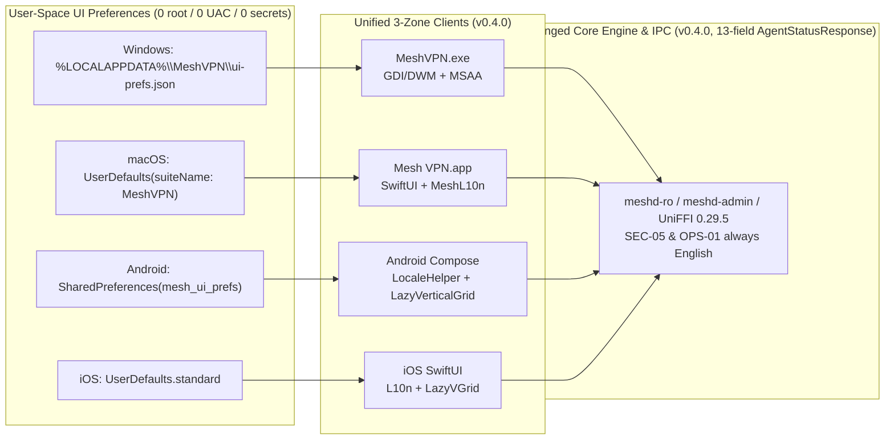

# Sổ Tay Vận Hành (Operational Runbook) — Unified UI (`v0.4.0`)

| Trường thông tin | Chi tiết |
| :--- | :--- |
| **Tên dự án** | Mesh VPN — Self-Hosted Secure Mesh Overlay Network |
| **Phiên bản áp dụng** | `v0.4.0` (Windows · macOS · Android · iOS) |
| **Mã tài liệu** | `OPS-RB-UUI-001` |
| **Phiên bản tài liệu** | `1.0` |
| **Ngày cập nhật** | `2026-11-21` |
| **Tác giả** | `WP-U-D0` Operations & Systems Engineering |
| **Tài liệu kế thừa** | `docs/06-operations/operational-runbook.md` · `docs/06-operations/desktop-gui-operational-runbook.md` · `docs/03-system-design/unified-ui-adr.md` (`ADR-027..031`) |
| **Trạng thái** | **GROUNDED FOR WAVE U-D / PRE-RELEASE** |

---

## 1. Tổng quan Kiến trúc Vận hành Unified UI (`v0.4.0`)

Phiên bản `v0.4.0` đồng nhất trải nghiệm 3 phân khu (**Status · Peers · Diagnostics & Settings**), bảng màu **Light/Dark/High-Contrast** (`ADR-030`), và **song ngữ trực tiếp `System / Tiếng Việt / English`** (`ADR-029`, `213` khóa) trên cả 4 nền tảng mà **không làm thay đổi hợp đồng dây (`protocol_version = 1`, `13` trường `AgentStatusResponse`)** và **không cần nâng quyền quản trị** cho tùy chọn giao diện.

---

## 2. Vị trí Lưu trữ Tùy chọn Giao diện (`ThemeMode` & `LocaleMode`)

Toàn bộ tùy chọn giao diện lưu hoàn toàn ở tầng người dùng (`0` UAC / `0` root, `0` secret):

| Nền tảng | Vị trí lưu trữ | Khóa Theme | Khóa Locale | Giá trị hợp lệ | Cơ chế dự phòng khi hỏng |
|---|---|---|---|---|---|
| **Windows** | `%LOCALAPPDATA%\MeshVPN\ui-prefs.json` | `"theme"` | `"locale"` | `"system"`, `"light"`, `"dark"` / `"system"`, `"en"`, `"vi"` | Xóa tệp JSON hỏng và quay về `System` |
| **macOS** | `UserDefaults(suiteName: "MeshVPN")` | `"mesh_theme_mode"` | `"mesh_locale_mode"` | Như trên | Fallback `.system` |
| **Android** | `SharedPreferences("mesh_ui_prefs")` | `"mesh_theme_mode"` | `"mesh_locale_mode"` | Như trên | Fallback `SYSTEM` |
| **iOS** | `UserDefaults.standard` | `"mesh_theme_mode"` | `"mesh_locale_mode"` | Như trên | Fallback `.system` |

---

## 3. Quy trình Vận hành Thường nhật (`v0.4.0`)

### 3.1. Xử lý Phục hồi khi Thiết bị `Re-auth Required` hoặc Đổi Control Server
- Từ `v0.4.0` (`ADR-028`), form Onboarding ẩn khi thiết bị đã đăng ký. Để xoay khóa hoặc đổi máy chủ/SPKI Pin:
  - **Windows / macOS**: Mở tab **Diagnostics & Settings** (Zone 3) -> chọn **Rotate Node Key** hoặc **Update Server / Pin** (khi đang ở `Re-auth Required`, nút xoay khóa cũng hiện trực tiếp ở Zone 1/Header).
  - **Android / iOS**: Mở tab **Settings** -> mục **Server & TLS** / **Identity** -> xác thực sinh trắc học (`BiometricPrompt` / `LAContext`) -> lưu thay đổi.

### 3.2. Kiểm tra Nhật ký & Khắc phục Sự cố trong Chế độ Tiếng Việt (`OPS-01` & `SEC-05`)
- Mọi nhật ký JSON (`ts`, `level`, `component`, `event`) trên `meshd`, `MeshVPN.exe`, `Mesh VPN.app`, Android `SafeLogger`, và iOS `MeshLogger` **luôn bằng tiếng Anh** bất kể người dùng chọn giao diện Tiếng Việt, đảm bảo các rule SIEM/grep vận hành không thay đổi.
- Lỗi xác thực dây `ErrorKind::Unauthenticated` luôn giữ nguyên văn `"authentication failed"` (`SEC-05`).

### 3.3. Kiểm tra Nhanh Rò rỉ Tài nguyên GDI trên Windows (`US-136`)
- Khi chẩn đoán phiên chạy dài ngày trên Windows, có thể mở Task Manager -> Details -> bật cột **GDI objects** cho `MeshVPN.exe`.
- Ngưỡng bình thường: `< 200` GDI objects, ổn định không tăng dần theo thời gian khi mở/đóng Dashboard hoặc đổi Theme/DPI; ngưỡng cảnh báo cứng: `5_000` (giới hạn Windows là `10_000`/tiến trình).

---

## 4. Ma trận Xử lý Sự cố Unified UI

| Triệu chứng | Nguyên nhân khả dĩ | Khắc phục chuẩn |
|---|---|---|
| **Windows hiển thị sai màu sau khi đổi Theme hệ thống** | Tùy chọn đang ghim thủ công ở `Light` hoặc `Dark` thay vì `System`. | Vào Zone 3 -> Appearance -> chọn **System** (hoặc kiểm tra `ui-prefs.json`). |
| **`ui-prefs.json` trên Windows bị lỗi cú pháp do tắt nguồn đột ngột** | Tệp ghi dở trước khi đổi tên. | Khởi động lại `MeshVPN.exe` — ứng dụng tự phát hiện JSON hỏng, xóa tệp và khôi phục `System/System` an toàn. |
| **Thanh 3 tab biến mất trên Desktop** | Thiết bị chưa đăng ký (`NotEnrolled`), đã chạy `Reset Identity`, hoặc dịch vụ `meshd` đang dừng (`ServiceStopped`/`AgentUnavailable`). | Khởi động dịch vụ nền (`Start / Update Service`) hoặc hoàn tất Onboarding 2-tab (`Join URI` / `Manual Setup`). |
| **Android `BiometricPrompt` báo lỗi sau khi đổi ngôn ngữ** | Không xảy ra trên bản `v0.4.0` chuẩn nhờ `LocaleHelper.wrapActivityContext` giữ `FragmentActivity`. Nếu thấy báo cáo lỗi, kiểm tra phiên bản APK (`versionName == "0.4.0"`, `versionCode == 40000`). | Cập nhật đúng bản phát hành `v0.4.0` và thu thập bugreport để điều tra. |
| **Windows Narrator không đọc thay đổi trạng thái** | Cửa sổ chưa có focus hoặc Narrator khởi động sau khi trạng thái đã cố định. | Nhấn `Tab` vào Dashboard hoặc chuyển tab để kích hoạt `SetWindowTextW` + `NotifyWinEvent(EVENT_OBJECT_NAMECHANGE)`. |
| **Peers trên Tablet/iPad chỉ hiện 1 cột** | Chiều rộng cửa sổ hiện tại `< 600 dp` (Android, ví dụ chế độ dọc hoặc Split-Screen hẹp) hoặc `horizontalSizeClass == .compact` (iPad Split View hẹp). | Xoay ngang màn hình hoặc mở rộng khung cửa sổ `>= 600 dp` / `.regular` để kích hoạt lưới 2 cột. |
